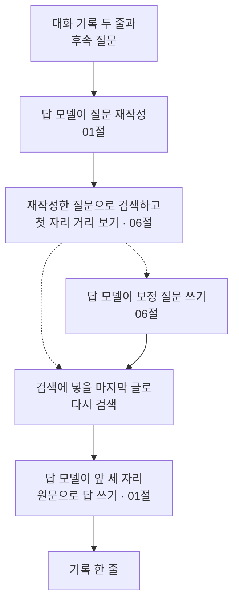
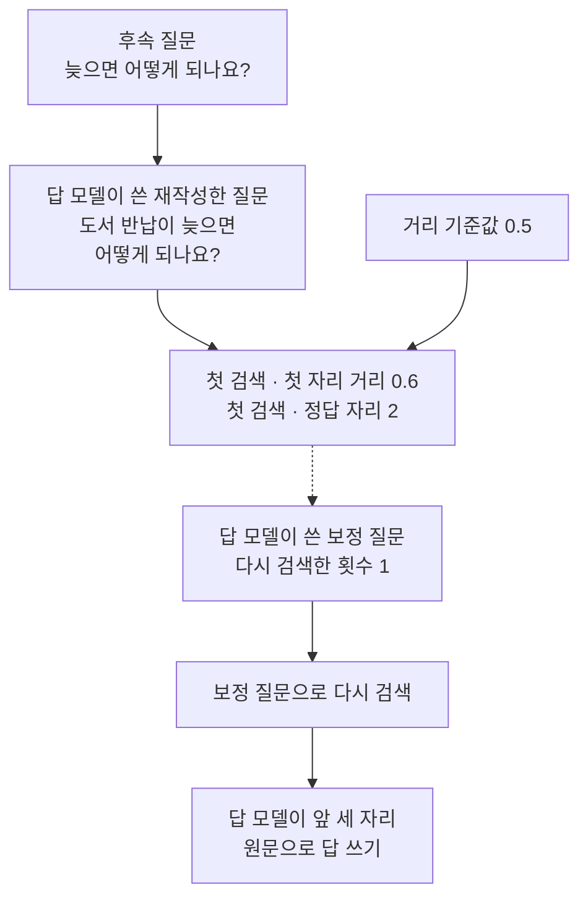
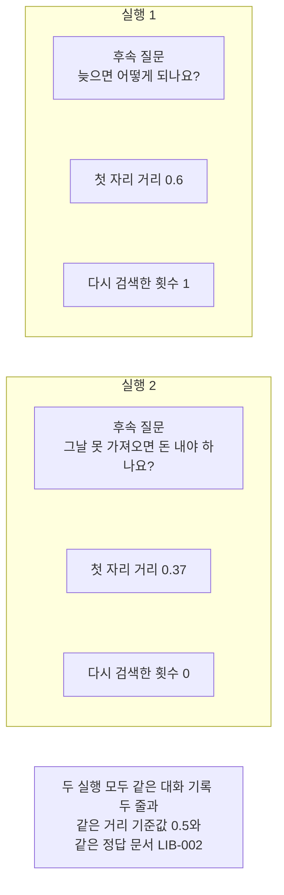

# 10-RAG-패턴-실습

## _src 본문 (HTML 원본)

```html
<!--meta: 실습 30분 | 코드 notebooks/10-RAG-패턴-실습.ipynb | 새 용어 0 -->
<style>html,body{overflow-x:hidden}.notebook,.nb-cell,.nb-main,.nb-input,.nb-result{min-width:0;max-width:100%}.nb-input pre,.nb-output{box-sizing:border-box;max-width:100%;overflow-x:auto}code.nb-source{display:block!important;width:100%!important;min-width:0!important;overflow-x:auto!important;padding:0!important}</style>
<h2 id="b1"><span class="no">1</span>학습 목표</h2><div class="goal"><ul>
<li>이 절을 마치면 01절 질문 재작성과 06절 보정 검색과 답 만들기를 한 흐름으로 이을 수 있습니다.</li>
<li>첫 자리 거리를 기준값과 견주어 다시 검색할지 코드가 정하게 만들 수 있습니다.</li>
<li>후속 질문 하나만 바꿔 같은 흐름을 다시 실행할 수 있습니다.</li>
<li>기능을 더 붙인 실행이 늘 나아지지는 않는다는 것을 출력으로 확인할 수 있습니다.</li>
</ul></div>
<h2 id="b2"><span class="no">2</span>이 내용을 배우는 이유</h2><p>01절부터 09절까지 패턴을 하나씩 익혔습니다. 검색 앞에서 넣을 글을 바꾸는 자리와 검색 뒤에 다시 검색하는 자리를 따로 보았습니다. 마지막 절에서는 같은 질문 벌로 패턴 셋을 나란히 견주었습니다.</p>
<p>실제 상담 창구를 만들면 이 자리들이 한 흐름 안에 함께 들어갑니다. 이용자는 앞 대화를 이어 짧게 묻고 창구는 그 말을 검색할 수 있는 질문으로 바꿉니다. 찾은 것이 멀면 한 번 더 찾고 마지막에 답을 만듭니다.</p>
<p>이번 실습은 그 세 자리를 한 번에 잇습니다. 01절 재작성과 06절 보정 검색과 01절 답 만들기입니다.</p>
<p>이번 절은 이 챕터의 실습입니다. 01~09절에서 쓴 이름과 문법만 쓰고 따로 내는 과제는 없습니다. 강사와 함께 노트북 셀을 차례로 실행합니다.</p>
<p><strong>이 절의 질문</strong> — 대화 기록을 그대로 두고 후속 질문 하나만 바꾸면 흐름은 어느 갈래로 갈까요?</p>
<h2 id="b3"><span class="no">3</span>앞에서 배운 내용</h2><p>이번 실습은 아래 절에서 배운 것을 그대로 가져옵니다. 앞 절 함수는 도구 파일 <code>notebooks/rag_tools.py</code>에 모아 두었고 노트북 1절 준비 셀에서 한 줄로 가져옵니다.</p>
<table><thead><tr><th>절</th><th>배운 것</th><th>실습에서 쓰는 곳</th></tr></thead><tbody>
<tr><td>01절</td><td>대화 기록과 후속 질문, 재작성 머리글과 <code>build_rewrite_prompt()</code></td><td>도구 파일·노트북 6절 머리글, 8절 <code>rewrite_question()</code></td></tr>
<tr><td>01절</td><td>답 머리글과 <code>build_answer_prompt()</code>·<code>keeps_word()</code>·문서 ID와 글의 짝</td><td>도구 파일·노트북 6절 머리글과 짝, 8절 <code>write_answer()</code></td></tr>
<tr><td>06절</td><td>첫 자리 거리와 기준값 견주기, <code>needs_retry()</code>·<code>correct_once()</code></td><td>도구 파일, 9절 <code>prepare_search()</code></td></tr>
<tr><td>06절</td><td>검색 한 번 묶기 <code>search_hits()</code>와 다시 검색 횟수 상한</td><td>도구 파일, 9절과 12절 확인 줄</td></tr>
<tr><td>02절</td><td>모델 답을 줄 단위로 나누는 <code>split_lines()</code></td><td>도구 파일의 <code>correct_once()</code> 안, 보정 질문 고르기</td></tr>
<tr><td>Ch 12 01·05절</td><td>코사인 거리와 거리 순위 만들기(도구 파일은 NumPy로 계산)</td><td>도구 파일의 <code>search_hits()</code> 안, 검색 자리</td></tr>
<tr><td>Ch 11 01절</td><td>문서 ID 모으기와 정답 자리 세기</td><td>도구 파일, 9절 자리 칸 둘</td></tr>
</tbody></table>
<p>읽는 파일은 01~09절과 같은 문서 파일과 질문 파일입니다. 문서 열두 건을 그대로 쓰고 이번 실습에서 새로 만든 자료는 없습니다. 이 절은 파일을 쓰지도 않습니다.</p>
<p>02절 변형 질문과 03·04절 질문 바꾸기와 05절 가상 문서는 이번 실습에서 쓰지 않습니다. 모두 검색 앞을 손보는 자리라 함께 붙이면 흐름만 길어집니다. 07절 근거 검사도 빼서 답 품질 판정을 Ch 15 몫으로 남겼습니다.</p>
<p>08절 한 단계 요약도 쓰지 않습니다. 질문을 받기 전에 요약을 만들어 두는 자리라 이 흐름에 들어갈 자리가 없습니다. 09절이 견준 패턴 셋도 그대로 되풀이하지 않습니다.</p>
<p>06절과 다른 점은 검색에 넣는 글입니다. 06절은 이용자가 적은 질문을 그대로 검색했습니다. 이번 실습은 재작성한 질문을 검색하므로 거리 범위가 달라집니다.</p>
<h2 id="b4"><span class="no">4</span>핵심 개념</h2><h3>비유로 시작하기</h3>
<p>01절부터 쓴 나무판을 그대로 씁니다. 지금까지는 구멍 하나에 마개 하나를 대 보거나 여러 마개를 차례로 대 보았습니다.</p>
<p>이번에는 한 판 위에 부품 셋을 나란히 세웁니다. 부품마다 하는 일이 다르고 짧은 막대가 옆 부품과 이어 줍니다. 그래서 셋이 따로 놓인 것이 아니라 한 줄로 읽힙니다.</p>
{{img:10-4-한-판에-부품-셋을-이어-끼우기|흰 바탕에 긴 나무판 하나가 비스듬히 위에서 본 모양으로 놓여 있고 그 위 한 줄에 같은 크기 둥근 나무 마개 셋이 서 있으며 짧은 나무 막대 둘이 첫 마개와 둘째 마개를 또 둘째 마개와 셋째 마개를 이어 주는 그림|한 판 위에 부품 셋을 세우고 막대 둘로 이어 한 줄로 만듭니다.}}
<p class="look"><b>그림 읽기</b> — 먼저 가운데 나무판을 봅니다. 긴 판 하나가 비스듬히 위에서 본 모양으로 놓여 있습니다. 판 위에 둥근 마개 셋이 한 줄로 서 있습니다.</p>
<p class="look">다음으로 마개 사이를 봅니다. 짧은 나무 막대 둘이 마개와 마개를 이어 줍니다. 막대가 있어 셋이 따로가 아니라 이어진 한 줄로 읽힙니다.</p>
<p class="look">마개 셋은 질문 재작성과 보정 검색과 답 만들기입니다. 막대 둘은 앞 부품이 낸 글을 다음 부품에 넘기는 자리입니다.</p>
<h3>실습 조립의 구성</h3>
{{mermaid:10-1-앞-절-기능-셋을-한-흐름으로-잇기|위에서 아래로 놓인 상자 일곱으로 맨 위 초록 상자 대화 기록 두 줄과 후속 질문에서 보라 상자 답 모델이 질문 재작성으로 이어지고 파란 상자 재작성한 질문으로 검색하고 첫 자리 거리 보기를 지나 점선 둘로 갈라져 오른쪽 보라 상자 답 모델이 보정 질문 쓰기와 왼쪽으로 내려가는 파란 상자 검색에 넣을 마지막 글로 다시 검색으로 가며 보라 상자 답 모델이 앞 세 자리 원문으로 답 쓰기를 지나 맨 아래 노란 상자 기록 한 줄로 이어지는 그림|앞 절 기능 셋을 한 흐름으로 잇고 가운데에서 갈래가 갈립니다.}}
<p class="look"><b>도식 읽기</b> — 위에서 아래로 읽습니다. 맨 위 초록 상자가 우리가 넣는 재료이고 맨 아래 노란 상자가 출력으로 확인하는 값입니다.</p>
<p class="look">보라 상자 셋이 답 모델을 부르는 자리입니다. 파란 상자 둘은 우리가 코드에 적은 처리입니다.</p>
<p class="look">가운데 파란 상자에서 점선 둘이 갈라집니다. 오른쪽 점선은 첫 자리 거리가 기준값보다 멀 때 가는 갈래입니다. 왼쪽 점선은 멀지 않을 때 보정을 건너뛰는 갈래입니다.</p>
<table><thead><tr><th>함수</th><th>하는 일</th><th>가져온 곳</th></tr></thead><tbody>
<tr><td><code>rewrite_question()</code></td><td>대화 기록과 후속 질문을 넣어 독립 질문을 받음</td><td>01절 머리글과 프롬프트 함수</td></tr>
<tr><td><code>prepare_search()</code></td><td>재작성한 질문으로 검색하고 다시 검색할지 정함</td><td>06절 판정과 보정 규칙</td></tr>
<tr><td><code>answer_once()</code></td><td>마지막 글로 다시 검색하고 답까지 받음</td><td>이 절이 새로 묶은 조립 함수</td></tr>
<tr><td><code>write_answer()</code></td><td>앞 세 자리 원문을 넣어 답 한 문장을 받음</td><td>01절 답 머리글과 프롬프트 함수</td></tr>
<tr><td><code>run_row()</code></td><td>실행 한 번을 표 한 줄로 만듦</td><td>06절 기록 판에서 자리 칸을 둘로 나누고 첫 자리 문서 칸을 뺌</td></tr>
</tbody></table>
<h3>거리 기준값을 다시 잡은 까닭</h3>
<p>06절 거리 기준값은 <code>0.65</code>였습니다. 06절은 자료 여덟 질문의 첫 자리 거리를 먼저 보고 그보다 조금 큰 값을 잡았습니다.</p>
<p>이번 실습은 재작성한 질문으로 검색합니다. 재작성한 질문은 대화 기록의 말을 담아 문서에 더 가깝습니다. 그래서 첫 자리 거리가 06절보다 작게 나옵니다.</p>
<p>탐색 실행에서 두 재작성 질문의 첫 자리 거리가 <code>0.5</code>의 위와 아래로 갈렸습니다. 그래서 기준값을 <code>0.5</code>로 잡았습니다. 두 갈래가 모두 보이게 하려고 정한 예이고 무엇을 재서 얻은 기준이 아닙니다.</p>
<h3>두 번의 실행</h3>
<p>실행 1의 후속 질문은 <code>늦으면 어떻게 되나요?</code>입니다. 실행 2는 후속 질문만 <code>그날 못 가져오면 돈 내야 하나요?</code>로 바꿉니다.</p>
<p>두 실행에서 같게 둔 것은 일곱입니다. 대화 기록 두 줄과 문서 열두 건과 정답 문서 <code>LIB-002</code>입니다. 거기에 거리 기준값 <code>0.5</code>와 다시 검색 횟수 상한을 더합니다. 답에 넣을 자리 셋과 답 모델도 같습니다.</p>
<p>후속 질문은 함수에 넣는 값이라 흐름을 고치지 않습니다. 두 질문 모두 반납이 늦을 때 무슨 일이 생기는지 묻습니다. 그래서 정답 문서도 같습니다.</p>
<h2 id="b5"><span class="no">5</span>실행 예제</h2>
<p>노트북은 먼저 자료를 읽고 값을 정하고 대화와 후속 질문을 적습니다. 그다음 문서 글과 머리글을 준비 셀 두 개로 적고 문서를 벡터로 바꿉니다. 마지막으로 함수 다섯을 만들고 실행 1과 실행 2와 두 실행 견주기를 차례로 합니다.</p>
<p>정의 셀은 다섯이고 모두 이 절에서 만드는 함수입니다. 앞 절 함수 일곱 개는 다시 적지 않고 첫머리 준비 셀에서 도구 파일로 가져옵니다. 가져온 함수가 안에서 부르는 앞 절 함수도 같은 파일에 있습니다.</p>
<p>실제 OpenAI 모델을 부릅니다. 이 페이지의 출력은 2026-09-21에 실행한 결과입니다. 서비스 요청은 모두 열 번이고 답 모델 다섯 번과 임베딩 다섯 번입니다. 답 모델 요청은 실행 1이 세 번이고 실행 2가 두 번입니다. 예상 비용은 열 번을 합쳐 미화 0.01달러 아래입니다.</p>
{{notebook:10-RAG-패턴-실습}}
<p class="look"><b>확인할 점</b> — 실행 1의 출력 줄 <code>첫 검색의 첫 자리 거리: 0.6</code>과 <code>다시 검색한 횟수: 1</code>을 봅니다. 실행 2의 같은 자리는 <code>0.37</code>과 <code>0</code>입니다. 두 실행의 <code>마지막 검색의 정답 자리</code> 줄을 견주고 견주기 표에서 네 칸을 함께 읽습니다. 출력 줄 <code>실제로 센 서비스 요청 수: 10</code>으로 요청 수를 확인합니다.</p>
<h3>실행 1의 실제 순서</h3>
{{mermaid:10-2-실행-1의-실제-순서|위에서 아래로 내려가는 흐름도로 맨 위 초록 상자 후속 질문 늦으면 어떻게 되나요와 그 아래 보라 상자 답 모델이 쓴 재작성한 질문이 있고 그 아래 노란 상자 첫 검색의 첫 자리 거리 0.6과 첫 검색의 정답 자리 2가 있으며 오른쪽 파란 상자 거리 기준값 0.5가 같은 자리로 모이고 점선으로 보라 상자 답 모델이 쓴 보정 질문과 다시 검색한 횟수 1로 내려간 뒤 파란 상자 보정 질문으로 다시 검색과 맨 아래 보라 상자 답 모델이 앞 세 자리 원문으로 답 쓰기로 이어지는 그림|첫 자리 거리 0.6이 기준값 0.5보다 멀어 보정 갈래로 가서 다시 검색한 뒤 답을 만들었습니다.}}
<p class="look"><b>도식 읽기</b> — 위에서 아래로 읽습니다. 맨 위 초록 상자가 이용자가 적은 후속 질문이고 그 아래 왼쪽 보라 상자가 답 모델이 쓴 재작성한 질문입니다.</p>
<p class="look">가운데 노란 상자로 화살표 둘이 모입니다. 하나는 왼쪽 위 보라 상자에서 오고 하나는 오른쪽 파란 상자에서 옵니다. 그 파란 상자가 우리가 코드에 적은 거리 기준값입니다.</p>
<p class="look">그 아래 점선이 보정 갈래입니다. 파란 상자에서 보정 질문으로 다시 검색하고 맨 아래 보라 상자에서 답을 만듭니다.</p>
<h2 id="b6"><span class="no">6</span>실험 결과 해석</h2>
<p>두 실행은 가는 길이 달랐고 자리도 달랐습니다. 실행 1은 첫 자리 거리가 기준값보다 멀어 한 번 더 검색했습니다. 실행 2는 멀지 않아 보정을 건너뛰었습니다.</p>
<table><thead><tr><th>실행</th><th>후속 질문</th><th>첫 자리 거리</th><th>다시 검색한 횟수</th><th>첫 검색 정답 자리</th><th>마지막 검색 정답 자리</th><th>서비스 요청 수</th></tr></thead><tbody>
<tr><td>실행 1</td><td><code>늦으면 어떻게 되나요?</code></td><td>0.6</td><td>1</td><td>2</td><td>2</td><td>5</td></tr>
<tr><td>실행 2</td><td><code>그날 못 가져오면 돈 내야 하나요?</code></td><td>0.37</td><td>0</td><td>1</td><td>1</td><td>4</td></tr>
</tbody></table>
<p>견준 네 칸이 모두 갈렸습니다. 요청을 한 번 더 쓴 실행 1에서도 이번에는 정답 문서가 첫 자리로 오지 않았습니다. 보정 뒤 자리 번호는 보정 질문 문장에 따라 달라지고 탐색 실행과도 달라 위 표에만 두고 결론과 그림 라벨에는 넣지 않았습니다.</p>
<p>실행 1의 마지막 검색에서 첫 자리 거리는 <code>0.56</code>으로 줄었습니다. 그런데 첫 자리에 선 문서는 정답이 아닌 <code>LIB-001</code>이었습니다. 거리가 줄어도 정답 문서가 앞으로 온다고 볼 수 없는 자리입니다. 거리와 함께 정답 문서의 자리를 세어야 무엇이 달라졌는지 보입니다.</p>
<p>답에는 두 실행 모두 정답 문서 ID 표시가 붙었습니다. 실행 1도 마지막 검색의 앞 세 자리 안에 정답 문서가 들어 있었기 때문입니다. 다만 모델이 쓴 문장은 실행마다 달라질 수 있어 한 번 본 결과로 적습니다.</p>
{{mermaid:10-3-두-실행-비교|위에서 아래로 놓인 칸 두 개와 회색 상자 하나로 위 칸 제목은 실행 1이고 그 안에 초록 상자 후속 질문 늦으면 어떻게 되나요와 노란 상자 첫 자리 거리 0.6과 노란 상자 다시 검색한 횟수 1이 있으며 아래 칸 제목은 실행 2이고 그 안에 초록 상자 후속 질문 그날 못 가져오면 돈 내야 하나요와 노란 상자 첫 자리 거리 0.37과 노란 상자 다시 검색한 횟수 0이 있고 맨 아래 회색 상자 두 실행 모두 같은 대화 기록 두 줄과 같은 거리 기준값 0.5와 같은 정답 문서 LIB-002가 놓인 그림|후속 질문 하나만 바꿨더니 첫 자리 거리와 다시 검색한 횟수가 달라졌습니다.}}
<p class="look"><b>도식 읽기</b> — 위에서 아래로 읽습니다. 위 칸이 실행 1이고 아래 칸이 실행 2입니다. 칸마다 맨 위 초록 상자가 우리가 바꾼 값입니다.</p>
<p class="look">그 아래 노란 상자 둘이 출력으로 확인한 값입니다. 두 칸에서 두 상자가 모두 갈렸습니다.</p>
<p class="look">맨 아래 회색 상자는 두 칸에서 모두 같게 둔 조건입니다. 한 실행의 결과가 아니라서 어느 칸에도 넣지 않았습니다.</p>
<p>요청 수는 실행 1이 다섯이고 실행 2가 넷이었습니다. 차이 한 번은 보정 질문을 받으려고 답 모델을 한 번 더 부른 것입니다. 답 모델 요청만 세면 셋과 둘입니다.</p>
<p>여기서 본 것은 문서 열두 건과 후속 질문 둘과 기준값 하나의 결과입니다. 보정 검색이 늘 자리를 앞으로 올린다고 읽으면 안 됩니다. 06절은 같은 규칙으로 정답 문서를 첫 자리로 올렸지만 이 실습의 실행 1에서는 첫 자리로 오지 않았습니다. 기능을 붙인 뒤에는 자리를 다시 세어 확인해야 한다는 것이 이 실습의 결론입니다.</p>
<h2 id="b7"><span class="no">7</span>주의할 점과 실무 메모</h2>
<ul>
<li><strong>후속 질문 둘은 탐색 실행 뒤에 골랐습니다.</strong> 자료의 여덟 질문은 모두 혼자서도 뜻이 통해 대화 기록이 필요 없습니다. 그래서 대화 두 줄과 후속 질문 둘을 손으로 적었습니다. 흐름의 두 갈래가 모두 보이게 고른 예입니다.</li>
<li><strong>거리 기준값 <code>0.5</code>도 탐색 실행 뒤에 정한 예입니다.</strong> 재작성한 질문의 첫 자리 거리를 먼저 보고 그 사이로 잡았습니다. 무엇을 재서 얻은 기준이 아닙니다.</li>
<li><strong>거리는 검색이 맞았는지 재는 값이 아닙니다.</strong> 실행 1은 보정 뒤에 거리가 줄었는데 첫 자리 문서는 여전히 정답이 아니었습니다. 거리와 함께 정답 문서의 자리를 봐야 합니다.</li>
<li><strong>한 번 더 검색한다고 늘 좋아지지는 않습니다.</strong> 이 질문에서는 보정 뒤 첫 자리에 대출 기간 문서가 섰습니다. 06절은 정답 문서가 첫 자리로 왔고 둘 다 질문 하나로 본 결과입니다.</li><li><strong>보정 뒤 정답 문서의 자리는 실행한 날마다 달랐습니다.</strong> 탐색 실행에서는 같은 후속 질문의 보정 뒤 정답 문서가 첫 자리였고 교재 출력에서는 첫 자리 밖이었습니다. 보정 질문 문장이 달라졌기 때문입니다. 그래서 보정 뒤 자리 번호는 본문 결론과 그림 라벨에 넣지 않았습니다.</li>
<li><strong>보정 갈래로 가지 않아도 검색은 두 번 합니다.</strong> 실행 2는 같은 글을 다시 검색하므로 결과가 같습니다. 갈래마다 코드를 나누지 않으려고 이렇게 두었습니다.</li>
<li><strong>모델이 쓴 문장은 실행마다 달라질 수 있습니다.</strong> 재작성한 질문과 보정 질문과 답이 모두 그렇습니다. 그래서 모델이 쓴 글에는 <code>assert</code>를 걸지 않았습니다.</li>
<li><strong>답에 붙은 문서 ID 표시는 한 번 본 결과입니다.</strong> 표시가 있는지와 답이 맞는지는 다른 물음입니다. 답 정확성 판정은 Ch 15 몫입니다.</li>
<li><strong>다시 검색 횟수 상한은 하나입니다.</strong> 보정 뒤에도 거리가 멀 수 있지만 이 실습은 더 검색하지 않습니다. 상한을 넘지 않았는지는 확인 줄로 봅니다.</li>
<li><strong>이 실습은 파일을 쓰지 않습니다.</strong> 자료 파일 둘은 읽기만 하고 고치지 않았습니다. 09절이 쓴 산출 파일도 건드리지 않았습니다.</li>
<li><strong>걸린 시간과 토큰과 비용은 이번에 재지 않았습니다.</strong> 서비스 요청 수만 코드로 셌습니다. 그래서 어느 갈래가 빠른지 적지 않습니다.</li>
<li><strong>임베딩 값은 호출마다 조금씩 달라집니다.</strong> 소수 둘째 자리까지 반올림해 보았고 그보다 작은 차이는 읽지 않았습니다.</li>
<li><strong>문서가 열두 건뿐입니다.</strong> 자리를 셀 때 재는 문서 수가 열둘이라 눈금이 성깁니다. 자료가 커지면 같은 기준값이 맞지 않을 수 있습니다.</li>
<li><strong>교재 출력은 Linux의 Python 3.12.13으로 만들었습니다.</strong> 패키지는 langchain 1.4.0과 langchain-openai 1.6.1과 python-dotenv 1.2.3입니다. 도구 파일이 쓰는 numpy 2.5.3도 함께 설치합니다. 다른 판과 Windows·macOS에서는 이번에 실행하지 않았습니다.</li>
</ul>
<h2 id="b8"><span class="no">8</span>정리와 다음 절</h2>
<ul>
<li>01절 질문 재작성과 06절 보정 검색과 01절 답 만들기를 한 흐름으로 이었습니다.</li>
<li>함수 다섯으로 나눠 묶었고 갈래는 첫 자리 거리와 기준값을 견주어 코드가 정했습니다.</li>
<li>실행 1은 첫 자리 거리가 <code>0.6</code>이어서 보정 갈래로 갔고 답 모델을 세 번 불렀습니다.</li>
<li>실행 2는 후속 질문만 바꾸자 첫 자리 거리가 <code>0.37</code>이 되어 보정을 건너뛰었습니다.</li>
<li>견준 네 칸이 모두 갈렸고 요청을 한 번 더 쓴 실행에서도 이번에는 정답 문서가 첫 자리로 오지 않았습니다.</li>
<li>서비스 요청은 모두 열 번이었고 코드가 센 수와 미리 세어 둔 수가 같았습니다.</li>
</ul>
<p><strong>다음 학습과 이어지는 지점</strong> — 이 절로 Ch 14가 끝납니다. Ch 15에서는 답이 맞는지와 근거가 있는지를 판정하는 방법을 배웁니다. 이 실습이 만든 답의 품질은 이번에 재지 않았습니다.</p>
<p>이 실습에서 고른 것은 검색에 넣을 글과 갈래입니다. 답 정확성과 근거 표시가 옳은지는 Ch 15 몫입니다. 들어온 글과 나가는 글을 막는 일은 Ch 16 몫입니다.</p>
<h2 id="b9"><span class="no">9</span>복습 문제</h2>
<details class="quiz" open><summary>문제 5개 · 해설 포함</summary>
<p class="quiz-q">1. [하] 두 실행에서 바꾼 값은 무엇입니까?</p>
<p class="quiz-a">후속 질문 하나입니다. 실행 1은 <code>늦으면 어떻게 되나요?</code>이고 실행 2는 <code>그날 못 가져오면 돈 내야 하나요?</code>입니다. 대화 기록과 거리 기준값과 문서와 정답 문서와 모델은 같게 두었습니다.</p>
<p class="quiz-q">2. [중] 다시 검색할지는 무엇을 보고 정합니까?</p>
<p class="quiz-a">재작성한 질문으로 검색한 첫 자리 거리를 거리 기준값과 견주어 정합니다. 거리가 기준값보다 크면 보정 질문을 받아 한 번 더 검색합니다. 06절 규칙을 그대로 가져온 자리입니다.</p>
<p class="quiz-q">3. [중] 거리 기준값을 06절 <code>0.65</code>에서 <code>0.5</code>로 바꾼 까닭은 무엇입니까?</p>
<p class="quiz-a">이 실습은 재작성한 질문으로 검색해 첫 자리 거리가 06절보다 작게 나오기 때문입니다. 탐색 실행에서 두 값이 <code>0.5</code>의 위와 아래로 갈려 그 사이로 잡았습니다. 두 갈래가 모두 보이게 하려고 정한 예입니다.</p>
<p class="quiz-q">4. [중] 실행 1에서 보정 뒤에 거리가 줄었는데 무엇이 좋아지지 않았습니까?</p>
<p class="quiz-a">이번 실행에서는 정답 문서가 첫 자리로 오지 않았습니다. 첫 자리에 선 문서도 정답이 아니었습니다. 거리 하나만 보면 이 점이 보이지 않습니다. 보정 뒤 자리 번호는 실행마다 달라져 여기에 적지 않습니다.</p>
<p class="quiz-q">5. [상] 동료가 「보정 검색을 붙이면 검색이 더 좋아진다」라고 적었습니다. 이 절 출력으로 무엇이라고 답하나요?</p>
<p class="quiz-a">이번 실행에서는 정답 문서가 첫 자리로 오지 않았다고 답합니다. 06절 질문에서는 같은 규칙이 정답 문서를 첫 자리로 올렸습니다. 같은 후속 질문도 탐색 실행에서는 정답 문서가 첫 자리로 왔습니다. 기능을 붙인 뒤에는 정답 문서의 자리를 다시 세어 확인해야 합니다.</p>
</details>
<h2 id="b10"><span class="no">10</span>참고 자료</h2>
<ul>
<li><div><a href="https://docs.langchain.com/oss/python/concepts/providers-and-models">LangChain 모델과 provider</a></div>확인 2026-09-20 · LangChain 1.4 기준 · 재작성과 보정과 답을 받을 모델을 준비하는 방법.</li>
<li><div><a href="https://developers.openai.com/api/docs/models/text-embedding-3-small">OpenAI text-embedding-3-small 모델 안내</a></div>확인 2026-09-20 · 문서와 질문을 벡터로 바꿀 때 쓴 모델과 차원 수 설정.</li>
<li>Ch 14 01절 대화 히스토리와 질문 재작성 — 이 실습이 이어 쓴 재작성 머리글과 답 머리글이 있는 자리.</li>
<li>Ch 14 06절 CRAG — 이 실습이 이어 쓴 판정 규칙과 보정 검색 규칙이 있는 자리.</li>
<li>Ch 12 01·05절 — 이 실습이 이어 쓴 코사인 거리 함수와 거리 순위 만들기가 있는 자리.</li>
<li>기준 버전은 langchain 1.4.0과 langchain-openai 1.6.1, python-dotenv 1.2.3입니다. 교재 출력은 Linux의 Python 3.12.13으로 만들었습니다.</li>
</ul>
```

## 노트북 셀 (순서대로)

### [0] markdown {'html': 'skip'}

# RAG 패턴 실습: 후속 질문 하나를 상담 흐름으로 잇기

**이 노트북에서 할 일**

1. 대화 기록 두 줄이 있는 후속 질문을 혼자서도 뜻이 통하는 질문으로 바꿉니다.
2. 그 질문으로 검색하고 첫 자리 거리가 기준값보다 멀면 한 번만 다시 검색합니다.
3. 마지막 검색의 앞 세 자리 원문으로 답을 만들고 두 실행을 견줍니다.

**준비물** — 이 절은 프로젝트 맨 위 폴더의 `.env`에 적어 둔 `OPENAI_API_KEY`를 씁니다.
읽어 오는 파일은 이 챕터 폴더의 문서 파일과 질문 파일 둘입니다.
새로 쓰는 파일은 없습니다.

서비스 요청은 열 번이고 답 모델 다섯 번과 임베딩 다섯 번입니다.
답 모델 요청은 실행 1이 세 번이고 실행 2가 두 번입니다.
임베딩 요청은 문서 한 번과 실행마다 두 번입니다.
예상 비용은 미화 0.01달러 아래이고 실행 시간은 3분 안팎입니다.

**기준 버전** — 첫 셀에서 LangChain 1.4.0과 langchain-openai 1.6.1을 설치합니다.
키를 읽는 python-dotenv 1.2.3과 도구 파일이 쓰는 numpy 2.5.3도 함께 설치합니다.
교재 출력은 Linux의 Python 3.12.13으로 만들었습니다.
다른 판과 Windows·macOS에서는 이번에 실행하지 않았습니다.

**강의와 실습 범위** — 강의 시간에는 4절부터 9절까지 읽습니다.
값을 정하고 대화와 후속 질문을 적고 함수 다섯을 만드는 자리입니다.
10절과 11절은 실행 1과 실행 2를 지나며 갈래가 갈리는 자리입니다.
12절은 두 실행을 표로 모으고 요청 수를 세는 자리입니다.

실습 폴더 `labs/part4/ch14-rag-patterns`에서 `uv sync --locked`를 실행합니다.
그다음 이 폴더의 `.venv` 커널을 고르고 첫 셀부터 순서대로 실행합니다.

### [1] markdown {'html': 'skip'}

## 오늘 볼 그림


위에서 아래로 읽습니다.
맨 위 초록 상자가 우리가 넣는 재료이고 맨 아래 노란 상자가 출력으로 확인하는 값입니다.
보라 상자 셋이 답 모델을 부르는 자리이고 파란 상자 둘이 코드가 하는 일입니다.
가운데에서 점선 둘로 갈라지는데 오른쪽 갈래만 답 모델을 한 번 더 부릅니다.

### [2] markdown {}

## 1. 준비

이번 절은 이 챕터의 실습입니다.
01~09절에서 쓴 이름과 문법만 쓰고 따로 내는 과제는 없습니다.
첫 셀은 패키지 네 개를 설치하고 설치된 판 번호를 출력합니다.

### [3] code {'execution': {'iopub.execute_input': '2026-09-21T09:40:07.283848Z', 'iopub.status.busy': '2026-09-21T09:40:07.283662Z', 'iopub.status.idle': '2026-09-21T09:40:07.733406Z', 'shell.execute_reply': '2026-09-21T09:40:07.732841Z'}, 'lesson_role': 'setup'}

```python
# 이 절에서 쓰는 패키지를 설치하고 버전을 확인합니다
%pip install -q "langchain==1.4.0" "langchain-openai==1.6.1" "python-dotenv==1.2.3" "numpy==2.5.3"
from importlib.metadata import version

print("langchain:", version("langchain"))
print("langchain-openai:", version("langchain-openai"))
print("python-dotenv:", version("python-dotenv"))
print("numpy:", version("numpy"))
```

출력:
```
Note: you may need to restart the kernel to use updated packages.
langchain: 1.4.0
langchain-openai: 1.6.1
python-dotenv: 1.2.3
numpy: 2.5.3

```

### [4] markdown {}

**결과 읽기** — 설치가 끝나면 판 번호 네 줄이 보입니다.
마지막 줄 `numpy: 2.5.3`은 도구 파일이 벡터 계산에 쓰는 패키지입니다.
이 노트북의 출력은 2026-09-21에 이 판으로 실행한 결과입니다.

다음 셀은 이름 네 개를 불러오고 도구 파일에서 함수 일곱 개를 가져옵니다.
앞의 둘은 자료 읽기와 폴더 확인에 씁니다.
뒤의 둘은 01~09절에서 쓴 임베딩과 답 모델 이름입니다.

앞에서 배운 함수는 `rag_tools.py`에 모아 두었습니다. 파일을 열면 코드를 볼 수 있습니다. 노트북과 같은 폴더(`notebooks/`)에 있는 파일입니다.

이 노트북은 01절 `build_rewrite_prompt()`·`build_answer_prompt()`·`keeps_word()`를 가져옵니다.
06절 `search_hits()`·`correct_once()`와 Ch 11 01절 `unique_doc_ids()`·`find_gold_rank()`도 가져옵니다.
02절 줄 나누기와 06절 판정 규칙·보정 머리글은 `correct_once()` 안에서 불립니다.
인자 모양은 8절과 9절에서 설명합니다.

### [5] code {'execution': {'iopub.execute_input': '2026-09-21T09:40:07.734600Z', 'iopub.status.busy': '2026-09-21T09:40:07.734498Z', 'iopub.status.idle': '2026-09-21T09:40:08.542597Z', 'shell.execute_reply': '2026-09-21T09:40:08.539805Z'}, 'lesson_role': 'setup'}

```python
# 자료 읽기·폴더 확인과 임베딩·답 모델 이름을 불러옵니다
import json
import os

from langchain_openai import OpenAIEmbeddings
from langchain.chat_models import init_chat_model
# 01·06절 함수와 Ch 11 01절 함수를 도구 파일에서 가져옵니다
from rag_tools import build_answer_prompt, build_rewrite_prompt, correct_once
from rag_tools import find_gold_rank, keeps_word, search_hits, unique_doc_ids

print("불러온 이름:", "json", "os", "OpenAIEmbeddings", "init_chat_model")
```

출력:
```
불러온 이름: json os OpenAIEmbeddings init_chat_model

```

### [6] markdown {}

**결과 읽기** — 출력 줄에 불러온 이름 네 개가 보입니다.
09절과 달리 `hashlib`이 없습니다.
이 절은 파일을 쓰지 않기 때문입니다.
도구 파일에서 가져온 함수 일곱 개는 출력하지 않습니다.

## 2. 키와 모델 준비

### [7] markdown {}

API 키가 있는지 확인합니다. `True` 값이 나오면 다음으로 넘어갑니다.

### [8] code {'execution': {'iopub.execute_input': '2026-09-21T09:40:08.543338Z', 'iopub.status.busy': '2026-09-21T09:40:08.543248Z', 'iopub.status.idle': '2026-09-21T09:40:08.546609Z', 'shell.execute_reply': '2026-09-21T09:40:08.546394Z'}, 'lesson_role': 'setup'}

```python
# .env 파일에서 OpenAI API 키를 읽습니다(키 값은 출력하지 않습니다)
import os
from dotenv import find_dotenv, load_dotenv

env_path = find_dotenv(usecwd=True)
load_dotenv(env_path)
has_key = os.getenv("OPENAI_API_KEY") is not None
print("OPENAI_API_KEY 설정 여부:", has_key)
assert has_key, "프로젝트 폴더의 .env 파일에 OPENAI_API_KEY를 적어 주세요."
```

출력:
```
OPENAI_API_KEY 설정 여부: True

```

### [9] markdown {}

실습에 쓸 모델을 준비합니다.
temperature 값을 0으로 두어 매번 비슷한 답을 고르게 합니다.

### [10] code {'execution': {'iopub.execute_input': '2026-09-21T09:40:08.547051Z', 'iopub.status.busy': '2026-09-21T09:40:08.547002Z', 'iopub.status.idle': '2026-09-21T09:40:08.592021Z', 'shell.execute_reply': '2026-09-21T09:40:08.591744Z'}}

```python
# 실습에 쓸 모델을 준비합니다
model = init_chat_model(
    "openai:gpt-5.4-mini",
    temperature=0,
    reasoning_effort="none",
)
print("모델 이름:", model.model_name)
print("temperature:", model.temperature)
```

출력:
```
모델 이름: gpt-5.4-mini
temperature: 0.0

```

### [11] markdown {}

**결과 읽기** — 모델 이름 `gpt-5.4-mini`, temperature `0.0`이 보이면 준비가 끝났습니다.
이 노트북의 출력은 2026-09-21에 이 모델로 실행한 결과입니다.

### [12] markdown {}

## 3. 문서와 질문 읽기

이 절은 01~09절과 같은 문서 파일과 질문 파일을 읽습니다.
먼저 노트북을 연 자리에서 프로젝트 맨 위를 찾습니다.

### [13] code {'execution': {'iopub.execute_input': '2026-09-21T09:40:08.592587Z', 'iopub.status.busy': '2026-09-21T09:40:08.592520Z', 'iopub.status.idle': '2026-09-21T09:40:08.594223Z', 'shell.execute_reply': '2026-09-21T09:40:08.594079Z'}}

```python
# 노트북을 어느 폴더에서 열어도 프로젝트 맨 위를 찾게 후보 세 개를 차례로 봅니다
candidates = [".", "../../..", "../../../.."]
root_path = None
for candidate in candidates:
    if os.path.exists(candidate + "/labs/part4/ch14-rag-patterns/data"):
        root_path = candidate
        break
print("고른 자리:", root_path)
assert root_path is not None, "notebooks 폴더나 실습 폴더 맨 위에서 노트북을 열어 주세요."
```

출력:
```
고른 자리: .

```

### [14] markdown {}

**결과 읽기** — 출력 줄 `고른 자리` 뒤에 점 하나나 위로 올라가는 표시가 보입니다.
01~09절에서 쓴 방법과 같습니다.

다음 셀은 문서 파일과 질문 파일을 읽습니다.

### [15] code {'execution': {'iopub.execute_input': '2026-09-21T09:40:08.594811Z', 'iopub.status.busy': '2026-09-21T09:40:08.594754Z', 'iopub.status.idle': '2026-09-21T09:40:08.597087Z', 'shell.execute_reply': '2026-09-21T09:40:08.596730Z'}}

```python
# 이 챕터 폴더의 문서 파일과 질문 파일을 읽습니다(읽기만 하고 고치지 않습니다)
data_path = root_path + "/labs/part4/ch14-rag-patterns/data"
with open(data_path + "/documents.json", encoding="utf-8") as file:
    docs = json.loads(file.read())
with open(data_path + "/queries.json", encoding="utf-8") as file:
    queries = json.loads(file.read())
print("문서 수:", len(docs))
print("질문 수:", len(queries))
```

출력:
```
문서 수: 12
질문 수: 8

```

### [16] markdown {}

**결과 읽기** — 출력 줄 `문서 수: 12`와 `질문 수: 8`이 01~09절과 같습니다.

자료의 질문 여덟 개는 모두 혼자서도 뜻이 통하는 질문입니다.
그래서 대화 기록이 있어야 뜻이 정해지는 후속 질문이 자료에 없습니다.
이 실습은 상담 대화 두 줄과 후속 질문 둘을 손으로 적습니다.
정답 문서는 자료에 있는 문서에서 고릅니다.

## 4. 값 정하기

다음 셀은 01~09절에서 쓰던 값 둘을 그대로 적는 준비 셀입니다.
읽지 말고 실행만 하고 넘어가도 됩니다.

### [17] code {'execution': {'iopub.execute_input': '2026-09-21T09:40:08.597643Z', 'iopub.status.busy': '2026-09-21T09:40:08.597585Z', 'iopub.status.idle': '2026-09-21T09:40:08.599127Z', 'shell.execute_reply': '2026-09-21T09:40:08.598826Z'}, 'lesson_role': 'setup'}

```python
# 01~09절에서 쓰던 값 둘을 그대로 적습니다
top_three = 3
top_all = 12
print("답에 넣을 상위 문서 수:", top_three)
print("자리를 셀 때 재는 문서 수:", top_all)
```

출력:
```
답에 넣을 상위 문서 수: 3
자리를 셀 때 재는 문서 수: 12

```

### [18] markdown {}

다음 셀은 06절 보정 검색에 쓸 값 둘과 미리 세어 둔 요청 수를 적습니다.
거리 기준값은 06절에서 `0.65`였고 이 실습은 `0.5`로 다시 잡았습니다.
06절은 자료 질문을 그대로 검색했고 이 실습은 재작성한 질문으로 검색합니다.
두 갈래가 모두 보이도록 탐색 실행 뒤에 정한 값입니다.

### [19] code {'execution': {'iopub.execute_input': '2026-09-21T09:40:08.599674Z', 'iopub.status.busy': '2026-09-21T09:40:08.599621Z', 'iopub.status.idle': '2026-09-21T09:40:08.601283Z', 'shell.execute_reply': '2026-09-21T09:40:08.600951Z'}}

```python
# 06절 보정 검색에 쓸 값 둘과 미리 세어 둔 요청 수를 적습니다
distance_limit = 0.5
retry_limit = 1
expected_calls = 10
print("거리 기준값:", distance_limit)
print("다시 검색할 수 있는 횟수 상한:", retry_limit)
print("미리 세어 둔 서비스 요청 수:", expected_calls)
```

출력:
```
거리 기준값: 0.5
다시 검색할 수 있는 횟수 상한: 1
미리 세어 둔 서비스 요청 수: 10

```

### [20] markdown {}

**결과 읽기** — 출력 줄 `거리 기준값: 0.5`가 다시 검색할지 가르는 값입니다.
출력 줄 `다시 검색할 수 있는 횟수 상한: 1`은 06절 값 그대로입니다.
출력 줄 `미리 세어 둔 서비스 요청 수: 10`은 마지막 셀에서 실제로 센 수와 견줍니다.

거리는 작을수록 가깝습니다.
첫 자리 거리가 기준값보다 크면 한 번만 다시 검색합니다.

## 5. 상담 대화와 후속 질문 정하기

이용자가 도우미와 두 줄을 주고받은 뒤에 짧게 묻는 상황입니다.
두 후속 질문은 모두 반납이 늦을 때 무슨 일이 생기는지 묻습니다.
그래서 정답 문서는 둘 다 같습니다.

### [21] code {'execution': {'iopub.execute_input': '2026-09-21T09:40:08.601896Z', 'iopub.status.busy': '2026-09-21T09:40:08.601851Z', 'iopub.status.idle': '2026-09-21T09:40:08.603916Z', 'shell.execute_reply': '2026-09-21T09:40:08.603575Z'}}

```python
# 상담 대화 두 줄과 말이 빠진 후속 질문 둘을 정합니다
history_lines = []
history_lines.append("사용자: 일반 도서는 며칠 동안 빌릴 수 있나요?")
history_lines.append("도우미: 일반 도서는 14일 동안 대출할 수 있습니다.")
first_follow_up = "늦으면 어떻게 되나요?"
second_follow_up = "그날 못 가져오면 돈 내야 하나요?"
gold_doc_id = "LIB-002"
print("대화 기록 줄 수:", len(history_lines))
print("실행 1의 후속 질문:", first_follow_up)
print("실행 2의 후속 질문:", second_follow_up)
print("두 후속 질문의 정답 문서 ID:", gold_doc_id)
```

출력:
```
대화 기록 줄 수: 2
실행 1의 후속 질문: 늦으면 어떻게 되나요?
실행 2의 후속 질문: 그날 못 가져오면 돈 내야 하나요?
두 후속 질문의 정답 문서 ID: LIB-002

```

### [22] markdown {}

**결과 읽기** — 출력 줄 `대화 기록 줄 수: 2`로 앞선 대화가 두 줄입니다.
출력 줄 `실행 1의 후속 질문: 늦으면 어떻게 되나요?`에는 무엇이 늦는지가 없습니다.
출력 줄 `실행 2의 후속 질문: 그날 못 가져오면 돈 내야 하나요?`에는 그날이 어느 날인지가 없습니다.
출력 줄 `두 후속 질문의 정답 문서 ID: LIB-002`가 두 실행에서 같게 두는 정답입니다.

둘 다 대화 기록을 봐야 뜻이 정해지는 후속 질문입니다.
다만 실행 2의 질문에는 돈이라는 말이 들어 있어 묻는 내용이 더 좁습니다.

## 6. 앞 절 부품 준비

다음 두 셀은 01~09절에서 이미 본 준비입니다.
읽지 말고 실행만 하고 넘어가도 됩니다.
첫 셀은 문서 글과 문서 ID와 글의 짝을 만들고 둘째 셀은 01절 머리글 둘을 적습니다.
앞 절 함수는 준비 셀에서 도구 파일로 가져왔습니다.

### [23] code {'execution': {'iopub.execute_input': '2026-09-21T09:40:08.604458Z', 'iopub.status.busy': '2026-09-21T09:40:08.604412Z', 'iopub.status.idle': '2026-09-21T09:40:08.606191Z', 'shell.execute_reply': '2026-09-21T09:40:08.605880Z'}, 'lesson_role': 'setup'}

```python
# 문서 12개의 제목과 본문을 이어 붙이고 문서 ID로 그 글을 찾을 짝도 만듭니다
doc_texts = []
doc_ids = []
for doc in docs:
    doc_texts.append(doc["title"] + " " + doc["text"])
    doc_ids.append(doc["doc_id"])
text_by_doc = {}
for i in range(len(doc_ids)):
    text_by_doc[doc_ids[i]] = doc_texts[i]
print("이어 붙인 글 수:", len(doc_texts))
print("문서 ID와 글의 짝 수:", len(text_by_doc))
```

출력:
```
이어 붙인 글 수: 12
문서 ID와 글의 짝 수: 12

```

### [24] code {'execution': {'iopub.execute_input': '2026-09-21T09:40:08.606722Z', 'iopub.status.busy': '2026-09-21T09:40:08.606677Z', 'iopub.status.idle': '2026-09-21T09:40:08.608461Z', 'shell.execute_reply': '2026-09-21T09:40:08.608107Z'}, 'lesson_role': 'setup'}

```python
# 01절 머리글 둘을 01절과 같게 적습니다
rewrite_head = "아래 대화 기록을 보고 마지막 질문을 혼자서도 뜻이 통하는 검색 질문 한 문장으로 바꾸세요.\n"
rewrite_head = rewrite_head + "새 조건을 보태지 말고 질문 한 문장만 적으세요.\n\n"
answer_head = "아래 자료만 보고 질문에 한국어로 한 문장으로 답하세요.\n"
answer_head = answer_head + "답 끝에 [문서ID] 모양으로 출처를 적으세요.\n\n"
print("재작성 머리글:")
print(rewrite_head)
print("답 만들기 머리글:")
print(answer_head)
```

출력:
```
재작성 머리글:
아래 대화 기록을 보고 마지막 질문을 혼자서도 뜻이 통하는 검색 질문 한 문장으로 바꾸세요.
새 조건을 보태지 말고 질문 한 문장만 적으세요.


답 만들기 머리글:
아래 자료만 보고 질문에 한국어로 한 문장으로 답하세요.
답 끝에 [문서ID] 모양으로 출처를 적으세요.


```

### [25] markdown {}

준비 셀 두 개를 지났습니다.
머리글 둘은 01절과 같고 06절 보정 질문 머리글은 도구 파일의 `build_fix_prompt()` 안에 있습니다.
같은 머리글을 써야 앞 절과 같은 조건이 됩니다.
02절 변형 질문과 05절 가상 문서와 07절 근거 검사와 08절 갈래 요약은 가져오지 않았습니다.

## 7. 문서를 벡터로 바꾸기

다음 셀은 문서 열두 건을 벡터로 바꿉니다.
이 절에서 서비스에 보내는 첫 요청입니다.

### [26] code {'execution': {'iopub.execute_input': '2026-09-21T09:40:08.608955Z', 'iopub.status.busy': '2026-09-21T09:40:08.608911Z', 'iopub.status.idle': '2026-09-21T09:40:08.891382Z', 'shell.execute_reply': '2026-09-21T09:40:08.890284Z'}}

```python
# Ch 12와 같은 모델로 문서 12개를 벡터로 바꿉니다(임베딩 요청 1번)
embedding_model_name = "text-embedding-3-small"
vector_dimensions = 256
embedding_model = OpenAIEmbeddings(model=embedding_model_name, dimensions=vector_dimensions)
doc_vectors = embedding_model.embed_documents(doc_texts)
print("임베딩 모델 이름:", embedding_model.model)
print("벡터의 숫자 개수 설정:", embedding_model.dimensions)
print("문서 벡터 수:", len(doc_vectors))
```

출력:
```
임베딩 모델 이름: text-embedding-3-small
벡터의 숫자 개수 설정: 256
문서 벡터 수: 12

```

### [27] markdown {}

**결과 읽기** — 출력 줄 `임베딩 모델 이름: text-embedding-3-small`은 01~09절과 같은 모델입니다.
출력 줄 `벡터의 숫자 개수 설정: 256`도 Ch 10~13과 같은 값입니다.
출력 줄 `문서 벡터 수: 12`로 문서마다 벡터 하나를 받았습니다.

문서 벡터는 한 번만 만들어 두 실행이 함께 씁니다.

## 8. 앞 절 기능을 함수로 묶기

앞 절 기능 둘을 함수 하나씩으로 묶습니다.
첫 함수는 01절 질문 재작성입니다.

### [28] code {'execution': {'iopub.execute_input': '2026-09-21T09:40:08.893145Z', 'iopub.status.busy': '2026-09-21T09:40:08.893009Z', 'iopub.status.idle': '2026-09-21T09:40:08.896306Z', 'shell.execute_reply': '2026-09-21T09:40:08.895582Z'}}

```python
# 01절 질문 재작성을 함수 하나로 묶습니다(부를 때마다 답 모델 요청 1번)
def rewrite_question(history_lines, question):
    rewrite_prompt = build_rewrite_prompt(rewrite_head, history_lines, question)
    rewrite_reply = model.invoke(rewrite_prompt)
    rewritten = rewrite_reply.text.strip()
    return rewritten
```

출력:
```

```

### [29] markdown {}

**결과 읽기** — 정의 셀이라 출력이 없습니다.
함수 `rewrite_question`은 대화 기록과 마지막 질문을 한 글로 이어 답 모델에 넣습니다.
받은 답에서 앞뒤 빈칸을 없앤 글이 재작성한 질문입니다.
01절과 같은 머리글을 쓰므로 01절과 같은 조건입니다.
가져온 `build_rewrite_prompt()`는 재작성 머리글을 첫 인자로 받습니다.

다음 셀은 01절 답 만들기입니다.

### [30] code {'execution': {'iopub.execute_input': '2026-09-21T09:40:08.897680Z', 'iopub.status.busy': '2026-09-21T09:40:08.897565Z', 'iopub.status.idle': '2026-09-21T09:40:08.900347Z', 'shell.execute_reply': '2026-09-21T09:40:08.899766Z'}}

```python
# 01절 답 만들기를 함수 하나로 묶습니다(부를 때마다 답 모델 요청 1번)
def write_answer(search_text, hit_list):
    answer_prompt = build_answer_prompt(answer_head, search_text, hit_list[:top_three], text_by_doc)
    answer_reply = model.invoke(answer_prompt)
    answer = answer_reply.text.strip()
    return answer
```

출력:
```

```

### [31] markdown {}

**결과 읽기** — 정의 셀이라 출력이 없습니다.
함수 `write_answer`는 검색한 목록에서 앞 세 자리만 골라 원문을 넣습니다.
답 머리글이 답 끝에 문서 ID 표시를 붙이라고 적고 있습니다.
가져온 `build_answer_prompt()`는 답 머리글을 첫 인자로, 문서 ID와 글의 짝을 넷째 인자로 받습니다.
드는 서비스 요청은 답 모델 한 번입니다.

## 9. 흐름 하나로 잇기

이제 두 함수와 06절 보정 검색을 한 흐름으로 잇습니다.
앞 흐름은 재작성과 검색과 판정과 보정까지입니다.

### [32] code {'execution': {'iopub.execute_input': '2026-09-21T09:40:08.901667Z', 'iopub.status.busy': '2026-09-21T09:40:08.901554Z', 'iopub.status.idle': '2026-09-21T09:40:08.904404Z', 'shell.execute_reply': '2026-09-21T09:40:08.904012Z'}}

```python
# 01절 재작성과 06절 보정 검색을 앞 흐름 하나로 잇습니다
def prepare_search(history_lines, question):
    rewritten = rewrite_question(history_lines, question)
    first_hits = search_hits(embedding_model, rewritten, doc_vectors, doc_ids, top_all)
    first_ids = unique_doc_ids(first_hits)
    row = correct_once(model, rewritten, first_hits[0]["거리"], distance_limit)
    row["재작성한 질문"] = rewritten
    row["첫 검색의 첫 자리 거리"] = first_hits[0]["거리"]
    row["첫 검색의 정답 자리"] = find_gold_rank(first_ids, [gold_doc_id])
    return row
```

출력:
```

```

### [33] markdown {}

**결과 읽기** — 정의 셀이라 출력이 없습니다.
함수 `prepare_search`는 재작성한 질문으로 한 번 검색하고 첫 자리 거리를 봅니다.
그 거리를 06절 규칙에 넣어 다시 검색할지 정합니다.

가져온 `search_hits()`는 임베딩 모델을 첫 인자로 받고 `correct_once()`는 답 모델을 첫 인자로 받습니다.
멀다고 나온 갈래에서만 답 모델이 보정 질문을 씁니다.
첫 검색의 정답 자리도 함께 적어 두어 뒤에서 견줄 수 있게 합니다.

다음 셀은 뒤 흐름입니다.

### [34] code {'execution': {'iopub.execute_input': '2026-09-21T09:40:08.905678Z', 'iopub.status.busy': '2026-09-21T09:40:08.905588Z', 'iopub.status.idle': '2026-09-21T09:40:08.908379Z', 'shell.execute_reply': '2026-09-21T09:40:08.907846Z'}}

```python
# 앞 흐름이 고른 글로 다시 검색하고 01절 답 만들기까지 잇습니다
def answer_once(history_lines, question):
    row = prepare_search(history_lines, question)
    final_hits = search_hits(embedding_model, row["보정 질문"], doc_vectors, doc_ids, top_all)
    final_ids = unique_doc_ids(final_hits)
    row["마지막 검색의 첫 자리 문서"] = final_ids[0]
    row["마지막 검색의 첫 자리 거리"] = final_hits[0]["거리"]
    row["마지막 검색의 정답 자리"] = find_gold_rank(final_ids, [gold_doc_id])
    row["답"] = write_answer(row["보정 질문"], final_hits)
    return row
```

출력:
```

```

### [35] markdown {}

**결과 읽기** — 정의 셀이라 출력이 없습니다.
함수 `answer_once`는 앞 흐름이 고른 마지막 글로 다시 검색합니다.
보정으로 가지 않은 갈래에서는 같은 글을 다시 검색하므로 결과가 같습니다.
갈래마다 코드가 달라지지 않아 흐름이 한 줄로 읽힙니다.
마지막으로 앞 세 자리 원문을 넣어 답을 받습니다.

다음 셀은 실행 한 번을 표 한 줄로 만드는 기록 장치입니다.

### [36] code {'execution': {'iopub.execute_input': '2026-09-21T09:40:08.909311Z', 'iopub.status.busy': '2026-09-21T09:40:08.909220Z', 'iopub.status.idle': '2026-09-21T09:40:08.911614Z', 'shell.execute_reply': '2026-09-21T09:40:08.911073Z'}}

```python
# 실행 한 번을 기록 한 줄로 만듭니다(06절 기록 판에서 자리 칸을 둘로 나누고 첫 자리 문서 칸을 뺐습니다)
def run_row(run_name, follow_up, result):
    row = {"실행": run_name}
    row["후속 질문"] = follow_up
    row["첫 검색의 첫 자리 거리"] = result["첫 검색의 첫 자리 거리"]
    row["다시 검색한 횟수"] = result["다시 검색한 횟수"]
    row["첫 검색의 정답 자리"] = result["첫 검색의 정답 자리"]
    row["마지막 검색의 정답 자리"] = result["마지막 검색의 정답 자리"]
    return row
```

출력:
```

```

### [37] markdown {}

**결과 읽기** — 정의 셀이라 출력이 없습니다.
함수 `run_row`는 06절 기록 판에서 자리 칸을 둘로 나누고 첫 자리 문서 칸을 뺀 것입니다.
칸은 실행 이름과 후속 질문과 첫 자리 거리와 다시 검색한 횟수입니다.
거기에 첫 검색의 정답 자리와 마지막 검색의 정답 자리를 더합니다.

## 10. 실행 1

실행 전에 예상해 봅니다.
후속 질문이 짧아 재작성한 질문도 넓게 나올 것입니다.
그러면 첫 자리 거리가 기준값보다 멀어 한 번 더 검색할 것입니다.

### [38] code {'execution': {'iopub.execute_input': '2026-09-21T09:40:08.912634Z', 'iopub.status.busy': '2026-09-21T09:40:08.912549Z', 'iopub.status.idle': '2026-09-21T09:40:11.000785Z', 'shell.execute_reply': '2026-09-21T09:40:10.999672Z'}}

```python
# 실행 1은 대화 기록 두 줄과 첫 후속 질문으로 흐름 전체를 지납니다(서비스 요청 다섯 번)
run1 = answer_once(history_lines, first_follow_up)
print("후속 질문:", first_follow_up)
print("재작성한 질문:", run1["재작성한 질문"])
print("첫 검색의 첫 자리 거리:", run1["첫 검색의 첫 자리 거리"])
print("거리 기준값:", distance_limit)
print("다시 검색한 횟수:", run1["다시 검색한 횟수"])
print("검색에 넣은 마지막 글:", run1["보정 질문"])
```

출력:
```
후속 질문: 늦으면 어떻게 되나요?
재작성한 질문: 도서 반납이 늦으면 어떻게 되나요?
첫 검색의 첫 자리 거리: 0.6
거리 기준값: 0.5
다시 검색한 횟수: 1
검색에 넣은 마지막 글: 도서 반납이 지연되면 어떻게 됩니까?

```

### [39] markdown {}

**결과 읽기** — 출력 줄 `첫 검색의 첫 자리 거리: 0.6`이 기준값 `0.5`보다 큽니다.
그래서 출력 줄 `다시 검색한 횟수: 1`이 되었습니다.
출력 줄 `검색에 넣은 마지막 글` 뒤에 답 모델이 쓴 보정 질문이 있습니다.

보정 질문에서는 「늦으면」이라는 일상 말이 「지연되면」으로 바뀌었습니다.
재작성한 질문과 보정 질문의 문장은 실행마다 달라질 수 있습니다.
다음 셀은 이 실행의 마지막 검색 결과와 답을 봅니다.

### [40] code {'execution': {'iopub.execute_input': '2026-09-21T09:40:11.003251Z', 'iopub.status.busy': '2026-09-21T09:40:11.003037Z', 'iopub.status.idle': '2026-09-21T09:40:11.007732Z', 'shell.execute_reply': '2026-09-21T09:40:11.007137Z'}}

```python
# 실행 1의 마지막 검색 결과와 모델이 쓴 답을 봅니다
print("마지막 검색의 첫 자리 문서:", run1["마지막 검색의 첫 자리 문서"])
print("마지막 검색의 첫 자리 거리:", run1["마지막 검색의 첫 자리 거리"])
print("첫 검색의 정답 자리:", run1["첫 검색의 정답 자리"])
print("마지막 검색의 정답 자리:", run1["마지막 검색의 정답 자리"])
print("답에 정답 문서 ID 표시가 있는가:", keeps_word(run1["답"], gold_doc_id))
print("모델이 쓴 답:")
print(run1["답"])
```

출력:
```
마지막 검색의 첫 자리 문서: LIB-001
마지막 검색의 첫 자리 거리: 0.56
첫 검색의 정답 자리: 2
마지막 검색의 정답 자리: 2
답에 정답 문서 ID 표시가 있는가: True
모델이 쓴 답:
반납 예정일을 넘기면 연체한 날짜만큼 새 대출이 제한되며 연체료는 부과되지 않습니다. [LIB-002]

```

### [41] markdown {}

**결과 읽기** — 출력 줄 `첫 검색의 정답 자리: 2`가 보정 전 자리입니다.
출력 줄 `마지막 검색의 정답 자리: 2`가 보정 뒤 자리입니다.
이번 실행에서는 자리 숫자가 그대로였습니다.

출력 줄 `마지막 검색의 첫 자리 거리: 0.56`은 첫 검색보다 작습니다.
그런데 출력 줄 `마지막 검색의 첫 자리 문서: LIB-001`은 정답 문서가 아닙니다.
거리가 줄어도 정답 문서가 앞으로 온다고 볼 수 없는 자리입니다.
탐색 실행에서는 같은 후속 질문의 보정 뒤 정답 문서가 첫 자리였습니다.
보정 뒤 자리는 보정 질문 문장에 따라 달라지는 값이라 결론에 쓰지 않습니다.

출력 줄 `답에 정답 문서 ID 표시가 있는가: True`로 답 끝에 정답 문서 표시가 붙었습니다.
마지막 검색의 앞 세 자리 안에 정답 문서가 들어 있었기 때문입니다.
답 문장과 이 확인 줄도 실행마다 달라질 수 있습니다.

## 11. 실행 2

바꾸는 값은 후속 질문 하나입니다.
대화 기록과 거리 기준값과 문서와 정답 문서와 모델은 그대로 둡니다.
실행 전에 예상해 봅니다.
질문에 돈이라는 말이 있어 재작성한 질문이 더 좁아질 것입니다.

### [42] code {'execution': {'iopub.execute_input': '2026-09-21T09:40:11.008919Z', 'iopub.status.busy': '2026-09-21T09:40:11.008822Z', 'iopub.status.idle': '2026-09-21T09:40:12.625068Z', 'shell.execute_reply': '2026-09-21T09:40:12.624000Z'}}

```python
# 실행 2는 후속 질문만 바꾸고 대화 기록과 기준값은 그대로 둡니다(서비스 요청 네 번)
run2 = answer_once(history_lines, second_follow_up)
print("후속 질문:", second_follow_up)
print("재작성한 질문:", run2["재작성한 질문"])
print("첫 검색의 첫 자리 거리:", run2["첫 검색의 첫 자리 거리"])
print("거리 기준값:", distance_limit)
print("다시 검색한 횟수:", run2["다시 검색한 횟수"])
print("검색에 넣은 마지막 글:", run2["보정 질문"])
```

출력:
```
후속 질문: 그날 못 가져오면 돈 내야 하나요?
재작성한 질문: 그날 못 가져오면 연체료를 내야 하나요?
첫 검색의 첫 자리 거리: 0.37
거리 기준값: 0.5
다시 검색한 횟수: 0
검색에 넣은 마지막 글: 그날 못 가져오면 연체료를 내야 하나요?

```

### [43] markdown {}

**결과 읽기** — 출력 줄 `첫 검색의 첫 자리 거리: 0.37`이 기준값 `0.5`보다 작습니다.
그래서 출력 줄 `다시 검색한 횟수: 0`이 되었습니다.
출력 줄 `검색에 넣은 마지막 글` 뒤에 재작성한 질문이 그대로 있습니다.

보정 갈래로 가지 않아 답 모델 요청이 한 번 줄었습니다.
다음 셀은 이 실행의 마지막 검색 결과와 답을 봅니다.

### [44] code {'execution': {'iopub.execute_input': '2026-09-21T09:40:12.627665Z', 'iopub.status.busy': '2026-09-21T09:40:12.627454Z', 'iopub.status.idle': '2026-09-21T09:40:12.631246Z', 'shell.execute_reply': '2026-09-21T09:40:12.630516Z'}}

```python
# 실행 2의 마지막 검색 결과와 모델이 쓴 답을 봅니다
print("마지막 검색의 첫 자리 문서:", run2["마지막 검색의 첫 자리 문서"])
print("마지막 검색의 첫 자리 거리:", run2["마지막 검색의 첫 자리 거리"])
print("첫 검색의 정답 자리:", run2["첫 검색의 정답 자리"])
print("마지막 검색의 정답 자리:", run2["마지막 검색의 정답 자리"])
print("답에 정답 문서 ID 표시가 있는가:", keeps_word(run2["답"], gold_doc_id))
print("모델이 쓴 답:")
print(run2["답"])
```

출력:
```
마지막 검색의 첫 자리 문서: LIB-002
마지막 검색의 첫 자리 거리: 0.37
첫 검색의 정답 자리: 1
마지막 검색의 정답 자리: 1
답에 정답 문서 ID 표시가 있는가: True
모델이 쓴 답:
아니요, 반납 예정일을 넘겨도 연체료는 부과하지 않습니다. [LIB-002]

```

### [45] markdown {}

**결과 읽기** — 출력 줄 `첫 검색의 정답 자리: 1`과 `마지막 검색의 정답 자리: 1`이 같습니다.
보정으로 가지 않아 같은 글을 다시 검색했기 때문입니다.
출력 줄 `마지막 검색의 첫 자리 거리: 0.37`도 첫 검색과 같습니다.

출력 줄 `답에 정답 문서 ID 표시가 있는가: True`는 실행 1과 같았습니다.
답 문장은 실행마다 달라질 수 있어 낱말을 확인 줄로 보지 않습니다.

## 12. 두 실행 견주기

마지막으로 두 실행의 기록을 한 표로 모읍니다.
실행 전에 예상해 봅니다.
한 번 더 검색한 실행 1의 자리가 앞으로 올 것이라고 기대하기 쉽습니다.

### [46] code {'execution': {'iopub.execute_input': '2026-09-21T09:40:12.632793Z', 'iopub.status.busy': '2026-09-21T09:40:12.632670Z', 'iopub.status.idle': '2026-09-21T09:40:12.636140Z', 'shell.execute_reply': '2026-09-21T09:40:12.635648Z'}}

```python
# 두 실행의 기록을 담아 라벨 줄 아래에 한 줄씩 출력합니다
run_rows = []
run_rows.append(run_row("실행 1", first_follow_up, run1))
run_rows.append(run_row("실행 2", second_follow_up, run2))
print("실행 | 첫 자리 거리 | 다시 검색한 횟수 | 첫 검색 정답 자리 | 마지막 검색 정답 자리")
for row in run_rows:
    print(row["실행"], "|", row["첫 검색의 첫 자리 거리"], "|", row["다시 검색한 횟수"], "|", row["첫 검색의 정답 자리"], "|", row["마지막 검색의 정답 자리"])
    print("  후속 질문:", row["후속 질문"])
```

출력:
```
실행 | 첫 자리 거리 | 다시 검색한 횟수 | 첫 검색 정답 자리 | 마지막 검색 정답 자리
실행 1 | 0.6 | 1 | 2 | 2
  후속 질문: 늦으면 어떻게 되나요?
실행 2 | 0.37 | 0 | 1 | 1
  후속 질문: 그날 못 가져오면 돈 내야 하나요?

```

### [47] markdown {}

**결과 읽기** — 라벨 줄 아래 두 줄이 나옵니다.
첫 줄은 `실행 1 | 0.6 | 1 | 2 | 2`이고 둘째 줄은 `실행 2 | 0.37 | 0 | 1 | 1`입니다.
마지막 칸은 실행 1이 `2`이고 실행 2가 `1`입니다.

한 번 더 검색한 실행 1의 자리가 앞으로 오지 않았습니다.
앞의 예상과 다른 결과입니다.
다음 셀은 갈린 칸 수를 세고 반복 상한을 확인합니다.

### [48] code {'execution': {'iopub.execute_input': '2026-09-21T09:40:12.637477Z', 'iopub.status.busy': '2026-09-21T09:40:12.637343Z', 'iopub.status.idle': '2026-09-21T09:40:12.640236Z', 'shell.execute_reply': '2026-09-21T09:40:12.639817Z'}}

```python
# 값이 갈린 칸 수를 세고 다시 검색 상한을 넘지 않았는지 확인합니다
column_names = ["첫 검색의 첫 자리 거리", "다시 검색한 횟수", "첫 검색의 정답 자리", "마지막 검색의 정답 자리"]
changed_count = 0
for name in column_names:
    if run1[name] != run2[name]:
        changed_count = changed_count + 1
print("견준 칸 수:", len(column_names))
print("값이 갈린 칸 수:", changed_count)
assert run1["다시 검색한 횟수"] <= retry_limit, "실행 1이 다시 검색 상한을 넘었습니다."
assert run2["다시 검색한 횟수"] <= retry_limit, "실행 2가 다시 검색 상한을 넘었습니다."
```

출력:
```
견준 칸 수: 4
값이 갈린 칸 수: 4

```

### [49] markdown {}

**결과 읽기** — 출력 줄 `견준 칸 수: 4`와 `값이 갈린 칸 수: 4`가 보입니다.
네 칸이 모두 갈렸습니다.
확인 줄 둘은 두 실행 모두 반복 상한을 넘지 않았을 때 조용히 지나갑니다.

다음 셀은 서비스에 보낸 요청 수를 셉니다.

### [50] code {'execution': {'iopub.execute_input': '2026-09-21T09:40:12.641434Z', 'iopub.status.busy': '2026-09-21T09:40:12.641331Z', 'iopub.status.idle': '2026-09-21T09:40:12.644273Z', 'shell.execute_reply': '2026-09-21T09:40:12.643722Z'}}

```python
# 두 실행이 서비스에 보낸 요청 수를 세어 미리 세어 둔 수와 견줍니다
doc_calls = 1
base_calls = 4
run1_calls = base_calls + run1["다시 검색한 횟수"]
run2_calls = base_calls + run2["다시 검색한 횟수"]
total_calls = doc_calls + run1_calls + run2_calls
print("실행 1의 서비스 요청 수:", run1_calls)
print("실행 2의 서비스 요청 수:", run2_calls)
print("실제로 센 서비스 요청 수:", total_calls)
assert total_calls == expected_calls, "미리 세어 둔 요청 수와 다릅니다."
```

출력:
```
실행 1의 서비스 요청 수: 5
실행 2의 서비스 요청 수: 4
실제로 센 서비스 요청 수: 10

```

### [51] markdown {}

**결과 읽기** — 출력 줄 `실행 1의 서비스 요청 수: 5`와 `실행 2의 서비스 요청 수: 4`가 보입니다.
출력 줄 `실제로 센 서비스 요청 수: 10`이 미리 세어 둔 수와 같아 확인 줄이 지나갔습니다.
이 수는 고정 네 번에 실행마다 다시 검색한 횟수를 더해 센 값입니다.
차이 한 번은 실행 1이 보정 질문을 받으려고 답 모델을 한 번 더 부른 것입니다.

## 정리

1. 01절 질문 재작성과 06절 보정 검색과 01절 답 만들기를 한 흐름으로 이었습니다.
2. 후속 질문 하나만 바꾸자 지나는 갈래와 서비스 요청 수가 달라졌습니다.
3. 요청을 한 번 더 쓴 실행에서도 이번에는 정답 문서가 첫 자리로 오지 않았습니다.

이 결과는 문서 열두 건과 후속 질문 둘과 기준값 하나에서 한 번 본 것입니다.
답이 맞는지 판정하는 일은 Ch 15에서 따로 봅니다.

## 그림

### 10-1-앞-절-기능-셋을-한-흐름으로-잇기.mmd



앞 절 기능 셋을 한 흐름으로 잇고 가운데에서 갈래가 갈립니다.

### 10-2-실행-1의-실제-순서.mmd



첫 자리 거리 0.6이 기준값 0.5보다 멀어 보정 갈래로 가서 다시 검색한 뒤 답을 만들었습니다.

### 10-3-두-실행-비교.mmd



후속 질문 하나만 바꿨더니 첫 자리 거리와 다시 검색한 횟수가 달라졌습니다.

### 10-4-한-판에-부품-셋을-이어-끼우기.prompt.md

# 10-4 한 판에 부품 셋을 이어 끼우기 (Higgsfield 삽화)

- 상태: **채택** · 2026-09-20 · 모델 `nano_banana_pro`(잡 기록 모델 이름은 `nano_banana_2`) · 16:9 · 2k · `use_unlim: false`
- job id `fc5d546d-3650-486b-97b4-62a9988d3b08` · **1차 채택**(재생성 0회) · 2크레딧 · 잔액 2667 → **2665**(`balance` 확인값)
- 원본 2752×1536 · 채택본 원본 sha256 `45786155ebc972b9408c8f2a34a32e478ce2a63eb0d07ef815402b32fa091573`
- 저장본 폭 1100px(614 높이) · sha256 `805f5ab4337629b7ef7f6e045d2d83e74cc2390bcd13a2e2a8f52f0ecf86075b`
- 채택 job 결과를 같은 폭으로 줄여 픽셀 대조한 결과 **다른 픽셀 0개**(규격 §5-4).
- 저장 방법: 기기 셸 `curl` → `uv run --no-project --with pillow`로 폭 1100px. 클라우드 `/mnt/user-data/outputs`는 쓰지 않았습니다.

## 설명 대상 문장 (본문 b4 비유 단락)

01절부터 쓴 나무판을 그대로 씁니다. 지금까지는 구멍 하나에 마개 하나를 대 보거나 여러 마개를
차례로 대 보았습니다. 이번에는 한 판 위에 부품 셋을 나란히 세웁니다. 부품마다 하는 일이 다르고
짧은 막대가 옆 부품과 이어 줍니다. 「앞 절 기능 셋을 한 흐름으로 잇기」의 비유입니다.

## 구성 요소와 배치 · 시선 순서

- 가운데에 긴 나무판 하나를 비스듬히 위에서 본 모양으로 둡니다.
- 판 위 한 줄에 같은 크기 둥근 나무 마개 셋을 세웁니다.
- 마개와 마개 사이에 짧은 나무 막대를 하나씩 놓아 셋을 잇습니다(막대는 둘).
- 왼쪽에서 오른쪽으로 읽으면 「부품 셋」과 「이음 둘」이 세어집니다.
- 판이 하나뿐이라 셋이 같은 판 위에 함께 있다는 것이 읽힙니다.
- 글자·숫자·화면·연장·손·자는 넣지 않았습니다.

## 프롬프트 (영어, 규격 §5-4 공통 스타일 줄 포함)

```text
Simple flat educational illustration, white background, limited soft palette,
clean outlines, plain everyday objects, no text, no letters, no numbers, no logos.
One long flat wooden board seen from slightly above, with three round wooden plugs
of the same size fitted into three holes in a single straight row along the board.
Two short straight wooden rods lie on top of the board and join the first plug to
the second and the second to the third, so the three plugs read as one connected
line. Nothing else in the scene, no tools, no hands, no screens.
```

## 검수 메모 (저장한 PNG를 직접 열어 보고 씀)

- 마개 셋이 같은 굵기·같은 높이로 그려져 한 줄로 또렷하게 세어집니다. 막대 둘도 또렷합니다.
- **구멍은 보이지 않습니다.** 프롬프트에 `fitted into three holes`를 적었지만 마개가 판 위에 서 있는
  모양으로 그려졌습니다. 관계(셋이 한 판 위에 이어져 있음)는 그대로 읽히므로 채택하고, 본문 alt와
  「그림 읽기」·캡션을 그린 대로 「판 위에 서 있다」로 고쳤습니다(규격 §5-4, Ch 3 05-5 선례).
- 판이 하나이고 마개가 셋이라 「기능 셋을 한 흐름에 붙이기」가 읽힙니다.
- 01~09절 삽화(구멍 하나에 마개 하나 · 한 장에서 네 장으로 · 구멍 둘에 마개 둘 · 넓은 구멍을 덮는 큰 판 ·
  본뜬 판과 진짜 판 · 틈이 넓은 마개와 꼭 맞는 마개 · 튀어나온 마개와 판과 나란한 마개 ·
  갈래별 판 더미와 표시판 · 같은 구멍에 마개 셋을 차례로 대 보기)와 견주면 이 장은 **여럿을 한 판에
  함께 두고 서로 잇는** 장입니다.
- 「자르기」·「조각」·「깎기」라는 말은 본문과 캡션에 쓰지 않았습니다.

