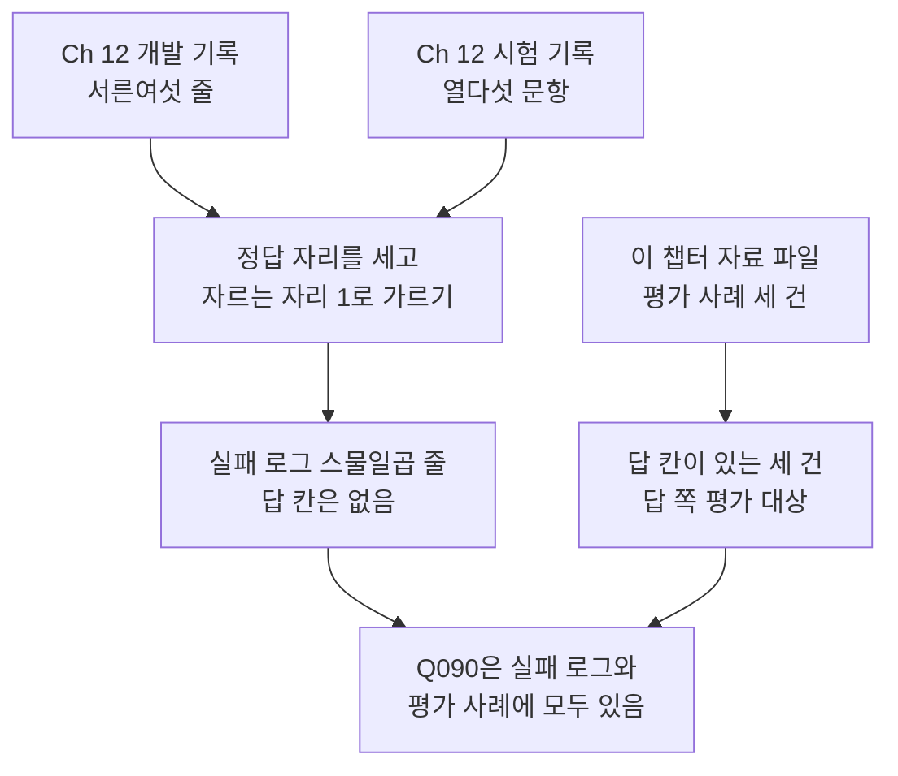
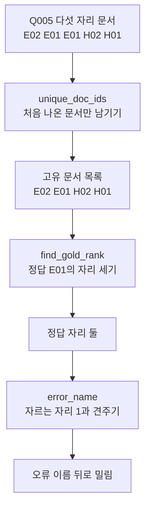
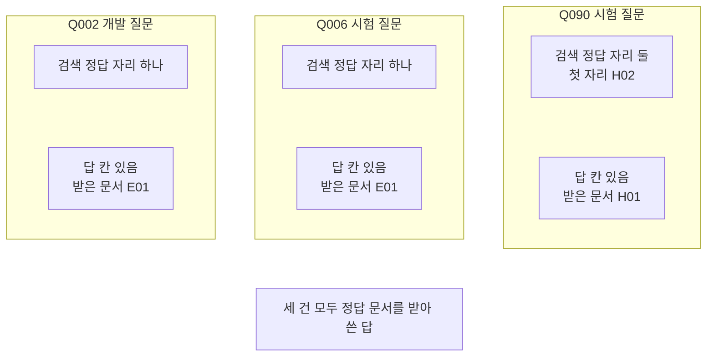
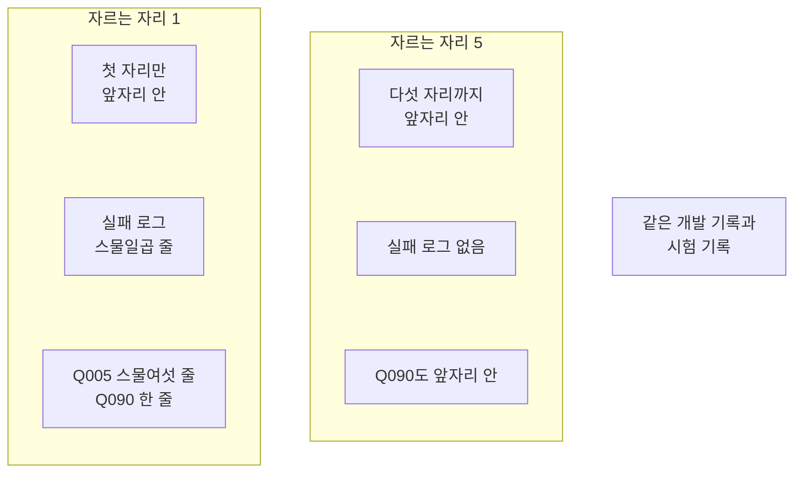

# 01-실패-로그와-평가-대상

## _src 본문 (HTML 원본)

```html
<!--meta: 강의 1h | 실습 1h | 코드 notebooks/01-실패-로그와-평가-대상.ipynb | 새 용어 5 -->
<style>html,body{overflow-x:hidden}.notebook,.nb-cell,.nb-main,.nb-input,.nb-result{min-width:0;max-width:100%}.nb-input pre,.nb-output{box-sizing:border-box;max-width:100%;overflow-x:auto}code.nb-source{display:block!important;width:100%!important;min-width:0!important;overflow-x:auto!important;padding:0!important}</style>
<h2 id="b1"><span class="no">1</span>학습 목표</h2><div class="goal"><ul>
<li>실행 기록의 칸 이름을 보고 검색 결과만 있는 기록과 답이 있는 기록을 가를 수 있습니다.</li>
<li>자르는 자리를 먼저 적고 그 기준으로 실패 로그를 만들 수 있습니다.</li>
<li>평가 사례마다 검색 쪽 표시와 답 쪽 평가 대상 여부를 표로 적을 수 있습니다.</li>
</ul></div>
<h2 id="b2"><span class="no">2</span>이 내용을 배우는 이유</h2><p>평가를 시작하면 무엇을 평가할지부터 골라야 합니다. 실행 기록이 많아도 답이 적힌 줄이 없으면 답을 평가할 수 없습니다. 검색 결과만 남은 줄을 답 실패로 세면 사실과 다른 기록이 됩니다.</p><p>이 챕터 뒤 절에서는 평가 모델(judge)로 답을 판정하고 같은 사례를 다시 검사합니다. 그 일의 출발점이 평가 사례입니다. 이 절은 Ch 12 기록에서 실패 줄을 모으고 답이 있는 사례를 골라 평가 대상으로 정합니다. 이 절은 모델을 부르지 않고 남은 기록 파일만 읽습니다.</p>
<h2 id="b3"><span class="no">3</span>앞에서 배운 내용</h2><p>Ch 11에서는 질문마다 정답 문서 ID를 두고 재현율과 nDCG를 쟀습니다. 05절에서는 정답 문서의 자리로 오류 이름 셋을 붙였습니다. 이름은 후보 밖·뒤로 밀림·앞자리 안입니다. 개발 질문으로 고르고 시험 질문은 다 고른 뒤 한 번만 여는 약속도 그때 정했습니다.</p><p>Ch 12 12절은 그 약속대로 검색 설정 서른여섯 벌을 개발 질문 열다섯 개로 쟀습니다. 설정 한 벌을 한 줄로 적은 개발 기록이 남았습니다. 고른 한 벌로 시험 질문 열다섯 개를 잰 시험 기록도 남았습니다. 두 기록에는 검색 결과와 지표가 있고, 이 절은 두 파일을 읽기만 합니다.</p><p>Ch 14에서는 검색 앞뒤에 단계를 붙이고 정답 문서의 자리를 견줬습니다. 답이 맞는지는 판정하지 않았고 07절 근거 점수도 정답률이 아니었습니다. 평가 모델로 답을 여러 기준에서 판정하는 일은 이 챕터가 처음 합니다.</p><p>앞에서 배운 함수는 <code>rag_tools.py</code>에 모아 두었습니다. 파일을 열면 코드를 볼 수 있습니다. 노트북과 같은 폴더(<code>notebooks/</code>)에 있는 파일입니다. 이 절은 Ch 11 01절의 두 함수와 04·05절의 함수 하나씩을 가져옵니다. 고유 문서 목록·정답 자리·자리 무게·오류 이름을 내는 함수입니다.</p>
<h2 id="b4"><span class="no">4</span>핵심 개념</h2><h3>비유로 시작하기</h3><p>긴 탁자 위에 바구니가 한 줄로 놓여 있다고 생각해 봅니다. 대부분은 비어 있고 세 개에만 사과가 한 알씩 들어 있습니다. 옆에 놓인 저울로 잴 수 있는 것은 사과가 든 바구니뿐입니다. 빈 바구니가 아무리 많아도 사과의 무게는 알 수 없습니다.</p><p>빈 바구니는 답이 없는 검색 기록 한 줄입니다. 사과는 답이고 저울은 뒤 절에서 쓸 평가 모델입니다. 이 절은 저울에 올릴 바구니를 고르는 자리입니다.</p>
{{img:01-5-빈-바구니와-사과-세-알|흰 바탕에 긴 나무 탁자가 있고 왼쪽에는 같은 모양의 빈 바구니 여섯 개가 한 줄로 놓여 있으며 조금 떨어진 오른쪽에는 빨간 사과가 한 알씩 든 바구니 세 개가 작은 부엌 저울 바로 옆에 놓인 그림|빈 바구니가 여럿 있어도 저울 옆으로 가는 것은 사과가 든 바구니 세 개뿐입니다.}}
<p class="look"><b>그림 읽기</b> — 탁자 왼쪽에 빈 바구니 여섯 개가 한 줄로 놓여 있습니다. 조금 떨어진 오른쪽에는 사과가 한 알씩 든 바구니 세 개가 있습니다. 그 세 바구니 바로 옆에 부엌 저울 하나가 서 있습니다. 빈 바구니는 저울과 떨어져 있고 사과가 든 바구니만 저울 곁에 모여 있습니다.</p>
<table><thead><tr><th>말</th><th>뜻</th></tr></thead><tbody><tr><td>실패 로그</td><td>실행 기록에서 정한 기준에 못 미친 줄만 모은 목록입니다. 이 절에서는 정답 문서가 첫 자리에 오지 않은 검색 결과 줄입니다.</td></tr><tr><td>평가 사례</td><td>질문·정답 문서·답이 받은 문서·답·기준 답을 한 벌로 묶은 한 건입니다. 이 챕터 자료 파일에 세 건이 있습니다.</td></tr><tr><td>검색 쪽 실패</td><td>정한 자르는 자리 안에 정답 문서가 오지 않은 상태입니다. 검색 기록만 있어도 셀 수 있습니다.</td></tr><tr><td>답 쪽 실패</td><td>정답 문서를 받고도 답이 기준 답과 어긋나거나 근거 밖 말을 보탠 상태입니다. 답이 적힌 사례에서만 셀 수 있습니다.</td></tr><tr><td>평가 모델(judge)</td><td>다른 모델이 쓴 답을 읽고 판정을 내리는 모델입니다. 이 절은 부르지 않고 02절부터 씁니다.</td></tr></tbody></table>
<p>아래 네 말은 Ch 11·Ch 12에서 쓰던 뜻 그대로 이어 씁니다.</p>
<table><thead><tr><th>말</th><th>뜻</th></tr></thead><tbody><tr><td>정답 자리</td><td>고유 문서 목록에서 정답 문서가 몇째 자리인지 센 값입니다(Ch 11 01절).</td></tr><tr><td>자르는 자리</td><td>목록 앞에서 몇 자리까지 볼지 정한 값입니다(Ch 11 02절).</td></tr><tr><td>자리 무게</td><td>자리 1이 가장 크고 뒤로 갈수록 작아지는 nDCG의 무게입니다(Ch 11 04절).</td></tr><tr><td>오류 이름 셋</td><td>정답 자리가 0이면 후보 밖, 자르는 자리보다 뒤면 뒤로 밀림, 그 안이면 앞자리 안입니다(Ch 11 05절).</td></tr></tbody></table>
{{mermaid:01-1-실패-로그와-평가-사례|위에서 아래로 읽는 흐름도로 맨 위 초록 상자 Ch 12 개발 기록 서른여섯 줄과 초록 상자 Ch 12 시험 기록 열다섯 문항이 파란 상자 정답 자리를 세고 자르는 자리 1로 가르기로 모여 노란 상자 실패 로그 스물일곱 줄 답 칸은 없음으로 이어지고 오른쪽 초록 상자 이 챕터 자료 파일 평가 사례 세 건은 노란 상자 답 칸이 있는 세 건 답 쪽 평가 대상으로 이어지며 두 노란 상자가 맨 아래 노란 상자 Q090은 실패 로그와 평가 사례에 모두 있음으로 모이는 그림|개발 기록과 시험 기록에서 모은 실패 로그에는 답이 없고, 답이 있는 평가 사례 세 건이 답 쪽 평가 대상입니다.}}
<p class="look"><b>도식 읽기</b> — 위에서 아래로 읽습니다. 왼쪽 줄기는 Ch 12 기록 두 개에서 실패 로그를 만드는 차례입니다. 파란 상자가 우리가 코드로 정한 기준이고 노란 상자는 출력으로 확인한 값입니다. 오른쪽 줄기는 이 챕터 자료 파일에서 답이 있는 사례를 고르는 차례입니다. 맨 아래 노란 상자가 두 줄기에 모두 있는 질문입니다.</p>
<h3>답이 없는 줄은 답 실패가 될 수 없습니다</h3><p>검색 기록 한 줄에는 문서 차례와 지표만 있습니다. 그 줄에서 찾은 실패는 모두 검색 쪽 실패입니다. 답 쪽 실패를 세려면 답이 적힌 사례가 먼저 있어야 합니다.</p>
<h3>기준을 먼저 적습니다</h3><p>무엇을 실패로 볼지는 자르는 자리가 정합니다. 기준을 적지 않고 줄을 세면 같은 기록에서도 다른 수가 나옵니다. 이 절은 자르는 자리를 1로 적고 시작합니다. 정답 문서가 첫 자리에 와야 앞자리 안입니다.</p>
<h3>답이 받은 문서를 함께 적습니다</h3><p>답이 틀렸을 때 검색 탓인지 답 탓인지 가르려면 답이 받은 문서를 알아야 합니다. 정답 문서를 받고도 틀렸다면 답 쪽 실패입니다. 받은 문서에 정답 문서가 없다면 검색 쪽부터 살핍니다.</p>
<h3>다른 상황에 적용</h3><p>고객 문의 상담에도 같은 자리가 있습니다. 「환불 규정을 못 찾음」과 「규정은 찾았지만 답에 잘못 옮김」은 고칠 곳이 다릅니다. 검색 기록과 답 기록을 따로 남겨야 어느 쪽을 고칠지 정할 수 있습니다.</p>
<h2 id="b5"><span class="no">5</span>실행 예제</h2><p>노트북은 기록 파일 세 개를 읽고 실패 로그와 평가 대상 표를 만듭니다. 모델 요청과 임베딩 요청이 0번이라 드는 비용이 없습니다. 새로 쓰는 파일도 없습니다.</p><p>먼저 Ch 12 개발 기록에 답 칸이 있는지 셉니다. 그다음 자르는 자리 1로 개발 기록과 시험 기록에서 실패 줄을 모읍니다. 이어서 이 챕터 자료 파일의 평가 사례 세 건을 같은 질문의 검색 기록과 짝짓습니다. 마지막으로 자르는 자리만 5로 바꿔 실패 로그를 다시 만듭니다.</p>
{{mermaid:01-2-한-줄에-오류-이름-붙이기|위에서 아래로 놓인 상자 일곱으로 맨 위 초록 상자 Q005 다섯 자리 문서 E02 E01 E01 H02 H01이 파란 상자 unique_doc_ids 처음 나온 문서만 남기기를 지나 노란 상자 고유 문서 목록 E02 E01 H02 H01이 되고 파란 상자 find_gold_rank 정답 E01의 자리 세기를 지나 노란 상자 정답 자리 둘이 되며 파란 상자 error_name 자르는 자리 1과 견주기를 지나 맨 아래 노란 상자 오류 이름 뒤로 밀림으로 이어지는 그림|질문 Q005의 다섯 자리를 고유 문서 목록으로 줄이면 정답 자리가 둘이고, 자르는 자리 1에서는 뒤로 밀림입니다.}}
<p class="look"><b>도식 읽기</b> — 위에서 아래로 읽습니다. 맨 위 초록 상자가 기록에 적힌 다섯 자리 문서 차례입니다. 파란 상자 셋은 도구 파일에서 가져온 Ch 11 함수입니다. 노란 상자 셋은 노트북 4절이 출력한 값입니다. 같은 문서 <code>E01</code>이 두 번 나와서 고유 문서 목록은 네 자리입니다.</p>
{{notebook:01-실패-로그와-평가-대상}}
<p class="look"><b>확인할 점</b> — 개발 기록의 출력 줄은 <code>답 칸이 있는 결과 줄 수: 0</code>이었습니다. 자르는 자리 1로 모은 줄은 <code>실패 로그 전체 줄 수: 27</code>이었습니다. 두 쪽에 걸친 질문은 <code>실패 로그와 평가 사례에 모두 있는 질문: ['Q090']</code>으로 나왔습니다. 자르는 자리 5에서는 같은 줄이 <code>실패 로그 전체 줄 수: 0</code>이었습니다.</p>
<h2 id="b6"><span class="no">6</span>실험 결과 해석</h2><p>개발 기록은 서른여섯 줄이었고 그 안의 질문별 결과는 540줄이었습니다. 답 칸이 있는 줄은 개발 기록과 시험 기록 모두 0줄이었습니다. 그래서 두 기록에서 모은 실패는 모두 검색 쪽 실패입니다.</p><p>자르는 자리 1로 가르니 개발 기록에서 26줄, 시험 기록에서 1줄이 실패 로그에 들어갔습니다. 개발 쪽 26줄은 모두 질문 <code>Q005</code>였고 고르지 않은 다른 설정에서 나왔습니다. 고른 설정 줄에서는 개발 쪽 실패가 0줄이었습니다. 실패 로그의 모든 줄에서 정답 문서는 둘째나 셋째 자리에 있었습니다.</p><p>시험 쪽 한 줄은 질문 <code>Q090</code>이었습니다. 첫 자리가 <code>H02</code>였고 정답 문서 <code>H01</code>은 둘째 자리였습니다. 기록된 nDCG <code>0.6309</code>는 자리 2의 자리 무게와 같았습니다. 정답 문서가 하나라서 가장 좋은 무게 합이 1이기 때문입니다.</p><p>평가 사례 세 건은 <code>Q002</code>·<code>Q006</code>·<code>Q090</code>이었고 세 건 모두 답 칸이 있었습니다. 세 건 모두 답을 쓸 때 정답 문서 한 건을 받았습니다. 그래서 세 답이 틀린다면 그것은 답 쪽 실패입니다. 질문 <code>Q090</code>에는 검색 쪽 표시도 함께 붙었습니다.</p>
{{mermaid:01-3-평가-사례-세-건|위쪽에 왼쪽부터 오른쪽으로 놓인 칸 세 개와 그 아래 회색 상자 하나로 첫 칸 제목은 Q002 개발 질문이고 그 안에 노란 상자 검색 정답 자리 하나와 노란 상자 답 칸 있음 받은 문서 E01이 있고 둘째 칸 제목은 Q006 시험 질문이고 같은 두 상자가 있으며 셋째 칸 제목은 Q090 시험 질문이고 그 안에 노란 상자 검색 정답 자리 둘 첫 자리 H02와 노란 상자 답 칸 있음 받은 문서 H01이 있고 맨 아래 회색 상자에 세 건 모두 정답 문서를 받아 쓴 답이 놓인 그림|평가 사례 세 건은 모두 답이 있고 정답 문서를 받아 쓴 답이며, Q090만 검색 정답 자리가 둘입니다.}}
<p class="look"><b>도식 읽기</b> — 위쪽에 나란히 놓인 칸 셋이 평가 사례 세 건입니다. 칸마다 위 노란 상자가 Ch 12 고른 설정의 검색 결과이고 아래 노란 상자가 사례의 답 쪽 칸입니다. 오른쪽 셋째 칸만 검색 정답 자리가 둘입니다. 맨 아래 회색 상자는 세 칸에 모두 해당하는 사실입니다.</p>
<p>실패 로그에만 있고 평가 사례가 없는 질문은 <code>Q005</code>였습니다. 이 질문은 답이 없어 답 쪽 평가 대상이 될 수 없습니다. 답을 평가하려면 답을 먼저 만들어 사례로 적어야 합니다. 이번에는 만들지 않았습니다.</p><p>자르는 자리만 5로 바꾸니 실패 로그가 0줄이 되었습니다. 질문 <code>Q090</code>의 정답 자리 2도 다섯 자리 안이라 앞자리 안이었습니다. 같은 기록에서 기준 하나로 실패 줄 수가 27에서 0으로 바뀌었습니다.</p>
{{mermaid:01-4-자르는-자리-1과-5|왼쪽부터 오른쪽으로 놓인 칸 두 개와 회색 상자 하나로 왼쪽 칸 제목은 자르는 자리 1이고 그 안에 파란 상자 첫 자리만 앞자리 안과 노란 상자 실패 로그 스물일곱 줄과 노란 상자 Q005 스물여섯 줄 Q090 한 줄이 있으며 가운데 칸 제목은 자르는 자리 5이고 그 안에 파란 상자 다섯 자리까지 앞자리 안과 노란 상자 실패 로그 없음과 노란 상자 Q090도 앞자리 안이 있고 오른쪽 회색 상자에 같은 개발 기록과 시험 기록이 놓인 그림|같은 기록에서 자르는 자리 1이면 실패 로그가 스물일곱 줄이고 5이면 한 줄도 없습니다.}}
<p class="look"><b>도식 읽기</b> — 왼쪽 칸이 자르는 자리 1이고 가운데 칸이 자르는 자리 5입니다. 칸마다 맨 위 파란 상자가 우리가 적은 기준입니다. 그 아래 노란 상자 둘이 출력으로 확인한 값입니다. 오른쪽 회색 상자는 두 칸이 같은 기록을 읽었다는 사실입니다.</p>
<p>여기서 본 것은 Ch 12 기록 두 개와 평가 사례 세 건입니다. 세 답이 맞는지는 이번에 판정하지 않았습니다. 답을 판정하는 일은 02절부터 합니다.</p>
<h2 id="b7"><span class="no">7</span>주의할 점과 실무 메모</h2><ul><li>자르는 자리 1과 5는 기록을 먼저 훑어본 뒤 흐름을 보여 주려고 정한 예입니다. 자리 5로는 실패 줄이 없어서 첫 자리 기준을 본 실행에 두었습니다.</li><li>한 줄 예로 쓴 질문 <code>Q005</code>도 기록을 훑어본 뒤 첫 설정 줄에서 첫 자리를 놓친 질문을 고른 것입니다.</li><li>평가 사례 세 건은 이 챕터 자료 파일에 미리 들어 있는 사례입니다. 이 절은 세 건이 Ch 12 기록의 어디에 있는지를 출력으로 확인했습니다.</li><li>사례의 답은 정답 문서 한 건만 받아 쓴 답입니다. Ch 12 검색이 고른 다섯 자리를 그대로 받은 답이 아닙니다.</li><li>기준 답의 출처는 교재 작성자가 적은 기준입니다. 사람 여럿이 따로 매긴 판정이 아닙니다.</li><li>이 절은 모델을 부르지 않았습니다. 사례의 답과 판정 글은 파일에 적힌 글을 읽기만 했고 그 글에 <code>assert</code>를 걸지 않았습니다.</li><li>개발 쪽 실패 26줄은 설정 서른여섯 벌을 모두 잰 기록에서 나왔습니다. 고른 설정만 보면 개발 쪽 실패는 0줄입니다. 어느 줄까지 실패 로그에 넣을지도 기준입니다.</li><li>기록된 nDCG는 소수 넷째 자리까지 반올림해 적었습니다. 기록 파일에는 반올림하지 않은 값이 있습니다.</li><li>걸린 시간과 비용은 재지 않았습니다. 이 절은 모델 요청이 0번입니다.</li><li>이 절은 파일을 쓰지 않습니다. Ch 12 기록 두 개와 이 챕터 자료 파일은 읽기만 합니다.</li><li>교재 출력은 Linux의 Python 3.12.13으로 만들었습니다. 다른 판과 Windows·macOS에서는 이번에 실행하지 않았습니다.</li></ul>
<h2 id="b8"><span class="no">8</span>정리와 다음 절</h2><ul><li>Ch 12 개발 기록과 시험 기록에는 답 칸이 없어 그 안의 실패는 모두 검색 쪽 실패였습니다.</li><li>자르는 자리 1로 가르니 실패 로그는 스물일곱 줄이었고 5로 바꾸니 한 줄도 없었습니다.</li><li>답이 있는 평가 사례 세 건을 답 쪽 평가 대상으로 정했고 <code>Q090</code>에는 검색 쪽 표시도 붙었습니다.</li></ul><p><strong>다음 학습과 이어지는 지점</strong> — 02절에서는 평가 사례의 답을 네 가지 평가로 봅니다. 평가마다 무엇과 무엇을 견주는지 가릅니다.</p>
<h2 id="b9"><span class="no">9</span>복습 문제</h2><details class="quiz" open><summary>문제 4개 · 해설 포함</summary><p class="quiz-q">1. Ch 12 개발 기록에서 찾은 실패를 답 쪽 실패로 세면 안 되는 까닭은 무엇입니까?</p><p class="quiz-a">개발 기록에는 답이 적힌 칸이 없어 답이 틀렸는지 알 수 없기 때문입니다. 그 기록의 실패는 모두 검색 쪽 실패입니다. 틀렸다면 「핵심 개념」의 첫 소제목을 다시 읽습니다.</p><p class="quiz-q">2. 같은 기록에서 실패 로그가 스물일곱 줄도 되고 0줄도 된 까닭은 무엇입니까?</p><p class="quiz-a">자르는 자리를 1로 두면 첫 자리를 놓친 줄이 모두 들어가고, 5로 두면 정답 문서가 다섯 자리 안이라 빠집니다. 실패 로그의 줄 수는 우리가 적은 기준이 정합니다. 틀렸다면 「실험 결과 해석」의 둘째 비교 도식을 다시 읽습니다.</p><p class="quiz-q">3. 질문 <code>Q090</code>의 기록된 nDCG <code>0.6309</code>는 무엇을 뜻합니까?</p><p class="quiz-a">정답 문서가 둘째 자리에 있었다는 뜻입니다. 정답 문서가 하나라서 nDCG가 정답 자리의 자리 무게와 같습니다. 틀렸다면 「실험 결과 해석」의 셋째 단락을 다시 읽습니다.</p><p class="quiz-q">4. 질문 <code>Q005</code>를 답 쪽 평가 대상으로 삼으려면 무엇이 먼저 있어야 합니까?</p><p class="quiz-a">그 질문의 답이 있어야 합니다. 답과 답이 받은 문서와 기준 답을 한 벌로 묶은 평가 사례를 먼저 적어야 합니다. 틀렸다면 「핵심 개념」의 용어 표를 다시 읽습니다.</p></details>
<h2 id="b10"><span class="no">10</span>참고 자료</h2><ul><li><div><a href="https://docs.langchain.com/langsmith/evaluation-concepts">LangSmith 평가 개념</a></div>확인 2026-09-21 · 입력과 기준 출력을 짝지은 평가 예시와, 운영 기록에서 평가할 사례를 고르는 방법.</li><li><div><a href="https://docs.langchain.com/langsmith/evaluation-types">LangSmith 평가 유형</a></div>확인 2026-09-21 · 모델로 판정하는 평가와 코드로 판정하는 평가의 구분.</li><li>Ch 11 05절 조건별 평가와 오류 분류 — 이 절이 이어 쓴 오류 이름 셋과 자르는 자리 5가 있는 자리.</li><li>Ch 12 12절 종합 튜닝과 실험 로그 — 이 절이 읽은 개발 기록과 시험 기록을 남긴 자리.</li></ul>
```

## 노트북 셀 (순서대로)

### [0] markdown {'html': 'skip'}

# 실패 로그와 평가 대상

**이 노트북에서 할 일**

1. Ch 12가 남긴 개발 기록 서른여섯 줄과 시험 기록 열다섯 문항을 읽습니다.
2. 두 기록에 답이 적힌 칸이 있는지 셉니다.
3. 정답 문서가 첫 자리에 오지 않은 줄을 모아 실패 로그를 만듭니다.
4. 이 챕터 자료 파일의 평가 사례 세 건을 같은 질문의 검색 기록과 짝짓습니다.
5. 자르는 자리만 5로 바꿔 실패 로그를 다시 만들고 견줍니다.

**준비물** — 이 절은 OpenAI API 키를 쓰지 않습니다.
모델 요청과 임베딩 요청이 모두 0번이라 드는 비용이 없습니다.
이미 남은 기록 파일을 읽어 평가할 사례를 고르는 절이기 때문입니다.

읽는 파일은 Ch 12 실습 폴더의 기록 두 개와 이 챕터 자료 파일 하나입니다.
새로 쓰는 파일은 없습니다.
교재 출력을 만든 실행에서는 노트북 전체가 1초 안에 끝났습니다.

**기준 버전** — 이 절은 Python에 들어 있는 기능과 도구 파일만 씁니다.
따로 설치할 패키지가 없어 설치 셀을 두지 않았습니다.
교재 출력은 Linux의 Python 3.12.13으로 만들었습니다.
다른 판과 Windows·macOS에서는 이번에 실행하지 않았습니다.

**강의와 실습 범위** — 강의 시간에는 2~6절을 읽습니다.
Ch 12 기록에서 답 칸을 세고 실패 로그를 만드는 자리입니다.
7~9절은 평가 사례를 읽고 평가 대상 표를 만드는 자리입니다.
10절은 값 바꿔 보기이고 실습 시간에 함께 실행합니다.

실습 폴더 `labs/part4/ch15-evaluation-advanced`에서 `uv sync --locked`를 실행합니다.
그다음 이 폴더의 `.venv` 커널을 고르고 첫 셀부터 순서대로 실행합니다.

### [1] markdown {'html': 'skip'}

## 오늘 볼 그림


위에서 아래로 읽습니다.
왼쪽 줄기는 Ch 12 기록에서 실패 로그를 만드는 차례입니다.
오른쪽 줄기는 답이 있는 평가 사례를 고르는 차례입니다.
두 줄기가 만나는 맨 아래 상자가 두 쪽에 모두 있는 질문입니다.

### [2] markdown {}

## 1. 준비

이 절은 따로 설치할 패키지가 없습니다.
첫 셀은 이 절에서 쓸 이름을 불러오고 Python 판을 출력합니다.

앞에서 배운 함수는 `rag_tools.py`에 모아 두었습니다. 파일을 열면 코드를 볼 수 있습니다. 노트북과 같은 폴더(`notebooks/`)에 있는 파일입니다.
이 노트북은 Ch 11 01절 `unique_doc_ids()`와 `find_gold_rank()`를 가져옵니다.

Ch 11 04절 `rank_weight()`와 05절 `error_name()`도 함께 가져옵니다.
네 함수 모두 Ch 11에서 쓰던 인자 그대로입니다.

### [3] code {'execution': {'iopub.execute_input': '2026-09-21T15:01:52.763902Z', 'iopub.status.busy': '2026-09-21T15:01:52.763702Z', 'iopub.status.idle': '2026-09-21T15:01:52.773441Z', 'shell.execute_reply': '2026-09-21T15:01:52.772715Z'}, 'lesson_role': 'setup'}

```python
# 기록 파일 읽기와 폴더 확인에 쓸 이름을 불러오고 Python 판을 출력합니다
import json
import os
import platform

# Ch 11 01·04·05절에서 배운 함수 넷을 도구 파일에서 가져옵니다
from rag_tools import error_name, find_gold_rank, rank_weight, unique_doc_ids

print("불러온 이름:", "json", "os", "platform")
print("Python 판:", platform.python_version())
```

출력:
```
불러온 이름: json os platform
Python 판: 3.12.13

```

### [4] markdown {}

**결과 읽기** — 출력 줄 `Python 판: 3.12.13`이 교재 출력을 만든 판입니다.
이름 `json`은 기록 파일을 읽을 때, `os`는 폴더를 찾을 때 씁니다.
도구 파일에서 가져온 함수 네 개는 출력하지 않습니다.
이 노트북의 출력은 2026-09-21에 실행한 결과입니다.

다음 셀은 노트북을 연 자리에서 프로젝트 맨 위를 찾습니다.
Ch 10~14에서 쓴 자리 찾기와 같은 방법입니다.

### [5] code {'execution': {'iopub.execute_input': '2026-09-21T15:01:52.775250Z', 'iopub.status.busy': '2026-09-21T15:01:52.775117Z', 'iopub.status.idle': '2026-09-21T15:01:52.778266Z', 'shell.execute_reply': '2026-09-21T15:01:52.777671Z'}, 'lesson_role': 'setup'}

```python
# 노트북을 어느 폴더에서 열어도 프로젝트 맨 위를 찾게 후보 세 개를 차례로 봅니다
candidates = [".", "../../..", "../../../.."]
root_path = None
for candidate in candidates:
    if os.path.exists(candidate + "/labs/part4/ch15-evaluation-advanced/data"):
        root_path = candidate
        break
print("찾은 프로젝트 맨 위:", root_path)
assert root_path is not None, "notebooks 폴더나 실습 폴더 맨 위에서 노트북을 열어 주세요."
```

출력:
```
찾은 프로젝트 맨 위: .

```

### [6] markdown {}

**결과 읽기** — 출력 줄 `찾은 프로젝트 맨 위:` 뒤에 점 하나나 위로 올라가는 자리가 보입니다.
후보 셋 가운데 이 챕터 자료 폴더가 있는 자리를 고릅니다.

## 2. Ch 12 개발 기록 읽기

Ch 12 12절은 손잡이 두 개를 곱해 검색 설정 서른여섯 벌을 만들었습니다.
설정 한 벌마다 개발 질문 열다섯 개를 재고 한 줄로 적었습니다.
그 개발 기록 파일을 읽어 줄 수부터 셉니다.

### [7] code {'execution': {'iopub.execute_input': '2026-09-21T15:01:52.779345Z', 'iopub.status.busy': '2026-09-21T15:01:52.779261Z', 'iopub.status.idle': '2026-09-21T15:01:52.796794Z', 'shell.execute_reply': '2026-09-21T15:01:52.796203Z'}}

```python
# Ch 12 12절이 남긴 개발 기록을 한 줄씩 읽어 목록에 담습니다(읽기만 합니다)
ch12_runs = root_path + "/labs/part3/ch12-retrieval-tuning/runs"
dev_rows = []
with open(ch12_runs + "/advanced-continuity-experiment-log.jsonl", encoding="utf-8") as file:
    for line in file:
        if line.strip() != "":
            dev_rows.append(json.loads(line))
print("개발 기록 줄 수:", len(dev_rows))
```

출력:
```
개발 기록 줄 수: 36

```

### [8] markdown {}

**결과 읽기** — 출력 줄 `개발 기록 줄 수: 36`은 Ch 12가 잰 설정 서른여섯 벌입니다.
한 줄이 설정 한 벌이고 그 안에 질문 열다섯 개의 결과가 들어 있습니다.

다음 셀은 한 줄에 어떤 칸이 있는지 칸 이름을 출력합니다.
칸 이름이 곧 그 기록에 무엇이 적혀 있는지를 알려 줍니다.

### [9] code {'execution': {'iopub.execute_input': '2026-09-21T15:01:52.797808Z', 'iopub.status.busy': '2026-09-21T15:01:52.797712Z', 'iopub.status.idle': '2026-09-21T15:01:52.800143Z', 'shell.execute_reply': '2026-09-21T15:01:52.799677Z'}}

```python
# 첫 줄의 칸 이름과 그 안에 든 질문별 결과 한 줄의 칸 이름을 출력합니다
first_row = dev_rows[0]
row_keys = list(first_row.keys())
result_keys = list(first_row["results"][0].keys())
print("한 줄의 칸 수:", len(row_keys))
print("칸 이름:")
print(row_keys)
print("질문별 결과 한 줄의 칸 이름:")
print(result_keys)
```

출력:
```
한 줄의 칸 수: 17
칸 이름:
['run_date', 'source_chapter', 'query_source_chapter', 'query_source', 'corpus_fingerprint', 'query_fingerprint', 'evaluation_unit', 'metrics_policy', 'query_count', 'excluded_query_count', 'run_id', 'settings', 'split', 'comparison_policy', 'metrics', 'slices', 'results']
질문별 결과 한 줄의 칸 이름:
['qid', 'tier', 'split', 'gold_doc_ids', 'returned_count', 'candidate_doc_ids', 'top_results', 'recall_at_3', 'recall_at_5', 'recall_at_50', 'precision_at_5', 'ndcg_at_5', 'chunk_precision_at_5']

```

### [10] markdown {}

**결과 읽기** — 출력 줄 `한 줄의 칸 수: 17` 아래에 칸 이름 열일곱 개가 있습니다.
칸 `settings`는 설정 한 벌이고 칸 `results`는 질문별 결과 목록입니다.
라벨 줄 `질문별 결과 한 줄의 칸 이름:` 아래에는 `'top_results'`와 `'ndcg_at_5'`가 보입니다.
두 줄 어디에도 답을 담는 칸 이름은 없습니다.

칸 `top_results`는 다섯 자리까지 받은 문서 청크 목록입니다.
문서 청크마다 칸 `doc_id`에 그 문서 청크가 속한 문서 ID가 있습니다.
같은 문서가 여러 번 나올 수 있어 뒤에서 고유 문서 목록을 먼저 만듭니다.

## 3. 답 칸이 있는지 세기

실패를 모으기 전에 기록에 답이 적혀 있는지부터 봅니다.
답이 없는 줄에서는 답이 틀렸는지 알 수 없기 때문입니다.
답을 담는 칸 이름으로 `response`와 `answer` 두 가지를 봅니다.
이 챕터 자료 파일은 앞의 이름을, Ch 9 기록 한 줄은 뒤의 이름을 씁니다.

### [11] code {'execution': {'iopub.execute_input': '2026-09-21T15:01:52.801044Z', 'iopub.status.busy': '2026-09-21T15:01:52.800966Z', 'iopub.status.idle': '2026-09-21T15:01:52.803124Z', 'shell.execute_reply': '2026-09-21T15:01:52.802714Z'}}

```python
# 질문별 결과 목록에서 답이 적힌 칸이 있는 줄을 셉니다
def count_answers(result_list):
    answer_rows = 0
    for result in result_list:
        if "response" in result or "answer" in result:
            answer_rows = answer_rows + 1
    return answer_rows
```

출력:
```

```

### [12] markdown {}

**결과 읽기** — 정의 셀이라 출력이 없습니다.
함수 `count_answers`는 결과 한 줄에 두 칸 이름 가운데 하나라도 있으면 셉니다.
답이 맞는지는 보지 않고 답 칸이 있는지만 봅니다.

다음 셀은 서른여섯 줄의 질문별 결과를 모두 세고 그 함수로 답 칸도 셉니다.

### [13] code {'execution': {'iopub.execute_input': '2026-09-21T15:01:52.803965Z', 'iopub.status.busy': '2026-09-21T15:01:52.803885Z', 'iopub.status.idle': '2026-09-21T15:01:52.806195Z', 'shell.execute_reply': '2026-09-21T15:01:52.805723Z'}}

```python
# 설정 서른여섯 줄마다 질문별 결과 줄 수와 답 칸이 있는 줄 수를 더해 갑니다
result_count = 0
answer_count = 0
for row in dev_rows:
    result_count = result_count + len(row["results"])
    answer_count = answer_count + count_answers(row["results"])
print("질문별 결과 줄 수:", result_count)
print("답 칸이 있는 결과 줄 수:", answer_count)
```

출력:
```
질문별 결과 줄 수: 540
답 칸이 있는 결과 줄 수: 0

```

### [14] markdown {}

**결과 읽기** — 출력 줄 `질문별 결과 줄 수: 540`은 설정 서른여섯 벌에 질문 열다섯 개를 곱한 수입니다.
출력 줄 `답 칸이 있는 결과 줄 수: 0`으로 개발 기록에는 답이 한 줄도 없습니다.
그래서 이 기록에서 찾는 실패는 모두 검색 쪽 실패입니다.

## 4. 실패를 가를 기준 정하기

실패 로그를 만들려면 무엇을 실패로 볼지 먼저 적어야 합니다.
이 절은 Ch 11 05절의 오류 이름 셋을 그대로 씁니다.
정답 자리가 0이면 후보 밖이고 자르는 자리보다 뒤면 뒤로 밀림입니다.
그 안이면 앞자리 안입니다.
이 절은 자르는 자리를 1로 두어 정답 문서가 첫 자리에 와야 앞자리 안으로 칩니다.

### [15] code {'execution': {'iopub.execute_input': '2026-09-21T15:01:52.806997Z', 'iopub.status.busy': '2026-09-21T15:01:52.806936Z', 'iopub.status.idle': '2026-09-21T15:01:52.808808Z', 'shell.execute_reply': '2026-09-21T15:01:52.808445Z'}}

```python
# 실패를 가를 자르는 자리를 정합니다(정답 문서가 첫 자리에 와야 앞자리 안입니다)
cutoff = 1
print("자르는 자리:", cutoff)
print("앞자리 안이 아닌 줄을 실패 로그에 적습니다")
```

출력:
```
자르는 자리: 1
앞자리 안이 아닌 줄을 실패 로그에 적습니다

```

### [16] markdown {}

**결과 읽기** — 출력 줄 `자르는 자리: 1`이 이 절의 기준입니다.
둘째 줄은 앞자리 안이 아닌 줄을 실패 로그에 적는다는 약속입니다.

다음 두 셀은 기준을 한 줄에 먼저 걸어 봅니다.
첫 설정 줄에서 질문 `Q005`의 결과를 찾아 다섯 자리 문서 차례를 봅니다.

### [17] code {'execution': {'iopub.execute_input': '2026-09-21T15:01:52.809596Z', 'iopub.status.busy': '2026-09-21T15:01:52.809526Z', 'iopub.status.idle': '2026-09-21T15:01:52.811783Z', 'shell.execute_reply': '2026-09-21T15:01:52.811378Z'}}

```python
# 첫 설정 줄에서 질문 Q005의 결과를 찾아 다섯 자리 문서 차례를 봅니다
sample = None
for result in dev_rows[0]["results"]:
    if result["qid"] == "Q005":
        sample = result
        break
sample_docs = []
for hit in sample["top_results"]:
    sample_docs.append(hit["doc_id"])
print("질문:", sample["qid"], "| 정답 문서:", sample["gold_doc_ids"])
print("다섯 자리 문서 차례:", sample_docs)
```

출력:
```
질문: Q005 | 정답 문서: ['E01']
다섯 자리 문서 차례: ['E02', 'E01', 'E01', 'H02', 'H01']

```

### [18] markdown {}

**결과 읽기** — 출력 줄 `질문: Q005 | 정답 문서: ['E01']`이 고른 줄입니다.
출력 줄 `다섯 자리 문서 차례: ['E02', 'E01', 'E01', 'H02', 'H01']`에서 첫 자리는 `E02`입니다.
정답 문서 `E01`은 둘째와 셋째 자리에 두 번 나옵니다.

다음 셀은 이 차례를 고유 문서 목록으로 줄이고 정답 자리를 셉니다.

### [19] code {'execution': {'iopub.execute_input': '2026-09-21T15:01:52.812679Z', 'iopub.status.busy': '2026-09-21T15:01:52.812611Z', 'iopub.status.idle': '2026-09-21T15:01:52.814674Z', 'shell.execute_reply': '2026-09-21T15:01:52.814303Z'}}

```python
# 고유 문서 목록을 만들어 정답 자리를 세고 오류 이름을 붙입니다
sample_ids = unique_doc_ids(sample["top_results"])
sample_rank = find_gold_rank(sample_ids, sample["gold_doc_ids"])
sample_name = error_name(sample_rank, cutoff)
print("고유 문서 목록:", sample_ids)
print("정답 자리:", sample_rank)
print("자르는 자리 1의 오류 이름:", sample_name)
```

출력:
```
고유 문서 목록: ['E02', 'E01', 'H02', 'H01']
정답 자리: 2
자르는 자리 1의 오류 이름: 뒤로 밀림

```

### [20] markdown {}

**결과 읽기** — 출력 줄 `고유 문서 목록: ['E02', 'E01', 'H02', 'H01']`은 처음 나온 문서만 남긴 목록입니다.
출력 줄 `정답 자리: 2`로 정답 문서는 둘째 자리입니다.
출력 줄 `자르는 자리 1의 오류 이름: 뒤로 밀림`으로 이 줄은 실패 로그에 들어갑니다.

## 5. 개발 기록에서 실패 로그 만들기

한 줄에서 본 차례를 함수 두 개로 적어 모든 줄에 겁니다.
먼저 실패 로그에 적을 한 줄을 만드는 함수입니다.

### [21] code {'execution': {'iopub.execute_input': '2026-09-21T15:01:52.815426Z', 'iopub.status.busy': '2026-09-21T15:01:52.815356Z', 'iopub.status.idle': '2026-09-21T15:01:52.817449Z', 'shell.execute_reply': '2026-09-21T15:01:52.817034Z'}}

```python
# 실패 로그에 적을 한 줄을 만듭니다(기록에 적힌 값을 그대로 옮깁니다)
def failure_row(result, gold_rank):
    row = {"묶음": result["split"]}
    row["질문"] = result["qid"]
    row["첫 자리 문서"] = result["top_results"][0]["doc_id"]
    row["정답 문서"] = result["gold_doc_ids"]
    row["정답 자리"] = gold_rank
    row["기록된 nDCG"] = round(result["ndcg_at_5"], 4)
    return row
```

출력:
```

```

### [22] markdown {}

**결과 읽기** — 정의 셀이라 출력이 없습니다.
함수 `failure_row`는 기록의 묶음과 질문 번호와 첫 자리 문서를 옮깁니다.
정답 문서와 셈한 정답 자리, 기록된 nDCG도 함께 담습니다.
기록된 nDCG는 소수 넷째 자리까지 반올림해 담습니다.

다음 셀은 결과 목록에서 실패 줄만 모으는 함수입니다.

### [23] code {'execution': {'iopub.execute_input': '2026-09-21T15:01:52.818159Z', 'iopub.status.busy': '2026-09-21T15:01:52.818096Z', 'iopub.status.idle': '2026-09-21T15:01:52.820135Z', 'shell.execute_reply': '2026-09-21T15:01:52.819683Z'}}

```python
# 질문별 결과 목록을 보고 앞자리 안이 아닌 줄만 모아 목록으로 만듭니다
def find_failures(result_list, cutoff_value):
    found_rows = []
    for result in result_list:
        found_ids = unique_doc_ids(result["top_results"])
        gold_rank = find_gold_rank(found_ids, result["gold_doc_ids"])
        if error_name(gold_rank, cutoff_value) != "앞자리 안":
            found_rows.append(failure_row(result, gold_rank))
    return found_rows
```

출력:
```

```

### [24] markdown {}

**결과 읽기** — 정의 셀이라 출력이 없습니다.
함수 `find_failures`는 줄마다 고유 문서 목록과 정답 자리를 셉니다.
오류 이름이 앞자리 안이 아니면 그 줄을 실패 로그 한 줄로 만들어 담습니다.
자르는 자리는 인자로 받아서 뒤에서 값만 바꿔 다시 부를 수 있습니다.

다음 셀은 개발 기록 서른여섯 줄에 이 함수를 겁니다.

### [25] code {'execution': {'iopub.execute_input': '2026-09-21T15:01:52.820883Z', 'iopub.status.busy': '2026-09-21T15:01:52.820817Z', 'iopub.status.idle': '2026-09-21T15:01:52.823128Z', 'shell.execute_reply': '2026-09-21T15:01:52.822860Z'}}

```python
# 개발 기록 서른여섯 줄마다 질문별 결과를 넘겨 실패 줄을 모읍니다
failure_log = []
for row in dev_rows:
    for failure in find_failures(row["results"], cutoff):
        failure_log.append(failure)
print("개발 기록에서 모은 실패 줄 수:", len(failure_log))
print("첫 실패 줄:")
print(failure_log[0])
```

출력:
```
개발 기록에서 모은 실패 줄 수: 26
첫 실패 줄:
{'묶음': 'dev', '질문': 'Q005', '첫 자리 문서': 'E02', '정답 문서': ['E01'], '정답 자리': 2, '기록된 nDCG': 0.6309}

```

### [26] markdown {}

**결과 읽기** — 출력 줄 `개발 기록에서 모은 실패 줄 수: 26`이 개발 쪽 실패 로그입니다.
라벨 줄 `첫 실패 줄:` 아래 한 줄은 앞에서 본 질문 `Q005`의 줄과 같습니다.
그 줄의 `'정답 자리': 2`와 `'기록된 nDCG': 0.6309`를 기억해 둡니다.

## 6. 시험 기록 더하기

Ch 12는 개발 질문으로 설정 한 벌을 고른 뒤 시험 질문을 한 번만 쟀습니다.
그 시험 기록을 읽고 답 칸도 같은 함수로 셉니다.

### [27] code {'execution': {'iopub.execute_input': '2026-09-21T15:01:52.823887Z', 'iopub.status.busy': '2026-09-21T15:01:52.823825Z', 'iopub.status.idle': '2026-09-21T15:01:52.826847Z', 'shell.execute_reply': '2026-09-21T15:01:52.826570Z'}}

```python
# 고른 설정 한 벌로 시험 질문 열다섯 개를 한 번 잰 시험 기록을 읽습니다
with open(ch12_runs + "/advanced-continuity-test-result.json", encoding="utf-8") as file:
    test_record = json.loads(file.read())
test_results = test_record["results"]
print("시험 질문 수:", len(test_results))
print("답 칸이 있는 결과 줄 수:", count_answers(test_results))
```

출력:
```
시험 질문 수: 15
답 칸이 있는 결과 줄 수: 0

```

### [28] markdown {}

**결과 읽기** — 출력 줄 `시험 질문 수: 15`는 시험 묶음의 질문 열다섯 개입니다.
출력 줄 `답 칸이 있는 결과 줄 수: 0`으로 시험 기록에도 답이 없습니다.

다음 셀은 시험 기록이 가리키는 고른 설정 줄을 개발 기록에서 찾습니다.
개발 쪽 실패 26줄이 고른 설정에서도 나왔는지 봅니다.

### [29] code {'execution': {'iopub.execute_input': '2026-09-21T15:01:52.827571Z', 'iopub.status.busy': '2026-09-21T15:01:52.827499Z', 'iopub.status.idle': '2026-09-21T15:01:52.829866Z', 'shell.execute_reply': '2026-09-21T15:01:52.829487Z'}}

```python
# 시험 기록이 가리키는 고른 설정 줄을 개발 기록에서 찾아 같은 기준을 겁니다
selected_row = None
for row in dev_rows:
    if row["run_id"] == test_record["selected_run_id"]:
        selected_row = row
        break
selected_failures = find_failures(selected_row["results"], cutoff)
print("고른 설정의 가중치:", selected_row["settings"]["weights"])
print("고른 설정의 관련성 비중:", selected_row["settings"]["relevance_weight"])
print("고른 설정 줄의 실패 줄 수:", len(selected_failures))
```

출력:
```
고른 설정의 가중치: [0.0, 1.0]
고른 설정의 관련성 비중: 1.0
고른 설정 줄의 실패 줄 수: 0

```

### [30] markdown {}

**결과 읽기** — 출력 줄 `고른 설정의 가중치: [0.0, 1.0]`은 Ch 12 12절이 고른 가중치입니다.
출력 줄 `고른 설정의 관련성 비중: 1.0`도 12절이 고른 값입니다.
출력 줄 `고른 설정 줄의 실패 줄 수: 0`으로 고른 설정에서는 개발 쪽 실패가 없습니다.
개발 쪽 26줄은 모두 고르지 않은 다른 설정에서 나왔습니다.

다음 셀은 시험 기록 열다섯 줄에 같은 기준을 걸어 실패 로그에 더합니다.

### [31] code {'execution': {'iopub.execute_input': '2026-09-21T15:01:52.830559Z', 'iopub.status.busy': '2026-09-21T15:01:52.830489Z', 'iopub.status.idle': '2026-09-21T15:01:52.832671Z', 'shell.execute_reply': '2026-09-21T15:01:52.832247Z'}}

```python
# 시험 기록 열다섯 줄에도 같은 기준을 걸어 실패 로그에 더합니다
test_failures = find_failures(test_results, cutoff)
for failure in test_failures:
    failure_log.append(failure)
print("시험 기록의 실패 줄 수:", len(test_failures))
print("실패 로그 전체 줄 수:", len(failure_log))
print("시험 기록의 실패 줄:")
print(test_failures[0])
```

출력:
```
시험 기록의 실패 줄 수: 1
실패 로그 전체 줄 수: 27
시험 기록의 실패 줄:
{'묶음': 'test', '질문': 'Q090', '첫 자리 문서': 'H02', '정답 문서': ['H01'], '정답 자리': 2, '기록된 nDCG': 0.6309}

```

### [32] markdown {}

**결과 읽기** — 출력 줄 `시험 기록의 실패 줄 수: 1`로 시험 쪽 실패는 한 줄입니다.
출력 줄 `실패 로그 전체 줄 수: 27`이 두 기록을 합친 실패 로그입니다.
라벨 줄 `시험 기록의 실패 줄:` 아래 줄은 질문 `Q090`입니다.
첫 자리 문서가 `'H02'`이고 정답 문서 `['H01']`은 `'정답 자리': 2`입니다.

다음 두 셀은 실패 로그를 질문별·정답 자리별로 셉니다.
먼저 세는 딕셔너리에 개수를 하나 더하는 함수를 만듭니다.

### [33] code {'execution': {'iopub.execute_input': '2026-09-21T15:01:52.833469Z', 'iopub.status.busy': '2026-09-21T15:01:52.833407Z', 'iopub.status.idle': '2026-09-21T15:01:52.835401Z', 'shell.execute_reply': '2026-09-21T15:01:52.834888Z'}}

```python
# 세는 딕셔너리에서 키 하나의 개수를 1 늘립니다(처음 보는 키는 0에서 시작합니다)
def add_count(counts, key):
    if key not in counts:
        counts[key] = 0
    counts[key] = counts[key] + 1
```

출력:
```

```

### [34] markdown {}

**결과 읽기** — 정의 셀이라 출력이 없습니다.
함수 `add_count`는 처음 보는 키를 0으로 만들고 1을 더합니다.
받은 딕셔너리를 바로 고치므로 따로 내놓는 값이 없습니다.

다음 셀은 이 함수로 실패 로그 스물일곱 줄을 셉니다.

### [35] code {'execution': {'iopub.execute_input': '2026-09-21T15:01:52.836462Z', 'iopub.status.busy': '2026-09-21T15:01:52.836391Z', 'iopub.status.idle': '2026-09-21T15:01:52.838427Z', 'shell.execute_reply': '2026-09-21T15:01:52.838141Z'}}

```python
# 실패 줄이 어느 질문에서 나왔고 정답 자리가 몇이었는지 셉니다
count_by_question = {}
count_by_rank = {}
for row in failure_log:
    add_count(count_by_question, row["질문"])
    add_count(count_by_rank, row["정답 자리"])
print("질문별 실패 줄 수:", count_by_question)
print("정답 자리별 실패 줄 수:", count_by_rank)
```

출력:
```
질문별 실패 줄 수: {'Q005': 26, 'Q090': 1}
정답 자리별 실패 줄 수: {2: 17, 3: 10}

```

### [36] markdown {}

**결과 읽기** — 출력 줄 `질문별 실패 줄 수: {'Q005': 26, 'Q090': 1}`로 실패 로그의 질문은 둘뿐입니다.
출력 줄 `정답 자리별 실패 줄 수: {2: 17, 3: 10}`으로 정답 자리는 둘째나 셋째였습니다.
실패 로그의 모든 줄에서 정답 문서가 다섯 자리 안에 있었습니다.

다음 셀은 질문 `Q090`의 기록된 nDCG가 무엇을 뜻하는지 Ch 11 04절 자리 무게로 봅니다.
정답 문서가 하나인 질문은 가장 좋은 무게 합이 1입니다.
그래서 nDCG는 정답 자리의 자리 무게와 같아야 합니다.

### [37] code {'execution': {'iopub.execute_input': '2026-09-21T15:01:52.839270Z', 'iopub.status.busy': '2026-09-21T15:01:52.839211Z', 'iopub.status.idle': '2026-09-21T15:01:52.841149Z', 'shell.execute_reply': '2026-09-21T15:01:52.840794Z'}}

```python
# 정답 문서가 하나인 질문은 nDCG가 정답 자리의 자리 무게와 같은지 봅니다
test_row = test_failures[0]
test_weight = rank_weight(test_row["정답 자리"])
print("질문:", test_row["질문"])
print("정답 자리:", test_row["정답 자리"])
print("그 자리의 자리 무게:", round(test_weight, 4))
print("기록된 nDCG:", test_row["기록된 nDCG"])
```

출력:
```
질문: Q090
정답 자리: 2
그 자리의 자리 무게: 0.6309
기록된 nDCG: 0.6309

```

### [38] markdown {}

**결과 읽기** — 출력 줄 `그 자리의 자리 무게: 0.6309`와 `기록된 nDCG: 0.6309`가 같습니다.
기록된 nDCG `0.6309`는 정답 문서가 둘째 자리에 있다는 뜻입니다.
재현율은 1이어도 첫 자리를 놓친 만큼 nDCG가 1보다 작습니다.

## 7. 평가 사례 읽기

이 챕터 자료 파일에는 답이 적힌 평가 사례가 들어 있습니다.
평가 사례는 질문과 정답 문서와 답이 받은 문서와 답과 기준 답을 한 벌로 묶은 한 건입니다.
파일을 읽어 사례 수와 질문 번호부터 봅니다.

### [39] code {'execution': {'iopub.execute_input': '2026-09-21T15:01:52.841951Z', 'iopub.status.busy': '2026-09-21T15:01:52.841882Z', 'iopub.status.idle': '2026-09-21T15:01:52.844838Z', 'shell.execute_reply': '2026-09-21T15:01:52.844406Z'}}

```python
# 이 챕터 자료 파일을 읽어 평가 사례 목록과 질문 번호 목록을 만듭니다(읽기만 합니다)
data_path = root_path + "/labs/part4/ch15-evaluation-advanced/data"
with open(data_path + "/evaluation-cases.json", encoding="utf-8") as file:
    case_file = json.loads(file.read())
cases = case_file["cases"]
case_qids = []
for case in cases:
    case_qids.append(case["qid"])
print("평가 사례 수:", len(cases))
print("평가 사례의 질문 번호:", case_qids)
```

출력:
```
평가 사례 수: 3
평가 사례의 질문 번호: ['Q002', 'Q006', 'Q090']

```

### [40] markdown {}

**결과 읽기** — 출력 줄 `평가 사례 수: 3`으로 사례는 세 건입니다.
출력 줄 `평가 사례의 질문 번호: ['Q002', 'Q006', 'Q090']`에 세 질문이 있습니다.
세 질문 모두 Ch 11 평가셋과 Ch 12 기록에 있는 질문 번호입니다.

다음 셀은 사례 한 건에 어떤 칸이 있는지 봅니다.

### [41] code {'execution': {'iopub.execute_input': '2026-09-21T15:01:52.845459Z', 'iopub.status.busy': '2026-09-21T15:01:52.845400Z', 'iopub.status.idle': '2026-09-21T15:01:52.847487Z', 'shell.execute_reply': '2026-09-21T15:01:52.847058Z'}}

```python
# 첫 사례의 칸 이름을 모두 출력하고 기준 답이 어디서 왔는지 봅니다
case_keys = list(cases[0].keys())
print("사례 한 건의 칸 수:", len(case_keys))
print("칸 이름:")
print(case_keys)
print("기준 답의 출처:", cases[0]["reference_kind"])
```

출력:
```
사례 한 건의 칸 수: 14
칸 이름:
['qid', 'question', 'gold_doc_ids', 'retrieved_doc_ids', 'context', 'response', 'reference_answer', 'reference_kind', 'answer_model', 'answer_prompt_version', 'judge_raw', 'judge_model', 'judge_placeholder', 'judge_prompt_version']
기준 답의 출처: 교육용 작성자 기준

```

### [42] markdown {}

**결과 읽기** — 출력 줄 `사례 한 건의 칸 수: 14` 아래에 칸 이름 열네 개가 있습니다.
칸 `'response'`가 답이고 칸 `'retrieved_doc_ids'`는 답을 쓸 때 받은 문서입니다.
칸 `'reference_answer'`는 기준 답이고 출처는 `교육용 작성자 기준`입니다.
사람 여럿이 따로 매긴 판정이 아니라 교재 작성자가 적어 둔 답입니다.

칸 `judge_raw`는 평가 모델(judge)이 남긴 판정 글입니다.
평가 모델은 다른 모델이 쓴 답을 읽고 판정을 내리는 모델입니다.
판정을 읽는 법은 02절부터 배웁니다.

다음 셀은 사례마다 질문과 파일에 적힌 답을 출력합니다.

### [43] code {'execution': {'iopub.execute_input': '2026-09-21T15:01:52.848335Z', 'iopub.status.busy': '2026-09-21T15:01:52.848267Z', 'iopub.status.idle': '2026-09-21T15:01:52.850228Z', 'shell.execute_reply': '2026-09-21T15:01:52.849848Z'}}

```python
# 사례마다 질문과 파일에 적힌 답을 출력합니다(모델을 다시 부르지 않습니다)
for case in cases:
    print(case["qid"], "|", case["question"])
    print("답을 쓴 모델:", case["answer_model"])
    print("답:", case["response"])
```

출력:
```
Q002 | 도서는 한 번에 몇 권까지, 며칠 동안 빌릴 수 있나요?
답을 쓴 모델: gpt-5.4-mini
답: 도서는 한 번에 7권까지 빌릴 수 있고, 대출 기간은 14일입니다. [E01]
Q006 | 도서관 주차장 요금은 어떻게 되나요?
답을 쓴 모델: gpt-5.4-mini
답: 회원은 주차장을 최초 2시간 무료로 이용할 수 있고, 그 이후에는 30분마다 500원의 요금이 부과됩니다. [E01]
Q090 | 이 계약의 입회인은 누구인가요?
답을 쓴 모델: gpt-5.4-mini
답: 제공된 근거에는 “입회인”이 누구인지에 대한 내용이 별도로 기재되어 있지 않아 알 수 없습니다. [H01]

```

### [44] markdown {}

**결과 읽기** — 세 사례 모두 줄 `답을 쓴 모델: gpt-5.4-mini`가 보입니다.
답은 파일에 적힌 글을 읽기만 했고 이 절에서 모델을 다시 부르지 않았습니다.
질문 `Q090`의 답은 입회인이 적혀 있지 않아 알 수 없다고 적었습니다.

답 글은 실습 폴더를 만들 때 한 번 받은 글이라 이 노트북을 다시 실행해도 같습니다.
그 글이 맞는지는 이 절에서 판정하지 않고 글에 `assert`도 걸지 않았습니다.

## 8. 사례와 검색 기록 짝짓기

세 사례가 Ch 12 기록에서 어떤 자리에 있었는지 봅니다.
고른 설정의 개발 결과와 시험 결과를 질문 번호로 찾을 수 있게 모읍니다.

### [45] code {'execution': {'iopub.execute_input': '2026-09-21T15:01:52.850965Z', 'iopub.status.busy': '2026-09-21T15:01:52.850903Z', 'iopub.status.idle': '2026-09-21T15:01:52.853009Z', 'shell.execute_reply': '2026-09-21T15:01:52.852529Z'}}

```python
# 고른 설정의 개발 결과와 시험 결과를 질문 번호로 찾을 수 있게 모읍니다
search_by_qid = {}
for result in selected_row["results"]:
    search_by_qid[result["qid"]] = result
for result in test_results:
    search_by_qid[result["qid"]] = result
print("질문 번호로 찾을 수 있는 결과 수:", len(search_by_qid))
```

출력:
```
질문 번호로 찾을 수 있는 결과 수: 30

```

### [46] markdown {}

**결과 읽기** — 출력 줄 `질문 번호로 찾을 수 있는 결과 수: 30`은 개발 열다섯과 시험 열다섯을 합친 수입니다.
모두 고른 설정 한 벌로 잰 결과입니다.

다음 셀은 검색 결과 한 줄에서 검색 표시를 뽑는 함수입니다.

### [47] code {'execution': {'iopub.execute_input': '2026-09-21T15:01:52.854097Z', 'iopub.status.busy': '2026-09-21T15:01:52.854028Z', 'iopub.status.idle': '2026-09-21T15:01:52.856100Z', 'shell.execute_reply': '2026-09-21T15:01:52.855717Z'}}

```python
# 검색 결과 한 줄에서 묶음과 첫 자리 문서와 정답 자리와 오류 이름을 뽑습니다
def search_mark(result, cutoff_value):
    found_ids = unique_doc_ids(result["top_results"])
    gold_rank = find_gold_rank(found_ids, result["gold_doc_ids"])
    mark = {"묶음": result["split"]}
    mark["첫 자리 문서"] = found_ids[0]
    mark["정답 자리"] = gold_rank
    mark["오류 이름"] = error_name(gold_rank, cutoff_value)
    return mark
```

출력:
```

```

### [48] markdown {}

**결과 읽기** — 정의 셀이라 출력이 없습니다.
함수 `search_mark`는 묶음과 첫 자리 문서와 정답 자리와 오류 이름을 담습니다.
묶음은 기록에 적힌 영문 값 `dev`·`test` 그대로입니다.

다음 셀은 평가 사례 세 건마다 이 함수를 부릅니다.

### [49] code {'execution': {'iopub.execute_input': '2026-09-21T15:01:52.856832Z', 'iopub.status.busy': '2026-09-21T15:01:52.856771Z', 'iopub.status.idle': '2026-09-21T15:01:52.858631Z', 'shell.execute_reply': '2026-09-21T15:01:52.858320Z'}}

```python
# 평가 사례 세 건마다 같은 질문의 검색 기록을 찾아 검색 표시를 출력합니다
print("질문 번호 | 검색 표시")
for case in cases:
    mark = search_mark(search_by_qid[case["qid"]], cutoff)
    print(case["qid"], "|", mark)
```

출력:
```
질문 번호 | 검색 표시
Q002 | {'묶음': 'dev', '첫 자리 문서': 'E01', '정답 자리': 1, '오류 이름': '앞자리 안'}
Q006 | {'묶음': 'test', '첫 자리 문서': 'E01', '정답 자리': 1, '오류 이름': '앞자리 안'}
Q090 | {'묶음': 'test', '첫 자리 문서': 'H02', '정답 자리': 2, '오류 이름': '뒤로 밀림'}

```

### [50] markdown {}

**결과 읽기** — 질문 `Q002`와 `Q006`은 `'정답 자리': 1`이고 `'앞자리 안'`입니다.
질문 `Q090`은 `'첫 자리 문서': 'H02'`와 `'정답 자리': 2`로 `'뒤로 밀림'`입니다.
질문 `Q002`는 개발 묶음이고 나머지 둘은 시험 묶음입니다.

다음 셀은 답을 쓸 때 받은 문서를 Ch 12 첫 자리 문서 옆에 놓습니다.
답이 틀렸을 때 검색 탓인지 답 탓인지 가르려면 이 칸이 필요합니다.

### [51] code {'execution': {'iopub.execute_input': '2026-09-21T15:01:52.859388Z', 'iopub.status.busy': '2026-09-21T15:01:52.859332Z', 'iopub.status.idle': '2026-09-21T15:01:52.861425Z', 'shell.execute_reply': '2026-09-21T15:01:52.860985Z'}}

```python
# 사례마다 Ch 12 첫 자리 문서와 답을 쓸 때 받은 문서와 정답 문서를 나란히 봅니다
print("질문 번호 | Ch 12 첫 자리 문서 | 답이 받은 문서 | 정답 문서")
for case in cases:
    mark = search_mark(search_by_qid[case["qid"]], cutoff)
    received = case["retrieved_doc_ids"]
    print(case["qid"], "|", mark["첫 자리 문서"], "|", received, "|", case["gold_doc_ids"])
```

출력:
```
질문 번호 | Ch 12 첫 자리 문서 | 답이 받은 문서 | 정답 문서
Q002 | E01 | ['E01'] | ['E01']
Q006 | E01 | ['E01'] | ['E01']
Q090 | H02 | ['H01'] | ['H01']

```

### [52] markdown {}

**결과 읽기** — 세 줄 모두 답이 받은 문서가 정답 문서와 같습니다.
질문 `Q090`은 Ch 12 첫 자리가 `H02`였지만 답을 쓸 때는 `['H01']`을 받았습니다.
세 답은 Ch 12 검색이 고른 다섯 자리를 그대로 받은 답이 아닙니다.
정답 문서 한 건만 받아 쓴 답이라 틀린다면 답 쪽 실패입니다.

## 9. 평가 대상 표 만들기

사례마다 검색 쪽 표시와 답 쪽 칸을 한 줄로 모읍니다.
먼저 표 한 줄을 만드는 함수입니다.

### [53] code {'execution': {'iopub.execute_input': '2026-09-21T15:01:52.862144Z', 'iopub.status.busy': '2026-09-21T15:01:52.862089Z', 'iopub.status.idle': '2026-09-21T15:01:52.864113Z', 'shell.execute_reply': '2026-09-21T15:01:52.863724Z'}}

```python
# 사례 한 건을 평가 대상 표의 한 줄로 만듭니다
def target_row(case, mark):
    row = {"질문 번호": case["qid"]}
    row["검색 쪽 살핌"] = mark["오류 이름"] != "앞자리 안"
    row["답 칸"] = "response" in case
    row["받은 문서가 정답"] = case["retrieved_doc_ids"] == case["gold_doc_ids"]
    return row
```

출력:
```

```

### [54] markdown {}

**결과 읽기** — 정의 셀이라 출력이 없습니다.
칸 `검색 쪽 살핌`은 오류 이름이 앞자리 안이 아닐 때 참입니다.
칸 `답 칸`은 사례에 답이 있을 때 참입니다.
칸 `받은 문서가 정답`은 답이 받은 문서가 정답 문서와 같을 때 참입니다.

다음 셀은 세 사례를 표로 모아 출력합니다.

### [55] code {'execution': {'iopub.execute_input': '2026-09-21T15:01:52.864814Z', 'iopub.status.busy': '2026-09-21T15:01:52.864756Z', 'iopub.status.idle': '2026-09-21T15:01:52.866852Z', 'shell.execute_reply': '2026-09-21T15:01:52.866503Z'}}

```python
# 세 사례를 평가 대상 표로 모아 라벨 줄 아래에 한 줄씩 출력합니다
target_rows = []
for case in cases:
    mark = search_mark(search_by_qid[case["qid"]], cutoff)
    target_rows.append(target_row(case, mark))
print("질문 번호 | 검색 쪽 살핌 | 답 칸 | 받은 문서가 정답")
for row in target_rows:
    print(row["질문 번호"], "|", row["검색 쪽 살핌"], "|", row["답 칸"], "|", row["받은 문서가 정답"])
```

출력:
```
질문 번호 | 검색 쪽 살핌 | 답 칸 | 받은 문서가 정답
Q002 | False | True | True
Q006 | False | True | True
Q090 | True | True | True

```

### [56] markdown {}

**결과 읽기** — 라벨 줄 `질문 번호 | 검색 쪽 살핌 | 답 칸 | 받은 문서가 정답` 아래에 세 줄이 있습니다.
세 줄 모두 답 칸과 받은 문서가 정답인 칸이 `True`입니다.
검색 쪽 살핌이 `True`인 줄은 질문 `Q090` 하나입니다.
세 사례 모두 답 쪽 평가 대상이고 `Q090`은 검색 쪽도 함께 살필 사례입니다.

다음 셀은 실패 로그의 질문을 평가 사례가 있는 것과 없는 것으로 나눕니다.

### [57] code {'execution': {'iopub.execute_input': '2026-09-21T15:01:52.867516Z', 'iopub.status.busy': '2026-09-21T15:01:52.867462Z', 'iopub.status.idle': '2026-09-21T15:01:52.869386Z', 'shell.execute_reply': '2026-09-21T15:01:52.869001Z'}}

```python
# 실패 로그의 질문을 평가 사례가 있는 것과 없는 것으로 나눕니다
in_both = []
no_case = []
for qid in count_by_question:
    if qid in case_qids:
        in_both.append(qid)
    else:
        no_case.append(qid)
print("실패 로그와 평가 사례에 모두 있는 질문:", in_both)
print("실패 로그에만 있는 질문:", no_case)
```

출력:
```
실패 로그와 평가 사례에 모두 있는 질문: ['Q090']
실패 로그에만 있는 질문: ['Q005']

```

### [58] markdown {}

**결과 읽기** — 출력 줄 `실패 로그와 평가 사례에 모두 있는 질문: ['Q090']`이 두 쪽에 걸친 질문입니다.
출력 줄 `실패 로그에만 있는 질문: ['Q005']`는 답 사례가 없는 질문입니다.
질문 `Q005`는 답이 없어 답 쪽 평가 대상이 될 수 없습니다.
답을 평가하려면 답을 먼저 만들어 사례로 적어야 하고, 이번에는 만들지 않았습니다.

## 10. 값 바꿔 보기 · 자르는 자리를 5로

바꿀 값은 자르는 자리 하나입니다.
Ch 11 05절이 쓴 5로 바꾸고 기록과 함수는 그대로 둡니다.
실행 전에 예상해 봅니다.
실패 로그의 모든 줄에서 정답 자리가 둘이나 셋이었으니 실패 줄이 남지 않을 것입니다.

### [59] code {'execution': {'iopub.execute_input': '2026-09-21T15:01:52.870110Z', 'iopub.status.busy': '2026-09-21T15:01:52.870047Z', 'iopub.status.idle': '2026-09-21T15:01:52.872150Z', 'shell.execute_reply': '2026-09-21T15:01:52.871885Z'}}

```python
# 바꿀 값은 자르는 자리 하나입니다(Ch 11 05절이 쓴 5로 바꿉니다)
wide_cutoff = 5
wide_log = []
for row in dev_rows:
    for failure in find_failures(row["results"], wide_cutoff):
        wide_log.append(failure)
for failure in find_failures(test_results, wide_cutoff):
    wide_log.append(failure)
print("자르는 자리:", wide_cutoff)
print("실패 로그 전체 줄 수:", len(wide_log))
```

출력:
```
자르는 자리: 5
실패 로그 전체 줄 수: 0

```

### [60] markdown {}

**결과 읽기** — 출력 줄 `자르는 자리: 5`로 기준만 바뀌었습니다.
출력 줄 `실패 로그 전체 줄 수: 0`으로 같은 기록에서 실패 줄이 하나도 남지 않았습니다.
실패 로그의 줄 수는 기록만이 아니라 우리가 적은 기준이 정합니다.

다음 셀은 세 사례의 검색 표시를 자르는 자리 5로 다시 봅니다.

### [61] code {'execution': {'iopub.execute_input': '2026-09-21T15:01:52.872875Z', 'iopub.status.busy': '2026-09-21T15:01:52.872813Z', 'iopub.status.idle': '2026-09-21T15:01:52.874756Z', 'shell.execute_reply': '2026-09-21T15:01:52.874421Z'}}

```python
# 같은 세 사례의 정답 자리와 오류 이름을 자르는 자리 5로 다시 봅니다
print("질문 번호 | 정답 자리 | 오류 이름")
for case in cases:
    wide_mark = search_mark(search_by_qid[case["qid"]], wide_cutoff)
    print(case["qid"], "|", wide_mark["정답 자리"], "|", wide_mark["오류 이름"])
```

출력:
```
질문 번호 | 정답 자리 | 오류 이름
Q002 | 1 | 앞자리 안
Q006 | 1 | 앞자리 안
Q090 | 2 | 앞자리 안

```

### [62] markdown {}

**결과 읽기** — 라벨 줄 `질문 번호 | 정답 자리 | 오류 이름` 아래 세 줄이 모두 `앞자리 안`입니다.
질문 `Q090`도 정답 자리 2가 다섯 자리 안이라 `Q090 | 2 | 앞자리 안`이 되었습니다.
자르는 자리 5로는 세 사례 모두 검색 쪽에서 살필 것이 없습니다.

## 정리

1. Ch 12 개발 기록과 시험 기록에는 답 칸이 없어 그 안의 실패는 모두 검색 쪽 실패였습니다.
2. 자르는 자리 1로 가르니 실패 로그는 스물일곱 줄이었고 5로 바꾸니 한 줄도 없었습니다.
3. 답이 있는 평가 사례 세 건을 답 쪽 평가 대상으로 정했고 `Q090`에는 검색 쪽 표시도 붙었습니다.

02절에서는 평가 사례의 답을 네 가지 평가로 봅니다.
평가마다 무엇과 무엇을 견주는지 가릅니다.

## 그림

### 01-1-실패-로그와-평가-사례.mmd



개발 기록과 시험 기록에서 모은 실패 로그에는 답이 없고, 답이 있는 평가 사례 세 건이 답 쪽 평가 대상입니다.

### 01-2-한-줄에-오류-이름-붙이기.mmd



질문 Q005의 다섯 자리를 고유 문서 목록으로 줄이면 정답 자리가 둘이고, 자르는 자리 1에서는 뒤로 밀림입니다.

### 01-3-평가-사례-세-건.mmd



평가 사례 세 건은 모두 답이 있고 정답 문서를 받아 쓴 답이며, Q090만 검색 정답 자리가 둘입니다.

### 01-4-자르는-자리-1과-5.mmd



같은 기록에서 자르는 자리 1이면 실패 로그가 스물일곱 줄이고 5이면 한 줄도 없습니다.

### 01-5-빈-바구니와-사과-세-알.prompt.md

# 01-5-빈-바구니와-사과-세-알 (Higgsfield 삽화)

설명 대상 문장(본문 b4 비유 단락): 긴 탁자 위에 바구니가 한 줄로 놓여 있다고 생각해 봅니다. 대부분은 비어 있고 세 개에만 사과가 한 알씩 들어 있습니다. 옆에 놓인 저울로 잴 수 있는 것은 사과가 든 바구니뿐입니다. 빈 바구니가 아무리 많아도 사과의 무게는 알 수 없습니다.

구성 요소와 배치: 흰 바탕에 긴 나무 탁자 하나. 탁자 왼쪽에 같은 모양의 **빈** 바구니 여러 개가 한 줄로(= 답 칸이 없는 검색 기록 줄). 조금 떨어진 오른쪽에 사과가 **한 알씩** 든 바구니 **세 개**(= 답이 있는 평가 사례 세 건). 그 세 바구니 바로 옆에 작은 부엌 저울(= 뒤 절의 평가 모델).

시선 순서: 왼쪽 빈 바구니 줄 → 오른쪽 사과 든 바구니 셋 → 그 옆 저울.

검수 기준: 그림만 보고 「빈 바구니가 여럿이다」와 「사과가 든 바구니는 셋이다」와 「저울 곁에 있는 것은 사과가 든 바구니뿐이다」가 읽히는가.

비유 계열(이 챕터에서 새로 정함): **바구니·사과·저울**. 바구니 = 기록 한 줄(또는 사례 한 건), 사과 = 답, 저울 = 평가 모델(judge). Ch 9~14가 쓴 카드·봉투·서랍·쟁반·끈·단추·관·깔때기·나무 길·작업대·칸 상자·나무판·마개는 뜻이 정해져 있어 쓰지 않았습니다.

## 프롬프트 (1차)

```text
Simple flat educational illustration, white background, limited soft palette, clean outlines, plain everyday objects, no text, no letters, no numbers, no logos.

A long wooden table seen from the front. On the left part of the table, a straight row of eight identical small woven baskets, all completely empty. On the right part of the table, three more identical woven baskets, each holding exactly one red apple, placed right next to a small kitchen scale with an empty flat pan.

No hands, no people, no screens, no monitors, no arrows.
```

## 상태

- 2026-09-21 · `nano_banana_pro`(응답 모델 이름 `nano_banana_2`) · 16:9 · 2k · `use_unlim: false` · 장당 2크레딧.
- **1차 job `b4e04cf6-706e-49c5-bdb9-e4bd96221c9c` 채택**: 검수 기준 세 가지가 모두 읽힙니다. 원본 해시 `13323979fa04ccc19efc46246428bb996a711d919a6b0685e97d2bbefef235c4`(2752 × 1536). 잔액 2665 → 2663.
- **프롬프트와 다른 점**: 빈 바구니를 여덟 개로 적었지만 그림에는 **여섯 개**가 그려졌습니다. 관계(여럿 ↔ 셋)는 그대로 읽혀 다시 만들지 않았고, 그림 읽기·alt는 그림대로 「여섯 개」로 적었습니다(본문 비유 단락은 개수를 적지 않고 「대부분」으로 씀).
- **그림에서 확인한 것(그림 읽기·alt·캡션에 반영)**: 긴 나무 탁자 왼쪽에 같은 모양의 빈 바구니 여섯 개가 한 줄로 있습니다. 가운데를 조금 비우고 오른쪽에 빨간 사과가 한 알씩 든 바구니 세 개가 있습니다. 그 바로 오른쪽에 둥근 눈금판이 달린 회색 부엌 저울 하나가 서 있고 접시는 비어 있습니다. 눈금판에 숫자·글자는 없습니다.
- 저장: 기기 셸에서 결과 URL을 `curl`로 받아 `uv run --no-project --with pillow`로 폭 1100px로 줄여 `figures/01-5-빈-바구니와-사과-세-알.png`(1100 × 614, `ec0d2a73818bf3ab8ca3f5f963101b78f2935c3eb83e27c2acbf0954ac43c9d7`)로 저장. 원본 2752px는 저장하지 않았습니다. 결과 URL을 다시 받아 같은 폭으로 줄인 그림과 저장 PNG를 픽셀 대조해 차이가 없음을 확인했습니다(`ImageChops.difference` bbox `None`, 세 칸 extrema 모두 `(0, 0)`, 규격 §5-4).

