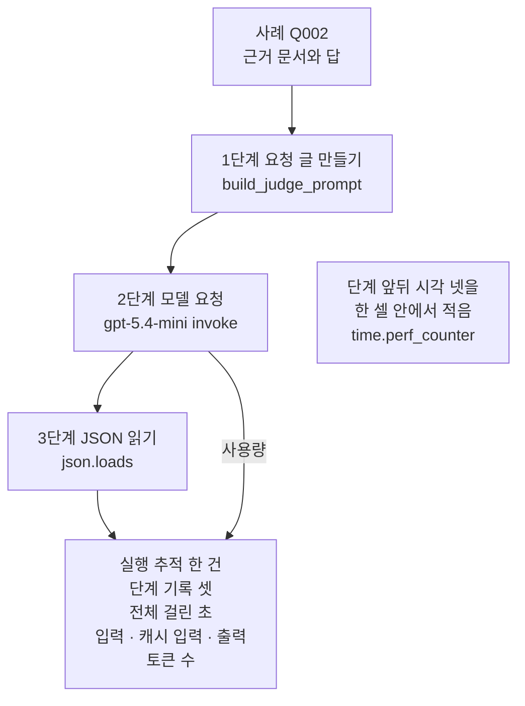
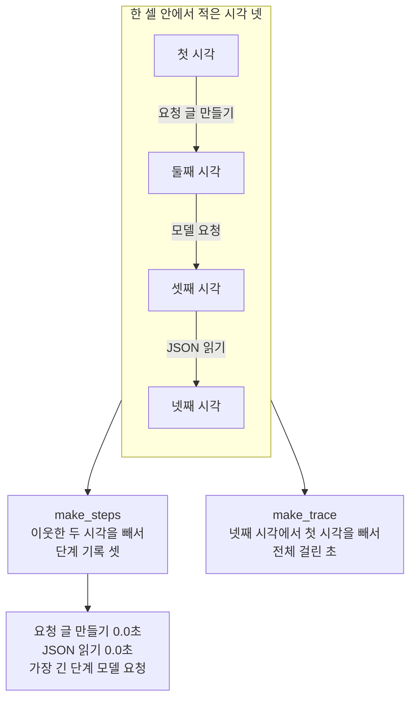
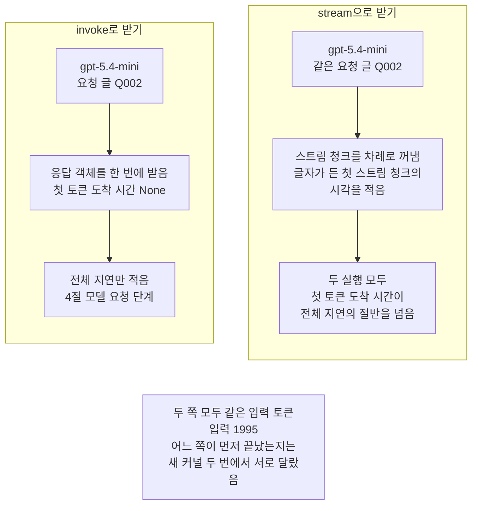
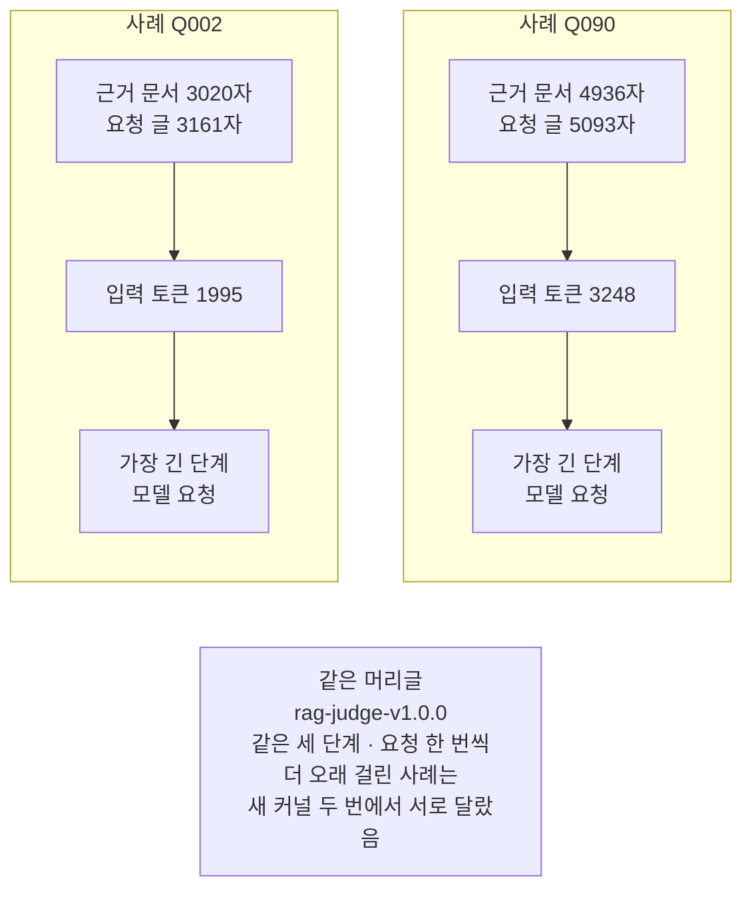

# 05-로컬-트레이싱과-지연

## _src 본문 (HTML 원본)

```html
<!--meta: 강의 1h | 실습 1h | 코드 notebooks/05-로컬-트레이싱과-지연.ipynb | 새 용어 4 -->
<style>html,body{overflow-x:hidden}.notebook,.nb-cell,.nb-main,.nb-input,.nb-result{min-width:0;max-width:100%}.nb-input pre,.nb-output{box-sizing:border-box;max-width:100%;overflow-x:auto}code.nb-source{display:block!important;width:100%!important;min-width:0!important;overflow-x:auto!important;padding:0!important}</style>
<h2 id="b1"><span class="no">1</span>학습 목표</h2><div class="goal"><ul>
<li>판정 요청 한 번을 세 단계로 나누어 단계마다 걸린 초를 잴 수 있습니다.</li>
<li>단계 기록과 사용량을 실행 추적 한 건으로 묶어 노트북 안에 남길 수 있습니다.</li>
<li>스트리밍으로 받아 첫 토큰 도착 시간과 전체 지연을 따로 잴 수 있습니다.</li>
</ul></div>
<h2 id="b2"><span class="no">2</span>이 내용을 배우는 이유</h2><p>평가 모델에 판정을 맡기면 요청 한 번마다 기다리는 시간이 생깁니다. 전체 시간 하나만 적으면 어느 단계에서 시간을 썼는지 알 수 없습니다. 단계 사이마다 시각을 적어 두면 오래 걸린 곳을 단계 이름으로 가리킬 수 있습니다.</p><p>답을 흘려 보여 주는 화면에서는 첫 글자가 언제 오는지도 봐야 합니다. 첫 글자를 받기까지의 시간과 답을 다 받기까지의 시간은 서로 다른 값입니다. 이 절은 두 시간을 따로 재고, 사용량과 함께 한 기록에 남깁니다.</p>
<h2 id="b3"><span class="no">3</span>앞에서 배운 내용</h2><p>02절은 판정 요청 글을 만드는 함수 <code>build_judge_prompt</code>와 그 글을 보내고 JSON을 읽는 함수 <code>judge_once</code>를 만들었습니다. 03·04절은 같은 두 함수로 판정을 여러 번 받았습니다. 04절은 제시 라벨과 판정의 일치율을 셌고, 이 챕터는 지금까지 걸린 시간을 재지 않았습니다.</p><p>이 절은 02절 함수 <code>build_judge_prompt</code>를 다시 씁니다. 앞에서 배운 함수는 <code>rag_tools.py</code>에 모아 두었습니다. 파일을 열면 코드를 볼 수 있습니다. 노트북과 같은 폴더(<code>notebooks/</code>)에 있는 파일입니다.</p><p>함수 <code>judge_once</code>는 이 절에서 부르지 않습니다. 모델 요청과 JSON 읽기를 따로 재려고 두 단계를 셀 안에 풀어 적었습니다. 판정 머리글은 02절 근거 충실도 판 <code>rag-judge-v1.0.0</code>을 그대로 다시 적었습니다.</p><p>요청 앞뒤에서 <code>time.perf_counter()</code>를 읽어 빼는 방법은 Ch 2 12절과 Ch 6 05절에서도 썼습니다. Ch 6 06절은 그 값을 칸 「걸린 초」에 적었습니다. 사용량 <code>usage_metadata</code>와 캐시 입력 토큰 수도 같은 절에서 읽었습니다. 메서드 <code>stream()</code>과 스트림 청크 합치기는 Ch 6 04절에서 배웠습니다.</p>
<h2 id="b4"><span class="no">4</span>핵심 개념</h2><h3>비유로 시작하기</h3><p>01절의 탁자에서 사과 한 알을 저울에 다는 일을 세 자리로 나눕니다. 바구니에서 사과를 꺼내고, 보라 저울에 올려 눈금을 기다리고, 눈금을 읽은 뒤 작은 바구니로 옮깁니다. 자리마다 모래시계를 하나씩 두고, 그 자리 일을 하는 동안만 모래가 흐른다고 해 봅니다.</p><p>일을 마친 뒤 모래시계 셋을 보면 어느 자리에서 시간을 가장 많이 썼는지 한눈에 보입니다. 이 절에서 사과를 꺼내는 자리는 요청 글 만들기, 저울은 평가 모델에 보내는 요청, 눈금 읽기는 JSON 읽기입니다. 모래시계 하나는 단계 기록 하나이고, 탁자 한 줄 전체가 실행 추적 한 건입니다.</p>
{{img:05-5-구간마다-모래시계|흰 바탕에 긴 나무 탁자가 있고 탁자 위에 왼쪽부터 빨간 사과가 가득 든 바구니, 사과 한 알이 올라간 보라색 부엌 저울, 사과 한 알이 든 작은 바구니가 한 줄로 놓여 있으며 세 자리 앞마다 같은 크기의 모래시계가 하나씩 서 있는데 두 바구니 앞 모래시계는 위쪽에 모래가 남아 있고 아래쪽에 조금만 쌓였으며 저울 앞 모래시계만 위쪽이 비고 아래쪽에 모래가 쌓인 그림|세 자리 앞 모래시계 가운데 저울 앞 모래시계만 모래가 거의 다 내려왔습니다.}}
<p class="look"><b>그림 읽기</b> — 탁자 위에 자리가 셋 있습니다. 왼쪽부터 사과가 가득 든 바구니, 사과 한 알을 올린 보라 저울, 사과 한 알이 든 작은 바구니입니다. 자리마다 앞에 같은 크기의 모래시계가 하나씩 서 있습니다. 두 바구니 앞 모래시계는 위쪽에 모래가 남아 있고, 저울 앞 모래시계만 위쪽이 비고 아래쪽에 모래가 쌓였습니다. 저울에 올려 기다린 자리에서 모래가 가장 많이 흘렀다는 뜻입니다.</p>
<table><thead><tr><th>말</th><th>뜻</th></tr></thead><tbody><tr><td>실행 추적(trace)</td><td>요청 한 번이 지나간 단계와 걸린 시간, 사용량을 한데 적은 기록입니다. 하루 일정표 한 장에 그날 한 일을 차례로 적는 것과 같습니다.</td></tr><tr><td>단계 기록(span)</td><td>실행 추적 안에서 단계 하나의 이름과 걸린 초를 적은 기록입니다. 일정표의 한 줄에 해당합니다.</td></tr><tr><td>전체 지연(latency)</td><td>요청 한 번의 시작부터 끝까지 걸린 시간입니다. 식당에서 주문한 때부터 음식이 모두 나올 때까지 기다린 시간과 같습니다.</td></tr><tr><td>첫 토큰 도착 시간(TTFT, time to first token)</td><td>요청을 보낸 때부터 답의 첫 글자가 도착할 때까지 걸린 시간입니다. 첫 접시가 나올 때까지 기다린 시간과 같습니다.</td></tr></tbody></table>
<p>새 용어를 이 절 코드에서 보면 이렇습니다. 실행 추적은 함수 <code>make_trace</code>가 만든 딕셔너리 한 개입니다. 단계 기록은 함수 <code>make_steps</code>가 만든 목록의 딕셔너리 하나하나입니다. 전체 지연은 노트북 5절과 7절에서, 첫 토큰 도착 시간은 7절에서 잽니다.</p>
{{mermaid:05-1-판정-요청-한-번의-실행-추적|위에서 아래로 읽는 그림으로 초록 상자 사례 Q002 근거 문서와 답에서 파란 상자 1단계 요청 글 만들기 build_judge_prompt, 보라 상자 2단계 모델 요청 gpt-5.4-mini invoke, 파란 상자 3단계 JSON 읽기 json.loads를 차례로 지나 노란 상자 실행 추적 한 건 단계 기록 셋 전체 걸린 초 입력 캐시 입력 출력 토큰 수로 이어지고, 보라 상자에서 노란 상자로 사용량이라고 적힌 화살표가 따로 가며, 오른쪽 회색 상자에 단계 앞뒤 시각 넷을 한 셀 안에서 적음 time.perf_counter가 적힌 그림|판정 요청 한 번은 세 단계를 지나고, 단계 기록 셋과 사용량이 실행 추적 한 건으로 모입니다.}}
<p class="look"><b>도식 읽기</b> — 위에서 아래로 읽습니다. 초록 상자 사례 Q002가 세 단계를 차례로 지납니다. 파란 상자 둘은 노트북 안에서 하는 일이고 가운데 보라 상자만 평가 모델에 보내는 요청입니다. 보라 상자에서 따로 나온 「사용량」 화살표는 응답 객체의 사용량이 실행 추적으로 들어간다는 뜻입니다. 맨 아래 노란 상자가 실행 추적 한 건이고, 오른쪽 회색 상자는 시각을 적는 방법입니다.</p>
<h3>시각은 한 셀 안에서 적습니다</h3><p>시각 넷은 요청 하나를 보내는 셀 안에서 모두 적습니다. 셀을 나누어 실행하면 다음 셀을 실행하기까지 기다린 시간도 함께 들어가기 때문입니다. 그래서 모델 요청과 JSON 읽기를 함수 <code>judge_once</code>로 묶지 않고 셀 안에 풀어 적었습니다. 이웃한 두 시각의 차가 그 사이 단계의 걸린 초입니다.</p>
<h3>로컬 트레이싱</h3><p>이 절의 실행 추적은 서버로 보내지 않고 노트북 안의 딕셔너리로만 남깁니다. 그래서 로컬 트레이싱이라고 부릅니다. 이 절은 LangSmith 키 없이 실행했고 기록을 올리지 않았습니다.</p><p>LangSmith 안내는 LLM 호출이나 요청 글 만들기 같은 일 한 단위를 실행(run)이라고 부릅니다. 한 작업의 실행을 모은 것은 실행 추적(trace)이라고 부릅니다. 실행 하나는 OpenTelemetry의 span으로 생각해도 된다고 적습니다.</p>
<h3>잰 시간에 들어 있는 것</h3><p>시각은 이 노트북을 실행한 컴퓨터에서 읽었습니다. 그래서 모델 요청 단계에는 네트워크를 오간 시간과 서버에서 처리한 시간이 함께 들어 있습니다. 이 절은 둘을 가르지 않았습니다. 걸린 시간은 기기·네트워크·실행 때에 따라 달라지므로 한 번 잰 값을 그대로 견주지 않습니다.</p>
<h3>다른 상황에 적용</h3><p>Ch 14에서 만든 RAG 흐름이라면 검색, 요청 글 만들기, 답 모델 요청, 근거 검사를 단계로 나눌 수 있습니다. 단계 사이마다 시각을 적는 방법은 이 절과 같습니다. 이 절은 판정 요청 한 가지만 쟀고 RAG 흐름은 이번에 재지 않았습니다.</p>
<h2 id="b5"><span class="no">5</span>실행 예제</h2><p>노트북은 02절 근거 충실도 머리글로 사례 Q002의 판정 요청 한 번을 세 단계로 나누어 보냅니다. 시각 넷으로 단계 기록 셋을 만들고 가장 긴 단계와 전체 걸린 초를 찾습니다. 사용량과 함께 실행 추적 한 건으로 묶어 JSON 모양으로 펼쳐 봅니다. 같은 요청 글을 스트리밍으로 한 번 더 보내 첫 토큰 도착 시간을 재고, 마지막에 사례를 Q090으로 바꿔 봅니다.</p><p>평가 모델 <code>gpt-5.4-mini</code>에 보내는 요청은 세 번이고 임베딩 요청은 없습니다. 예상 비용은 미화 0.01달러 아래이고 실제 청구 금액과는 다를 수 있습니다. 걸린 시간은 기기·네트워크·실행 때에 따라 달라지므로 여러분 실행의 초 값은 교재와 다를 수 있습니다. 새로 쓰는 파일은 없습니다.</p>
{{mermaid:05-2-시각-넷과-단계-기록-셋|위쪽 칸 한 셀 안에서 적은 시각 넷에 회색 상자 첫 시각 둘째 시각 셋째 시각 넷째 시각이 세로로 놓이고 그 사이 화살표에 요청 글 만들기 모델 요청 JSON 읽기가 적혀 있으며 칸 아래로 파란 상자 둘 make_steps 이웃한 두 시각을 빼서 단계 기록 셋과 make_trace 넷째 시각에서 첫 시각을 빼서 전체 걸린 초로 갈라지고 make_steps 아래 노란 상자에 요청 글 만들기 0.0초 JSON 읽기 0.0초 가장 긴 단계 모델 요청이 적힌 그림|시각 넷의 이웃한 차가 단계 기록 셋이 되고, 두 사례와 두 실행 모두 가장 긴 단계는 모델 요청이었습니다.}}
<p class="look"><b>도식 읽기</b> — 위쪽 칸은 노트북 4절 셀 하나에서 적은 시각 넷입니다. 시각과 시각 사이 화살표에 그 사이에 한 단계 이름이 적혀 있습니다. 칸 아래 왼쪽 파란 상자는 이웃한 두 시각을 빼서 단계 기록을 만듭니다. 오른쪽 파란 상자는 넷째 시각에서 첫 시각을 빼서 전체 걸린 초를 냅니다. 노란 상자는 새 커널 두 번 실행에서 두 사례 모두 같았던 관찰입니다.</p>
{{notebook:05-로컬-트레이싱과-지연}}
<p class="look"><b>확인할 점</b> — 4절 출력 <code>적은 시각 수: 4</code>와 5절 출력 <code>가장 긴 단계: 모델 요청</code>을 확인합니다. 6절 출력 <code>실행 추적 칸:</code> 뒤의 칸 여섯과 토큰 수도 봅니다. 7절 출력 <code>첫 토큰이 끝보다 먼저 왔는가: True</code>와 줄 <code>invoke | None</code>을 확인합니다. 8절 출력 <code>요청 글 글자 수 Q002 Q090: 3161 5093</code>도 봅니다.</p>
<h2 id="b6"><span class="no">6</span>실험 결과 해석</h2><p>사례 Q002의 판정 요청 한 번에서 요청 글 만들기와 JSON 읽기는 <code>0.0</code>초였습니다. 소수 셋째 자리에서 0이 될 만큼 짧았다는 뜻입니다. 모델 요청은 교재 출력에서 0.993초였고 전체 걸린 초는 0.994초였습니다. 새 커널로 두 번 실행했을 때 가장 긴 단계는 두 번 모두 모델 요청이었고 초 값은 서로 달랐습니다.</p><p>이 요청의 사용량은 입력 1995, 캐시 입력 1792, 출력 42토큰이었고 두 실행 모두 같았습니다. 이 노트북의 첫 요청인데도 캐시 입력이 있었습니다. 02~04절도 같은 요청 글을 보냈으니 그때 처리해 둔 앞부분을 다시 썼을 수 있으나 까닭은 확인하지 않았습니다. 여러분 실행에서는 캐시 입력이 0일 수 있습니다.</p>
{{mermaid:05-3-invoke와-stream|위쪽에 칸 둘이 나란히 있고 아래에 회색 상자 하나가 있는 그림으로 왼쪽 칸 invoke로 받기에는 보라 상자 gpt-5.4-mini 요청 글 Q002에서 노란 상자 응답 객체를 한 번에 받음 첫 토큰 도착 시간 None을 지나 노란 상자 전체 지연만 적음 4절 모델 요청 단계로 이어지고 오른쪽 칸 stream으로 받기에는 보라 상자 gpt-5.4-mini 같은 요청 글 Q002에서 파란 상자 스트림 청크를 차례로 꺼냄 글자가 든 첫 스트림 청크의 시각을 적음을 지나 노란 상자 두 실행 모두 첫 토큰 도착 시간이 전체 지연의 절반을 넘음으로 이어지며 맨 아래 회색 상자에 두 쪽 모두 같은 입력 토큰 입력 1995 어느 쪽이 먼저 끝났는지는 새 커널 두 번에서 서로 달랐음이 적힌 그림|메서드 stream으로 받으면 첫 토큰 도착 시간을 따로 적을 수 있고, 두 실행 모두 그 시간이 전체 지연의 절반을 넘었습니다.}}
<p class="look"><b>도식 읽기</b> — 위쪽 왼쪽 칸이 노트북 4절의 invoke 요청이고 오른쪽 칸이 7절의 stream 요청입니다. 두 칸의 보라 상자는 같은 요청 글을 받은 같은 평가 모델입니다. 왼쪽은 응답 객체를 한 번에 받아 첫 토큰 도착 시간 자리가 None입니다. 오른쪽은 글자가 든 첫 스트림 청크의 시각을 적어 첫 토큰 도착 시간을 따로 냅니다. 맨 아래 회색 상자는 두 칸에 모두 해당합니다.</p>
<p>같은 요청 글을 스트리밍으로 받자 교재 출력에서 첫 토큰 도착 시간은 1.275초, 전체 지연은 1.417초였습니다. 두 실행 모두 첫 토큰 도착 시간이 전체 지연의 절반을 넘었습니다. 판정 답이 짧은 JSON 한 줄일 때 본 모양이고, 긴 답에서도 같다고 말할 수 없습니다. 메서드 <code>invoke()</code> 요청과 어느 쪽이 먼저 끝났는지는 두 실행에서 서로 달랐습니다.</p><p>스트리밍 요청의 입력 1995토큰과 캐시 입력 1792토큰은 두 실행 모두 같았습니다. 받은 스트림 청크 수와 출력 토큰 수는 두 실행에서 달랐습니다. 걸린 시간뿐 아니라 출력 토큰 수도 요청마다 기록해 두어야 하는 까닭입니다.</p><p>값 바꿔 보기에서 사례를 Q090으로 바꾸자 요청 글이 3161자에서 5093자로 길어졌습니다. 입력 토큰도 1995에서 3248로 늘었고, 가장 긴 단계는 여전히 모델 요청이었습니다. 전체 걸린 초는 교재 출력에서 Q002 0.994초, Q090 0.872초였습니다. 그러나 두 실행에서 어느 사례가 더 오래 걸렸는지가 서로 달랐습니다. 그래서 요청 글 길이가 걸린 시간을 바꿨는지는 이번 결과로 말할 수 없습니다.</p>
{{mermaid:05-4-Q002와-Q090|위쪽에 칸 둘이 나란히 있고 아래에 회색 상자 하나가 있는 그림으로 왼쪽 칸 사례 Q002에는 초록 상자 근거 문서 3020자 요청 글 3161자에서 노란 상자 입력 토큰 1995를 지나 노란 상자 가장 긴 단계 모델 요청으로 이어지고 오른쪽 칸 사례 Q090에는 초록 상자 근거 문서 4936자 요청 글 5093자에서 노란 상자 입력 토큰 3248을 지나 노란 상자 가장 긴 단계 모델 요청으로 이어지며 맨 아래 회색 상자에 같은 머리글 rag-judge-v1.0.0 같은 세 단계 요청 한 번씩 더 오래 걸린 사례는 새 커널 두 번에서 서로 달랐음이 적힌 그림|요청 글이 긴 Q090은 입력 토큰이 더 많았지만, 더 오래 걸린 사례는 두 실행에서 서로 달랐습니다.}}
<p class="look"><b>도식 읽기</b> — 위쪽 왼쪽 칸이 사례 Q002이고 오른쪽 칸이 노트북 8절 값 바꿔 보기의 Q090입니다. 초록 상자를 견주면 Q090의 근거 문서와 요청 글이 더 깁니다. 노란 상자의 입력 토큰도 Q090이 더 많고, 가장 긴 단계는 두 사례 모두 모델 요청입니다. 맨 아래 회색 상자는 두 칸에 모두 해당합니다. 걸린 초는 두 실행에서 어느 쪽이 컸는지가 뒤바뀌어 그림에 넣지 않았습니다.</p>
<p>단계 초와 전체 걸린 초는 따로 반올림해 출력하므로 끝자리가 서로 맞지 않을 수 있습니다. 반올림 전의 단계 초를 더하면 전체와 같습니다. 걸린 시간을 견주려면 같은 요청을 여러 번 보내 모은 값을 봐야 합니다. 이 절은 요청을 한 번씩만 보냈고 여러 번 모아 보는 일은 하지 않았습니다.</p>
<h2 id="b7"><span class="no">7</span>주의할 점과 실무 메모</h2><ul><li>걸린 시간은 이 노트북을 실행한 컴퓨터에서 <code>time.perf_counter()</code>로 잰 값입니다. 기기·네트워크·실행 때에 따라 달라집니다.</li><li>모델 요청 단계에는 네트워크를 오간 시간과 서버에서 처리한 시간이 함께 들어 있습니다. 이 절은 둘을 가르지 않았습니다.</li><li>잰 초에는 <code>assert</code>를 쓰지 않았습니다. 결론에는 새 커널 두 번 실행에서 같았던 관찰만 적었습니다.</li><li>요청은 조건마다 한 번씩만 보냈습니다. 한 번 잰 초로 두 사례나 두 받는 방법의 빠르기를 가르지 않았습니다.</li><li>첫 토큰 도착 시간은 글자가 든 첫 스트림 청크를 받은 때로 쟀습니다. 글자가 없는 스트림 청크가 몇 개였는지는 이번에 세지 않았습니다.</li><li>캐시 입력 토큰 수는 이 노트북의 첫 요청에도 있었습니다. 생긴 까닭은 확인하지 않았고, 생긴다고 보장되지도 않습니다.</li><li>사용량 안쪽 딕셔너리에는 칸 <code>audio</code>와 <code>cache_read</code>만 보였습니다. 이 절은 캐시 입력 토큰 수만 적었습니다.</li><li>실행 추적은 노트북 안 딕셔너리로만 남기고 파일로 저장하지 않았습니다. LangSmith 화면과 업로드는 이번에 실행하지 않았습니다.</li><li>판정 점수가 맞는지는 이 절에서 따지지 않았습니다. 점수와 까닭은 02~04절과 같은 머리글로 받은 값입니다.</li><li>비용은 이 절에서 계산하지 않았습니다. 요청 수와 예상 비용만 준비물에 적었습니다.</li><li>노트북을 쓰기 전에 따로 요청을 보내 본 탐색 실행은 없습니다.</li><li>교재 출력은 Linux의 Python 3.12.13으로 만들었습니다. 다른 판과 Windows·macOS에서는 이번에 실행하지 않았습니다.</li></ul>
<h2 id="b8"><span class="no">8</span>정리와 다음 절</h2><ul><li>판정 요청 한 번을 세 단계로 나누어 단계 기록 셋과 사용량을 실행 추적 한 건에 남겼습니다.</li><li>두 사례와 두 실행 모두 모델 요청 단계가 가장 길었고, 걸린 초는 실행마다 달라 한 번 잰 값으로 견주지 않습니다.</li><li>메서드 <code>stream()</code>으로 받으면 첫 토큰 도착 시간과 전체 지연을 따로 잴 수 있습니다.</li></ul><p><strong>다음 학습과 이어지는 지점</strong> — 06절에서는 대화당 비용을 백분위수로 봅니다.</p>
<h2 id="b9"><span class="no">9</span>복습 문제</h2><details class="quiz" open><summary>문제 4개 · 해설 포함</summary><p class="quiz-q">1. 단계 사이의 시각 넷을 한 셀 안에서 적는 까닭은 무엇입니까?</p><p class="quiz-a">셀을 나누어 실행하면 다음 셀을 실행하기까지 기다린 시간도 단계 시간에 들어가기 때문입니다. 그래서 모델 요청과 JSON 읽기를 한 셀 안에 풀어 적었습니다. 틀렸다면 「핵심 개념」의 「시각은 한 셀 안에서 적습니다」를 다시 읽습니다.</p><p class="quiz-q">2. 메서드 <code>invoke()</code>로 받은 요청의 첫 토큰 도착 시간이 <code>None</code>인 까닭은 무엇입니까?</p><p class="quiz-a">답을 끝까지 받은 뒤에 응답 객체를 한 번에 받아 첫 글자가 도착한 시각을 알 수 없기 때문입니다. 첫 토큰 도착 시간은 <code>stream()</code>으로 받아 글자가 든 첫 스트림 청크의 시각을 적어야 잴 수 있습니다. 틀렸다면 노트북 7절을 다시 읽습니다.</p><p class="quiz-q">3. 요청 글이 더 긴 Q090과 Q002의 걸린 초를 견주어 요청 글 길이의 영향을 말하지 않는 까닭은 무엇입니까?</p><p class="quiz-a">두 사례의 요청을 한 번씩만 보냈고, 새 커널로 두 번 실행했을 때 어느 사례가 더 오래 걸렸는지가 서로 달랐기 때문입니다. 걸린 시간을 견주려면 같은 요청을 여러 번 보내 모은 값을 봐야 합니다. 틀렸다면 「실험 결과 해석」의 다섯째 단락을 다시 읽습니다.</p><p class="quiz-q">4. 실행 추적 한 건에 걸린 초와 토큰 수를 함께 적어 두는 까닭은 무엇입니까?</p><p class="quiz-a">같은 요청의 시간과 사용량을 한 기록에 묶어 두어야 나중에 어느 요청의 값인지 가릴 수 있기 때문입니다. 캐시 입력 토큰 수처럼 요청마다 달라질 수 있는 값도 그 요청의 기록에 남습니다. 틀렸다면 노트북 6절을 다시 읽습니다.</p></details>
<h2 id="b10"><span class="no">10</span>참고 자료</h2><ul><li><div><a href="https://docs.langchain.com/langsmith/observability-concepts">Observability concepts</a></div>확인 2026-09-21 · LangSmith의 실행(run)과 실행 추적(trace)의 뜻.</li><li>Ch 6 06절 — 요청 앞뒤에서 <code>time.perf_counter()</code>로 걸린 초를 재고 사용량을 읽은 자리.</li><li>Ch 6 04절 — <code>stream()</code>으로 스트림 청크를 받아 하나로 합친 자리.</li></ul>
```

## 노트북 셀 (순서대로)

### [0] markdown {'html': 'skip'}

# 로컬 트레이싱과 지연

**이 노트북에서 할 일**

1. 판정 요청 한 번을 세 단계로 나누고 단계마다 걸린 초를 잽니다.
2. 단계 기록과 사용량을 실행 추적 한 건으로 묶어 노트북 안에 남깁니다.
3. 같은 요청을 스트리밍으로 받아 첫 토큰 도착 시간과 전체 지연을 가릅니다.
4. 근거 문서가 더 긴 사례로 바꿔 같은 기록을 한 번 더 남깁니다.

**준비물** — 이 절은 프로젝트 맨 위 폴더의 `.env`에 적어 둔 `OPENAI_API_KEY`를 씁니다.
평가 모델 `gpt-5.4-mini`에 보내는 요청은 세 번이고 임베딩 요청은 없습니다.
예상 비용은 미화 0.01달러 아래이고 실제 청구 금액과는 다를 수 있습니다.
LangSmith 키는 쓰지 않고 실행 추적을 서버로 보내지 않습니다.

걸린 시간은 기기·네트워크·실행 때에 따라 달라집니다.
그래서 이 노트북에 찍힌 초 값은 여러분 실행과 다를 수 있습니다.
읽는 파일은 이 챕터 자료 파일 하나이고 새로 쓰는 파일은 없습니다.
교재 출력을 만든 실행에서는 노트북 전체가 약 5초 만에 끝났습니다.

**기준 버전** — 첫 셀에서 LangChain 1.4.0과 langchain-openai 1.6.1을 설치합니다.
키를 읽는 python-dotenv 1.2.3도 함께 설치합니다.
교재 출력은 Linux의 Python 3.12.13으로 만들었습니다.
다른 판과 Windows·macOS에서는 이번에 실행하지 않았습니다.

**강의와 실습 범위** — 강의 시간에는 3~6절을 읽습니다.
판정 요청 한 번을 단계로 나누고 실행 추적 한 건으로 묶는 자리입니다.
7절은 스트리밍으로 첫 토큰 도착 시간을 잽니다.
8절은 값 바꿔 보기이고 7절과 함께 실습 시간에 실행합니다.

실습 폴더 `labs/part4/ch15-evaluation-advanced`에서 `uv sync --locked`를 실행합니다.
그다음 이 폴더의 `.venv` 커널을 고르고 첫 셀부터 순서대로 실행합니다.

### [1] markdown {'html': 'skip'}

## 오늘 볼 그림


위에서 아래로 읽습니다. 초록 상자 사례 Q002가 세 단계를 차례로 지납니다.
파란 상자 둘은 노트북 안에서 하는 일이고 가운데 보라 상자만 평가 모델에 보내는 요청입니다.
맨 아래 노란 상자가 단계 기록 셋과 사용량을 묶은 실행 추적 한 건입니다.

### [2] markdown {}

## 1. 준비

첫 셀은 패키지 세 개를 설치하고 설치된 판 번호를 출력합니다.
설치에는 몇십 초가 걸릴 수 있습니다.

### [3] code {'execution': {'iopub.execute_input': '2026-09-21T16:59:47.483230Z', 'iopub.status.busy': '2026-09-21T16:59:47.483078Z', 'iopub.status.idle': '2026-09-21T16:59:47.911473Z', 'shell.execute_reply': '2026-09-21T16:59:47.910545Z'}, 'lesson_role': 'setup'}

```python
# 이 절에서 쓰는 패키지를 설치하고 버전을 확인합니다
%pip install -q "langchain==1.4.0" "langchain-openai==1.6.1" "python-dotenv==1.2.3"
from importlib.metadata import version

print("langchain:", version("langchain"))
print("langchain-openai:", version("langchain-openai"))
print("python-dotenv:", version("python-dotenv"))
```

출력:
```
Note: you may need to restart the kernel to use updated packages.
langchain: 1.4.0
langchain-openai: 1.6.1
python-dotenv: 1.2.3

```

### [4] markdown {}

**결과 읽기** — 설치가 끝나면 판 번호 세 줄이 보입니다.
출력 줄 `langchain: 1.4.0`과 `langchain-openai: 1.6.1`이 실습 폴더 잠금과 같은 판입니다.
이 노트북의 출력은 2026-09-21에 이 판으로 실행한 결과입니다.

다음 셀은 이 절에서 쓸 이름을 불러오고 02절 함수 하나를 도구 파일에서 가져옵니다.
이름 `time`은 걸린 시간을 잴 때 씁니다(Ch 6 06절).

앞에서 배운 함수는 `rag_tools.py`에 모아 두었습니다. 파일을 열면 코드를 볼 수 있습니다. 노트북과 같은 폴더(`notebooks/`)에 있는 파일입니다.
이 노트북은 02절 `build_judge_prompt()`만 가져옵니다.

### [5] code {'execution': {'iopub.execute_input': '2026-09-21T16:59:47.913254Z', 'iopub.status.busy': '2026-09-21T16:59:47.913148Z', 'iopub.status.idle': '2026-09-21T16:59:48.209920Z', 'shell.execute_reply': '2026-09-21T16:59:48.209539Z'}, 'lesson_role': 'setup'}

```python
# 자료 읽기·시간 재기·폴더 확인에 쓸 이름과 모델을 준비하는 이름을 불러옵니다
import json
import os
import time

from langchain.chat_models import init_chat_model

# Ch 15 02절에서 배운 함수 하나를 도구 파일에서 가져옵니다
from rag_tools import build_judge_prompt

print("불러온 이름:", "json", "os", "time", "init_chat_model")
```

출력:
```
불러온 이름: json os time init_chat_model

```

### [6] markdown {}

**결과 읽기** — 출력 줄 `불러온 이름: json os time init_chat_model`로 이름 네 개를 불러왔습니다.
도구 파일에서 가져온 함수 `build_judge_prompt`는 출력하지 않습니다.
이 함수는 02절에서 쓰던 인자 그대로입니다.

## 2. 키와 모델 준비

이 절도 02~04절과 같은 평가 모델 `gpt-5.4-mini`를 부릅니다.
모델을 만드는 설정 값도 04절과 같습니다.

### [7] markdown {}

API 키가 있는지 확인합니다. `True` 값이 나오면 다음으로 넘어갑니다.

### [8] code {'execution': {'iopub.execute_input': '2026-09-21T16:59:48.210629Z', 'iopub.status.busy': '2026-09-21T16:59:48.210573Z', 'iopub.status.idle': '2026-09-21T16:59:48.213790Z', 'shell.execute_reply': '2026-09-21T16:59:48.213461Z'}, 'lesson_role': 'setup'}

```python
# .env 파일에서 OpenAI API 키를 읽습니다(키 값은 출력하지 않습니다)
import os
from dotenv import find_dotenv, load_dotenv

env_path = find_dotenv(usecwd=True)
load_dotenv(env_path)
has_key = os.getenv("OPENAI_API_KEY") is not None
print("OPENAI_API_KEY 설정 여부:", has_key)
assert has_key, "프로젝트 폴더의 .env 파일에 OPENAI_API_KEY를 적어 주세요."
```

출력:
```
OPENAI_API_KEY 설정 여부: True

```

### [9] markdown {}

실습에 쓸 모델을 준비합니다.
temperature 값을 0으로 두어도 판정 글과 걸린 시간이 매번 같다고 보장하지는 않습니다.

### [10] code {'execution': {'iopub.execute_input': '2026-09-21T16:59:48.214393Z', 'iopub.status.busy': '2026-09-21T16:59:48.214336Z', 'iopub.status.idle': '2026-09-21T16:59:48.660776Z', 'shell.execute_reply': '2026-09-21T16:59:48.660505Z'}}

```python
# 실습에 쓸 모델을 준비합니다
model = init_chat_model(
    "openai:gpt-5.4-mini",
    temperature=0,
    reasoning_effort="none",
)
print("모델 이름:", model.model_name)
print("temperature:", model.temperature)
```

출력:
```
모델 이름: gpt-5.4-mini
temperature: 0.0

```

### [11] markdown {}

**결과 읽기** — 모델 이름 `gpt-5.4-mini`, temperature `0.0`이 보이면 준비가 끝났습니다.
이 노트북의 출력은 2026-09-21에 이 모델로 실행한 결과입니다.

### [12] markdown {}

## 3. 판정 요청 한 건

이 절은 02절에서 받은 근거 충실도 판정 한 번을 다시 보냅니다.
이번에는 판정 점수보다 요청 한 번이 어디에서 시간을 쓰는지 봅니다.

먼저 노트북을 연 자리에서 프로젝트 맨 위를 찾습니다.
01~04절과 같은 자리 찾기 셀입니다.

### [13] code {'execution': {'iopub.execute_input': '2026-09-21T16:59:48.661496Z', 'iopub.status.busy': '2026-09-21T16:59:48.661441Z', 'iopub.status.idle': '2026-09-21T16:59:48.663595Z', 'shell.execute_reply': '2026-09-21T16:59:48.663288Z'}, 'lesson_role': 'setup'}

```python
# 노트북을 어느 폴더에서 열어도 프로젝트 맨 위를 찾게 후보 세 개를 차례로 봅니다
candidates = [".", "../../..", "../../../.."]
root_path = None
for candidate in candidates:
    if os.path.exists(candidate + "/labs/part4/ch15-evaluation-advanced/data"):
        root_path = candidate
        break
print("찾은 프로젝트 맨 위:", root_path)
assert root_path is not None, "notebooks 폴더나 실습 폴더 맨 위에서 노트북을 열어 주세요."
```

출력:
```
찾은 프로젝트 맨 위: .

```

### [14] markdown {}

**결과 읽기** — 출력 줄 `찾은 프로젝트 맨 위:` 뒤에 점 하나나 위로 올라가는 자리가 보입니다.

다음 셀은 04절과 같은 방법으로 이 챕터 자료 파일을 읽습니다.
이 절에서 쓸 첫 사례와 마지막 사례도 꺼내 둡니다.

### [15] code {'execution': {'iopub.execute_input': '2026-09-21T16:59:48.664132Z', 'iopub.status.busy': '2026-09-21T16:59:48.664083Z', 'iopub.status.idle': '2026-09-21T16:59:48.666581Z', 'shell.execute_reply': '2026-09-21T16:59:48.666177Z'}}

```python
# 이 챕터 자료 파일을 읽어 평가 사례 목록을 만들고 첫 사례와 마지막 사례를 꺼냅니다(읽기만 합니다)
data_path = root_path + "/labs/part4/ch15-evaluation-advanced/data"
with open(data_path + "/evaluation-cases.json", encoding="utf-8") as file:
    case_file = json.loads(file.read())
cases = case_file["cases"]
first_case = cases[0]
last_case = cases[2]
print("평가 사례 수:", len(cases))
print("첫 사례와 마지막 사례:", first_case["qid"], last_case["qid"])
print("근거 문서 글자 수:", len(first_case["context"]), len(last_case["context"]))
```

출력:
```
평가 사례 수: 3
첫 사례와 마지막 사례: Q002 Q090
근거 문서 글자 수: 3020 4936

```

### [16] markdown {}

**결과 읽기** — 출력 줄 `평가 사례 수: 3`으로 사례는 세 건입니다.
출력 줄 `첫 사례와 마지막 사례: Q002 Q090`이 이 절에서 쓸 두 사례입니다.
출력 줄 `근거 문서 글자 수: 3020 4936`처럼 Q090의 근거 문서가 더 깁니다.

4~7절은 사례 Q002 하나로 요청을 보냅니다.
8절 값 바꿔 보기에서 근거 문서가 더 긴 Q090으로 바꿉니다.
다음 셀은 02절 근거 충실도의 판정 머리글을 다시 적습니다.

### [17] code {'execution': {'iopub.execute_input': '2026-09-21T16:59:48.667123Z', 'iopub.status.busy': '2026-09-21T16:59:48.667068Z', 'iopub.status.idle': '2026-09-21T16:59:48.668775Z', 'shell.execute_reply': '2026-09-21T16:59:48.668483Z'}}

```python
# 02절 근거 충실도의 두 칸 짝과 판정 머리글 rag-judge-v1.0.0을 다시 적습니다
ground_pair = {"답": "response", "근거 문서": "context"}
ground_rule = "답이 근거 문서로 뒷받침되면 1, 아니면 0을 판정하세요."
output_rule = 'JSON만 출력하세요: {"score": 0 또는 1, "reason": "한 문장"}.'
judge_version = "rag-judge-v1.0.0"
judge_head = ground_rule + "\n" + output_rule
print("판 이름:", judge_version)
print("머리글:")
print(judge_head)
```

출력:
```
판 이름: rag-judge-v1.0.0
머리글:
답이 근거 문서로 뒷받침되면 1, 아니면 0을 판정하세요.
JSON만 출력하세요: {"score": 0 또는 1, "reason": "한 문장"}.

```

### [18] markdown {}

**결과 읽기** — 출력 줄 `판 이름: rag-judge-v1.0.0`은 02절이 붙인 판 이름입니다.
라벨 줄 `머리글:` 아래 두 줄이 기준 문장과 출력 모양입니다.
02절 근거 충실도 머리글과 글자까지 같은 글입니다.

이 절은 머리글 한 판만 씁니다.
판정 점수가 맞는지는 02~04절에서 봤으니 이 절에서는 다시 따지지 않습니다.

## 4. 세 단계로 나누어 시각 적기

02절 함수 `build_judge_prompt()`는 머리글과 사례 두 칸으로 판정 요청 글을 만들었습니다.
02절 함수 `judge_once()`는 그 글을 모델에 보내고 받은 JSON 글을 읽었습니다.
그래서 판정 한 번은 요청 글 만들기, 모델 요청, JSON 읽기의 세 단계입니다.
다음 셀은 세 단계의 이름을 차례대로 적습니다.

### [19] code {'execution': {'iopub.execute_input': '2026-09-21T16:59:48.669352Z', 'iopub.status.busy': '2026-09-21T16:59:48.669297Z', 'iopub.status.idle': '2026-09-21T16:59:48.670901Z', 'shell.execute_reply': '2026-09-21T16:59:48.670538Z'}}

```python
# 판정 요청 한 번을 나눌 세 단계의 이름을 차례대로 적습니다
step_names = ["요청 글 만들기", "모델 요청", "JSON 읽기"]
print("단계 이름:", step_names)
print("단계 수:", len(step_names))
```

출력:
```
단계 이름: ['요청 글 만들기', '모델 요청', 'JSON 읽기']
단계 수: 3

```

### [20] markdown {}

**결과 읽기** — 출력 줄 `단계 이름:` 뒤 목록이 세 단계의 차례입니다.
출력 줄 `단계 수: 3`처럼 판정 요청 한 번을 세 단계로 나눕니다.

단계마다 걸린 시간을 재려면 단계와 단계 사이의 시각을 적어 둡니다.
Ch 6 06절 함수 `timed_invoke()`는 요청 앞뒤 두 시각만 적었습니다.
이번에는 세 단계의 앞뒤에 시각 넷을 적습니다.
시각은 Ch 6 06절처럼 `time.perf_counter()`로 읽고, 두 값을 빼면 그 사이에 걸린 초입니다.

네 시각은 모두 한 셀 안에서 적습니다.
셀을 나누어 실행하면 셀과 셀 사이에 기다린 시간도 함께 들어가기 때문입니다.
그래서 모델 요청과 JSON 읽기는 02절 `judge_once()`를 부르지 않고 셀 안에 풀어 적습니다.
다음 셀은 사례 Q002의 판정 요청 한 번을 보냅니다.

### [21] code {'execution': {'iopub.execute_input': '2026-09-21T16:59:48.671394Z', 'iopub.status.busy': '2026-09-21T16:59:48.671348Z', 'iopub.status.idle': '2026-09-21T16:59:49.667847Z', 'shell.execute_reply': '2026-09-21T16:59:49.667160Z'}}

```python
# 사례 Q002의 판정 요청 한 번을 세 단계로 나누고 단계 사이마다 시각을 적습니다(모델 요청 1번)
time_marks = [time.perf_counter()]
prompt_text = build_judge_prompt(judge_head, ground_pair, first_case)
time_marks.append(time.perf_counter())
reply = model.invoke(prompt_text)
time_marks.append(time.perf_counter())
verdict = json.loads(reply.text)
time_marks.append(time.perf_counter())
print("적은 시각 수:", len(time_marks))
print("점수:", verdict["score"], "| 까닭:", verdict["reason"])
```

출력:
```
적은 시각 수: 4
점수: 1 | 까닭: 근거 문서 4항에 도서는 한 번에 7권까지, 대출 기간은 14일이라고 명시되어 있습니다.

```

### [22] markdown {}

**결과 읽기** — 출력 줄 `적은 시각 수: 4`는 세 단계의 앞뒤에 적은 시각의 수입니다.
출력 줄 `점수:` 뒤가 평가 모델의 판정이고, 이 셀에서 모델 요청이 한 번 나갔습니다.

이번 실행에서는 점수 1을 받았습니다.
까닭은 근거 문서 4항에 도서 7권과 14일이 적혀 있다는 문장이었습니다.
까닭 글은 모델이 쓴 문장이라 실행마다 달라질 수 있습니다.

목록 `time_marks`에는 시각 넷이 차례로 들어 있습니다.
이웃한 두 시각을 빼면 그 사이 단계에 걸린 초가 나옵니다.
다음 셀은 이 계산을 함수 하나로 묶습니다.

### [23] code {'execution': {'iopub.execute_input': '2026-09-21T16:59:49.669456Z', 'iopub.status.busy': '2026-09-21T16:59:49.669325Z', 'iopub.status.idle': '2026-09-21T16:59:49.672450Z', 'shell.execute_reply': '2026-09-21T16:59:49.671803Z'}}

```python
# 단계 이름 목록과 시각 목록으로, 단계마다 걸린 초를 담은 단계 기록 목록을 만듭니다
def make_steps(names, marks):
    steps = []
    for i in range(len(names)):
        seconds = round(marks[i + 1] - marks[i], 3)
        steps.append({"단계": names[i], "걸린 초": seconds})
    return steps
```

출력:
```

```

### [24] markdown {}

**결과 읽기** — 정의 셀이라 출력이 없습니다.
함수 `make_steps`는 단계 이름 목록과 시각 목록을 받습니다.
단계 번호 `i`마다 뒤 시각 `marks[i + 1]`에서 앞 시각 `marks[i]`를 뺍니다.
뺀 값은 `round()`로 소수 셋째 자리까지 남겨 1000분의 1초까지 봅니다.
결과는 단계 이름과 걸린 초를 담은 딕셔너리를 차례로 모은 목록입니다.

이 딕셔너리 하나를 단계 기록(span)이라고 부릅니다.
하루 일정표에서 일 하나의 이름과 걸린 시간을 적은 한 줄과 같습니다.
이 절에서는 함수 `make_steps`가 만든 목록의 딕셔너리 하나하나가 단계 기록입니다.
다음 셀은 사례 Q002 요청의 단계 기록을 만듭니다.

### [25] code {'execution': {'iopub.execute_input': '2026-09-21T16:59:49.673804Z', 'iopub.status.busy': '2026-09-21T16:59:49.673683Z', 'iopub.status.idle': '2026-09-21T16:59:49.676705Z', 'shell.execute_reply': '2026-09-21T16:59:49.676095Z'}}

```python
# 사례 Q002 요청의 단계 기록 셋을 만들어 단계마다 걸린 초를 봅니다
first_steps = make_steps(step_names, time_marks)
print("단계 | 걸린 초")
for step in first_steps:
    print(step["단계"], "|", step["걸린 초"])
```

출력:
```
단계 | 걸린 초
요청 글 만들기 | 0.0
모델 요청 | 0.993
JSON 읽기 | 0.0

```

### [26] markdown {}

**결과 읽기** — 라벨 줄 `단계 | 걸린 초` 아래 세 줄이 단계 기록 셋입니다.
줄의 차례는 출력 줄 `단계 이름:`의 차례와 같습니다.

이번 실행에서는 요청 글 만들기와 JSON 읽기가 `0.0`초, 모델 요청이 `0.993`초였습니다.
값 `0.0`은 0.0005초보다 짧아 소수 셋째 자리에서 0이 되었다는 뜻입니다.
두 단계는 노트북 안에서 글을 잇고 읽는 일이고, 모델 요청은 서버에 다녀오는 일입니다.
새 커널로 두 번 실행했을 때 두 단계는 두 번 모두 `0.0`초였고 모델 요청의 초 값만 달랐습니다.

## 5. 가장 긴 단계와 전체 지연

단계가 많아지면 표를 눈으로 훑기보다 가장 긴 단계를 코드로 찾는 편이 낫습니다.
다음 셀은 단계 기록을 처음부터 끝까지 보며 더 긴 단계를 남기는 함수입니다.

### [27] code {'execution': {'iopub.execute_input': '2026-09-21T16:59:49.678036Z', 'iopub.status.busy': '2026-09-21T16:59:49.677923Z', 'iopub.status.idle': '2026-09-21T16:59:49.680666Z', 'shell.execute_reply': '2026-09-21T16:59:49.680197Z'}}

```python
# 단계 기록 목록에서 걸린 초가 가장 큰 단계의 이름을 찾습니다
def longest_step(steps):
    longest = steps[0]
    for step in steps:
        if step["걸린 초"] > longest["걸린 초"]:
            longest = step
    return longest["단계"]
```

출력:
```

```

### [28] markdown {}

**결과 읽기** — 정의 셀이라 출력이 없습니다.
함수 `longest_step`은 첫 단계 기록을 가장 긴 것으로 두고 시작합니다.
다음 단계의 걸린 초가 더 크면 그 단계로 바꿉니다.
끝까지 본 뒤 남은 단계의 이름을 냅니다.

다음 셀은 가장 긴 단계와 요청 한 번 전체에 걸린 초를 봅니다.
전체는 첫 시각 `time_marks[0]`부터 마지막 시각 `time_marks[-1]`까지입니다.
목록 자리 `-1`은 맨 끝 자리를 가리킵니다.

### [29] code {'execution': {'iopub.execute_input': '2026-09-21T16:59:49.681911Z', 'iopub.status.busy': '2026-09-21T16:59:49.681809Z', 'iopub.status.idle': '2026-09-21T16:59:49.684519Z', 'shell.execute_reply': '2026-09-21T16:59:49.683897Z'}}

```python
# 가장 긴 단계를 찾고, 첫 시각부터 마지막 시각까지 요청 한 번 전체에 걸린 초를 봅니다
first_longest = longest_step(first_steps)
first_total = round(time_marks[-1] - time_marks[0], 3)
print("가장 긴 단계:", first_longest)
print("전체 걸린 초:", first_total)
```

출력:
```
가장 긴 단계: 모델 요청
전체 걸린 초: 0.994

```

### [30] markdown {}

**결과 읽기** — 출력 줄 `가장 긴 단계: 모델 요청`으로 세 단계 가운데 모델 요청이 가장 길었습니다.
출력 줄 `전체 걸린 초:` 뒤가 첫 시각부터 마지막 시각까지의 초입니다.

이번 실행에서 전체 걸린 초는 `0.994`초로 모델 요청 단계 `0.993`초와 1000분의 1초 다릅니다.
단계마다 따로 반올림했기 때문이고, 반올림 전의 단계 초를 모두 더하면 전체와 같습니다.
새 커널로 두 번 실행했을 때 가장 긴 단계는 두 번 모두 모델 요청이었고, 전체 걸린 초는 서로 달랐습니다.

요청 한 번의 시작부터 끝까지 걸린 시간을 전체 지연(latency)이라고 부릅니다.
식당에서 주문한 때부터 음식이 모두 나올 때까지 기다린 시간과 같습니다.
이 셀에서는 변수 `first_total`이 이 요청의 전체 지연입니다.

## 6. 실행 추적 한 건

걸린 시간과 함께 요청에 든 토큰 수도 적어 두면 나중에 비용을 셀 수 있습니다.
Ch 6 06절처럼 응답 객체의 속성 `usage_metadata`에서 사용량을 읽습니다.
다음 셀은 4절에서 받은 응답 객체의 사용량을 칸별로 봅니다. 새 요청은 보내지 않습니다.

### [31] code {'execution': {'iopub.execute_input': '2026-09-21T16:59:49.685524Z', 'iopub.status.busy': '2026-09-21T16:59:49.685437Z', 'iopub.status.idle': '2026-09-21T16:59:49.688152Z', 'shell.execute_reply': '2026-09-21T16:59:49.687610Z'}}

```python
# 2단계에서 받은 응답 객체의 사용량 딕셔너리를 칸별로 봅니다(요청 없음)
usage = reply.usage_metadata
details = usage["input_token_details"]
usage_keys = list(usage.keys())
detail_keys = list(details.keys())
print("사용량 칸:", usage_keys)
print("입력 안쪽 칸:", detail_keys)
print("입력 토큰 수:", usage["input_tokens"])
print("캐시 입력 토큰 수:", details["cache_read"])
print("출력 토큰 수:", usage["output_tokens"])
```

출력:
```
사용량 칸: ['input_tokens', 'output_tokens', 'total_tokens', 'input_token_details', 'output_token_details']
입력 안쪽 칸: ['audio', 'cache_read']
입력 토큰 수: 1995
캐시 입력 토큰 수: 1792
출력 토큰 수: 42

```

### [32] markdown {}

**결과 읽기** — 출력 줄 `사용량 칸:` 뒤 목록이 사용량 딕셔너리의 칸 이름입니다.
출력 줄 `입력 안쪽 칸:` 뒤 목록에 칸 `cache_read`가 있습니다.
Ch 6 06절에서 캐시 입력 토큰 수로 읽은 칸입니다.

이번 실행에서는 입력 토큰 `1995`개 가운데 `1792`개가 캐시 입력이었고 출력 토큰은 `42`개였습니다.
Ch 6 06절에서 본 것처럼 캐시 입력은 제공자가 앞선 요청에서 처리해 둔 앞부분을 다시 쓴 입력 토큰입니다.
이 노트북의 첫 요청인데도 캐시 입력이 있었습니다.
02~04절도 같은 요청 글을 보냈으니 그때 처리해 둔 앞부분을 다시 썼을 수 있습니다.
까닭은 확인하지 않았고, 여러분 실행에서는 0일 수 있습니다.

다음 셀은 단계 기록 목록과 사용량을 딕셔너리 하나로 묶는 함수입니다.

### [33] code {'execution': {'iopub.execute_input': '2026-09-21T16:59:49.689187Z', 'iopub.status.busy': '2026-09-21T16:59:49.689098Z', 'iopub.status.idle': '2026-09-21T16:59:49.691809Z', 'shell.execute_reply': '2026-09-21T16:59:49.691365Z'}}

```python
# 질문 번호·단계 기록·시각·응답 객체로 실행 추적 한 건(딕셔너리)을 만듭니다
def make_trace(qid, steps, marks, run_reply):
    run_usage = run_reply.usage_metadata
    trace = {"질문 번호": qid, "단계": steps}
    trace["전체 걸린 초"] = round(marks[-1] - marks[0], 3)
    trace["입력 토큰 수"] = run_usage["input_tokens"]
    trace["캐시 입력 토큰 수"] = run_usage["input_token_details"]["cache_read"]
    trace["출력 토큰 수"] = run_usage["output_tokens"]
    return trace
```

출력:
```

```

### [34] markdown {}

**결과 읽기** — 정의 셀이라 출력이 없습니다.
함수 `make_trace`는 질문 번호, 단계 기록 목록, 시각 목록, 응답 객체를 받습니다.
칸은 질문 번호, 단계, 전체 걸린 초와 토큰 수 셋으로 모두 여섯입니다.
토큰 수 칸 이름은 Ch 6 06절 기록표의 칸 이름과 같습니다.

요청 한 번이 지나간 단계와 걸린 시간, 사용량을 한데 적은 기록을 실행 추적(trace)이라고 부릅니다.
하루 일정표 한 장에 그날 한 일을 차례로 적는 것과 같습니다.
이 절에서는 함수 `make_trace`가 만든 딕셔너리 한 개가 실행 추적 한 건입니다.

### [35] code {'execution': {'iopub.execute_input': '2026-09-21T16:59:49.692978Z', 'iopub.status.busy': '2026-09-21T16:59:49.692888Z', 'iopub.status.idle': '2026-09-21T16:59:49.695749Z', 'shell.execute_reply': '2026-09-21T16:59:49.695193Z'}}

```python
# 사례 Q002 요청의 실행 추적 한 건을 만들고 JSON 모양으로 펼쳐 봅니다
first_trace = make_trace(first_case["qid"], first_steps, time_marks, reply)
trace_keys = list(first_trace.keys())
print("실행 추적 칸:", trace_keys)
print("실행 추적:")
print(json.dumps(first_trace, ensure_ascii=False, indent=2))
```

출력:
```
실행 추적 칸: ['질문 번호', '단계', '전체 걸린 초', '입력 토큰 수', '캐시 입력 토큰 수', '출력 토큰 수']
실행 추적:
{
  "질문 번호": "Q002",
  "단계": [
    {
      "단계": "요청 글 만들기",
      "걸린 초": 0.0
    },
    {
      "단계": "모델 요청",
      "걸린 초": 0.993
    },
    {
      "단계": "JSON 읽기",
      "걸린 초": 0.0
    }
  ],
  "전체 걸린 초": 0.994,
  "입력 토큰 수": 1995,
  "캐시 입력 토큰 수": 1792,
  "출력 토큰 수": 42
}

```

### [36] markdown {}

**결과 읽기** — 출력 줄 `실행 추적 칸:` 뒤 목록이 실행 추적 한 건의 칸 여섯입니다.
라벨 줄 `실행 추적:` 아래가 같은 딕셔너리를 JSON 모양으로 펼친 글입니다.
칸 `"단계"` 안에 단계 기록 셋이 목록으로 들어 있습니다.

이번 실행에서는 칸 `"전체 걸린 초"`가 `0.994`였고 토큰 수 세 칸은 앞 셀과 같았습니다.
새 커널로 두 번 실행했을 때 칸 여섯과 토큰 수는 같았고 초 값만 달랐습니다.

이 실행 추적은 서버로 보내지 않고 노트북 안의 딕셔너리로만 남깁니다.
그래서 이 절의 방법을 로컬 트레이싱이라고 부릅니다. 파일로도 저장하지 않았습니다.
LangSmith 같은 서비스는 이런 기록을 서버에 올려 화면으로 보여 줍니다.
이 절은 그 서비스를 쓰지 않았습니다.

## 7. 첫 토큰 도착 시간

메서드 `invoke()`는 답을 끝까지 받은 뒤에야 응답 객체를 줍니다.
그래서 답의 첫 글자가 언제 도착했는지는 알 수 없습니다.
Ch 6 04절의 메서드 `stream()`으로 받으면 답을 스트림 청크로 나누어 도착하는 대로 꺼낼 수 있습니다.
그때 본 것처럼 첫 스트림 청크에는 글자가 없을 수 있습니다.

### [37] markdown {}

첫 토큰 도착 시간(TTFT, time to first token)은 답의 첫 글자를 받기까지 걸린 시간입니다.
식당에서 첫 접시가 나올 때까지 기다린 시간과 같습니다.
이 절에서는 요청을 보낸 때부터 글자가 든 첫 스트림 청크가 도착할 때까지로 잽니다.

다음 셀은 4절과 같은 요청 글 `prompt_text`를 `stream()`으로 보냅니다.
스트림 청크를 꺼낼 때마다 글자가 있는지 보고, 처음으로 글자가 든 스트림 청크를 받은 시각을 적습니다.

### [38] code {'execution': {'iopub.execute_input': '2026-09-21T16:59:49.696752Z', 'iopub.status.busy': '2026-09-21T16:59:49.696667Z', 'iopub.status.idle': '2026-09-21T16:59:51.118496Z', 'shell.execute_reply': '2026-09-21T16:59:51.117353Z'}}

```python
# 같은 요청 글을 stream()으로 보내고 글자가 든 첫 스트림 청크가 도착한 시각을 적습니다(모델 요청 1번)
stream_start = time.perf_counter()
first_text_time = None
chunks = []
for chunk in model.stream(prompt_text):
    if chunk.text != "" and first_text_time is None:
        first_text_time = time.perf_counter()
    chunks.append(chunk)
stream_end = time.perf_counter()
print("받은 스트림 청크 수:", len(chunks))
```

출력:
```
받은 스트림 청크 수: 43

```

### [39] markdown {}

**결과 읽기** — 출력 줄 `받은 스트림 청크 수:` 뒤가 이번 요청에서 꺼낸 스트림 청크의 수입니다.
이 셀에서 모델 요청이 한 번 나갔습니다.

이번 실행에서는 스트림 청크 `43`개를 받았습니다.
새 커널로 두 번 실행했을 때 받은 스트림 청크 수는 서로 달랐습니다.
그 가운데 글자가 없는 스트림 청크가 몇 개인지는 이번에 세지 않았습니다.

다음 셀은 적어 둔 시각으로 첫 토큰 도착 시간과 전체 지연을 계산합니다.

### [40] code {'execution': {'iopub.execute_input': '2026-09-21T16:59:51.121464Z', 'iopub.status.busy': '2026-09-21T16:59:51.121294Z', 'iopub.status.idle': '2026-09-21T16:59:51.126214Z', 'shell.execute_reply': '2026-09-21T16:59:51.125214Z'}}

```python
# 적어 둔 시각으로 첫 토큰 도착 시간과 전체 지연을 초로 계산하고 둘을 견줍니다
first_token_seconds = round(first_text_time - stream_start, 3)
stream_seconds = round(stream_end - stream_start, 3)
print("첫 토큰 도착 시간(초):", first_token_seconds)
print("전체 지연(초):", stream_seconds)
print("첫 토큰이 끝보다 먼저 왔는가:", first_text_time < stream_end)
```

출력:
```
첫 토큰 도착 시간(초): 1.275
전체 지연(초): 1.417
첫 토큰이 끝보다 먼저 왔는가: True

```

### [41] markdown {}

**결과 읽기** — 출력 줄 `첫 토큰 도착 시간(초):`과 `전체 지연(초):` 뒤가 이번 요청의 두 시간입니다.
출력 줄 `첫 토큰이 끝보다 먼저 왔는가: True`로 첫 글자가 마지막 스트림 청크보다 먼저 도착했습니다.

이번 실행에서는 첫 토큰 도착 시간이 `1.275`초, 전체 지연이 `1.417`초였습니다.
첫 글자를 기다린 시간이 첫 글자 뒤 나머지를 받은 시간보다 길었습니다.
새 커널로 두 번 실행했을 때 두 번 모두 첫 토큰 도착 시간이 전체 지연의 절반을 넘었습니다.
판정 답이 짧은 JSON 한 줄일 때 본 모양이고, 긴 답에서도 같다고 말할 수는 없습니다.

다음 셀은 스트림 청크를 하나로 합쳐 판정 JSON과 사용량을 읽습니다.
Ch 6 04절에서 스트림 청크를 차례로 더해 합친 방법 그대로입니다.

### [42] code {'execution': {'iopub.execute_input': '2026-09-21T16:59:51.127800Z', 'iopub.status.busy': '2026-09-21T16:59:51.127676Z', 'iopub.status.idle': '2026-09-21T16:59:51.131867Z', 'shell.execute_reply': '2026-09-21T16:59:51.131364Z'}}

```python
# 스트림 청크를 하나로 합쳐 판정 JSON을 읽고 사용량을 봅니다(요청 없음)
merged = chunks[0]
for chunk in chunks[1:]:
    merged = merged + chunk
stream_verdict = json.loads(merged.text)
stream_usage = merged.usage_metadata
print("점수:", stream_verdict["score"], "| 까닭:", stream_verdict["reason"])
print("입력 토큰 수:", stream_usage["input_tokens"])
print("캐시 입력 토큰 수:", stream_usage["input_token_details"]["cache_read"])
print("출력 토큰 수:", stream_usage["output_tokens"])
```

출력:
```
점수: 1 | 까닭: 근거 문서 4항에 도서는 한 번에 7권까지, 대출 기간은 14일이라고 명시되어 있습니다.
입력 토큰 수: 1995
캐시 입력 토큰 수: 1792
출력 토큰 수: 42

```

### [43] markdown {}

**결과 읽기** — 출력 줄 `점수:` 뒤가 스트림 청크를 합친 글에서 읽은 판정입니다.
아래 세 줄 `입력 토큰 수:`·`캐시 입력 토큰 수:`·`출력 토큰 수:`가 이번 요청의 사용량입니다.

이번 실행에서는 점수 1과 함께 4절과 같은 까닭 문장을 받았습니다.
사용량도 입력 `1995`, 캐시 입력 `1792`, 출력 `42`로 4절 요청과 같았습니다.
새 커널로 두 번 실행했을 때 한 번은 까닭 글과 출력 토큰 수가 4절과 달랐습니다.
받는 방법이 달라도 사용량은 같은 칸 이름으로 읽힙니다.

다음 셀은 4절의 `invoke()` 요청과 이번 `stream()` 요청을 나란히 놓습니다.
줄 `invoke`의 전체 지연은 4절 모델 요청 단계의 걸린 초입니다.

### [44] code {'execution': {'iopub.execute_input': '2026-09-21T16:59:51.133376Z', 'iopub.status.busy': '2026-09-21T16:59:51.133242Z', 'iopub.status.idle': '2026-09-21T16:59:51.136055Z', 'shell.execute_reply': '2026-09-21T16:59:51.135512Z'}}

```python
# invoke()와 stream()으로 받은 두 요청을 나란히 봅니다(invoke 줄의 전체 지연은 4절 모델 요청 단계의 걸린 초)
invoke_first_token = None
invoke_seconds = first_steps[1]["걸린 초"]
print("받는 방법 | 첫 토큰 도착 시간(초) | 전체 지연(초)")
print("invoke |", invoke_first_token, "|", invoke_seconds)
print("stream |", first_token_seconds, "|", stream_seconds)
```

출력:
```
받는 방법 | 첫 토큰 도착 시간(초) | 전체 지연(초)
invoke | None | 0.993
stream | 1.275 | 1.417

```

### [45] markdown {}

**결과 읽기** — 라벨 줄 `받는 방법 | 첫 토큰 도착 시간(초) | 전체 지연(초)` 아래 두 줄이 두 요청입니다.
줄 `invoke`의 첫 토큰 도착 시간 자리에는 `None`이 찍힙니다.
응답 객체를 한 번에 받아 첫 글자 시각을 적을 자리가 없기 때문입니다.

이번 실행에서는 invoke 요청이 `0.993`초, stream 요청이 `1.417`초에 끝났습니다.
두 요청은 따로 보낸 요청이라 이 차이를 받는 방법 탓으로 읽지 않습니다.
새 커널로 두 번 실행했을 때 어느 쪽이 먼저 끝났는지도 두 실행에서 서로 달랐습니다.

## 8. 값 바꿔 보기 · 근거 문서가 더 긴 사례

바꿀 값은 사례 하나입니다. 사례 Q002 대신 근거 문서가 더 긴 Q090을 보냅니다.
판정 머리글, 모델, 세 단계와 재는 방법은 그대로입니다. 모델 요청은 한 번입니다.

실행 전에 예상해 봅니다.
요청 글이 길어지므로 입력 토큰 수는 Q002보다 많을 것입니다.
걸린 초가 늘어날지는 요청 한 번씩만 견주어서는 말하기 어렵습니다.

### [46] code {'execution': {'iopub.execute_input': '2026-09-21T16:59:51.137407Z', 'iopub.status.busy': '2026-09-21T16:59:51.137288Z', 'iopub.status.idle': '2026-09-21T16:59:52.014697Z', 'shell.execute_reply': '2026-09-21T16:59:52.013582Z'}}

```python
# 바꿀 값은 사례 하나입니다: 근거 문서가 더 긴 Q090으로 같은 세 단계를 다시 잽니다(모델 요청 1번)
other_marks = [time.perf_counter()]
other_prompt = build_judge_prompt(judge_head, ground_pair, last_case)
other_marks.append(time.perf_counter())
other_reply = model.invoke(other_prompt)
other_marks.append(time.perf_counter())
other_verdict = json.loads(other_reply.text)
other_marks.append(time.perf_counter())
print("요청 글 글자 수 Q002 Q090:", len(prompt_text), len(other_prompt))
print("점수:", other_verdict["score"])
```

출력:
```
요청 글 글자 수 Q002 Q090: 3161 5093
점수: 0

```

### [47] markdown {}

**결과 읽기** — 출력 줄 `요청 글 글자 수 Q002 Q090: 3161 5093`으로 Q090 요청 글이 더 깁니다.
출력 줄 `점수:` 뒤가 Q090 판정 점수이고, 이 셀에서 모델 요청이 한 번 나갔습니다.

이번 실행에서 Q090 점수는 0이었습니다.
02~04절에서도 이 머리글은 Q090에 0을 냈습니다.
이 절은 점수를 따지지 않고 걸린 시간과 사용량만 봅니다.

다음 셀은 Q090 요청의 실행 추적을 만들고 Q002 실행 추적과 한 표로 봅니다.

### [48] code {'execution': {'iopub.execute_input': '2026-09-21T16:59:52.017156Z', 'iopub.status.busy': '2026-09-21T16:59:52.016926Z', 'iopub.status.idle': '2026-09-21T16:59:52.022147Z', 'shell.execute_reply': '2026-09-21T16:59:52.021123Z'}}

```python
# Q090 요청의 실행 추적을 만들고 Q002 실행 추적과 한 표로 봅니다
other_steps = make_steps(step_names, other_marks)
other_trace = make_trace(last_case["qid"], other_steps, other_marks, other_reply)
print("질문 번호 | 입력 토큰 수 | 캐시 입력 토큰 수 | 가장 긴 단계 | 전체 걸린 초")
for trace in [first_trace, other_trace]:
    longest = longest_step(trace["단계"])
    print(trace["질문 번호"], "|", trace["입력 토큰 수"], "|", trace["캐시 입력 토큰 수"], "|", longest, "|", trace["전체 걸린 초"])
```

출력:
```
질문 번호 | 입력 토큰 수 | 캐시 입력 토큰 수 | 가장 긴 단계 | 전체 걸린 초
Q002 | 1995 | 1792 | 모델 요청 | 0.994
Q090 | 3248 | 2816 | 모델 요청 | 0.872

```

### [49] markdown {}

**결과 읽기** — 라벨 줄 `질문 번호 | 입력 토큰 수 | 캐시 입력 토큰 수 | 가장 긴 단계 | 전체 걸린 초` 아래 두 줄이 두 실행 추적입니다.
줄 `Q090 | 3248`과 `Q002 | 1995`처럼 Q090의 입력 토큰 수가 더 많습니다.
두 줄 모두 가장 긴 단계가 `모델 요청`입니다.

이번 실행에서 전체 걸린 초는 Q002가 `0.994`초, Q090이 `0.872`초였습니다.
새 커널로 두 번 실행했을 때 두 사례 가운데 어느 쪽이 더 오래 걸렸는지는 두 실행에서 서로 달랐습니다.
그래서 요청 글 길이가 걸린 시간을 바꿨는지는 이번 결과로 말할 수 없습니다.
캐시 입력 토큰 수는 이번 실행에서 Q090도 `2816`개였습니다.

다음 셀은 두 요청의 단계 기록을 단계마다 나란히 놓습니다.

### [50] code {'execution': {'iopub.execute_input': '2026-09-21T16:59:52.023675Z', 'iopub.status.busy': '2026-09-21T16:59:52.023558Z', 'iopub.status.idle': '2026-09-21T16:59:52.026866Z', 'shell.execute_reply': '2026-09-21T16:59:52.026211Z'}}

```python
# 두 요청의 단계마다 걸린 초를 한 줄씩 나란히 봅니다
print("단계 | Q002 걸린 초 | Q090 걸린 초")
for i in range(len(step_names)):
    print(step_names[i], "|", first_steps[i]["걸린 초"], "|", other_steps[i]["걸린 초"])
```

출력:
```
단계 | Q002 걸린 초 | Q090 걸린 초
요청 글 만들기 | 0.0 | 0.0
모델 요청 | 0.993 | 0.872
JSON 읽기 | 0.0 | 0.0

```

### [51] markdown {}

**결과 읽기** — 라벨 줄 `단계 | Q002 걸린 초 | Q090 걸린 초` 아래 세 줄이 단계마다 두 요청의 걸린 초입니다.

이번 실행에서 두 요청 모두 요청 글 만들기와 JSON 읽기는 `0.0`초였습니다.
모델 요청은 Q002가 `0.993`초, Q090이 `0.872`초였습니다.
사례 Q002의 값이 앞 셀 표의 전체 걸린 초와 1000분의 1초 다른 것은 5절에서 본 반올림 차이입니다.
걸린 초를 견주려면 같은 요청을 여러 번 보내 모은 값을 봐야 합니다.

## 정리

1. 판정 요청 한 번을 세 단계로 나누어 단계 기록 셋과 사용량을 실행 추적 한 건에 남겼습니다.
2. 두 사례 모두 모델 요청 단계가 가장 길었고, 걸린 초는 실행마다 달라 한 번 잰 값으로 견주지 않습니다.
3. 스트리밍으로 받으면 첫 토큰 도착 시간과 전체 지연을 따로 잴 수 있습니다.

06절에서는 대화당 비용을 백분위수로 봅니다.

## 그림

### 05-1-판정-요청-한-번의-실행-추적.mmd



판정 요청 한 번은 세 단계를 지나고, 단계 기록 셋과 사용량이 실행 추적 한 건으로 모입니다.

### 05-2-시각-넷과-단계-기록-셋.mmd



시각 넷의 이웃한 차가 단계 기록 셋이 되고, 두 사례와 두 실행 모두 가장 긴 단계는 모델 요청이었습니다.

### 05-3-invoke와-stream.mmd



메서드 stream으로 받으면 첫 토큰 도착 시간을 따로 적을 수 있고, 두 실행 모두 그 시간이 전체 지연의 절반을 넘었습니다.

### 05-4-Q002와-Q090.mmd



요청 글이 긴 Q090은 입력 토큰이 더 많았지만, 더 오래 걸린 사례는 두 실행에서 서로 달랐습니다.

### 05-5-구간마다-모래시계.prompt.md

# 05-5-구간마다-모래시계 (Higgsfield 삽화)

설명 대상 문장(본문 b4 비유 단락): 01절의 탁자에서 사과 한 알을 저울에 다는 일을 세 자리로 나눕니다. 자리마다 모래시계를 하나씩 두고, 그 자리 일을 하는 동안만 모래가 흐른다고 해 봅니다. 일을 마친 뒤 모래시계 셋을 보면 어느 자리에서 시간을 가장 많이 썼는지 한눈에 보입니다.

구성 요소와 배치: 흰 바탕에 긴 나무 탁자 하나. 탁자 위 왼쪽부터 **세 자리**(= 세 단계): 사과가 가득 든 바구니(= 요청 글 만들기, 사과를 꺼내는 자리) · 사과 한 알을 올린 **보라 부엌 저울**(= 평가 모델에 보내는 요청, 04절 삽화와 같은 보라 저울) · 사과 한 알이 든 작은 바구니(= JSON 읽기, 눈금을 읽고 옮긴 자리). 자리마다 앞에 **같은 크기의 모래시계 하나**(= 단계 기록 하나). 두 바구니 앞 모래시계는 거의 흐르지 않았고, **저울 앞 모래시계만 위쪽이 비고 아래쪽에 모래가 쌓임**(= 가장 긴 단계 모델 요청 — 새 커널 두 번·두 사례 모두 같은 관찰). 초 값은 흔들려 그림에 넣지 않았습니다.

시선 순서: 왼쪽 바구니 → 가운데 저울 → 오른쪽 작은 바구니 → 세 모래시계를 견줌 → 저울 앞 모래시계만 모래가 거의 다 내려옴.

검수 기준: 그림만 보고 「자리가 셋이고 자리마다 모래시계가 하나씩 있다」, 「모래시계 크기가 같다」, 「가운데 저울 앞 모래시계만 모래가 거의 다 내려왔다」가 읽히는가. 글자·숫자가 없는가.

비유 계열: 01절이 정한 **바구니·사과·저울**(사과 = 답, 저울 = 평가 모델). handoff 제안 「사과 한 알이 탁자 위 단계를 지나는 차례 + 구간마다 모래시계」를 그렸습니다. 모래시계는 Ch 6 05절 삽화(나무 레일, 모래시계 = 타임아웃)에도 나왔으나 이 절에서는 「그 자리에서 흐른 시간」 뜻으로 그림 읽기에 적었습니다.

## 프롬프트 (1차, 탈락)

```text
Simple flat educational illustration, white background, limited soft palette, clean outlines, plain everyday objects, no text, no letters, no numbers, no logos.

A long wooden table seen from the front. On it, from left to right, three stations in one row: a woven basket full of red apples, a purple kitchen scale with one red apple on its plate, and a small woven basket holding a single red apple. In front of each station stands one hourglass; all three hourglasses are the same size. In the two hourglasses in front of the baskets almost all the sand is still in the top bulb. In the hourglass in front of the purple scale most of the sand has already fallen into the bottom bulb.

No hands, no people, no clocks, no screens, no arrows.
```

## 프롬프트 (2차, 채택)

```text
Simple flat educational illustration, white background, limited soft palette, clean outlines, plain everyday objects, no text, no letters, no numbers, no logos.

A long wooden table seen from the front. On the table top, from left to right, three stations in one row: a woven basket full of red apples, a purple kitchen scale with one red apple on its plate, and a small woven basket holding a single red apple. On the table top, directly in front of each station, stands one small hourglass; all three hourglasses are the same size and rest on the table. The two hourglasses in front of the baskets are almost untouched: their top bulbs are full of sand and their bottom bulbs hold only a thin line of sand. The hourglass in front of the purple scale is almost finished: its top bulb is empty and its bottom bulb is full of sand.

No hands, no people, no clocks, no screens, no arrows.
```

## 상태

- 2026-09-21 · `nano_banana_pro`(응답 모델 이름 `nano_banana_2`) · 16:9 · 2k · `use_unlim: false` · 장당 2크레딧. 생성 전 잔액 2657 → 두 장 뒤 **2653**.
- **1차 job `b884e222-c255-4a85-bdb4-abcbd66145c6` 탈락**(원본 `6a4a9ab6…`, 2752 × 1536): 모래시계 셋이 탁자 앞 허공에 떠 있었고(탁자 위에 서 있지 않음), 가운데 모래시계 위쪽에도 모래가 꽤 남아 세 모래시계의 차이가 약했습니다. 재생성 1회에서 「탁자 위에 선다」·「가운데는 위쪽이 비고 아래쪽이 찬다」를 이름으로 적었습니다.
- **2차 job `c9779ac1-f6d5-4624-83bc-70efe4a306e4` 채택**(재생성 1회, 이 절 한도): 검수 기준 셋이 읽힙니다. 원본 해시 `d6f5b86a2325a93b55745ee66f2e87fc24ac712d59c70d253c80d15e35832df5`(2752 × 1536, RGB). 생성에서 결과까지 약 45초.
- **그림에서 확인한 것(그림 읽기·alt·캡션에 반영)**: 긴 나무 탁자 위 왼쪽부터 빨간 사과가 가득 든 짚 바구니, 사과 한 알을 접시에 올린 보라 부엌 저울(바늘 하나짜리 둥근 눈금판, 숫자 없는 짧은 눈금 선), 사과 한 알이 든 작은 짚 바구니가 한 줄로 있습니다. 자리마다 앞에 같은 크기의 나무틀 모래시계가 탁자 위에 서 있습니다. 왼쪽 모래시계는 위쪽에 모래가 절반쯤, 아래쪽에 작은 더미, 오른쪽 모래시계는 위쪽에 모래가 더 많고 아래쪽에 작은 더미입니다. 가운데 저울 앞 모래시계만 위쪽이 비었고 아래쪽에 모래가 절반쯤 쌓였습니다. 글자·숫자·화살표·사람 손은 없습니다. 모래시계가 작아(폭 1100 그림에서 약 45px) 가운데 모래시계의 빈 위쪽은 가까이 봐야 또렷합니다.
- 저장: 기기 셸에서 결과 URL을 `curl`로 받아 `uv run --no-project --with pillow`로 RGB로 바꾸고 폭 1100px로 줄여 `figures/05-5-구간마다-모래시계.png`(1100 × 614, `7ce4beb11cc4a96fd4112573eea5a8c8d9abb6d39346871e29f63d99b33483f2`)로 저장. 원본 2752px는 저장하지 않았습니다. 결과 URL을 다시 받아(같은 해시 `d6f5b86a…`) 같은 폭으로 줄인 그림과 저장 PNG를 픽셀 대조해 차이가 없음을 확인했습니다(`ImageChops.difference` bbox `None`, 세 칸 extrema 모두 `(0, 0)`, 규격 §5-4). 저장 PNG와 같은 파일(해시 같음)을 직접 열어 그림 읽기를 썼습니다.

