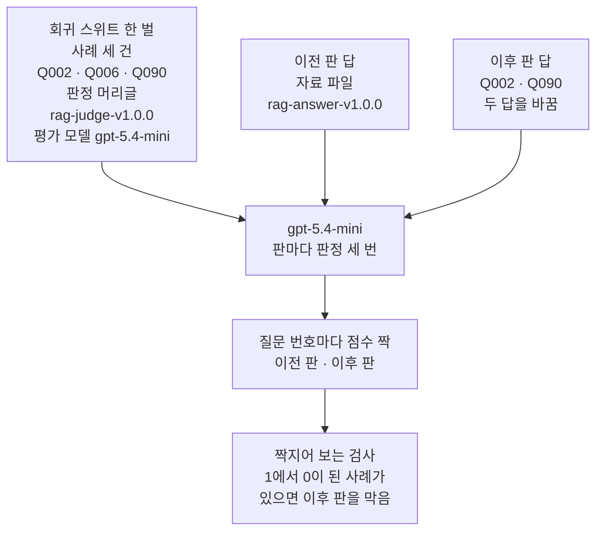
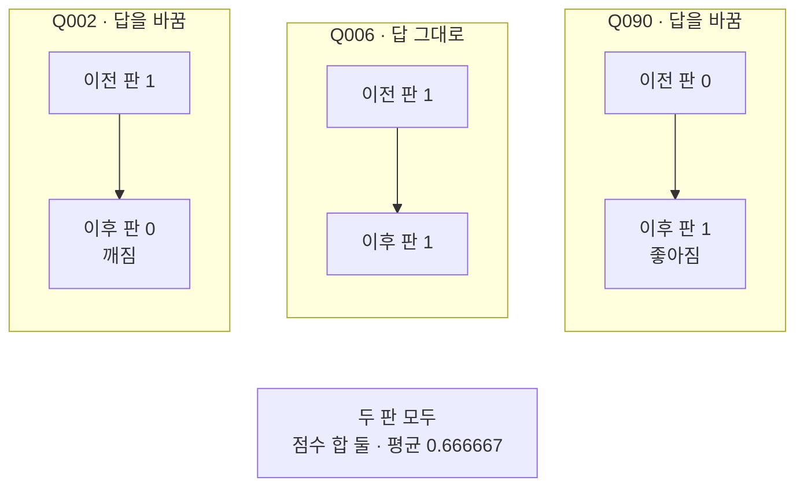
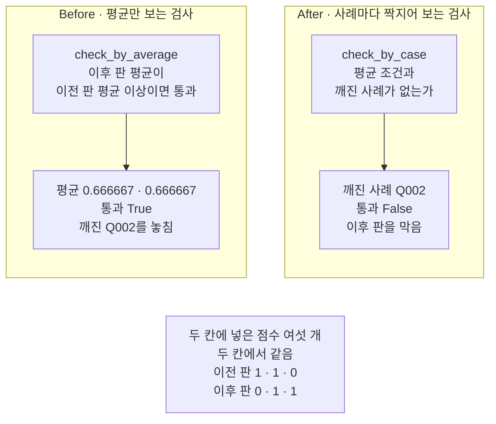
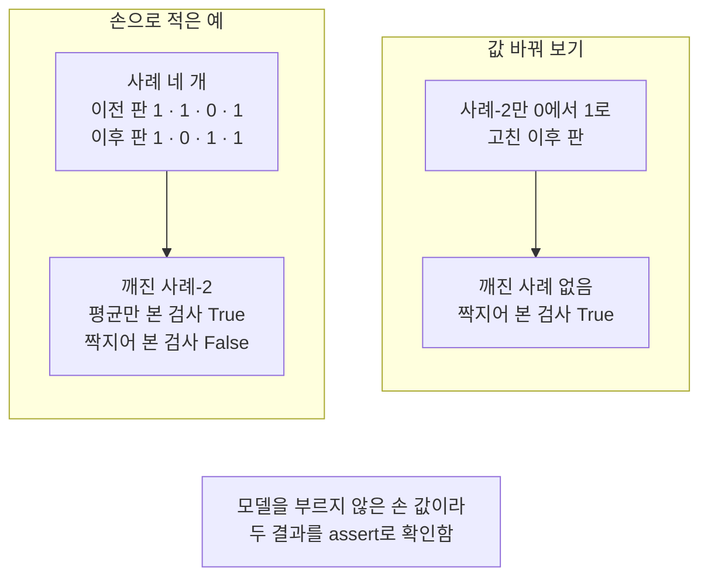

# 07-회귀-스위트

## _src 본문 (HTML 원본)

```html
<!--meta: 강의 1h | 실습 1h | 코드 notebooks/07-회귀-스위트.ipynb | 새 용어 4 -->
<style>html,body{overflow-x:hidden}.notebook,.nb-cell,.nb-main,.nb-input,.nb-result{min-width:0;max-width:100%}.nb-input pre,.nb-output{box-sizing:border-box;max-width:100%;overflow-x:auto}code.nb-source{display:block!important;width:100%!important;min-width:0!important;overflow-x:auto!important;padding:0!important}</style>
<h2 id="b1"><span class="no">1</span>학습 목표</h2><div class="goal"><ul>
<li>같은 사례와 같은 판정 머리글로 이전 판과 이후 판의 점수를 짝지을 수 있습니다.</li>
<li>평균만 보는 검사가 깨진 사례를 놓칠 수 있는 까닭을 설명할 수 있습니다.</li>
<li>기준선에서 통과하던 사례가 깨지면 이후 판을 막는 검사를 만들 수 있습니다.</li>
</ul></div>
<h2 id="b2"><span class="no">2</span>이 내용을 배우는 이유</h2><p>답을 쓰는 방법을 고치면 좋아지는 사례와 나빠지는 사례가 함께 생길 수 있습니다. 둘이 서로 가리면 평균 점수는 그대로 보입니다. 평균만 보고 새 판을 내보내면 전에 맞게 답하던 질문이 틀린 채로 나갑니다.</p><p>그래서 판을 바꿀 때마다 같은 사례를 같은 기준으로 다시 판정하고 사례마다 견줍니다. 이 절은 평가 사례 세 건으로 그 검사를 만듭니다.</p>
<h2 id="b3"><span class="no">3</span>앞에서 배운 내용</h2><p>02절은 근거 충실도 판정 머리글에 판 이름 <code>rag-judge-v1.0.0</code>을 붙였습니다. 그 뒤 이 머리글로 받은 점수는 Q002 1, Q006 1, Q090 0에서 바뀐 적이 없습니다. 03절은 사례 여러 건을 한 번에 판정 받는 함수 <code>score_cases</code>를 만들었습니다. 03·04절에서는 같은 요청 글도 실행한 때에 따라 판정이 달라질 수 있음을 봤습니다.</p><p>04절은 권수와 기간을 틀리게 바꾼 답을 만들고, 판정에서 점수만 꺼내는 함수 <code>scores_of</code>를 썼습니다. 06절은 값 목록의 평균을 내는 함수 <code>average</code>를 만들었습니다. 평균 하나로는 값이 어떻게 퍼져 있는지 보이지 않는다는 것도 06절에서 봤습니다.</p><p>이 절은 02·03·04·06절 함수 넷을 다시 씁니다. 앞에서 배운 함수는 <code>rag_tools.py</code>에 모아 두었습니다. 파일을 열면 코드를 볼 수 있습니다. 노트북과 같은 폴더(<code>notebooks/</code>)에 있는 파일입니다.</p><p>함수 <code>scores_of</code>와 <code>average</code>는 04절과 06절 본문 그대로 이 절에서 도구 파일에 옮겼습니다. 인자도 그때와 같습니다.</p>
<h2 id="b4"><span class="no">4</span>핵심 개념</h2><h3>비유로 시작하기</h3><p>01절의 탁자 옆에 두 층 선반을 둡니다. 층마다 바구니 세 개를 같은 자리에 놓고, 바구니 하나는 평가 사례 한 건입니다. 위층 바구니에는 이전 판 답을, 아래층 바구니에는 이후 판 답을 사과로 담습니다. 빨간 사과는 저울에서 1을 받은 답이고, 멍든 사과는 0을 받은 답입니다. 두 층의 사과는 모두 같은 저울 하나로 잽니다.</p><p>두 층 모두 빨간 사과가 두 알이라 세어 보면 같습니다. 그러나 층끼리 바구니를 하나씩 짝지어 보면 왼쪽 바구니의 사과가 멍든 사과로 바뀌었습니다. 빨간 사과 수만 세면 이 바구니를 놓칩니다.</p>
{{img:07-5-두-선반의-사과-바구니|흰 바탕에 두 층 나무 선반이 있고 층마다 짚 바구니 셋이 한 줄로 놓여 바구니마다 사과가 한 알씩 들어 있는데 위층은 왼쪽과 가운데가 빨간 사과이고 오른쪽이 멍든 갈색 사과이며 아래층은 왼쪽이 멍든 갈색 사과이고 가운데와 오른쪽이 빨간 사과이고 선반 오른쪽 옆에 둥근 눈금판이 달린 부엌 저울 하나가 서 있는 그림|위층과 아래층 모두 빨간 사과가 두 알이지만, 왼쪽 바구니의 사과만 멍든 사과로 바뀌었습니다.}}
<p class="look"><b>그림 읽기</b> — 두 층 나무 선반에 바구니가 층마다 셋씩 같은 자리에 있습니다. 위층은 왼쪽과 가운데가 빨간 사과, 오른쪽이 멍든 갈색 사과입니다. 아래층은 왼쪽이 멍든 사과이고 가운데와 오른쪽이 빨간 사과입니다. 두 층 모두 빨간 사과가 두 알이지만 왼쪽 바구니끼리 견주면 빨간 사과가 멍든 사과로 바뀌었습니다. 오른쪽 옆의 저울 하나로 두 층을 모두 잽니다.</p>
<table><thead><tr><th>말</th><th>뜻</th></tr></thead><tbody><tr><td>회귀(regression)</td><td>판을 바꾼 뒤 전에 통과하던 사례가 다시 실패하는 일입니다. 브레이크를 고친 자전거에서 전에 울리던 벨이 울리지 않게 된 것과 같습니다.</td></tr><tr><td>회귀 스위트(regression suite)</td><td>판이 바뀔 때마다 똑같이 다시 실행하는 사례와 판정 기준 한 벌입니다. 새 판 교과서가 나올 때마다 늘 같은 문제 묶음으로 풀어 보는 것과 같습니다.</td></tr><tr><td>기준선(baseline)</td><td>뒤 판과 견줄 출발점입니다. 키를 잴 때 문틀에 그어 둔 지난해 눈금과 같습니다.</td></tr><tr><td>통과 조건</td><td>이후 판을 내보내도 되는지 정하는 조건입니다. 책을 펴내기 전에 미리 정해 둔 합격 기준과 같습니다.</td></tr></tbody></table>
<p>새 용어를 이 절 코드에서 보면 이렇습니다. 회귀 스위트는 딕셔너리 <code>suite</code>에 적은 사례 세 건, 판정 머리글, 평가 모델입니다. 기준선은 이전 판 점수 <code>old_scores</code>입니다. 회귀는 함수 <code>broken_cases</code>가 찾는 사례, 곧 기준선에서 1이던 사례가 이후 판에서 0이 된 사례입니다. 통과 조건은 검사 함수가 내는 <code>True</code>·<code>False</code>입니다.</p><p>여기서 회귀는 통계에서 말하는 회귀와 다른 뜻입니다. Ch 2 08절의 회귀 테스트도 고친 결함이 다시 생기는지 확인하려고 남겨 둔 테스트였습니다. 기준선은 Ch 7 08절에서 처음 쓴 말입니다.</p>
{{mermaid:07-1-같은-스위트로-두-판을-판정|위에서 아래로 읽는 그림으로 파란 상자 회귀 스위트 한 벌 사례 세 건 Q002 Q006 Q090 판정 머리글 rag-judge-v1.0.0 평가 모델 gpt-5.4-mini와 초록 상자 이전 판 답 자료 파일 rag-answer-v1.0.0, 초록 상자 이후 판 답 Q002 Q090 두 답을 바꿈이 나란히 있고 셋이 모두 보라 상자 gpt-5.4-mini 판마다 판정 세 번으로 모인 뒤 노란 상자 질문 번호마다 점수 짝 이전 판 이후 판을 지나 파란 상자 짝지어 보는 검사 1에서 0이 된 사례가 있으면 이후 판을 막음으로 이어지는 그림|같은 스위트로 두 판의 답을 판정해 점수를 질문 번호마다 짝짓고, 1에서 0이 된 사례가 있으면 막습니다.}}
<p class="look"><b>도식 읽기</b> — 위에서 아래로 읽습니다. 맨 위 파란 상자가 회귀 스위트 한 벌이고, 초록 상자 둘이 두 판의 답입니다. 셋이 모두 같은 보라 평가 모델로 들어가 판마다 판정을 세 번 받습니다. 노란 상자는 두 판의 점수를 질문 번호마다 짝지은 것입니다. 맨 아래 파란 검사가 1에서 0이 된 사례를 찾습니다.</p>
<h3>저울은 그대로, 답만 바꿉니다</h3><p>회귀 스위트에서 바꾸는 것은 판정받는 쪽 하나입니다. 이 절은 답 쪽의 판을 바꾸고 사례, 판정 머리글, 평가 모델은 두 판에 똑같이 씁니다. 판정 머리글까지 바꾸면 점수 차이가 답 때문인지 머리글 때문인지 가를 수 없습니다. 03절에서 머리글에 문장 하나를 더하자 같은 답의 점수가 달라진 것을 봤습니다.</p><p>두 판은 같은 실행 안에서 같은 모델로 판정합니다. 같은 요청 글도 실행한 때에 따라 판정이 달라질 수 있기 때문입니다. 지난번에 받아 둔 점수를 기준선으로 쓰면 그사이의 흔들림이 섞입니다.</p>
<h3>평균과 짝지은 비교</h3><p>평균은 점수를 모두 더해 사례 수로 나눈 값이라 어느 사례의 점수인지 잊습니다. 한 사례가 1에서 0으로 내려가고 다른 사례가 0에서 1로 오르면 합이 같아 평균도 같습니다. 짝지은 비교는 같은 질문 번호의 두 점수를 나란히 놓고 봅니다. 그래서 어느 사례가 내려갔는지 질문 번호로 알 수 있습니다.</p>
<h3>다른 상황에 적용</h3><p>Ch 14의 RAG 흐름에서 질문 재작성이나 답 모델의 머리글을 고쳤다면 같은 방법을 쓸 수 있습니다. 고치기 전 답과 고친 뒤 답을 같은 판정 머리글로 판정하고, 기준선에서 통과하던 사례가 깨졌는지 봅니다. 실제 서비스는 걸린 시간이나 대화당 비용의 상한도 통과 조건에 넣기도 합니다. 이 절은 판정 점수 조건만 실행했고 시간과 비용 조건은 실행하지 않았습니다.</p>
<h2 id="b5"><span class="no">5</span>실행 예제</h2><p>노트북은 평가 사례 세 건을 두 판으로 판정합니다. 이전 판은 자료 파일에 적힌 답 세 개이고 답의 판 이름은 <code>rag-answer-v1.0.0</code>입니다. 이후 판은 사례 Q002와 Q090의 답만 바꾼 판이고, 두 답은 이 절에서 만든 답입니다. 사례 Q002의 새 답은 04절 바꾼 답과 같은 글이라 권수와 기간이 틀렸습니다. 사례 Q090의 새 답은 근거 문서에 적힌 당사자와 서명면을 밝혀 답합니다.</p><p>두 판 모두 판정 머리글 <code>rag-judge-v1.0.0</code>과 평가 모델 <code>gpt-5.4-mini</code>로 판정합니다. 평가 모델에 보내는 요청은 두 판마다 세 번씩 여섯 번이고 임베딩 요청은 없습니다. 예상 비용은 미화 0.02달러 아래이고 실제 청구 금액과는 다를 수 있습니다. 새로 쓰는 파일은 없습니다.</p>
{{notebook:07-회귀-스위트|example}}
<p class="look"><b>확인할 점</b> — 5절 출력 <code>Q006 | 3183 | 3183 | True</code>로 답을 바꾸지 않은 사례는 요청 글이 같은지 봅니다. 6절 표 <code>질문 번호 | 이전 판 | 이후 판</code> 아래 세 줄에서 점수가 바뀐 사례를 찾습니다.</p>
{{mermaid:07-2-두-판의-점수-짝|위쪽에 칸 셋이 나란히 있고 아래에 회색 상자 하나가 있는 그림으로 왼쪽 칸 Q002 답을 바꿈에는 노란 상자 이전 판 1에서 노란 상자 이후 판 0 깨짐으로, 가운데 칸 Q006 답 그대로에는 이전 판 1에서 이후 판 1로, 오른쪽 칸 Q090 답을 바꿈에는 이전 판 0에서 이후 판 1 좋아짐으로 이어지고, 맨 아래 회색 상자에 두 판 모두 점수 합 둘 평균 0.666667이 적힌 그림|사례 Q002는 1에서 0으로, 사례 Q090은 0에서 1로 바뀌어 두 판의 평균은 0.666667로 같았습니다.}}
<p class="look"><b>도식 읽기</b> — 칸 셋은 사례 세 건이고 칸 제목에 답을 바꿨는지 적었습니다. 칸마다 위 노란 상자가 이전 판 점수이고 아래 노란 상자가 이후 판 점수입니다. 왼쪽 칸의 Q002는 1에서 0으로 깨졌고 오른쪽 칸의 Q090은 0에서 1로 좋아졌습니다. 맨 아래 회색 상자는 두 판에 모두 해당하는 값이고, 점수 합과 평균이 두 판에서 같았다는 것을 보여 줍니다.</p>
<h2 id="b6"><span class="no">6</span>실패 확인</h2><p>아래 Before 셀은 평균만 보는 검사로 두 판을 견줍니다. 두 판의 평균이 모두 0.666667이라 이 검사는 이후 판을 통과시켰습니다. 이어지는 After 셀은 같은 점수 여섯 개를 그대로 쓰고 검사만 바꿉니다. 질문 번호마다 두 점수를 짝지어 기준선에서 1이던 사례가 0이 되었는지 봅니다.</p>
{{notebook:07-회귀-스위트|failure}}
{{mermaid:07-3-평균만-본-검사와-짝지어-본-검사|위쪽에 칸 둘이 나란히 있고 아래에 회색 상자 하나가 있는 그림으로 왼쪽 칸 Before 평균만 보는 검사에는 파란 상자 check_by_average 이후 판 평균이 이전 판 평균 이상이면 통과에서 빨간 상자 평균 0.666667 0.666667 통과 True 깨진 Q002를 놓침으로, 오른쪽 칸 After 사례마다 짝지어 보는 검사에는 파란 상자 check_by_case 평균 조건과 깨진 사례가 없는가에서 노란 상자 깨진 사례 Q002 통과 False 이후 판을 막음으로 이어지고, 맨 아래 회색 상자에 두 칸에 넣은 점수 여섯 개 두 칸에서 같음 이전 판 1 1 0 이후 판 0 1 1이 적힌 그림|같은 점수 여섯 개에서 평균만 본 검사는 통과였고, 짝지어 본 검사는 깨진 Q002를 찾아 막았습니다.}}
<p class="look"><b>도식 읽기</b> — 두 칸의 제목이 검사 이름입니다. 왼쪽 칸 Before의 빨간 상자는 평균이 같아 통과시킨 결과이고, 깨진 사례를 놓친 결함입니다. 오른쪽 칸 After의 노란 상자는 깨진 사례 Q002를 찾아 이후 판을 막은 결과입니다. 맨 아래 회색 상자는 두 칸에 넣은 같은 점수 여섯 개입니다.</p>
<p>두 검사는 같은 점수를 받았고 판단만 달랐습니다. 평균만 본 검사는 사례 Q002가 1에서 0으로 깨진 것을 놓쳤습니다. 사례 Q090이 0에서 1로 올라 두 판의 점수 합이 같았기 때문입니다. 짝지어 본 검사는 깨진 사례를 질문 번호로 알려 주었습니다. 이후 판 판정의 까닭은 근거 문서의 7권·14일과 답이 다르다는 것이었습니다.</p><p>새 커널로 두 번 실행했을 때 점수 여섯 개와 두 검사의 판단은 두 번 모두 같았습니다. 까닭 문장은 두 실행에서 달랐지만 두 번 모두 7권과 14일을 짚었습니다.</p><p>값 바꿔 보기는 손으로 적은 작은 예로 했습니다. 사례 네 개에서 사례-2만 1에서 0으로 깨지게 적자 평균만 본 검사는 True, 짝지어 본 검사는 False였습니다. 사례-2를 다시 1로 고친 복사본에서는 깨진 사례가 없어져 짝지어 본 검사가 True였습니다. 모델 판정이 없는 손 값이라 세 판단을 <code>assert</code>로 확인했습니다. 노트북 9·10절은 두 검사를 함께 확인하는 셀이라 After 칸에 들어 있습니다.</p>
{{mermaid:07-4-깨진-사례를-고친-뒤|위쪽에 칸 둘이 나란히 있고 아래에 회색 상자 하나가 있는 그림으로 왼쪽 칸 손으로 적은 예에는 초록 상자 사례 네 개 이전 판 1 1 0 1 이후 판 1 0 1 1에서 노란 상자 깨진 사례-2 평균만 본 검사 True 짝지어 본 검사 False로, 오른쪽 칸 값 바꿔 보기에는 초록 상자 사례-2만 0에서 1로 고친 이후 판에서 노란 상자 깨진 사례 없음 짝지어 본 검사 True로 이어지고, 맨 아래 회색 상자에 모델을 부르지 않은 손 값이라 두 결과를 assert로 확인함이 적힌 그림|손으로 적은 예에서 사례-2만 0에서 1로 고치자 깨진 사례가 없어져 짝지어 본 검사가 통과했습니다.}}
<p class="look"><b>도식 읽기</b> — 왼쪽 칸은 손으로 적은 예이고 오른쪽 칸은 사례-2만 고친 값 바꿔 보기입니다. 칸마다 위 초록 상자가 넣은 손 값이고, 아래 노란 상자가 두 검사의 출력입니다. 맨 아래 회색 상자는 두 칸 모두 모델을 부르지 않은 값이라는 메모입니다.</p>
<h2 id="b7"><span class="no">7</span>주의할 점과 실무 메모</h2><ul><li>이후 판의 답 두 개는 자료 파일에 없고 이 절에서 만든 답입니다. 평균은 그대로인데 한 사례가 깨지는 모양을 보이려고 정한 예입니다.</li><li>사례 Q002의 새 답은 04절 바꾼 답과 같은 글입니다. 5권과 7일은 근거 문서의 다른 항목에 나오는 숫자라 도서 대출과 맞지 않습니다.</li><li>근거 충실도 점수가 오른 것이 답이 더 맞아졌다는 뜻은 아닙니다. 사례 Q090의 새 답은 근거 문서에 적힌 것을 밝혀 1을 받았고, 질문에 더 잘 답했는지는 따로 판정하지 않았습니다.</li><li>노트북을 쓰기 전에 이후 판의 두 요청을 따로 다섯 번씩 보냈습니다. 판정이 같은지 보려는 확인이었고 다섯 번 모두 같았습니다. 사례 Q090의 새 답은 그 요청을 보내기 전에 둘째 후보와 함께 적었습니다. 첫 후보가 다섯 번 모두 1이 아니면 둘째 후보를 보내 보기로 정했고, 모두 1이라 첫 후보를 바꾸지 않고 썼습니다.</li><li>같은 요청도 실행한 때에 따라 판정이 달라질 수 있습니다. 여러분 실행에서 점수가 다르면 6절 표와 7·8절의 판단도 달라집니다.</li><li>판정 점수에는 <code>assert</code>를 쓰지 않았습니다. 모델을 부르지 않는 검사 함수만 손으로 적은 작은 예로 <code>assert</code>를 걸었습니다.</li><li>사례가 세 건뿐이라 평균은 0, 0.333333, 0.666667, 1.0 가운데 하나로만 나옵니다. 한 사례의 점수가 바뀌면 평균이 약 0.33씩 움직입니다.</li><li>회귀 스위트는 등록한 사례만 지킵니다. 통과했다고 새 질문에서도 틀리지 않는다는 뜻은 아닙니다.</li><li>통과 조건을 이후 판 결과에 맞춰 느슨하게 고치면 회귀 스위트가 깨진 사례를 지키지 못합니다.</li><li>판정 머리글이나 평가 모델을 바꾸면 기준선도 같은 조건으로 다시 판정합니다. 점수 차이가 답이 아니라 판정 쪽 변화에서 생길 수 있기 때문입니다.</li><li>이 절은 판정 점수만 통과 조건에 넣었습니다. 06절 대화당 비용은 흐름을 보여 주려고 정한 목록이라 통과 조건에 쓰지 않았습니다.</li><li>걸린 시간과 비용은 재지 않았습니다. 요청 수와 예상 비용만 준비물에 적었습니다.</li><li>LangSmith 화면과 업로드, 데이터셋 기능은 이번에 실행하지 않았습니다.</li><li>이 절은 파일을 쓰지 않습니다. 이 챕터 자료 파일은 읽기만 합니다.</li><li>교재 출력은 Linux의 Python 3.12.13으로 만들었습니다. 다른 판과 Windows·macOS에서는 이번에 실행하지 않았습니다.</li></ul>
<h2 id="b8"><span class="no">8</span>정리와 다음 절</h2><ul><li>같은 사례와 판정 머리글, 모델로 두 판을 판정해 점수를 질문 번호마다 짝지었습니다.</li><li>두 판의 평균이 같아 평균만 본 검사는 통과였지만, 사례 Q002는 1에서 0으로 깨져 있었습니다.</li><li>사례마다 짝지어 본 검사는 깨진 Q002를 찾아 이후 판을 막았습니다.</li></ul><p><strong>다음 학습과 이어지는 지점</strong> — 08절에서는 판정 요청 여러 개를 한 파일에 담아 한꺼번에 제출할 입력을 만듭니다.</p>
<h2 id="b9"><span class="no">9</span>복습 문제</h2><details class="quiz" open><summary>문제 4개 · 해설 포함</summary><p class="quiz-q">1. 두 판의 평균이 같았는데도 이후 판을 막아야 했던 까닭은 무엇입니까?</p><p class="quiz-a">기준선에서 1이던 Q002가 이후 판에서 0으로 깨졌기 때문입니다. 사례 Q090이 0에서 1로 올라 점수 합이 같았고, 평균이 그 변화를 가렸습니다. 틀렸다면 노트북 6~8절을 다시 읽습니다.</p><p class="quiz-q">2. 이 절의 회귀 스위트에서 두 판 사이에 바꾸지 않은 것 세 가지는 무엇입니까?</p><p class="quiz-a">사례, 판정 머리글, 평가 모델입니다. 바뀐 것은 판정받는 답 쪽 하나입니다. 틀렸다면 「핵심 개념」의 「저울은 그대로, 답만 바꿉니다」를 다시 읽습니다.</p><p class="quiz-q">3. 함수 <code>broken_cases</code>의 두 인자 차례를 바꿔 부르면 무엇이 나옵니까?</p><p class="quiz-a">이후 판이 1이고 이전 판이 0인 사례, 곧 좋아진 사례가 나옵니다. 이 절에서는 Q090이었습니다. 틀렸다면 노트북 8절을 다시 읽습니다.</p><p class="quiz-q">4. 이 절에서 <code>assert</code>를 판정 점수가 아니라 손으로 적은 예에만 건 까닭은 무엇입니까?</p><p class="quiz-a">판정 점수는 모델이 낸 값이라 실행한 때에 따라 달라질 수 있기 때문입니다. 손으로 적은 점수는 넣을 때마다 같은 판단이 나와 <code>assert</code>로 확인할 수 있습니다. 틀렸다면 노트북 9절을 다시 읽습니다.</p></details>
<h2 id="b10"><span class="no">10</span>참고 자료</h2><ul><li><div><a href="https://docs.langchain.com/langsmith/evaluation-types">LangSmith evaluation types</a></div>확인 2026-09-21 · 회귀 검사는 지금 판이 맞게 처리하는 사례에서 새 판이 나빠지지 않는지 봅니다. 기준선과 견준 비교 화면은 이번에 실행하지 않았습니다.</li><li>Ch 2 08절 — 회귀 테스트.</li><li>Ch 7 08절 — 기준선.</li><li>02·03·04·06절 — 판정 머리글 <code>rag-judge-v1.0.0</code>, 함수 <code>score_cases</code>·<code>scores_of</code>·<code>average</code>, 바꾼 답.</li></ul>
```

## 노트북 셀 (순서대로)

### [0] markdown {'html': 'skip'}

# 회귀 스위트

**이 노트북에서 할 일**

1. 평가 사례 세 건을 이전 판 답과 이후 판 답으로 한 번씩 판정 받습니다.
2. 두 판의 점수를 질문 번호마다 짝지어 나란히 봅니다.
3. 평균만 보는 검사가 깨진 사례를 놓치는 모습을 봅니다(Before).
4. 사례마다 짝지어 보는 검사로 깨진 사례를 찾아 이후 판을 막습니다(After).

**준비물** — 이 절은 프로젝트 맨 위 폴더의 `.env`에 적어 둔 `OPENAI_API_KEY`를 씁니다.
평가 모델 `gpt-5.4-mini`에 보내는 요청은 여섯 번이고 임베딩 요청은 없습니다.
두 판마다 사례 세 건을 한 번씩 판정하므로 여섯 번입니다.
예상 비용은 미화 0.02달러 아래이고 실제 청구 금액과는 다를 수 있습니다.

읽는 파일은 이 챕터 자료 파일 하나이고 새로 쓰는 파일은 없습니다.
교재 출력을 만든 실행에서는 노트북 전체가 약 7초 만에 끝났습니다.

이후 판의 답 두 개는 자료 파일에 없고 이 절에서 만든 답입니다.
평균은 그대로인데 한 사례가 깨지는 모양을 보이려고 정한 답입니다.

**기준 버전** — 첫 셀에서 LangChain 1.4.0과 langchain-openai 1.6.1을 설치합니다.
키를 읽는 python-dotenv 1.2.3도 함께 설치합니다.
교재 출력은 Linux의 Python 3.12.13으로 만들었습니다.
다른 판과 Windows·macOS에서는 이번에 실행하지 않았습니다.

**강의와 실습 범위** — 강의 시간에는 3~8절을 읽습니다.
두 판을 같은 스위트로 판정하고, 평균만 보는 검사와 짝지어 보는 검사를 견주는 자리입니다.
9절은 손으로 적은 작은 예로 두 검사를 확인합니다.
10절은 값 바꿔 보기이고 9절과 함께 실습 시간에 실행합니다.

실습 폴더 `labs/part4/ch15-evaluation-advanced`에서 `uv sync --locked`를 실행합니다.
그다음 이 폴더의 `.venv` 커널을 고르고 첫 셀부터 순서대로 실행합니다.

### [1] markdown {'html': 'skip'}

## 오늘 볼 그림


위에서 아래로 읽습니다. 맨 위 파란 스위트와 초록 두 판의 답이 모두 같은 보라 평가 모델로 들어갑니다.
판마다 나온 점수를 질문 번호마다 짝지어 노란 상자에 두고, 맨 아래 파란 검사가 깨진 사례를 찾습니다.

### [2] markdown {}

## 1. 준비

첫 셀은 패키지 세 개를 설치하고 설치된 판 번호를 출력합니다.
설치에는 몇십 초가 걸릴 수 있습니다.

### [3] code {'execution': {'iopub.execute_input': '2026-09-21T17:57:29.795995Z', 'iopub.status.busy': '2026-09-21T17:57:29.795805Z', 'iopub.status.idle': '2026-09-21T17:57:30.238872Z', 'shell.execute_reply': '2026-09-21T17:57:30.238393Z'}, 'lesson_role': 'setup'}

```python
# 이 절에서 쓰는 패키지를 설치하고 버전을 확인합니다
%pip install -q "langchain==1.4.0" "langchain-openai==1.6.1" "python-dotenv==1.2.3"
from importlib.metadata import version

print("langchain:", version("langchain"))
print("langchain-openai:", version("langchain-openai"))
print("python-dotenv:", version("python-dotenv"))
```

출력:
```
Note: you may need to restart the kernel to use updated packages.
langchain: 1.4.0
langchain-openai: 1.6.1
python-dotenv: 1.2.3

```

### [4] markdown {}

**결과 읽기** — 설치가 끝나면 판 번호 세 줄이 보입니다.
출력 줄 `langchain: 1.4.0`과 `langchain-openai: 1.6.1`이 실습 폴더 잠금과 같은 판입니다.
이 노트북의 출력은 2026-09-21에 이 판으로 실행한 결과입니다.

다음 셀은 이 절에서 쓸 이름을 불러오고 앞에서 배운 함수 넷을 도구 파일에서 가져옵니다.

앞에서 배운 함수는 `rag_tools.py`에 모아 두었습니다. 파일을 열면 코드를 볼 수 있습니다. 노트북과 같은 폴더(`notebooks/`)에 있는 파일입니다.
이 노트북은 02절 `build_judge_prompt()`와 03절 `score_cases()`를 가져옵니다.
04절 `scores_of()`와 06절 `average()`도 가져옵니다.

### [5] code {'execution': {'iopub.execute_input': '2026-09-21T17:57:30.240112Z', 'iopub.status.busy': '2026-09-21T17:57:30.240012Z', 'iopub.status.idle': '2026-09-21T17:57:30.546707Z', 'shell.execute_reply': '2026-09-21T17:57:30.546437Z'}, 'lesson_role': 'setup'}

```python
# 자료 읽기·폴더 확인에 쓸 이름과 모델을 준비하는 이름을 불러옵니다
import json
import os

from langchain.chat_models import init_chat_model

# Ch 15 02·03·04·06절 함수 넷을 도구 파일에서 가져옵니다
from rag_tools import average, build_judge_prompt, score_cases, scores_of

print("불러온 이름:", "json", "os", "init_chat_model")
```

출력:
```
불러온 이름: json os init_chat_model

```

### [6] markdown {}

**결과 읽기** — 출력 줄 `불러온 이름: json os init_chat_model`로 이름 세 개를 불러왔습니다.
도구 파일에서 가져온 함수 넷은 출력하지 않습니다.
함수 `scores_of`와 `average`는 04절과 06절 본문 그대로 도구 파일에 옮겼고, 인자도 그때와 같습니다.

## 2. 키와 모델 준비

이 절도 02~06절과 같은 평가 모델 `gpt-5.4-mini`를 부릅니다.
모델을 만드는 설정 값도 06절과 같습니다.

### [7] markdown {}

API 키가 있는지 확인합니다. `True` 값이 나오면 다음으로 넘어갑니다.

### [8] code {'execution': {'iopub.execute_input': '2026-09-21T17:57:30.547455Z', 'iopub.status.busy': '2026-09-21T17:57:30.547399Z', 'iopub.status.idle': '2026-09-21T17:57:30.550861Z', 'shell.execute_reply': '2026-09-21T17:57:30.550519Z'}, 'lesson_role': 'setup'}

```python
# .env 파일에서 OpenAI API 키를 읽습니다(키 값은 출력하지 않습니다)
import os
from dotenv import find_dotenv, load_dotenv

env_path = find_dotenv(usecwd=True)
load_dotenv(env_path)
has_key = os.getenv("OPENAI_API_KEY") is not None
print("OPENAI_API_KEY 설정 여부:", has_key)
assert has_key, "프로젝트 폴더의 .env 파일에 OPENAI_API_KEY를 적어 주세요."
```

출력:
```
OPENAI_API_KEY 설정 여부: True

```

### [9] markdown {}

실습에 쓸 모델을 준비합니다.
temperature 값을 0으로 두어도 판정 점수와 까닭이 매번 같다고 보장하지는 않습니다.

### [10] code {'execution': {'iopub.execute_input': '2026-09-21T17:57:30.551497Z', 'iopub.status.busy': '2026-09-21T17:57:30.551431Z', 'iopub.status.idle': '2026-09-21T17:57:31.036536Z', 'shell.execute_reply': '2026-09-21T17:57:31.036151Z'}}

```python
# 실습에 쓸 모델을 준비합니다
model = init_chat_model(
    "openai:gpt-5.4-mini",
    temperature=0,
    reasoning_effort="none",
)
print("모델 이름:", model.model_name)
print("temperature:", model.temperature)
```

출력:
```
모델 이름: gpt-5.4-mini
temperature: 0.0

```

### [11] markdown {}

**결과 읽기** — 모델 이름 `gpt-5.4-mini`, temperature `0.0`이 보이면 준비가 끝났습니다.
이 노트북의 출력은 2026-09-21에 이 모델로 실행한 결과입니다.

### [12] markdown {}

## 3. 사례와 판정 머리글

회귀(regression)는 판을 바꾼 뒤 전에 통과하던 사례가 다시 실패하는 일입니다.
Ch 2 08절의 회귀 테스트는 고친 결함이 다시 생기는지 확인하려고 남겨 둔 테스트였습니다.
이 절은 같은 생각을 평가 모델의 판정 점수에 씁니다.

먼저 노트북을 연 자리에서 프로젝트 맨 위를 찾습니다.
01~06절과 같은 자리 찾기 셀입니다.

### [13] code {'execution': {'iopub.execute_input': '2026-09-21T17:57:31.037344Z', 'iopub.status.busy': '2026-09-21T17:57:31.037276Z', 'iopub.status.idle': '2026-09-21T17:57:31.039577Z', 'shell.execute_reply': '2026-09-21T17:57:31.039159Z'}, 'lesson_role': 'setup'}

```python
# 노트북을 어느 폴더에서 열어도 프로젝트 맨 위를 찾게 후보 세 개를 차례로 봅니다
candidates = [".", "../../..", "../../../.."]
root_path = None
for candidate in candidates:
    if os.path.exists(candidate + "/labs/part4/ch15-evaluation-advanced/data"):
        root_path = candidate
        break
print("찾은 프로젝트 맨 위:", root_path)
assert root_path is not None, "notebooks 폴더나 실습 폴더 맨 위에서 노트북을 열어 주세요."
```

출력:
```
찾은 프로젝트 맨 위: .

```

### [14] markdown {}

**결과 읽기** — 출력 줄 `찾은 프로젝트 맨 위:` 뒤에 점 하나나 위로 올라가는 자리가 보입니다.

다음 셀은 06절과 같은 방법으로 이 챕터 자료 파일을 읽습니다.
사례마다 질문 번호도 모아 둡니다.

### [15] code {'execution': {'iopub.execute_input': '2026-09-21T17:57:31.040236Z', 'iopub.status.busy': '2026-09-21T17:57:31.040167Z', 'iopub.status.idle': '2026-09-21T17:57:31.042760Z', 'shell.execute_reply': '2026-09-21T17:57:31.042446Z'}}

```python
# 이 챕터 자료 파일을 읽어 평가 사례 목록을 만들고 질문 번호를 모읍니다(읽기만 합니다)
data_path = root_path + "/labs/part4/ch15-evaluation-advanced/data"
with open(data_path + "/evaluation-cases.json", encoding="utf-8") as file:
    case_file = json.loads(file.read())
cases = case_file["cases"]
case_qids = []
for case in cases:
    case_qids.append(case["qid"])
print("평가 사례 수:", len(cases))
print("질문 번호:", case_qids)
```

출력:
```
평가 사례 수: 3
질문 번호: ['Q002', 'Q006', 'Q090']

```

### [16] markdown {}

**결과 읽기** — 출력 줄 `평가 사례 수: 3`으로 사례는 세 건입니다.
출력 줄 `질문 번호: ['Q002', 'Q006', 'Q090']`이 이 절에서 두 판을 견줄 사례입니다.

다음 셀은 02절 근거 충실도의 판정 머리글을 다시 적습니다.
06절에서 다시 적은 머리글과 같은 코드입니다.

### [17] code {'execution': {'iopub.execute_input': '2026-09-21T17:57:31.043382Z', 'iopub.status.busy': '2026-09-21T17:57:31.043327Z', 'iopub.status.idle': '2026-09-21T17:57:31.045114Z', 'shell.execute_reply': '2026-09-21T17:57:31.044831Z'}}

```python
# 02절 근거 충실도의 두 칸 짝과 판정 머리글 rag-judge-v1.0.0을 다시 적습니다
ground_pair = {"답": "response", "근거 문서": "context"}
ground_rule = "답이 근거 문서로 뒷받침되면 1, 아니면 0을 판정하세요."
output_rule = 'JSON만 출력하세요: {"score": 0 또는 1, "reason": "한 문장"}.'
judge_version = "rag-judge-v1.0.0"
judge_head = ground_rule + "\n" + output_rule
print("판 이름:", judge_version)
print("머리글:")
print(judge_head)
```

출력:
```
판 이름: rag-judge-v1.0.0
머리글:
답이 근거 문서로 뒷받침되면 1, 아니면 0을 판정하세요.
JSON만 출력하세요: {"score": 0 또는 1, "reason": "한 문장"}.

```

### [18] markdown {}

**결과 읽기** — 출력 줄 `판 이름: rag-judge-v1.0.0`은 02절이 붙인 판 이름입니다.
라벨 줄 `머리글:` 아래 두 줄이 기준 문장과 출력 모양입니다.
이 머리글은 두 판을 판정할 때 한 글자도 바꾸지 않습니다.

## 4. 이전 판 점수와 기준선

이 절에서 견줄 두 판은 답 쪽의 판입니다.
이전 판은 자료 파일에 적힌 답 세 개입니다.
다음 셀은 사례마다 답을 쓴 모델과 답의 판 이름을 봅니다.

### [19] code {'execution': {'iopub.execute_input': '2026-09-21T17:57:31.045649Z', 'iopub.status.busy': '2026-09-21T17:57:31.045594Z', 'iopub.status.idle': '2026-09-21T17:57:31.047408Z', 'shell.execute_reply': '2026-09-21T17:57:31.047157Z'}}

```python
# 이전 판은 자료 파일에 적힌 답 세 개입니다: 사례마다 답을 쓴 모델과 답의 판 이름을 봅니다(요청 없음)
print("질문 번호 | 답을 쓴 모델 | 답의 판 이름 | 답 글자 수")
for case in cases:
    print(case["qid"], "|", case["answer_model"], "|", case["answer_prompt_version"], "|", len(case["response"]))
```

출력:
```
질문 번호 | 답을 쓴 모델 | 답의 판 이름 | 답 글자 수
Q002 | gpt-5.4-mini | rag-answer-v1.0.0 | 43
Q006 | gpt-5.4-mini | rag-answer-v1.0.0 | 65
Q090 | gpt-5.4-mini | rag-answer-v1.0.0 | 59

```

### [20] markdown {}

**결과 읽기** — 라벨 줄 `질문 번호 | 답을 쓴 모델 | 답의 판 이름 | 답 글자 수` 아래 세 줄이 이전 판 답입니다.
줄 `Q002 | gpt-5.4-mini | rag-answer-v1.0.0 | 43`처럼 세 줄 모두 같은 모델과 같은 판 이름입니다.
끝 칸은 답의 글자 수입니다.

회귀 스위트(regression suite)는 판이 바뀔 때마다 똑같이 다시 실행하는 사례와 판정 기준 한 벌입니다.
새 판 교과서가 나올 때마다 늘 같은 문제 묶음으로 풀어 보는 모양과 같습니다.
이 절에서는 사례 세 건, 판정 머리글, 평가 모델이 한 벌입니다.
다음 셀은 이 한 벌을 딕셔너리 하나로 적습니다.

### [21] code {'execution': {'iopub.execute_input': '2026-09-21T17:57:31.047962Z', 'iopub.status.busy': '2026-09-21T17:57:31.047911Z', 'iopub.status.idle': '2026-09-21T17:57:31.049656Z', 'shell.execute_reply': '2026-09-21T17:57:31.049386Z'}}

```python
# 회귀 스위트 한 벌을 적습니다: 두 판에 똑같이 쓸 사례·판정 머리글·평가 모델입니다
suite = {"사례": case_qids, "판정 머리글": judge_version, "평가 모델": model.model_name}
print("회귀 스위트:")
print(suite)
```

출력:
```
회귀 스위트:
{'사례': ['Q002', 'Q006', 'Q090'], '판정 머리글': 'rag-judge-v1.0.0', '평가 모델': 'gpt-5.4-mini'}

```

### [22] markdown {}

**결과 읽기** — 라벨 줄 `회귀 스위트:` 아래 딕셔너리가 이 절의 스위트 한 벌입니다.
칸 `판정 머리글`의 값은 `rag-judge-v1.0.0`이고, 칸 `평가 모델`의 값은 `gpt-5.4-mini`입니다.

두 판에서 이 셋을 모두 그대로 두어야 점수 차이를 답의 차이로 읽을 수 있습니다.
다음 셀은 스위트의 사례 세 건을 이전 판 답 그대로 판정 받습니다.
03절 함수 `score_cases()`가 사례마다 요청을 한 번씩 보내고, 04절 함수 `scores_of()`가 점수만 꺼냅니다.
이 셀에서 모델 요청이 세 번 나갑니다.

### [23] code {'execution': {'iopub.execute_input': '2026-09-21T17:57:31.050168Z', 'iopub.status.busy': '2026-09-21T17:57:31.050110Z', 'iopub.status.idle': '2026-09-21T17:57:33.982910Z', 'shell.execute_reply': '2026-09-21T17:57:33.981667Z'}}

```python
# 스위트의 사례 세 건을 이전 판 답 그대로 판정 받고 점수만 꺼냅니다(모델 요청 3번)
old_verdicts = score_cases(model, judge_head, ground_pair, cases)
old_scores = scores_of(old_verdicts)
print("이전 판 점수:", old_scores)
```

출력:
```
이전 판 점수: {'Q002': 1, 'Q006': 1, 'Q090': 0}

```

### [24] markdown {}

**결과 읽기** — 출력 줄 `이전 판 점수:` 뒤 딕셔너리가 질문 번호별 점수입니다.

이번 실행에서 이전 판 점수는 Q002 1, Q006 1, Q090 0이었습니다.
02~06절에서 같은 머리글로 받은 점수와 같습니다.
새 커널로 두 번 실행했을 때 세 점수는 두 번 모두 같았습니다.
사례 Q090의 0은 02절에서 본 것처럼 모른다고 답한 답을 이 머리글이 0으로 적은 것입니다.

기준선(baseline)은 뒤 판과 견줄 출발점이고, Ch 7 08절에서 처음 쓴 말입니다.
이 절에서는 이전 판 점수가 기준선이고, 점수 1을 그 사례의 통과로 봅니다.
다음 셀은 기준선의 평균과 통과한 사례를 봅니다.

### [25] code {'execution': {'iopub.execute_input': '2026-09-21T17:57:33.985911Z', 'iopub.status.busy': '2026-09-21T17:57:33.985610Z', 'iopub.status.idle': '2026-09-21T17:57:33.989900Z', 'shell.execute_reply': '2026-09-21T17:57:33.989415Z'}}

```python
# 이전 판 점수를 기준선으로 삼고, 평균과 점수가 1인 사례를 봅니다(요청 없음)
old_values = list(old_scores.values())
passed_qids = []
for qid in old_scores:
    if old_scores[qid] == 1:
        passed_qids.append(qid)
print("기준선 평균:", average(old_values))
print("기준선에서 통과한 사례:", passed_qids)
```

출력:
```
기준선 평균: 0.666667
기준선에서 통과한 사례: ['Q002', 'Q006']

```

### [26] markdown {}

**결과 읽기** — 출력 줄 `기준선 평균:` 뒤가 점수 세 개의 평균입니다.
출력 줄 `기준선에서 통과한 사례:` 뒤 목록이 점수가 1인 사례입니다.

이번 실행에서 기준선 평균은 0.666667이었고 통과한 사례는 Q002와 Q006이었습니다.
06절 함수 `average()`가 점수 세 개를 더해 3으로 나누고 여섯째 자리에서 반올림한 값입니다.
이 두 사례가 이후 판에서도 지켜야 할 사례입니다.

## 5. 이후 판 답 만들기

이후 판은 답 쪽을 고친 판이라고 해 봅니다.
이 절에서는 두 사례의 답만 바꾸고 나머지 사례의 답은 이전 판 그대로 둡니다.
사례 Q002의 새 답은 04절 바꾼 답과 같은 글이라 권수와 기간이 틀렸습니다.
사례 Q090의 새 답은 근거 문서에 적힌 당사자와 서명면을 밝혀 답합니다.
두 답 모두 자료 파일에 없고 이 절에서 만든 답입니다.

### [27] code {'execution': {'iopub.execute_input': '2026-09-21T17:57:33.991530Z', 'iopub.status.busy': '2026-09-21T17:57:33.991412Z', 'iopub.status.idle': '2026-09-21T17:57:33.994519Z', 'shell.execute_reply': '2026-09-21T17:57:33.993847Z'}}

```python
# 이후 판에서 바뀐 답 두 개를 적습니다(이 절에서 만든 답이고, 나머지 사례의 답은 이전 판 그대로입니다)
new_answers = {}
new_answers["Q002"] = "도서는 한 번에 5권까지 빌릴 수 있고, 대출 기간은 7일입니다. [E01]"
new_answers["Q090"] = "계약서 본문에는 갑과 을 두 회사만 당사자로 적혀 있고 입회인은 적혀 있지 않습니다. 서명면은 스캔본으로 따로 첨부된다고만 적혀 있습니다. [H01]"
changed_qids = list(new_answers.keys())
print("답을 바꾼 사례:", changed_qids)
```

출력:
```
답을 바꾼 사례: ['Q002', 'Q090']

```

### [28] markdown {}

**결과 읽기** — 출력 줄 `답을 바꾼 사례: ['Q002', 'Q090']`이 이후 판에서 답이 바뀐 사례입니다.
사례 Q006은 목록에 없으므로 이전 판 답을 그대로 씁니다.

다음 셀은 사례마다 복사본을 만들어 이후 판 사례 목록을 만듭니다.
딕셔너리 `copy()`는 04절에서 쓴 대로 복사본을 만들어 원래 사례를 그대로 둡니다.

### [29] code {'execution': {'iopub.execute_input': '2026-09-21T17:57:33.996044Z', 'iopub.status.busy': '2026-09-21T17:57:33.995933Z', 'iopub.status.idle': '2026-09-21T17:57:33.999150Z', 'shell.execute_reply': '2026-09-21T17:57:33.998524Z'}}

```python
# 사례마다 복사본을 만들고, 바뀐 답이 있는 사례만 답 칸을 바꿔 이후 판 사례 목록을 만듭니다
new_cases = []
for case in cases:
    new_case = case.copy()
    if case["qid"] in new_answers:
        new_case["response"] = new_answers[case["qid"]]
    new_cases.append(new_case)
print("이후 판 사례 수:", len(new_cases))
```

출력:
```
이후 판 사례 수: 3

```

### [30] markdown {}

**결과 읽기** — 출력 줄 `이후 판 사례 수: 3`으로 이후 판도 사례 세 건입니다.
목록 `new_cases`의 사례는 답 칸만 다를 수 있고 질문과 근거 문서는 이전 판과 같습니다.

다음 셀은 사례마다 두 판의 판정 요청 글을 만들어 견줍니다.
02절 함수 `build_judge_prompt()`로 글만 만들고 요청은 보내지 않습니다.

### [31] code {'execution': {'iopub.execute_input': '2026-09-21T17:57:34.000304Z', 'iopub.status.busy': '2026-09-21T17:57:34.000188Z', 'iopub.status.idle': '2026-09-21T17:57:34.002965Z', 'shell.execute_reply': '2026-09-21T17:57:34.002544Z'}}

```python
# 사례마다 두 판의 판정 요청 글을 만들어 견줍니다: 머리글과 근거 문서는 같고 답만 다를 수 있습니다(요청 없음)
print("질문 번호 | 이전 판 글자 수 | 이후 판 글자 수 | 요청 글이 같은가")
for i in range(len(cases)):
    old_prompt = build_judge_prompt(judge_head, ground_pair, cases[i])
    new_prompt = build_judge_prompt(judge_head, ground_pair, new_cases[i])
    print(cases[i]["qid"], "|", len(old_prompt), "|", len(new_prompt), "|", old_prompt == new_prompt)
```

출력:
```
질문 번호 | 이전 판 글자 수 | 이후 판 글자 수 | 요청 글이 같은가
Q002 | 3161 | 3160 | False
Q006 | 3183 | 3183 | True
Q090 | 5093 | 5117 | False

```

### [32] markdown {}

**결과 읽기** — 라벨 줄 `질문 번호 | 이전 판 글자 수 | 이후 판 글자 수 | 요청 글이 같은가` 아래 세 줄이 나옵니다.
줄 `Q006 | 3183 | 3183 | True`처럼 답을 바꾸지 않은 사례는 요청 글이 같습니다.
줄 `Q002 | 3161 | 3160 | False`와 `Q090 | 5093 | 5117 | False`는 답을 바꾼 사례입니다.

머리글과 근거 문서가 같으므로 두 판의 요청 글은 답 칸에서만 다릅니다.

## 6. 이후 판 점수

다음 셀은 같은 스위트로 이후 판 사례 세 건을 판정 받습니다.
머리글, 두 칸 짝, 모델은 4절과 같습니다.
이 셀에서 모델 요청이 세 번 나갑니다.

### [33] code {'execution': {'iopub.execute_input': '2026-09-21T17:57:34.004186Z', 'iopub.status.busy': '2026-09-21T17:57:34.004103Z', 'iopub.status.idle': '2026-09-21T17:57:36.542005Z', 'shell.execute_reply': '2026-09-21T17:57:36.541286Z'}}

```python
# 같은 스위트로 이후 판 사례 세 건을 판정 받고 점수만 꺼냅니다(모델 요청 3번)
new_verdicts = score_cases(model, judge_head, ground_pair, new_cases)
new_scores = scores_of(new_verdicts)
print("이후 판 점수:", new_scores)
```

출력:
```
이후 판 점수: {'Q002': 0, 'Q006': 1, 'Q090': 1}

```

### [34] markdown {}

**결과 읽기** — 출력 줄 `이후 판 점수:` 뒤 딕셔너리가 질문 번호별 점수입니다.

이번 실행에서 이후 판 점수는 Q002 0, Q006 1, Q090 1이었습니다.
새 커널로 두 번 실행했을 때 세 점수는 두 번 모두 같았습니다.
판정은 모델이 쓴 글이라 여러분 실행에서는 다를 수 있습니다.

다음 셀은 두 판의 점수를 질문 번호마다 짝지어 나란히 봅니다.

### [35] code {'execution': {'iopub.execute_input': '2026-09-21T17:57:36.546114Z', 'iopub.status.busy': '2026-09-21T17:57:36.545864Z', 'iopub.status.idle': '2026-09-21T17:57:36.550417Z', 'shell.execute_reply': '2026-09-21T17:57:36.549608Z'}}

```python
# 두 판의 점수를 질문 번호마다 짝지어 한 줄씩 나란히 봅니다(요청 없음)
print("질문 번호 | 이전 판 | 이후 판")
for qid in case_qids:
    print(qid, "|", old_scores[qid], "|", new_scores[qid])
```

출력:
```
질문 번호 | 이전 판 | 이후 판
Q002 | 1 | 0
Q006 | 1 | 1
Q090 | 0 | 1

```

### [36] markdown {}

**결과 읽기** — 라벨 줄 `질문 번호 | 이전 판 | 이후 판` 아래 세 줄이 사례마다의 점수 짝입니다.

이번 실행에서는 사례 Q002가 1에서 0으로 내려갔고 사례 Q090은 0에서 1로 올랐습니다.
사례 Q006은 두 판 모두 1이었습니다.
한 사례가 내려가고 다른 사례가 올라 점수 합은 두 판 모두 2입니다.
새 커널로 두 번 실행했을 때 세 줄은 두 번 모두 같았습니다.

### [37] markdown {'lesson_part': 'before'}

## 7. 평균만 보는 검사

Before 셀은 「평균이 떨어지지 않았으면 이후 판을 내보내도 된다」고 보는 자리입니다.
통과 조건은 이후 판을 내보내도 되는지 정하는 조건입니다.
책을 펴내기 전에 미리 정해 둔 합격 기준과 같습니다.
이 절에서는 검사 함수가 내는 `True`·`False`가 통과 조건의 판단입니다.
다음 셀은 평균 하나만 보는 검사를 함수로 적습니다.

### [38] code {'execution': {'iopub.execute_input': '2026-09-21T17:57:36.551927Z', 'iopub.status.busy': '2026-09-21T17:57:36.551807Z', 'iopub.status.idle': '2026-09-21T17:57:36.554803Z', 'shell.execute_reply': '2026-09-21T17:57:36.554203Z'}, 'lesson_part': 'before'}

```python
# 평균만 보는 검사입니다: 이후 판 평균이 이전 판 평균보다 낮지 않으면 통과로 봅니다
def check_by_average(old_scores, new_scores):
    old_values = list(old_scores.values())
    new_values = list(new_scores.values())
    return average(new_values) >= average(old_values)
```

출력:
```

```

### [39] markdown {'lesson_part': 'before'}

**결과 읽기** — 정의 셀이라 출력이 없습니다.
함수 `check_by_average`는 두 판의 점수 딕셔너리를 받아 값만 목록으로 옮깁니다.
06절 함수 `average()`로 두 평균을 내고, 이후 판 평균이 이전 판 평균 이상이면 `True`를 냅니다.
어느 사례의 점수인지는 보지 않고 평균 두 개만 견줍니다.

다음 셀은 4절과 6절에서 받은 두 판 점수에 이 검사를 겁니다.

### [40] code {'execution': {'iopub.execute_input': '2026-09-21T17:57:36.556139Z', 'iopub.status.busy': '2026-09-21T17:57:36.556031Z', 'iopub.status.idle': '2026-09-21T17:57:36.559031Z', 'shell.execute_reply': '2026-09-21T17:57:36.558446Z'}, 'lesson_part': 'before'}

```python
# 두 판 점수에 평균만 보는 검사를 걸어 봅니다(요청 없음)
new_values = list(new_scores.values())
print("이전 판 평균:", average(old_values))
print("이후 판 평균:", average(new_values))
print("평균만 본 검사 통과:", check_by_average(old_scores, new_scores))
```

출력:
```
이전 판 평균: 0.666667
이후 판 평균: 0.666667
평균만 본 검사 통과: True

```

### [41] markdown {'lesson_part': 'before'}

**결과 읽기** — 출력 줄 `이전 판 평균:`과 `이후 판 평균:` 뒤가 두 판의 평균입니다.
출력 줄 `평균만 본 검사 통과:` 뒤가 이 검사의 판단입니다.

이번 실행에서 두 평균은 모두 0.666667이었고 검사는 True, 곧 통과였습니다.
그러나 6절 표에서 사례 Q002는 1에서 0으로 깨져 있었습니다.
사례 Q090이 0에서 1로 올라 평균이 그대로였기 때문입니다.
평균만 본 검사는 이 깨진 사례를 놓치고 이후 판을 내보내도 된다고 판단했습니다.

### [42] markdown {'lesson_part': 'after'}

## 8. 사례마다 짝지어 보는 검사

After 셀은 같은 두 판 점수를 질문 번호마다 짝지어 봅니다.
기준선에서 1이던 사례가 이후 판에서 0이 되면 그 사례가 깨졌다고 봅니다.
전에 통과하던 사례가 실패한 것이라 이것이 이 절의 회귀입니다.
다음 셀은 깨진 사례의 질문 번호를 모으는 함수입니다.

### [43] code {'execution': {'iopub.execute_input': '2026-09-21T17:57:36.560160Z', 'iopub.status.busy': '2026-09-21T17:57:36.560066Z', 'iopub.status.idle': '2026-09-21T17:57:36.562634Z', 'shell.execute_reply': '2026-09-21T17:57:36.562025Z'}, 'lesson_part': 'after'}

```python
# 기준선에서 1이던 사례 가운데 이후 판에서 0이 된 사례의 질문 번호를 모읍니다
def broken_cases(old_scores, new_scores):
    broken = []
    for qid in old_scores:
        if old_scores[qid] == 1 and new_scores[qid] == 0:
            broken.append(qid)
    return broken
```

출력:
```

```

### [44] markdown {'lesson_part': 'after'}

**결과 읽기** — 정의 셀이라 출력이 없습니다.
함수 `broken_cases`는 이전 판 점수의 질문 번호를 하나씩 봅니다.
이전 판이 1이고 이후 판이 0인 사례만 목록에 모아 냅니다.
두 판을 같은 질문 번호로 짝지어 보므로 다른 사례의 점수에 가려지지 않습니다.

다음 셀은 이 함수로 깨진 사례를 찾습니다.
인자 차례를 바꿔 부르면 이후 판이 1이고 이전 판이 0인 사례, 곧 좋아진 사례가 나옵니다.

### [45] code {'execution': {'iopub.execute_input': '2026-09-21T17:57:36.563680Z', 'iopub.status.busy': '2026-09-21T17:57:36.563593Z', 'iopub.status.idle': '2026-09-21T17:57:36.566047Z', 'shell.execute_reply': '2026-09-21T17:57:36.565488Z'}, 'lesson_part': 'after'}

```python
# 두 판 점수를 질문 번호마다 짝지어 깨진 사례를 찾고, 인자 차례를 바꿔 좋아진 사례도 찾습니다(요청 없음)
broken_qids = broken_cases(old_scores, new_scores)
rose_qids = broken_cases(new_scores, old_scores)
print("깨진 사례(1 → 0):", broken_qids)
print("좋아진 사례(0 → 1):", rose_qids)
```

출력:
```
깨진 사례(1 → 0): ['Q002']
좋아진 사례(0 → 1): ['Q090']

```

### [46] markdown {'lesson_part': 'after'}

**결과 읽기** — 출력 줄 `깨진 사례(1 → 0):` 뒤 목록이 깨진 사례입니다.
출력 줄 `좋아진 사례(0 → 1):` 뒤 목록이 좋아진 사례입니다.

이번 실행에서 깨진 사례는 Q002, 좋아진 사례는 Q090이었습니다.
6절 표에서 본 두 사례가 질문 번호로 나왔습니다.
평균만 본 검사와 달리 어느 사례가 깨졌는지 이름으로 알려 줍니다.

다음 셀은 깨진 사례마다 이후 판 판정의 까닭을 읽습니다.
까닭은 모델이 쓴 글이라 실행마다 문장이 다를 수 있습니다.

### [47] code {'execution': {'iopub.execute_input': '2026-09-21T17:57:36.567074Z', 'iopub.status.busy': '2026-09-21T17:57:36.566981Z', 'iopub.status.idle': '2026-09-21T17:57:36.569629Z', 'shell.execute_reply': '2026-09-21T17:57:36.569101Z'}, 'lesson_part': 'after'}

```python
# 깨진 사례마다 이후 판 판정의 까닭을 읽습니다(모델이 쓴 글이라 실행마다 문장이 다를 수 있습니다)
print("질문 번호 | 이후 판 까닭")
for qid in broken_qids:
    print(qid, "|", new_verdicts[qid]["reason"])
```

출력:
```
질문 번호 | 이후 판 까닭
Q002 | 근거 문서에는 도서는 한 번에 7권까지, 대출 기간은 14일이라고 되어 있어 답과 다릅니다.

```

### [48] markdown {'lesson_part': 'after'}

**결과 읽기** — 라벨 줄 `질문 번호 | 이후 판 까닭` 아래 줄이 깨진 사례의 까닭입니다.

이번 실행에서는 근거 문서에 7권·14일로 적혀 있어 답과 다르다는 까닭이었습니다.
이후 판 답의 5권과 7일이 근거 문서와 맞지 않는다는 뜻입니다.
새 커널로 두 번 실행했을 때 까닭 문장은 달랐지만 두 번 모두 7권과 14일을 짚었습니다.

다음 셀은 평균 조건과 깨진 사례 조건을 함께 보는 검사 함수입니다.

### [49] code {'execution': {'iopub.execute_input': '2026-09-21T17:57:36.570578Z', 'iopub.status.busy': '2026-09-21T17:57:36.570486Z', 'iopub.status.idle': '2026-09-21T17:57:36.572781Z', 'shell.execute_reply': '2026-09-21T17:57:36.572416Z'}, 'lesson_part': 'after'}

```python
# 사례마다 짝지어 보는 검사입니다: 평균이 낮지 않고 깨진 사례도 없어야 통과로 봅니다
def check_by_case(old_scores, new_scores):
    average_ok = check_by_average(old_scores, new_scores)
    broken = broken_cases(old_scores, new_scores)
    return average_ok and len(broken) == 0
```

출력:
```

```

### [50] markdown {'lesson_part': 'after'}

**결과 읽기** — 정의 셀이라 출력이 없습니다.
함수 `check_by_case`는 7절 함수 `check_by_average()`로 평균 조건을 먼저 봅니다.
그다음 함수 `broken_cases()`로 깨진 사례를 모읍니다.
평균 조건이 참이고 깨진 사례가 하나도 없을 때만 `True`를 냅니다.
두 조건을 잇는 `and`는 둘 다 참일 때만 참입니다.

다음 셀은 같은 두 판 점수에 이 검사를 겁니다.

### [51] code {'execution': {'iopub.execute_input': '2026-09-21T17:57:36.574043Z', 'iopub.status.busy': '2026-09-21T17:57:36.573960Z', 'iopub.status.idle': '2026-09-21T17:57:36.576507Z', 'shell.execute_reply': '2026-09-21T17:57:36.576019Z'}, 'lesson_part': 'after'}

```python
# 같은 두 판 점수에 사례마다 짝지어 보는 검사를 겁니다(요청 없음)
average_ok = check_by_average(old_scores, new_scores)
no_broken = len(broken_qids) == 0
print("평균 조건:", average_ok)
print("깨진 사례가 없는가:", no_broken)
print("짝지어 본 검사 통과:", check_by_case(old_scores, new_scores))
```

출력:
```
평균 조건: True
깨진 사례가 없는가: False
짝지어 본 검사 통과: False

```

### [52] markdown {'lesson_part': 'after'}

**결과 읽기** — 출력 줄 `평균 조건:`, `깨진 사례가 없는가:`, `짝지어 본 검사 통과:` 세 줄이 검사의 판단입니다.

이번 실행에서 평균 조건은 True였지만 깨진 사례가 없는가는 False였습니다.
그래서 짝지어 본 검사는 False를 내고 이후 판을 막았습니다.
평균이 그대로여도 전에 통과하던 사례 Q002가 깨졌기 때문입니다.
새 커널로 두 번 실행했을 때 세 줄은 두 번 모두 같았습니다.

## 9. 손으로 적은 예로 두 검사 확인

두 검사 함수는 모델을 부르지 않는 계산이라 같은 점수를 넣으면 늘 같은 답을 냅니다.
그래서 손으로 적은 작은 예로 `assert`를 걸어 확인할 수 있습니다.
사례 네 개의 두 판 점수를 정하고, 사례-2만 1에서 0으로 깨지게 적습니다.
사례-3은 0에서 1로 올려 평균은 그대로 둡니다.

### [53] code {'execution': {'iopub.execute_input': '2026-09-21T17:57:36.577501Z', 'iopub.status.busy': '2026-09-21T17:57:36.577429Z', 'iopub.status.idle': '2026-09-21T17:57:36.580144Z', 'shell.execute_reply': '2026-09-21T17:57:36.579595Z'}, 'lesson_part': 'after'}

```python
# 손으로 적은 작은 예로 두 검사를 확인합니다(모델 판정이 아니라 미리 정한 값이라 assert로 확인합니다)
sample_old = {"사례-1": 1, "사례-2": 1, "사례-3": 0, "사례-4": 1}
sample_new = {"사례-1": 1, "사례-2": 0, "사례-3": 1, "사례-4": 1}
print("깨진 사례:", broken_cases(sample_old, sample_new))
print("평균만 본 검사 통과:", check_by_average(sample_old, sample_new))
print("짝지어 본 검사 통과:", check_by_case(sample_old, sample_new))
assert check_by_average(sample_old, sample_new)
assert not check_by_case(sample_old, sample_new)
```

출력:
```
깨진 사례: ['사례-2']
평균만 본 검사 통과: True
짝지어 본 검사 통과: False

```

### [54] markdown {'lesson_part': 'after'}

**결과 읽기** — 출력 줄 `깨진 사례: ['사례-2']`가 짝지어 찾은 깨진 사례입니다.
출력 줄 `평균만 본 검사 통과: True`와 `짝지어 본 검사 통과: False`가 두 검사의 판단입니다.
마지막 두 줄의 `assert`도 통과했습니다.

손으로 적은 예에서도 평균만 본 검사는 깨진 사례를 놓치고 통과시켰습니다.
모델 판정이 든 6절 점수에는 `assert`를 쓰지 않고, 미리 정한 이 예에만 씁니다.

## 10. 값 바꿔 보기 · 깨진 사례를 고친 이후 판

바꿀 값은 손으로 적은 이후 판 점수의 사례-2 하나입니다. 0을 1로 고친 복사본을 만듭니다.
깨진 사례를 고친 이후 판을 다시 판정했다고 해 봅니다.

실행 전에 예상해 봅니다.
깨진 사례가 없어지고 평균도 올라 짝지어 본 검사가 통과할 것입니다.

### [55] code {'execution': {'iopub.execute_input': '2026-09-21T17:57:36.581264Z', 'iopub.status.busy': '2026-09-21T17:57:36.581171Z', 'iopub.status.idle': '2026-09-21T17:57:36.583780Z', 'shell.execute_reply': '2026-09-21T17:57:36.583243Z'}, 'lesson_part': 'after'}

```python
# 바꿀 값은 손으로 적은 이후 판 점수의 사례-2 하나입니다: 0을 1로 고친 복사본으로 다시 검사합니다
fixed_new = sample_new.copy()
fixed_new["사례-2"] = 1
print("고친 이후 판:", fixed_new)
print("깨진 사례:", broken_cases(sample_old, fixed_new))
print("짝지어 본 검사 통과:", check_by_case(sample_old, fixed_new))
assert check_by_case(sample_old, fixed_new)
```

출력:
```
고친 이후 판: {'사례-1': 1, '사례-2': 1, '사례-3': 1, '사례-4': 1}
깨진 사례: []
짝지어 본 검사 통과: True

```

### [56] markdown {'lesson_part': 'after'}

**결과 읽기** — 출력 줄 `고친 이후 판: {'사례-1': 1, '사례-2': 1, '사례-3': 1, '사례-4': 1}`이 고친 점수입니다.
출력 줄 `깨진 사례: []`와 `짝지어 본 검사 통과: True`가 새 판단입니다.
마지막 줄의 `assert`도 통과했습니다.

예상대로 깨진 사례가 없어져 짝지어 본 검사가 통과했습니다.
실제로는 깨진 사례를 고친 뒤 같은 스위트로 다시 판정해 통과를 확인합니다.
이 절은 그 판정을 모델에 보내지 않고 손으로 적은 점수로만 보였습니다.

## 정리

1. 같은 사례 세 건과 판정 머리글, 모델로 이전 판과 이후 판을 판정해 점수를 짝지었습니다.
2. 두 판의 평균이 같아 평균만 본 검사는 통과였지만, 사례 Q002는 1에서 0으로 깨져 있었습니다.
3. 사례마다 짝지어 본 검사는 깨진 Q002를 찾아 이후 판을 막았습니다.

08절에서는 판정 요청 여러 개를 한 파일에 담아 한꺼번에 제출할 입력을 만듭니다.

## 그림

### 07-1-같은-스위트로-두-판을-판정.mmd



같은 스위트로 두 판의 답을 판정해 점수를 질문 번호마다 짝짓고, 1에서 0이 된 사례가 있으면 막습니다.

### 07-2-두-판의-점수-짝.mmd



사례 Q002는 1에서 0으로, 사례 Q090은 0에서 1로 바뀌어 두 판의 평균은 0.666667로 같았습니다.

### 07-3-평균만-본-검사와-짝지어-본-검사.mmd



같은 점수 여섯 개에서 평균만 본 검사는 통과였고, 짝지어 본 검사는 깨진 Q002를 찾아 막았습니다.

### 07-4-깨진-사례를-고친-뒤.mmd



손으로 적은 예에서 사례-2만 0에서 1로 고치자 깨진 사례가 없어져 짝지어 본 검사가 통과했습니다.

### 07-5-두-선반의-사과-바구니.prompt.md

# 07-5-두-선반의-사과-바구니 (Higgsfield 삽화)

설명 대상 문장(본문 b4 비유 단락): 01절의 탁자 옆에 두 층 선반을 둡니다. 층마다 바구니 세 개를 같은 자리에 놓고, 바구니 하나는 평가 사례 한 건입니다. 위층 바구니에는 이전 판 답을, 아래층 바구니에는 이후 판 답을 사과로 담습니다. 빨간 사과는 저울에서 1을 받은 답이고, 멍든 사과는 0을 받은 답입니다. 두 층의 사과는 모두 같은 저울 하나로 잽니다.

구성 요소와 배치: 흰 바탕에 두 층 나무 선반 하나. 층마다 **큰 짚 바구니 셋**(= 평가 사례 세 건, 위아래 같은 자리 = 같은 사례의 두 판). 바구니마다 사과 **한 알**(= 그 판의 답). 위층(이전 판) 왼쪽·가운데 빨간 사과, 오른쪽 멍든 갈색 사과(= 1·1·0). 아래층(이후 판) 왼쪽 멍든 사과, 가운데·오른쪽 빨간 사과(= 0·1·1). 선반 오른쪽 옆에 **부엌 저울 하나**(= 두 판을 같은 평가 모델로 잼). 숫자·글자 없이 사과 상태와 자리로만 읽히게 했습니다.

시선 순서: 위층 세 바구니 → 아래층 세 바구니 → 두 층 모두 빨간 사과 두 알(평균 같음) → 왼쪽 바구니끼리 짝지어 보면 빨간 사과가 멍든 사과로 바뀜(깨진 Q002) → 옆의 저울 하나.

검수 기준: 그림만 보고 「두 층 모두 빨간 사과가 두 알」, 「왼쪽 위 빨간 사과가 왼쪽 아래에서는 멍든 사과」, 「오른쪽 위 멍든 사과가 오른쪽 아래에서는 빨간 사과」, 「저울은 하나」가 읽히는가. 글자·숫자가 없는가.

비유 계열: 01절이 정한 **바구니·사과·저울**. handoff 공통 제안 「07 회귀 → 같은 사과를 다시 올리기」와 §06→§07 9번 제안(같은 저울, 이전 판·이후 판을 사과마다 나란히)을 두 층 선반으로 그렸습니다. 04절 삽화의 「멍든 넷째 사과」(틀린 답)와 같은 표시를 이어 썼습니다.

## 프롬프트 (1차, 채택)

```text
Simple flat educational illustration, white background, limited soft palette, clean outlines, plain everyday objects, no text, no letters, no numbers, no logos.

A wooden shelf with two levels seen from the front. Each level holds three large woven baskets in a row: left, middle and right. Each basket on the lower level stands directly below the matching basket on the upper level. Each basket holds exactly one large apple. Upper level: left basket a shiny red apple, middle basket a shiny red apple, right basket a brown bruised apple. Lower level: left basket a brown bruised apple, middle basket a shiny red apple, right basket a shiny red apple. One large plain kitchen scale with a round dial stands next to the shelf on the right side.

No hands, no people, no screens, no arrows, no charts.
```

## 상태

- 2026-09-21 · `nano_banana_pro`(응답 모델 이름 `nano_banana_2`) · 16:9 · 2k · `use_unlim: false` · 장당 2크레딧. 생성 전 잔액 2651 → 생성 뒤 **2649**.
- **1차 job `67c174c6-cd18-4e38-a41a-199d92d3e268` 채택**(재생성 없음). 원본 `d981e6e607fcd0938f31f06469f624f78acad68d6a3c35dd0afd3ec60153ee64`(2752 × 1536, RGB). 생성에서 결과까지 약 30초.
- **그림에서 확인한 것(그림 읽기·alt·캡션에 반영)**: 두 층 나무 선반, 층마다 짚 바구니 셋(위아래 같은 자리), 바구니마다 사과 한 알. 위층 왼쪽·가운데 빨간 사과, 오른쪽 멍든 갈색 사과. 아래층 왼쪽 멍든 갈색 사과, 가운데·오른쪽 빨간 사과. 선반 오른쪽 옆 바닥에 둥근 눈금판이 달린 하늘색 부엌 저울 하나(눈금판에는 숫자 없는 짧은 선만). 프롬프트의 배치가 그대로 그려졌습니다. 글자·숫자·사람 손은 없습니다.
- 저장: 기기 셸에서 결과 URL을 `curl`로 받아 `uv run --no-project --with pillow`로 RGB로 바꾸고 폭 1100px로 줄여 `figures/07-5-두-선반의-사과-바구니.png`(1100 × 614, `0e9dc744e21417e89fc5c4230f97170ebbfa81c7e905fe0af5f606464d0a5c89`)로 저장. 원본 2752px는 저장하지 않았습니다. 결과 URL을 다시 받아(같은 해시 `d981e6e6…`) 같은 폭으로 줄인 그림과 저장 PNG를 픽셀 대조해 차이가 없음을 확인했습니다(`ImageChops.difference` bbox `None`, 세 칸 extrema 모두 `(0, 0)`, 규격 §5-4). 저장 PNG와 같은 파일(해시 같음, `.cache/ch15-07/illu-job1.png`)을 직접 열어 그림 읽기를 썼습니다.

