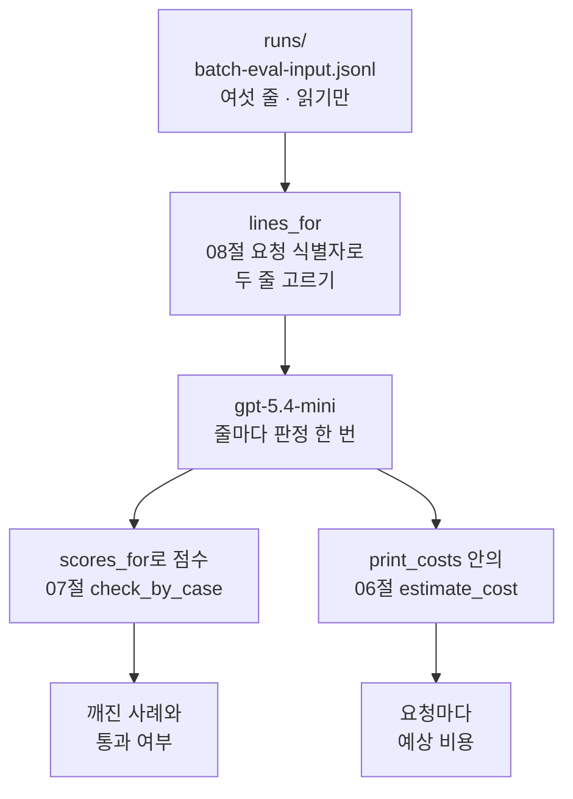
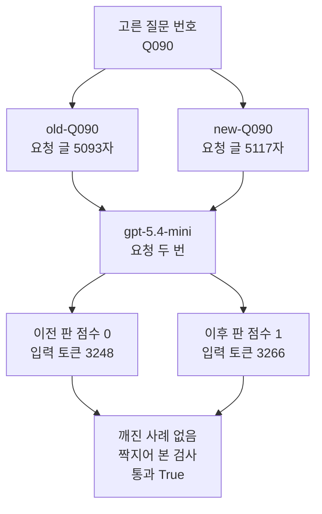
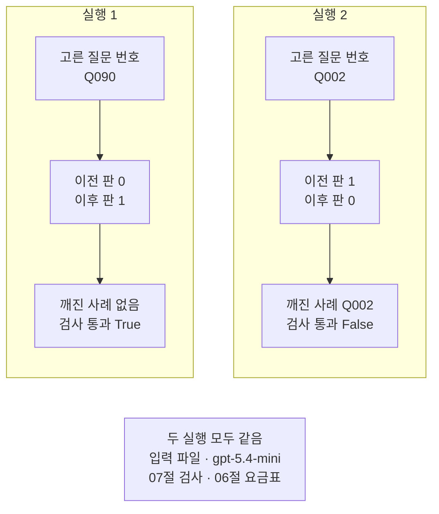
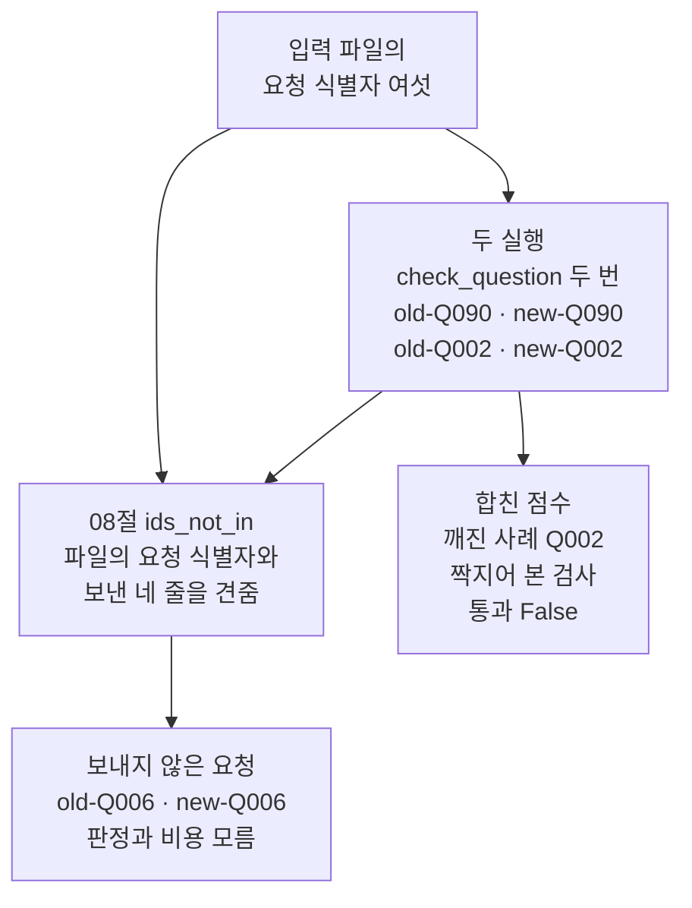

# 09-평가-심화-실습

## _src 본문 (HTML 원본)

```html
<!--meta: 실습 30분 | 코드 notebooks/09-평가-심화-실습.ipynb | 새 용어 0 -->
<style>html,body{overflow-x:hidden}.notebook,.nb-cell,.nb-main,.nb-input,.nb-result{min-width:0;max-width:100%}.nb-input pre,.nb-output{box-sizing:border-box;max-width:100%;overflow-x:auto}code.nb-source{display:block!important;width:100%!important;min-width:0!important;overflow-x:auto!important;padding:0!important}</style>
<h2 id="b1"><span class="no">1</span>학습 목표</h2><div class="goal"><ul>
<li>08절 입력 파일에서 요청 식별자로 줄을 골라 판정 요청을 하나씩 보낼 수 있습니다.</li>
<li>받은 점수로 07절 짝지어 보는 검사를 걸고, 받은 사용량으로 요청마다 예상 비용을 셀 수 있습니다.</li>
<li>고른 질문 번호 하나만 바꿔 다시 실행하고 두 실행을 견줄 수 있습니다.</li>
<li>몇 줄만 먼저 보낸 검사 결과로 이후 판을 내보낼지 정하면 안 되는 까닭을 출력으로 설명할 수 있습니다.</li>
</ul></div>
<h2 id="b2"><span class="no">2</span>이 내용을 배우는 이유</h2><p>07절은 두 판을 사례 세 건씩 판정해 깨진 사례를 찾았습니다. 08절은 그 판정 요청 여섯 개를 입력 파일에 담았고 제출은 하지 않았습니다. 실제로 일괄 처리에 맡기는 파일은 요청이 수백, 수천 줄일 수 있습니다.</p>
<p>그런 파일을 맡기기 전에 몇 줄만 골라 먼저 보내 볼 수 있습니다. 파일에 든 판정 요청 글이 판정되는지 보고, 요청 한 번에 드는 비용도 미리 봅니다. 이번 실습은 이 일을 06·07·08절에서 배운 방법으로 해 봅니다.</p>
<p>이번 절은 이 챕터의 실습입니다. 01~08절에서 쓴 이름과 문법만 쓰고 따로 내는 과제는 없습니다. 강사와 함께 노트북 셀을 차례로 실행합니다.</p>
<p><strong>이 절의 질문</strong> — 입력 파일에서 두 줄만 골라 보낸 검사 결과로 이후 판을 내보낼지 정할 수 있을까요?</p>
<h2 id="b3"><span class="no">3</span>앞에서 배운 내용</h2><p>이번 실습은 아래 절에서 배운 것을 그대로 가져옵니다. 앞에서 배운 함수는 <code>rag_tools.py</code>에 모아 두었습니다. 파일을 열면 코드를 볼 수 있습니다. 노트북과 같은 폴더(<code>notebooks/</code>)에 있는 파일입니다.</p>
<table><thead><tr><th>절</th><th>배운 것</th><th>실습에서 쓰는 곳</th></tr></thead><tbody>
<tr><td>02절</td><td>근거 충실도 판정 머리글 <code>rag-judge-v1.0.0</code>, 모델이 쓴 JSON 글을 <code>json.loads()</code>로 읽기</td><td>입력 파일 줄마다 든 판정 요청 글, 노트북 5절 <code>scores_for()</code></td></tr>
<tr><td>06절</td><td>응답의 사용량과 요금표, Ch 6 06절 <code>estimate_cost()</code></td><td>노트북 4절 요금표, 5절 <code>print_costs()</code></td></tr>
<tr><td>07절</td><td>이전 판과 이후 판, <code>broken_cases()</code>·<code>check_by_case()</code></td><td>노트북 5절 <code>check_question()</code>, 8절 두 실행 모으기</td></tr>
<tr><td>08절</td><td>입력 파일과 요청 식별자, <code>read_jsonl()</code>·<code>ids_not_in()</code></td><td>노트북 3절 파일 읽기, 4절 <code>lines_for()</code>, 8절 보내지 않은 줄</td></tr>
</tbody></table>
<p>07절 함수 셋과 08절 함수 둘은 이번에 그 절 본문 그대로 도구 파일로 옮겼습니다. 07절 함수 셋은 <code>broken_cases()</code>와 <code>check_by_case()</code>, 그리고 그 안에서 불리는 <code>check_by_average()</code>입니다. 인자는 모두 그 절과 같습니다.</p>
<p>세 절을 고른 까닭은 이렇습니다. 08절 입력 파일을 맡기기 전에 할 일은 요청이 판정되는지와 비용이 얼마인지 보는 것입니다. 판정은 07절 검사로, 비용은 06절 방법으로 봅니다.</p>
<p>다른 절의 기능은 쓰지 않습니다. 01절 실패 로그는 검색 쪽 기록이라 판정 흐름에 들어갈 자리가 없습니다. 02절 네 평가를 모두 걸면 요청이 네 배가 되어 근거 충실도 하나만 씁니다. 03절 머리글 두 판과 04절 일치율도 쓰지 않습니다. 새 판의 Q090 판정이 실행에 따라 갈렸고, 일치율에는 제시 라벨이 따로 필요하기 때문입니다.</p>
<p>05절 걸린 시간은 재지 않습니다. 06절 백분위수도 쓰지 않는데, 요청 네 번으로는 분포를 볼 수 없기 때문입니다. 07절처럼 두 판의 여섯 줄을 모두 보내면 07절 실험을 되풀이하게 됩니다. 그래서 이 실습은 두 줄씩 골라 보냅니다.</p>
<h2 id="b4"><span class="no">4</span>핵심 개념</h2><h3>비유로 시작하기</h3>
<p>08절에서 나무 궤짝 하나에 담은 바구니 여섯 개를 그대로 씁니다. 이번에는 이름표를 보고 바구니를 두 개씩 꺼내 저울에 차례로 올립니다. 사과가 멍들었는지 보고, 바구니마다 동전이 얼마나 드는지도 적습니다. 궤짝에 남은 바구니는 이번에 저울에 올리지 않습니다.</p>
{{img:09-5-궤짝에서-꺼낸-바구니를-저울에|흰 바탕에 긴 나무 탁자가 있고 왼쪽에 뚜껑이 뒤로 열린 나무 궤짝 안에 초록과 주황 빈 이름표를 단 짚 바구니 두 개가 빨간 사과를 한 알씩 담고 있으며, 가운데 둥근 눈금판 부엌 저울 접시 위에 분홍 이름표 바구니가 멍든 사과를 담고 올라가 있고, 오른쪽에는 노랑 이름표 바구니의 멍든 사과와 보라·하늘색 이름표 바구니의 빨간 사과가 한 줄로 놓이며, 저울 앞과 오른쪽 세 바구니 앞에 작은 동전 더미가 하나씩 있는 그림|궤짝에서 꺼낸 바구니 넷은 저울에 올려 사과를 보고 동전을 두었고, 두 바구니는 궤짝에 남았습니다.}}
<p class="look"><b>그림 읽기</b> — 왼쪽 나무 궤짝에는 초록과 주황 이름표를 단 바구니 두 개가 남아 있습니다. 가운데 저울 접시에는 분홍 이름표 바구니가 올라가 있고, 그 안의 사과는 멍들어 있습니다. 오른쪽에는 이미 저울에 올린 바구니 셋이 한 줄로 놓여 있습니다. 노랑 이름표 바구니의 사과는 멍들었고, 보라와 하늘색 이름표 바구니의 사과는 빨갛습니다.</p>
<p class="look">저울 앞과 오른쪽 세 바구니 앞에는 작은 동전 더미가 하나씩 있습니다. 궤짝에서 꺼낸 바구니 넷은 이 절에서 보낸 요청 넷이고, 빨간 사과는 점수 1, 멍든 사과는 점수 0입니다. 동전 더미는 요청마다 센 예상 비용입니다. 궤짝에 남은 두 바구니는 이번에 보내지 않은 사례 Q006의 두 줄입니다.</p>
<h3>실습 조립의 구성</h3>
{{mermaid:09-1-입력-파일에서-검사와-비용까지|위에서 아래로 읽는 그림으로 초록 상자 runs batch-eval-input.jsonl 여섯 줄 읽기만에서 파란 상자 lines_for 08절 요청 식별자로 두 줄 고르기를 지나 보라 상자 gpt-5.4-mini 줄마다 판정 한 번으로 가고, 거기서 화살표 둘이 나와 왼쪽은 파란 상자 scores_for로 점수 07절 check_by_case를 지나 노란 상자 깨진 사례와 통과 여부로, 오른쪽은 파란 상자 print_costs 안의 06절 estimate_cost를 지나 노란 상자 요청마다 예상 비용으로 이어지는 그림|입력 파일에서 두 줄을 골라 평가 모델에 보내고, 받은 응답을 07절 검사와 06절 예상 비용에 함께 씁니다.}}
<p class="look"><b>도식 읽기</b> — 위에서 아래로 읽습니다. 맨 위 초록 상자가 08절이 쓴 입력 파일이고, 파란 <code>lines_for</code>가 08절 요청 식별자로 두 줄을 고릅니다. 보라 상자가 이 절에서 실제로 부르는 평가 모델입니다.</p>
<p class="look">보라 상자에서 화살표 둘이 나옵니다. 왼쪽 화살표는 07절 검사로 가서 노란 상자에 깨진 사례와 통과 여부를 냅니다. 오른쪽 화살표는 06절 예상 비용으로 가서 노란 상자에 요청마다 예상 비용을 냅니다. 두 화살표는 같은 응답 객체를 쓰고 둘 다 실행됩니다.</p>
<table><thead><tr><th>함수</th><th>하는 일</th><th>가져온 곳</th></tr></thead><tbody>
<tr><td><code>lines_for()</code></td><td>요청 식별자의 질문 번호가 같은 줄을 파일 차례대로 고름</td><td>08절 요청 식별자 나누기</td></tr>
<tr><td><code>send_lines()</code></td><td>고른 줄마다 판정 요청 글을 보내 응답 객체를 모음</td><td>06절 응답 객체 모으기</td></tr>
<tr><td><code>scores_for()</code></td><td>한 판의 응답에서 JSON 글을 읽어 점수를 모음</td><td>02절 JSON 읽기, 07절 점수 딕셔너리 모양</td></tr>
<tr><td><code>check_question()</code></td><td>줄 고르기·보내기·두 판 점수·07절 검사를 한 흐름으로 이음</td><td>이 절이 새로 묶은 조립 함수</td></tr>
<tr><td><code>print_costs()</code></td><td>응답마다 토큰 수와 예상 비용을 출력하고 합을 냄</td><td>06절 <code>estimate_cost()</code>와 요금표</td></tr>
</tbody></table>
<h3>파일의 요청을 하나씩 보내는 방법</h3>
<p>이 실습은 입력 파일을 일괄 처리로 제출하지 않습니다. 줄마다 본문 메시지의 판정 요청 글을 꺼내 <code>invoke()</code>로 보냅니다. 본문의 설정 칸은 보내지 않고, 같은 설정으로 만든 모델 객체가 요청을 보냅니다. 그래서 노트북 3절에서 본문 설정과 모델 객체가 같은지 먼저 견줍니다.</p>
<h3>두 번의 실행</h3>
<p>실행 1은 질문 번호 <code>Q090</code>의 두 줄을 보냅니다. 실행 2는 고른 질문 번호만 <code>Q002</code>로 바꿉니다. 입력 파일과 모델, 요금표, 조립 함수는 두 실행이 같습니다.</p>
<p>두 사례는 07절에서 판정이 서로 반대로 움직인 사례라 골랐습니다. 07절에서 사례 Q090은 이전 판 0에서 이후 판 1로, 사례 Q002는 1에서 0으로 바뀌었습니다. 흐름을 보여 주려고 07절 결과를 보고 정한 예입니다.</p>
<h2 id="b5"><span class="no">5</span>실행 예제</h2>
<p>노트북은 먼저 입력 파일을 읽고 본문 설정을 모델과 견줍니다. 요금표를 적고 함수 다섯을 만든 뒤 실행 1과 실행 2를 차례로 합니다. 마지막에 두 실행을 견주고, 보내지 않은 줄을 찾고, 두 실행의 점수를 합쳐 검사를 다시 겁니다.</p>
<p>실제 OpenAI 모델을 부릅니다. 교재 출력은 2026-09-21에 실행한 결과입니다. 모델 요청은 실행 1과 실행 2가 두 번씩 모두 네 번이고 임베딩 요청은 없습니다. 예상 비용은 네 번을 합쳐 미화 0.01달러 아래입니다.</p>
{{notebook:09-평가-심화-실습}}
<p class="look"><b>확인할 점</b> — 출력 줄 <code>읽은 줄 수: 6</code>과 <code>모델 이름과 temperature가 같은 줄 수: 6</code>을 봅니다. 실행 1과 실행 2의 <code>짝지어 본 검사 통과:</code> 줄을 견줍니다. 비용 표의 입력 토큰 수와 <code>보내지 않은 요청:</code> 줄도 확인합니다.</p>
<h3>실행 1의 실제 순서</h3>
{{mermaid:09-2-실행-1의-실제-순서|위에서 아래로 읽는 그림으로 맨 위 초록 상자 고른 질문 번호 Q090 아래에 초록 상자 old-Q090 요청 글 5093자와 초록 상자 new-Q090 요청 글 5117자가 나란히 있고, 둘이 보라 상자 gpt-5.4-mini 요청 두 번으로 모인 뒤 노란 상자 이전 판 점수 0 입력 토큰 3248과 노란 상자 이후 판 점수 1 입력 토큰 3266으로 나뉘고, 두 상자가 맨 아래 노란 상자 깨진 사례 없음 짝지어 본 검사 통과 True로 모이는 그림|실행 1은 Q090의 두 줄을 보내 이전 판 0, 이후 판 1을 받았고 짝지어 본 검사를 통과했습니다.}}
<p class="look"><b>도식 읽기</b> — 위에서 아래로 읽습니다. 맨 위 초록 상자가 실행 1에서 고른 질문 번호이고, 그 아래 초록 두 상자가 파일에서 고른 두 줄입니다. 두 줄의 요청 글 글자 수는 07·08절 출력과 같습니다.</p>
<p class="look">보라 상자에서 요청이 두 번 나가고, 노란 두 상자가 줄마다 받은 점수와 입력 토큰 수입니다. 맨 아래 노란 상자가 07절 검사 결과입니다. 노란 상자의 값은 새 커널 두 번 실행에서 같았던 값만 적었습니다.</p>
<h2 id="b6"><span class="no">6</span>실험 결과 해석</h2>
<p>두 실행은 고른 질문 번호 하나만 달랐고 검사 결과는 반대로 나왔습니다.</p>
<table><thead><tr><th>실행</th><th>고른 질문 번호</th><th>이전 판 점수</th><th>이후 판 점수</th><th>깨진 사례</th><th>짝지어 본 검사 통과</th><th>모델 요청 수</th></tr></thead><tbody>
<tr><td>실행 1</td><td><code>Q090</code></td><td>0</td><td>1</td><td>없음</td><td>True</td><td>2</td></tr>
<tr><td>실행 2</td><td><code>Q002</code></td><td>1</td><td>0</td><td><code>Q002</code></td><td>False</td><td>2</td></tr>
</tbody></table>
<p>실행 1만 보면 이후 판을 내보내도 된다고 읽힙니다. 실행 2만 보면 이후 판을 막아야 합니다. 두 줄만 골라 보낸 검사 결과는 어느 사례를 골랐는지에 달렸습니다.</p>
{{mermaid:09-3-두-실행-견주기|위쪽에 칸 둘이 나란히 있고 아래에 회색 상자 하나가 있는 그림으로 왼쪽 칸 실행 1에는 초록 상자 고른 질문 번호 Q090, 노란 상자 이전 판 0에서 이후 판 1, 노란 상자 깨진 사례 없음 검사 통과 True가 위에서 아래로 놓이고, 오른쪽 칸 실행 2에는 초록 상자 고른 질문 번호 Q002, 노란 상자 이전 판 1에서 이후 판 0, 노란 상자 깨진 사례 Q002 검사 통과 False가 놓이며, 맨 아래 회색 상자에 두 실행 모두 같음 입력 파일 gpt-5.4-mini 07절 검사 06절 요금표가 적힌 그림|고른 질문 번호 하나만 바꿨더니 짝지어 본 검사 결과가 True에서 False로 뒤집혔습니다.}}
<p class="look"><b>도식 읽기</b> — 위쪽 두 칸이 두 실행이고 왼쪽이 실행 1, 오른쪽이 실행 2입니다. 칸마다 맨 위 초록 상자가 바꾼 값이고, 노란 상자 둘이 출력으로 확인한 점수와 검사 결과입니다.</p>
<p class="look">맨 아래 회색 상자는 두 실행에서 같게 둔 조건입니다. 한 실행의 결과가 아니라서 어느 칸에도 넣지 않았습니다.</p>
<p>두 실행의 점수를 합치면 사례 두 개짜리 점수가 됩니다. 합친 점수에서 깨진 사례는 <code>['Q002']</code>이고 짝지어 본 검사는 <code>False</code>였습니다. 실행 1에서 통과로 보였던 이후 판도 사례를 하나 더 보자 막혔습니다.</p>
{{mermaid:09-4-두-실행-모으기와-보내지-않은-줄|위에서 아래로 읽는 그림으로 맨 위 초록 상자 입력 파일의 요청 식별자 여섯에서 화살표 둘이 나와 오른쪽 파란 상자 두 실행 check_question 두 번 old-Q090 new-Q090 old-Q002 new-Q002와 왼쪽 파란 상자 08절 ids_not_in 파일의 요청 식별자와 보낸 네 줄을 견줌으로 가고, 오른쪽 파란 상자에서도 화살표가 왼쪽 파란 상자로 이어지며, 오른쪽 파란 상자 아래 노란 상자 합친 점수 깨진 사례 Q002 짝지어 본 검사 통과 False와 왼쪽 파란 상자 아래 노란 상자 보내지 않은 요청 old-Q006 new-Q006 판정과 비용 모름이 놓인 그림|두 실행을 합치면 깨진 사례 Q002 때문에 검사를 통과하지 못하고, Q006의 두 줄은 보내지 않은 채 남습니다.}}
<p class="look"><b>도식 읽기</b> — 위에서 아래로 읽습니다. 맨 위 초록 상자가 입력 파일의 요청 식별자 여섯입니다. 오른쪽 파란 상자는 두 실행이 보낸 네 줄이고, 그 아래 노란 상자가 합친 점수의 검사 결과입니다.</p>
<p class="look">왼쪽 파란 상자는 08절 <code>ids_not_in()</code>이고 파일의 요청 식별자와 보낸 네 줄을 함께 받습니다. 그 아래 노란 상자가 보내지 않은 두 줄이고, 이 두 줄의 판정과 비용은 이번에 알 수 없습니다.</p>
<p>입력 파일의 여섯 줄 가운데 이번에 보낸 것은 넷이고 사례 Q006의 두 줄은 보내지 않았습니다. 이후 판을 내보낼지는 07절처럼 사례 전체를 한 벌로 판정해 정합니다. 이 실습은 그 앞 단계에서 파일에 든 판정 요청 글이 판정되는지와 요청 한 번의 비용을 먼저 본 것입니다.</p>
<p>비용 표의 입력 토큰 수는 새 커널 두 번 실행에서 같았습니다. 사례 Q090의 두 줄은 3248·3266이고 사례 Q002의 두 줄은 모두 1995였습니다. 요청 글이 긴 사례 Q090 쪽이 입력 토큰도 많습니다.</p>
<p>캐시 입력 토큰 수와 출력 토큰 수, 예상 비용은 결론에 쓰지 않습니다. 출력 토큰 수와 예상 비용은 새 커널로 두 번 실행했을 때 달랐습니다. 캐시 입력 토큰 수는 06절에서 실행마다 달랐고 여러분 실행에서는 0일 수 있습니다. 요청마다 예상 비용은 노트북 출력에 있고 청구 금액이 아닙니다.</p>
<h2 id="b7"><span class="no">7</span>주의할 점과 실무 메모</h2>
<ul>
<li><strong>일괄 처리로 제출하지 않았습니다.</strong> 파일 올리기와 일괄 작업 만들기 요청은 0번입니다. 파일의 요청 글을 하나씩 보냈으므로 일괄 처리로 받은 판정이 같은지는 알 수 없습니다.</li>
<li><strong>본문의 설정 칸을 그대로 보낸 것은 아닙니다.</strong> 같은 설정으로 만든 모델 객체가 요청 글만 보냈습니다. 모델 이름과 temperature가 같은지는 출력으로 확인했습니다.</li>
<li><strong>노트북을 쓰기 전에 네 요청을 따로 다섯 번씩 보냈습니다.</strong> 판정이 흔들리는지 보려는 확인이었고 다섯 번 모두 같은 점수였습니다. 그래도 같은 요청의 판정이 실행한 때에 따라 달라질 수 있습니다.</li>
<li><strong>고른 두 사례는 07절 결과를 보고 정한 예입니다.</strong> 판정이 반대로 움직인 두 사례를 골라 검사 결과가 갈리는 모습을 보였습니다.</li>
<li><strong>이후 판 답은 07절에서 만든 답입니다.</strong> 자료 파일에 없는 답이고 실제 새 판의 답이 아닙니다.</li>
<li><strong>출력 토큰 수와 예상 비용은 새 커널 두 번 실행에서 달랐습니다.</strong> 캐시 입력 토큰 수는 새 커널로 두 번 실행했을 때 같았지만 06절에서는 실행마다 달랐습니다. 그래서 결론과 그림에는 입력 토큰 수와 점수만 썼습니다.</li>
<li><strong>예상 비용은 청구 금액이 아닙니다.</strong> 2026-09-17에 확인한 요금표로 센 값입니다. 일괄 처리로 맡기면 요금이 달라질 수 있지만 이번에 계산하지 않았습니다.</li>
<li><strong>사례 Q006의 두 줄은 보내지 않았습니다.</strong> 두 줄의 판정과 비용은 이번에 알 수 없습니다.</li>
<li><strong>걸린 시간은 이번에 재지 않았습니다.</strong> 요청 수는 코드가 고른 줄 수로 셌습니다.</li>
<li><strong>모델이 쓴 판정에는 <code>assert</code>를 걸지 않았습니다.</strong> 보낸 요청 수와 보내지 않은 줄처럼 코드가 정한 값에만 썼습니다.</li>
<li><strong>이 실습은 파일을 쓰지 않습니다.</strong> 08절 입력 파일은 읽기만 하고 다시 쓰지 않았습니다.</li>
<li><strong>교재 출력은 Linux의 Python 3.12.13으로 만들었습니다.</strong> 패키지는 langchain 1.4.0과 langchain-openai 1.6.1과 python-dotenv 1.2.3입니다. 다른 판과 Windows·macOS에서는 이번에 실행하지 않았습니다.</li>
</ul>
<h2 id="b8"><span class="no">8</span>정리와 다음 절</h2>
<ul>
<li>08절 입력 파일에서 요청 식별자로 두 줄을 골라 판정 요청 글을 하나씩 보냈습니다.</li>
<li>받은 점수로 07절 짝지어 보는 검사를 걸고, 받은 사용량으로 06절처럼 요청마다 예상 비용을 셌습니다.</li>
<li>고른 질문 번호를 Q090에서 Q002로 바꾸자 검사 결과가 True에서 False로 뒤집혔습니다.</li>
<li>두 실행을 합치면 깨진 사례 Q002 때문에 검사를 통과하지 못했습니다.</li>
<li>몇 줄만 먼저 보낸 결과는 요청과 비용을 미리 보는 데 쓰고, 내보낼지는 사례 전체로 정합니다.</li>
</ul>
<p><strong>다음 학습과 이어지는 지점</strong> — 이 절로 Ch 15가 끝납니다. 다음은 Ch 16 가드레일·안정화입니다.</p>
<p>이 실습은 요청 한 번의 예상 비용을 세기만 했습니다. 비용이나 호출 수에 상한을 두어 요청을 막는 일은 이번에 하지 않았습니다.</p>
<h2 id="b9"><span class="no">9</span>복습 문제</h2>
<details class="quiz" open><summary>문제 5개 · 해설 포함</summary>
<p class="quiz-q">1. [하] 두 실행에서 바꾼 값은 무엇입니까?</p>
<p class="quiz-a">고른 질문 번호 하나입니다. 실행 1은 Q090이고 실행 2는 Q002입니다. 입력 파일과 모델, 요금표, 조립 함수는 같게 두었습니다.</p>
<p class="quiz-q">2. [중] 입력 파일의 줄을 보내기 전에 무엇을 견주었습니까?</p>
<p class="quiz-a">본문의 모델 이름과 temperature가 노트북에서 만든 모델 객체와 같은지 견주었습니다. 요청 글만 보내고 설정 칸은 모델 객체가 정하기 때문입니다. 틀렸다면 노트북 3절을 다시 읽습니다.</p>
<p class="quiz-q">3. [중] 함수 scores_for가 만든 점수 딕셔너리를 07절 함수에 그대로 넣을 수 있는 까닭은 무엇입니까?</p>
<p class="quiz-a">질문 번호를 키로, 점수를 값으로 모아 07절 점수 딕셔너리와 모양이 같기 때문입니다. 판 표시로 이전 판과 이후 판을 나눠 두 딕셔너리를 만듭니다. 틀렸다면 노트북 5절을 다시 읽습니다.</p>
<p class="quiz-q">4. [중] 새 커널로 두 번 실행했을 때 비용 표에서 같았던 값과 달랐던 값은 무엇입니까?</p>
<p class="quiz-a">새 커널로 두 번 실행했을 때 입력 토큰 수는 같았고, 출력 토큰 수와 예상 비용은 달랐습니다. 캐시 입력 토큰 수도 두 번 같았지만 06절에서 실행마다 달라 결론에 쓰지 않았습니다. 틀렸다면 노트북 6·7절의 비용 표를 다시 읽습니다.</p>
<p class="quiz-q">5. [상] 동료가 「파일에서 두 줄만 보내 봤더니 검사를 통과했으니 이후 판을 내보내자」라고 적었습니다. 이 절 출력으로 무엇이라고 답하나요?</p>
<p class="quiz-a">고른 사례에 따라 결과가 뒤집힌다고 답합니다. 이번 실행에서 Q090 두 줄은 통과했지만 Q002 두 줄은 막혔고, 둘을 합치면 막혔습니다. 사례 Q006은 보내지도 않았습니다. 07절처럼 사례 전체를 판정해 정해야 합니다.</p>
</details>
<h2 id="b10"><span class="no">10</span>참고 자료</h2>
<ul>
<li><div><a href="https://developers.openai.com/api/docs/guides/batch">Batch API</a></div>확인 2026-09-21 · 입력 파일 한 줄의 네 칸과 요청 식별자를 적은 안내입니다.</li>
<li>Ch 15 06절 대화당 비용 백분위수 — 이 실습이 이어 쓴 요금표와 사용량으로 비용 세기가 있는 자리.</li>
<li>Ch 15 07절 회귀 스위트 — 이 실습이 이어 쓴 이전 판·이후 판과 짝지어 보는 검사가 있는 자리.</li>
<li>Ch 15 08절 Batch 평가 입력 — 이 실습이 읽은 입력 파일과 요청 식별자가 있는 자리.</li>
<li>기준 버전은 langchain 1.4.0과 langchain-openai 1.6.1, python-dotenv 1.2.3입니다. 교재 출력은 Linux의 Python 3.12.13으로 만들었습니다.</li>
</ul>
```

## 노트북 셀 (순서대로)

### [0] markdown {'html': 'skip'}

# 평가 심화 실습: 입력 파일에서 두 줄씩 골라 회귀와 비용 보기

**이 노트북에서 할 일**

1. 08절이 쓴 입력 파일을 읽고, 요청 식별자의 질문 번호로 두 줄을 고릅니다.
2. 고른 두 줄의 판정 요청 글을 평가 모델에 하나씩 보내 07절 검사를 겁니다.
3. 응답의 사용량으로 06절처럼 요청마다 예상 비용을 셉니다.
4. 고른 질문 번호만 바꿔 한 번 더 실행하고 두 실행을 견줍니다.

**준비물** — 이 절은 프로젝트 맨 위 폴더의 `.env`에 적어 둔 `OPENAI_API_KEY`를 씁니다.
평가 모델 `gpt-5.4-mini`에 보내는 요청은 네 번이고 임베딩 요청은 없습니다.
실행 1과 실행 2가 두 번씩 보냅니다.
예상 비용은 미화 0.01달러 아래이고 실제 청구 금액과는 다를 수 있습니다.
일괄 처리로 제출하지 않고 파일에 적힌 요청을 하나씩 보냅니다.

읽는 파일은 08절이 쓴 입력 파일 `runs/batch-eval-input.jsonl` 하나입니다.
이 파일은 읽기만 하고 다시 쓰지 않습니다. 새로 쓰는 파일도 없습니다.
교재 출력을 만든 실행에서는 노트북 전체가 1분 안에 끝났습니다.

**기준 버전** — 첫 셀에서 LangChain 1.4.0과 langchain-openai 1.6.1을 설치합니다.
키를 읽는 python-dotenv 1.2.3도 함께 설치합니다.
교재 출력은 Linux의 Python 3.12.13으로 만들었습니다.
다른 판과 Windows·macOS에서는 이번에 실행하지 않았습니다.

**실습 범위** — 이 절은 챕터 끝 실습 절이고 30분 안에 끝나는 분량입니다.
강사와 함께 첫 셀부터 차례로 실행하고, 따로 내는 과제는 없습니다.
01~08절에서 쓴 이름과 문법만 씁니다.

실습 폴더 `labs/part4/ch15-evaluation-advanced`에서 `uv sync --locked`를 실행합니다.
그다음 이 폴더의 `.venv` 커널을 고르고 첫 셀부터 순서대로 실행합니다.

### [1] markdown {'html': 'skip'}

## 오늘 볼 그림


위에서 아래로 읽습니다. 초록 입력 파일에서 파란 상자가 두 줄을 고르고, 보라 평가 모델이 줄마다 한 번씩 판정합니다.
보라 상자에서 화살표 둘이 나옵니다. 왼쪽은 07절 검사로, 오른쪽은 06절 예상 비용으로 가고 둘 다 실행됩니다.

### [2] markdown {}

## 1. 준비

이번 절은 이 챕터의 실습입니다.
01~08절에서 쓴 이름과 문법만 쓰고 따로 내는 과제는 없습니다.
첫 셀은 패키지 세 개를 설치하고 설치된 판 번호를 출력합니다.
설치에는 몇십 초가 걸릴 수 있습니다.

### [3] code {'execution': {'iopub.execute_input': '2026-09-21T19:02:56.654134Z', 'iopub.status.busy': '2026-09-21T19:02:56.653951Z', 'iopub.status.idle': '2026-09-21T19:02:57.131460Z', 'shell.execute_reply': '2026-09-21T19:02:57.130663Z'}, 'lesson_role': 'setup'}

```python
# 이 절에서 쓰는 패키지를 설치하고 버전을 확인합니다
%pip install -q "langchain==1.4.0" "langchain-openai==1.6.1" "python-dotenv==1.2.3"
from importlib.metadata import version

print("langchain:", version("langchain"))
print("langchain-openai:", version("langchain-openai"))
print("python-dotenv:", version("python-dotenv"))
```

출력:
```
Note: you may need to restart the kernel to use updated packages.
langchain: 1.4.0
langchain-openai: 1.6.1
python-dotenv: 1.2.3

```

### [4] markdown {}

**결과 읽기** — 설치가 끝나면 판 번호 세 줄이 보입니다.
출력 줄 `langchain: 1.4.0`과 `langchain-openai: 1.6.1`이 실습 폴더 잠금과 같은 판입니다.
이 노트북의 출력은 2026-09-21에 이 판으로 실행한 결과입니다.

다음 셀은 이 절에서 쓸 이름을 불러오고 앞에서 배운 함수 다섯을 도구 파일에서 가져옵니다.

앞에서 배운 함수는 `rag_tools.py`에 모아 두었습니다. 파일을 열면 코드를 볼 수 있습니다. 노트북과 같은 폴더(`notebooks/`)에 있는 파일입니다.
이 노트북은 07절 `broken_cases()`·`check_by_case()`와 08절 `read_jsonl()`·`ids_not_in()`을 가져옵니다.
Ch 6 06절 `estimate_cost()`도 가져옵니다.

### [5] code {'execution': {'iopub.execute_input': '2026-09-21T19:02:57.132899Z', 'iopub.status.busy': '2026-09-21T19:02:57.132785Z', 'iopub.status.idle': '2026-09-21T19:02:57.457465Z', 'shell.execute_reply': '2026-09-21T19:02:57.457052Z'}, 'lesson_role': 'setup'}

```python
# 파일 읽기·폴더 확인에 쓸 이름과 모델을 준비하는 이름을 불러옵니다
import json
import os

from langchain.chat_models import init_chat_model

# Ch 6 06절 함수 하나와 Ch 15 07·08절 함수 넷을 도구 파일에서 가져옵니다
from rag_tools import broken_cases, check_by_case, estimate_cost, ids_not_in, read_jsonl

print("불러온 이름:", "json", "os", "init_chat_model")
```

출력:
```
불러온 이름: json os init_chat_model

```

### [6] markdown {}

**결과 읽기** — 출력 줄 `불러온 이름: json os init_chat_model`로 이름 세 개를 불러왔습니다.
도구 파일에서 가져온 함수 다섯은 출력하지 않습니다.

07절 함수 둘과 08절 함수 둘은 그 절 본문 그대로 도구 파일에 옮겼고, 인자도 그때와 같습니다.
함수 `check_by_case()`가 안에서 부르는 07절 `check_by_average()`도 함께 옮겼습니다.
함수 `estimate_cost()`는 06절이 옮긴 Ch 6 06절 함수 그대로입니다.

## 2. 키와 모델 준비

이 절도 02~07절과 같은 평가 모델 `gpt-5.4-mini`를 부릅니다.
모델을 만드는 설정 값도 07절과 같습니다.

### [7] markdown {}

API 키가 있는지 확인합니다. `True` 값이 나오면 다음으로 넘어갑니다.

### [8] code {'execution': {'iopub.execute_input': '2026-09-21T19:02:57.458207Z', 'iopub.status.busy': '2026-09-21T19:02:57.458156Z', 'iopub.status.idle': '2026-09-21T19:02:57.461848Z', 'shell.execute_reply': '2026-09-21T19:02:57.461497Z'}, 'lesson_role': 'setup'}

```python
# .env 파일에서 OpenAI API 키를 읽습니다(키 값은 출력하지 않습니다)
import os
from dotenv import find_dotenv, load_dotenv

env_path = find_dotenv(usecwd=True)
load_dotenv(env_path)
has_key = os.getenv("OPENAI_API_KEY") is not None
print("OPENAI_API_KEY 설정 여부:", has_key)
assert has_key, "프로젝트 폴더의 .env 파일에 OPENAI_API_KEY를 적어 주세요."
```

출력:
```
OPENAI_API_KEY 설정 여부: True

```

### [9] markdown {}

실습에 쓸 모델을 준비합니다.
temperature 값을 0으로 두어도 판정 점수가 매번 같다고 보장하지는 않습니다.

### [10] code {'execution': {'iopub.execute_input': '2026-09-21T19:02:57.462451Z', 'iopub.status.busy': '2026-09-21T19:02:57.462392Z', 'iopub.status.idle': '2026-09-21T19:02:58.066081Z', 'shell.execute_reply': '2026-09-21T19:02:58.065418Z'}}

```python
# 실습에 쓸 모델을 준비합니다
model = init_chat_model(
    "openai:gpt-5.4-mini",
    temperature=0,
    reasoning_effort="none",
)
print("모델 이름:", model.model_name)
print("temperature:", model.temperature)
```

출력:
```
모델 이름: gpt-5.4-mini
temperature: 0.0

```

### [11] markdown {}

**결과 읽기** — 모델 이름 `gpt-5.4-mini`, temperature `0.0`이 보이면 준비가 끝났습니다.
이 노트북의 출력은 2026-09-21에 이 모델로 실행한 결과입니다.

### [12] markdown {}

## 3. 입력 파일 읽기

이 실습의 상황은 이렇습니다.
08절은 판정 요청 여섯 개를 입력 파일에 담았고 제출은 하지 않았습니다.
여섯 줄을 한꺼번에 맡기기 전에 두 줄만 골라 하나씩 보내 봅니다.
파일에 든 판정 요청 글이 판정되는지와 요청 한 번의 비용을 먼저 보려는 것입니다.

먼저 노트북을 연 자리에서 프로젝트 맨 위를 찾습니다.
01~08절과 같은 자리 찾기 셀입니다.

### [13] code {'execution': {'iopub.execute_input': '2026-09-21T19:02:58.067421Z', 'iopub.status.busy': '2026-09-21T19:02:58.067330Z', 'iopub.status.idle': '2026-09-21T19:02:58.069941Z', 'shell.execute_reply': '2026-09-21T19:02:58.069492Z'}, 'lesson_role': 'setup'}

```python
# 노트북을 어느 폴더에서 열어도 프로젝트 맨 위를 찾게 후보 세 개를 차례로 봅니다
candidates = [".", "../../..", "../../../.."]
root_path = None
for candidate in candidates:
    if os.path.exists(candidate + "/labs/part4/ch15-evaluation-advanced/data"):
        root_path = candidate
        break
print("찾은 프로젝트 맨 위:", root_path)
assert root_path is not None, "notebooks 폴더나 실습 폴더 맨 위에서 노트북을 열어 주세요."
```

출력:
```
찾은 프로젝트 맨 위: .

```

### [14] markdown {}

**결과 읽기** — 출력 줄 `찾은 프로젝트 맨 위:` 뒤에 점 하나나 위로 올라가는 자리가 보입니다.

다음 셀은 08절이 쓴 입력 파일을 08절 함수 `read_jsonl()`로 읽습니다.
파일은 내려받은 실습 자료에 들어 있습니다.
08절 노트북을 다시 실행해도 같은 내용으로 다시 써집니다.
이 절은 파일을 읽기만 하고 다시 쓰지 않습니다.

### [15] code {'execution': {'iopub.execute_input': '2026-09-21T19:02:58.070718Z', 'iopub.status.busy': '2026-09-21T19:02:58.070660Z', 'iopub.status.idle': '2026-09-21T19:02:58.073814Z', 'shell.execute_reply': '2026-09-21T19:02:58.073452Z'}}

```python
# 08절이 쓴 입력 파일을 읽어 줄 수와 요청 식별자를 봅니다(읽기만 하고 다시 쓰지 않습니다)
batch_path = root_path + "/labs/part4/ch15-evaluation-advanced/runs/batch-eval-input.jsonl"
batch_lines = read_jsonl(batch_path)
request_ids = []
for line in batch_lines:
    request_ids.append(line["custom_id"])
print("읽은 줄 수:", len(batch_lines))
print("요청 식별자:", request_ids)
```

출력:
```
읽은 줄 수: 6
요청 식별자: ['old-Q002', 'old-Q006', 'old-Q090', 'new-Q002', 'new-Q006', 'new-Q090']

```

### [16] markdown {}

**결과 읽기** — 출력 줄 `읽은 줄 수: 6`으로 입력 파일의 요청은 여섯 줄입니다.
출력 줄 `요청 식별자:` 뒤 목록이 08절이 붙인 이름이고, `old-Q002`부터 `new-Q090`까지입니다.
판 표시 `old`는 이전 판, `new`는 이후 판이고 줄표 뒤가 질문 번호입니다.

다음 셀은 요청 주소와 본문 설정을 2절에서 만든 모델과 견줍니다.
본문 설정이 같아야 파일의 요청 글을 이 모델로 보내도 같은 설정의 요청이 됩니다.

### [17] code {'execution': {'iopub.execute_input': '2026-09-21T19:02:58.074635Z', 'iopub.status.busy': '2026-09-21T19:02:58.074566Z', 'iopub.status.idle': '2026-09-21T19:02:58.076832Z', 'shell.execute_reply': '2026-09-21T19:02:58.076485Z'}}

```python
# 여섯 줄의 요청 주소와 본문 설정을 2절에서 만든 모델과 견줍니다(요청 없음)
first_body = batch_lines[0]["body"]
print("첫 줄 요청 주소:", batch_lines[0]["url"])
print("첫 줄 본문 설정:", first_body["model"], first_body["temperature"], first_body["reasoning_effort"])
print("모델 객체:", model.model_name, model.temperature)
same_count = 0
for line in batch_lines:
    if line["body"]["model"] == model.model_name and line["body"]["temperature"] == model.temperature:
        same_count = same_count + 1
print("모델 이름과 temperature가 같은 줄 수:", same_count)
```

출력:
```
첫 줄 요청 주소: /v1/chat/completions
첫 줄 본문 설정: gpt-5.4-mini 0 none
모델 객체: gpt-5.4-mini 0.0
모델 이름과 temperature가 같은 줄 수: 6

```

### [18] markdown {}

**결과 읽기** — 출력 줄 `첫 줄 요청 주소: /v1/chat/completions`는 08절이 정한 요청 주소입니다.
출력 줄 `첫 줄 본문 설정: gpt-5.4-mini 0 none`과 `모델 객체: gpt-5.4-mini 0.0`을 견줍니다.
출력 줄 `모델 이름과 temperature가 같은 줄 수: 6`으로 여섯 줄 모두 같았습니다.

본문의 `0`과 모델 객체의 `0.0`은 적는 모양만 다르고 같은 값으로 셉니다.
추론 설정 `none`은 2절 모델 셀에서 `reasoning_effort="none"`으로 준 값과 같습니다.
08절에서 본 것처럼 이 과정의 LangChain 판은 이 설정의 요청을 같은 주소로 보냅니다.

## 4. 요금표와 줄 고르기

다음 셀은 06절 요금표를 같은 키 이름과 값으로 다시 적습니다.
요청 한 번의 예상 비용을 셀 때 씁니다.

### [19] code {'execution': {'iopub.execute_input': '2026-09-21T19:02:58.077517Z', 'iopub.status.busy': '2026-09-21T19:02:58.077474Z', 'iopub.status.idle': '2026-09-21T19:02:58.079041Z', 'shell.execute_reply': '2026-09-21T19:02:58.078734Z'}}

```python
# 06절 요금표(100만 토큰당 달러)를 같은 키 이름과 값으로 다시 적고 확인한 날짜도 적습니다
pricing_date = "2026-09-17"
mini_prices = {"ordinary_input": 0.75, "cached_input": 0.075, "output": 4.50}
print("요금 확인 날짜:", pricing_date)
print("mini 요금:", mini_prices)
```

출력:
```
요금 확인 날짜: 2026-09-17
mini 요금: {'ordinary_input': 0.75, 'cached_input': 0.075, 'output': 4.5}

```

### [20] markdown {}

**결과 읽기** — 출력 줄 `요금 확인 날짜: 2026-09-17`은 Ch 6 06절에서 요금을 확인한 날입니다.
출력 줄 `mini 요금:` 뒤 딕셔너리가 100만 토큰당 달러입니다.

코드에 적은 `4.50`은 출력에서 `4.5`로 보입니다.
다음 셀은 입력 파일에서 질문 번호가 같은 줄만 고르는 함수입니다.
08절에서 요청 식별자를 `split("-")`로 나눠 판 표시와 질문 번호를 읽은 방법을 씁니다.

### [21] code {'execution': {'iopub.execute_input': '2026-09-21T19:02:58.079710Z', 'iopub.status.busy': '2026-09-21T19:02:58.079648Z', 'iopub.status.idle': '2026-09-21T19:02:58.081744Z', 'shell.execute_reply': '2026-09-21T19:02:58.081380Z'}}

```python
# 입력 파일의 줄 가운데 요청 식별자의 질문 번호가 같은 줄만 파일 차례대로 고릅니다
def lines_for(lines, qid):
    chosen_lines = []
    for line in lines:
        parts = line["custom_id"].split("-")
        if parts[1] == qid:
            chosen_lines.append(line)
    return chosen_lines
```

출력:
```

```

### [22] markdown {}

**결과 읽기** — 정의 셀이라 출력이 없습니다.
함수 `lines_for`는 요청 식별자를 줄표로 나눠 둘째 값이 질문 번호와 같은 줄만 모읍니다.
고른 줄은 파일 차례대로 목록에 들어가므로 이전 판 줄이 먼저 옵니다.

다음 셀은 실행 1에서 보낼 줄을 미리 골라 봅니다. 요청은 보내지 않습니다.

### [23] code {'execution': {'iopub.execute_input': '2026-09-21T19:02:58.082393Z', 'iopub.status.busy': '2026-09-21T19:02:58.082334Z', 'iopub.status.idle': '2026-09-21T19:02:58.084386Z', 'shell.execute_reply': '2026-09-21T19:02:58.084003Z'}}

```python
# 실행 1에서 보낼 질문 번호 Q090의 줄을 미리 고르고 요청 식별자와 요청 글 글자 수를 봅니다(요청 없음)
preview_lines = lines_for(batch_lines, "Q090")
print("고른 줄 수:", len(preview_lines))
print("요청 식별자 | 요청 글 글자 수")
for line in preview_lines:
    content = line["body"]["messages"][0]["content"]
    print(line["custom_id"], "|", len(content))
```

출력:
```
고른 줄 수: 2
요청 식별자 | 요청 글 글자 수
old-Q090 | 5093
new-Q090 | 5117

```

### [24] markdown {}

**결과 읽기** — 출력 줄 `고른 줄 수: 2`로 질문 번호 Q090의 줄은 두 줄입니다.
라벨 줄 `요청 식별자 | 요청 글 글자 수` 아래 `old-Q090 | 5093`과 `new-Q090 | 5117`이 보입니다.
두 글자 수는 07·08절 출력의 Q090 글자 수와 같습니다.

사례 하나에 이전 판과 이후 판이 한 줄씩 있습니다.
그래서 두 줄을 보내면 07절처럼 두 판을 짝지어 볼 수 있습니다.

## 5. 기록 장치와 조립

다음 셀은 고른 줄을 평가 모델에 보내는 함수입니다.
줄마다 본문 메시지의 내용이 판정 요청 글입니다.
06절처럼 응답 객체를 통째로 모아 두면 점수와 사용량을 함께 꺼낼 수 있습니다.

### [25] code {'execution': {'iopub.execute_input': '2026-09-21T19:02:58.084991Z', 'iopub.status.busy': '2026-09-21T19:02:58.084944Z', 'iopub.status.idle': '2026-09-21T19:02:58.086789Z', 'shell.execute_reply': '2026-09-21T19:02:58.086402Z'}}

```python
# 고른 줄마다 본문 메시지의 판정 요청 글을 평가 모델에 보내고 응답 객체를 요청 식별자별로 모읍니다(줄 하나에 모델 요청 1번)
def send_lines(judge_model, chosen_lines):
    replies = {}
    for line in chosen_lines:
        prompt_text = line["body"]["messages"][0]["content"]
        replies[line["custom_id"]] = judge_model.invoke(prompt_text)
    return replies
```

출력:
```

```

### [26] markdown {}

**결과 읽기** — 정의 셀이라 출력이 없습니다.
함수 `send_lines`는 줄마다 `invoke()`를 한 번씩 불러 응답 객체를 요청 식별자별로 모읍니다.
고른 줄이 두 줄이면 모델 요청이 두 번 나갑니다.
파일에 적힌 설정 칸은 보내지 않고, 같은 설정으로 만든 모델 객체가 요청을 보냅니다.

다음 셀은 응답 객체에서 한 판의 점수만 모으는 함수입니다.

### [27] code {'execution': {'iopub.execute_input': '2026-09-21T19:02:58.087392Z', 'iopub.status.busy': '2026-09-21T19:02:58.087344Z', 'iopub.status.idle': '2026-09-21T19:02:58.088910Z', 'shell.execute_reply': '2026-09-21T19:02:58.088679Z'}}

```python
# 응답 객체 가운데 판 표시가 같은 것만 골라 JSON 글을 읽고 점수를 질문 번호별로 모읍니다
def scores_for(replies, version_tag):
    scores = {}
    for custom_id in replies:
        parts = custom_id.split("-")
        if parts[0] == version_tag:
            verdict = json.loads(replies[custom_id].text)
            scores[parts[1]] = verdict["score"]
    return scores
```

출력:
```

```

### [28] markdown {}

**결과 읽기** — 정의 셀이라 출력이 없습니다.
함수 `scores_for`는 요청 식별자의 판 표시가 같은 응답만 골라 JSON 글을 읽습니다.
점수는 질문 번호를 키로 모으므로 07절 점수 딕셔너리와 모양이 같습니다.
그래서 07절 함수에 그대로 넣을 수 있습니다.

다음 셀은 앞 절 기능을 한 흐름으로 잇는 조립 함수입니다.
08절 줄 고르기, 파일 속 판정 요청 글 보내기, 07절 검사를 차례로 합니다.

### [29] code {'execution': {'iopub.execute_input': '2026-09-21T19:02:58.089630Z', 'iopub.status.busy': '2026-09-21T19:02:58.089576Z', 'iopub.status.idle': '2026-09-21T19:02:58.091574Z', 'shell.execute_reply': '2026-09-21T19:02:58.091229Z'}}

```python
# 08절 줄 고르기 → 판정 요청 → 07절 짝지어 보는 검사를 한 흐름으로 잇습니다(고른 줄 하나에 모델 요청 1번)
def check_question(judge_model, lines, qid):
    # 08절: 요청 식별자의 질문 번호로 두 줄을 고릅니다
    chosen_lines = lines_for(lines, qid)
    # 02절 판정 요청 글(파일 본문에 든 글)을 줄마다 보냅니다
    replies = send_lines(judge_model, chosen_lines)
    old_scores = scores_for(replies, "old")
    new_scores = scores_for(replies, "new")
    result = {"응답": replies, "이전 판": old_scores, "이후 판": new_scores}
    # 07절: 깨진 사례와 짝지어 보는 검사
    result["깨진 사례"] = broken_cases(old_scores, new_scores)
    result["통과"] = check_by_case(old_scores, new_scores)
    return result
```

출력:
```

```

### [30] markdown {}

**결과 읽기** — 정의 셀이라 출력이 없습니다.
함수 `check_question`은 질문 번호 하나를 받아 두 줄을 보내고 두 판 점수를 모읍니다.
07절 `broken_cases()`로 깨진 사례를 찾고, `check_by_case()`로 짝지어 본 검사 결과를 냅니다.
결과는 응답·두 판 점수·깨진 사례·통과를 담은 딕셔너리 하나입니다.

다음 셀은 응답 객체의 사용량으로 예상 비용을 세어 출력하는 함수입니다.
06절처럼 요청마다 `estimate_cost()`를 한 번씩 부릅니다.

### [31] code {'execution': {'iopub.execute_input': '2026-09-21T19:02:58.092154Z', 'iopub.status.busy': '2026-09-21T19:02:58.092108Z', 'iopub.status.idle': '2026-09-21T19:02:58.093852Z', 'shell.execute_reply': '2026-09-21T19:02:58.093554Z'}}

```python
# 응답 객체마다 사용량과 요금표로 06절처럼 예상 비용을 세어 한 줄씩 출력하고 합도 출력합니다(요청 없음)
def print_costs(replies, prices):
    total_cost = 0
    print("요청 식별자 | 입력 토큰 수 | 캐시 입력 토큰 수 | 출력 토큰 수 | 예상 비용(달러)")
    for custom_id in replies:
        usage = replies[custom_id].usage_metadata
        cost = estimate_cost(usage, prices["ordinary_input"], prices["cached_input"], prices["output"])
        total_cost = total_cost + cost
        print(custom_id, "|", usage["input_tokens"], "|", usage["input_token_details"]["cache_read"], "|", usage["output_tokens"], "|", round(cost, 8))
    print("예상 비용 합(달러):", round(total_cost, 8))
```

출력:
```

```

### [32] markdown {}

**결과 읽기** — 정의 셀이라 출력이 없습니다.
함수 `print_costs`는 응답마다 입력·캐시 입력·출력 토큰 수와 예상 비용을 한 줄씩 출력합니다.
마지막 줄에는 출력한 요청들의 예상 비용 합을 적습니다.
입력 가운데 캐시 입력은 싼 요금으로, 나머지는 일반 입력 요금으로 셉니다.

이것으로 부품과 기록 장치를 모두 만들었습니다.
실행 1·2가 고를 두 사례 Q090·Q002는 흐름을 보여 주려고 07절 결과를 보고 정한 예입니다.

## 6. 실행 1 · 질문 번호 Q090

실행 1은 질문 번호 Q090의 두 줄을 보냅니다.
실행 전에 예상해 봅니다.
07절에서 이 사례는 이전 판 0, 이후 판 1이었습니다.
같은 판정이 나오면 깨진 사례가 없고 짝지어 본 검사를 통과할 것입니다.
이 셀에서 모델 요청이 두 번 나갑니다.

### [33] code {'execution': {'iopub.execute_input': '2026-09-21T19:02:58.094411Z', 'iopub.status.busy': '2026-09-21T19:02:58.094363Z', 'iopub.status.idle': '2026-09-21T19:03:00.151200Z', 'shell.execute_reply': '2026-09-21T19:03:00.150387Z'}}

```python
# 실행 1은 질문 번호 Q090의 두 줄을 파일에서 골라 하나씩 보냅니다(모델 요청 2번)
chosen_qid = "Q090"
run1 = check_question(model, batch_lines, chosen_qid)
run1_ids = list(run1["응답"].keys())
print("고른 질문 번호:", chosen_qid)
print("보낸 요청 식별자:", run1_ids)
```

출력:
```
고른 질문 번호: Q090
보낸 요청 식별자: ['old-Q090', 'new-Q090']

```

### [34] markdown {}

**결과 읽기** — 출력 줄 `고른 질문 번호: Q090`과 `보낸 요청 식별자: ['old-Q090', 'new-Q090']`로 두 줄을 보냈습니다.
응답 객체는 결과 딕셔너리의 칸 `응답`에 요청 식별자별로 들어 있습니다.

다음 셀은 두 판 점수와 07절 검사 결과를 봅니다.

### [35] code {'execution': {'iopub.execute_input': '2026-09-21T19:03:00.153137Z', 'iopub.status.busy': '2026-09-21T19:03:00.152980Z', 'iopub.status.idle': '2026-09-21T19:03:00.156928Z', 'shell.execute_reply': '2026-09-21T19:03:00.156207Z'}}

```python
# 실행 1의 두 판 점수와 07절 검사 결과를 봅니다(요청 없음)
print("이전 판 점수:", run1["이전 판"])
print("이후 판 점수:", run1["이후 판"])
print("깨진 사례(1 → 0):", run1["깨진 사례"])
print("짝지어 본 검사 통과:", run1["통과"])
```

출력:
```
이전 판 점수: {'Q090': 0}
이후 판 점수: {'Q090': 1}
깨진 사례(1 → 0): []
짝지어 본 검사 통과: True

```

### [36] markdown {}

**결과 읽기** — 출력 줄 `이전 판 점수:`와 `이후 판 점수:` 뒤가 질문 번호별 점수입니다.
출력 줄 `깨진 사례(1 → 0):`와 `짝지어 본 검사 통과:` 뒤가 07절 검사 결과입니다.

이번 실행에서 사례 Q090은 이전 판 0, 이후 판 1이었습니다.
깨진 사례는 없었고 짝지어 본 검사는 True, 곧 통과였습니다.
예상과 같았고, 새 커널로 두 번 실행했을 때 두 번 모두 같았습니다.
판정은 모델이 쓴 글이라 여러분 실행에서는 다를 수 있습니다.

다음 셀은 두 응답의 사용량으로 요청마다 예상 비용을 셉니다.

### [37] code {'execution': {'iopub.execute_input': '2026-09-21T19:03:00.157566Z', 'iopub.status.busy': '2026-09-21T19:03:00.157517Z', 'iopub.status.idle': '2026-09-21T19:03:00.160159Z', 'shell.execute_reply': '2026-09-21T19:03:00.159491Z'}}

```python
# 실행 1에서 받은 두 응답의 사용량으로 요청마다 예상 비용을 셉니다(요청 없음)
print("실행 1의 응답 수:", len(run1["응답"]))
print_costs(run1["응답"], mini_prices)
```

출력:
```
실행 1의 응답 수: 2
요청 식별자 | 입력 토큰 수 | 캐시 입력 토큰 수 | 출력 토큰 수 | 예상 비용(달러)
old-Q090 | 3248 | 2816 | 48 | 0.0007512
new-Q090 | 3266 | 2816 | 61 | 0.0008232
예상 비용 합(달러): 0.0015744

```

### [38] markdown {}

**결과 읽기** — 출력 줄 `실행 1의 응답 수: 2`로 두 응답을 셉니다.
라벨 줄 `요청 식별자 | 입력 토큰 수 | 캐시 입력 토큰 수 | 출력 토큰 수 | 예상 비용(달러)` 아래 두 줄이 두 요청입니다.
줄 `old-Q090 | 3248`과 `new-Q090 | 3266`처럼 요청 글이 긴 이후 판의 입력 토큰이 조금 많습니다.

이번 실행에서 캐시 입력 토큰 수는 두 줄 모두 2816이었고, 출력 토큰 수는 48과 61이었습니다.
예상 비용은 0.0007512달러와 0.0008232달러였고 합은 0.0015744달러였습니다.
새 커널로 두 번 실행했을 때 입력 토큰 수는 같았고, 출력 토큰 수와 예상 비용은 달랐습니다.
캐시 입력 토큰 수는 여러분 실행에서 0일 수 있고, 그러면 같은 요금표로도 예상 비용이 커집니다.

## 7. 실행 2 · 질문 번호 Q002

실행 2는 고른 질문 번호만 Q002로 바꿉니다.
입력 파일·모델·요금표·조립 함수는 실행 1과 같습니다.
실행 전에 예상해 봅니다.
07절에서 이 사례는 이전 판 1, 이후 판 0이었습니다.
같은 판정이 나오면 사례 Q002가 깨진 사례로 잡혀 검사를 통과하지 못할 것입니다.

이 셀에서 모델 요청이 두 번 나갑니다.

### [39] code {'execution': {'iopub.execute_input': '2026-09-21T19:03:00.161339Z', 'iopub.status.busy': '2026-09-21T19:03:00.161268Z', 'iopub.status.idle': '2026-09-21T19:03:01.851163Z', 'shell.execute_reply': '2026-09-21T19:03:01.849897Z'}}

```python
# 실행 2는 고른 질문 번호만 Q002로 바꾸고 나머지는 실행 1과 같게 둡니다(모델 요청 2번)
chosen_qid = "Q002"
run2 = check_question(model, batch_lines, chosen_qid)
run2_ids = list(run2["응답"].keys())
print("고른 질문 번호:", chosen_qid)
print("보낸 요청 식별자:", run2_ids)
```

출력:
```
고른 질문 번호: Q002
보낸 요청 식별자: ['old-Q002', 'new-Q002']

```

### [40] markdown {}

**결과 읽기** — 출력 줄 `고른 질문 번호: Q002`와 `보낸 요청 식별자: ['old-Q002', 'new-Q002']`로 두 줄을 보냈습니다.
실행 1과 달라진 값은 고른 질문 번호 하나입니다.

다음 셀은 두 판 점수와 07절 검사 결과를 봅니다.

### [41] code {'execution': {'iopub.execute_input': '2026-09-21T19:03:01.853881Z', 'iopub.status.busy': '2026-09-21T19:03:01.853632Z', 'iopub.status.idle': '2026-09-21T19:03:01.858377Z', 'shell.execute_reply': '2026-09-21T19:03:01.857379Z'}}

```python
# 실행 2의 두 판 점수와 07절 검사 결과를 봅니다(요청 없음)
print("이전 판 점수:", run2["이전 판"])
print("이후 판 점수:", run2["이후 판"])
print("깨진 사례(1 → 0):", run2["깨진 사례"])
print("짝지어 본 검사 통과:", run2["통과"])
```

출력:
```
이전 판 점수: {'Q002': 1}
이후 판 점수: {'Q002': 0}
깨진 사례(1 → 0): ['Q002']
짝지어 본 검사 통과: False

```

### [42] markdown {}

**결과 읽기** — 출력 줄 `이전 판 점수:`와 `이후 판 점수:` 뒤가 질문 번호별 점수입니다.
출력 줄 `깨진 사례(1 → 0):`와 `짝지어 본 검사 통과:` 뒤가 07절 검사 결과입니다.

이번 실행에서 사례 Q002는 이전 판 1, 이후 판 0이었습니다.
깨진 사례로 Q002가 나왔고 짝지어 본 검사는 False, 곧 막힘이었습니다.
예상과 같았고, 새 커널로 두 번 실행했을 때 두 번 모두 같았습니다.
실행 1과 바꾼 값은 질문 번호 하나인데 검사 결과가 반대로 나왔습니다.

다음 셀은 두 응답의 사용량으로 요청마다 예상 비용을 셉니다.

### [43] code {'execution': {'iopub.execute_input': '2026-09-21T19:03:01.860264Z', 'iopub.status.busy': '2026-09-21T19:03:01.860055Z', 'iopub.status.idle': '2026-09-21T19:03:01.863480Z', 'shell.execute_reply': '2026-09-21T19:03:01.862714Z'}}

```python
# 실행 2에서 받은 두 응답의 사용량으로 요청마다 예상 비용을 셉니다(요청 없음)
print("실행 2의 응답 수:", len(run2["응답"]))
print_costs(run2["응답"], mini_prices)
```

출력:
```
실행 2의 응답 수: 2
요청 식별자 | 입력 토큰 수 | 캐시 입력 토큰 수 | 출력 토큰 수 | 예상 비용(달러)
old-Q002 | 1995 | 1792 | 45 | 0.00048915
new-Q002 | 1995 | 1792 | 50 | 0.00051165
예상 비용 합(달러): 0.0010008

```

### [44] markdown {}

**결과 읽기** — 출력 줄 `실행 2의 응답 수: 2`로 두 응답을 셉니다.
라벨 줄 `요청 식별자 | 입력 토큰 수 | 캐시 입력 토큰 수 | 출력 토큰 수 | 예상 비용(달러)` 아래 두 줄이 두 요청입니다.
줄 `old-Q002 | 1995`와 `new-Q002 | 1995`처럼 두 줄의 입력 토큰 수가 같습니다.

이번 실행에서 캐시 입력 토큰 수는 두 줄 모두 1792였고, 출력 토큰 수는 45와 50이었습니다.
예상 비용은 0.00048915달러와 0.00051165달러였고 합은 0.0010008달러였습니다.
새 커널로 두 번 실행했을 때 입력 토큰 수는 같았고, 출력 토큰 수와 예상 비용은 달랐습니다.
예상 비용은 요금표로 센 값이고 청구 금액이 아닙니다.

## 8. 두 실행 견주기

다음 셀은 두 실행의 점수와 검사 결과를 한 줄씩 나란히 봅니다.

### [45] code {'execution': {'iopub.execute_input': '2026-09-21T19:03:01.864720Z', 'iopub.status.busy': '2026-09-21T19:03:01.864600Z', 'iopub.status.idle': '2026-09-21T19:03:01.868230Z', 'shell.execute_reply': '2026-09-21T19:03:01.867593Z'}}

```python
# 두 실행의 두 판 점수와 07절 검사 결과를 한 줄씩 나란히 봅니다(요청 없음)
run_results = {"실행 1": run1, "실행 2": run2}
print("실행 | 이전 판 점수 | 이후 판 점수 | 깨진 사례 | 짝지어 본 검사 통과")
for run_name in run_results:
    result = run_results[run_name]
    print(run_name, "|", result["이전 판"], "|", result["이후 판"], "|", result["깨진 사례"], "|", result["통과"])
```

출력:
```
실행 | 이전 판 점수 | 이후 판 점수 | 깨진 사례 | 짝지어 본 검사 통과
실행 1 | {'Q090': 0} | {'Q090': 1} | [] | True
실행 2 | {'Q002': 1} | {'Q002': 0} | ['Q002'] | False

```

### [46] markdown {}

**결과 읽기** — 라벨 줄 `실행 | 이전 판 점수 | 이후 판 점수 | 깨진 사례 | 짝지어 본 검사 통과` 아래 두 줄이 두 실행입니다.

이번 실행에서 실행 1은 깨진 사례 없이 통과했고, 실행 2는 사례 Q002가 깨져 막혔습니다.
고른 질문 번호 하나만 바꿨는데 검사 결과가 뒤집혔습니다.
두 줄만 골라 보낸 검사 결과는 어느 사례를 골랐는지에 달린다는 뜻입니다.
새 커널로 두 번 실행했을 때 두 줄은 두 번 모두 같았습니다.

다음 셀은 두 실행이 보낸 요청을 모으고 입력 파일에서 보내지 않은 줄을 찾습니다.
08절 함수 `ids_not_in()`에 파일의 요청 식별자를 첫째로 넣습니다.

### [47] code {'execution': {'iopub.execute_input': '2026-09-21T19:03:01.869504Z', 'iopub.status.busy': '2026-09-21T19:03:01.869357Z', 'iopub.status.idle': '2026-09-21T19:03:01.872305Z', 'shell.execute_reply': '2026-09-21T19:03:01.871684Z'}}

```python
# 두 실행이 보낸 요청 식별자를 모으고, 입력 파일에서 보내지 않은 줄을 08절 함수로 찾습니다(요청 없음)
sent_ids = run1_ids + run2_ids
unsent_ids = ids_not_in(request_ids, sent_ids)
print("보낸 요청 수:", len(sent_ids))
print("보낸 요청 식별자:", sent_ids)
print("보내지 않은 요청:", unsent_ids)
assert len(sent_ids) == 4
assert unsent_ids == ["old-Q006", "new-Q006"]
```

출력:
```
보낸 요청 수: 4
보낸 요청 식별자: ['old-Q090', 'new-Q090', 'old-Q002', 'new-Q002']
보내지 않은 요청: ['old-Q006', 'new-Q006']

```

### [48] markdown {}

**결과 읽기** — 출력 줄 `보낸 요청 수: 4`로 두 실행이 보낸 요청은 네 번입니다.
출력 줄 `보내지 않은 요청: ['old-Q006', 'new-Q006']`이 이번에 보내지 않은 두 줄입니다.
보낸 요청 수와 보내지 않은 줄은 코드가 고른 줄에서 정해지는 값이라 `assert`로도 확인했습니다.

사례 Q006의 두 줄은 판정도 비용도 이번에 알 수 없습니다.
두 줄만 골라 보내면 나머지 줄은 보지 않은 채로 남습니다.

다음 셀은 두 실행의 점수를 합쳐 사례 두 개짜리 점수로 07절 검사를 다시 겁니다.
요청은 보내지 않고 받은 점수만 씁니다.

### [49] code {'execution': {'iopub.execute_input': '2026-09-21T19:03:01.873736Z', 'iopub.status.busy': '2026-09-21T19:03:01.873622Z', 'iopub.status.idle': '2026-09-21T19:03:01.877101Z', 'shell.execute_reply': '2026-09-21T19:03:01.876478Z'}}

```python
# 두 실행의 점수를 사례 두 개짜리 점수로 합쳐 07절 검사를 다시 겁니다(요청 없음)
merged_old = run1["이전 판"].copy()
merged_new = run1["이후 판"].copy()
for qid in run2["이전 판"]:
    merged_old[qid] = run2["이전 판"][qid]
    merged_new[qid] = run2["이후 판"][qid]
print("합친 이전 판 점수:", merged_old)
print("합친 이후 판 점수:", merged_new)
print("깨진 사례(1 → 0):", broken_cases(merged_old, merged_new))
print("짝지어 본 검사 통과:", check_by_case(merged_old, merged_new))
```

출력:
```
합친 이전 판 점수: {'Q090': 0, 'Q002': 1}
합친 이후 판 점수: {'Q090': 1, 'Q002': 0}
깨진 사례(1 → 0): ['Q002']
짝지어 본 검사 통과: False

```

### [50] markdown {}

**결과 읽기** — 출력 줄 `합친 이전 판 점수:`와 `합친 이후 판 점수:` 뒤가 사례 두 개의 점수입니다.
출력 줄 `깨진 사례(1 → 0):`와 `짝지어 본 검사 통과:` 뒤가 합친 점수의 검사 결과입니다.

이번 실행에서 합친 점수의 깨진 사례는 Q002였고 짝지어 본 검사는 False였습니다.
실행 1만 봤다면 통과로 읽었을 이후 판이 사례를 하나 더 보자 막혔습니다.
07절처럼 사례 전체를 한 벌로 판정해야 이후 판을 내보낼지 정할 수 있습니다.
새 커널로 두 번 실행했을 때 네 줄은 두 번 모두 같았습니다.

## 정리

1. 08절 입력 파일에서 요청 식별자로 두 줄을 골라 판정 요청 글을 하나씩 보냈습니다.
2. 받은 점수로 07절 검사를 걸고, 받은 사용량으로 요청마다 예상 비용을 셌습니다.
3. 고른 질문 번호만 바꾸자 검사 결과가 뒤집혀, 내보낼지는 사례 전체로 정해야 했습니다.

이 절로 Ch 15가 끝납니다. 다음은 Ch 16 가드레일·안정화입니다.

## 그림

### 09-1-입력-파일에서-검사와-비용까지.mmd



입력 파일에서 두 줄을 골라 평가 모델에 보내고, 받은 응답을 07절 검사와 06절 예상 비용에 함께 씁니다.

### 09-2-실행-1의-실제-순서.mmd



실행 1은 Q090의 두 줄을 보내 이전 판 0, 이후 판 1을 받았고 짝지어 본 검사를 통과했습니다.

### 09-3-두-실행-견주기.mmd



고른 질문 번호 하나만 바꿨더니 짝지어 본 검사 결과가 True에서 False로 뒤집혔습니다.

### 09-4-두-실행-모으기와-보내지-않은-줄.mmd



두 실행을 합치면 깨진 사례 Q002 때문에 검사를 통과하지 못하고, Q006의 두 줄은 보내지 않은 채 남습니다.

### 09-5-궤짝에서-꺼낸-바구니를-저울에.prompt.md

# 09-5-궤짝에서-꺼낸-바구니를-저울에 (Higgsfield 삽화)

설명 대상 문장(본문 b4 비유 단락): 08절에서 나무 궤짝 하나에 담은 바구니 여섯 개를 그대로 씁니다. 이번에는 이름표를 보고 바구니를 두 개씩 꺼내 저울에 차례로 올립니다. 사과가 멍들었는지 보고, 바구니마다 동전이 얼마나 드는지도 적습니다. 궤짝에 남은 바구니는 이번에 저울에 올리지 않습니다.

구성 요소와 배치: 흰 바탕의 긴 탁자, 왼쪽부터 한 줄. **왼쪽** 뚜껑이 열린 나무 궤짝 하나(= 입력 파일) 안에 바구니 **두 개**(= 보내지 않은 old-Q006·new-Q006, 08절 삽화의 이름표 색 차례대로 초록·주황). **가운데** 부엌 저울 하나(= 평가 모델) 접시 위에 분홍 이름표 바구니(= new-Q002), 사과는 **멍듦**(= 점수 0). **오른쪽** 이미 올린 바구니 **셋** — 노랑(= old-Q090, 멍듦 = 0)·보라(= new-Q090, 빨강 = 1)·하늘색(= old-Q002, 빨강 = 1). 저울 앞과 오른쪽 세 바구니 앞에 **작은 동전 더미 하나씩**(= 요청마다 예상 비용). 이름표 색은 08절 삽화(`08-5`)의 뒷줄 하늘색·초록·노랑, 앞줄 분홍·주황·보라를 요청 식별자 차례(old-Q002·old-Q006·old-Q090 / new-Q002·new-Q006·new-Q090)에 맞춰 이어 썼습니다(본문은 색과 요청 식별자의 짝을 가르치지 않음). 사과 상태는 07절 삽화(`07-5`)의 빨간 사과 1·멍든 사과 0 약속.

시선 순서: 왼쪽 궤짝에 남은 두 바구니 → 가운데 저울 위 바구니와 멍든 사과 → 오른쪽 이미 올린 세 바구니의 사과 상태 → 앞의 동전 더미.

검수 기준: 그림만 보고 「궤짝에서 바구니를 꺼내 저울에 차례로 올린다」, 「올린 바구니마다 사과 상태가 다르다(멍듦·빨강)」, 「올린 바구니마다 동전 더미가 있다」, 「궤짝에 두 바구니가 남았다」가 읽히는가. 글자·숫자가 없는가.

비유 계열: 01절이 정한 **바구니·사과·저울**. handoff §08→실습(09) 9번 제안(「궤짝에서 꺼낸 바구니를 저울에 차례로 올려 멍든 사과를 골라냄」)에 06절 동전 더미(`06-5`)를 더해 앞 삽화들을 한 장면에 모았습니다.

## 프롬프트 (1차, 채택)

```text
Simple flat educational illustration, white background, limited soft palette, clean outlines, plain everyday objects, no text, no letters, no numbers, no logos.

A long plain wooden table seen from the front and slightly above. Large objects arranged left to right in one row.

Left: one open wooden crate with its lid tilted back. Inside the crate sit exactly two large woven baskets side by side, each holding one shiny red apple. The left basket in the crate has a plain green blank paper tag tied to its handle, the right one a plain orange blank paper tag.

Center: one kitchen scale with a round dial face that has only short plain tick marks and a needle. On the scale pan sits one large woven basket with a plain pink blank paper tag on its handle, holding one bruised apple with a large brown soft spot.

Right: exactly three large woven baskets stand in a row on the table. From left to right: the first has a plain yellow blank tag and holds one bruised apple with a large brown soft spot; the second has a plain purple blank tag and holds one shiny red apple; the third has a plain light blue blank tag and holds one shiny red apple. In front of each of these three baskets, and in front of the scale, lies one small low stack of a few round gold coins.

No hands, no people, no screens, no arrows, no charts, no writing on the tags.
```

## 상태

- 2026-09-21 · `nano_banana_pro`(응답 모델 이름 `nano_banana_2`) · 16:9 · 2k · `use_unlim: false` · `count: 1` · 장당 2크레딧. 생성 전 잔액 2647 → 생성 뒤 **2645**.
- **1차 job `999fe89c-6bcf-423d-b54c-eb2720adb2fd` 채택**(재생성 없음). 원본 `c60826cb0bc9acd8035e729f197b9e8407116a911104984eb0d29a0ce57142da`(2752 × 1536, RGBA). 생성에서 결과까지 약 1분.
- **그림에서 확인한 것(그림 읽기·alt·캡션에 반영)**: 왼쪽에 뚜껑이 뒤로 열린 나무 궤짝, 안에 초록·주황 빈 이름표를 단 짚 바구니 둘과 빨간 사과 한 알씩. 가운데 둥근 눈금판 부엌 저울(숫자 없는 짧은 선, 바늘은 맨 위) 접시 위에 분홍 이름표 바구니, 사과는 갈색 멍이 든 사과. 오른쪽에 노랑(멍든 사과)·보라(빨간 사과)·하늘색(빨간 사과) 이름표 바구니가 한 줄. 저울 앞과 오른쪽 세 바구니 앞에 낮은 동전 더미가 하나씩(모두 비슷한 높이 — 그림 읽기는 높낮이를 말하지 않음). 글자·숫자·사람 손 없음. 프롬프트의 개수·배치·상태가 그대로 그려졌습니다. 동전 더미는 1100폭에서 약 50px로 작지만 알아볼 수 있습니다.
- 저장: 기기 셸에서 결과 URL을 `curl`로 받아 `uv run --no-project --with pillow`로 RGB로 바꾸고 폭 1100px로 줄여 `figures/09-5-궤짝에서-꺼낸-바구니를-저울에.png`(1100 × 614, `c84cb46cc501486b496eb426f085d77da3edd6f1b4acbda5598fceda35b28ce1`)로 저장. 원본 2752px는 저장하지 않았습니다. 결과 URL을 다시 받아(같은 해시 `c60826cb…`) 같은 폭으로 줄인 그림과 저장 PNG를 픽셀 대조해 차이가 없음을 확인했습니다(`ImageChops.difference` bbox `None`, 세 칸 extrema 모두 `(0, 0)`, 규격 §5-4). 저장 PNG와 같은 파일(`.cache/ch15-09/illu-job1.png`, 해시 같음)을 직접 열어 그림 읽기를 썼습니다.

