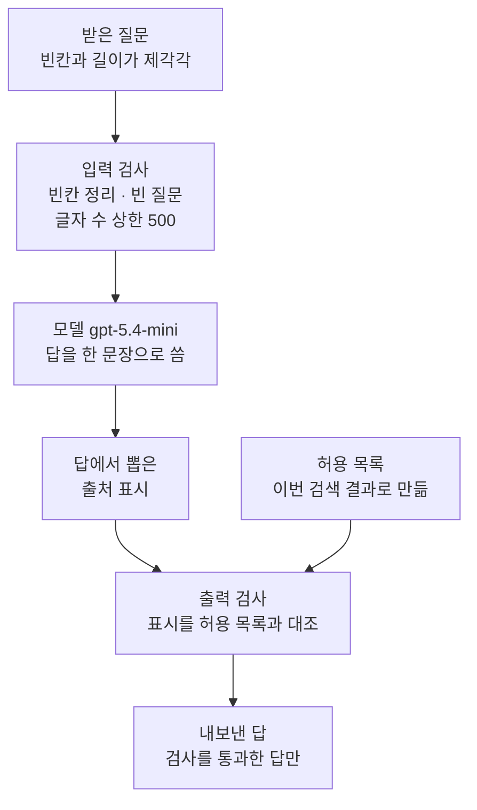
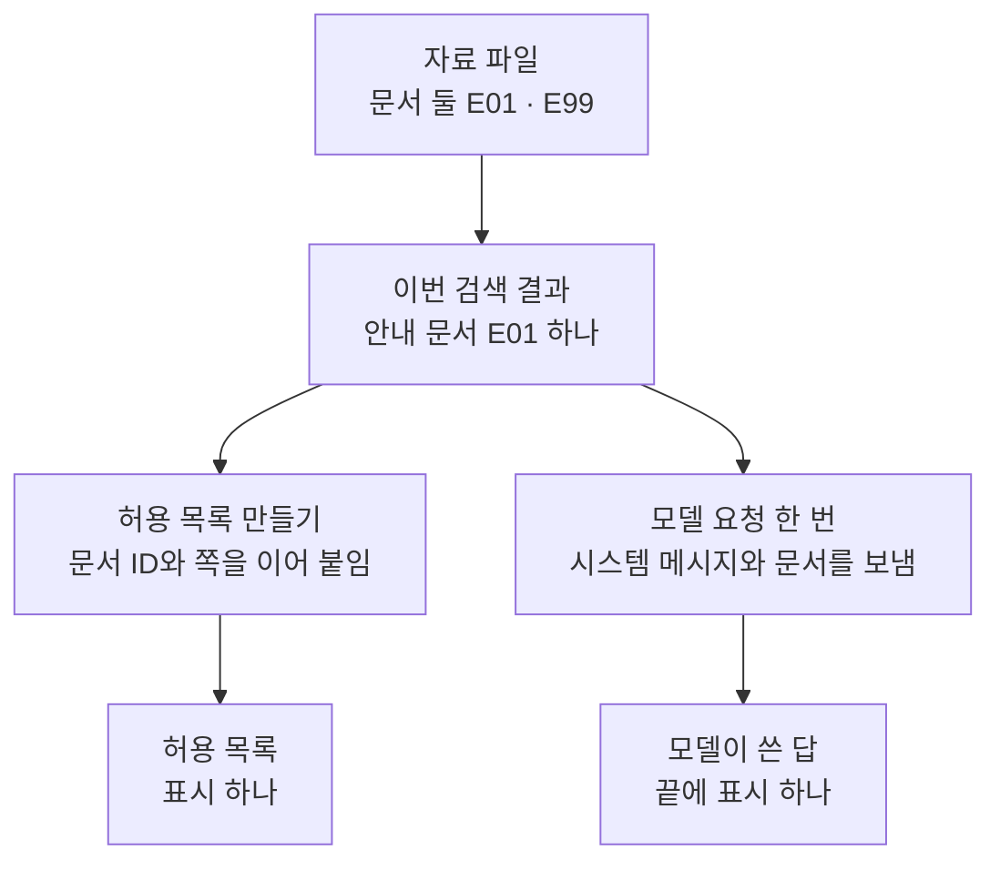
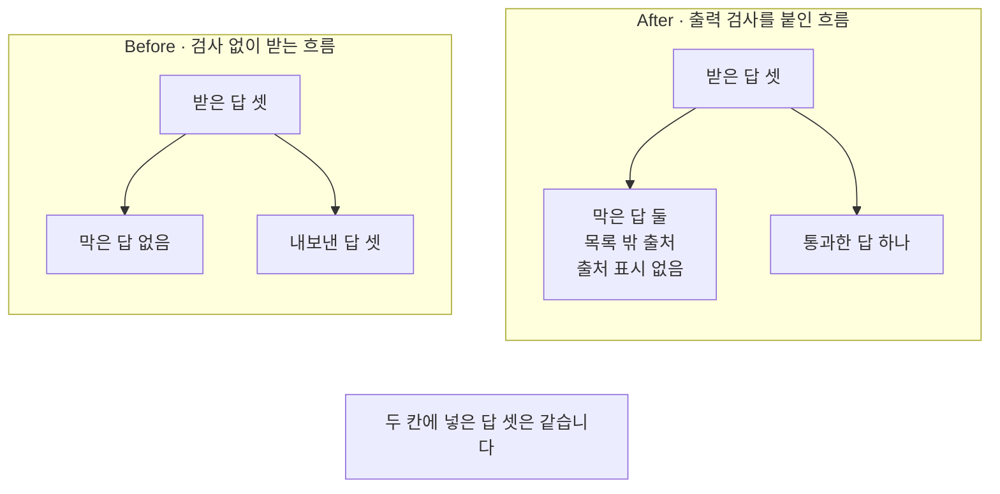
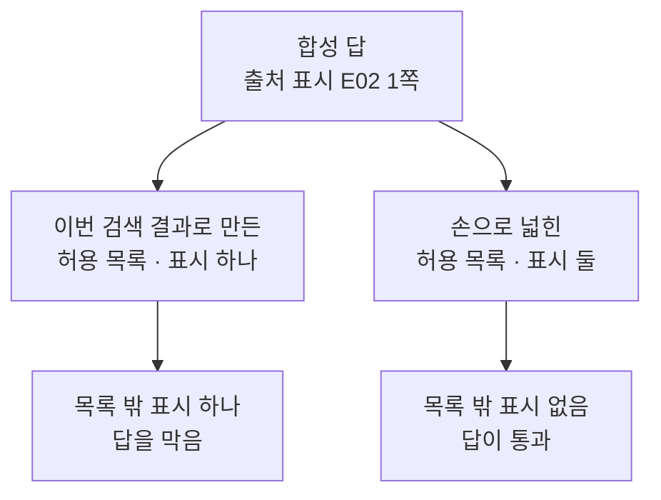

# 01-입출력-출처-검증

## _src 본문 (HTML 원본)

```html
<!--meta: 강의 0.5h | 실습 0.5h | 코드 notebooks/01-입출력-출처-검증.ipynb | 새 용어 4 -->
<style>html,body{overflow-x:hidden}.notebook,.nb-cell,.nb-main,.nb-input,.nb-result{min-width:0;max-width:100%}.nb-input pre,.nb-output{box-sizing:border-box;max-width:100%;overflow-x:auto}code.nb-source{display:block!important;width:100%!important;min-width:0!important;overflow-x:auto!important;padding:0!important}</style>
<h2 id="b1"><span class="no">1</span>학습 목표</h2><div class="goal"><ul>
<li>빈 질문과 정한 글자 수 상한을 넘는 질문을 모델 호출 앞에서 막을 수 있습니다.</li>
<li>이번 검색 결과로 허용 목록을 만들어 답의 출처 표시와 대조할 수 있습니다.</li>
<li>검사 없이 받는 흐름이 무엇을 놓치는지 출력으로 설명할 수 있습니다.</li>
</ul></div>
<h2 id="b2"><span class="no">2</span>이 내용을 배우는 이유</h2><p>검색이 알맞은 문서를 찾아 주어도 답이 그 문서를 인용했다고 보장할 수는 없습니다. 답 끝에 붙은 출처 표시가 이번 검색 결과에 없는 문서를 가리킬 수도 있습니다. 그런 답을 그대로 내보내면 읽는 사람은 없는 근거를 믿게 됩니다.</p><p>질문 쪽도 마찬가지입니다. 빈 질문이나 아주 긴 질문도 검사가 없으면 그대로 요청이 됩니다. 이 절은 모델 바깥에 파이썬 검사 둘을 두어 이 두 자리를 막습니다.</p>
<h2 id="b3"><span class="no">3</span>앞에서 배운 내용</h2><p>Ch 8 02절에서 답 끝에 <code>[E01 p.3]</code> 같은 출처 표시를 적게 했습니다. Ch 9 01절의 함수 <code>find_cited_marks()</code>는 검색 결과의 표시 가운데 답에 들어 있는 것만 모았습니다. 이 방식은 목록에 없는 표시를 결과에 내놓지 않습니다. Ch 9 04절도 그런 표시는 결과에 나오지 않아 답 글을 함께 읽어야 한다고 적었습니다.</p><p>이 절은 방향을 거꾸로 잡습니다. 답에서 표시를 먼저 뽑고, 목록 밖 표시가 있으면 답을 막습니다.</p><p>Ch 15에서는 답이 근거 문서로 뒷받침되는지 평가 모델에게 물었습니다. 이 절의 검사는 평가가 아니라 글자 대조입니다. 모델을 한 번 더 부르지 않고 파이썬만으로 막습니다.</p><p>Ch 2 05절에서 배운 <code>try/except 이름 as error</code>와 <code>ValueError</code>를 그대로 씁니다. 막을 자리에서는 파이썬 말 <code>raise</code>로 오류를 일부러 일으킵니다. 부르는 쪽은 그 오류를 받아 한 줄씩 출력합니다.</p>
<h2 id="b4"><span class="no">4</span>핵심 개념</h2><h3>비유로 시작하기</h3><p>창구에 쪽지 세 장이 들어왔다고 해 봅니다. 쪽지마다 도장이 찍혀 있을 수도 있고 없을 수도 있습니다. 창구 옆에는 오늘 받을 수 있는 도장 무늬만 찍어 둔 대장이 한 권 있습니다.</p><p>대장에 찍힌 무늬는 둥근 무늬 하나뿐입니다. 왼쪽 쪽지의 둥근 무늬는 대장과 같고, 가운데 쪽지의 네모난 무늬는 대장에 없습니다. 오른쪽 쪽지에는 무늬가 아예 없습니다. 대장과 견주지 않으면 세 장이 모두 똑같이 통과합니다.</p>
{{img:01-5-쪽지-세-장과-도장-대장|흰 바탕 나무 탁자에 종이 쪽지 세 장이 한 줄로 놓여 있고 왼쪽 쪽지에는 파란 둥근 도장 무늬가 찍혀 있으며 가운데 쪽지에는 붉은 네모난 도장 무늬가 찍혀 있고 오른쪽 쪽지에는 아무 무늬도 없으며 쪽지 뒤에 펼쳐 놓은 대장 한 권에 파란 둥근 도장 무늬 하나가 찍혀 있고 그 오른쪽에 나무 손도장 하나가 놓인 그림|대장에 찍힌 무늬는 파란 둥근 무늬 하나뿐입니다. 왼쪽 쪽지만 그 무늬와 같습니다.}}
<p class="look"><b>그림 읽기</b> — 나무 탁자에 종이 쪽지 세 장이 한 줄로 놓여 있습니다. 왼쪽 쪽지에는 파란 둥근 무늬가, 가운데 쪽지에는 붉은 네모난 무늬가 찍혀 있습니다. 오른쪽 쪽지에는 무늬가 없습니다. 쪽지 뒤에 펼쳐 놓은 대장 한 권에는 파란 둥근 무늬 하나만 찍혀 있습니다. 대장 오른쪽에는 나무 손도장 하나가 놓여 있습니다.</p>
<table><thead><tr><th>말</th><th>뜻</th></tr></thead><tbody><tr><td>입력 검사(input validation)</td><td>모델을 부르기 전에 질문이 정한 모양과 길이에 맞는지 보는 일입니다. 우편물을 부치기 전에 주소 칸이 비었는지 보는 일과 같습니다.</td></tr><tr><td>출력 검사(output validation)</td><td>모델이 쓴 답을 내보내기 전에 정한 조건에 맞는지 보는 일입니다. 서류를 창구에 내기 전에 다시 훑어보는 일과 같습니다.</td></tr><tr><td>출처 표시</td><td>답 끝에 <code>[문서ID p.쪽]</code> 꼴로 적는 짧은 표시입니다. 쪽지에 찍은 도장 무늬와 같습니다.</td></tr><tr><td>허용 목록(allow list)</td><td>이번 검색 결과로 만든 출처 표시 목록입니다. 오늘 받을 무늬만 찍어 둔 대장과 같습니다.</td></tr></tbody></table>
<p>새 말을 이 절 코드에서 보면 이렇습니다. 입력 검사는 함수 <code>validate_query</code>이고, 출력 검사는 함수 <code>validate_answer</code>입니다. 출처 표시는 함수 <code>find_source_marks</code>가 뽑는 <code>[E01 p.1]</code> 같은 글자입니다. 허용 목록은 함수 <code>allowed_marks_of</code>가 검색 문서로 만든 <code>['[E01 p.1]']</code>입니다.</p>
{{mermaid:01-1-질문-검사와-출처-대조|위에서 아래로 읽는 그림으로 초록 상자 받은 질문 빈칸과 길이가 제각각에서 파란 상자 입력 검사 빈칸 정리 빈 질문 글자 수 상한 500으로, 다시 보라 상자 모델 gpt-5.4-mini 답을 한 문장으로 씀으로, 다시 노란 상자 답에서 뽑은 출처 표시로, 다시 파란 상자 출력 검사 표시를 허용 목록과 대조로 이어지고 그 옆 노란 상자 허용 목록 이번 검색 결과로 만듦도 같은 출력 검사로 들어가며 맨 아래 노란 상자 내보낸 답 검사를 통과한 답만으로 끝나는 그림|질문은 모델을 부르기 전에, 답은 내보내기 전에 검사합니다. 허용 목록은 이번 검색 결과로 만듭니다.}}
<p class="look"><b>도식 읽기</b> — 위에서 아래로 읽습니다. 맨 위 초록 상자가 받은 질문이고, 그 아래 파란 상자가 입력 검사입니다. 검사를 지난 질문이 보라 모델로 들어가 답을 받습니다. 답에서 뽑은 노란 출처 표시가, 노트북이 출력한 노란 허용 목록과 함께 파란 출력 검사로 들어갑니다. 맨 아래 노란 상자가 검사를 지난 답입니다.</p>
<h3>두 검사가 맡는 자리</h3><p>입력 검사는 모델을 부르기 전에 한 번만 합니다. 질문의 빈칸을 정리하고, 빈 질문과 정한 상한을 넘는 질문을 막습니다. 이 검사는 요청이 나가기 전에 끝나므로 막힌 질문은 비용을 쓰지 않습니다.</p><p>출력 검사는 모델 답을 받은 뒤에 합니다. 답에서 출처 표시를 뽑아 허용 목록과 글자끼리 견줍니다. 목록 밖 표시가 있거나 표시가 아예 없으면 답을 내보내지 않습니다.</p><p>노트북은 설명하려고 차례를 나눴습니다. 모델 요청은 노트북 5절에서 먼저 한 번 보냅니다. 검사 둘은 노트북 7~9절에서 같은 질문 셋과 답 셋에 따로 겁니다. 실제 서비스에서는 그림처럼 입력 검사를 지난 질문만 모델에 보냅니다.</p>
<h3>허용 목록은 이번 검색 결과에서 만듭니다</h3><p>허용 목록을 미리 적어 두면 검사가 헐거워집니다. 이번에 찾지 않은 문서의 표시까지 통과하기 때문입니다. 그래서 이 절은 요청마다 검색 결과에서 허용 목록을 새로 만듭니다. 노트북 10절이 목록을 손으로 한 칸 넓히면 무엇이 달라지는지 보입니다.</p>
<h3>다른 상황에 적용</h3><p>약품 안내 서비스라면 답에 적힌 약품 코드를 이번에 찾은 안내문 목록과 견줄 수 있습니다. 사내 규정 안내라면 규정 번호를 이번 검색 결과의 번호 목록과 견줍니다. 자리는 같습니다. 질문은 부르기 전에, 답은 내보내기 전에 봅니다.</p>
<h3>비교와 경계</h3><p>이 검사는 표시가 이번 검색 결과에 있는지만 봅니다. 표시가 맞다고 해서 그 문서가 답을 실제로 뒷받침한다는 뜻은 아닙니다. 답의 내용이 근거와 맞는지는 Ch 15에서 본 평가 모델 판정이 맡는 자리입니다. 이 절은 그 판정을 하지 않았습니다.</p>
<h2 id="b5"><span class="no">5</span>실행 예제</h2><p>노트북은 이 챕터 자료 파일에서 문서 둘을 읽습니다. 그 가운데 안내 문서 <code>E01</code> 하나만 이 절의 검색 결과로 씁니다. 나머지 문서 <code>E99</code>는 06절에서 쓸 합성 문서라 이 절에서는 고르지 않습니다.</p><p>모델 <code>gpt-5.4-mini</code>에 보내는 요청은 한 번이고 임베딩 요청은 없습니다. 노트북을 한 번 실행하는 요금은 요금표로 어림해 미화 0.01달러 아래입니다. 실제 청구 금액과는 다를 수 있습니다. 새로 쓰는 파일은 없습니다.</p>
{{notebook:01-입출력-출처-검증|example}}
<p class="look"><b>확인할 점</b> — 노트북 3절 출력 <code>이번 검색 결과의 문서 수: 1</code>로 이 절이 쓰는 문서가 하나인지 봅니다. 노트북 5절 라벨 줄 <code>모델이 쓴 답:</code> 아래 줄 끝에 표시 <code>[E01 p.1]</code>이 붙었는지 봅니다.</p>
{{mermaid:01-2-검색-결과로-허용-목록-만들기|위에서 아래로 읽는 그림으로 초록 상자 자료 파일 문서 둘 E01과 E99에서 초록 상자 이번 검색 결과 안내 문서 E01 하나로 이어지고 거기서 화살표가 둘로 나뉘어 왼쪽으로는 파란 상자 허용 목록 만들기 문서 ID와 쪽을 이어 붙임을 지나 노란 상자 허용 목록 표시 하나로 가며 오른쪽으로는 보라 상자 모델 요청 한 번 시스템 메시지와 문서를 보냄을 지나 노란 상자 모델이 쓴 답 끝에 표시 하나로 가는 그림|허용 목록과 모델 답이 같은 검색 결과 문서 하나에서 나옵니다. 그래서 둘을 대조할 수 있습니다.}}
<p class="look"><b>도식 읽기</b> — 위에서 아래로 읽습니다. 맨 위 초록 상자가 자료 파일이고 그 아래 초록 상자가 이번 검색 결과입니다. 거기서 화살표가 둘로 나뉩니다. 왼쪽은 파란 허용 목록 만들기를 지나 노란 허용 목록으로 갑니다. 오른쪽은 보라 모델 요청을 지나 노란 모델 답으로 갑니다.</p>
<h2 id="b6"><span class="no">6</span>실패 확인</h2><p>아래 Before 셀은 받은 것을 그대로 쓰는 흐름입니다. 질문 셋과 답 셋을 하나도 막지 않습니다. 이어지는 After 셀은 같은 질문 셋과 같은 답 셋을 그대로 쓰고 검사 둘만 붙입니다.</p>
{{notebook:01-입출력-출처-검증|failure}}
{{mermaid:01-3-검사-없는-흐름과-검사한-흐름|칸 둘이 나란히 있고 아래에 회색 상자가 있는 그림으로 왼쪽 칸 Before 검사 없이 받는 흐름에는 초록 상자 받은 답 셋에서 화살표가 둘로 나뉘어 빨간 상자 막은 답 없음과 빨간 상자 내보낸 답 셋으로 가고 오른쪽 칸 After 출력 검사를 붙인 흐름에는 초록 상자 받은 답 셋에서 화살표가 둘로 나뉘어 노란 상자 막은 답 둘 목록 밖 출처와 출처 표시 없음, 노란 상자 통과한 답 하나로 가며 맨 아래 회색 상자에 두 칸에 넣은 답 셋은 같습니다가 적힌 그림|같은 답 셋에서 검사 없는 흐름은 하나도 막지 못했고, 검사한 흐름은 둘을 막았습니다.}}
<p class="look"><b>도식 읽기</b> — 왼쪽 칸이 Before이고 오른쪽 칸이 출력 검사를 붙인 After입니다. 칸마다 맨 위 초록 받은 답 셋에서 화살표가 둘로 나뉘어, 막은 쪽과 내보낸 쪽을 나란히 보입니다. 왼쪽 칸의 빨간 상자 둘은 하나도 막지 못하고 셋을 모두 내보낸 결함입니다. 오른쪽 칸의 노란 상자 둘은 막은 답 둘과 통과한 답 하나입니다. 맨 아래 회색 상자는 두 칸에 같은 답 셋을 넣었다는 메모입니다.</p>
<p>두 흐름은 같은 답 셋을 받았고 검사만 달랐습니다. 검사 없는 흐름은 출력 줄 <code>막은 답 수: 0</code>으로 하나도 막지 못했습니다. 검사한 흐름은 목록 밖 표시를 적은 답과 표시가 없는 답을 막았습니다.</p><p>질문 쪽도 같습니다. 검사 없는 흐름은 빈 질문과 700자 질문도 보낼 목록에 그대로 담았습니다. 검사한 흐름에서는 출력 줄 <code>검사를 통과한 질문 수: 1</code>로 하나만 남았습니다. 막아야 할 두 질문은 실제로 모델에 보내지 않았습니다.</p><p>새 커널로 두 번 실행했을 때 막은 수와 통과한 수는 두 번 모두 같았습니다. 모델이 쓴 답 문장은 실행마다 달라질 수 있어 본문에 글자 수를 적지 않았습니다.</p>
<p>값 바꿔 보기는 허용 목록 하나만 바꿉니다. 손으로 <code>[E02 p.1]</code>을 더한 목록으로 같은 합성 답을 다시 대조했습니다. 넓힌 목록에서는 목록 밖 표시가 남지 않아 답이 막히지 않았습니다. 이번 검색 결과로 만든 좁은 목록에서는 목록 밖 표시가 하나 남았습니다.</p>
{{mermaid:01-4-허용-목록을-넓히면|위에서 아래로 읽는 그림으로 초록 상자 합성 답 출처 표시 E02 1쪽에서 화살표가 둘로 나뉘어 왼쪽은 노란 상자 이번 검색 결과로 만든 허용 목록 표시 하나를 지나 노란 상자 목록 밖 표시 하나 답을 막음으로 가고 오른쪽은 노란 상자 손으로 넓힌 허용 목록 표시 둘을 지나 노란 상자 목록 밖 표시 없음 답이 통과로 가는 그림|허용 목록을 손으로 넓히자 같은 합성 답이 통과했습니다. 목록은 이번 검색 결과로 만들어야 합니다.}}
<p class="look"><b>도식 읽기</b> — 위에서 아래로 읽습니다. 맨 위 초록 상자가 합성 답 하나이고 그 아래에서 화살표가 둘로 나뉩니다. 왼쪽 노란 상자는 이번 검색 결과로 만든 목록이고 오른쪽 노란 상자는 손으로 넓힌 목록입니다. 두 목록도 노트북이 출력한 값이라 노랑이고, 그 아래 노란 상자 둘이 각각의 대조 결과입니다.</p>
<h2 id="b7"><span class="no">7</span>주의할 점과 실무 메모</h2><ul><li>합성 답 둘은 자료 파일에 없고 이 절에서 손으로 적은 답입니다. 검사가 무엇을 막는지 보이려고 정한 답입니다.</li><li>글자 수 상한 500과 허용 목록은 이 절에서 정한 값입니다. 실제 서비스에서는 화면 입력 칸과 모델 입력 예산을 함께 보고 정합니다.</li><li>출처 표시가 허용 목록에 있다고 해서 답이 사실이라는 뜻은 아닙니다. 표시가 가리키는 문서가 답을 뒷받침하는지는 이번에 판정하지 않았습니다.</li><li>노트북을 쓰기 전에 같은 요청을 따로 다섯 번 보냈습니다. 다섯 번 모두 답 끝에 <code>[E01 p.1]</code>이 붙었고 답 글자 수만 달랐습니다.</li><li>같은 요청도 실행한 때에 따라 답 문장이 달라질 수 있습니다. 여러분 실행에서 표시가 다르면 노트북 9절의 통과 결과도 달라집니다.</li><li>모델이 쓴 답에는 <code>assert</code>를 쓰지 않았습니다. 손으로 적은 글자에 건 검사 함수 셋만 <code>assert</code>로 확인했습니다.</li><li>빈 질문과 아주 긴 질문을 실제로 모델에 보내 보지는 않았습니다. 검사 없는 흐름은 보낼 목록에 담는 데서 멈췄습니다.</li><li>표시를 뽑는 함수는 대괄호만 봅니다. 답 안에 다른 뜻으로 쓴 대괄호가 있으면 그것도 표시로 셉니다.</li><li>이 절은 정규 표현식을 쓰지 않았습니다. 정규 표현식은 02절에서 처음 씁니다.</li><li>입력 검사에서 막힌 질문은 모델 요청을 쓰지 않습니다. 출력 검사에서 막힌 답은 이미 요청을 쓴 뒤라 비용이 듭니다.</li><li>걸린 시간과 비용은 재지 않았습니다. 요청 수와 요금 어림만 준비물에 적었습니다.</li><li>이 절은 파일을 쓰지 않습니다. 이 챕터 자료 파일은 읽기만 합니다.</li><li>교재 출력은 Linux의 Python 3.12.13으로 만들었습니다. 다른 판과 Windows·macOS에서는 이번에 실행하지 않았습니다.</li></ul>
<h2 id="b8"><span class="no">8</span>정리와 다음 절</h2><ul><li>이번 검색 결과 문서 하나로 허용 목록 <code>['[E01 p.1]']</code>을 만들었습니다.</li><li>검사 없이 받는 흐름은 질문도 답도 하나도 막지 못했습니다.</li><li>입력 검사와 출력 검사를 붙이자 질문 둘과 답 둘이 막혔습니다.</li></ul><p><strong>다음 학습과 이어지는 지점</strong> — 02절에서는 검사를 지난 질문에서도 개인정보를 모델과 기록에 보내기 전에 가립니다.</p>
<h2 id="b9"><span class="no">9</span>복습 문제</h2><details class="quiz" open><summary>문제 4개 · 해설 포함</summary><p class="quiz-q">1. 입력 검사와 출력 검사는 각각 언제 하나요?</p><p class="quiz-a">입력 검사는 모델을 부르기 전에 질문을 보고, 출력 검사는 답을 받은 뒤 내보내기 전에 봅니다. 틀렸다면 「핵심 개념」의 「두 검사가 맡는 자리」를 다시 읽습니다.</p><p class="quiz-q">2. 답의 출처 표시를 무엇과 대조했나요?</p><p class="quiz-a">이번 검색 결과로 만든 허용 목록과 대조했습니다. 이 절에서는 문서 하나로 만든 <code>['[E01 p.1]']</code>이었습니다. 틀렸다면 노트북 9절을 다시 읽습니다.</p><p class="quiz-q">3. 검사 없이 받는 흐름에서 막은 답은 몇 개였나요?</p><p class="quiz-a">하나도 없었습니다. 출력 줄 <code>막은 답 수: 0</code>이 그 결과입니다. 틀렸다면 노트북 6절을 다시 읽습니다.</p><p class="quiz-q">4. 허용 목록에 <code>[E02 p.1]</code>을 손으로 더하면 무엇이 달라지나요?</p><p class="quiz-a">합성 답의 표시가 목록 안에 들어가 막히지 않습니다. 허용 목록을 이번 검색 결과로 만들어야 하는 까닭입니다. 틀렸다면 노트북 10절을 다시 읽습니다.</p></details>
<h2 id="b10"><span class="no">10</span>참고 자료</h2><ul><li><div><a href="https://docs.langchain.com/oss/python/langchain/models">LangChain models</a></div>확인 2026-09-23 · 모델을 만드는 <code>init_chat_model</code>과 설정 값을 적어 둔 문서입니다.</li><li><div><a href="https://docs.langchain.com/oss/python/langchain/messages">LangChain messages</a></div>확인 2026-09-23 · 역할 딕셔너리 꼴 메시지와 답 글을 읽는 <code>text</code>를 적어 둔 문서입니다.</li><li>Ch 8 02절 · Ch 9 01·04절 — 답 끝의 출처 표시와 답에 쓰인 출처 찾기.</li><li>Ch 2 05절 — <code>try/except 이름 as error</code>와 <code>ValueError</code>.</li></ul>
```

## 노트북 셀 (순서대로)

### [0] markdown {'html': 'skip'}

# 입출력과 출처 검증

**이 노트북에서 할 일**

1. 이번 검색 결과 문서 하나로 허용 목록을 만듭니다.
2. 같은 문서를 붙여 모델에게 한 번 묻고 답을 받습니다.
3. 검사 없이 받는 흐름이 질문도 답도 하나도 막지 못하는 것을 봅니다(Before).
4. 입력 검사와 출력 검사를 붙여 막아야 할 질문 둘과 답 둘을 막습니다(After).

**준비물** — 이 절은 프로젝트 맨 위 폴더의 `.env`에 적어 둔 `OPENAI_API_KEY`를 씁니다.
모델 `gpt-5.4-mini`에 보내는 요청은 한 번이고 임베딩 요청은 없습니다.
노트북을 한 번 실행하는 요금은 요금표로 어림해 미화 0.01달러 아래입니다.
실제 청구 금액과는 다를 수 있습니다.

읽는 파일은 이 챕터 자료 파일 `data/retrieved-documents.json` 하나입니다.
새로 쓰는 파일은 없습니다.
교재 출력을 만든 실행에서는 노트북 전체가 약 4초 만에 끝났습니다.

합성 답 두 개는 자료 파일에 없고 이 절에서 손으로 적은 답입니다.
검사가 무엇을 막는지 보이려고 정한 답입니다.

**기준 버전** — 첫 셀에서 LangChain 1.4.0과 langchain-openai 1.6.1을 설치합니다.
키를 읽는 python-dotenv 1.2.3도 함께 설치합니다.
교재 출력은 Linux의 Python 3.12.13으로 만들었습니다.
다른 판과 Windows·macOS에서는 이번에 실행하지 않았습니다.

**강의와 실습 범위** — 강의 시간에는 3~6절을 읽습니다.
검색 결과로 허용 목록을 만들고, 검사 없는 흐름이 무엇을 놓치는지 보는 자리입니다.
7~9절은 입력 검사와 출력 검사를 붙이는 자리입니다.
10절은 값 바꿔 보기이고 9절과 함께 실습 시간에 실행합니다.

실습 폴더 `labs/part4/ch16-guardrails`에서 `uv sync --locked`를 실행합니다.
그다음 이 폴더의 `.venv` 커널을 고르고 첫 셀부터 순서대로 실행합니다.

### [1] markdown {'html': 'skip'}

## 오늘 볼 그림


위에서 아래로 읽습니다. 초록 질문이 파란 입력 검사를 지나 보라 모델로 들어갑니다.
모델 답에서 뽑은 노란 출처 표시가 노란 허용 목록과 함께 파란 출력 검사로 들어갑니다.

### [2] markdown {}

## 1. 준비

첫 셀은 패키지 세 개를 설치하고 설치된 판 번호를 출력합니다.
설치에는 몇십 초가 걸릴 수 있습니다.

### [3] code {'execution': {'iopub.execute_input': '2026-09-23T13:14:02.188689Z', 'iopub.status.busy': '2026-09-23T13:14:02.188535Z', 'iopub.status.idle': '2026-09-23T13:14:02.892168Z', 'shell.execute_reply': '2026-09-23T13:14:02.891600Z'}, 'lesson_role': 'setup'}

```python
# 이 절에서 쓰는 패키지를 설치하고 버전을 확인합니다
%pip install -q "langchain==1.4.0" "langchain-openai==1.6.1" "python-dotenv==1.2.3"
from importlib.metadata import version

print("langchain:", version("langchain"))
print("langchain-openai:", version("langchain-openai"))
print("python-dotenv:", version("python-dotenv"))
```

출력:
```
Note: you may need to restart the kernel to use updated packages.
langchain: 1.4.0
langchain-openai: 1.6.1
python-dotenv: 1.2.3

```

### [4] markdown {}

**결과 읽기** — 설치가 끝나면 판 번호 세 줄이 보입니다.
출력 줄 `langchain: 1.4.0`과 `langchain-openai: 1.6.1`이 실습 폴더 잠금과 같은 판입니다.
이 노트북의 출력은 2026-09-23에 이 판으로 실행한 결과입니다.

다음 셀은 이 절에서 쓸 이름 셋을 불러옵니다.

### [5] code {'execution': {'iopub.execute_input': '2026-09-23T13:14:02.893330Z', 'iopub.status.busy': '2026-09-23T13:14:02.893242Z', 'iopub.status.idle': '2026-09-23T13:14:03.271969Z', 'shell.execute_reply': '2026-09-23T13:14:03.271619Z'}, 'lesson_role': 'setup'}

```python
# 자료 파일을 읽을 이름과 모델을 만들 이름을 불러옵니다
import json
import os

from langchain.chat_models import init_chat_model

print("불러온 이름:", "json", "os", "init_chat_model")
```

출력:
```
불러온 이름: json os init_chat_model

```

### [6] markdown {}

**결과 읽기** — 출력 줄 `불러온 이름: json os init_chat_model`로 이름 셋을 불러왔습니다.

## 2. 키와 모델 준비

이 절은 답을 쓰는 모델 `gpt-5.4-mini`를 한 번 부릅니다.

### [7] markdown {}

API 키가 있는지 확인합니다. `True` 값이 나오면 다음으로 넘어갑니다.

### [8] code {'execution': {'iopub.execute_input': '2026-09-23T13:14:03.272624Z', 'iopub.status.busy': '2026-09-23T13:14:03.272563Z', 'iopub.status.idle': '2026-09-23T13:14:03.277587Z', 'shell.execute_reply': '2026-09-23T13:14:03.277240Z'}, 'lesson_role': 'setup'}

```python
# .env 파일에서 OpenAI API 키를 읽습니다(키 값은 출력하지 않습니다)
import os
from dotenv import find_dotenv, load_dotenv

env_path = find_dotenv(usecwd=True)
load_dotenv(env_path)
has_key = os.getenv("OPENAI_API_KEY") is not None
print("OPENAI_API_KEY 설정 여부:", has_key)
assert has_key, "프로젝트 폴더의 .env 파일에 OPENAI_API_KEY를 적어 주세요."
```

출력:
```
OPENAI_API_KEY 설정 여부: True

```

### [9] markdown {}

실습에 쓸 모델을 준비합니다.
temperature 값을 0으로 두어도 답 문장이 매번 같다고 보장하지는 않습니다.

### [10] code {'execution': {'iopub.execute_input': '2026-09-23T13:14:03.278126Z', 'iopub.status.busy': '2026-09-23T13:14:03.278077Z', 'iopub.status.idle': '2026-09-23T13:14:03.759725Z', 'shell.execute_reply': '2026-09-23T13:14:03.759288Z'}}

```python
# 실습에 쓸 모델을 준비합니다
model = init_chat_model(
    "openai:gpt-5.4-mini",
    temperature=0,
    reasoning_effort="none",
)
print("모델 이름:", model.model_name)
print("temperature:", model.temperature)
```

출력:
```
모델 이름: gpt-5.4-mini
temperature: 0.0

```

### [11] markdown {}

**결과 읽기** — 모델 이름 `gpt-5.4-mini`, temperature `0.0`이 보이면 준비가 끝났습니다.
이 노트북의 출력은 2026-09-23에 이 모델로 실행한 결과입니다.

### [12] markdown {}

## 3. 이번 검색 결과와 허용 목록의 재료

먼저 노트북을 연 자리에서 프로젝트 맨 위를 찾습니다.
Ch 14·Ch 15와 같은 자리 찾기 셀입니다.

### [13] code {'execution': {'iopub.execute_input': '2026-09-23T13:14:03.760487Z', 'iopub.status.busy': '2026-09-23T13:14:03.760418Z', 'iopub.status.idle': '2026-09-23T13:14:03.762566Z', 'shell.execute_reply': '2026-09-23T13:14:03.762237Z'}, 'lesson_role': 'setup'}

```python
# 노트북을 어느 폴더에서 열어도 프로젝트 맨 위를 찾게 후보 세 개를 차례로 봅니다
candidates = [".", "../../..", "../../../.."]
root_path = None
for candidate in candidates:
    if os.path.exists(candidate + "/labs/part4/ch16-guardrails/data"):
        root_path = candidate
        break
print("찾은 프로젝트 맨 위:", root_path)
assert root_path is not None, "notebooks 폴더나 실습 폴더 맨 위에서 노트북을 열어 주세요."
```

출력:
```
찾은 프로젝트 맨 위: .

```

### [14] markdown {}

**결과 읽기** — 출력 줄 `찾은 프로젝트 맨 위:` 뒤에 점 하나나 위로 올라가는 자리가 보입니다.

다음 셀은 이 챕터 자료 파일을 읽습니다.
문서마다 문서 ID와 쪽 번호, 제목이 들어 있습니다.

### [15] code {'execution': {'iopub.execute_input': '2026-09-23T13:14:03.763098Z', 'iopub.status.busy': '2026-09-23T13:14:03.763039Z', 'iopub.status.idle': '2026-09-23T13:14:03.765390Z', 'shell.execute_reply': '2026-09-23T13:14:03.765133Z'}}

```python
# 이 챕터 자료 파일을 읽어 문서 목록을 만듭니다(읽기만 합니다)
data_path = root_path + "/labs/part4/ch16-guardrails/data"
with open(data_path + "/retrieved-documents.json", encoding="utf-8") as file:
    all_documents = json.loads(file.read())
print("자료 파일의 문서 수:", len(all_documents))
print("문서 ID | 쪽 | 제목")
for document in all_documents:
    print(document["doc_id"], "|", document["page"], "|", document["title"])
```

출력:
```
자료 파일의 문서 수: 2
문서 ID | 쪽 | 제목
E01 | 1 | 미르시립도서관 이용 안내
E99 | 1 | 로컬 공격 학습 문서

```

### [16] markdown {}

**결과 읽기** — 출력 줄 `자료 파일의 문서 수: 2`로 문서는 둘입니다.
라벨 줄 `문서 ID | 쪽 | 제목` 아래 두 줄이 문서 하나씩입니다.
줄 `E01 | 1 | 미르시립도서관 이용 안내`가 도서관 안내문입니다.
줄 `E99 | 1 | 로컬 공격 학습 문서`는 06절에서 쓸 합성 문서라 이 절에서는 고르지 않습니다.

다음 셀은 이 절의 검색 결과로 쓸 문서만 고릅니다.

### [17] code {'execution': {'iopub.execute_input': '2026-09-23T13:14:03.765936Z', 'iopub.status.busy': '2026-09-23T13:14:03.765882Z', 'iopub.status.idle': '2026-09-23T13:14:03.767732Z', 'shell.execute_reply': '2026-09-23T13:14:03.767448Z'}}

```python
# 이 절의 검색 결과로 쓸 문서만 고릅니다: 안내 문서 E01 하나입니다
retrieved = []
for document in all_documents:
    if document["doc_id"] == "E01":
        retrieved.append(document)
print("이번 검색 결과의 문서 수:", len(retrieved))
print("문서 본문:")
print(retrieved[0]["text"])
```

출력:
```
이번 검색 결과의 문서 수: 1
문서 본문:
미르시립도서관은 매주 월요일과 법정 공휴일에 휴관합니다. 공휴일이 월요일과 겹치면 다음 날인 화요일에도 휴관합니다.

```

### [18] markdown {}

**결과 읽기** — 출력 줄 `이번 검색 결과의 문서 수: 1`로 이 절의 검색 결과는 문서 하나입니다.
라벨 줄 `문서 본문:` 아래 한 줄이 그 문서의 본문입니다.
휴관일이 적혀 있어 이 절의 질문에 답할 수 있습니다.

## 4. 이 절에서 정한 값

다음 셀은 이 절에서 정한 값 둘을 적습니다.
질문 글자 수 상한과 모델에게 보낼 시스템 메시지 글입니다.

### [19] code {'execution': {'iopub.execute_input': '2026-09-23T13:14:03.768258Z', 'iopub.status.busy': '2026-09-23T13:14:03.768208Z', 'iopub.status.idle': '2026-09-23T13:14:03.769887Z', 'shell.execute_reply': '2026-09-23T13:14:03.769620Z'}}

```python
# 이 절에서 정한 값입니다: 질문 글자 수 상한과 모델에게 보낼 시스템 메시지 글입니다
max_chars = 500
system_text = "검색 문서에 있는 사실만 써서 한국어 한 문장으로 답하세요. 답 끝에 쓴 문서의 출처를 [문서ID p.쪽] 꼴로 적으세요."
print("정한 질문 글자 수 상한:", max_chars)
print("시스템 메시지:")
print(system_text)
```

출력:
```
정한 질문 글자 수 상한: 500
시스템 메시지:
검색 문서에 있는 사실만 써서 한국어 한 문장으로 답하세요. 답 끝에 쓴 문서의 출처를 [문서ID p.쪽] 꼴로 적으세요.

```

### [20] markdown {}

**결과 읽기** — 출력 줄 `정한 질문 글자 수 상한: 500`이 이 절에서 정한 값입니다.
라벨 줄 `시스템 메시지:` 아래 한 줄이 모델에게 보낼 시스템 메시지 글입니다.
답 끝에 `[문서ID p.쪽]` 꼴로 출처를 적으라고 적었습니다.

다음 셀은 이 절에서 쓸 질문 넷을 적습니다.
하나는 모델에게 보낼 질문이고 셋은 입력 검사에 걸어 볼 질문입니다.
아주 긴 질문은 글 `"도서관 휴관일"`에 `repeat_count`를 곱해 만듭니다.
글에 정수를 곱하면 그 글을 그 수만큼 이어 붙입니다.

### [21] code {'execution': {'iopub.execute_input': '2026-09-23T13:14:03.770400Z', 'iopub.status.busy': '2026-09-23T13:14:03.770348Z', 'iopub.status.idle': '2026-09-23T13:14:03.771901Z', 'shell.execute_reply': '2026-09-23T13:14:03.771693Z'}}

```python
# 이 절에서 정한 질문입니다: 모델에게 보낼 질문 하나와 검사에 쓸 질문 셋입니다
question = "도서관 휴관일은 언제인가요?"
spaced_question = "   도서관 휴관일은   언제인가요?   "
empty_question = "   "
repeat_count = 100
long_question = "도서관 휴관일" * repeat_count
raw_questions = [spaced_question, empty_question, long_question]
print("모델에게 보낼 질문:", question)
print("검사에 쓸 질문 수:", len(raw_questions))
print("질문별 글자 수:", len(spaced_question), len(empty_question), len(long_question))
```

출력:
```
모델에게 보낼 질문: 도서관 휴관일은 언제인가요?
검사에 쓸 질문 수: 3
질문별 글자 수: 23 3 700

```

### [22] markdown {}

**결과 읽기** — 출력 줄 `모델에게 보낼 질문: 도서관 휴관일은 언제인가요?`가 이 절의 질문입니다.
출력 줄 `검사에 쓸 질문 수: 3`으로 검사에 걸어 볼 질문은 셋입니다.
출력 줄 `질문별 글자 수: 23 3 700`이 차례로 빈칸이 붙은 질문, 빈 질문, 아주 긴 질문입니다.
빈칸까지 일곱 글자인 글을 백 번 이어 붙여 700자가 되었습니다.

## 5. 모델에게 한 번 묻기

다음 셀은 시스템 메시지와 검색 문서를 붙여 모델에게 한 번 묻습니다.
이 셀에서 모델 요청이 한 번 나갑니다.

메시지는 Ch 5 04절에서 본 역할 딕셔너리 꼴 `{"role": …, "content": …}`로 적습니다.
모델 객체의 `invoke`는 Ch 6 01절의 튜플 목록처럼 이 꼴도 받습니다.
이 절은 요청을 여기서 한 번만 보내고, 검사 둘은 7~9절에서 따로 겁니다.

### [23] code {'execution': {'iopub.execute_input': '2026-09-23T13:14:03.772433Z', 'iopub.status.busy': '2026-09-23T13:14:03.772389Z', 'iopub.status.idle': '2026-09-23T13:14:05.727282Z', 'shell.execute_reply': '2026-09-23T13:14:05.726457Z'}}

```python
# 시스템 메시지와 검색 문서를 붙여 모델에게 한 번 묻습니다(모델 요청 1번)
document = retrieved[0]
document_line = "검색 문서 " + document["doc_id"] + " " + str(document["page"]) + "쪽: " + document["text"]
messages = [
    {"role": "system", "content": system_text},
    {"role": "user", "content": "질문: " + question + "\n" + document_line},
]
model_answer = model.invoke(messages).text
print("모델이 쓴 답:")
print(model_answer)
```

출력:
```
모델이 쓴 답:
미르시립도서관은 매주 월요일과 법정 공휴일에 휴관하며, 공휴일이 월요일과 겹치면 다음 날인 화요일에도 휴관합니다. [E01 p.1]

```

### [24] markdown {}

**결과 읽기** — 라벨 줄 `모델이 쓴 답:` 아래 한 줄이 모델 답입니다.
답 끝에 출처 표시 `[E01 p.1]`이 붙어 있습니다.

이 답은 모델이 쓴 글이라 여러분 실행에서는 문장이 다를 수 있습니다.
교재 출력을 만들기 전에 같은 요청을 따로 다섯 번 보냈고 다섯 번 모두 같은 표시가 붙었습니다.

다음 셀은 이 절에서 손으로 적은 합성 답 둘을 더해 검사 대상 목록을 만듭니다.

### [25] code {'execution': {'iopub.execute_input': '2026-09-23T13:14:05.728920Z', 'iopub.status.busy': '2026-09-23T13:14:05.728785Z', 'iopub.status.idle': '2026-09-23T13:14:05.732060Z', 'shell.execute_reply': '2026-09-23T13:14:05.731420Z'}}

```python
# 이 절에서 정한 합성 답 둘을 모델 답과 함께 검사 대상 목록에 담습니다
fake_answer = "도서관 휴관일은 화요일입니다. [E02 p.1]"
bare_answer = "도서관 휴관일은 월요일입니다."
raw_answers = [model_answer, fake_answer, bare_answer]
print("검사에 쓸 답 수:", len(raw_answers))
print("검색 결과에 없는 출처를 적은 합성 답:", fake_answer)
print("출처 표시가 없는 합성 답:", bare_answer)
```

출력:
```
검사에 쓸 답 수: 3
검색 결과에 없는 출처를 적은 합성 답: 도서관 휴관일은 화요일입니다. [E02 p.1]
출처 표시가 없는 합성 답: 도서관 휴관일은 월요일입니다.

```

### [26] markdown {}

**결과 읽기** — 출력 줄 `검사에 쓸 답 수: 3`으로 검사 대상 답은 셋입니다.
출력 줄 `검색 결과에 없는 출처를 적은 합성 답:` 뒤 답에는 표시 `[E02 p.1]`이 붙어 있습니다.
문서 `E02`는 이번 검색 결과에 없습니다.
출력 줄 `출처 표시가 없는 합성 답:` 뒤 답에는 대괄호 표시가 아예 없습니다.

### [27] markdown {'lesson_part': 'before'}

## 6. 검사 없이 받는 흐름 (Before)

### [28] markdown {'lesson_part': 'before'}

Before 셀은 받은 것을 그대로 쓰는 흐름입니다.
질문을 손보지도 막지도 않고, 답을 대조하지도 않습니다.
먼저 질문 셋을 막지 않고 보낼 목록에 담는 흐름입니다.

### [29] code {'execution': {'iopub.execute_input': '2026-09-23T13:14:05.733193Z', 'iopub.status.busy': '2026-09-23T13:14:05.733087Z', 'iopub.status.idle': '2026-09-23T13:14:05.736162Z', 'shell.execute_reply': '2026-09-23T13:14:05.735573Z'}, 'lesson_part': 'before'}

```python
# 검사 없이 받는 흐름입니다: 질문 셋을 하나도 막지 않고 보낼 목록에 담습니다
sent_questions = []
for raw_question in raw_questions:
    sent_questions.append(raw_question)
print("받은 질문 수:", len(raw_questions))
print("보낼 목록에 담은 질문 수:", len(sent_questions))
print("막은 질문 수:", len(raw_questions) - len(sent_questions))
```

출력:
```
받은 질문 수: 3
보낼 목록에 담은 질문 수: 3
막은 질문 수: 0

```

### [30] markdown {'lesson_part': 'before'}

**결과 읽기** — 출력 줄 `받은 질문 수: 3`과 `보낼 목록에 담은 질문 수: 3`이 같습니다.
출력 줄 `막은 질문 수: 0`이 이 흐름의 결함입니다.
이 흐름이라면 빈 질문과 아주 긴 질문도 보낼 목록에 그대로 들어갑니다.
이 절은 이 두 질문을 실제로 모델에 보내지는 않았습니다.

다음 셀은 답 셋을 그대로 내보내는 흐름입니다.

### [31] code {'execution': {'iopub.execute_input': '2026-09-23T13:14:05.737224Z', 'iopub.status.busy': '2026-09-23T13:14:05.737133Z', 'iopub.status.idle': '2026-09-23T13:14:05.739899Z', 'shell.execute_reply': '2026-09-23T13:14:05.739391Z'}, 'lesson_part': 'before'}

```python
# 검사 없이 받는 흐름입니다: 답 셋을 대조하지 않고 그대로 내보냅니다
sent_answers = []
for raw_answer in raw_answers:
    sent_answers.append(raw_answer)
print("받은 답 수:", len(raw_answers))
print("그대로 내보낸 답 수:", len(sent_answers))
print("막은 답 수:", len(raw_answers) - len(sent_answers))
```

출력:
```
받은 답 수: 3
그대로 내보낸 답 수: 3
막은 답 수: 0

```

### [32] markdown {'lesson_part': 'before'}

**결과 읽기** — 출력 줄 `받은 답 수: 3`과 `그대로 내보낸 답 수: 3`이 같습니다.
출력 줄 `막은 답 수: 0`이 이 흐름의 결함입니다.
답이 적은 출처를 무엇과도 대조하지 않았기 때문입니다.

다음 셀은 그대로 내보낸 답 셋을 한 줄씩 봅니다.

### [33] code {'execution': {'iopub.execute_input': '2026-09-23T13:14:05.740959Z', 'iopub.status.busy': '2026-09-23T13:14:05.740863Z', 'iopub.status.idle': '2026-09-23T13:14:05.743374Z', 'shell.execute_reply': '2026-09-23T13:14:05.742845Z'}, 'lesson_part': 'before'}

```python
# 검사 없이 내보낸 답 셋을 한 줄씩 봅니다
print("번호 | 내보낸 답")
for i in range(len(sent_answers)):
    print(i + 1, "|", sent_answers[i])
```

출력:
```
번호 | 내보낸 답
1 | 미르시립도서관은 매주 월요일과 법정 공휴일에 휴관하며, 공휴일이 월요일과 겹치면 다음 날인 화요일에도 휴관합니다. [E01 p.1]
2 | 도서관 휴관일은 화요일입니다. [E02 p.1]
3 | 도서관 휴관일은 월요일입니다.

```

### [34] markdown {'lesson_part': 'before'}

**결과 읽기** — 라벨 줄 `번호 | 내보낸 답` 아래 세 줄이 내보낸 답입니다.
둘째 줄 답은 표시 `[E02 p.1]`을 적었지만 그대로 나갔습니다.
셋째 줄 답은 출처 표시가 없는데도 그대로 나갔습니다.

화면만 보면 어느 표시가 이번 검색 결과에 있는 표시인지 알 수 없습니다.
그래서 다음 소절에서 검사 둘을 붙입니다.

### [35] markdown {'lesson_part': 'after'}

## 7. 입력 검사 (After)

### [36] markdown {'lesson_part': 'after'}

입력 검사(input validation)는 모델을 부르기 전에 질문을 보는 일입니다.
이 절의 입력 검사는 세 가지를 합니다.
먼저 앞뒤와 가운데 빈칸을 한 칸으로 정리합니다.
그다음 빈 질문과 정한 글자 수 상한을 넘는 질문을 막습니다.

막을 때는 `raise ValueError(글)` 줄로 오류를 일으킵니다.
파이썬 말 `raise`는 그 자리에서 오류를 일부러 일으켜 함수를 멈춥니다.
오류 이름 `ValueError`와 받는 쪽의 `try/except`는 Ch 2 05절에서 배웠습니다.

### [37] code {'execution': {'iopub.execute_input': '2026-09-23T13:14:05.744431Z', 'iopub.status.busy': '2026-09-23T13:14:05.744331Z', 'iopub.status.idle': '2026-09-23T13:14:05.746896Z', 'shell.execute_reply': '2026-09-23T13:14:05.746506Z'}, 'lesson_part': 'after'}

```python
# 질문의 빈칸을 정리하고 빈 질문과 글자 수 상한을 봅니다
def validate_query(query, max_chars):
    normalized = " ".join(query.split())
    if not normalized:
        raise ValueError("질문이 비어 있습니다.")
    if len(normalized) > max_chars:
        raise ValueError("질문이 너무 깁니다. 정한 상한: " + str(max_chars))
    return normalized
```

출력:
```

```

### [38] markdown {'lesson_part': 'after'}

**결과 읽기** — 정의 셀이라 출력이 없습니다.
함수 `validate_query`는 질문과 글자 수 상한을 받습니다.
먼저 `split()`으로 빈칸을 기준으로 나눕니다.
그다음 `" ".join(목록)`으로 나눈 글 사이에 빈칸 한 칸을 넣어 다시 잇습니다.

조건 `not normalized`는 정리한 글이 빈 글일 때 참이 됩니다.
정리한 글이 비었거나 상한을 넘으면 `ValueError`를 일으키고, 아니면 정리한 글을 내놓습니다.

다음 셀은 6절과 같은 질문 셋에 이 검사를 겁니다.

### [39] code {'execution': {'iopub.execute_input': '2026-09-23T13:14:05.747836Z', 'iopub.status.busy': '2026-09-23T13:14:05.747763Z', 'iopub.status.idle': '2026-09-23T13:14:05.750175Z', 'shell.execute_reply': '2026-09-23T13:14:05.749698Z'}, 'lesson_part': 'after'}

```python
# 질문 셋에 입력 검사를 걸어 통과한 질문만 모읍니다
checked_questions = []
for raw_question in raw_questions:
    try:
        checked_questions.append(validate_query(raw_question, max_chars))
    except ValueError as error:
        print("막은 질문:", error)
print("받은 질문 수:", len(raw_questions))
print("검사를 통과한 질문 수:", len(checked_questions))
```

출력:
```
막은 질문: 질문이 비어 있습니다.
막은 질문: 질문이 너무 깁니다. 정한 상한: 500
받은 질문 수: 3
검사를 통과한 질문 수: 1

```

### [40] markdown {'lesson_part': 'after'}

**결과 읽기** — 출력 줄 `막은 질문: 질문이 비어 있습니다.`가 빈 질문을 막은 자리입니다.
출력 줄 `막은 질문: 질문이 너무 깁니다. 정한 상한: 500`이 긴 질문을 막은 자리입니다.
출력 줄 `검사를 통과한 질문 수: 1`로 셋 가운데 하나만 지났습니다.

앞 6절 Before 셀에서는 `막은 질문 수: 0`이었습니다.

다음 셀은 통과한 질문이 어떻게 정리됐는지 봅니다.

### [41] code {'execution': {'iopub.execute_input': '2026-09-23T13:14:05.751090Z', 'iopub.status.busy': '2026-09-23T13:14:05.751017Z', 'iopub.status.idle': '2026-09-23T13:14:05.753148Z', 'shell.execute_reply': '2026-09-23T13:14:05.752717Z'}, 'lesson_part': 'after'}

```python
# 통과한 질문에서 앞뒤 빈칸과 겹친 빈칸이 정리된 것을 봅니다
print("정리한 질문:", checked_questions[0])
print("정리 전 글자 수:", len(spaced_question))
print("정리 뒤 글자 수:", len(checked_questions[0]))
```

출력:
```
정리한 질문: 도서관 휴관일은 언제인가요?
정리 전 글자 수: 23
정리 뒤 글자 수: 15

```

### [42] markdown {'lesson_part': 'after'}

**결과 읽기** — 출력 줄 `정리한 질문: 도서관 휴관일은 언제인가요?`에 앞뒤 빈칸이 없습니다.
출력 줄 `정리 전 글자 수: 23`과 `정리 뒤 글자 수: 15`가 정리한 양입니다.
빈칸 여덟 칸이 줄었습니다.

## 8. 답에서 출처 표시 뽑기

출처 표시는 답 끝에 `[문서ID p.쪽]` 꼴로 적는 짧은 표시입니다.
다음 셀은 답에서 대괄호로 묶은 표시를 모두 뽑는 함수입니다.
정규 표현식 대신 `split()`만 씁니다.

### [43] code {'execution': {'iopub.execute_input': '2026-09-23T13:14:05.753956Z', 'iopub.status.busy': '2026-09-23T13:14:05.753888Z', 'iopub.status.idle': '2026-09-23T13:14:05.756133Z', 'shell.execute_reply': '2026-09-23T13:14:05.755656Z'}, 'lesson_part': 'after'}

```python
# 답에서 대괄호로 묶은 출처 표시를 모두 뽑습니다
def find_source_marks(answer):
    marks = []
    pieces = answer.split("[")
    for piece in pieces[1:]:
        if "]" in piece:
            inside = piece.split("]")[0]
            marks.append("[" + inside + "]")
    return marks
```

출력:
```

```

### [44] markdown {'lesson_part': 'after'}

**결과 읽기** — 정의 셀이라 출력이 없습니다.
함수 `find_source_marks`는 답을 여는 대괄호로 나눕니다.
나눈 글 가운데 첫째는 대괄호 앞 글이라 건너뜁니다.
나머지 글마다 닫는 대괄호 앞까지를 표시로 봅니다.
표시를 찾지 못하면 빈 목록을 내놓습니다.

다음 셀은 답 셋에 이 함수를 겁니다.

### [45] code {'execution': {'iopub.execute_input': '2026-09-23T13:14:05.756975Z', 'iopub.status.busy': '2026-09-23T13:14:05.756896Z', 'iopub.status.idle': '2026-09-23T13:14:05.759134Z', 'shell.execute_reply': '2026-09-23T13:14:05.758617Z'}, 'lesson_part': 'after'}

```python
# 답 셋에서 출처 표시를 뽑아 한 줄씩 봅니다
print("번호 | 뽑은 출처 표시")
for i in range(len(raw_answers)):
    print(i + 1, "|", find_source_marks(raw_answers[i]))
```

출력:
```
번호 | 뽑은 출처 표시
1 | ['[E01 p.1]']
2 | ['[E02 p.1]']
3 | []

```

### [46] markdown {'lesson_part': 'after'}

**결과 읽기** — 라벨 줄 `번호 | 뽑은 출처 표시` 아래 세 줄이 답마다의 표시입니다.
첫째 줄 `1 | ['[E01 p.1]']`이 모델 답에서 뽑은 표시입니다.
둘째 줄 `2 | ['[E02 p.1]']`이 합성 답에서 뽑은 표시입니다.
셋째 줄 `3 | []`은 표시가 없는 답이라 빈 목록입니다.

## 9. 허용 목록과 대조하기

허용 목록(allow list)은 이번 검색 결과로 만든 출처 표시 목록입니다.
다음 셀은 검색 문서 목록에서 허용 목록을 만드는 함수입니다.

### [47] code {'execution': {'iopub.execute_input': '2026-09-23T13:14:05.759948Z', 'iopub.status.busy': '2026-09-23T13:14:05.759878Z', 'iopub.status.idle': '2026-09-23T13:14:05.762157Z', 'shell.execute_reply': '2026-09-23T13:14:05.761673Z'}, 'lesson_part': 'after'}

```python
# 검색 문서 목록으로 허용 목록을 만듭니다
def allowed_marks_of(documents):
    allowed = []
    for document in documents:
        allowed.append("[" + str(document["doc_id"]) + " p." + str(document["page"]) + "]")
    return allowed
```

출력:
```

```

### [48] markdown {'lesson_part': 'after'}

**결과 읽기** — 정의 셀이라 출력이 없습니다.
함수 `allowed_marks_of`는 문서마다 문서 ID와 쪽 번호를 이어 붙입니다.
답에 적힐 표시와 같은 모양으로 만들어야 글자끼리 견줄 수 있습니다.

다음 셀은 3절에서 고른 검색 결과로 허용 목록을 만듭니다.

### [49] code {'execution': {'iopub.execute_input': '2026-09-23T13:14:05.763003Z', 'iopub.status.busy': '2026-09-23T13:14:05.762926Z', 'iopub.status.idle': '2026-09-23T13:14:05.765170Z', 'shell.execute_reply': '2026-09-23T13:14:05.764642Z'}, 'lesson_part': 'after'}

```python
# 이번 검색 결과로 이 절의 허용 목록을 만듭니다
allowed_marks = allowed_marks_of(retrieved)
print("이번 검색 결과의 문서 수:", len(retrieved))
print("허용 목록:", allowed_marks)
```

출력:
```
이번 검색 결과의 문서 수: 1
허용 목록: ['[E01 p.1]']

```

### [50] markdown {'lesson_part': 'after'}

**결과 읽기** — 출력 줄 `허용 목록: ['[E01 p.1]']`이 이 절의 허용 목록입니다.
출력 줄 `이번 검색 결과의 문서 수: 1`과 목록 길이가 같습니다.
이 목록은 이번 검색 결과에서 만든 것이라 요청마다 달라집니다.

다음 셀은 허용 목록에 없는 표시만 모으는 함수입니다.

### [51] code {'execution': {'iopub.execute_input': '2026-09-23T13:14:05.766028Z', 'iopub.status.busy': '2026-09-23T13:14:05.765945Z', 'iopub.status.idle': '2026-09-23T13:14:05.768030Z', 'shell.execute_reply': '2026-09-23T13:14:05.767687Z'}, 'lesson_part': 'after'}

```python
# 허용 목록에 없는 출처 표시만 모읍니다
def unknown_marks(marks, allowed_list):
    unknown = []
    for mark in marks:
        if mark not in allowed_list:
            unknown.append(mark)
    return unknown
```

출력:
```

```

### [52] markdown {'lesson_part': 'after'}

**결과 읽기** — 정의 셀이라 출력이 없습니다.
함수 `unknown_marks`는 표시 목록과 허용 목록을 받습니다.
허용 목록에 없는 표시만 새 목록에 담아 내놓습니다.

다음 셀은 출력 검사(output validation) 함수입니다.
표시가 하나도 없거나 허용 목록 밖 표시가 있으면 `ValueError`를 일으킵니다.

### [53] code {'execution': {'iopub.execute_input': '2026-09-23T13:14:05.768973Z', 'iopub.status.busy': '2026-09-23T13:14:05.768900Z', 'iopub.status.idle': '2026-09-23T13:14:05.770963Z', 'shell.execute_reply': '2026-09-23T13:14:05.770627Z'}, 'lesson_part': 'after'}

```python
# 답의 출처 표시를 허용 목록과 대조합니다
def validate_answer(answer, allowed_list):
    marks = find_source_marks(answer)
    if len(marks) == 0:
        raise ValueError("답에 [문서ID p.쪽] 출처 표시가 없습니다.")
    unknown = unknown_marks(marks, allowed_list)
    if len(unknown) > 0:
        raise ValueError("검색 결과에 없는 출처: " + ", ".join(unknown))
    return marks
```

출력:
```

```

### [54] markdown {'lesson_part': 'after'}

**결과 읽기** — 정의 셀이라 출력이 없습니다.
함수 `validate_answer`는 먼저 답에서 표시를 뽑습니다.
표시가 하나도 없으면 거기서 막고, 있으면 허용 목록 밖 표시를 찾습니다.
밖 표시가 하나라도 있으면 막고, 없으면 뽑은 표시 목록을 내놓습니다.

다음 셀은 6절과 같은 답 셋에 이 검사를 겁니다.

### [55] code {'execution': {'iopub.execute_input': '2026-09-23T13:14:05.771964Z', 'iopub.status.busy': '2026-09-23T13:14:05.771896Z', 'iopub.status.idle': '2026-09-23T13:14:05.774002Z', 'shell.execute_reply': '2026-09-23T13:14:05.773570Z'}, 'lesson_part': 'after'}

```python
# 답 셋에 출력 검사를 걸어 통과한 답만 모읍니다
passed_answers = []
for raw_answer in raw_answers:
    try:
        validate_answer(raw_answer, allowed_marks)
        passed_answers.append(raw_answer)
    except ValueError as error:
        print("막은 답:", error)
print("받은 답 수:", len(raw_answers))
print("검사를 통과한 답 수:", len(passed_answers))
```

출력:
```
막은 답: 검색 결과에 없는 출처: [E02 p.1]
막은 답: 답에 [문서ID p.쪽] 출처 표시가 없습니다.
받은 답 수: 3
검사를 통과한 답 수: 1

```

### [56] markdown {'lesson_part': 'after'}

**결과 읽기** — 출력 줄 `막은 답: 검색 결과에 없는 출처: [E02 p.1]`이 합성 답을 막은 자리입니다.
출력 줄 `막은 답: 답에 [문서ID p.쪽] 출처 표시가 없습니다.`가 표시 없는 답을 막은 자리입니다.
출력 줄 `검사를 통과한 답 수: 1`로 셋 가운데 하나만 지났습니다.

앞 6절 Before 셀에서는 `막은 답 수: 0`이었습니다.

다음 셀은 통과한 답과 그 답이 쓴 표시를 봅니다.

### [57] code {'execution': {'iopub.execute_input': '2026-09-23T13:14:05.774834Z', 'iopub.status.busy': '2026-09-23T13:14:05.774759Z', 'iopub.status.idle': '2026-09-23T13:14:05.776976Z', 'shell.execute_reply': '2026-09-23T13:14:05.776554Z'}, 'lesson_part': 'after'}

```python
# 검사를 통과한 답과 그 답이 쓴 출처 표시를 봅니다
print("통과한 답:", passed_answers[0])
print("대조한 허용 목록:", allowed_marks)
print("답이 쓴 출처 표시:", find_source_marks(passed_answers[0]))
```

출력:
```
통과한 답: 미르시립도서관은 매주 월요일과 법정 공휴일에 휴관하며, 공휴일이 월요일과 겹치면 다음 날인 화요일에도 휴관합니다. [E01 p.1]
대조한 허용 목록: ['[E01 p.1]']
답이 쓴 출처 표시: ['[E01 p.1]']

```

### [58] markdown {'lesson_part': 'after'}

**결과 읽기** — 출력 줄 `대조한 허용 목록: ['[E01 p.1]']`과 `답이 쓴 출처 표시: ['[E01 p.1]']`이 같습니다.
두 목록이 같아서 이 답이 검사를 지났습니다.
출력 줄 `통과한 답:` 뒤는 모델이 쓴 답이라 실행마다 문장이 다를 수 있습니다.

다음 셀은 손으로 적은 글자로 검사 함수 셋을 확인합니다.
모델이 쓴 답이 아니라 미리 정한 글자라 `assert`로 확인할 수 있습니다.

### [59] code {'execution': {'iopub.execute_input': '2026-09-23T13:14:05.777851Z', 'iopub.status.busy': '2026-09-23T13:14:05.777778Z', 'iopub.status.idle': '2026-09-23T13:14:05.780155Z', 'shell.execute_reply': '2026-09-23T13:14:05.779666Z'}, 'lesson_part': 'after'}

```python
# 손으로 적은 글자로 검사 함수 셋을 확인합니다(모델 답이 아니라 미리 정한 값이라 assert로 봅니다)
print("정리 결과:", validate_query("  휴관일은   언제인가요? ", max_chars))
print("표시 뽑기:", find_source_marks("답입니다. [E01 p.1]"))
print("허용 목록 밖 표시:", unknown_marks(["[E02 p.1]"], ["[E01 p.1]"]))
assert validate_query("  휴관일은   언제인가요? ", max_chars) == "휴관일은 언제인가요?"
assert find_source_marks("답입니다. [E01 p.1]") == ["[E01 p.1]"]
assert unknown_marks(["[E02 p.1]"], ["[E01 p.1]"]) == ["[E02 p.1]"]
```

출력:
```
정리 결과: 휴관일은 언제인가요?
표시 뽑기: ['[E01 p.1]']
허용 목록 밖 표시: ['[E02 p.1]']

```

### [60] markdown {'lesson_part': 'after'}

**결과 읽기** — 출력 줄 `정리 결과: 휴관일은 언제인가요?`가 빈칸을 정리한 결과입니다.
출력 줄 `표시 뽑기: ['[E01 p.1]']`이 손으로 적은 답에서 뽑은 표시입니다.
출력 줄 `허용 목록 밖 표시: ['[E02 p.1]']`이 목록 밖 표시입니다.
마지막 세 줄의 `assert`도 통과했습니다.

## 10. 값 바꿔 보기 · 허용 목록을 넓히면

바꿀 값은 허용 목록 하나입니다. 손으로 `[E02 p.1]`을 더한 목록을 만듭니다.

실행 전에 예상해 봅니다.
넓힌 목록에서는 합성 답의 표시가 목록 안에 들어가 밖 표시가 없을 것입니다.

### [61] code {'execution': {'iopub.execute_input': '2026-09-23T13:14:05.780991Z', 'iopub.status.busy': '2026-09-23T13:14:05.780917Z', 'iopub.status.idle': '2026-09-23T13:14:05.783123Z', 'shell.execute_reply': '2026-09-23T13:14:05.782721Z'}, 'lesson_part': 'after'}

```python
# 바꿀 값은 허용 목록 하나입니다: 손으로 [E02 p.1]을 더한 목록으로 다시 대조합니다
wider_marks = allowed_marks + ["[E02 p.1]"]
fake_marks = find_source_marks(fake_answer)
print("넓힌 허용 목록:", wider_marks)
print("합성 답의 출처 표시:", fake_marks)
print("넓힌 목록에서 남은 밖 표시:", unknown_marks(fake_marks, wider_marks))
print("이번 검색 결과 목록에서 남은 밖 표시:", unknown_marks(fake_marks, allowed_marks))
```

출력:
```
넓힌 허용 목록: ['[E01 p.1]', '[E02 p.1]']
합성 답의 출처 표시: ['[E02 p.1]']
넓힌 목록에서 남은 밖 표시: []
이번 검색 결과 목록에서 남은 밖 표시: ['[E02 p.1]']

```

### [62] markdown {'lesson_part': 'after'}

**결과 읽기** — 출력 줄 `넓힌 허용 목록: ['[E01 p.1]', '[E02 p.1]']`이 손으로 넓힌 목록입니다.
출력 줄 `넓힌 목록에서 남은 밖 표시: []`로 합성 답의 표시가 목록 안에 들었습니다.
출력 줄 `이번 검색 결과 목록에서 남은 밖 표시: ['[E02 p.1]']`은 좁은 목록의 결과입니다.

예상대로 넓힌 목록에서는 합성 답이 막히지 않습니다.
허용 목록을 손으로 넓히면 검사가 지어낸 출처를 잡지 못합니다.
그래서 허용 목록은 이번 검색 결과에서 만들어야 합니다.

## 정리

1. 이번 검색 결과 문서 하나로 허용 목록 `['[E01 p.1]']`을 만들었습니다.
2. 검사 없이 받는 흐름은 질문도 답도 하나도 막지 못했습니다.
3. 입력 검사와 출력 검사를 붙이자 질문 둘과 답 둘이 막혔습니다.

02절에서는 검사를 지난 질문에서도 개인정보를 모델과 기록에 보내기 전에 가립니다.

## 그림

### 01-1-질문-검사와-출처-대조.mmd



질문은 모델을 부르기 전에, 답은 내보내기 전에 검사합니다. 허용 목록은 이번 검색 결과로 만듭니다.

### 01-2-검색-결과로-허용-목록-만들기.mmd



허용 목록과 모델 답이 같은 검색 결과 문서 하나에서 나옵니다. 그래서 둘을 대조할 수 있습니다.

### 01-3-검사-없는-흐름과-검사한-흐름.mmd



같은 답 셋에서 검사 없는 흐름은 하나도 막지 못했고, 검사한 흐름은 둘을 막았습니다.

### 01-4-허용-목록을-넓히면.mmd



허용 목록을 손으로 넓히자 같은 합성 답이 통과했습니다. 목록은 이번 검색 결과로 만들어야 합니다.

### 01-5-쪽지-세-장과-도장-대장.prompt.md

# 01-5-쪽지-세-장과-도장-대장 (Higgsfield 삽화)

설명 대상 문장(본문 b4 비유 단락): 창구에 쪽지 세 장이 들어왔다고 해 봅니다. 쪽지마다 도장이 찍혀 있을 수도 있고 없을 수도 있습니다. 창구 옆에는 오늘 받을 수 있는 도장 무늬만 찍어 둔 대장이 한 권 있습니다. 대장과 견주지 않으면 세 장이 모두 똑같이 통과합니다.

구성 요소와 배치: 흰 바탕 나무 탁자 위에 **종이 쪽지 세 장**(= 검사 대상 답 셋)이 한 줄로. 왼쪽 쪽지에 **둥근 무늬 하나**(= 모델 답의 출처 표시 `[E01 p.1]`), 가운데 쪽지에 **네모난 무늬 하나**(= 합성 답의 `[E02 p.1]`), 오른쪽 쪽지는 **무늬 없음**(= 출처 표시가 없는 합성 답). 쪽지 뒤에 **펼친 대장 한 권**(= 허용 목록), 대장에는 **둥근 무늬 하나만**(= 허용 목록의 표시 하나). 대장 옆에 **나무 손도장 하나**. 숫자·글자 없이 무늬 모양과 자리로만 읽히게 했습니다.

시선 순서: 쪽지 세 장 → 왼쪽 둥근 무늬 → 가운데 네모난 무늬 → 오른쪽 빈 쪽지 → 뒤쪽 대장의 둥근 무늬 하나 → 대장과 같은 무늬는 왼쪽 쪽지뿐.

검수 기준: 그림만 보고 「쪽지는 셋」, 「무늬가 셋 다 다르다(둥근·네모난·없음)」, 「대장에 찍힌 무늬는 둥근 무늬 하나」, 「대장과 같은 무늬는 왼쪽 쪽지뿐」이 읽히는가. 글자·숫자가 없는가.

비유 계열: 이 챕터가 여기서 정한 **도장과 도장 대장**(챕터 리드 결정). 쪽지 = 답, 도장 무늬 = 출처 표시, 대장 = 허용 목록, 손도장 = 표시를 찍는 쪽. 뒤 절은 같은 계열 안에서 덮개 천·개찰구 막대·체 같은 소품을 이어 씁니다. Ch 9~15의 카드·봉투·서랍·쟁반·바구니·사과·저울·스티커는 쓰지 않습니다.

## 프롬프트 (1차, 채택)

```text
Simple flat educational illustration, white background, limited soft palette, clean outlines, plain everyday objects, no text, no letters, no numbers, no logos.

Three plain paper slips lie in a row on a wooden table. The left slip carries one round ink stamp mark. The middle slip carries one square ink stamp mark. The right slip is completely blank with no mark. Behind the slips stands one open flat ledger book showing a single round ink stamp mark of the same round shape as the left slip. One wooden hand stamp lies beside the ledger.

No hands, no people, no screens, no arrows, no charts.
```

## 상태

- 2026-09-23 · `nano_banana_pro`(응답 모델 이름 `nano_banana_2`) · 16:9 · 2k · `use_unlim: false` · 장당 2크레딧. 생성 전 잔액 2644.5 → 생성 뒤 **2642.5**.
- **1차 job `daf169d3-aa44-4f22-a3d1-7c96494049a4` 채택**(재생성 없음). 원본 `cc4224b3c8e5b77941a69d301bfd2bbe1c25fbba380539a6d77eb2b4f6af1df1`(2752 × 1536, RGB).
- **그림에서 확인한 것(그림 읽기·alt·캡션에 반영)**: 나무 탁자 위에 종이 쪽지 세 장이 한 줄로 놓여 있습니다. 왼쪽 쪽지에 파란 둥근 무늬, 가운데 쪽지에 붉은 네모난 무늬, 오른쪽 쪽지에는 무늬가 없습니다. 쪽지 뒤에 펼쳐 놓은 대장 한 권에 파란 둥근 무늬 하나가 찍혀 있고, 그 오른쪽에 나무 손도장 하나가 놓여 있습니다. 글자·숫자·사람은 없습니다. 대장이 「서 있다」가 아니라 탁자에 펼쳐 놓인 모습이라 alt와 그림 읽기를 그림대로 고쳤습니다.
- 저장: 기기 셸에서 결과 URL을 `curl`로 받아 `uv run --no-project --with pillow`로 RGB로 바꾸고 폭 1100px로 줄여 `figures/01-5-쪽지-세-장과-도장-대장.png`(1100 × 614, `0df47a1f238724b1dccda728e4f5dd1e5e2657d689e88aaff390d92f66a51192`)로 저장했습니다. 원본 2752px는 저장하지 않았습니다.
- 결과 URL을 다시 받아(같은 해시 `cc4224b3…`) 같은 폭으로 줄인 그림과 저장 PNG를 픽셀 대조했습니다(`ImageChops.difference` bbox `None`, 세 칸 extrema 모두 `(0, 0)`, 규격 §5-4). 저장한 PNG를 직접 열어 그림 읽기를 썼습니다.

