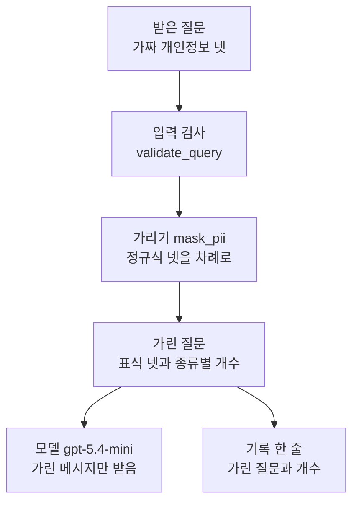
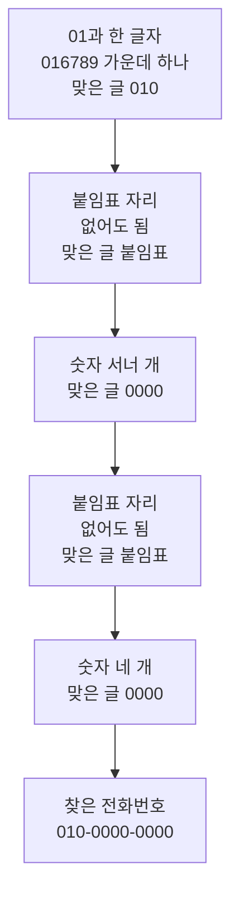
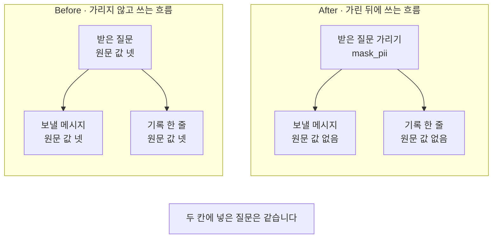
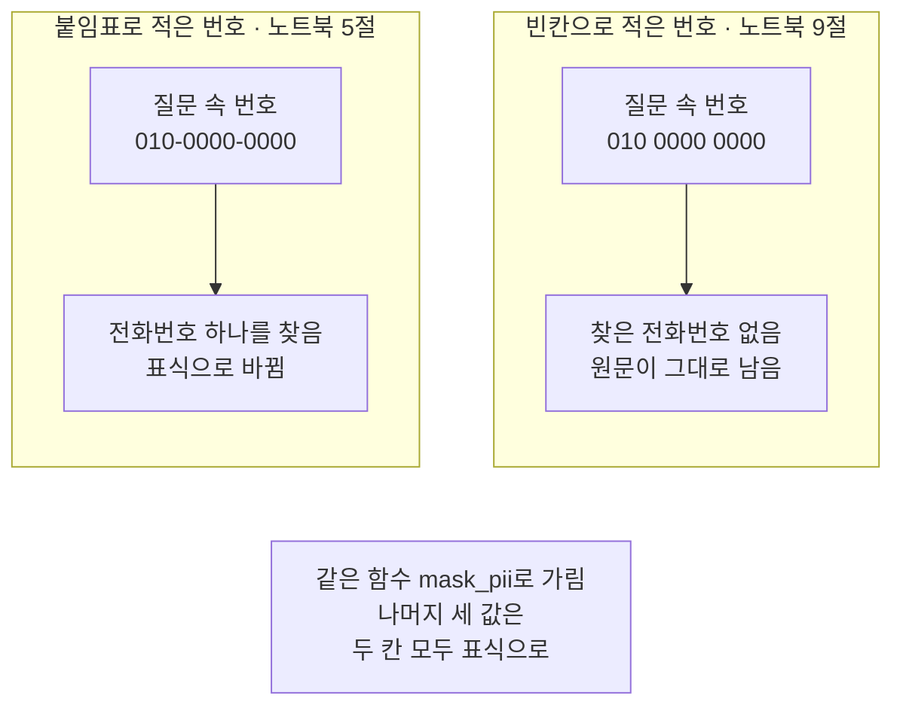

# 02-PII-마스킹

## _src 본문 (HTML 원본)

```html
<!--meta: 강의 0.5h | 실습 0.75h | 코드 notebooks/02-PII-마스킹.ipynb | 새 용어 4 -->
<style>html,body{overflow-x:hidden}.notebook,.nb-cell,.nb-main,.nb-input,.nb-result{min-width:0;max-width:100%}.nb-input pre,.nb-output{box-sizing:border-box;max-width:100%;overflow-x:auto}code.nb-source{display:block!important;width:100%!important;min-width:0!important;overflow-x:auto!important;padding:0!important}</style>
<h2 id="b1"><span class="no">1</span>학습 목표</h2><div class="goal"><ul>
<li>정규 표현식으로 이메일·전화번호·주민등록번호·카드 번호의 모양을 찾을 수 있습니다.</li>
<li>모델에 보내기 전과 기록에 남기기 전에 개인정보를 표식으로 가릴 수 있습니다.</li>
<li>가리지 않은 흐름이 무엇을 남기는지 출력으로 설명할 수 있습니다.</li>
</ul></div>
<h2 id="b2"><span class="no">2</span>이 내용을 배우는 이유</h2><p>사용자는 질문에 자기 연락처나 주민등록번호·카드 번호를 함께 적곤 합니다. 01절의 입력 검사는 빈칸과 글자 수만 봅니다. 그래서 이메일이나 카드 번호가 든 질문도 그대로 검사를 지납니다.</p><p>그 질문을 그대로 쓰면 개인정보가 모델 서비스로 나갑니다. 질문을 적어 두는 기록에도 원문이 남습니다. 휴관일을 답하는 데에는 이 값들이 필요하지 않습니다. 이 절은 보내기 전과 남기기 전에 이런 값을 표식으로 바꿉니다.</p>
<h2 id="b3"><span class="no">3</span>앞에서 배운 내용</h2><p>01절에서는 모델을 부르기 전에 질문을 입력 검사 <code>validate_query</code>에 걸었습니다. 빈칸을 정리하고, 빈 질문과 글자 수 상한을 넘는 질문을 막았습니다. 이 절은 그 함수를 도구 파일 <code>guardrails.py</code>에서 가져와 그대로 씁니다.</p><p>01절의 출력 검사는 답 끝 출처 표시 <code>[E01 p.1]</code>을 허용 목록과 견줬습니다. 이 절의 가리기는 그 표시를 건드리지 않아야 합니다. 노트북 8절의 손 확인 셀에서 이 점을 봅니다.</p><p>기록 한 줄은 Ch 15 08절처럼 <code>json.dumps(…, ensure_ascii=False)</code>로 만듭니다. 딕셔너리를 JSON 글 한 줄로 바꾸는 함수입니다. 정규 표현식은 이 과정에서 이 절이 처음 다룹니다.</p>
<h2 id="b4"><span class="no">4</span>핵심 개념</h2><h3>비유로 시작하기</h3><p>01절의 탁자에 이번에는 쪽지 다섯 장이 한 줄로 놓였다고 해 봅니다. 그 가운데 두 장에는 남에게 보이면 안 되는 번호가 적혀 있습니다. 그 두 장만 작은 천으로 덮고, 천 위에 무엇을 덮었는지 모양으로 표시합니다.</p><p>천을 덮어도 그 자리에 어떤 종류의 쪽지가 있었는지는 알 수 있습니다. 번호 자체는 보이지 않습니다. 쪽지를 옮기거나 대장에 적을 때도 천을 덮은 채로 다룹니다.</p>
{{img:02-5-쪽지와-덮개-천|흰 바탕 나무 탁자 위에 다섯 자리가 한 줄로 놓여 있고 첫째·셋째·다섯째 자리에는 물결 줄이 그어진 종이 쪽지가 보이며 둘째 자리는 둥근 주황 헝겊을 덧댄 파란 천이, 넷째 자리는 세모난 노란 헝겊을 덧댄 초록 천이 쪽지를 완전히 덮고 있고 탁자 뒤 오른쪽에 펼친 대장 한 권과 나무 손도장 하나가 작게 놓인 그림|다섯 자리 가운데 둘만 천으로 덮였습니다. 천 위 헝겊 모양으로 무엇을 덮었는지만 알 수 있습니다.}}
<p class="look"><b>그림 읽기</b> — 나무 탁자 위에 다섯 자리가 한 줄로 놓여 있습니다. 첫째·셋째·다섯째 자리는 물결 줄이 그어진 종이 쪽지입니다. 둘째 자리는 둥근 주황 헝겊을 덧댄 파란 천이, 넷째 자리는 세모난 노란 헝겊을 덧댄 초록 천이 덮고 있습니다. 천 아래 쪽지는 보이지 않습니다. 탁자 뒤 오른쪽에는 01절의 펼친 대장과 나무 손도장이 작게 놓여 있습니다.</p>
<table><thead><tr><th>말</th><th>뜻</th></tr></thead><tbody><tr><td>개인정보(PII)</td><td>한 사람을 알아볼 수 있게 하는 값입니다. 이메일·전화번호·주민등록번호·카드 번호가 예입니다. 쪽지에 적힌 남의 번호와 같습니다.</td></tr><tr><td>가리기(마스킹, masking)</td><td>값을 종류만 알 수 있는 짧은 글로 바꾸는 일입니다. 쪽지 위에 천을 덮는 일과 같습니다.</td></tr><tr><td>정규 표현식(regular expression)</td><td>글자 모양을 적은 짧은 규칙입니다. 줄여서 정규식이라고도 부릅니다. 값 대신 「숫자 셋, 붙임표, 숫자 넷」처럼 모양을 적습니다.</td></tr><tr><td>표식</td><td>가린 자리에 넣는 짧은 글입니다. 값은 보이지 않고 종류 이름만 남습니다. 천 위의 모양 표시와 같습니다.</td></tr></tbody></table>
<p>새 말을 이 절 코드에서 보면 이렇습니다. 개인정보는 질문에 넣은 가짜 값 넷입니다. 정규식은 <code>r"01[016789]-?\d{3,4}-?\d{4}"</code> 같은 글입니다. 표식은 <code>&lt;PHONE_MASKED&gt;</code> 같은 글이고, 가리기는 함수 <code>mask_pii</code>가 합니다.</p>
{{mermaid:02-1-보내기-전과-남기기-전에-가리기|위에서 아래로 읽는 그림으로 초록 상자 받은 질문 가짜 개인정보 넷에서 파란 상자 입력 검사 validate_query로, 다시 파란 상자 가리기 mask_pii 정규식 넷을 차례로로, 다시 노란 상자 가린 질문 표식 넷과 종류별 개수로 이어지고 거기서 화살표가 둘로 나뉘어 보라 상자 모델 gpt-5.4-mini 가린 메시지만 받음과 노란 상자 기록 한 줄 가린 질문과 개수로 가는 그림|질문은 입력 검사를 지난 뒤 가립니다. 모델과 기록 한 줄은 가린 질문만 받습니다.}}
<p class="look"><b>도식 읽기</b> — 위에서 아래로 읽습니다. 맨 위 초록 상자가 받은 질문이고, 그 아래 파란 상자 둘이 입력 검사와 가리기입니다. 가리기를 지난 노란 상자가 가린 질문입니다. 거기서 화살표가 둘로 나뉘어 보라 모델과 노란 기록 한 줄로 갑니다. 두 곳 모두 가린 질문만 받습니다.</p>
<h3>가리는 자리는 보내기 전과 남기기 전입니다</h3><p>가리기는 값이 밖으로 나가거나 남기 전에 해야 합니다. 이 절은 두 자리를 봅니다. 하나는 모델에게 보낼 사용자 메시지이고, 다른 하나는 기록 한 줄입니다. 이미 보낸 뒤에 가리면 모델 서비스는 원문을 받은 뒤입니다.</p><p>함수를 만들어 두는 것만으로는 가려지지 않습니다. 보내는 코드와 남기는 코드가 그 함수를 불러야 합니다. 노트북 6절 Before는 가리기 함수를 만들어 두고도 부르지 않은 흐름입니다.</p>
<h3>정규식은 모양을 적은 규칙입니다</h3><p>정규식은 값 하나하나를 적지 않고 모양을 적습니다. 전화번호 정규식은 01과 한 글자, 붙임표 자리, 숫자 서너 개, 붙임표 자리, 숫자 네 개를 차례로 적은 규칙입니다. 이 모양에 맞는 글이면 어떤 번호든 찾습니다. 반대로 모양이 조금만 달라도 찾지 못합니다.</p>
<h3>다른 상황에 적용</h3><p>상담 챗봇이라면 상담 기록을 모델에게 요약시키기 전에 전화번호를 가릴 수 있습니다. 쇼핑몰 문의 분류라면 문의 글의 카드 번호를 가린 채 문의 종류만 고르게 합니다. 자리는 같습니다. 밖으로 보내기 전과 기록에 남기기 전입니다.</p>
<h3>비교와 경계</h3><p>정규식은 적어 둔 모양만 찾습니다. 노트북 9절처럼 빈칸으로 적은 전화번호는 놓칩니다. 사람 이름이나 주소처럼 모양이 정해지지 않은 개인정보는 이 절의 정규식으로 찾지 않았습니다. 가린 뒤에도 표식 자리에 어떤 종류가 있었는지는 드러납니다.</p>
<h2 id="b5"><span class="no">5</span>실행 예제</h2><p>노트북은 01절과 같은 자료 파일에서 안내 문서 <code>E01</code> 하나를 고릅니다. 질문에는 이 절에서 지어낸 가짜 개인정보 넷을 넣습니다. 노트북 4절은 정규식 넷을 하나씩 적어 질문에서 값을 찾습니다. 노트북 5절은 네 정규식을 함수 <code>mask_pii</code> 하나로 묶어 질문을 가립니다.</p><p>가짜 값은 가짜임이 드러나게 정했습니다. 이메일의 <code>example.com</code>은 문서 예시용으로 따로 떼어 둔 주소 이름입니다. 전화번호는 가운데와 끝자리가 모두 0입니다. 주민등록번호 앞자리 <code>123456</code>은 34월 56일이라 있을 수 없는 날짜입니다. 카드 번호는 같은 숫자를 네 자리씩 늘어놓아 모양만 맞췄습니다.</p><p>모델 <code>gpt-5.4-mini</code>에 보내는 요청은 노트북 7절의 한 번이고 임베딩 요청은 없습니다. 노트북을 한 번 실행하는 요금은 요금표로 어림해 미화 0.01달러 아래입니다. 실제 청구 금액과는 다를 수 있습니다. 새로 쓰는 파일은 없습니다.</p>
{{notebook:02-PII-마스킹|example}}
<p class="look"><b>확인할 점</b> — 노트북 4절 출력에서 정규식마다 값을 하나씩 찾았는지 봅니다. 노트북 5절 출력 <code>종류별 개수: {'email': 1, 'phone': 1, 'rrn': 1, 'card': 1}</code>과 <code>가린 질문에 남은 원문 값 수: 0</code>을 봅니다.</p>
{{mermaid:02-2-전화번호-정규식-한-칸씩|위에서 아래로 파란 상자 다섯이 이어지는 그림으로 첫 상자는 01과 한 글자 016789 가운데 하나 맞은 글 010, 둘째 상자는 붙임표 자리 없어도 됨 맞은 글 붙임표, 셋째 상자는 숫자 서너 개 맞은 글 0000, 넷째 상자는 붙임표 자리 없어도 됨 맞은 글 붙임표, 다섯째 상자는 숫자 네 개 맞은 글 0000이고 맨 아래 노란 상자 찾은 전화번호 010-0000-0000으로 끝나는 그림|전화번호 정규식은 다섯 규칙이 차례로 맞아야 번호 하나를 찾습니다.}}
<p class="look"><b>도식 읽기</b> — 위에서 아래로 읽습니다. 전화번호 정규식 <code>01[016789]-?\d{3,4}-?\d{4}</code>를 다섯 규칙으로 나눈 그림입니다. 파란 상자 다섯이 차례로 맞아야 맨 아래 노란 상자의 번호 하나를 찾습니다. 붙임표 자리 두 규칙은 붙임표가 없어도 맞습니다.</p>
<p>함수 <code>mask_pii</code>는 정규식 넷을 목록 차례대로 겁니다. 이메일, 전화번호, 주민등록번호, 카드 번호 차례입니다. 정규식마다 먼저 맞는 값의 개수를 세고 그다음 표식으로 바꿉니다. 앞 정규식이 바꾼 글에 다음 정규식을 겁니다.</p>
<h2 id="b6"><span class="no">6</span>실패 확인</h2><p>아래 Before 셀은 가리기 함수를 만들어 두고도 부르지 않은 흐름입니다. 입력 검사를 지난 질문을 그대로 메시지와 기록 한 줄에 담습니다. 이어지는 After 셀은 같은 질문을 가린 뒤에 담고, 가린 메시지만 모델에게 보냅니다.</p>
{{notebook:02-PII-마스킹|failure}}
{{mermaid:02-3-가리지-않은-흐름과-가린-흐름|칸 둘이 나란히 있고 아래에 회색 상자가 있는 그림으로 왼쪽 Before 가리지 않고 쓰는 흐름 칸에서는 초록 상자 받은 질문 원문 값 넷에서 화살표가 둘로 나뉘어 빨간 상자 보낼 메시지 원문 값 넷과 빨간 상자 기록 한 줄 원문 값 넷으로 가고 오른쪽 After 가린 뒤에 쓰는 흐름 칸에서는 같은 질문을 넣은 파란 상자 받은 질문 가리기 mask_pii에서 화살표가 둘로 나뉘어 노란 상자 보낼 메시지 원문 값 없음과 노란 상자 기록 한 줄 원문 값 없음으로 가며 맨 아래 회색 상자에 두 칸에 넣은 질문은 같습니다가 적힌 그림|같은 질문에서 가리지 않은 흐름은 두 곳에 원문 넷을 담았고, 가린 흐름은 원문을 담지 않았습니다.}}
<p class="look"><b>도식 읽기</b> — 왼쪽 칸이 Before이고 오른쪽 칸이 After입니다. 왼쪽 칸 맨 위 초록 상자가 받은 질문이고, 오른쪽 칸은 같은 질문을 맨 위 파란 가리기에 넣습니다. 왼쪽 빨간 상자 둘은 보낼 메시지와 기록 한 줄에 원문 넷이 남은 결함입니다. 오른쪽은 가리기를 지난 뒤라 노란 상자 둘에 원문이 없습니다. 모델 요청은 오른쪽 흐름에서만 한 번 보냈고 그림에는 넣지 않았습니다.</p>
<p>두 흐름은 같은 질문을 썼고 가리기를 불렀는지만 달랐습니다. 가리지 않은 흐름은 출력 줄 <code>가리지 않은 흐름 | 4 | 4</code>로 두 곳 모두 원문 넷을 담았습니다. 가린 흐름은 출력 줄 <code>가린 흐름 | 0 | 0</code>이었습니다.</p><p>Before 흐름은 보내기 직전에서 멈췄습니다. 원문이 든 메시지를 실제로 모델에 보내지는 않았습니다. 가린 메시지를 받은 모델의 답에서는 출력 줄 <code>답에 든 원문 값 수: 0</code>이 나왔습니다.</p><p>새 커널로 두 번 실행했을 때 원문 값 수와 종류별 개수는 두 번 모두 같았습니다. 모델이 쓴 답 문장은 실행마다 달라질 수 있어 본문에 옮기지 않았습니다.</p>
<p>값 바꿔 보기는 질문 속 전화번호의 모양 하나만 바꿉니다. 붙임표 대신 빈칸으로 적은 번호는 전화번호 정규식에 맞지 않았습니다. 출력 줄 <code>종류별 개수: {'email': 1, 'phone': 0, 'rrn': 1, 'card': 1}</code>로 전화번호만 찾지 못했습니다. 그 번호는 가린 질문에 원문 그대로 남았습니다.</p>
{{mermaid:02-4-빈칸으로-적은-전화번호|칸 둘이 나란히 있고 아래에 회색 상자가 있는 그림으로 붙임표로 적은 번호 칸에는 초록 상자 질문 속 번호 010-0000-0000에서 노란 상자 전화번호 하나를 찾음 표식으로 바뀜으로 이어지고 빈칸으로 적은 번호 칸에는 초록 상자 질문 속 번호 010 0000 0000에서 노란 상자 찾은 전화번호 없음 원문이 그대로 남음으로 이어지며 맨 아래 회색 상자에 두 칸 모두 같은 함수 mask_pii로 가림 나머지 세 값은 두 칸 모두 표식으로가 적힌 그림|전화번호를 빈칸으로 적자 같은 정규식이 번호를 찾지 못해 원문이 남았습니다.}}
<p class="look"><b>도식 읽기</b> — 왼쪽 칸은 노트북 5절의 붙임표로 적은 번호이고, 오른쪽 칸은 노트북 9절의 빈칸으로 적은 번호입니다. 칸마다 초록 상자가 질문 속 번호이고 노란 상자가 가린 결과입니다. 왼쪽은 전화번호를 찾아 표식으로 바꿨고, 오른쪽은 찾지 못해 원문이 남았습니다. 맨 아래 회색 상자는 두 칸 모두 같은 함수로 가렸고 나머지 세 값은 두 칸 모두 표식이 되었다는 메모입니다.</p>
<h2 id="b7"><span class="no">7</span>주의할 점과 실무 메모</h2><ul><li>질문에 넣은 개인정보 넷은 모두 이 절에서 지어낸 가짜 값입니다. 실제 사람의 정보로 시험하지 않습니다. 카드 번호 <code>1111-2222-3333-4444</code>는 네 자리씩 모양만 맞춘 가짜 번호이고, 실제 카드 발급 규칙과는 무관합니다.</li><li>정규식은 적어 둔 모양만 찾습니다. 빈칸으로 적은 전화번호는 찾지 못했습니다. 실제 입력 예시로 먼저 확인합니다.</li><li>사람 이름과 주소처럼 모양이 정해지지 않은 개인정보는 이번에 다루지 않았습니다. 이런 값은 정규식만으로 찾기 어렵습니다.</li><li>기호 <code>\w</code>는 한글 글자도 한 글자로 봅니다. 이메일 바로 뒤에 조사를 붙여 쓴 글에서는 조사까지 가려졌습니다. 그래서 이 절의 질문은 값 뒤에 빈칸을 두었고, 흐름을 보여 주려고 정한 예입니다.</li><li>이 절의 이메일 정규식은 모양을 넓게 잡았습니다. 골뱅이 앞뒤가 글자와 점이면 이메일로 봅니다.</li><li>정규식 넷은 정한 차례대로 겁니다. 앞 정규식이 바꾼 글에 다음 정규식을 겁니다.</li><li>가리지 않은 흐름은 보내기 직전에서 멈췄습니다. 원문이 든 메시지를 실제로 모델에 보내지는 않았습니다.</li><li>기록 한 줄은 글로만 만들고 파일에 쓰지 않았습니다. 기록 파일 쓰기는 05절에서 다룹니다.</li><li>노트북을 쓰기 전에 가린 메시지를 따로 다섯 번 보냈습니다. 다섯 번 모두 같은 답이었고 원문 값도 표식도 답에 없었습니다.</li><li>같은 요청도 실행한 때에 따라 답 문장이 달라질 수 있습니다. 그래서 모델 답에는 <code>assert</code>를 쓰지 않았습니다.</li><li>걸린 시간과 비용은 재지 않았습니다. 요청 수와 요금 어림만 준비물에 적었습니다.</li><li>이 절은 파일을 쓰지 않습니다. 이 챕터 자료 파일은 읽기만 합니다.</li><li>교재 출력은 Linux의 Python 3.12.13으로 만들었습니다. 다른 판과 Windows·macOS에서는 이번에 실행하지 않았습니다.</li></ul>
<h2 id="b8"><span class="no">8</span>정리와 다음 절</h2><ul><li>정규식 넷으로 이메일·전화번호·주민등록번호·카드 번호를 찾아 표식으로 바꿨습니다.</li><li>가리지 않은 흐름은 보낼 메시지와 기록 한 줄에 원문 값 넷을 그대로 담았습니다.</li><li>가린 흐름은 두 곳 모두 원문 값이 없었고, 빈칸으로 적은 전화번호는 찾지 못했습니다.</li></ul><p><strong>다음 학습과 이어지는 지점</strong> — 03절에서는 길어진 대화 기록을 자르는 방법과 요약하는 방법을 견줍니다.</p>
<h2 id="b9"><span class="no">9</span>복습 문제</h2><details class="quiz" open><summary>문제 4개 · 해설 포함</summary><p class="quiz-q">1. 이 절은 개인정보를 어느 두 자리에서 가렸나요?</p><p class="quiz-a">모델에게 보낼 사용자 메시지와 기록 한 줄입니다. 둘 다 값이 밖으로 나가거나 남기 전의 자리입니다. 틀렸다면 「핵심 개념」의 「가리는 자리」를 다시 읽습니다.</p><p class="quiz-q">2. 전화번호 정규식의 <code>-?</code>는 무슨 뜻인가요?</p><p class="quiz-a">붙임표가 있어도 없어도 맞는다는 뜻입니다. 기호 <code>?</code>는 바로 앞 글자가 없거나 한 번 있다는 뜻입니다. 틀렸다면 노트북 4절을 다시 읽습니다.</p><p class="quiz-q">3. 가리지 않은 흐름에서 기록 한 줄에 남은 원문 값은 몇 개였나요?</p><p class="quiz-a">넷입니다. 출력 줄 <code>기록 한 줄에 남은 원문 값 수: 4</code>가 그 결과입니다. 틀렸다면 노트북 6절을 다시 읽습니다.</p><p class="quiz-q">4. 질문 속 전화번호를 빈칸으로 적으면 무엇이 달라지나요?</p><p class="quiz-a">전화번호를 찾지 못해 원문이 그대로 남습니다. 정규식은 적어 둔 모양만 찾기 때문입니다. 틀렸다면 노트북 9절을 다시 읽습니다.</p></details>
<h2 id="b10"><span class="no">10</span>참고 자료</h2><ul><li><div><a href="https://docs.python.org/3.12/library/re.html">re — Regular expression operations</a></div>확인 2026-09-23 · 함수 <code>re.findall</code>·<code>re.sub</code>와 기호 <code>\w</code>·<code>\d</code>·<code>?</code>·<code>{m,n}</code>의 뜻을 적어 둔 문서입니다.</li><li><div><a href="https://www.rfc-editor.org/rfc/rfc2606.html">RFC 2606 Reserved Top Level DNS Names</a></div>확인 2026-09-23 · 주소 이름 <code>example.com</code>을 예시용으로 떼어 둔 문서입니다.</li><li>Ch 16 01절 — 입력 검사 <code>validate_query</code>와 출처 표시.</li><li>Ch 15 08절 — <code>json.dumps(…, ensure_ascii=False)</code>로 JSON 글 한 줄 만들기.</li></ul>
```

## 노트북 셀 (순서대로)

### [0] markdown {'html': 'skip'}

# PII 마스킹

이 절은 질문에 든 개인정보(PII, personally identifiable information)를 가립니다.
가리기를 영어로 마스킹(masking)이라고 부릅니다.

**이 노트북에서 할 일**

1. 가짜 개인정보 넷이 든 질문을 만들고 01절 입력 검사에 겁니다.
2. 정규 표현식 넷으로 이메일·전화번호·주민등록번호·카드 번호를 찾아 표식으로 바꿉니다.
3. 가리지 않고 쓰는 흐름이 메시지와 기록 한 줄에 원문을 남기는 것을 봅니다(Before).
4. 가린 뒤에 보내고 남기면 두 곳 모두 원문이 남지 않는 것을 봅니다(After).

**준비물** — 이 절은 프로젝트 맨 위 폴더의 `.env`에 적어 둔 `OPENAI_API_KEY`를 씁니다.
모델 `gpt-5.4-mini`에 보내는 요청은 한 번이고 임베딩 요청은 없습니다.
노트북을 한 번 실행하는 요금은 요금표로 어림해 미화 0.01달러 아래입니다.
실제 청구 금액과는 다를 수 있습니다.

읽는 파일은 이 챕터 자료 파일 `data/retrieved-documents.json` 하나입니다.
새로 쓰는 파일은 없습니다.
교재 출력을 만든 실행에서는 노트북 전체가 약 3초 만에 끝났습니다.

질문에 넣은 개인정보 넷은 모두 이 절에서 지어낸 가짜 값입니다.
실제 사람의 정보는 쓰지 않습니다.

**기준 버전** — 첫 셀에서 LangChain 1.4.0과 langchain-openai 1.6.1을 설치합니다.
키를 읽는 python-dotenv 1.2.3도 함께 설치합니다.
교재 출력은 Linux의 Python 3.12.13으로 만들었습니다.
다른 판과 Windows·macOS에서는 이번에 실행하지 않았습니다.

**강의와 실습 범위** — 강의 시간에는 4~6절을 읽습니다.
정규식으로 값을 찾아 가리고, 가리지 않은 흐름이 무엇을 남기는지 보는 자리입니다.
7절은 가린 뒤에 보내고 남기는 자리입니다.
8절 손 확인과 9절 값 바꿔 보기는 실습 시간에 실행합니다.

실습 폴더 `labs/part4/ch16-guardrails`에서 `uv sync --locked`를 실행합니다.
그다음 이 폴더의 `.venv` 커널을 고르고 첫 셀부터 순서대로 실행합니다.

### [1] markdown {'html': 'skip'}

## 오늘 볼 그림


위에서 아래로 읽습니다. 초록 질문이 파란 입력 검사와 파란 가리기를 차례로 지납니다.
노란 가린 질문에서 화살표가 둘로 나뉘어 보라 모델과 노란 기록 한 줄로 갑니다.

### [2] markdown {}

## 1. 준비

첫 셀은 패키지 세 개를 설치하고 설치된 판 번호를 출력합니다.
설치에는 몇십 초가 걸릴 수 있습니다.

### [3] code {'execution': {'iopub.execute_input': '2026-09-23T09:36:13.103369Z', 'iopub.status.busy': '2026-09-23T09:36:13.103203Z', 'iopub.status.idle': '2026-09-23T09:36:13.816205Z', 'shell.execute_reply': '2026-09-23T09:36:13.815694Z'}, 'lesson_role': 'setup'}

```python
# 이 절에서 쓰는 패키지를 설치하고 버전을 확인합니다
%pip install -q "langchain==1.4.0" "langchain-openai==1.6.1" "python-dotenv==1.2.3"
from importlib.metadata import version

print("langchain:", version("langchain"))
print("langchain-openai:", version("langchain-openai"))
print("python-dotenv:", version("python-dotenv"))
```

출력:
```
Note: you may need to restart the kernel to use updated packages.
langchain: 1.4.0
langchain-openai: 1.6.1
python-dotenv: 1.2.3

```

### [4] markdown {}

**결과 읽기** — 설치가 끝나면 판 번호 세 줄이 보입니다.
출력 줄 `langchain: 1.4.0`과 `langchain-openai: 1.6.1`이 실습 폴더 잠금과 같은 판입니다.
이 노트북의 출력은 2026-09-23에 이 판으로 실행한 결과입니다.

다음 셀은 이 절에서 쓸 이름 다섯을 불러옵니다.
모듈 `re`는 파이썬에 들어 있는 정규 표현식 기능입니다.
이 과정에서 `re`를 쓰는 것은 이 절이 처음입니다.

앞에서 배운 함수는 `guardrails.py`에 모아 두었습니다. 파일을 열면 코드를 볼 수 있습니다. 노트북과 같은 폴더(`notebooks/`)에 있는 파일입니다. 커널이 `notebooks/` 폴더에서 시작해야 이 파일을 가져올 수 있습니다.
이 절은 그 파일에서 01절 입력 검사 함수 `validate_query` 하나만 가져옵니다.

### [5] code {'execution': {'iopub.execute_input': '2026-09-23T09:36:13.817243Z', 'iopub.status.busy': '2026-09-23T09:36:13.817157Z', 'iopub.status.idle': '2026-09-23T09:36:14.226562Z', 'shell.execute_reply': '2026-09-23T09:36:14.226186Z'}, 'lesson_role': 'setup'}

```python
# 파일을 읽을 이름, 정규 표현식 모듈, 01절 입력 검사 함수, 모델을 만들 이름을 불러옵니다
import json
import os
import re

from guardrails import validate_query
from langchain.chat_models import init_chat_model

print("불러온 이름:", "json", "os", "re", "validate_query", "init_chat_model")
```

출력:
```
불러온 이름: json os re validate_query init_chat_model

```

### [6] markdown {}

**결과 읽기** — 출력 줄 `불러온 이름: json os re validate_query init_chat_model`로 이름 다섯을 불러왔습니다.
함수 `validate_query`는 01절 노트북에서 정의한 함수와 같은 본문입니다.

## 2. 키와 모델 준비

이 절은 7절에서 가린 질문을 답 모델 `gpt-5.4-mini`에 한 번 보냅니다.

### [7] markdown {}

API 키가 있는지 확인합니다. `True` 값이 나오면 다음으로 넘어갑니다.

### [8] code {'execution': {'iopub.execute_input': '2026-09-23T09:36:14.227296Z', 'iopub.status.busy': '2026-09-23T09:36:14.227232Z', 'iopub.status.idle': '2026-09-23T09:36:14.232727Z', 'shell.execute_reply': '2026-09-23T09:36:14.232426Z'}, 'lesson_role': 'setup'}

```python
# .env 파일에서 OpenAI API 키를 읽습니다(키 값은 출력하지 않습니다)
import os
from dotenv import find_dotenv, load_dotenv

env_path = find_dotenv(usecwd=True)
load_dotenv(env_path)
has_key = os.getenv("OPENAI_API_KEY") is not None
print("OPENAI_API_KEY 설정 여부:", has_key)
assert has_key, "프로젝트 폴더의 .env 파일에 OPENAI_API_KEY를 적어 주세요."
```

출력:
```
OPENAI_API_KEY 설정 여부: True

```

### [9] markdown {}

실습에 쓸 모델을 준비합니다.
temperature 값을 0으로 두어도 답 문장이 매번 같다고 보장하지는 않습니다.

### [10] code {'execution': {'iopub.execute_input': '2026-09-23T09:36:14.233263Z', 'iopub.status.busy': '2026-09-23T09:36:14.233213Z', 'iopub.status.idle': '2026-09-23T09:36:14.692961Z', 'shell.execute_reply': '2026-09-23T09:36:14.692624Z'}}

```python
# 실습에 쓸 모델을 준비합니다
model = init_chat_model(
    "openai:gpt-5.4-mini",
    temperature=0,
    reasoning_effort="none",
)
print("모델 이름:", model.model_name)
print("temperature:", model.temperature)
```

출력:
```
모델 이름: gpt-5.4-mini
temperature: 0.0

```

### [11] markdown {}

**결과 읽기** — 모델 이름 `gpt-5.4-mini`, temperature `0.0`이 보이면 준비가 끝났습니다.
이 노트북의 출력은 2026-09-23에 이 모델로 실행한 결과입니다.

### [12] markdown {}

## 3. 자료와 이 절에서 정한 값

먼저 노트북을 연 자리에서 프로젝트 맨 위를 찾습니다.
01절과 같은 자리 찾기 셀입니다.

### [13] code {'execution': {'iopub.execute_input': '2026-09-23T09:36:14.693908Z', 'iopub.status.busy': '2026-09-23T09:36:14.693814Z', 'iopub.status.idle': '2026-09-23T09:36:14.696040Z', 'shell.execute_reply': '2026-09-23T09:36:14.695650Z'}, 'lesson_role': 'setup'}

```python
# 노트북을 어느 폴더에서 열어도 프로젝트 맨 위를 찾게 후보 세 개를 차례로 봅니다
candidates = [".", "../../..", "../../../.."]
root_path = None
for candidate in candidates:
    if os.path.exists(candidate + "/labs/part4/ch16-guardrails/data"):
        root_path = candidate
        break
print("찾은 프로젝트 맨 위:", root_path)
assert root_path is not None, "notebooks 폴더나 실습 폴더 맨 위에서 노트북을 열어 주세요."
```

출력:
```
찾은 프로젝트 맨 위: .

```

### [14] markdown {}

**결과 읽기** — 출력 줄 `찾은 프로젝트 맨 위:` 뒤에 점 하나나 위로 올라가는 자리가 보입니다.

다음 셀은 01절과 같은 자료 파일을 읽고 안내 문서 `E01` 하나를 고릅니다.
이 절의 검색 결과는 이 문서 하나입니다.

### [15] code {'execution': {'iopub.execute_input': '2026-09-23T09:36:14.696896Z', 'iopub.status.busy': '2026-09-23T09:36:14.696823Z', 'iopub.status.idle': '2026-09-23T09:36:14.699810Z', 'shell.execute_reply': '2026-09-23T09:36:14.699448Z'}}

```python
# 자료 파일을 읽고 이 절의 검색 결과로 안내 문서 E01 하나만 고릅니다(읽기만 합니다)
data_path = root_path + "/labs/part4/ch16-guardrails/data"
with open(data_path + "/retrieved-documents.json", encoding="utf-8") as file:
    all_documents = json.loads(file.read())
retrieved = []
for document in all_documents:
    if document["doc_id"] == "E01":
        retrieved.append(document)
print("자료 파일의 문서 수:", len(all_documents))
print("이번 검색 결과의 문서 수:", len(retrieved))
```

출력:
```
자료 파일의 문서 수: 2
이번 검색 결과의 문서 수: 1

```

### [16] markdown {}

**결과 읽기** — 출력 줄 `자료 파일의 문서 수: 2`로 자료 파일의 문서는 둘입니다.
출력 줄 `이번 검색 결과의 문서 수: 1`로 이 절은 안내 문서 하나만 씁니다.

다음 셀은 이 절에서 정한 값을 적습니다.
글자 수 상한과 시스템 메시지 글은 01절과 같습니다.
검색 문서 한 줄도 01절과 같은 모양으로 만듭니다.

### [17] code {'execution': {'iopub.execute_input': '2026-09-23T09:36:14.700558Z', 'iopub.status.busy': '2026-09-23T09:36:14.700491Z', 'iopub.status.idle': '2026-09-23T09:36:14.702428Z', 'shell.execute_reply': '2026-09-23T09:36:14.702045Z'}}

```python
# 이 절에서 정한 값입니다: 01절과 같은 글자 수 상한·지킬 말과 검색 문서 한 줄입니다
max_chars = 500
system_text = "검색 문서에 있는 사실만 써서 한국어 한 문장으로 답하세요. 답 끝에 쓴 문서의 출처를 [문서ID p.쪽] 꼴로 적으세요."
document = retrieved[0]
document_line = "검색 문서 " + document["doc_id"] + " " + str(document["page"]) + "쪽: " + document["text"]
print("정한 질문 글자 수 상한:", max_chars)
print("검색 문서 한 줄:")
print(document_line)
```

출력:
```
정한 질문 글자 수 상한: 500
검색 문서 한 줄:
검색 문서 E01 1쪽: 미르시립도서관은 매주 월요일과 법정 공휴일에 휴관합니다. 공휴일이 월요일과 겹치면 다음 날인 화요일에도 휴관합니다.

```

### [18] markdown {}

**결과 읽기** — 출력 줄 `정한 질문 글자 수 상한: 500`이 01절과 같은 상한입니다.
라벨 줄 `검색 문서 한 줄:` 아래 줄이 모델에게 함께 보낼 문서입니다.
이 문서에는 개인정보가 없습니다.
코드 첫 줄 주석의 「지킬 말」은 01절과 같은 시스템 메시지 글을 가리킵니다.

다음 셀은 이 절에서 지어낸 가짜 개인정보 넷을 적습니다.
실제 사람의 정보가 아니고, 가짜임이 드러나게 정한 값입니다.

### [19] code {'execution': {'iopub.execute_input': '2026-09-23T09:36:14.703126Z', 'iopub.status.busy': '2026-09-23T09:36:14.703073Z', 'iopub.status.idle': '2026-09-23T09:36:14.704716Z', 'shell.execute_reply': '2026-09-23T09:36:14.704390Z'}}

```python
# 이 절에서 지어낸 가짜 개인정보 넷입니다(실제 사람의 정보가 아닙니다)
fake_email = "test.user@example.com"
fake_phone = "010-0000-0000"
fake_rrn = "123456-1234567"
fake_card = "1111-2222-3333-4444"
fake_values = [fake_email, fake_phone, fake_rrn, fake_card]
print("가짜 값 수:", len(fake_values))
print("가짜 값:", fake_values)
```

출력:
```
가짜 값 수: 4
가짜 값: ['test.user@example.com', '010-0000-0000', '123456-1234567', '1111-2222-3333-4444']

```

### [20] markdown {}

**결과 읽기** — 출력 줄 `가짜 값 수: 4`로 값은 넷입니다.
차례로 이메일, 휴대 전화번호, 주민등록번호, 카드 번호입니다.

이메일의 `example.com`은 문서 예시용으로 따로 떼어 둔 주소 이름입니다.
전화번호는 가운데와 끝자리가 모두 0입니다.
주민등록번호 앞자리 `123456`은 34월 56일이라 있을 수 없는 날짜입니다.
카드 번호는 같은 숫자를 네 자리씩 늘어놓아 모양만 맞췄습니다.

다음 셀은 글 안에 이 값이 원문 그대로 남았는지 찾는 함수입니다.

### [21] code {'execution': {'iopub.execute_input': '2026-09-23T09:36:14.705380Z', 'iopub.status.busy': '2026-09-23T09:36:14.705318Z', 'iopub.status.idle': '2026-09-23T09:36:14.706981Z', 'shell.execute_reply': '2026-09-23T09:36:14.706591Z'}}

```python
# 글 안에 원문 그대로 남은 가짜 값만 모읍니다
def find_raw_values(text, values):
    remaining = []
    for value in values:
        if value in text:
            remaining.append(value)
    return remaining
```

출력:
```

```

### [22] markdown {}

**결과 읽기** — 정의 셀이라 출력이 없습니다.
함수 `find_raw_values`는 글 하나와 값 목록을 받습니다.
값마다 조건 `value in text`로 글 안에 그 값이 그대로 들어 있는지 봅니다.
들어 있는 값만 새 목록에 담아 내놓습니다.

다음 셀은 가짜 값 넷을 넣은 질문을 만들고 01절 입력 검사에 겁니다.
휴관일을 묻고, 답을 받을 연락처와 주민등록번호·카드 번호를 함께 적은 질문입니다.

### [23] code {'execution': {'iopub.execute_input': '2026-09-23T09:36:14.707729Z', 'iopub.status.busy': '2026-09-23T09:36:14.707653Z', 'iopub.status.idle': '2026-09-23T09:36:14.709815Z', 'shell.execute_reply': '2026-09-23T09:36:14.709496Z'}}

```python
# 가짜 값 넷을 넣은 질문을 만들고 01절 입력 검사에 겁니다
contact_line = "답은 " + fake_email + " 이나 " + fake_phone + " 으로 보내 주세요."
member_line = "주민등록번호는 " + fake_rrn + " 이고, 연체료는 카드 " + fake_card + " 로 내겠습니다."
question = "도서관 휴관일은 언제인가요? " + contact_line + " " + member_line
checked_question = validate_query(question, max_chars)
raw_in_question = find_raw_values(checked_question, fake_values)
print("입력 검사를 지난 질문:")
print(checked_question)
print("질문에 든 원문 값 수:", len(raw_in_question))
```

출력:
```
입력 검사를 지난 질문:
도서관 휴관일은 언제인가요? 답은 test.user@example.com 이나 010-0000-0000 으로 보내 주세요. 주민등록번호는 123456-1234567 이고, 연체료는 카드 1111-2222-3333-4444 로 내겠습니다.
질문에 든 원문 값 수: 4

```

### [24] markdown {}

**결과 읽기** — 라벨 줄 `입력 검사를 지난 질문:` 아래 줄이 이 절의 질문입니다.
출력 줄 `질문에 든 원문 값 수: 4`로 가짜 값 넷이 모두 들어 있습니다.
01절 입력 검사는 빈칸과 글자 수만 보므로 이 질문을 막지 않았습니다.

휴관일을 답하는 데에는 이 넷이 하나도 필요하지 않습니다.
다음 소절부터 이 값을 찾아 가리는 방법을 배웁니다.

## 4. 정규 표현식으로 찾기

정규 표현식(regular expression)은 글자 모양을 적은 짧은 규칙입니다.
이 교재에서는 줄여서 정규식이라고도 부릅니다.
값을 하나하나 적는 대신 「숫자 셋, 붙임표, 숫자 넷」처럼 모양을 적어 찾습니다.
이 절 코드에서는 `r"…"` 꼴 글 하나가 정규식 하나입니다.

함수 `re.findall(정규식, 글)`은 글에서 정규식에 맞는 부분을 모두 찾아 목록으로 내놓습니다.
글 앞의 `r`은 역슬래시(`\`)를 글자 그대로 두라는 표시입니다.
정규식에는 역슬래시가 자주 들어가서 이 표시를 붙입니다.

첫 정규식은 이메일 모양입니다. 기호는 하나씩 봅니다.

- 대괄호 `[ ]`는 그 안에 적은 글자 가운데 한 글자에 맞습니다.
- 기호 `\w`는 글자·숫자·밑줄 가운데 한 글자이고, 한글 글자도 여기에 들어갑니다.
- 그래서 `[\w.]`는 그런 글자나 점 한 글자입니다. 대괄호 안의 점은 점 그대로입니다.
- 기호 `+`는 바로 앞 규칙이 한 번 이상 이어진다는 뜻입니다.
- 가운데 `@`는 골뱅이 글자 그대로입니다.

### [25] code {'execution': {'iopub.execute_input': '2026-09-23T09:36:14.710445Z', 'iopub.status.busy': '2026-09-23T09:36:14.710385Z', 'iopub.status.idle': '2026-09-23T09:36:14.712207Z', 'shell.execute_reply': '2026-09-23T09:36:14.711899Z'}}

```python
# 이메일 모양 정규식으로 질문에서 이메일을 찾습니다
email_pattern = r"[\w.]+@[\w.]+"
print("이메일 정규식:", email_pattern)
print("찾은 이메일:", re.findall(email_pattern, checked_question))
```

출력:
```
이메일 정규식: [\w.]+@[\w.]+
찾은 이메일: ['test.user@example.com']

```

### [26] markdown {}

**결과 읽기** — 출력 줄 `찾은 이메일: ['test.user@example.com']`으로 질문에서 이메일 하나를 찾았습니다.
점이 섞인 글자 덩어리, 골뱅이, 다시 점이 섞인 글자 덩어리가 이어진 부분입니다.

둘째 정규식은 휴대 전화번호 모양입니다.

- 맨 앞 `01`은 글자 0과 1 그대로입니다.
- 대괄호 `[016789]`는 0·1·6·7·8·9 가운데 한 글자입니다.
- 기호 `?`는 바로 앞 글자가 없어도 되고 한 번 있어도 된다는 뜻입니다. 그래서 `-?`는 붙임표가 있어도 없어도 맞습니다.
- 기호 `\d`는 숫자 한 글자입니다.
- 중괄호 `{3,4}`는 바로 앞 규칙이 세 번이나 네 번 이어진다는 뜻입니다. 중괄호 `{4}`는 꼭 네 번입니다.

### [27] code {'execution': {'iopub.execute_input': '2026-09-23T09:36:14.712781Z', 'iopub.status.busy': '2026-09-23T09:36:14.712728Z', 'iopub.status.idle': '2026-09-23T09:36:14.714643Z', 'shell.execute_reply': '2026-09-23T09:36:14.714390Z'}}

```python
# 휴대 전화번호 모양 정규식으로 질문에서 전화번호를 찾습니다
phone_pattern = r"01[016789]-?\d{3,4}-?\d{4}"
print("전화번호 정규식:", phone_pattern)
print("찾은 전화번호:", re.findall(phone_pattern, checked_question))
```

출력:
```
전화번호 정규식: 01[016789]-?\d{3,4}-?\d{4}
찾은 전화번호: ['010-0000-0000']

```

### [28] markdown {}

**결과 읽기** — 출력 줄 `찾은 전화번호: ['010-0000-0000']`으로 전화번호 하나를 찾았습니다.
앞 세 글자 `010`이 `01[016789]`에 맞고, 붙임표 둘이 `-?` 자리에 맞았습니다.
가운데 `0000`과 끝 `0000`이 숫자 자리에 맞았습니다.

셋째 정규식은 주민등록번호 모양입니다.
앞 여섯 자리, 붙임표 자리, 뒤 일곱 자리 차례입니다.

- 대괄호 안의 `1-4`는 1부터 4까지 숫자 가운데 한 글자라는 뜻입니다.
- 뒷자리 첫 글자를 이 넷으로 좁혔습니다. 나머지 `\d{6}`과 `-?`는 앞에서 본 기호입니다.

### [29] code {'execution': {'iopub.execute_input': '2026-09-23T09:36:14.715196Z', 'iopub.status.busy': '2026-09-23T09:36:14.715148Z', 'iopub.status.idle': '2026-09-23T09:36:14.717019Z', 'shell.execute_reply': '2026-09-23T09:36:14.716692Z'}}

```python
# 주민등록번호 모양 정규식으로 질문에서 주민등록번호를 찾습니다
rrn_pattern = r"\d{6}-?[1-4]\d{6}"
print("주민등록번호 정규식:", rrn_pattern)
print("찾은 주민등록번호:", re.findall(rrn_pattern, checked_question))
```

출력:
```
주민등록번호 정규식: \d{6}-?[1-4]\d{6}
찾은 주민등록번호: ['123456-1234567']

```

### [30] markdown {}

**결과 읽기** — 출력 줄 `찾은 주민등록번호: ['123456-1234567']`로 값 하나를 찾았습니다.
뒷자리 첫 글자 1이 `[1-4]` 자리에 맞았습니다.

넷째 정규식은 카드 번호 모양입니다.
숫자 네 자리를 붙임표로 이어 네 번 적은 모양입니다.
새 기호는 없습니다.
이 정규식의 붙임표에는 `?`가 없어서 붙임표가 꼭 있어야 맞습니다.

### [31] code {'execution': {'iopub.execute_input': '2026-09-23T09:36:14.717517Z', 'iopub.status.busy': '2026-09-23T09:36:14.717465Z', 'iopub.status.idle': '2026-09-23T09:36:14.719085Z', 'shell.execute_reply': '2026-09-23T09:36:14.718844Z'}}

```python
# 카드 번호 모양 정규식으로 질문에서 카드 번호를 찾습니다
card_pattern = r"\d{4}-\d{4}-\d{4}-\d{4}"
print("카드 번호 정규식:", card_pattern)
print("찾은 카드 번호:", re.findall(card_pattern, checked_question))
```

출력:
```
카드 번호 정규식: \d{4}-\d{4}-\d{4}-\d{4}
찾은 카드 번호: ['1111-2222-3333-4444']

```

### [32] markdown {}

**결과 읽기** — 출력 줄 `찾은 카드 번호: ['1111-2222-3333-4444']`로 값 하나를 찾았습니다.
정규식 넷이 질문에서 값을 하나씩 찾았습니다.

## 5. 표식으로 바꾸기

찾은 값은 표식으로 바꿉니다.
표식은 가린 자리에 종류 이름만 남긴 짧은 글입니다.
쪽지에 천을 덮고 천 위에 무엇을 덮었는지 표시하는 것과 같습니다.
이 절의 표식은 `<EMAIL_MASKED>`처럼 꺾쇠 안에 종류 이름을 적습니다.

함수 `re.sub(정규식, 바꿀 글, 글)`은 맞는 부분을 모두 바꾼 새 글을 내놓습니다.
먼저 이메일 하나만 바꿔 봅니다.

### [33] code {'execution': {'iopub.execute_input': '2026-09-23T09:36:14.719579Z', 'iopub.status.busy': '2026-09-23T09:36:14.719528Z', 'iopub.status.idle': '2026-09-23T09:36:14.721110Z', 'shell.execute_reply': '2026-09-23T09:36:14.720789Z'}}

```python
# 질문의 이메일을 표식 <EMAIL_MASKED>로 바꿉니다
email_masked = re.sub(email_pattern, "<EMAIL_MASKED>", checked_question)
print("이메일만 바꾼 질문:")
print(email_masked)
```

출력:
```
이메일만 바꾼 질문:
도서관 휴관일은 언제인가요? 답은 <EMAIL_MASKED> 이나 010-0000-0000 으로 보내 주세요. 주민등록번호는 123456-1234567 이고, 연체료는 카드 1111-2222-3333-4444 로 내겠습니다.

```

### [34] markdown {}

**결과 읽기** — 라벨 줄 `이메일만 바꾼 질문:` 아래 줄에서 이메일 자리가 `<EMAIL_MASKED>`로 바뀌었습니다.
전화번호·주민등록번호·카드 번호는 아직 원문 그대로입니다.
원래 질문 `checked_question`은 그대로 두고 바꾼 글은 `email_masked`에 담았습니다.

이제 정규식 넷을 한 번에 겁니다.
정규식과 종류 이름을 같은 차례로 목록 둘에 담습니다.
이름을 모두 대문자로 적은 것은 한 번 정하면 바꾸지 않는 값이라는 표시입니다.

### [35] code {'execution': {'iopub.execute_input': '2026-09-23T09:36:14.721704Z', 'iopub.status.busy': '2026-09-23T09:36:14.721664Z', 'iopub.status.idle': '2026-09-23T09:36:14.723253Z', 'shell.execute_reply': '2026-09-23T09:36:14.722928Z'}}

```python
# 정규식 넷과 종류 이름 넷을 같은 차례로 목록 둘에 담습니다
PII_PATTERNS = [email_pattern, phone_pattern, rrn_pattern, card_pattern]
PII_NAMES = ["email", "phone", "rrn", "card"]
print("정규식 수:", len(PII_PATTERNS))
print("종류 이름:", PII_NAMES)
```

출력:
```
정규식 수: 4
종류 이름: ['email', 'phone', 'rrn', 'card']

```

### [36] markdown {}

**결과 읽기** — 출력 줄 `정규식 수: 4`와 `종류 이름: ['email', 'phone', 'rrn', 'card']`가 두 목록입니다.
두 목록은 같은 번호 자리끼리 한 짝입니다.
0번 자리는 이메일 정규식과 이름 `email`이고, 3번 자리는 카드 번호 정규식과 이름 `card`입니다.

다음 셀은 가리기 함수 `mask_pii`입니다.
번호 `i`로 두 목록을 함께 돌며 정규식을 하나씩 겁니다.
정규식마다 `re.findall`로 맞는 값의 개수를 먼저 세고, 그다음 `re.sub`로 바꿉니다.
앞 정규식이 바꾼 글에 다음 정규식을 겁니다.

표식은 종류 이름을 대문자로 바꿔 `<`와 `_MASKED>` 사이에 넣어 만듭니다.
글 메서드 `upper()`는 영문 소문자를 대문자로 바꾼 새 글을 내놓습니다.
마지막 줄 `return masked, counts`는 가린 글과 개수 딕셔너리를 함께 내놓습니다.
쉼표로 이은 두 값은 튜플 하나로 묶여 나갑니다.

### [37] code {'execution': {'iopub.execute_input': '2026-09-23T09:36:14.723833Z', 'iopub.status.busy': '2026-09-23T09:36:14.723792Z', 'iopub.status.idle': '2026-09-23T09:36:14.725701Z', 'shell.execute_reply': '2026-09-23T09:36:14.725327Z'}}

```python
# 개인정보 네 가지를 표식으로 바꾸고 종류별 개수를 셉니다
def mask_pii(text):
    masked = text
    counts = {}
    for i in range(len(PII_NAMES)):
        mark = "<" + PII_NAMES[i].upper() + "_MASKED>"
        found = re.findall(PII_PATTERNS[i], masked)
        counts[PII_NAMES[i]] = len(found)
        masked = re.sub(PII_PATTERNS[i], mark, masked)
    return masked, counts
```

출력:
```

```

### [38] markdown {}

**결과 읽기** — 정의 셀이라 출력이 없습니다.
함수 `mask_pii`는 글 하나를 받아 가린 글과 종류별 개수를 함께 내놓습니다.
개수 딕셔너리의 키는 종류 이름 넷입니다.

다음 셀은 입력 검사를 지난 질문을 이 함수로 가립니다.
왼쪽에 이름 둘을 쉼표로 적으면 함수가 내놓은 튜플의 두 값을 차례로 받습니다.
가린 글은 `masked_question`에, 개수 딕셔너리는 `pii_counts`에 담깁니다.

### [39] code {'execution': {'iopub.execute_input': '2026-09-23T09:36:14.726278Z', 'iopub.status.busy': '2026-09-23T09:36:14.726237Z', 'iopub.status.idle': '2026-09-23T09:36:14.727964Z', 'shell.execute_reply': '2026-09-23T09:36:14.727672Z'}}

```python
# 입력 검사를 지난 질문을 가리고 종류별 개수와 남은 원문 값을 봅니다
masked_question, pii_counts = mask_pii(checked_question)
raw_in_masked = find_raw_values(masked_question, fake_values)
print("가린 질문:")
print(masked_question)
print("종류별 개수:", pii_counts)
print("가린 질문에 남은 원문 값 수:", len(raw_in_masked))
```

출력:
```
가린 질문:
도서관 휴관일은 언제인가요? 답은 <EMAIL_MASKED> 이나 <PHONE_MASKED> 으로 보내 주세요. 주민등록번호는 <RRN_MASKED> 이고, 연체료는 카드 <CARD_MASKED> 로 내겠습니다.
종류별 개수: {'email': 1, 'phone': 1, 'rrn': 1, 'card': 1}
가린 질문에 남은 원문 값 수: 0

```

### [40] markdown {}

**결과 읽기** — 라벨 줄 `가린 질문:` 아래 줄에서 값 넷이 모두 표식으로 바뀌었습니다.
출력 줄 `종류별 개수: {'email': 1, 'phone': 1, 'rrn': 1, 'card': 1}`로 종류마다 하나씩 찾았습니다.
출력 줄 `가린 질문에 남은 원문 값 수: 0`으로 원문은 하나도 남지 않았습니다.

휴관일을 묻는 앞 문장은 그대로입니다.
표식 자리를 보면 어떤 종류의 값이 있었는지는 알 수 있습니다.

### [41] markdown {'lesson_part': 'before'}

## 6. 가리지 않고 쓰는 흐름 (Before)

### [42] markdown {'lesson_part': 'before'}

Before 셀은 가리기 함수를 만들어 두고도 부르지 않은 흐름입니다.
입력 검사를 지난 질문 `checked_question`을 그대로 메시지와 기록 한 줄에 담습니다.
이 흐름은 보내기 직전에서 멈추고 실제로 모델에 보내지는 않았습니다.

먼저 모델에게 보낼 메시지를 만듭니다.
메시지 모양은 01절과 같은 역할 딕셔너리 두 개입니다.

### [43] code {'execution': {'iopub.execute_input': '2026-09-23T09:36:14.728500Z', 'iopub.status.busy': '2026-09-23T09:36:14.728442Z', 'iopub.status.idle': '2026-09-23T09:36:14.730228Z', 'shell.execute_reply': '2026-09-23T09:36:14.729897Z'}, 'lesson_part': 'before'}

```python
# 가리지 않는 흐름입니다: 입력 검사를 지난 질문을 그대로 메시지에 담습니다(보내지는 않습니다)
raw_messages = [
    {"role": "system", "content": system_text},
    {"role": "user", "content": "질문: " + checked_question + "\n" + document_line},
]
raw_sent = find_raw_values(raw_messages[1]["content"], fake_values)
print("보낼 사용자 메시지:")
print(raw_messages[1]["content"])
print("보낼 사용자 메시지에 남은 원문 값 수:", len(raw_sent))
```

출력:
```
보낼 사용자 메시지:
질문: 도서관 휴관일은 언제인가요? 답은 test.user@example.com 이나 010-0000-0000 으로 보내 주세요. 주민등록번호는 123456-1234567 이고, 연체료는 카드 1111-2222-3333-4444 로 내겠습니다.
검색 문서 E01 1쪽: 미르시립도서관은 매주 월요일과 법정 공휴일에 휴관합니다. 공휴일이 월요일과 겹치면 다음 날인 화요일에도 휴관합니다.
보낼 사용자 메시지에 남은 원문 값 수: 4

```

### [44] markdown {'lesson_part': 'before'}

**결과 읽기** — 라벨 줄 `보낼 사용자 메시지:` 아래 두 줄이 모델에게 갈 글입니다.
첫 줄 질문에 가짜 값 넷이 원문 그대로 있습니다.
출력 줄 `보낼 사용자 메시지에 남은 원문 값 수: 4`가 이 흐름의 결함입니다.
이대로 보내면 모델 서비스가 개인정보 넷을 그대로 받습니다.

다음 셀은 같은 질문을 기록 한 줄로 바꿉니다.
Ch 15 08절처럼 `json.dumps(…, ensure_ascii=False)`로 딕셔너리를 JSON 글 한 줄로 바꿉니다.
이 절은 기록을 파일에 쓰지 않고 글로만 만듭니다.

### [45] code {'execution': {'iopub.execute_input': '2026-09-23T09:36:14.730721Z', 'iopub.status.busy': '2026-09-23T09:36:14.730681Z', 'iopub.status.idle': '2026-09-23T09:36:14.732546Z', 'shell.execute_reply': '2026-09-23T09:36:14.732222Z'}, 'lesson_part': 'before'}

```python
# 가리지 않는 흐름입니다: 같은 질문을 그대로 기록 한 줄로 바꿉니다
raw_row = {"event": "question", "question": checked_question}
raw_log_line = json.dumps(raw_row, ensure_ascii=False)
raw_logged = find_raw_values(raw_log_line, fake_values)
print("기록 한 줄:")
print(raw_log_line)
print("기록 한 줄에 남은 원문 값 수:", len(raw_logged))
```

출력:
```
기록 한 줄:
{"event": "question", "question": "도서관 휴관일은 언제인가요? 답은 test.user@example.com 이나 010-0000-0000 으로 보내 주세요. 주민등록번호는 123456-1234567 이고, 연체료는 카드 1111-2222-3333-4444 로 내겠습니다."}
기록 한 줄에 남은 원문 값 수: 4

```

### [46] markdown {'lesson_part': 'before'}

**결과 읽기** — 라벨 줄 `기록 한 줄:` 아래 줄에 가짜 값 넷이 원문 그대로 들어 있습니다.
출력 줄 `기록 한 줄에 남은 원문 값 수: 4`도 이 흐름의 결함입니다.
이 줄이 기록 파일에 들어가면 원문 넷이 그대로 남습니다.

가리기 함수는 5절에서 이미 만들었습니다.
함수를 만들어 두어도 보내는 코드와 남기는 코드가 부르지 않으면 원문이 나갑니다.

### [47] markdown {'lesson_part': 'after'}

## 7. 가린 뒤에 보내고 남기는 흐름 (After)

### [48] markdown {'lesson_part': 'after'}

After 셀은 5절에서 가린 질문 `masked_question`을 씁니다.
메시지와 기록 한 줄에 원문 대신 표식이 들어갑니다.
먼저 모델에게 보낼 메시지를 만듭니다.

### [49] code {'execution': {'iopub.execute_input': '2026-09-23T09:36:14.732993Z', 'iopub.status.busy': '2026-09-23T09:36:14.732951Z', 'iopub.status.idle': '2026-09-23T09:36:14.734880Z', 'shell.execute_reply': '2026-09-23T09:36:14.734533Z'}, 'lesson_part': 'after'}

```python
# 가린 질문으로 메시지를 만들고 원문 값이 남았는지 봅니다
masked_messages = [
    {"role": "system", "content": system_text},
    {"role": "user", "content": "질문: " + masked_question + "\n" + document_line},
]
masked_sent = find_raw_values(masked_messages[1]["content"], fake_values)
print("보낼 사용자 메시지:")
print(masked_messages[1]["content"])
print("보낼 사용자 메시지에 남은 원문 값 수:", len(masked_sent))
```

출력:
```
보낼 사용자 메시지:
질문: 도서관 휴관일은 언제인가요? 답은 <EMAIL_MASKED> 이나 <PHONE_MASKED> 으로 보내 주세요. 주민등록번호는 <RRN_MASKED> 이고, 연체료는 카드 <CARD_MASKED> 로 내겠습니다.
검색 문서 E01 1쪽: 미르시립도서관은 매주 월요일과 법정 공휴일에 휴관합니다. 공휴일이 월요일과 겹치면 다음 날인 화요일에도 휴관합니다.
보낼 사용자 메시지에 남은 원문 값 수: 0

```

### [50] markdown {'lesson_part': 'after'}

**결과 읽기** — 라벨 줄 `보낼 사용자 메시지:` 아래 첫 줄에 표식 넷이 보입니다.
출력 줄 `보낼 사용자 메시지에 남은 원문 값 수: 0`으로 원문은 남지 않았습니다.

앞 6절 Before 셀에서는 `보낼 사용자 메시지에 남은 원문 값 수: 4`였습니다.

다음 셀은 가린 메시지만 모델에게 보냅니다.
이 셀에서 모델 요청이 한 번 나갑니다.

### [51] code {'execution': {'iopub.execute_input': '2026-09-23T09:36:14.735372Z', 'iopub.status.busy': '2026-09-23T09:36:14.735324Z', 'iopub.status.idle': '2026-09-23T09:36:16.199984Z', 'shell.execute_reply': '2026-09-23T09:36:16.199544Z'}, 'lesson_part': 'after'}

```python
# 가린 메시지만 모델에게 보냅니다(모델 요청 1번)
model_answer = model.invoke(masked_messages).text
answer_raw = find_raw_values(model_answer, fake_values)
print("모델이 쓴 답:")
print(model_answer)
print("답에 든 원문 값 수:", len(answer_raw))
```

출력:
```
모델이 쓴 답:
미르시립도서관은 매주 월요일과 법정 공휴일에 휴관하며, 공휴일이 월요일과 겹치면 다음 날인 화요일에도 휴관합니다. [E01 p.1]
답에 든 원문 값 수: 0

```

### [52] markdown {'lesson_part': 'after'}

**결과 읽기** — 라벨 줄 `모델이 쓴 답:` 아래 줄이 모델 답입니다.
출력 줄 `답에 든 원문 값 수: 0`으로 답에도 원문 값이 없습니다.
모델이 받은 글에 원문이 없었기 때문입니다.

이 답은 모델이 쓴 글이라 여러분 실행에서는 문장이 다를 수 있습니다.
교재 출력을 만들기 전에 같은 요청을 따로 다섯 번 보냈습니다.
다섯 번 모두 같은 답이었고 끝에 출처 표시 `[E01 p.1]`이 붙었습니다.

다음 셀은 가린 질문과 종류별 개수만 기록 한 줄로 바꿉니다.
개수는 어떤 종류를 가렸는지 뒤에서 알아볼 때 씁니다.

### [53] code {'execution': {'iopub.execute_input': '2026-09-23T09:36:16.200675Z', 'iopub.status.busy': '2026-09-23T09:36:16.200613Z', 'iopub.status.idle': '2026-09-23T09:36:16.202752Z', 'shell.execute_reply': '2026-09-23T09:36:16.202426Z'}, 'lesson_part': 'after'}

```python
# 가린 질문과 종류별 개수만 기록 한 줄로 바꿉니다
safe_row = {"event": "question", "question": masked_question, "pii": pii_counts}
safe_log_line = json.dumps(safe_row, ensure_ascii=False)
safe_logged = find_raw_values(safe_log_line, fake_values)
print("기록 한 줄:")
print(safe_log_line)
print("기록 한 줄에 남은 원문 값 수:", len(safe_logged))
```

출력:
```
기록 한 줄:
{"event": "question", "question": "도서관 휴관일은 언제인가요? 답은 <EMAIL_MASKED> 이나 <PHONE_MASKED> 으로 보내 주세요. 주민등록번호는 <RRN_MASKED> 이고, 연체료는 카드 <CARD_MASKED> 로 내겠습니다.", "pii": {"email": 1, "phone": 1, "rrn": 1, "card": 1}}
기록 한 줄에 남은 원문 값 수: 0

```

### [54] markdown {'lesson_part': 'after'}

**결과 읽기** — 라벨 줄 `기록 한 줄:` 아래 줄에 표식 넷과 종류별 개수가 들어 있습니다.
출력 줄 `기록 한 줄에 남은 원문 값 수: 0`으로 기록에도 원문이 남지 않았습니다.

앞 6절 Before 셀에서는 `기록 한 줄에 남은 원문 값 수: 4`였습니다.

다음 셀은 두 흐름의 원문 값 수를 한 표로 나란히 봅니다.

### [55] code {'execution': {'iopub.execute_input': '2026-09-23T09:36:16.203270Z', 'iopub.status.busy': '2026-09-23T09:36:16.203220Z', 'iopub.status.idle': '2026-09-23T09:36:16.204966Z', 'shell.execute_reply': '2026-09-23T09:36:16.204642Z'}, 'lesson_part': 'after'}

```python
# 두 흐름에서 원문 값이 남은 수를 한 표로 나란히 봅니다
print("흐름 | 보낼 사용자 메시지 | 기록 한 줄")
print("가리지 않은 흐름 |", len(raw_sent), "|", len(raw_logged))
print("가린 흐름 |", len(masked_sent), "|", len(safe_logged))
```

출력:
```
흐름 | 보낼 사용자 메시지 | 기록 한 줄
가리지 않은 흐름 | 4 | 4
가린 흐름 | 0 | 0

```

### [56] markdown {'lesson_part': 'after'}

**결과 읽기** — 라벨 줄 `흐름 | 보낼 사용자 메시지 | 기록 한 줄` 아래 두 줄이 두 흐름입니다.
출력 줄 `가리지 않은 흐름 | 4 | 4`로 가리지 않은 흐름은 두 곳 모두 원문 넷을 담았습니다.
출력 줄 `가린 흐름 | 0 | 0`으로 가린 흐름은 두 곳 모두 원문이 없습니다.
두 흐름은 같은 질문을 썼고 가리기를 불렀는지만 달랐습니다.

## 8. 손으로 적은 글로 확인하기

다음 셀은 손으로 적은 글 둘로 가리기를 확인합니다.
첫째 글에는 01절의 출처 표시 `[E01 p.1]`을 함께 적었습니다.
가리기가 출력 검사에 쓸 표시를 건드리면 안 되기 때문입니다.

둘째 글은 이메일 바로 뒤에 조사 「으로」를 붙여 썼습니다.
함수 결과 뒤의 `[0]`은 튜플의 첫째 값인 가린 글만 꺼냅니다.
미리 정한 글이라 결과를 `assert`로 확인할 수 있습니다.

### [57] code {'execution': {'iopub.execute_input': '2026-09-23T09:36:16.205504Z', 'iopub.status.busy': '2026-09-23T09:36:16.205446Z', 'iopub.status.idle': '2026-09-23T09:36:16.207358Z', 'shell.execute_reply': '2026-09-23T09:36:16.207062Z'}, 'lesson_part': 'after'}

```python
# 손으로 적은 글 둘로 가리기를 확인합니다(미리 정한 글이라 assert로 봅니다)
source_sample = "메일 test.user@example.com, 출처 [E01 p.1]"
particle_sample = "메일 test.user@example.com으로 주세요"
source_masked, source_counts = mask_pii(source_sample)
particle_masked = mask_pii(particle_sample)[0]
print("출처 표시가 든 글:", source_masked)
print("조사를 붙여 쓴 글:", particle_masked)
assert source_masked == "메일 <EMAIL_MASKED>, 출처 [E01 p.1]"
assert source_counts == {"email": 1, "phone": 0, "rrn": 0, "card": 0}
```

출력:
```
출처 표시가 든 글: 메일 <EMAIL_MASKED>, 출처 [E01 p.1]
조사를 붙여 쓴 글: 메일 <EMAIL_MASKED> 주세요

```

### [58] markdown {'lesson_part': 'after'}

**결과 읽기** — 출력 줄 `출처 표시가 든 글: 메일 <EMAIL_MASKED>, 출처 [E01 p.1]`에서 출처 표시가 그대로 남았습니다.
마지막 두 줄의 `assert`도 통과했습니다.

출력 줄 `조사를 붙여 쓴 글: 메일 <EMAIL_MASKED> 주세요`에서는 조사 「으로」까지 사라졌습니다.
기호 `\w`가 한글 글자도 한 글자로 보아 조사까지 이메일로 묶었기 때문입니다.
그래서 이 절의 질문은 이메일 뒤에 빈칸을 두었습니다.

## 9. 값 바꿔 보기 · 빈칸으로 적은 전화번호

바꿀 값은 질문 속 전화번호의 모양 하나입니다.
붙임표 대신 빈칸으로 적은 번호 `010 0000 0000`으로 바꾸고 같은 함수로 가립니다.
글 메서드 `replace(찾을 글, 바꿀 글)`는 찾은 글을 바꾼 새 글을 내놓습니다.

실행 전에 예상해 봅니다.
전화번호 정규식의 `-?` 자리는 붙임표만 받으므로 이 번호는 찾지 못할 것입니다.
나머지 셋은 5절처럼 하나씩 찾을 것입니다.

### [59] code {'execution': {'iopub.execute_input': '2026-09-23T09:36:16.207905Z', 'iopub.status.busy': '2026-09-23T09:36:16.207850Z', 'iopub.status.idle': '2026-09-23T09:36:16.209829Z', 'shell.execute_reply': '2026-09-23T09:36:16.209573Z'}, 'lesson_part': 'after'}

```python
# 바꿀 값은 전화번호 모양 하나입니다: 질문의 번호를 빈칸으로 적은 모양으로 바꿔 가립니다
spaced_phone = "010 0000 0000"
spaced_question = checked_question.replace(fake_phone, spaced_phone)
spaced_masked, spaced_counts = mask_pii(spaced_question)
spaced_raw = find_raw_values(spaced_masked, [spaced_phone])
print("가린 질문:")
print(spaced_masked)
print("종류별 개수:", spaced_counts)
print("남은 원문 값 수:", len(spaced_raw))
```

출력:
```
가린 질문:
도서관 휴관일은 언제인가요? 답은 <EMAIL_MASKED> 이나 010 0000 0000 으로 보내 주세요. 주민등록번호는 <RRN_MASKED> 이고, 연체료는 카드 <CARD_MASKED> 로 내겠습니다.
종류별 개수: {'email': 1, 'phone': 0, 'rrn': 1, 'card': 1}
남은 원문 값 수: 1

```

### [60] markdown {'lesson_part': 'after'}

**결과 읽기** — 라벨 줄 `가린 질문:` 아래 줄에 `010 0000 0000`이 원문 그대로 남았습니다.
출력 줄 `종류별 개수: {'email': 1, 'phone': 0, 'rrn': 1, 'card': 1}`로 전화번호만 0개입니다.
출력 줄 `남은 원문 값 수: 1`이 놓친 번호 하나입니다.

예상대로 정규식은 적어 둔 모양만 찾았습니다.
5절 출력에서는 `'phone': 1`이었습니다.
실제 입력에 어떤 모양이 들어오는지 먼저 보고 정규식을 정해야 합니다.

## 정리

1. 정규식 넷으로 이메일·전화번호·주민등록번호·카드 번호를 찾아 표식으로 바꿨습니다.
2. 가리지 않은 흐름은 보낼 메시지와 기록 한 줄에 원문 값 넷을 그대로 담았습니다.
3. 가린 흐름은 두 곳 모두 원문 값이 없었고, 빈칸으로 적은 전화번호는 찾지 못했습니다.

03절에서는 길어진 대화 기록을 자르는 방법과 요약하는 방법을 견줍니다.

## 그림

### 02-1-보내기-전과-남기기-전에-가리기.mmd



질문은 입력 검사를 지난 뒤 가립니다. 모델과 기록 한 줄은 가린 질문만 받습니다.

### 02-2-전화번호-정규식-한-칸씩.mmd



전화번호 정규식은 다섯 규칙이 차례로 맞아야 번호 하나를 찾습니다.

### 02-3-가리지-않은-흐름과-가린-흐름.mmd



같은 질문에서 가리지 않은 흐름은 두 곳에 원문 넷을 담았고, 가린 흐름은 원문을 담지 않았습니다.

### 02-4-빈칸으로-적은-전화번호.mmd



전화번호를 빈칸으로 적자 같은 정규식이 번호를 찾지 못해 원문이 남았습니다.

### 02-5-쪽지와-덮개-천.prompt.md

# 02-5-쪽지와-덮개-천 (Higgsfield 삽화)

설명 대상 문장(본문 b4 비유 단락): 01절의 탁자에 이번에는 쪽지 다섯 장이 한 줄로 놓였다고 해 봅니다. 그 가운데 두 장에는 남에게 보이면 안 되는 번호가 적혀 있습니다. 그 두 장만 작은 천으로 덮고, 천 위에 무엇을 덮었는지 모양으로 표시합니다.

구성 요소와 배치: 흰 바탕 나무 탁자 위에 **쪽지 다섯 장**(= 질문 속 글)이 한 줄로. **둘째·넷째 쪽지만 작은 천으로 완전히 덮임**(= 개인정보를 가린 자리). 둘째 천 위에 **둥근 헝겊**, 넷째 천 위에 **세모 헝겊**(= 표식 — 값은 가리고 종류만 남김, 두 모양이 달라 종류가 다름을 보임). 나머지 세 장은 물결 줄만 있는 쪽지(= 가리지 않은 글). 탁자 뒤 오른쪽에 **01절의 펼친 대장과 나무 손도장**을 작게(비유 계열 이어짐). 숫자·글자 없이 자리와 모양으로만 읽히게 했습니다.

시선 순서: 한 줄로 놓인 다섯 자리 → 둘째·넷째만 천으로 덮임 → 천 위 헝겊 모양이 서로 다름(둥근·세모) → 뒤쪽 대장과 손도장.

검수 기준: 그림만 보고 「자리는 다섯」, 「덮인 것은 둘째와 넷째 둘」, 「두 천의 헝겊 모양이 다르다」, 「나머지 셋은 덮이지 않은 쪽지」가 읽히는가. 글자·숫자가 없는가.

비유 계열: 이 챕터의 **도장과 도장 대장**(01절) 탁자 위에서 **덮개 천**을 더했습니다(챕터 리드 결정 9). 쓰지 않은 것: Ch 9~15의 카드·봉투·서랍·쟁반·바구니·사과·저울·스티커. Ch 22 02절 삽화의 「가림 스티커」와 겹치지 않게 천과 기운 헝겊으로 그렸습니다.

## 프롬프트 (1차, 채택)

```text
Simple flat educational illustration, white background, limited soft palette, clean outlines, plain everyday objects, no text, no letters, no numbers, no logos.

Five plain paper slips lie in a single row on a wooden table, each slip showing a few short wavy ink lines. The second slip and the fourth slip are each completely hidden under a small folded cloth. The cloth on the second slip has one round patch sewn on top. The cloth on the fourth slip has one triangle patch sewn on top. The first, third and fifth slips stay uncovered. One open flat ledger book and one wooden hand stamp sit small at the back right corner of the table.

No hands, no people, no screens, no arrows, no charts.
```

## 상태

- 2026-09-23 · `nano_banana_pro`(응답 모델 이름 `nano_banana_2`) · 16:9 · 2k · `use_unlim: false` · count 1 · 장당 2크레딧. 생성 전 잔액 2642.5 → 생성 뒤 **2640.5**.
- **1차 job `330c52bf-758f-46c4-aa57-9a7b28976a00` 채택**(재생성 없음). 원본 `cfa9d7a312c4a82f0cf1c2ab7a4532babe8bff95bcb43dd8a1c515735d9151d3`(2752 × 1536, RGB).
- **그림에서 확인한 것(그림 읽기·alt·캡션에 반영)**: 나무 탁자 위에 다섯 자리가 한 줄로 놓여 있습니다. 첫째·셋째·다섯째는 물결 줄이 그어진 종이 쪽지입니다. 둘째는 둥근 주황 헝겊을 덧댄 파란 천, 넷째는 세모난 노란 헝겊을 덧댄 초록 천이 쪽지를 완전히 덮고 있어 천 아래 쪽지는 보이지 않습니다. 탁자 뒤 오른쪽에 펼친 대장 한 권과 나무 손도장 하나가 작게 놓여 있습니다. 글자·숫자·사람은 없습니다. 프롬프트에 없던 천의 색(파랑·초록)과 헝겊 색(주황·노랑)은 그림대로 적었습니다.
- 저장: 기기 셸에서 결과 URL을 `curl`로 받아 `uv run --no-project --with pillow`로 RGB로 바꾸고 폭 1100px로 줄여 `figures/02-5-쪽지와-덮개-천.png`(1100 × 614, `e4386ea35304600264f452bfee3a29be84a3b28988b7a4912f618ca651be2f05`)로 저장했습니다. 원본 2752px는 저장하지 않았습니다.
- 결과 URL을 다시 받아(같은 해시 `cfa9d7a3…`) 같은 폭으로 줄인 그림과 저장 PNG를 픽셀 대조했습니다(`ImageChops.difference` bbox `None`, 세 칸 extrema 모두 `(0, 0)`, 규격 §5-4). 저장한 PNG를 직접 열어 그림 읽기를 썼습니다.

