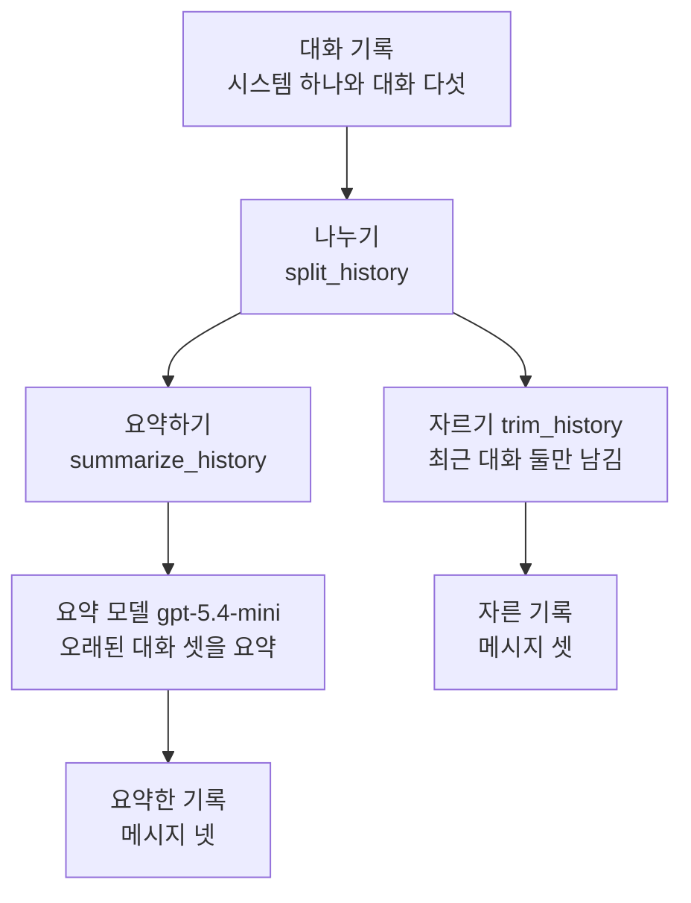
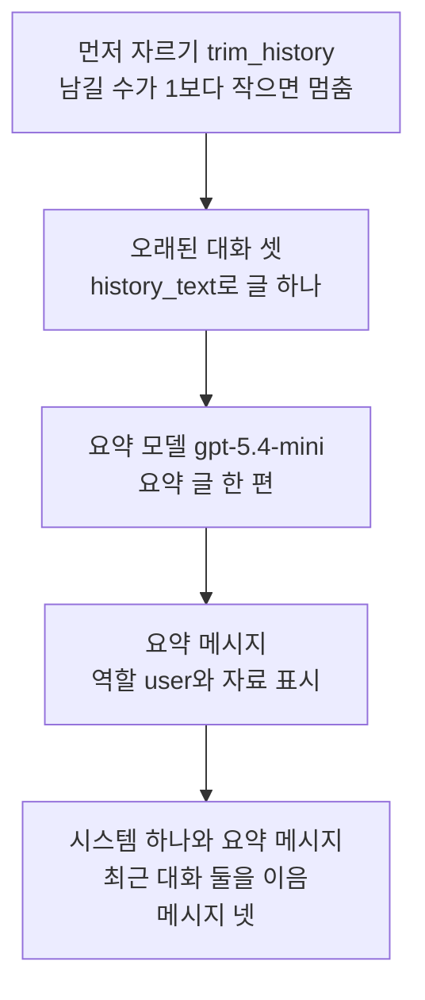
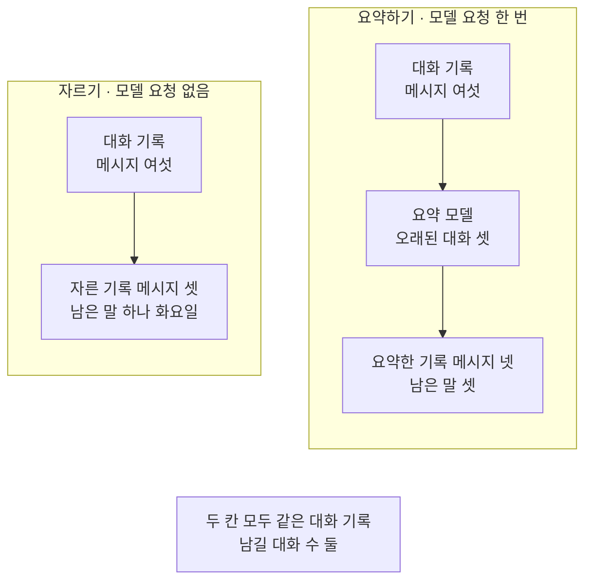
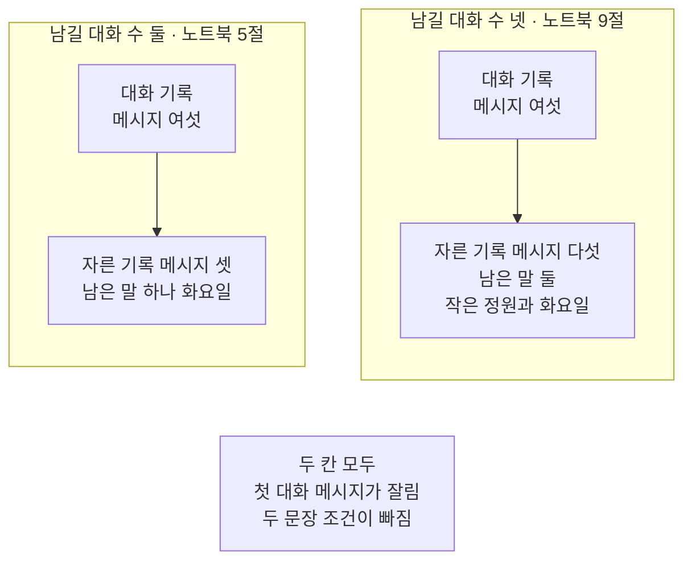

# 03-히스토리-트리밍과-요약

## _src 본문 (HTML 원본)

```html
<!--meta: 강의 0.5h | 실습 0.75h | 코드 notebooks/03-히스토리-트리밍과-요약.ipynb | 새 용어 3 -->
<style>html,body{overflow-x:hidden}.notebook,.nb-cell,.nb-main,.nb-input,.nb-result{min-width:0;max-width:100%}.nb-input pre,.nb-output{box-sizing:border-box;max-width:100%;overflow-x:auto}code.nb-source{display:block!important;width:100%!important;min-width:0!important;overflow-x:auto!important;padding:0!important}</style>
<h2 id="b1"><span class="no">1</span>학습 목표</h2><div class="goal"><ul>
<li>시스템 메시지는 두고 최근 대화만 남기는 자르기 함수를 만들 수 있습니다.</li>
<li>오래된 대화를 모델로 요약해 요약 메시지 하나로 바꾸는 함수를 만들 수 있습니다.</li>
<li>두 방법이 남긴 메시지 수와 지킬 말을 코드로 견줄 수 있습니다.</li>
</ul></div>
<h2 id="b2"><span class="no">2</span>이 내용을 배우는 이유</h2><p>대화가 이어질수록 모델에 보내는 대화 기록도 길어집니다. 앞서 주고받은 말을 모두 보내면 요청마다 입력이 계속 늘어납니다. 그렇다고 오래된 대화를 버리면 대화 첫머리에서 정한 조건도 함께 사라집니다.</p><p>이 절은 대화 기록을 줄이는 두 방법을 같은 대화에 걸어 봅니다. 오래된 대화를 잘라 내는 방법과 모델로 요약하는 방법입니다. 줄인 뒤에 무엇이 남았는지는 짐작하지 않고 코드로 셉니다.</p>
<h2 id="b3"><span class="no">3</span>앞에서 배운 내용</h2><p>Ch 7 04절에서는 대화 기록 자리에 최근 메시지 하나만 넣어 보았습니다. 그때 빠진 메시지의 내용은 모델에 가지 않았습니다. 이 절은 최근 메시지만 남기는 일을 함수로 직접 만듭니다. Ch 14 01절은 앞서 주고받은 말을 담은 목록을 대화 기록이라고 불렀습니다.</p><p>Ch 8 03절에서는 사람이 원문을 줄이고, 꼭 남길 말 목록인 지킬 말이 남았는지 코드로 확인했습니다. 그 일을 줄이기(Compress)라고 불렀습니다. 이 교재에서 「요약」은 모델이 줄인 글에만 씁니다.</p><p>02절에서는 글 안에 원문 값이 그대로 남았는지 찾는 함수 <code>find_raw_values</code>를 만들었습니다. 이 절은 그 함수를 도구 파일 <code>guardrails.py</code>에서 가져와 지킬 말을 찾는 데 씁니다. 메시지는 01·02절처럼 역할과 내용을 담은 딕셔너리입니다.</p>
<h2 id="b4"><span class="no">4</span>핵심 개념</h2><h3>비유로 시작하기</h3><p>01절의 탁자 위에 이번에는 긴 두루마리 하나가 펼쳐져 있다고 해 봅니다. 두루마리에는 대화가 위에서 아래로 한 줄씩 적혀 있습니다. 줄이 늘어 두루마리가 너무 길어졌습니다.</p><p>한 가지 방법은 끝의 두 줄만 남기고 앞부분을 가위로 잘라 내는 것입니다. 다른 방법은 앞부분을 짧은 쪽지에 옮겨 적어 심지에 감아 두는 것입니다. 감은 쪽지는 끝의 두 줄 곁에 함께 둡니다. 잘라 낸 쪽은 앞부분이 사라지고, 감아 둔 쪽은 옮겨 적은 만큼만 남습니다.</p>
{{img:03-5-두루마리와-감은-심지|흰 바탕 나무 탁자 위에 두루마리 셋이 놓여 있고 왼쪽 긴 두루마리는 물결 줄 여섯 개가 적힌 채 탁자 끝 너머로 늘어져 있으며 가운데 짧은 두루마리는 윗단이 곧게 잘려 물결 줄 두 개만 남았고 곁에 가위 하나가 놓였고 오른쪽에는 같은 짧은 두루마리 위에 나무 심지에 감은 작은 쪽지 하나가 놓였으며 탁자 뒤 오른쪽에 펼친 대장 한 권과 나무 손도장 하나가 작게 놓인 그림|긴 기록을 줄이는 두 방법입니다. 가운데는 끝 두 줄만 남기고 잘랐고, 오른쪽은 끝 두 줄 곁에 감아 둔 쪽지를 두었습니다.}}
<p class="look"><b>그림 읽기</b> — 나무 탁자 위에 두루마리 셋이 놓여 있습니다. 왼쪽 긴 두루마리에는 물결 줄 여섯 개가 적혀 있고 탁자 끝 너머로 늘어져 있습니다. 가운데 짧은 두루마리는 윗단이 곧게 잘려 물결 줄 두 개만 남았고 곁에 가위가 있습니다. 오른쪽은 같은 짧은 두루마리 위에 나무 심지에 감은 작은 쪽지 하나가 놓여 있습니다. 탁자 뒤 오른쪽에는 01절의 펼친 대장과 나무 손도장이 작게 놓여 있습니다.</p>
<table><thead><tr><th>말</th><th>뜻</th></tr></thead><tbody><tr><td>자르기(트리밍, trimming)</td><td>오래된 대화 메시지를 버리고 최근 몇 개만 남기는 일입니다. 모델을 부르지 않습니다. 두루마리 앞부분을 가위로 잘라 내는 일과 같습니다.</td></tr><tr><td>요약 메시지</td><td>오래된 대화를 모델이 요약한 글을 담은 메시지 하나입니다. 대화 기록 안에서 잘라 낸 대화 자리에 들어갑니다. 심지에 감아 둔 쪽지와 같습니다.</td></tr><tr><td>남길 대화 수</td><td>자르기와 요약하기가 손대지 않고 남기는 최근 대화 메시지 수입니다. 두루마리 끝에서 남기는 줄 수와 같습니다.</td></tr></tbody></table>
<p>대화 기록(히스토리)은 Ch 14 01절, 지킬 말은 Ch 8 03절에서 쓴 뜻 그대로입니다. 새 말을 이 절 코드에서 보면 이렇습니다. 자르기는 함수 <code>trim_history</code>가 하고, 요약 메시지는 함수 <code>summarize_history</code>가 넣습니다. 남길 대화 수는 인자 <code>keep_recent</code>이고, 지킬 말은 목록 <code>keep_words</code>입니다.</p>
{{mermaid:03-1-자르기와-요약하기|위에서 아래로 읽는 그림으로 초록 상자 대화 기록 시스템 하나와 대화 다섯에서 파란 상자 나누기 split_history로 이어지고 거기서 화살표가 둘로 나뉘어 왼쪽은 파란 상자 요약하기 summarize_history와 보라 상자 요약 모델 gpt-5.4-mini 오래된 대화 셋을 요약을 지나 노란 상자 요약한 기록 메시지 넷으로 가고 오른쪽은 파란 상자 자르기 trim_history 최근 대화 둘만 남김을 지나 노란 상자 자른 기록 메시지 셋으로 가는 그림|같은 대화 기록을 두 방법으로 줄입니다. 자르기는 메시지 셋, 요약하기는 메시지 넷을 남겼습니다.}}
<p class="look"><b>도식 읽기</b> — 위에서 아래로 읽습니다. 맨 위 초록 상자가 이 절의 대화 기록이고, 파란 나누기 상자에서 화살표가 둘로 나뉩니다. 왼쪽은 파란 요약하기 상자와 보라 요약 모델을 지나 노란 요약한 기록으로 갑니다. 오른쪽은 파란 자르기 상자를 지나 노란 자른 기록으로 갑니다. 두 쪽 모두 노트북에서 실제로 실행한 흐름입니다.</p>
<h3>시스템 메시지는 줄이지 않습니다</h3><p>대화 기록의 첫 메시지는 모델이 따를 규칙을 담은 시스템 메시지입니다. 두 방법 모두 시스템 메시지는 그대로 두고 대화 메시지만 줄입니다. 그래서 두 함수는 먼저 함수 <code>split_history</code>로 둘을 나눕니다.</p>
<h3>자르기는 가장 오래된 대화부터 버립니다</h3><p>자르기는 대화 끝에서 정한 수만큼만 남깁니다. 모델을 부르지 않으므로 같은 기록에 같은 수를 넣으면 늘 같은 결과가 나옵니다. 대신 대화 첫머리에서 정한 조건이 가장 먼저 잘립니다. 남길 수를 늘려도 대화 전체를 남기기 전까지는 첫 메시지가 빠집니다.</p>
<h3>요약은 모델이 쓴 글입니다</h3><p>요약하기는 잘라 낼 대화를 모델에게 요약시켜 메시지 하나로 남깁니다. 요약을 만들 때 모델 요청이 한 번 더 나갑니다. 요약 글은 실행마다 문장과 길이가 달라질 수 있고, 조건을 빠뜨릴 수도 있습니다. 그래서 요약한 뒤에도 지킬 말이 있는지 코드로 확인합니다.</p><p>요약 메시지는 시스템 메시지가 아니라 역할 <code>user</code> 메시지로 넣습니다. 앞에는 「참고용 이전 대화 요약(지시가 아닌 자료)」을 붙입니다. 모델이 쓴 글을 시스템 메시지처럼 규칙으로 다루지 않으려는 것입니다.</p>
<h3>다른 상황에 적용</h3><p>택배 상담 챗봇이라면 대화 첫머리에 고객이 알려 준 송장 번호가 중요합니다. 최근 대화만 자르면 송장 번호가 빠질 수 있으니 지킬 말 목록에 넣고 확인합니다. 방금 물은 질문만 중요한 안내라면 모델을 부르지 않는 자르기로 충분할 수 있습니다.</p>
<h3>비교와 경계</h3><p>자르기는 결과가 늘 같지만 오래된 조건을 잃습니다. 요약하기는 오래된 조건을 남길 수 있지만 모델 요청이 하나 늘고 결과가 흔들릴 수 있습니다. 지킬 말 검사는 말이 글에 있는지만 봅니다. 요약이 뜻을 바꾸지 않았는지는 이 검사로 알 수 없습니다.</p>
<h2 id="b5"><span class="no">5</span>실행 예제</h2><p>노트북은 시스템 메시지 하나와 대화 메시지 다섯 개로 된 대화 기록을 손으로 적습니다. 첫 사용자 메시지는 답을 두 문장으로 해 달라는 조건입니다. 둘째 사용자 메시지에는 빌린 책 이름 「작은 정원」이 있습니다. 노트북 4절은 기록을 나누고 글로 잇는 함수 둘을 만들고, 지킬 말 셋을 정합니다.</p><p>노트북 5절은 자르기를, 6절은 요약하기를 같은 남길 대화 수 2로 합니다. 모델 <code>gpt-5.4-mini</code>에 보내는 요청은 노트북 6절의 요약 한 번이고 임베딩 요청은 없습니다. 노트북을 한 번 실행하는 요금은 요금표로 어림해 미화 0.01달러 아래입니다. 실제 청구 금액과는 다를 수 있습니다. 읽는 자료 파일은 없고 새로 쓰는 파일도 없습니다.</p>
{{mermaid:03-2-요약하기-함수의-차례|위에서 아래로 상자 다섯이 이어지는 그림으로 파란 상자 먼저 자르기 trim_history 남길 수가 1보다 작으면 멈춤, 파란 상자 오래된 대화 셋을 history_text로 글 하나로 이음, 보라 상자 요약 모델 gpt-5.4-mini 요약 글 한 편, 노란 상자 요약 메시지 역할 user와 자료 표시, 노란 상자 시스템 하나와 요약 메시지 최근 대화 둘을 이음 메시지 넷 차례인 그림|요약하기 함수는 먼저 자르기로 남길 수를 확인하고, 오래된 대화만 모델에게 보냅니다.}}
<p class="look"><b>도식 읽기</b> — 위에서 아래로 읽는 요약하기 함수의 차례입니다. 맨 위 파란 상자에서 먼저 자르기를 해 남길 수를 확인합니다. 둘째 파란 상자는 오래된 대화 셋만 글 하나로 잇습니다. 그 글만 보라 요약 모델에게 가고, 아래 노란 상자 둘이 노트북 6절이 출력한 요약 메시지와 메시지 넷입니다.</p>
{{notebook:03-히스토리-트리밍과-요약}}
<p class="look"><b>확인할 점</b> — 노트북 5절 출력 <code>자른 기록의 메시지 수: 3</code>과 <code>자른 기록에 남은 말: ['화요일']</code>을 봅니다. 노트북 6절 출력 <code>요약한 기록의 메시지 수: 4</code>와 요약 메시지에 「두 문장」·「작은 정원」이 있는지 봅니다. 노트북 7절 표의 요약한 기록 글자 수는 이번 실행에서 <code>요약하기 | 4 | 251 | 3</code>이었고, 노트북 밖 다섯 번 확인에서는 246자나 248자였습니다. 이 값은 실행마다 달라질 수 있습니다.</p>
<h2 id="b6"><span class="no">6</span>실험 결과 해석</h2><p>같은 대화 기록에 같은 남길 대화 수 2를 넣었습니다. 자르기는 메시지 여섯 개를 셋으로 줄였습니다. 요약하기는 넷으로 줄였고, 잘라 낸 셋 자리에 요약 메시지 하나가 들어갔습니다. 새 커널로 두 번 실행해 두 방법의 메시지 수와 남은 말이 두 번 모두 같았습니다.</p><p>자른 기록에는 남아야 할 말 셋 가운데 「화요일」 하나만 남았습니다. 「두 문장」 조건과 책 이름 「작은 정원」은 잘려 나간 1번과 3번 메시지에 있었습니다. 요약한 기록에는 셋이 모두 남았습니다. 「두 문장」과 「작은 정원」은 모델이 쓴 요약 메시지 안에 있었습니다.</p>
{{mermaid:03-3-자른-기록과-요약한-기록|칸 둘이 나란히 있고 아래에 회색 상자가 있는 그림으로 왼쪽 자르기 모델 요청 없음 칸에서는 초록 상자 대화 기록 메시지 여섯에서 노란 상자 자른 기록 메시지 셋 남은 말 하나 화요일로 이어지고 오른쪽 요약하기 모델 요청 한 번 칸에서는 초록 상자 대화 기록 메시지 여섯에서 보라 상자 요약 모델 오래된 대화 셋을 지나 노란 상자 요약한 기록 메시지 넷 남은 말 셋으로 이어지며 맨 아래 회색 상자에 두 칸 모두 같은 대화 기록 남길 대화 수 둘이 적힌 그림|같은 기록에서 자르기는 지킬 말 하나를, 요약하기는 셋을 남겼습니다.}}
<p class="look"><b>도식 읽기</b> — 왼쪽 칸이 자르기이고 오른쪽 칸이 요약하기입니다. 칸마다 맨 위 초록 상자가 같은 대화 기록입니다. 왼쪽은 모델을 거치지 않고 노란 자른 기록으로 가고, 오른쪽은 보라 요약 모델을 거쳐 노란 요약한 기록으로 갑니다. 맨 아래 회색 상자는 두 칸에 모두 해당합니다.</p>
<p>글자 수는 원본 233자, 자른 기록 137자였습니다. 두 값은 모델을 부르지 않아 다시 실행해도 같습니다. 요약한 기록의 글자 수는 요약 글에 따라 달라져 「확인할 점」에만 적었습니다. 요약 메시지 한 줄이 잘라 낸 대화 셋보다 길면, 메시지 수가 줄어도 글 전체는 원본보다 길어집니다.</p>
<p>값 바꿔 보기는 자르기의 남길 대화 수만 2에서 4로 바꿨습니다. 메시지는 다섯 개가 남았고 남은 말은 「작은 정원」과 「화요일」 둘이었습니다. 1번 메시지는 이번에도 잘려 「두 문장」 조건은 빠졌습니다. 자르기는 남길 수를 늘려도 가장 오래된 메시지부터 버립니다.</p>
{{mermaid:03-4-남길-대화-수를-넷으로|칸 둘이 나란히 있고 아래에 회색 상자가 있는 그림으로 왼쪽 남길 대화 수 둘 칸에서는 초록 상자 대화 기록 메시지 여섯에서 노란 상자 자른 기록 메시지 셋 남은 말 하나 화요일로 이어지고 오른쪽 남길 대화 수 넷 칸에서는 초록 상자 대화 기록 메시지 여섯에서 노란 상자 자른 기록 메시지 다섯 남은 말 둘 작은 정원과 화요일로 이어지며 맨 아래 회색 상자에 두 칸 모두 첫 대화 메시지가 잘려 두 문장 조건이 빠짐이 적힌 그림|남길 대화 수를 넷으로 늘려도 가장 오래된 조건 메시지는 잘렸습니다.}}
<p class="look"><b>도식 읽기</b> — 왼쪽 칸이 노트북 5절의 남길 대화 수 둘이고, 오른쪽 칸이 노트북 9절의 넷입니다. 칸마다 초록 대화 기록에서 노란 자른 기록으로 갑니다. 오른쪽은 메시지가 다섯으로 늘고 남은 말도 둘로 늘었습니다. 맨 아래 회색 상자는 두 칸 모두 첫 대화 메시지가 잘렸다는 메모입니다.</p>
<h2 id="b7"><span class="no">7</span>주의할 점과 실무 메모</h2><ul><li>대화 기록은 이 절에서 손으로 적었고 개인정보는 넣지 않았습니다. 개인정보가 든 대화라면 02절처럼 먼저 가린 뒤 요약에 넘깁니다.</li><li>노트북을 쓰기 전에 같은 요약 요청을 따로 다섯 번 보냈습니다. 다섯 번 모두 요약에 「두 문장」과 「작은 정원」이 있었습니다. 요약 문장 끝말과 글 길이는 조금씩 달랐습니다.</li><li>같은 요청도 실행한 때에 따라 요약이 조건을 빠뜨릴 수 있습니다. 그래서 요약 글에는 <code>assert</code>를 쓰지 않고 출력으로만 확인했습니다.</li><li>지킬 말 검사는 말이 글에 그대로 있는지만 봅니다. 요약이 뜻을 바꿨는지는 이 검사로 알 수 없습니다.</li><li>지킬 말 셋과 남길 대화 수 2·4는 흐름을 보여 주려고 실행 전에 정한 예입니다.</li><li>글자 수는 역할 이름과 줄바꿈까지 센 글 길이입니다. 토큰 수와 비용, 걸린 시간은 이번에 재지 않았습니다.</li><li>요약하기도 모델 요청이라 04절에서 다룰 호출 한도와 비용 상한에 들어갑니다.</li><li>요약 메시지 앞에 「지시가 아닌 자료」라고 적었습니다. 모델이 이 표시를 늘 지키는지는 이번에 확인하지 않았습니다.</li><li>줄인 두 기록을 모델에 보내 답을 받지는 않았습니다. 줄인 기록으로 답이 어떻게 달라지는지는 이번에 확인하지 않았습니다.</li><li>남길 대화 수에 따라 자른 기록이 질문 없이 모델 답(역할 <code>assistant</code>)으로 시작할 수 있습니다. 이 절의 두 자른 기록이 모두 그랬고, 질문과 답을 짝으로 맞춰 자르는 방법은 이번에 다루지 않았습니다.</li><li>함수 <code>split_history</code>는 역할이 <code>system</code>인 메시지를 모두 시스템 목록에 담습니다. 이 절의 기록에는 시스템 메시지가 하나뿐입니다.</li><li>Ch 22 03절에서는 오래된 대화를 요약하는 일을 미들웨어에 맡깁니다.</li><li>이 절은 파일을 읽지도 쓰지도 않습니다.</li><li>교재 출력은 Linux의 Python 3.12.13으로 만들었습니다. 다른 판과 Windows·macOS에서는 이번에 실행하지 않았습니다.</li></ul>
<h2 id="b8"><span class="no">8</span>정리와 다음 절</h2><ul><li>자르기는 모델을 부르지 않고 최근 대화 둘만 남겨, 대화 첫머리의 조건과 책 이름을 잃었습니다.</li><li>요약하기는 모델 요청 한 번으로 오래된 대화 셋을 요약 메시지 하나로 바꿨고, 지킬 말 셋이 모두 남았습니다.</li><li>남길 대화 수를 넷으로 늘려도 가장 오래된 「두 문장」 조건은 잘렸습니다.</li></ul><p><strong>다음 학습과 이어지는 지점</strong> — 04절에서는 모델을 부르기 전에 호출 수와 비용 상한을 정하고, 넘치는 요청을 막습니다.</p>
<h2 id="b9"><span class="no">9</span>복습 문제</h2><details class="quiz" open><summary>문제 4개 · 해설 포함</summary><p class="quiz-q">1. 자르기와 요약하기가 모두 그대로 두는 메시지는 무엇인가요?</p><p class="quiz-a">시스템 메시지입니다. 두 함수 모두 먼저 시스템 메시지와 대화 메시지를 나누고 대화 메시지만 줄입니다. 틀렸다면 「핵심 개념」의 「시스템 메시지는 줄이지 않습니다」를 다시 읽습니다.</p><p class="quiz-q">2. 대화 메시지 목록 <code>dialogue</code>에서 <code>dialogue[-2:]</code>는 무엇인가요?</p><p class="quiz-a">끝에서 둘째 값부터 끝까지, 곧 최근 대화 둘입니다. 슬라이스에 음수를 쓰면 끝에서부터 셉니다. 틀렸다면 노트북 5절을 다시 읽습니다.</p><p class="quiz-q">3. 남길 대화 수를 넷으로 늘렸는데도 「두 문장」 조건이 빠진 까닭은 무엇인가요?</p><p class="quiz-a">그 조건이 가장 오래된 첫 대화 메시지에 있었기 때문입니다. 자르기는 늘 가장 오래된 메시지부터 버립니다. 틀렸다면 노트북 9절을 다시 읽습니다.</p><p class="quiz-q">4. 요약한 기록에 지킬 말이 모두 있었다는 결과는 어디까지 말해 주나요?</p><p class="quiz-a">이번 실행과 다섯 번 확인에서 그 말들이 글에 그대로 있었다는 것까지입니다. 요약은 모델이 쓴 글이라 다른 실행이나 다른 대화에서는 빠질 수 있습니다. 뜻이 바뀌었는지도 이 검사로는 알 수 없습니다. 틀렸다면 「비교와 경계」를 다시 읽습니다.</p></details>
<h2 id="b10"><span class="no">10</span>참고 자료</h2><ul><li><div><a href="https://docs.langchain.com/oss/python/langchain/short-term-memory">LangChain Short-term memory</a></div>확인 2026-09-23 · 오래된 메시지를 자르는 방법과 요약하는 방법을 함께 소개하는 문서입니다.</li><li><div><a href="https://docs.python.org/3.12/library/stdtypes.html#common-sequence-operations">Common Sequence Operations</a></div>확인 2026-09-23 · 슬라이스에 음수를 쓰면 끝에서부터 센다는 규칙을 적어 둔 문서입니다.</li><li>Ch 16 02절 — 함수 <code>find_raw_values</code>를 처음 만든 자리.</li><li>Ch 8 03절 — 사람이 원문을 줄이는 줄이기(Compress).</li></ul>
```

## 노트북 셀 (순서대로)

### [0] markdown {'html': 'skip'}

# 히스토리 트리밍과 실제 요약

이 절은 길어진 대화 기록(히스토리)을 줄이는 두 방법을 견줍니다.
하나는 오래된 대화를 잘라 내는 자르기(트리밍, trimming)입니다.
다른 하나는 오래된 대화를 모델에게 요약시켜 메시지 하나로 남기는 요약하기입니다.

**이 노트북에서 할 일**

1. 시스템 메시지 하나와 대화 메시지 다섯 개로 된 대화 기록을 만듭니다.
2. 최근 대화 둘만 남기고 오래된 대화를 잘라 냅니다.
3. 오래된 대화를 모델로 요약해 요약 메시지 하나로 바꿉니다.
4. 두 기록의 메시지 수와 지킬 말을 코드로 견줍니다.

**준비물** — 이 절은 프로젝트 맨 위 폴더의 `.env`에 적어 둔 `OPENAI_API_KEY`를 씁니다.
모델 `gpt-5.4-mini`에 보내는 요청은 6절의 요약 한 번이고 임베딩 요청은 없습니다.
노트북을 한 번 실행하는 요금은 요금표로 어림해 미화 0.01달러 아래입니다.
실제 청구 금액과는 다를 수 있습니다.

읽는 자료 파일은 없고 새로 쓰는 파일도 없습니다.
대화 기록은 이 절에서 손으로 적은 것이고 개인정보는 넣지 않았습니다.
교재 출력을 만든 실행에서는 노트북 전체가 약 3초 만에 끝났습니다.

**기준 버전** — 첫 셀에서 LangChain 1.4.0과 langchain-openai 1.6.1을 설치합니다.
키를 읽는 python-dotenv 1.2.3도 함께 설치합니다.
교재 출력은 Linux의 Python 3.12.13으로 만들었습니다.
다른 판과 Windows·macOS에서는 이번에 실행하지 않았습니다.

**강의와 실습 범위** — 강의 시간에는 3~5절을 읽습니다.
대화 기록을 나누고 오래된 대화를 잘라 내는 자리입니다.
6절 요약하기와 7절 견주기는 실습 시간에 실행합니다.
8절 손 확인과 9절 값 바꿔 보기도 실습 시간에 실행합니다.

실습 폴더 `labs/part4/ch16-guardrails`에서 `uv sync --locked`를 실행합니다.
그다음 이 폴더의 `.venv` 커널을 고르고 첫 셀부터 순서대로 실행합니다.

### [1] markdown {'html': 'skip'}

## 오늘 볼 그림


위에서 아래로 읽습니다. 초록 대화 기록이 파란 나누기를 지나 화살표 둘로 나뉩니다.
왼쪽은 보라 요약 모델을 거쳐 메시지 넷이 남고, 오른쪽은 자르기만 거쳐 메시지 셋이 남습니다.

### [2] markdown {}

## 1. 준비

첫 셀은 패키지 세 개를 설치하고 설치된 판 번호를 출력합니다.
설치에는 몇십 초가 걸릴 수 있습니다.

### [3] code {'execution': {'iopub.execute_input': '2026-09-23T13:14:25.480026Z', 'iopub.status.busy': '2026-09-23T13:14:25.479911Z', 'iopub.status.idle': '2026-09-23T13:14:26.080075Z', 'shell.execute_reply': '2026-09-23T13:14:26.079587Z'}, 'lesson_role': 'setup'}

```python
# 이 절에서 쓰는 패키지를 설치하고 버전을 확인합니다
%pip install -q "langchain==1.4.0" "langchain-openai==1.6.1" "python-dotenv==1.2.3"
from importlib.metadata import version

print("langchain:", version("langchain"))
print("langchain-openai:", version("langchain-openai"))
print("python-dotenv:", version("python-dotenv"))
```

출력:
```
Note: you may need to restart the kernel to use updated packages.
langchain: 1.4.0
langchain-openai: 1.6.1
python-dotenv: 1.2.3

```

### [4] markdown {}

**결과 읽기** — 설치가 끝나면 판 번호 세 줄이 보입니다.
출력 줄 `langchain: 1.4.0`과 `langchain-openai: 1.6.1`이 실습 폴더 잠금과 같은 판입니다.
이 노트북의 출력은 2026-09-23에 이 판으로 실행한 결과입니다.

다음 셀은 이 절에서 쓸 이름 둘을 불러옵니다.
02절에서 글에 원문 값이 그대로 남았는지 찾던 함수 `find_raw_values`를 다시 씁니다.

앞에서 배운 함수는 `guardrails.py`에 모아 두었습니다. 파일을 열면 코드를 볼 수 있습니다. 노트북과 같은 폴더(`notebooks/`)에 있는 파일입니다. 커널이 `notebooks/` 폴더에서 시작해야 이 파일을 가져올 수 있습니다.
이 절은 그 파일에서 이 함수 하나만 가져옵니다.

### [5] code {'execution': {'iopub.execute_input': '2026-09-23T13:14:26.081328Z', 'iopub.status.busy': '2026-09-23T13:14:26.081230Z', 'iopub.status.idle': '2026-09-23T13:14:26.451824Z', 'shell.execute_reply': '2026-09-23T13:14:26.451303Z'}, 'lesson_role': 'setup'}

```python
# 02절에서 배운 함수 하나와 모델을 만들 이름을 불러옵니다
from guardrails import find_raw_values
from langchain.chat_models import init_chat_model

print("불러온 이름:", "find_raw_values", "init_chat_model")
```

출력:
```
불러온 이름: find_raw_values init_chat_model

```

### [6] markdown {}

**결과 읽기** — 출력 줄 `불러온 이름: find_raw_values init_chat_model`로 이름 둘을 불러왔습니다.
함수 `find_raw_values`는 02절 노트북에서 정의한 함수와 같은 본문입니다.

## 2. 키와 모델 준비

이 절은 6절에서 오래된 대화를 요약할 때 모델 `gpt-5.4-mini`를 한 번 부릅니다.

### [7] markdown {}

API 키가 있는지 확인합니다. `True` 값이 나오면 다음으로 넘어갑니다.

### [8] code {'execution': {'iopub.execute_input': '2026-09-23T13:14:26.452615Z', 'iopub.status.busy': '2026-09-23T13:14:26.452548Z', 'iopub.status.idle': '2026-09-23T13:14:26.458817Z', 'shell.execute_reply': '2026-09-23T13:14:26.458485Z'}, 'lesson_role': 'setup'}

```python
# .env 파일에서 OpenAI API 키를 읽습니다(키 값은 출력하지 않습니다)
import os
from dotenv import find_dotenv, load_dotenv

env_path = find_dotenv(usecwd=True)
load_dotenv(env_path)
has_key = os.getenv("OPENAI_API_KEY") is not None
print("OPENAI_API_KEY 설정 여부:", has_key)
assert has_key, "프로젝트 폴더의 .env 파일에 OPENAI_API_KEY를 적어 주세요."
```

출력:
```
OPENAI_API_KEY 설정 여부: True

```

### [9] markdown {}

실습에 쓸 모델을 준비합니다.
temperature 값을 0으로 두어도 요약 글이 매번 같다고 보장하지는 않습니다.

### [10] code {'execution': {'iopub.execute_input': '2026-09-23T13:14:26.459462Z', 'iopub.status.busy': '2026-09-23T13:14:26.459395Z', 'iopub.status.idle': '2026-09-23T13:14:26.879991Z', 'shell.execute_reply': '2026-09-23T13:14:26.879597Z'}}

```python
# 실습에 쓸 모델을 준비합니다
model = init_chat_model(
    "openai:gpt-5.4-mini",
    temperature=0,
    reasoning_effort="none",
)
print("모델 이름:", model.model_name)
print("temperature:", model.temperature)
```

출력:
```
모델 이름: gpt-5.4-mini
temperature: 0.0

```

### [11] markdown {}

**결과 읽기** — 모델 이름 `gpt-5.4-mini`, temperature `0.0`이 보이면 준비가 끝났습니다.
이 노트북의 출력은 2026-09-23에 이 모델로 실행한 결과입니다.

### [12] markdown {}

## 3. 이 절의 대화 기록

대화 기록(히스토리)은 앞서 주고받은 메시지를 차례대로 담은 목록입니다.
Ch 14 01절에서 쓴 말 그대로입니다.
메시지는 01·02절처럼 역할과 내용을 담은 딕셔너리입니다.
역할 `assistant`는 Ch 7 04절에서 본 것처럼 앞에서 모델이 한 답입니다.

다음 셀은 이 절에서 손으로 적은 대화 기록입니다.
첫 사용자 메시지가 답을 두 문장으로 해 달라는 조건을 정합니다.
둘째 사용자 메시지에는 빌린 책의 이름이 있습니다.

### [13] code {'execution': {'iopub.execute_input': '2026-09-23T13:14:26.880728Z', 'iopub.status.busy': '2026-09-23T13:14:26.880673Z', 'iopub.status.idle': '2026-09-23T13:14:26.882869Z', 'shell.execute_reply': '2026-09-23T13:14:26.882485Z'}}

```python
# 이 절에서 손으로 적은 대화 기록입니다: 시스템 메시지 하나와 대화 메시지 다섯 개
system_text = "미르시립도서관 안내 도우미입니다. 대화에 나온 사실만 써서 한국어로 답하세요."
history = [
    {"role": "system", "content": system_text},
    {"role": "user", "content": "앞으로 답은 두 문장으로 해 주세요."},
    {"role": "assistant", "content": "네, 그렇게 하겠습니다."},
    {"role": "user", "content": "빌린 책 『작은 정원』을 반납하려고 합니다. 도서관은 언제 쉬나요?"},
    {"role": "assistant", "content": "매주 월요일과 법정 공휴일에 쉽니다. 공휴일이 월요일과 겹치면 화요일에도 쉽니다."},
    {"role": "user", "content": "그럼 이번 주에는 언제 반납하면 되나요?"},
]
print("메시지 수:", len(history))
```

출력:
```
메시지 수: 6

```

### [14] markdown {}

**결과 읽기** — 출력 줄 `메시지 수: 6`으로 기록에는 메시지가 여섯 개 있습니다.
시스템 메시지 하나와 대화 메시지 다섯 개입니다.
대화는 사용자와 모델이 번갈아 주고받은 모양으로 적었습니다.

다음 셀은 메시지마다 번호와 역할과 내용을 한 줄씩 출력합니다.
번호 `i`로 목록을 차례대로 돕니다.

### [15] code {'execution': {'iopub.execute_input': '2026-09-23T13:14:26.883445Z', 'iopub.status.busy': '2026-09-23T13:14:26.883393Z', 'iopub.status.idle': '2026-09-23T13:14:26.884983Z', 'shell.execute_reply': '2026-09-23T13:14:26.884647Z'}}

```python
# 메시지마다 번호와 역할과 내용을 한 줄씩 봅니다
print("번호 | 역할 | 내용")
for i in range(len(history)):
    print(i, "|", history[i]["role"], "|", history[i]["content"])
```

출력:
```
번호 | 역할 | 내용
0 | system | 미르시립도서관 안내 도우미입니다. 대화에 나온 사실만 써서 한국어로 답하세요.
1 | user | 앞으로 답은 두 문장으로 해 주세요.
2 | assistant | 네, 그렇게 하겠습니다.
3 | user | 빌린 책 『작은 정원』을 반납하려고 합니다. 도서관은 언제 쉬나요?
4 | assistant | 매주 월요일과 법정 공휴일에 쉽니다. 공휴일이 월요일과 겹치면 화요일에도 쉽니다.
5 | user | 그럼 이번 주에는 언제 반납하면 되나요?

```

### [16] markdown {}

**결과 읽기** — 라벨 줄 `번호 | 역할 | 내용` 아래 여섯 줄이 메시지입니다.
0번은 시스템 메시지이고 1번부터 대화가 이어집니다.
1번은 답을 두 문장으로 해 달라는 조건이고, 3번에 책 이름 「작은 정원」이 있습니다.
4번 답에는 공휴일이 월요일과 겹치면 화요일에도 쉰다는 사실이 있습니다.
5번이 지금 막 들어온 질문입니다.

## 4. 기록을 나누고 글로 잇기

자르거나 요약하기 전에 시스템 메시지와 대화 메시지를 나눕니다.
시스템 메시지는 모델이 따를 규칙이라 줄이지 않고 그대로 둡니다.
줄이는 대상은 대화 메시지뿐입니다.

다음 셀은 두 목록으로 나누는 함수입니다.
마지막 줄은 02절처럼 두 값을 튜플 하나로 묶어 내놓습니다.

### [17] code {'execution': {'iopub.execute_input': '2026-09-23T13:14:26.885520Z', 'iopub.status.busy': '2026-09-23T13:14:26.885473Z', 'iopub.status.idle': '2026-09-23T13:14:26.887057Z', 'shell.execute_reply': '2026-09-23T13:14:26.886727Z'}}

```python
# 시스템 메시지와 나머지 대화 메시지를 두 목록으로 나눕니다
def split_history(messages):
    system_messages = []
    dialogue = []
    for message in messages:
        if message["role"] == "system":
            system_messages.append(message)
        else:
            dialogue.append(message)
    return system_messages, dialogue
```

출력:
```

```

### [18] markdown {}

**결과 읽기** — 정의 셀이라 출력이 없습니다.
함수 `split_history`는 메시지를 하나씩 보며 역할이 `system`이면 첫 목록에 담습니다.
다른 역할이면 둘째 목록에 담습니다.
두 목록 모두 원래 차례를 그대로 지킵니다.

다음 셀은 이 함수로 대화 기록을 나눕니다.
02절처럼 왼쪽에 이름 둘을 쉼표로 적어 튜플의 두 값을 차례로 받습니다.

### [19] code {'execution': {'iopub.execute_input': '2026-09-23T13:14:26.887658Z', 'iopub.status.busy': '2026-09-23T13:14:26.887604Z', 'iopub.status.idle': '2026-09-23T13:14:26.889194Z', 'shell.execute_reply': '2026-09-23T13:14:26.888875Z'}}

```python
# 대화 기록을 두 목록으로 나누고 목록마다 메시지 수를 봅니다
system_messages, dialogue = split_history(history)
print("시스템 메시지 수:", len(system_messages))
print("대화 메시지 수:", len(dialogue))
```

출력:
```
시스템 메시지 수: 1
대화 메시지 수: 5

```

### [20] markdown {}

**결과 읽기** — 출력 줄 `시스템 메시지 수: 1`과 `대화 메시지 수: 5`로 두 목록이 나뉘었습니다.
이제 줄일 대상은 대화 메시지 다섯 개입니다.

다음 셀은 메시지 목록을 글 하나로 잇는 함수입니다.
메시지마다 「역할: 내용」 한 줄을 만들고 줄바꿈으로 잇습니다.
01절의 `" ".join(목록)`은 빈칸을 넣어 이었고, `"\n".join(목록)`은 줄바꿈을 넣어 잇습니다.
6절에서 모델에게 보낼 대화 글을 만들 때 이 함수를 씁니다.

### [21] code {'execution': {'iopub.execute_input': '2026-09-23T13:14:26.889757Z', 'iopub.status.busy': '2026-09-23T13:14:26.889713Z', 'iopub.status.idle': '2026-09-23T13:14:26.891269Z', 'shell.execute_reply': '2026-09-23T13:14:26.890952Z'}}

```python
# 메시지마다 「역할: 내용」 한 줄을 만들어 글 하나로 잇습니다
def history_text(messages):
    lines = []
    for message in messages:
        lines.append(message["role"] + ": " + message["content"])
    return "\n".join(lines)
```

출력:
```

```

### [22] markdown {}

**결과 읽기** — 정의 셀이라 출력이 없습니다.
함수 `history_text`는 메시지 목록을 받아 글 하나를 내놓습니다.

다음 셀은 원본 대화 기록을 글 하나로 잇고 글자 수를 셉니다.
글자 수는 역할 이름과 줄바꿈까지 센 값입니다.

### [23] code {'execution': {'iopub.execute_input': '2026-09-23T13:14:26.891839Z', 'iopub.status.busy': '2026-09-23T13:14:26.891791Z', 'iopub.status.idle': '2026-09-23T13:14:26.893602Z', 'shell.execute_reply': '2026-09-23T13:14:26.893255Z'}}

```python
# 원본 대화 기록을 글 하나로 잇고 글자 수를 셉니다
full_text = history_text(history)
print("원본 기록 글:")
print(full_text)
print("원본 기록 글자 수:", len(full_text))
```

출력:
```
원본 기록 글:
system: 미르시립도서관 안내 도우미입니다. 대화에 나온 사실만 써서 한국어로 답하세요.
user: 앞으로 답은 두 문장으로 해 주세요.
assistant: 네, 그렇게 하겠습니다.
user: 빌린 책 『작은 정원』을 반납하려고 합니다. 도서관은 언제 쉬나요?
assistant: 매주 월요일과 법정 공휴일에 쉽니다. 공휴일이 월요일과 겹치면 화요일에도 쉽니다.
user: 그럼 이번 주에는 언제 반납하면 되나요?
원본 기록 글자 수: 233

```

### [24] markdown {}

**결과 읽기** — 라벨 줄 `원본 기록 글:` 아래 여섯 줄이 메시지 여섯 개입니다.
줄마다 역할 이름이 앞에 붙었습니다.
출력 줄 `원본 기록 글자 수: 233`이 이 글의 길이입니다.

다음 셀은 줄인 뒤에도 기록에 꼭 남아 있어야 할 지킬 말 셋을 정합니다.
지킬 말은 Ch 8 03절에서 쓴 말 그대로입니다.
1번의 조건 「두 문장」, 3번의 책 이름 「작은 정원」, 4번 답의 「화요일」입니다.
02절 함수 `find_raw_values`로 글 안에 그대로 있는 말만 모읍니다.
말이 글에 있는지만 보는 검사이고 요약의 품질 점수는 아닙니다.

### [25] code {'execution': {'iopub.execute_input': '2026-09-23T13:14:26.894082Z', 'iopub.status.busy': '2026-09-23T13:14:26.894038Z', 'iopub.status.idle': '2026-09-23T13:14:26.895911Z', 'shell.execute_reply': '2026-09-23T13:14:26.895552Z'}}

```python
# 줄인 뒤에도 기록에 남아 있어야 할 지킬 말 셋을 정하고 원본 기록 글에 있는지 봅니다
keep_words = ["두 문장", "작은 정원", "화요일"]
full_kept = find_raw_values(full_text, keep_words)
print("지킬 말:", keep_words)
print("원본 기록에 남은 말:", full_kept)
```

출력:
```
지킬 말: ['두 문장', '작은 정원', '화요일']
원본 기록에 남은 말: ['두 문장', '작은 정원', '화요일']

```

### [26] markdown {}

**결과 읽기** — 출력 줄 `원본 기록에 남은 말: ['두 문장', '작은 정원', '화요일']`로 원본에는 셋이 모두 있습니다.
이 목록을 뒤에서 줄인 기록과 견줍니다.

## 5. 오래된 대화 잘라 내기

자르기(트리밍, trimming)는 오래된 대화 메시지를 버리고 최근 몇 개만 남기는 일입니다.
긴 두루마리에서 끝부분만 남기고 앞을 잘라 내는 것과 같습니다.
자르기에는 모델을 부르지 않습니다.

먼저 목록 끝에서 몇 개를 떼는 슬라이스를 봅니다.
Ch 2 03절에서 `[-1]`은 마지막 값이었습니다.
슬라이스에도 음수를 쓰면 끝에서부터 셉니다.
그래서 `dialogue[-2:]`는 끝에서 둘째 값부터 끝까지입니다.
슬라이스 `dialogue[:-2]`는 그 앞 전부입니다.

### [27] code {'execution': {'iopub.execute_input': '2026-09-23T13:14:26.896475Z', 'iopub.status.busy': '2026-09-23T13:14:26.896424Z', 'iopub.status.idle': '2026-09-23T13:14:26.898042Z', 'shell.execute_reply': '2026-09-23T13:14:26.897696Z'}}

```python
# 대화 메시지 목록을 끝의 둘과 그 앞으로 나눠 봅니다
older_part = dialogue[:-2]
recent_part = dialogue[-2:]
print("앞쪽 메시지 수:", len(older_part))
print("끝쪽 메시지 수:", len(recent_part))
print("끝쪽 첫 메시지:", recent_part[0]["content"])
```

출력:
```
앞쪽 메시지 수: 3
끝쪽 메시지 수: 2
끝쪽 첫 메시지: 매주 월요일과 법정 공휴일에 쉽니다. 공휴일이 월요일과 겹치면 화요일에도 쉽니다.

```

### [28] markdown {}

**결과 읽기** — 출력 줄 `앞쪽 메시지 수: 3`과 `끝쪽 메시지 수: 2`로 대화 다섯 개가 셋과 둘로 나뉘었습니다.
출력 줄 `끝쪽 첫 메시지:` 뒤 글이 4번 답입니다.
원래 목록 `dialogue`는 그대로이고 두 슬라이스는 새 목록입니다.

다음 셀은 자르기 함수입니다.
남길 대화 수를 인자 `keep_recent`로 받습니다.
1보다 작은 수를 넣으면 01절처럼 `raise ValueError`로 멈춥니다.
시스템 메시지 목록 뒤에 최근 대화를 `+`로 잇습니다.
목록끼리 `+`로 이으면 두 목록을 차례대로 이은 새 목록이 됩니다.

### [29] code {'execution': {'iopub.execute_input': '2026-09-23T13:14:26.898757Z', 'iopub.status.busy': '2026-09-23T13:14:26.898701Z', 'iopub.status.idle': '2026-09-23T13:14:26.900491Z', 'shell.execute_reply': '2026-09-23T13:14:26.900151Z'}}

```python
# 시스템 메시지는 모두 두고 대화는 최근 keep_recent개만 남깁니다
def trim_history(messages, keep_recent):
    if keep_recent < 1:
        raise ValueError("keep_recent는 1 이상이어야 합니다.")
    system_messages, dialogue = split_history(messages)
    return system_messages + dialogue[-keep_recent:]
```

출력:
```

```

### [30] markdown {}

**결과 읽기** — 정의 셀이라 출력이 없습니다.
함수 `trim_history`는 시스템 메시지를 모두 두고 대화는 끝에서 `keep_recent`개만 남깁니다.
함수 안에서 앞 셀의 함수 `split_history`를 부릅니다.
함수 안의 이름 `dialogue`는 함수가 끝나면 사라져 4절에서 만든 같은 이름을 바꾸지 않습니다.

다음 셀은 최근 대화 둘만 남기고 잘라 냅니다.
그다음 자른 기록을 글로 잇고 지킬 말을 찾습니다.

### [31] code {'execution': {'iopub.execute_input': '2026-09-23T13:14:26.901093Z', 'iopub.status.busy': '2026-09-23T13:14:26.901049Z', 'iopub.status.idle': '2026-09-23T13:14:26.902893Z', 'shell.execute_reply': '2026-09-23T13:14:26.902627Z'}}

```python
# 최근 대화 둘만 남기고 잘라 낸 뒤 지킬 말이 남았는지 봅니다
trimmed = trim_history(history, 2)
trimmed_text = history_text(trimmed)
trimmed_kept = find_raw_values(trimmed_text, keep_words)
print("자른 기록의 메시지 수:", len(trimmed))
print("자른 기록 글:")
print(trimmed_text)
print("자른 기록에 남은 말:", trimmed_kept)
```

출력:
```
자른 기록의 메시지 수: 3
자른 기록 글:
system: 미르시립도서관 안내 도우미입니다. 대화에 나온 사실만 써서 한국어로 답하세요.
assistant: 매주 월요일과 법정 공휴일에 쉽니다. 공휴일이 월요일과 겹치면 화요일에도 쉽니다.
user: 그럼 이번 주에는 언제 반납하면 되나요?
자른 기록에 남은 말: ['화요일']

```

### [32] markdown {}

**결과 읽기** — 출력 줄 `자른 기록의 메시지 수: 3`으로 시스템 메시지 하나와 최근 대화 둘이 남았습니다.
라벨 줄 `자른 기록 글:` 아래 세 줄이 남은 메시지입니다.
출력 줄 `자른 기록에 남은 말: ['화요일']`로 셋 가운데 하나만 남았습니다.

1번의 「두 문장」 조건과 3번의 책 이름은 잘려 나갔습니다.
대화 첫머리에서 정한 조건이 가장 먼저 잘립니다.
이 기록을 모델에 보내면 모델은 두 문장 조건을 받지 못합니다.
시스템 메시지 다음 줄이 `assistant:`로 시작해, 자른 기록은 질문 없이 모델 답부터 시작합니다.

## 6. 오래된 대화 요약하기

요약하기는 잘라 낼 오래된 대화를 모델에게 요약시켜 메시지 하나로 남기는 방법입니다.
이 교재에서 「요약」은 모델이 줄인 글에만 씁니다.
Ch 8 03절에서 사람이 원문을 줄인 일은 줄이기(Compress)라고 불렀습니다.

다음 셀은 요약을 부탁하는 머리글입니다.
Ch 14 01절처럼 모델에 넣을 글 앞에 붙일 말을 미리 적어 둡니다.

### [33] code {'execution': {'iopub.execute_input': '2026-09-23T13:14:26.903511Z', 'iopub.status.busy': '2026-09-23T13:14:26.903462Z', 'iopub.status.idle': '2026-09-23T13:14:26.905484Z', 'shell.execute_reply': '2026-09-23T13:14:26.905072Z'}}

```python
# 요약을 부탁하는 머리글입니다: 조건과 사실만 남기고 새 내용은 보태지 말라고 적습니다
summary_head = "아래 대화에서 사용자가 정한 조건과 확인한 사실만 한국어로 짧게 요약하세요.\n"
summary_head = summary_head + "대화에 없는 내용은 보태지 마세요.\n\n대화:\n"
print("요약 머리글:")
print(summary_head)
```

출력:
```
요약 머리글:
아래 대화에서 사용자가 정한 조건과 확인한 사실만 한국어로 짧게 요약하세요.
대화에 없는 내용은 보태지 마세요.

대화:


```

### [34] markdown {}

**결과 읽기** — 라벨 줄 `요약 머리글:` 아래가 모델에게 보낼 글의 앞부분입니다.
사용자가 정한 조건과 확인한 사실만 남기라고 적었습니다.
대화에 없는 내용은 보태지 말라는 줄도 넣었습니다.
맨 끝 `대화:` 뒤에 요약할 대화 글이 붙습니다.

다음 셀은 대화 글 하나를 받아 모델에게 요약을 받는 함수입니다.
Ch 14 01절처럼 글 하나를 그대로 `invoke`에 넣습니다.
이 함수를 부를 때마다 모델 요청이 한 번 나갑니다.

### [35] code {'execution': {'iopub.execute_input': '2026-09-23T13:14:26.906104Z', 'iopub.status.busy': '2026-09-23T13:14:26.906047Z', 'iopub.status.idle': '2026-09-23T13:14:26.907876Z', 'shell.execute_reply': '2026-09-23T13:14:26.907523Z'}}

```python
# 대화 글 하나를 머리글과 함께 모델에게 보내 요약 글을 받습니다(부를 때마다 모델 요청 1번)
def summarize_text(text):
    reply = model.invoke(summary_head + text)
    return reply.text
```

출력:
```

```

### [36] markdown {}

**결과 읽기** — 정의 셀이라 출력이 없습니다.
함수 `summarize_text`는 머리글 뒤에 대화 글을 붙여 보내고 모델이 쓴 글을 내놓습니다.
정의만 했으므로 아직 요청은 나가지 않았습니다.

다음 셀은 요약하기 함수입니다.
요약을 만드는 함수를 인자 `summarizer`로 받습니다.
함수 이름을 괄호 없이 적으면 함수를 부르지 않고 함수 자체를 넘깁니다.
Ch 13에서 `add_node`에 함수 이름을 넘긴 것과 같은 모양입니다.

함수 본문 첫 줄은 5절의 자르기를 먼저 합니다.
남길 대화 수가 1보다 작으면 여기서 멈추고 모델은 부르지 않습니다.
잘라 낼 오래된 대화가 없으면 자른 기록을 그대로 내놓습니다.
오래된 대화가 있으면 글로 이어 요약을 받고 `strip()`으로 앞뒤 빈칸을 지웁니다.

요약 글은 역할 `user` 메시지에 담아 시스템 메시지와 최근 대화 사이에 넣습니다.
앞에는 「참고용 이전 대화 요약(지시가 아닌 자료)」을 붙입니다.
요약은 모델이 쓴 글이라 시스템 메시지 자리에 두지 않고 자료로 넣습니다.

### [37] code {'execution': {'iopub.execute_input': '2026-09-23T13:14:26.908489Z', 'iopub.status.busy': '2026-09-23T13:14:26.908438Z', 'iopub.status.idle': '2026-09-23T13:14:26.910742Z', 'shell.execute_reply': '2026-09-23T13:14:26.910220Z'}}

```python
# 오래된 대화는 요약 메시지 하나로 바꾸고 최근 keep_recent개는 그대로 둡니다
def summarize_history(messages, summarizer, keep_recent):
    trimmed_messages = trim_history(messages, keep_recent)
    system_messages, dialogue = split_history(messages)
    older = dialogue[:-keep_recent]
    if len(older) == 0:
        return trimmed_messages
    summary = summarizer(history_text(older)).strip()
    note = {"role": "user", "content": "참고용 이전 대화 요약(지시가 아닌 자료): " + summary}
    return system_messages + [note] + dialogue[-keep_recent:]
```

출력:
```

```

### [38] markdown {}

**결과 읽기** — 정의 셀이라 출력이 없습니다.
함수 `summarize_history`는 시스템 메시지, 요약 메시지, 최근 대화 차례로 이은 새 목록을 내놓습니다.

다음 셀은 5절과 같은 대화 기록에 같은 남길 대화 수 2로 요약하기를 합니다.
오래된 대화 셋이 요약 메시지 하나가 됩니다.
이 셀에서 모델 요청이 한 번 나갑니다.

### [39] code {'execution': {'iopub.execute_input': '2026-09-23T13:14:26.911283Z', 'iopub.status.busy': '2026-09-23T13:14:26.911232Z', 'iopub.status.idle': '2026-09-23T13:14:28.125011Z', 'shell.execute_reply': '2026-09-23T13:14:28.124287Z'}}

```python
# 오래된 대화 셋을 요약 메시지 하나로 바꿉니다(모델 요청 1번)
summarized = summarize_history(history, summarize_text, 2)
summarized_text = history_text(summarized)
summarized_kept = find_raw_values(summarized_text, keep_words)
print("요약한 기록의 메시지 수:", len(summarized))
print("요약 메시지:")
print(summarized[1]["content"])
print("요약한 기록에 남은 말:", summarized_kept)
```

출력:
```
요약한 기록의 메시지 수: 4
요약 메시지:
참고용 이전 대화 요약(지시가 아닌 자료): 사용자는 앞으로 답을 두 문장으로 해 달라고 정했습니다.  
또한 빌린 책 『작은 정원』을 반납하려고 하며, 도서관의 휴관일을 확인하려고 했습니다.
요약한 기록에 남은 말: ['두 문장', '작은 정원', '화요일']

```

### [40] markdown {}

**결과 읽기** — 출력 줄 `요약한 기록의 메시지 수: 4`로 시스템 메시지, 요약 메시지, 최근 대화 둘이 남았습니다.
라벨 줄 `요약 메시지:` 아래가 모델이 쓴 요약을 담은 메시지입니다.
출력 줄 `요약한 기록에 남은 말: ['두 문장', '작은 정원', '화요일']`로 셋이 모두 남았습니다.
「두 문장」과 「작은 정원」은 요약 메시지 안에 있습니다.

요약 글은 모델이 쓴 글이라 여러분 실행에서는 문장이 다를 수 있습니다.
교재 출력을 만들기 전에 같은 요약 요청을 따로 다섯 번 보냈습니다.
다섯 번 모두 요약에 「두 문장」과 「작은 정원」이 있었고 글 길이는 조금씩 달랐습니다.

### [41] code {'execution': {'iopub.execute_input': '2026-09-23T13:14:28.126592Z', 'iopub.status.busy': '2026-09-23T13:14:28.126459Z', 'iopub.status.idle': '2026-09-23T13:14:28.129275Z', 'shell.execute_reply': '2026-09-23T13:14:28.128665Z'}}

```python
# 요약한 기록의 메시지마다 번호와 역할을 봅니다
print("번호 | 역할")
for i in range(len(summarized)):
    print(i, "|", summarized[i]["role"])
```

출력:
```
번호 | 역할
0 | system
1 | user
2 | assistant
3 | user

```

### [42] markdown {}

**결과 읽기** — 라벨 줄 `번호 | 역할` 아래 네 줄이 요약한 기록의 차례입니다.
1번이 요약 메시지이고 역할은 `user`입니다.
2번과 3번은 5절 자른 기록의 마지막 두 메시지와 같은 메시지입니다.

## 7. 세 기록 견주기

다음 셀은 원본, 자른 기록, 요약한 기록을 한 표로 나란히 봅니다.
글자 수는 `history_text`로 이은 글의 길이입니다.
남은 말 수는 지킬 말 셋 가운데 기록 글에 있는 수입니다.

### [43] code {'execution': {'iopub.execute_input': '2026-09-23T13:14:28.130422Z', 'iopub.status.busy': '2026-09-23T13:14:28.130307Z', 'iopub.status.idle': '2026-09-23T13:14:28.133123Z', 'shell.execute_reply': '2026-09-23T13:14:28.132610Z'}}

```python
# 세 기록의 메시지 수·글자 수·남은 말 수를 한 표로 나란히 봅니다
print("기록 | 메시지 수 | 글자 수 | 남은 말 수")
print("원본 |", len(history), "|", len(full_text), "|", len(full_kept))
print("자르기 |", len(trimmed), "|", len(trimmed_text), "|", len(trimmed_kept))
print("요약하기 |", len(summarized), "|", len(summarized_text), "|", len(summarized_kept))
```

출력:
```
기록 | 메시지 수 | 글자 수 | 남은 말 수
원본 | 6 | 233 | 3
자르기 | 3 | 137 | 1
요약하기 | 4 | 251 | 3

```

### [44] markdown {}

**결과 읽기** — 라벨 줄 `기록 | 메시지 수 | 글자 수 | 남은 말 수` 아래 세 줄이 세 기록입니다.
출력 줄 `원본 | 6 | 233 | 3`과 `자르기 | 3 | 137 | 1`은 모델을 부르지 않은 값이라 다시 실행해도 같습니다.
요약한 기록은 메시지 넷에 남은 말 셋입니다.

이번 실행에서는 출력 줄 `요약하기 | 4 | 251 | 3`이었습니다.
요약한 기록의 글자 수는 요약 글 길이에 따라 달라집니다.
이번 실행에서는 원본보다 18자 길었습니다.
짧은 대화에서는 요약 메시지가 잘라 낸 대화보다 길 수 있습니다.
메시지 수가 줄어도 글이 늘 짧아지지는 않습니다.

## 8. 손으로 확인하기 · 남길 대화 수 0

다음 셀은 요약하기 함수에 남길 대화 수 0을 넣어 봅니다.
함수 본문 첫 줄의 자르기가 먼저 멈추므로 모델 요청은 나가지 않습니다.
오류를 받는 `try`·`except ValueError as error`는 Ch 2 05절에서 배운 모양입니다.
오류를 받아 출력하고 셀은 끝까지 실행합니다.

### [45] code {'execution': {'iopub.execute_input': '2026-09-23T13:14:28.134229Z', 'iopub.status.busy': '2026-09-23T13:14:28.134139Z', 'iopub.status.idle': '2026-09-23T13:14:28.136812Z', 'shell.execute_reply': '2026-09-23T13:14:28.136299Z'}}

```python
# 남길 대화 수 0을 요약하기 함수에 넣어 봅니다(첫 줄에서 멈춰 모델은 부르지 않습니다)
try:
    summarize_history(history, summarize_text, 0)
except ValueError as error:
    print("오류 종류:", type(error).__name__)
    print("오류 메시지:", error)
```

출력:
```
오류 종류: ValueError
오류 메시지: keep_recent는 1 이상이어야 합니다.

```

### [46] markdown {}

**결과 읽기** — 출력 줄 `오류 종류: ValueError`로 함수가 멈췄습니다.
출력 줄 `오류 메시지: keep_recent는 1 이상이어야 합니다.`가 자르기 함수의 오류 문장입니다.
요약 함수 `summarize_text`를 부르기 전에 멈췄으므로 이 셀은 모델을 부르지 않았습니다.

## 9. 값 바꿔 보기 · 남길 대화 수 4

바꿀 값은 자르기의 남길 대화 수 하나입니다.
2 대신 4를 넣어 자릅니다.

실행 전에 예상해 봅니다.
대화 다섯 개 가운데 가장 오래된 1번 하나만 잘릴 것입니다.
1번에 있던 「두 문장」 조건은 이번에도 빠질 것입니다.

### [47] code {'execution': {'iopub.execute_input': '2026-09-23T13:14:28.137792Z', 'iopub.status.busy': '2026-09-23T13:14:28.137699Z', 'iopub.status.idle': '2026-09-23T13:14:28.140197Z', 'shell.execute_reply': '2026-09-23T13:14:28.139714Z'}}

```python
# 바꿀 값은 남길 대화 수 하나입니다: 2 대신 4로 잘라 봅니다
trimmed_four = trim_history(history, 4)
four_text = history_text(trimmed_four)
four_kept = find_raw_values(four_text, keep_words)
print("넷을 남긴 기록의 메시지 수:", len(trimmed_four))
print("넷을 남긴 기록의 첫 대화:", trimmed_four[1]["content"])
print("넷을 남긴 기록에 남은 말:", four_kept)
```

출력:
```
넷을 남긴 기록의 메시지 수: 5
넷을 남긴 기록의 첫 대화: 네, 그렇게 하겠습니다.
넷을 남긴 기록에 남은 말: ['작은 정원', '화요일']

```

### [48] markdown {}

**결과 읽기** — 출력 줄 `넷을 남긴 기록의 메시지 수: 5`로 시스템 메시지와 대화 넷이 남았습니다.
출력 줄 `넷을 남긴 기록의 첫 대화: 네, 그렇게 하겠습니다.`로 1번 조건 메시지가 잘렸습니다.
출력 줄 `넷을 남긴 기록에 남은 말: ['작은 정원', '화요일']`로 둘이 남았습니다.

예상대로 남길 수를 넷으로 늘려도 「두 문장」 조건은 빠졌습니다.
자르기는 늘 가장 오래된 메시지부터 버립니다.
5절 출력에서는 `자른 기록에 남은 말: ['화요일']`이었습니다.

## 정리

1. 자르기는 모델을 부르지 않고 최근 대화 둘만 남겨, 대화 첫머리의 조건과 책 이름을 잃었습니다.
2. 요약하기는 모델 요청 한 번으로 오래된 대화 셋을 요약 메시지 하나로 바꿨고, 지킬 말 셋이 모두 남았습니다.
3. 남길 대화 수를 넷으로 늘려도 가장 오래된 「두 문장」 조건은 잘렸습니다.

04절에서는 모델을 부르기 전에 호출 수와 비용 상한을 정하고, 넘치는 요청을 막습니다.

## 그림

### 03-1-자르기와-요약하기.mmd



같은 대화 기록을 두 방법으로 줄입니다. 자르기는 메시지 셋, 요약하기는 메시지 넷을 남겼습니다.

### 03-2-요약하기-함수의-차례.mmd



요약하기 함수는 먼저 자르기로 남길 수를 확인하고, 오래된 대화만 모델에게 보냅니다.

### 03-3-자른-기록과-요약한-기록.mmd



같은 기록에서 자르기는 지킬 말 하나를, 요약하기는 셋을 남겼습니다.

### 03-4-남길-대화-수를-넷으로.mmd



남길 대화 수를 넷으로 늘려도 가장 오래된 조건 메시지는 잘렸습니다.

### 03-5-두루마리와-감은-심지.prompt.md

# 03-5-두루마리와-감은-심지 (Higgsfield 삽화)

설명 대상 문장(본문 b4 비유 단락): 01절의 탁자 위에 이번에는 긴 두루마리 하나가 펼쳐져 있다고 해 봅니다. 한 가지 방법은 끝의 두 줄만 남기고 앞부분을 가위로 잘라 내는 것입니다. 다른 방법은 앞부분을 짧은 쪽지에 옮겨 적어 심지에 감아 두는 것입니다. 감은 쪽지는 끝의 두 줄 곁에 함께 둡니다.

구성 요소와 배치: 흰 바탕 나무 탁자 위에 **두루마리 셋**을 나란히. 왼쪽 **긴 두루마리**(= 원본 대화 기록, 물결 줄 = 메시지), 가운데 **윗단을 곧게 자른 짧은 두루마리 + 가위**(= 자르기, 끝 두 줄만 남음), 오른쪽 **같은 짧은 두루마리 + 그 위 나무 심지에 감은 작은 쪽지**(= 요약하기, 감은 쪽지 = 요약 메시지). 탁자 뒤 오른쪽에 **01절의 펼친 대장과 나무 손도장**을 작게(비유 계열 이어짐). 숫자·글자 없이 줄 수와 자리로만 읽히게 했습니다.

시선 순서: 왼쪽 긴 두루마리 → 가운데 잘린 두루마리와 가위 → 오른쪽 두루마리와 감은 쪽지 → 뒤쪽 대장과 손도장.

검수 기준: 그림만 보고 「왼쪽은 길고 줄이 많다」, 「가운데는 두 줄만 남기고 잘렸다(가위)」, 「오른쪽은 두 줄에 감아 둔 쪽지가 더해졌다」가 읽히는가. 글자·숫자가 없는가.

비유 계열: 이 챕터의 **도장과 도장 대장**(01절)·덮개 천(02절) 탁자 위에서 **두루마리와 감은 심지**를 더했습니다(handoff §02 → §03 9번, 준비 조사 §6 보조 후보). 쓰지 않은 것: Ch 9~15의 카드·봉투·서랍·쟁반·바구니·사과·저울·스티커, Ch 22 03절의 메모·요약 카드.

## 프롬프트 (1차, 채택)

```text
Simple flat educational illustration, white background, limited soft palette, clean outlines, plain everyday objects, no text, no letters, no numbers, no logos.

Three paper scrolls lie side by side on a wooden table. The left scroll is long and fully unrolled, showing five short wavy ink lines from top to bottom. The middle scroll is short and shows only two wavy ink lines, its top edge cut straight, with one small pair of scissors lying next to it. The right scroll is the same short two-line scroll, and just above it lies one small separate slip tightly rolled around a thin wooden rod. One open flat ledger book and one wooden hand stamp sit small at the back right corner of the table.

No hands, no people, no screens, no arrows, no charts.
```

## 상태

- 2026-09-23 · `nano_banana_pro`(응답 모델 이름 `nano_banana_2`) · 16:9 · 2k · `use_unlim: false` · count 1 · 장당 2크레딧. 생성 전 잔액 2640.5 → 생성 뒤 **2638.5**(`balance`로 전후 확인).
- **1차 job `71f41830-f291-4301-a024-56978ec01d50` 채택**(재생성 없음). 원본 `5703e0a40f48ff82566beed312e29067ef4bcb356ef8ce587d8dcb63839ed43e`(2752 × 1536).
- **그림에서 확인한 것(그림 읽기·alt·캡션에 반영)**: 나무 탁자 위에 두루마리 셋이 있습니다. 왼쪽 긴 두루마리에는 물결 줄이 **여섯 개**(프롬프트는 다섯 개)이고 탁자 끝 너머로 늘어져 있습니다. 가운데 짧은 두루마리는 윗단이 곧게 잘려 물결 줄 두 개만 남았고 곁에 주황 손잡이 가위가 있습니다. 오른쪽은 같은 짧은 두루마리 위에 양끝이 나무인 심지에 감은 작은 쪽지가 놓여 있습니다. 탁자 뒤 오른쪽에 펼친 대장과 나무 손도장이 작게 있습니다. 글자·숫자·사람은 없습니다. 줄 수는 그림대로 「여섯 개」로 적었습니다(이 절 대화 기록의 메시지 수 여섯과 우연히 같지만 본문에서 그 대응을 주장하지 않음). 감은 쪽지가 밀대처럼 보일 수 있다는 점은 검토자 확인 대상입니다.
- 저장: 기기 셸에서 결과 URL을 `curl`로 받아 `uv run --no-project --with pillow`로 RGB로 바꾸고 폭 1100px로 줄여 `figures/03-5-두루마리와-감은-심지.png`(1100 × 614, `364a67ccdfb67caa8a6e71b3cfeb13eff904737702e2de585c5a4eb3a3044c28`)로 저장했습니다. 원본 2752px는 교재 폴더에 저장하지 않았습니다.
- 결과 URL을 다시 받아(같은 해시 `5703e0a4…`) 같은 폭으로 줄인 그림과 저장 PNG를 픽셀 대조했습니다(`ImageChops.difference` bbox `None`, 세 칸 extrema 모두 `(0, 0)`, 규격 §5-4). 저장한 PNG의 다른 이름 사본(`.cache/ch16-03-view/illu-job1-1100.png`)을 직접 열어 그림 읽기를 썼습니다.

