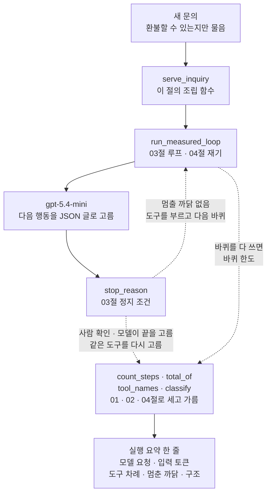
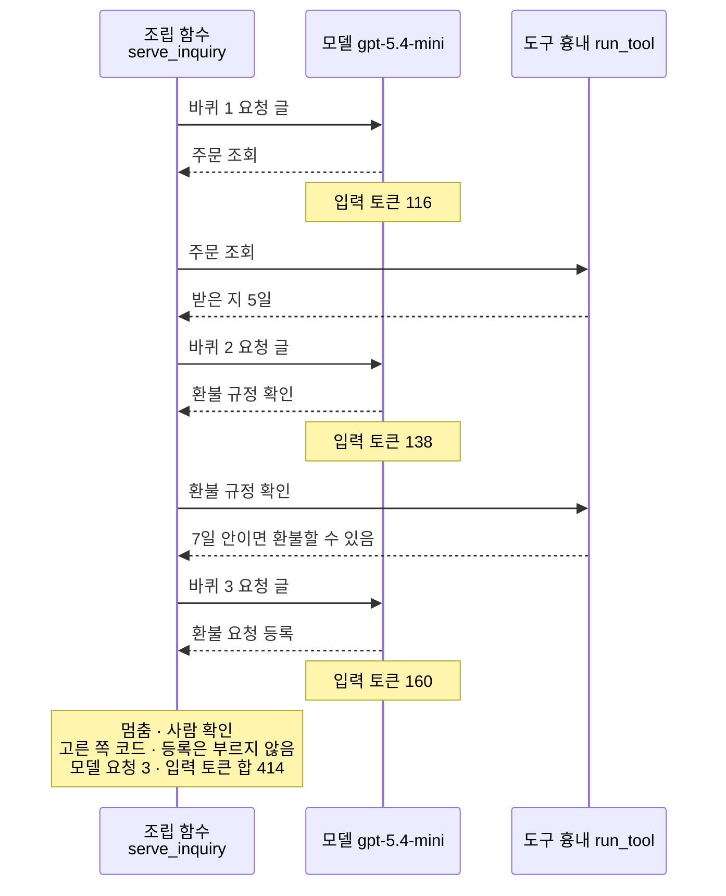
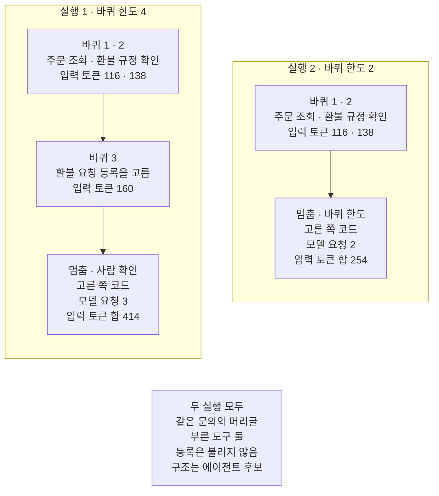

# 06-Agent-개요-실습

## _src 본문 (HTML 원본)

```html
<!--meta: 실습 30분 | 코드 notebooks/06-Agent-개요-실습.ipynb | 새 용어 0 -->
<style>html,body{overflow-x:hidden}.notebook,.nb-cell,.nb-main,.nb-input,.nb-result{min-width:0;max-width:100%}.nb-input pre,.nb-output{box-sizing:border-box;max-width:100%;overflow-x:auto}code.nb-source{display:block!important;width:100%!important;min-width:0!important;overflow-x:auto!important;padding:0!important}</style>
<h2 id="b1"><span class="no">1</span>학습 목표</h2><div class="goal"><ul>
<li>01·03·04절 함수를 조립 함수 하나로 이어, 새 문의의 요청 수·입력 토큰·멈춘 까닭·구조를 한 번에 볼 수 있습니다.</li>
<li>문의가 묻지 않은 부작용 도구를 모델이 고를 때, 사람 확인이 부르기 전에 멈추는 것을 기록으로 확인할 수 있습니다.</li>
<li>바퀴 한도 하나만 바꿔 다시 실행하고, 두 실행의 요청 수와 입력 토큰을 견줄 수 있습니다.</li>
</ul></div>
<h2 id="b2"><span class="no">2</span>이 내용을 배우는 이유</h2><p>이 챕터에서는 모델에게 다음 단계를 맡길 때 따라오는 것을 절마다 따로 보았습니다. 01절은 누가 골랐는지 갈랐고, 03절은 반복을 멈추는 조건을 세웠습니다. 04절은 그 반복에 드는 모델 요청과 토큰을 쟀습니다. 실제 문의 하나를 맡기면 이 셋이 한꺼번에 일어납니다.</p>
<p>이번 실습은 새 문의 하나에 세 절 기능을 한 조립 함수로 붙입니다. 문의는 주문 A-1024를 지금 환불할 수 있는지만 묻습니다. 바퀴 한도 하나만 바꿔 한 번 더 실행하고, 두 실행을 한 표로 견줍니다.</p>
<p>이번 절은 이 챕터의 실습입니다. 01~05절에서 쓴 이름과 문법만 쓰고 따로 내는 과제는 없습니다. 강사와 함께 노트북 셀을 차례로 실행합니다.</p>
<p><strong>이 절의 질문</strong> — 환불할 수 있는지만 묻는 문의를 루프에 맡기면 모델은 어디까지 고르고, 누가 멈출까요? 바퀴 한도를 낮추면 요청 수와 입력 토큰은 얼마나 줄고, 무엇이 달라질까요?</p>
<h2 id="b3"><span class="no">3</span>앞에서 배운 내용</h2><p>이번 실습은 아래 절에서 배운 함수를 도구 파일 <code>agent_tools.py</code>에서 그대로 가져옵니다.</p>
<table><thead><tr><th>절</th><th>배운 것</th><th>실습에서 쓰는 곳</th></tr></thead><tbody>
<tr><td>01절</td><td>기록 한 줄의 칸 「단계」·「한 쪽」·「고른 쪽」, 줄 수를 세는 <code>count_steps()</code>, 모델이 고른 단계가 있으면 에이전트 후보로 가르는 <code>classify()</code></td><td>조립 함수의 모델 요청 수와 구조, 노트북 7절 다시 보기</td></tr>
<tr><td>02절</td><td>도구가 한 단계 이름을 모으는 <code>tool_names()</code>, 부작용과 승인 지점</td><td>조립 함수의 도구 차례, 사람 확인이 필요한 도구</td></tr>
<tr><td>03절</td><td>도구 흉내 <code>run_tool()</code>, 요청 글 <code>build_request()</code>, 바퀴 기록 <code>turn_lines()</code>, 정지 조건(사람 확인·바퀴 한도), <code>print_results()</code></td><td>노트북 3절 재료와 요청 글 미리 보기, 5·6절 멈춘 까닭</td></tr>
<tr><td>04절</td><td>요청마다 재는 루프 <code>run_measured_loop()</code>, 바퀴마다 잰 값을 보는 <code>print_measures()</code>, 칸 값을 더하는 <code>total_of()</code></td><td>조립 함수의 입력 토큰 합, 노트북 5·6절 바퀴마다 잰 값</td></tr>
</tbody></table>
<p>04절 함수 셋은 이 절에서 처음 도구 파일에서 가져옵니다. 04절 노트북과 같은 본문으로 옮겼고, 인자도 그대로입니다. 안에서 부르는 04절 함수 <code>choose_line()</code>·<code>send_and_measure()</code>도 함께 옮겼습니다.</p>
<p>세 절을 고른 까닭은 이렇습니다. 모델에게 다음 단계를 맡긴 흐름에서 꼭 볼 것은 셋입니다. 누가 골랐는지와 무엇이 멈췄는지, 얼마나 들었는지입니다. 이 셋이 01절 가르기, 03절 정지 조건, 04절 재기입니다. 02절 <code>tool_names()</code>와 03절 재료 함수는 기록을 읽고 요청 글을 만드는 데만 씁니다.</p>
<p>다른 기능은 쓰지 않습니다. 02절 진단 질문과 점수는 실행 전에 사람이 답을 적는 진단이라 이 흐름에 넣지 않습니다. 04절에서 코드 차례 흐름과 견준 실험은 되풀이하지 않습니다. 04절에서 잰 출력 토큰과 걸린 초, 예상 비용은 실행마다 달라 결론에 쓰지 않습니다. 05절 공개 자료와 진단표는 남이 남긴 기록을 읽는 일이라 뺐습니다.</p>
<p>03절에서 사람 확인을 뺀 실험도 되풀이하지 않고, 바퀴 한도를 바꿉니다. 03절 노트북 9절도 바퀴 한도를 2로 낮췄지만, 환불 문의였고 요청마다 입력 토큰은 재지 않았습니다. 이번에는 새 문의로, 요청마다 입력 토큰을 재며 봅니다.</p><p>05절 진단표는 이 챕터 환불 문의 흐름에 워크플로우 유지를 권했습니다. 이 실습은 그 권고를 바꾸려는 것이 아닙니다. 모델에게 맡기면 무엇을 세고 무엇으로 막는지를 새 문의 하나로 확인합니다.</p>
<h2 id="b4"><span class="no">4</span>핵심 개념</h2><h3>비유로 시작하기</h3>
<p>01절부터 쓴 눈밭에 앞 절 소품을 함께 놓아 봅니다. 발자국 한 줄은 실행 한 번의 기록입니다. 눈이 둥글게 다져진 자리는 걷던 사람이 멈춰 둘러본 자리이고, 04절처럼 모델 요청 한 번입니다. 울타리는 03절처럼 코드가 세운 정지 조건이고, 말뚝은 걷는 사람이 스스로 멈추는 자리입니다.</p>
{{img:06-4-말뚝에-닿지-않은-두-발자국|흰 눈밭 위쪽 가운데에 짧은 나무 말뚝 하나가 서 있고, 그 아래 같은 높이에 낮은 나무 울타리 두 개가 왼쪽 절반과 오른쪽 절반에 따로 서 있으며 가운데는 트여 있고, 발자국 두 줄이 아래 끝에서 곧게 올라오는데 왼쪽 줄은 눈이 둥글게 다져지고 갈색 흙빛이 조금 비치는 자리 셋을 지나 왼쪽 울타리 바로 앞에서 끝나고, 오른쪽 줄은 같은 모양의 다져진 자리 둘을 지난 뒤 발자국 몇 개를 더 딛고 오른쪽 울타리 왼쪽 끝 곁, 울타리와 같은 높이에서 끝나며, 두 줄 모두 말뚝에는 닿지 않은 그림|두 줄 모두 울타리 높이에서 멈춰 말뚝에 닿지 않았고, 왼쪽 줄에만 다져진 자리가 하나 더 있습니다.}}
<p class="look"><b>그림 읽기</b> — 흰 눈밭 위쪽 가운데에 짧은 나무 말뚝 하나가 서 있습니다. 그 아래 같은 높이에 낮은 나무 울타리 두 개가 왼쪽 절반과 오른쪽 절반을 막고, 가운데는 트여 있습니다. 발자국 두 줄이 아래 끝에서 곧게 올라옵니다. 왼쪽 줄은 눈이 둥글게 다져진 자리 셋을 지나 왼쪽 울타리 바로 앞에서 끝납니다. 오른쪽 줄은 다져진 자리 둘을 지나 발자국 몇 개를 더 딛고, 오른쪽 울타리 왼쪽 끝 곁에서 끝납니다.</p>
<p class="look">왼쪽 줄은 실행 1, 오른쪽 줄은 실행 2입니다. 다져진 자리가 모델 요청 한 번이라, 왼쪽 줄에만 있는 셋째 자리가 실행 1의 셋째 요청입니다. 두 줄이 같은 높이까지 올라온 것은 두 실행이 같은 두 도구를 부른 것과 같습니다. 어느 줄도 말뚝에 닿지 않은 것은 두 실행 모두 모델이 끝을 고른 기록이 없는 것과 같습니다. 오른쪽 줄은 울타리 끝 곁에서 멈췄고, 이 절에서는 이 자리를 바퀴 한도로 읽습니다.</p>
<h3>실습 조립의 구성</h3>
{{mermaid:06-1-루프-정지-조건-요청-세기의-조립|위에서 아래로 읽는 그림으로 초록 상자 새 문의 환불할 수 있는지만 물음에서 파란 상자 serve_inquiry 이 절의 조립 함수와 파란 상자 run_measured_loop 03절 루프 04절 재기를 지나 보라 상자 gpt-5.4-mini 다음 행동을 JSON 글로 고름과 파란 상자 stop_reason 03절 정지 조건에 닿고 거기서 점선 둘이 나와 멈출 까닭이 없으면 도구를 부르고 run_measured_loop로 되돌아가고 사람 확인이나 모델의 끝 선택이나 같은 도구를 다시 고름이면 파란 상자 count_steps total_of tool_names classify로 가며 run_measured_loop에서도 점선 하나가 바퀴를 다 쓰면 바퀴 한도로 같은 파란 상자에 닿고 거기서 맨 아래 초록 상자 실행 요약 한 줄로 가는 그림|문의 하나를 03절 루프로 처리하며 04절처럼 재고, 멈춘 뒤 01절 규칙으로 갈라 실행 요약 한 줄에 모읍니다.}}
<p class="look"><b>도식 읽기</b> — 위에서 아래로 읽으면 초록 새 문의가 파란 조립 함수 <code>serve_inquiry</code>와 루프 <code>run_measured_loop</code>를 지나 보라 모델에 닿습니다. 파란 <code>stop_reason</code>이 멈출 까닭이 없다고 보면, 위로 가는 점선을 따라 도구를 부르고 루프로 되돌아가 다음 바퀴를 돕니다. 사람 확인·모델의 끝 선택·같은 도구 다시 고름이면 아래 점선을 따라 파란 상자의 01·02·04절 함수로 갑니다. 바퀴를 다 쓰면 바퀴 한도로 멈추고, 루프 오른쪽 점선을 따라 같은 상자로 갑니다. 그 함수들이 세고 가른 값이 맨 아래 초록 실행 요약 한 줄에 모입니다.</p>
<table><thead><tr><th>함수</th><th>하는 일</th><th>가져온 곳</th></tr></thead><tbody>
<tr><td><code>serve_inquiry()</code></td><td>문의 하나를 루프로 처리하고, 요청 수·입력 토큰·도구 차례·멈춘 까닭·구조를 딕셔너리 하나에 모음</td><td>01~04절 함수를 이 절이 묶은 조립 함수</td></tr>
<tr><td><code>print_reports()</code></td><td>실행 요약을 실행마다 한 줄로 출력</td><td>이 절의 기록 장치</td></tr>
<tr><td><code>run_measured_loop()</code></td><td>바퀴마다 모델에게 다음 행동을 묻고, 요청마다 잰 값을 기록에 남기는 루프</td><td>04절(03절 루프와 같은 차례)</td></tr>
<tr><td><code>print_results()</code>·<code>print_measures()</code></td><td>기록을 줄마다, 잰 값을 바퀴마다 출력</td><td>03절·04절</td></tr>
</tbody></table>
<h3>두 번의 실행</h3>
<p>실행 1은 03·04절 값 그대로 바퀴 한도 4로 새 문의를 처리합니다. 실행 2는 바퀴 한도 하나만 2로 바꿉니다. 문의와 머리글, 사람 확인 도구 목록, 조립 함수는 두 실행이 같습니다.</p>
<p>모델이 두 실행에서 같은 도구를 고르면 첫 두 바퀴는 요청 글이 같습니다. 같은 도구 결과가 같은 차례로 요청 글에 붙기 때문입니다. 그러면 두 실행의 차이는 실행 1에만 있는 바퀴에서 나옵니다.</p>
<h3>비교와 경계</h3>
<p>사람 확인과 바퀴 한도는 둘 다 코드가 세운 정지 조건이지만 막는 것이 다릅니다. 사람 확인은 부작용이 있는 도구를 부르기 전에 멈춥니다. 바퀴 한도는 모델이 무엇을 고르든 모델 요청 수에 위쪽 끝을 둡니다. 어느 쪽도 일이 다 끝났는지는 알려 주지 않습니다.</p>
<h2 id="b5"><span class="no">5</span>실행 예제</h2>
<p>노트북은 먼저 03절과 같은 도구 이름과 머리글을 다시 적고, 도구 흉내의 결과 글을 봅니다. 새 문의와 실행 전에 예상한 도구 차례를 적고, 첫 두 바퀴의 요청 글을 모델 없이 미리 만듭니다. 기록 장치와 조립 함수를 만든 뒤 실행 1과 실행 2를 차례로 합니다. 마지막에 두 실행을 한 표로 견주고, 01절 규칙으로 두 기록을 다시 봅니다.</p>
<p>실제 OpenAI 모델을 부릅니다. 교재 출력은 2026-09-23에 실행한 결과입니다. 모델 요청은 바퀴마다 한 번이고, 교재 출력에서는 실행 1이 3번, 실행 2가 2번으로 모두 5번이었습니다. 요금표로 어림한 예상 비용은 0.01달러 아래이고, 청구 금액과는 다를 수 있습니다. 새로 쓰는 파일은 없습니다.</p>
{{notebook:06-Agent-개요-실습}}
<p class="look"><b>확인할 점</b> — 노트북 5절 기록에서 셋째 바퀴에 모델이 고른 이름과 멈춤 줄을 봅니다. 노트북 7절 표에서 두 실행의 모델 요청 수와 입력 토큰 합을 견줍니다. 바퀴마다 잰 출력 토큰과 걸린 초는 여러분의 실행에서 교재 출력과 다를 수 있습니다. 모델이 고르는 행동도 실행한 때에 따라 달라질 수 있습니다.</p>
<h3>실행 1의 실제 순서</h3>
{{mermaid:06-2-실행-1의-실제-순서|위에서 아래로 읽는 차례 그림으로 조립 함수 serve_inquiry와 모델 gpt-5.4-mini와 도구 흉내 run_tool 세 세로줄이 있고, 바퀴 1은 요청 글을 모델에 보내 주문 조회를 받은 뒤 노란 메모 입력 토큰 116이 있고 도구 흉내에서 받은 지 5일을 받고, 바퀴 2는 환불 규정 확인을 받은 뒤 입력 토큰 138이 있고 7일 안이면 환불할 수 있음을 받고, 바퀴 3은 환불 요청 등록을 받은 뒤 입력 토큰 160이 있고 이어서 조립 함수 쪽 노란 메모에 멈춤 사람 확인, 고른 쪽 코드, 등록은 부르지 않음, 모델 요청 3, 입력 토큰 합 414가 적힌 그림|실행 1은 세 바퀴 동안 모델에게 물었고, 셋째 바퀴에 모델이 고른 환불 요청 등록 앞에서 코드가 멈췄습니다.}}
<p class="look"><b>도식 읽기</b> — 위에서 아래로 읽는 차례 그림이고, 세로줄은 왼쪽부터 조립 함수, 모델, 도구 흉내입니다. 바퀴마다 요청 글을 모델에 보내고, 응답이 돌아온 뒤 노란 메모에 그 요청의 입력 토큰을 적었습니다. 모델이 고른 이름은 점선으로 돌아오고, 첫 두 바퀴는 그 도구를 불러 결과 글을 받습니다. 셋째 바퀴에 모델이 환불 요청 등록을 고르자, 왼쪽 아래 노란 메모처럼 코드가 부르기 전에 멈췄습니다. 노란 메모의 값은 두 실행과 노트북 밖 다섯 번에서 모두 같았습니다.</p>
<p class="look">입력 토큰은 응답의 사용량에서 읽는 값이라 메모를 응답 화살표 뒤에 두었습니다. 차례 그림의 세로줄 머리 상자는 색을 칠하지 않은 기본 회색입니다.</p>
<h2 id="b6"><span class="no">6</span>실험 결과 해석</h2>
<p>두 실행은 바퀴 한도 하나만 달랐습니다.</p>
<table><thead><tr><th>실행</th><th>바퀴 한도</th><th>모델 요청</th><th>입력 토큰 합</th><th>부른 도구</th><th>멈춘 까닭</th><th>구조</th></tr></thead><tbody>
<tr><td>실행 1</td><td>4</td><td>3</td><td>414</td><td>주문 조회, 환불 규정 확인</td><td>사람 확인</td><td>에이전트 후보</td></tr>
<tr><td>실행 2</td><td>2</td><td>2</td><td>254</td><td>주문 조회, 환불 규정 확인</td><td>바퀴 한도</td><td>에이전트 후보</td></tr>
</tbody></table>
<p>실행 1에서 모델은 첫 두 바퀴에 주문 조회와 환불 규정 확인을 골랐습니다. 두 결과로 환불할 수 있는지 답할 재료는 모두 모였습니다. 그런데 셋째 바퀴에 모델은 끝 대신 환불 요청 등록을 골랐습니다. 문의가 묻지 않은 부작용을 모델이 고른 것입니다. 사람 확인이 부르기 전에 멈춰 등록 도구는 불리지 않았습니다.</p>
<p>실행 2는 같은 두 도구를 부른 뒤 바퀴 한도로 멈췄습니다. 모델 요청은 하나 줄었고, 입력 토큰 합은 160 줄었습니다. 줄어든 160은 실행 1 셋째 요청의 입력 토큰과 같았습니다. 모델이 등록을 고른 그 요청을 실행 2는 보내지 않은 것입니다.</p>
{{mermaid:06-3-바퀴-한도-넷과-둘|칸 둘이 나란히 있고 아래 가운데에 회색 상자가 있는 그림으로 왼쪽 실행 1 바퀴 한도 4 칸에는 노란 상자 바퀴 1 2 주문 조회 환불 규정 확인 입력 토큰 116 138, 노란 상자 바퀴 3 환불 요청 등록을 고름 입력 토큰 160, 노란 상자 멈춤 사람 확인 고른 쪽 코드 모델 요청 3 입력 토큰 합 414가 차례로 있고, 오른쪽 실행 2 바퀴 한도 2 칸에는 노란 상자 바퀴 1 2 주문 조회 환불 규정 확인 입력 토큰 116 138과 노란 상자 멈춤 바퀴 한도 고른 쪽 코드 모델 요청 2 입력 토큰 합 254가 있으며, 회색 상자에 두 실행 모두 같은 문의와 머리글, 부른 도구 둘, 등록은 불리지 않음, 구조는 에이전트 후보가 적힌 그림|바퀴 한도를 2로 낮추자 같은 두 도구를 부른 뒤 멈춰, 모델 요청이 하나, 입력 토큰이 160 줄었습니다.}}
<p class="look"><b>도식 읽기</b> — 왼쪽 칸이 실행 1, 오른쪽 칸이 실행 2이고, 칸마다 위에서 아래로 읽습니다. 두 칸의 맨 위 노란 상자는 같은 두 바퀴와 같은 입력 토큰입니다. 실행 1에만 셋째 바퀴 상자가 있고, 그 입력 토큰 160만큼 두 칸의 합이 다릅니다. 멈춤 상자의 까닭은 사람 확인과 바퀴 한도로 다르지만, 고른 쪽은 둘 다 코드입니다. 맨 아래 회색 상자는 두 실행의 출력에서 모두 확인한 공통 사실입니다.</p>
<p>두 실행 모두 멈추기로 정한 쪽은 코드였습니다. 모델이 끝을 고른 기록은 어디에도 없습니다. 그래서 기록만 보고는 일을 다 했는지 코드가 알 수 없습니다. 이번에는 3절에서 적은 예상과 견주어 필요한 두 도구가 불렸음을 알았습니다.</p>
<p>바퀴 한도 2가 이 문의에 맞았던 것은 필요한 도구가 둘이고, 모델이 첫 두 바퀴에 그 둘을 골랐기 때문입니다. 값 2는 「주의할 점」처럼 노트북 밖 확인을 보고 정했습니다. 단계를 미리 적을 수 있다면 02절 말로 워크플로우로 충분한 일입니다. 04절처럼 코드 차례로 두 도구를 부르면 다음 행동을 고르는 모델 요청은 0번이 되지만, 이 흐름은 이번에 실행하지 않았습니다. 05절 진단표가 환불 문의 흐름에 워크플로우 유지를 권한 것과 같은 방향입니다.</p>
<p>노트북 5·6·7절의 고른 이름과 모델 요청 수, 입력 토큰은 새 커널로 두 번 실행했을 때 두 번 모두 같았습니다. 노트북 밖에서 바퀴 한도 4로 같은 루프를 다섯 번 돌렸을 때도 같았습니다. 출력 토큰과 걸린 초는 두 실행에서 달라 결론에 쓰지 않았습니다.</p>
<h2 id="b7"><span class="no">7</span>주의할 점과 실무 메모</h2>
<ul>
<li><strong>새 문의와 예상한 도구 차례는 실행 전에 정했습니다.</strong> 문의는 이 절에서 적은 글이고, 예상은 도구 흉내의 결과 글을 보고 정했습니다. 실제 손님 글이 아닙니다.</li>
<li><strong>노트북 밖에서 먼저 흔들림을 확인했습니다.</strong> 노트북을 실행하기 전에 같은 루프를 바퀴 한도 4로 다섯 번 돌렸습니다. 다섯 번 모두 같은 세 이름을 골랐고, 셋째 바퀴는 환불 요청 등록이었습니다. 요청마다 입력 토큰도 다섯 번 같았습니다.</li>
<li><strong>실행 2의 바퀴 한도 2는 그 확인을 본 뒤 정했습니다.</strong> 모델이 셋째 바퀴에 등록을 고르는 것을 보고, 그 바퀴 앞에서 멈추는 값을 골랐습니다. 흐름을 보여 주려고 정한 예입니다. 노트북 5절의 실행 전 예상 문장도 이 확인 뒤에 적었습니다.</li>
<li><strong>같은 요청도 실행한 때에 따라 모델이 다른 행동을 고를 수 있습니다.</strong> 04절 확인에서는 환불 문의 첫 바퀴에 등록을 고른 때가 드물게 있었습니다. 그러면 모델 요청 수와 멈춘 까닭이 달라집니다.</li>
<li><strong>도구 셋은 03절에서 만든 도구 흉내입니다.</strong> 실제 주문을 조회하거나 환불을 등록하지 않습니다. 사람 확인도 멈추기까지만 하고, 확인 뒤 이어 가는 장면은 다루지 않았습니다.</li>
<li><strong>출력 토큰과 걸린 초는 결론에 쓰지 않았습니다.</strong> 실행마다 달라지기 때문입니다. 걸린 시간과 청구 금액은 재지 않았고, 모델이 쓴 글에는 <code>assert</code>를 걸지 않았습니다.</li>
<li><strong>이 실습은 파일을 쓰지 않습니다.</strong> 실행 요약은 노트북 안 딕셔너리에만 있어 커널을 다시 시작하면 사라집니다.</li>
<li><strong>받은 글이 JSON 모양이 아니면 셀이 멈춥니다.</strong> 04절 <code>choose_line()</code>이 <code>json.loads</code>로 읽기 때문입니다. 이번 실행에서는 그런 글을 받지 않았습니다.</li>
<li><strong>교재 출력은 Linux의 Python 3.12.13으로 만들었습니다.</strong> 패키지는 langchain 1.4.0과 langchain-openai 1.6.1, python-dotenv 1.2.3입니다. 다른 판과 Windows·macOS에서는 이번에 실행하지 않았습니다.</li>
</ul>
<h2 id="b8"><span class="no">8</span>정리와 다음 절</h2>
<ul>
<li>01·03·04절 함수를 조립 함수 하나로 이어, 새 문의의 요청 수·입력 토큰·멈춘 까닭·구조를 한 줄로 보았습니다.</li>
<li>환불할 수 있는지만 물었는데 모델은 셋째 바퀴에 환불 요청 등록을 골랐고, 사람 확인이 부르기 전에 멈췄습니다.</li>
<li>바퀴 한도를 2로 낮추자 같은 두 도구를 부른 뒤 코드가 멈췄습니다. 모델 요청은 3번에서 2번, 입력 토큰 합은 414에서 254로 줄었습니다.</li>
</ul>
<p><strong>다음 학습과 이어지는 지점</strong> — 이 절로 Ch 17이 끝납니다. Ch 18에서는 워크플로우 다섯 패턴을 프레임워크 없이 만듭니다.</p>
<h2 id="b9"><span class="no">9</span>복습 문제</h2>
<details class="quiz" open><summary>문제 4개 · 해설 포함</summary>
<p class="quiz-q">1. [하] 두 실행에서 바꾼 값은 무엇입니까?</p>
<p class="quiz-a">바퀴 한도 하나입니다. 실행 1은 4이고 실행 2는 2입니다. 문의와 머리글, 사람 확인 도구 목록, 조립 함수는 같게 두었습니다.</p>
<p class="quiz-q">2. [중] 실행 1에서 모델이 환불 요청 등록을 골랐는데도 그 도구가 불리지 않은 까닭은 무엇입니까?</p>
<p class="quiz-a">환불 요청 등록이 사람 확인 도구 목록에 있어 03절 함수 <code>stop_reason()</code>이 사람 확인을 내놓았기 때문입니다. 코드는 멈춤 줄만 남기고 도구를 부르지 않았습니다. 틀렸다면 노트북 5절과 03절 6절을 다시 읽습니다.</p>
<p class="quiz-q">3. [중] 실행 2에서 입력 토큰 합이 160 줄어든 까닭은 무엇입니까?</p>
<p class="quiz-a">바퀴 한도 2로 셋째 요청을 보내지 않았기 때문입니다. 첫 두 요청은 실행 1과 요청 글이 같아 입력 토큰도 같았습니다. 줄어든 160은 실행 1 셋째 요청의 입력 토큰과 같습니다. 틀렸다면 노트북 7절을 다시 읽습니다.</p>
<p class="quiz-q">4. [상] 동료가 「바퀴 한도를 2로 두면 요청이 줄고 도구도 다 불렀으니 늘 2로 두자」라고 말합니다. 이 절 결과로 무엇이라고 답하나요?</p>
<p class="quiz-a">이 문의는 도구가 둘이면 되고, 모델이 첫 두 바퀴에 그 둘을 골랐기 때문에 2가 맞았다고 답합니다. 모델이 첫 바퀴에 다른 도구를 고르거나 도구가 셋 필요한 문의라면, 한도 2는 필요한 도구를 부르기 전에 멈춥니다. 또 바퀴 한도로 멈춘 기록에는 모델이 끝을 고른 줄이 없어, 일을 다 했는지 기록만으로 알 수 없습니다. 단계를 미리 안다면 워크플로우로 충분한지부터 따져 봅니다.</p>
</details>
<h2 id="b10"><span class="no">10</span>참고 자료</h2>
<ul>
<li>01절 — 칸 「고른 쪽」으로 워크플로우와 에이전트 후보를 가른 자리.</li>
<li>02절 — 도구 차례를 모으는 함수와 부작용·승인 지점을 다룬 자리.</li>
<li>03절 — 모델이 다음 행동을 고르는 루프와 정지 조건(사람 확인·바퀴 한도)을 만든 자리.</li>
<li>04절 — 요청마다 입력 토큰을 재는 루프로 자율성의 대가를 견준 자리.</li>
<li>05절 — 이 챕터 환불 문의 흐름을 자율성 진단표로 진단한 자리.</li>
<li>기준 버전은 langchain 1.4.0과 langchain-openai 1.6.1, python-dotenv 1.2.3입니다. 교재 출력은 Linux의 Python 3.12.13으로 만들었습니다.</li>
</ul>
```

## 노트북 셀 (순서대로)

### [0] markdown {'html': 'skip'}

# Agent 개요 실습: 환불 가능 여부 문의를 루프로 처리하고 바퀴 한도 바꾸기

**이 노트북에서 할 일**

1. 환불할 수 있는지만 묻는 새 문의와, 실행 전에 예상한 도구 차례를 적습니다.
2. 01·03·04절 함수를 이은 조립 함수로 문의를 처리하고, 요청 수·입력 토큰·멈춘 까닭·구조를 한 줄로 봅니다.
3. 바퀴 한도 하나만 4에서 2로 바꿔 다시 실행하고, 두 실행을 한 표로 견줍니다.

**준비물** — 프로젝트 폴더의 `.env` 파일에 `OPENAI_API_KEY`가 있어야 합니다.
모델은 `gpt-5.4-mini`이고, 모델 요청은 루프의 바퀴마다 한 번 나갑니다.
교재 출력에서는 실행 1이 3번, 실행 2가 2번으로 모두 5번이었습니다.
바퀴 한도 때문에 노트북 전체에서 6번을 넘지 않습니다.
요금표로 어림한 예상 비용은 0.01달러 아래이고, 청구 금액이 아닙니다.

도구는 03절에서 만든 도구 흉내라 바깥 서비스를 부르지 않습니다.
읽는 자료 파일도 새로 쓰는 파일도 없습니다.
걸린 초는 기기와 네트워크, 실행 때에 따라 달라집니다.
교재 출력을 만든 실행에서는 노트북 전체가 약 6초 만에 끝났습니다.

**기준 버전** — 패키지는 `langchain` 1.4.0, `langchain-openai` 1.6.1, `python-dotenv` 1.2.3입니다.
실습 폴더 잠금과 같은 판입니다.
교재 출력은 Linux의 Python 3.12.13으로 만들었습니다.
다른 판과 Windows·macOS에서는 이번에 실행하지 않았습니다.

**실습 범위** — 이 절은 챕터 끝 실습 절이고 30분 안에 끝나는 분량입니다.
강사와 함께 첫 셀부터 차례로 실행하고, 따로 내는 과제는 없습니다.
01~05절에서 쓴 이름과 문법만 씁니다.

실습 폴더 `labs/part5/ch17-agent-overview`에서 `uv sync --locked`를 실행합니다.
그다음 이 폴더의 `.venv` 커널을 고르고 첫 셀부터 순서대로 실행합니다.

### [1] markdown {'html': 'skip'}

## 오늘 볼 그림


위에서 아래로 읽습니다.
초록 새 문의가 파란 조립 함수와 루프를 지나 보라 모델에 닿고, 파란 정지 조건이 멈출지 정합니다.
멈출 까닭이 없으면 점선을 따라 루프로 되돌아가 다음 바퀴를 돕니다.
바퀴 한도 멈춤은 루프가 바퀴를 다 쓴 뒤라, 루프 상자에서 따로 점선이 나옵니다.
어느 쪽으로 멈추든 01·02·04절 함수가 세고 가른 값이 맨 아래 초록 실행 요약에 모입니다.

### [2] markdown {}

## 1. 준비

이번 절은 이 챕터의 실습입니다.
01~05절에서 쓴 이름과 문법만 쓰고 따로 내는 과제는 없습니다.
첫 셀은 패키지 세 개를 설치하고 설치된 판 번호를 출력합니다.
설치에는 몇십 초가 걸릴 수 있습니다.

### [3] code {'execution': {'iopub.execute_input': '2026-09-23T17:14:24.930102Z', 'iopub.status.busy': '2026-09-23T17:14:24.929910Z', 'iopub.status.idle': '2026-09-23T17:14:25.552728Z', 'shell.execute_reply': '2026-09-23T17:14:25.552187Z'}, 'lesson_role': 'setup'}

```python
# 이 절에서 쓰는 패키지를 설치하고 버전을 확인합니다
%pip install -q "langchain==1.4.0" "langchain-openai==1.6.1" "python-dotenv==1.2.3"
from importlib.metadata import version

print("langchain:", version("langchain"))
print("langchain-openai:", version("langchain-openai"))
print("python-dotenv:", version("python-dotenv"))
```

출력:
```
Note: you may need to restart the kernel to use updated packages.
langchain: 1.4.0
langchain-openai: 1.6.1
python-dotenv: 1.2.3

```

### [4] markdown {}

**결과 읽기** — 설치가 끝나면 판 번호 세 줄이 보입니다.
출력 줄 `langchain: 1.4.0`과 `langchain-openai: 1.6.1`이 실습 폴더 잠금과 같은 판입니다.

다음 셀은 01~04절에서 배운 함수를 도구 파일에서 불러옵니다.
앞에서 배운 함수는 `agent_tools.py`에 모아 두었습니다. 파일을 열면 코드를 볼 수 있습니다. 노트북과 같은 폴더(`notebooks/`)에 있는 파일입니다. 커널이 `notebooks/` 폴더에서 시작해야 이 파일을 가져올 수 있습니다.

04절 함수 `run_measured_loop`·`print_measures`·`total_of`는 이 절에서 처음 도구 파일에서 가져옵니다.
04절 노트북과 같은 본문으로 옮겼고, 인자도 그대로입니다.
함수 `run_measured_loop`가 안에서 부르는 04절 함수 `choose_line`·`send_and_measure`도 함께 옮겼습니다.

### [5] code {'execution': {'iopub.execute_input': '2026-09-23T17:14:25.553870Z', 'iopub.status.busy': '2026-09-23T17:14:25.553777Z', 'iopub.status.idle': '2026-09-23T17:14:25.936934Z', 'shell.execute_reply': '2026-09-23T17:14:25.936564Z'}, 'lesson_role': 'setup'}

```python
# 모델 준비 함수와, 01~04절에서 배운 함수를 도구 파일에서 불러옵니다
from agent_tools import build_request, classify, count_steps, print_measures, print_results
from agent_tools import run_measured_loop, run_tool, tool_names, total_of, turn_lines
from langchain.chat_models import init_chat_model

print("01절:", "classify", "count_steps")
print("02절:", "tool_names")
print("03절:", "build_request", "print_results", "run_tool", "turn_lines")
print("04절:", "print_measures", "run_measured_loop", "total_of")
```

출력:
```
01절: classify count_steps
02절: tool_names
03절: build_request print_results run_tool turn_lines
04절: print_measures run_measured_loop total_of

```

### [6] markdown {}

**결과 읽기** — 출력 네 줄이 절마다 가져온 함수 이름입니다.
출력 줄 `01절: classify count_steps`의 두 함수로 기록을 세고 가릅니다.
출력 줄 `04절: print_measures run_measured_loop total_of`의 세 함수로 루프를 돌리며 요청마다 잽니다.
02절 함수 `tool_names`와 03절 함수 넷은 재료를 만들고 기록을 읽는 데 씁니다.

## 2. 키와 모델 준비

이 절도 03·04절과 같은 모델 `gpt-5.4-mini` 하나만 씁니다.

### [7] markdown {}

API 키가 있는지 확인합니다. `True` 값이 나오면 다음으로 넘어갑니다.

### [8] code {'execution': {'iopub.execute_input': '2026-09-23T17:14:25.937655Z', 'iopub.status.busy': '2026-09-23T17:14:25.937599Z', 'iopub.status.idle': '2026-09-23T17:14:25.943436Z', 'shell.execute_reply': '2026-09-23T17:14:25.942980Z'}, 'lesson_role': 'setup'}

```python
# .env 파일에서 OpenAI API 키를 읽습니다(키 값은 출력하지 않습니다)
import os
from dotenv import find_dotenv, load_dotenv

env_path = find_dotenv(usecwd=True)
load_dotenv(env_path)
has_key = os.getenv("OPENAI_API_KEY") is not None
print("OPENAI_API_KEY 설정 여부:", has_key)
assert has_key, "프로젝트 폴더의 .env 파일에 OPENAI_API_KEY를 적어 주세요."
```

출력:
```
OPENAI_API_KEY 설정 여부: True

```

### [9] markdown {}

실습에 쓸 모델을 준비합니다.
temperature 값을 0으로 두어도 모델이 고르는 행동이 매번 같다고 보장하지는 않습니다.

### [10] code {'execution': {'iopub.execute_input': '2026-09-23T17:14:25.944056Z', 'iopub.status.busy': '2026-09-23T17:14:25.943990Z', 'iopub.status.idle': '2026-09-23T17:14:26.896493Z', 'shell.execute_reply': '2026-09-23T17:14:26.896125Z'}}

```python
# 실습에 쓸 모델을 준비합니다
model = init_chat_model(
    "openai:gpt-5.4-mini",
    temperature=0,
    reasoning_effort="none",
)
print("모델 이름:", model.model_name)
print("temperature:", model.temperature)
```

출력:
```
모델 이름: gpt-5.4-mini
temperature: 0.0

```

### [11] markdown {}

**결과 읽기** — 모델 이름 `gpt-5.4-mini`, temperature `0.0`이 보이면 준비가 끝났습니다.
이 노트북의 출력은 2026-09-23에 이 모델로 실행한 결과입니다.

### [12] markdown {}

## 3. 상황과 재료

손님이 주문 A-1024를 지금 환불할 수 있는지 묻습니다.
환불해 달라는 글이 아니라, 할 수 있는지만 묻는 문의입니다.
03·04절의 환불 문의는 환불해 달라는 글이었습니다.
이 실습은 같은 도구 셋과 같은 머리글로 이 새 문의를 처리합니다.

다음 셀은 03절과 같은 도구 이름 셋과 사람 확인 도구, 머리글을 다시 적습니다.
환불 요청 등록은 02절에서 말한 부작용이 있는 도구라, 부르기 전에 사람이 확인합니다.

### [13] code {'execution': {'iopub.execute_input': '2026-09-23T17:14:26.897444Z', 'iopub.status.busy': '2026-09-23T17:14:26.897366Z', 'iopub.status.idle': '2026-09-23T17:14:26.899661Z', 'shell.execute_reply': '2026-09-23T17:14:26.899317Z'}}

```python
# 03절과 같은 도구 이름 셋·사람 확인 도구·바퀴마다 보낼 머리글을 다시 적습니다
tool_list = ["주문 조회", "환불 규정 확인", "환불 요청 등록"]
confirm_tools = ["환불 요청 등록"]
request_head = "손님 문의를 처리하고 있습니다. 다음에 부를 도구 하나를 고르세요.\n"
request_head = request_head + "쓸 수 있는 도구: " + ", ".join(tool_list) + "\n"
request_head = request_head + "더 부를 도구가 없으면 끝을 고르세요.\n"
request_head = request_head + 'JSON만 출력하세요: {"다음": "도구 이름 또는 끝", "까닭": "한 문장"}'
print("사람 확인이 필요한 도구:", confirm_tools)
print("머리글:")
print(request_head)
```

출력:
```
사람 확인이 필요한 도구: ['환불 요청 등록']
머리글:
손님 문의를 처리하고 있습니다. 다음에 부를 도구 하나를 고르세요.
쓸 수 있는 도구: 주문 조회, 환불 규정 확인, 환불 요청 등록
더 부를 도구가 없으면 끝을 고르세요.
JSON만 출력하세요: {"다음": "도구 이름 또는 끝", "까닭": "한 문장"}

```

### [14] markdown {}

**결과 읽기** — 출력 줄 `사람 확인이 필요한 도구: ['환불 요청 등록']`이 03절 값 그대로입니다.
라벨 줄 `머리글:` 아래 네 줄도 03·04절 머리글과 같습니다.
둘째 줄에 도구 이름 셋이 모두 있어, 모델은 환불 요청 등록도 고를 수 있습니다.

다음 셀은 03절 도구 흉내를 이름마다 한 번씩 불러 결과 글을 봅니다.
도구 흉내는 정해 둔 결과 글을 내놓는 파이썬 함수이고, 모델을 부르지 않습니다.

### [15] code {'execution': {'iopub.execute_input': '2026-09-23T17:14:26.900492Z', 'iopub.status.busy': '2026-09-23T17:14:26.900419Z', 'iopub.status.idle': '2026-09-23T17:14:26.902554Z', 'shell.execute_reply': '2026-09-23T17:14:26.902052Z'}}

```python
# 03절 도구 흉내를 이름마다 한 번씩 불러 결과 글을 봅니다(모델 요청 없음)
print("도구 이름 | 결과")
for tool_name in tool_list:
    print(tool_name, "|", run_tool(tool_name))
```

출력:
```
도구 이름 | 결과
주문 조회 | 주문 A-1024 · 무선 이어폰 · 배송 완료 · 받은 지 5일
환불 규정 확인 | 받은 지 7일 안의 상품은 환불할 수 있음
환불 요청 등록 | 환불 요청을 등록함

```

### [16] markdown {}

**결과 읽기** — 라벨 줄 `도구 이름 | 결과` 아래 세 줄이 도구 흉내의 결과 글입니다.
출력 줄 `주문 조회 | 주문 A-1024 · 무선 이어폰 · 배송 완료 · 받은 지 5일`에서 받은 지 며칠인지 봅니다.
출력 줄 `환불 규정 확인 | 받은 지 7일 안의 상품은 환불할 수 있음`이 환불 기한입니다.
두 결과를 함께 보면 환불할 수 있는지 답할 수 있습니다.

다음 셀은 새 문의와, 실행 전에 예상한 도구 차례를 적습니다.
예상은 위 결과 글을 보고 이 절에서 정했습니다.
받은 날은 주문 조회로, 기한은 환불 규정 확인으로 알 수 있어 도구 둘이면 됩니다.

### [17] code {'execution': {'iopub.execute_input': '2026-09-23T17:14:26.903336Z', 'iopub.status.busy': '2026-09-23T17:14:26.903281Z', 'iopub.status.idle': '2026-09-23T17:14:26.905240Z', 'shell.execute_reply': '2026-09-23T17:14:26.904832Z'}}

```python
# 이 실습의 새 문의와, 실행 전에 예상한 도구 차례를 적습니다(둘 다 이 절에서 실행 전에 정한 값)
check_question = "주문 A-1024를 지금 환불할 수 있는지 알려 주세요."
expected_tools = ["주문 조회", "환불 규정 확인"]
print("새 문의:", check_question)
print("예상한 도구 차례:", expected_tools)
print("출처:", "이 절에서 실행 전에 적은 글과 예상")
```

출력:
```
새 문의: 주문 A-1024를 지금 환불할 수 있는지 알려 주세요.
예상한 도구 차례: ['주문 조회', '환불 규정 확인']
출처: 이 절에서 실행 전에 적은 글과 예상

```

### [18] markdown {}

**결과 읽기** — 출력 줄 `새 문의: 주문 A-1024를 지금 환불할 수 있는지 알려 주세요.`가 이 실습의 문의입니다.
출력 줄 `예상한 도구 차례: ['주문 조회', '환불 규정 확인']`이 실행 전에 적은 예상입니다.
출력 줄 `출처: 이 절에서 실행 전에 적은 글과 예상`처럼 둘 다 실제 손님 글이 아닙니다.

다음 셀은 첫 바퀴에 보낼 요청 글을 03절 함수 `build_request`로 미리 만듭니다.
아직 부른 도구가 없으니 기록은 빈 목록 `[]`입니다.

### [19] code {'execution': {'iopub.execute_input': '2026-09-23T17:14:26.905938Z', 'iopub.status.busy': '2026-09-23T17:14:26.905872Z', 'iopub.status.idle': '2026-09-23T17:14:26.907551Z', 'shell.execute_reply': '2026-09-23T17:14:26.907216Z'}}

```python
# 첫 바퀴에 보낼 요청 글을 03절 함수로 미리 만들어 봅니다(아직 모델을 부르지 않습니다)
first_request = build_request(request_head, check_question, [])
print("첫 바퀴 요청 글:")
print(first_request)
```

출력:
```
첫 바퀴 요청 글:
손님 문의를 처리하고 있습니다. 다음에 부를 도구 하나를 고르세요.
쓸 수 있는 도구: 주문 조회, 환불 규정 확인, 환불 요청 등록
더 부를 도구가 없으면 끝을 고르세요.
JSON만 출력하세요: {"다음": "도구 이름 또는 끝", "까닭": "한 문장"}

문의: 주문 A-1024를 지금 환불할 수 있는지 알려 주세요.
지금까지 부른 도구와 결과: 없음

```

### [20] markdown {}

**결과 읽기** — 라벨 줄 `첫 바퀴 요청 글:` 아래가 모델이 첫 바퀴에 받을 글 전체입니다.
머리글 네 줄 뒤에 출력 줄 `문의: 주문 A-1024를 지금 환불할 수 있는지 알려 주세요.`가 이어집니다.
마지막 줄 `지금까지 부른 도구와 결과: 없음`으로 첫 요청임을 알립니다.

다음 셀은 첫 바퀴에 모델이 주문 조회를 골랐다고 정하고, 그 바퀴의 기록 줄을 만듭니다.
03절 함수 `turn_lines`는 고른 줄과 도구를 부른 줄, 두 줄을 내놓습니다.
고른 이름은 이 절에서 정한 것이고, 모델에게 묻지 않습니다.

### [21] code {'execution': {'iopub.execute_input': '2026-09-23T17:14:26.908200Z', 'iopub.status.busy': '2026-09-23T17:14:26.908147Z', 'iopub.status.idle': '2026-09-23T17:14:26.909921Z', 'shell.execute_reply': '2026-09-23T17:14:26.909502Z'}}

```python
# 첫 바퀴에 주문 조회를 골랐다고 정하고, 03절 함수로 그 바퀴의 기록 줄을 만듭니다(모델 요청 없음)
imagined_steps = turn_lines("주문 조회", "")
print_results(imagined_steps)
```

출력:
```
번호 | 단계 | 한 쪽 | 고른 쪽 | 결과
0 | 다음 단계 고르기 | 모델 | 코드 | 주문 조회
1 | 주문 조회 | 도구 | 모델 | 주문 A-1024 · 무선 이어폰 · 배송 완료 · 받은 지 5일

```

### [22] markdown {}

**결과 읽기** — 라벨 줄 `번호 | 단계 | 한 쪽 | 고른 쪽 | 결과` 아래 두 줄이 한 바퀴의 기록입니다.
출력 줄 `0 | 다음 단계 고르기 | 모델 | 코드 | 주문 조회`가 고른 줄입니다.
출력 줄 `1 | 주문 조회 | 도구 | 모델 | 주문 A-1024 · 무선 이어폰 · 배송 완료 · 받은 지 5일`이 도구를 부른 줄입니다.

다음 셀은 이 기록으로 둘째 바퀴 요청 글을 만들고, 첫 바퀴 요청 글과 글자 수를 견줍니다.

### [23] code {'execution': {'iopub.execute_input': '2026-09-23T17:14:26.910506Z', 'iopub.status.busy': '2026-09-23T17:14:26.910450Z', 'iopub.status.idle': '2026-09-23T17:14:26.912610Z', 'shell.execute_reply': '2026-09-23T17:14:26.912256Z'}}

```python
# 그 기록으로 둘째 바퀴 요청 글을 만들고, 첫 바퀴 요청 글과 글자 수를 견줍니다(모델 요청 없음)
second_request = build_request(request_head, check_question, imagined_steps)
print("둘째 바퀴 요청 글:")
print(second_request)
print("글자 수 | 첫 바퀴", len(first_request), "| 둘째 바퀴", len(second_request))
```

출력:
```
둘째 바퀴 요청 글:
손님 문의를 처리하고 있습니다. 다음에 부를 도구 하나를 고르세요.
쓸 수 있는 도구: 주문 조회, 환불 규정 확인, 환불 요청 등록
더 부를 도구가 없으면 끝을 고르세요.
JSON만 출력하세요: {"다음": "도구 이름 또는 끝", "까닭": "한 문장"}

문의: 주문 A-1024를 지금 환불할 수 있는지 알려 주세요.
지금까지 부른 도구와 결과:
- 주문 조회: 주문 A-1024 · 무선 이어폰 · 배송 완료 · 받은 지 5일
글자 수 | 첫 바퀴 200 | 둘째 바퀴 243

```

### [24] markdown {}

**결과 읽기** — 라벨 줄 `둘째 바퀴 요청 글:` 아래 마지막 줄에 도구 결과 한 줄이 붙었습니다.
출력 줄 `- 주문 조회: 주문 A-1024 · 무선 이어폰 · 배송 완료 · 받은 지 5일`이 그 줄입니다.
출력 줄 `글자 수 | 첫 바퀴 200 | 둘째 바퀴 243`처럼 바퀴가 늘면 요청 글이 길어집니다.
04절에서 보았듯 요청 글이 길어지면 입력 토큰도 늡니다.

## 4. 기록 장치와 조립 함수

기록을 보는 함수는 앞 절에서 이미 셋 만들었습니다.
03절 함수 `print_results`는 기록을 줄마다 출력합니다.
04절 함수 `print_measures`는 바퀴마다 잰 값을, `total_of`는 모델이 한 줄의 칸 값 합을 냅니다.

다음 셀은 이 실습의 기록 장치입니다.
실행 요약 여러 개를 받아, 실행마다 한 줄로 출력합니다.
한 줄에는 바퀴 한도, 모델 요청 수, 입력 토큰 합, 도구 차례, 멈춘 까닭, 구조가 들어갑니다.
출력 토큰과 걸린 초는 04절에서 실행마다 달라졌으므로 요약에 넣지 않습니다.

### [25] code {'execution': {'iopub.execute_input': '2026-09-23T17:14:26.913309Z', 'iopub.status.busy': '2026-09-23T17:14:26.913242Z', 'iopub.status.idle': '2026-09-23T17:14:26.915288Z', 'shell.execute_reply': '2026-09-23T17:14:26.914889Z'}}

```python
# 기록 장치: 실행 요약을 실행마다 한 줄로 출력합니다(바퀴 한도·모델 요청·입력 토큰·도구 차례·멈춘 까닭·구조)
def print_reports(reports):
    print("바퀴 한도 | 모델 요청 | 입력 토큰 | 도구 차례 | 멈춘 까닭 | 구조")
    for report in reports:
        print(report["바퀴 한도"], "|", report["모델 요청"], "|", report["입력 토큰"], "|",
              report["도구 차례"], "|", report["멈춘 까닭"], "|", report["구조"])
```

출력:
```

```

### [26] markdown {}

**결과 읽기** — 정의 셀이라 출력이 없습니다.
함수 `print_reports`는 실행 요약 딕셔너리의 목록을 받습니다.
라벨 줄을 먼저 출력하고, 요약 하나마다 한 줄씩 출력합니다.

다음 셀은 이 실습의 조립 함수입니다.
03절 루프를 04절처럼 재며 돌리고, 그 기록을 세고 가른 값을 딕셔너리 하나에 모읍니다.
함수 안 주석에 어느 절에서 배운 일인지 적었습니다.

모델 요청 수는 칸 「한 쪽」이 모델인 줄 수로 셉니다.
02절에서 정한 약속이고, 03·04절에서 실제로 그 줄마다 요청이 한 번 나갔습니다.
멈춘 까닭은 기록 마지막 줄 `steps[-1]`의 칸 「결과」에서 꺼냅니다.

### [27] code {'execution': {'iopub.execute_input': '2026-09-23T17:14:26.915915Z', 'iopub.status.busy': '2026-09-23T17:14:26.915858Z', 'iopub.status.idle': '2026-09-23T17:14:26.917827Z', 'shell.execute_reply': '2026-09-23T17:14:26.917507Z'}}

```python
# 조립 함수: 문의 하나를 03절 루프로 처리하며 04절처럼 재고, 세고 가른 값을 실행 요약 하나에 모읍니다
def serve_inquiry(chat_model, head, question, confirm_tools, turn_limit):
    # 03·04절: 모델이 다음 행동을 고르고 코드가 멈출지 정하는 루프(요청마다 잰 값이 기록에 남습니다)
    steps = run_measured_loop(chat_model, head, question, confirm_tools, turn_limit)
    report = {"바퀴 한도": turn_limit, "기록": steps}
    # 01·04절: 모델 요청 수(칸 「한 쪽」이 모델인 줄 수)와 입력 토큰 합
    report["모델 요청"] = count_steps(steps, "한 쪽", "모델")
    report["입력 토큰"] = total_of(steps, "입력 토큰")
    # 02·03절: 부른 도구 차례와 멈춘 까닭(마지막 멈춤 줄), 01절: 구조
    report["도구 차례"] = tool_names(steps)
    report["멈춘 까닭"] = steps[-1]["결과"]
    report["구조"] = classify(steps)
    return report
```

출력:
```

```

### [28] markdown {}

**결과 읽기** — 정의 셀이라 출력이 없습니다.
함수 `serve_inquiry`는 모델, 머리글, 문의, 사람 확인 도구 목록, 바퀴 한도를 인자로 받습니다.
04절 함수 `run_measured_loop`와 인자가 같고, 내놓는 값이 실행 요약 딕셔너리입니다.
이 함수를 한 번 부르면 모델 요청이 바퀴 한도만큼까지 나갑니다.

## 5. 실행 1 · 바퀴 한도 4

실행 1은 03·04절과 같은 바퀴 한도 4로 새 문의를 처리합니다.
사람 확인 도구는 환불 요청 등록 하나 그대로입니다.

실행 전에 예상해 봅니다.
첫 두 바퀴에는 3절에서 적은 예상대로 주문 조회와 환불 규정 확인을 고를 것입니다.
문의는 환불할 수 있는지만 물으니, 문의만 보면 셋째 바퀴에는 끝을 고르면 됩니다.
셋째 바퀴에 무엇을 고르든 모델 요청은 세 번일 것입니다.

### [29] code {'execution': {'iopub.execute_input': '2026-09-23T17:14:26.918431Z', 'iopub.status.busy': '2026-09-23T17:14:26.918366Z', 'iopub.status.idle': '2026-09-23T17:14:29.799873Z', 'shell.execute_reply': '2026-09-23T17:14:29.799238Z'}}

```python
# 실행 1: 바퀴 한도 4로 새 문의를 처리합니다(바퀴마다 모델 요청 1번, 네 번까지)
turn_limit = 4
report_one = serve_inquiry(model, request_head, check_question, confirm_tools, turn_limit)
print_results(report_one["기록"])
```

출력:
```
번호 | 단계 | 한 쪽 | 고른 쪽 | 결과
0 | 다음 단계 고르기 | 모델 | 코드 | 주문 조회
1 | 주문 조회 | 도구 | 모델 | 주문 A-1024 · 무선 이어폰 · 배송 완료 · 받은 지 5일
2 | 다음 단계 고르기 | 모델 | 코드 | 환불 규정 확인
3 | 환불 규정 확인 | 도구 | 모델 | 받은 지 7일 안의 상품은 환불할 수 있음
4 | 다음 단계 고르기 | 모델 | 코드 | 환불 요청 등록
5 | 멈춤 | 코드 | 코드 | 사람 확인

```

### [30] markdown {}

**결과 읽기** — 라벨 줄 아래 여섯 줄이 실행 1의 기록입니다.
출력 줄 `4 | 다음 단계 고르기 | 모델 | 코드 | 환불 요청 등록`에서 셋째 바퀴에 등록을 골랐습니다.
마지막 줄 `5 | 멈춤 | 코드 | 코드 | 사람 확인`에서 코드가 부르기 전에 멈췄습니다.
첫 두 바퀴는 예상대로 주문 조회와 환불 규정 확인이었습니다.

문의는 환불할 수 있는지만 물었는데, 모델은 등록까지 고르려 했습니다.
사람 확인 목록에 이 도구가 없었다면 코드는 그대로 불렀을 것입니다. 03절 10절에서 본 모습입니다.
이 도구는 흉내라 불러도 실제로 바뀌는 것은 없습니다.
노트북을 실행하기 전에 노트북 밖에서 같은 루프를 다섯 번 돌렸을 때도 셋째 바퀴는 모두 등록이었습니다.

### [31] code {'execution': {'iopub.execute_input': '2026-09-23T17:14:29.801108Z', 'iopub.status.busy': '2026-09-23T17:14:29.800976Z', 'iopub.status.idle': '2026-09-23T17:14:29.803607Z', 'shell.execute_reply': '2026-09-23T17:14:29.803048Z'}}

```python
# 실행 1에서 바퀴마다 고른 이름과 잰 값을 봅니다(04절 함수, 요청 없음)
print_measures(report_one["기록"])
print("바퀴 수:", report_one["모델 요청"])
```

출력:
```
바퀴 | 고른 이름 | 입력 토큰 | 출력 토큰 | 걸린 초
1 | 주문 조회 | 116 | 40 | 0.943
2 | 환불 규정 확인 | 138 | 50 | 1.009
3 | 환불 요청 등록 | 160 | 52 | 0.927
바퀴 수: 3

```

### [32] markdown {}

**결과 읽기** — 라벨 줄 `바퀴 | 고른 이름 | 입력 토큰 | 출력 토큰 | 걸린 초` 아래 세 줄이 바퀴마다 잰 값입니다.
출력 줄 `1 | 주문 조회 | 116`, `2 | 환불 규정 확인 | 138`, `3 | 환불 요청 등록 | 160`으로 시작합니다.
입력 토큰은 바퀴마다 늘었고, 출력 줄 `바퀴 수: 3`처럼 모델 요청은 세 번이었습니다.

출력 토큰과 걸린 초는 실행마다 달라집니다.
그래서 이 실습은 두 값을 결론에 쓰지 않습니다.

### [33] code {'execution': {'iopub.execute_input': '2026-09-23T17:14:29.804551Z', 'iopub.status.busy': '2026-09-23T17:14:29.804455Z', 'iopub.status.idle': '2026-09-23T17:14:29.806681Z', 'shell.execute_reply': '2026-09-23T17:14:29.806209Z'}}

```python
# 실행 1의 요약을 한 줄로 보고, 실행 전 예상과 견줍니다(요청 없음)
print_reports([report_one])
print("예상한 도구 차례와 같은가:", report_one["도구 차례"] == expected_tools)
print("환불 요청 등록을 부른 줄 수:", count_steps(report_one["기록"], "단계", "환불 요청 등록"))
```

출력:
```
바퀴 한도 | 모델 요청 | 입력 토큰 | 도구 차례 | 멈춘 까닭 | 구조
4 | 3 | 414 | ['주문 조회', '환불 규정 확인'] | 사람 확인 | 에이전트 후보
예상한 도구 차례와 같은가: True
환불 요청 등록을 부른 줄 수: 0

```

### [34] markdown {}

**결과 읽기** — 라벨 줄 아래 한 줄이 실행 1의 요약입니다.
출력 줄 `4 | 3 | 414 | ['주문 조회', '환불 규정 확인'] | 사람 확인 | 에이전트 후보`를 봅니다.
출력 줄 `예상한 도구 차례와 같은가: True`로 부른 도구는 예상과 같았습니다.
출력 줄 `환불 요청 등록을 부른 줄 수: 0`으로 등록 도구는 한 번도 불리지 않았습니다.

구조가 에이전트 후보인 까닭은 01절 규칙 그대로입니다.
모델이 고른 도구가 실제로 불린 줄이 있기 때문입니다.

## 6. 실행 2 · 바퀴 한도 2

바꿀 값은 바퀴 한도 하나입니다. 4에서 2로 낮춥니다.
문의와 머리글, 사람 확인 도구 목록, 조립 함수는 실행 1과 같습니다.

실행 전에 예상해 봅니다.
첫 두 바퀴는 실행 1과 요청 글이 같으니 같은 두 도구를 고를 것입니다.
셋째 바퀴가 오기 전에 바퀴 한도로 멈추고, 모델 요청은 두 번일 것입니다.
실행 1에서 모델이 등록을 고른 셋째 요청은 보내지 않을 것입니다.

### [35] code {'execution': {'iopub.execute_input': '2026-09-23T17:14:29.807648Z', 'iopub.status.busy': '2026-09-23T17:14:29.807554Z', 'iopub.status.idle': '2026-09-23T17:14:31.389484Z', 'shell.execute_reply': '2026-09-23T17:14:31.388595Z'}}

```python
# 실행 2: 바꿀 값은 바퀴 한도 하나입니다. 4 대신 2로 같은 문의를 처리합니다(모델 요청 두 번까지)
short_limit = 2
report_two = serve_inquiry(model, request_head, check_question, confirm_tools, short_limit)
print_results(report_two["기록"])
```

출력:
```
번호 | 단계 | 한 쪽 | 고른 쪽 | 결과
0 | 다음 단계 고르기 | 모델 | 코드 | 주문 조회
1 | 주문 조회 | 도구 | 모델 | 주문 A-1024 · 무선 이어폰 · 배송 완료 · 받은 지 5일
2 | 다음 단계 고르기 | 모델 | 코드 | 환불 규정 확인
3 | 환불 규정 확인 | 도구 | 모델 | 받은 지 7일 안의 상품은 환불할 수 있음
4 | 멈춤 | 코드 | 코드 | 바퀴 한도

```

### [36] markdown {}

**결과 읽기** — 라벨 줄 아래 다섯 줄이 실행 2의 기록입니다.
출력 줄 `3 | 환불 규정 확인 | 도구 | 모델 | 받은 지 7일 안의 상품은 환불할 수 있음`까지 두 도구를 불렀습니다.
마지막 줄 `4 | 멈춤 | 코드 | 코드 | 바퀴 한도`에서 코드가 바퀴 한도로 멈췄습니다.
예상과 맞았습니다.

### [37] code {'execution': {'iopub.execute_input': '2026-09-23T17:14:31.391545Z', 'iopub.status.busy': '2026-09-23T17:14:31.391372Z', 'iopub.status.idle': '2026-09-23T17:14:31.394575Z', 'shell.execute_reply': '2026-09-23T17:14:31.394109Z'}}

```python
# 실행 2에서 바퀴마다 고른 이름과 잰 값을 봅니다(요청 없음)
print_measures(report_two["기록"])
print("바퀴 수:", report_two["모델 요청"])
```

출력:
```
바퀴 | 고른 이름 | 입력 토큰 | 출력 토큰 | 걸린 초
1 | 주문 조회 | 116 | 40 | 0.722
2 | 환불 규정 확인 | 138 | 45 | 0.857
바퀴 수: 2

```

### [38] markdown {}

**결과 읽기** — 라벨 줄 아래 두 줄이 바퀴마다 잰 값입니다.
출력 줄 `1 | 주문 조회 | 116`과 `2 | 환불 규정 확인 | 138`의 입력 토큰이 실행 1 첫 두 바퀴와 같습니다.
출력 줄 `바퀴 수: 2`처럼 모델 요청은 두 번이었습니다.

출력 토큰과 걸린 초는 이번에도 결론에 쓰지 않습니다.

## 7. 두 실행 견주기

다음 셀은 두 실행의 요약을 한 표로 견주고, 부른 도구 차례가 같은지 봅니다.

### [39] code {'execution': {'iopub.execute_input': '2026-09-23T17:14:31.395285Z', 'iopub.status.busy': '2026-09-23T17:14:31.395222Z', 'iopub.status.idle': '2026-09-23T17:14:31.397602Z', 'shell.execute_reply': '2026-09-23T17:14:31.397328Z'}}

```python
# 두 실행의 요약을 한 표로 견주고, 부른 도구 차례가 같은지 봅니다
print_reports([report_one, report_two])
print("부른 도구 차례가 같은가:", report_one["도구 차례"] == report_two["도구 차례"])
```

출력:
```
바퀴 한도 | 모델 요청 | 입력 토큰 | 도구 차례 | 멈춘 까닭 | 구조
4 | 3 | 414 | ['주문 조회', '환불 규정 확인'] | 사람 확인 | 에이전트 후보
2 | 2 | 254 | ['주문 조회', '환불 규정 확인'] | 바퀴 한도 | 에이전트 후보
부른 도구 차례가 같은가: True

```

### [40] markdown {}

**결과 읽기** — 라벨 줄 아래 두 줄을 견줍니다.
출력 줄 `4 | 3 | 414 |`로 시작하는 줄이 실행 1, `2 | 2 | 254 |`로 시작하는 줄이 실행 2입니다.
출력 줄 `부른 도구 차례가 같은가: True`로 두 실행이 부른 도구는 같았습니다.
두 실행 모두 코드가 멈췄고, 까닭은 사람 확인과 바퀴 한도로 달랐습니다.

다음 셀은 두 실행의 첫 바퀴 입력 토큰을 나란히 봅니다.
첫 바퀴 요청 글은 두 실행이 글자까지 같습니다.
기록 첫 줄 `[0]`은 늘 첫 바퀴의 고른 줄입니다.

### [41] code {'execution': {'iopub.execute_input': '2026-09-23T17:14:31.398222Z', 'iopub.status.busy': '2026-09-23T17:14:31.398169Z', 'iopub.status.idle': '2026-09-23T17:14:31.400218Z', 'shell.execute_reply': '2026-09-23T17:14:31.399896Z'}}

```python
# 두 실행의 첫 바퀴 요청은 요청 글이 같습니다: 입력 토큰을 나란히 봅니다
first_one = report_one["기록"][0]
first_two = report_two["기록"][0]
print("첫 바퀴 | 실행 1", first_one["입력 토큰"], "| 실행 2", first_two["입력 토큰"])
print("첫 바퀴 입력 토큰이 같은가:", first_one["입력 토큰"] == first_two["입력 토큰"])
```

출력:
```
첫 바퀴 | 실행 1 116 | 실행 2 116
첫 바퀴 입력 토큰이 같은가: True

```

### [42] markdown {}

**결과 읽기** — 출력 줄 `첫 바퀴 | 실행 1 116 | 실행 2 116`에서 두 실행의 첫 요청 입력 토큰이 같습니다.
출력 줄 `첫 바퀴 입력 토큰이 같은가: True`입니다.
04절에서 본 것처럼 요청 글이 같으면 입력 토큰도 같았습니다.

다음 셀은 실행 2가 보내지 않은 요청을 찾습니다.
실행 1 기록에서 끝에서 둘째 줄 `[-2]`는 멈춤 줄 바로 앞, 마지막 바퀴의 고른 줄입니다.

### [43] code {'execution': {'iopub.execute_input': '2026-09-23T17:14:31.400869Z', 'iopub.status.busy': '2026-09-23T17:14:31.400808Z', 'iopub.status.idle': '2026-09-23T17:14:31.402663Z', 'shell.execute_reply': '2026-09-23T17:14:31.402429Z'}}

```python
# 실행 2가 보내지 않은 요청을 봅니다: 실행 1의 마지막 고른 줄(멈춤 줄 바로 앞 줄)
last_choice = report_one["기록"][-2]
saved_tokens = report_one["입력 토큰"] - report_two["입력 토큰"]
print("실행 1 마지막 바퀴 | 고른 이름", last_choice["결과"], "| 입력 토큰", last_choice["입력 토큰"])
print("줄어든 모델 요청:", report_one["모델 요청"] - report_two["모델 요청"])
print("줄어든 입력 토큰:", saved_tokens)
print("마지막 바퀴 입력 토큰과 같은가:", saved_tokens == last_choice["입력 토큰"])
```

출력:
```
실행 1 마지막 바퀴 | 고른 이름 환불 요청 등록 | 입력 토큰 160
줄어든 모델 요청: 1
줄어든 입력 토큰: 160
마지막 바퀴 입력 토큰과 같은가: True

```

### [44] markdown {}

**결과 읽기** — 출력 줄 `실행 1 마지막 바퀴 | 고른 이름 환불 요청 등록 | 입력 토큰 160`이 그 요청입니다.
출력 줄 `줄어든 모델 요청: 1`과 `줄어든 입력 토큰: 160`을 봅니다.
출력 줄 `마지막 바퀴 입력 토큰과 같은가: True`로 줄어든 몫이 그 요청 하나의 몫과 같습니다.

바퀴 한도 2는 모델이 등록을 고른 바퀴가 오기 전에 루프를 멈췄습니다.
그만큼 요청 하나와, 요청 글이 가장 긴 바퀴의 입력 토큰을 쓰지 않았습니다.

다음 셀은 두 기록을 01절 규칙으로 다시 봅니다.

### [45] code {'execution': {'iopub.execute_input': '2026-09-23T17:14:31.403278Z', 'iopub.status.busy': '2026-09-23T17:14:31.403212Z', 'iopub.status.idle': '2026-09-23T17:14:31.405296Z', 'shell.execute_reply': '2026-09-23T17:14:31.405022Z'}}

```python
# 01절 규칙으로 두 기록을 다시 봅니다: 모델이 고른 단계 수와 멈춤 줄의 고른 쪽
print("바퀴 한도 | 모델이 고른 단계 수 | 멈춤 줄 고른 쪽 | 구조")
for report in [report_one, report_two]:
    steps = report["기록"]
    chosen = count_steps(steps, "고른 쪽", "모델")
    print(report["바퀴 한도"], "|", chosen, "|", steps[-1]["고른 쪽"], "|", report["구조"])
```

출력:
```
바퀴 한도 | 모델이 고른 단계 수 | 멈춤 줄 고른 쪽 | 구조
4 | 2 | 코드 | 에이전트 후보
2 | 2 | 코드 | 에이전트 후보

```

### [46] markdown {}

**결과 읽기** — 라벨 줄 아래 두 줄이 두 기록을 01절 규칙으로 본 값입니다.
출력 줄 `4 | 2 | 코드 | 에이전트 후보`와 `2 | 2 | 코드 | 에이전트 후보`가 같습니다.
두 기록 모두 모델이 고른 도구 두 단계가 불려 에이전트 후보입니다.
멈춤 줄의 고른 쪽은 두 기록 모두 코드이고, 모델이 끝을 고른 기록은 없습니다.

그래서 기록만 보고는 일을 다 했는지 코드가 알 수 없습니다.
이번에는 3절에서 적은 예상과 견주어, 필요한 두 도구가 불렸음을 알았습니다.

## 정리

1. 01·03·04절 함수를 조립 함수 하나로 이어, 새 문의의 요청 수·입력 토큰·멈춘 까닭·구조를 한 줄로 보았습니다.
2. 환불할 수 있는지만 물었는데 모델은 셋째 바퀴에 환불 요청 등록을 골랐고, 사람 확인이 부르기 전에 멈췄습니다.
3. 바퀴 한도를 2로 낮추자 같은 두 도구를 부른 뒤 코드가 멈췄습니다. 모델 요청은 3번에서 2번, 입력 토큰 합은 414에서 254로 줄었습니다.

이 절로 Ch 17이 끝납니다.
Ch 18에서는 워크플로우 다섯 패턴을 프레임워크 없이 만듭니다.

## 그림

### 06-1-루프-정지-조건-요청-세기의-조립.mmd



문의 하나를 03절 루프로 처리하며 04절처럼 재고, 멈춘 뒤 01절 규칙으로 갈라 실행 요약 한 줄에 모읍니다.

### 06-2-실행-1의-실제-순서.mmd



실행 1은 세 바퀴 동안 모델에게 물었고, 셋째 바퀴에 모델이 고른 환불 요청 등록 앞에서 코드가 멈췄습니다.

### 06-3-바퀴-한도-넷과-둘.mmd



바퀴 한도를 2로 낮추자 같은 두 도구를 부른 뒤 멈춰, 모델 요청이 하나, 입력 토큰이 160 줄었습니다.

### 06-4-말뚝에-닿지-않은-두-발자국.prompt.md

# 06-4-말뚝에-닿지-않은-두-발자국 (Higgsfield 삽화)

설명 대상 문장(본문 b4 비유 단락): 01절부터 쓴 눈밭에 앞 절 소품을 함께 놓아 봅니다. 발자국 한 줄은 실행 한 번의 기록입니다. 눈이 둥글게 다져진 자리는 걷던 사람이 멈춰 둘러본 자리이고, 04절처럼 모델 요청 한 번입니다. 울타리는 03절처럼 코드가 세운 정지 조건이고, 말뚝은 걷는 사람이 스스로 멈추는 자리입니다.

구성 요소와 배치(요청한 것): 눈밭 한 장. 위쪽 가운데에 **짧은 나무 말뚝 하나**(= 모델이 스스로 끝을 고르는 자리, 두 실행 모두 닿지 않음). 발자국 **두 줄**이 아래 끝에서 곧게 올라옴. **왼쪽 줄**(= 실행 1)은 둥글게 다져진 자리 **셋**(= 모델 요청 셋)을 지나 왼쪽 절반만 막는 낮은 울타리 바로 앞에서 끝남(= 사람 확인). **오른쪽 줄**(= 실행 2)은 다져진 자리 **둘**을 지나 오른쪽 절반만 막는 낮은 울타리 앞에서 끝남(= 바퀴 한도). 앞 절 소품을 한 장면에: 말뚝(03·04) · 울타리(03) · 다져진 자리(04) · 발자국 두 줄(01~05). 바위는 이번 대응에 쓰지 않아 뺐습니다. 사람·동물·표지판·길 없음(「길·갈림길」은 Ch 13 계열).

시선 순서: 아래 두 줄의 시작 → 왼쪽 줄의 다져진 자리 셋 → 오른쪽 줄의 둘 → 울타리 → 위쪽 말뚝(아무 줄도 닿지 않음).

검수 기준: 그림만 보고 「두 줄이 울타리에서 멈췄다」, 「왼쪽 줄에 다져진 자리가 하나 더 있다」, 「말뚝에는 아무 줄도 닿지 않았다」가 읽히는가. 글자·숫자·사람이 없는가. 01~05절 삽화와 같은 눈밭 계열인가.

비유 계열: 챕터 리드 결정 10 **「눈 위 발자국」**. 03절 울타리·말뚝, 04절 다져진 자리를 이어 썼습니다. 04·05절 인계대로 「Nothing faint or blurred in the background」를 넣었습니다.

## 프롬프트 (1차, 탈락)

```text
Simple flat educational illustration, white background, limited soft palette, clean outlines, plain everyday objects, no text, no letters, no numbers, no logos.

A wide field of fresh white snow seen from slightly above. One short wooden post stands alone at the top center of the field, with smooth untouched snow all around it. Two separate low wooden fences stand in the snow below the post. The left fence covers only the left half of the field, about one third down from the top. The right fence covers only the right half of the field, lower down, near the middle of the field. Two lines of boot footprints start at the bottom edge. The left line walks straight up the left half; at exactly three places along it the snow is trampled into a small round patch of many overlapping footprints, and the line ends right in front of the left fence. The right line walks straight up the right half; at exactly two places along it the snow is trampled into the same kind of small round patch, and the line ends right in front of the right fence. There are no footprints beyond either fence and none near the post. Nothing faint or blurred in the background.

No people, no animals, no rocks, no signs, no paths, no roads, no arrows, no screens.
```

## 프롬프트 (2차, 채택)

```text
Simple flat educational illustration, white background, limited soft palette, clean outlines, plain everyday objects, no text, no letters, no numbers, no logos.

A wide field of fresh white snow seen from slightly above. One short wooden post stands alone at the top center of the field, with smooth untouched snow all around it. Two lines of boot footprints start at the bottom edge and walk straight up, one in the left half and one in the right half. Along each line, the snow is trampled into small round patches of many overlapping footprints, and single footprints connect the patches.

Left line: exactly three round trampled patches, one low near the bottom, one at the middle height of the field, and one higher, about one third down from the top. Right above that third patch stands a low wooden fence that covers only the left half of the field, and the left line ends right there in front of it.

Right line: exactly two round trampled patches, one low near the bottom and one at the middle height of the field, at the same heights as the first two patches of the left line. Right above that second patch stands another low wooden fence that covers only the right half of the field, and the right line ends right there in front of it.

No footprints beyond either fence and none near the post. Nothing faint or blurred in the background.

No people, no animals, no rocks, no signs, no paths, no roads, no arrows, no screens.
```

## 상태

- 2026-09-23 · `nano_banana_pro`(응답 모델 이름 `nano_banana_2`) · 16:9 · 2k · `use_unlim: false` · count 1. 생성 전 잔액 **2585.25**(다른 세션의 「Recraft V4.1」 −1.25 줄이 16:50~16:51에 섞여 있음), 생성 뒤 **2581.25**.
- **1차 job `68d3343e-9b59-4386-b910-97a2e3ec5da8` 탈락**: 개수가 프롬프트와 달랐습니다. 원본을 잘라 세어 보니 왼쪽 줄 다져진 자리 **둘**(셋을 요청), 오른쪽 줄 **하나**(둘을 요청)였습니다. 오른쪽 울타리는 요청대로 더 낮게 섰습니다. 다져진 자리 수를 모델 요청 수와 짝짓는 비유라 개수가 틀리면 그림 읽기가 본문과 어긋나 탈락시켰습니다. 결과 원본 `e51919197122…`(2752 × 1536), `/tmp/ch17-06/img/raw1.png`.
- **2차 job `647452f1-5036-4370-9d5b-be4de83d26d6` 채택**(재생성 1회 — 절당 한도 안). 거래 기록 2026-09-23 **17:15:49 · 17:17:08 「Nano Banana Pro −2」 두 줄 = 이 절 몫 4크레딧**(그 앞 Nano Banana Pro 줄은 05절 16:43:59). 2차 프롬프트는 다져진 자리의 높이를 하나씩 이름으로 적고, 두 줄의 첫 두 자리를 같은 높이로 두게 했습니다.
- 결과 원본 `5977ff4da3e42141689d79df72d85c1198c123b7488f7af8377975b2264f4a50`(2752 × 1536, RGB). 기기 셸에서 `curl`로 받아 `UV_CACHE_DIR=/tmp/uv-cache uv run --no-project --with pillow`로 RGB·폭 1100(LANCZOS)으로 줄여 `figures/06-4-말뚝에-닿지-않은-두-발자국.png`(1100 × 614, `35b53ed92bbd012ab89749d75ef8714e58a520df962c18f9c08d555f9ad51a33`)로 저장했습니다. 원본 2752px는 저장하지 않았습니다(`/tmp/ch17-06/img/raw2.png`에만).
- 결과 URL을 다시 받아(`raw2b.png`, 같은 해시 `5977ff4d…`) 같은 폭으로 줄인 그림과 저장 PNG를 픽셀 대조했습니다: `ImageChops.difference` bbox `None`, 세 칸 extrema 모두 `(0, 0)`.
- **그림에서 확인한 것(저장 PNG 사본 `.cache/ch17-06-view/saved-06-4.png`와 원본 좌우 자른 그림 `crop2_left.png`·`crop2_right.png`를 직접 열어 셈)**: 위쪽 가운데에 짧은 나무 말뚝 하나, 둘레 눈은 비어 있음. 낮은 나무 울타리 **둘**이 **같은 높이**에서 왼쪽 절반과 오른쪽 절반을 따로 막고 가운데는 트여 있음(프롬프트는 오른쪽 울타리를 더 낮게 두라고 했으나 같은 높이로 그려짐 — 2차 프롬프트는 높이를 「그 둘째 자리 바로 위」로만 적었음). 왼쪽 줄은 다져진 자리 **셋**(아래·가운데·위)을 지나 왼쪽 울타리 바로 앞에서 끝남. 오른쪽 줄은 다져진 자리 **둘**(왼쪽 줄 아래 둘과 비슷한 높이)을 지나 **발자국 몇 개를 더 딛고**, 오른쪽 울타리 **왼쪽 끝 곁**(트인 가운데 쪽), 울타리와 같은 높이에서 끝남 — 울타리 바로 앞은 아님. 다져진 자리에는 갈색 흙빛이 조금 비침. 울타리 너머·말뚝 곁 발자국 없음. 사람·글자·숫자·흐릿한 배경 없음.
- 채택 까닭: 개수(셋·둘)가 모델 요청 수와 맞고, 두 줄이 같은 높이에서 멈춘 모습이 「두 실행이 같은 두 도구를 부르고 멈춤」과 맞으며, 말뚝에 아무 줄도 닿지 않아 「모델이 끝을 고른 기록 없음」이 읽힙니다. 오른쪽 줄 끝이 울타리 바로 앞이 아닌 점은 alt·그림 읽기에 그대로 적었습니다(「오른쪽 울타리 왼쪽 끝 곁」). 이름도 처음 계획한 「울타리 앞에서 멈춘」 대신 그림대로 「말뚝에 닿지 않은」으로 정했습니다.

