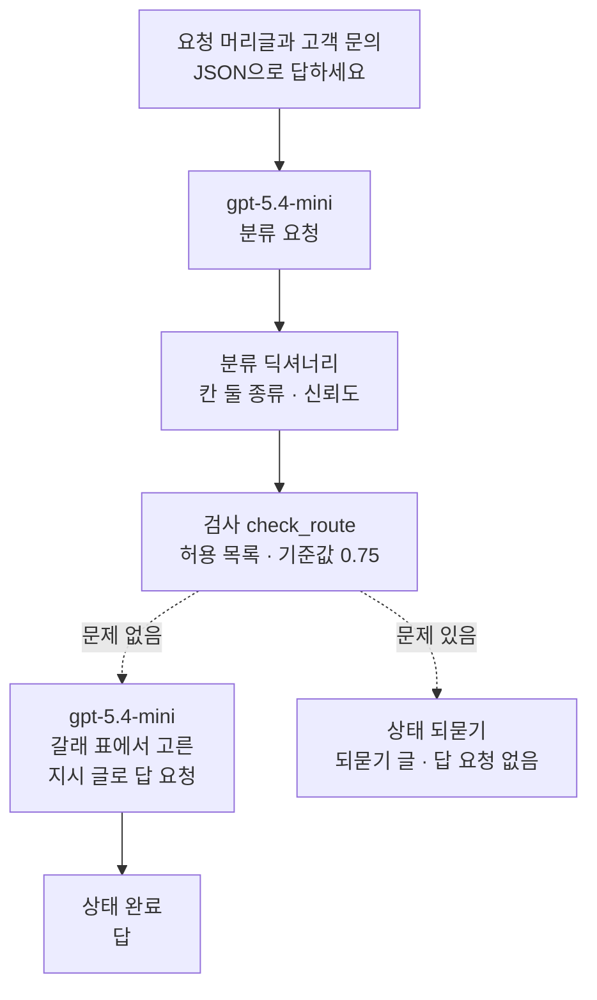
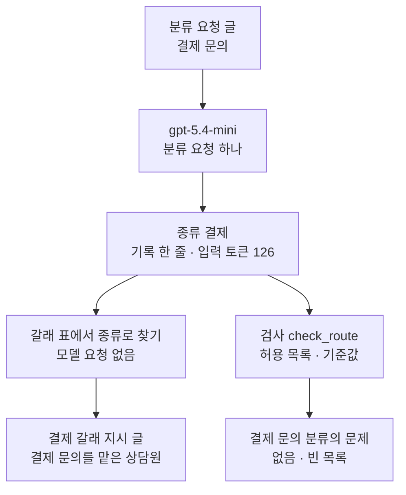
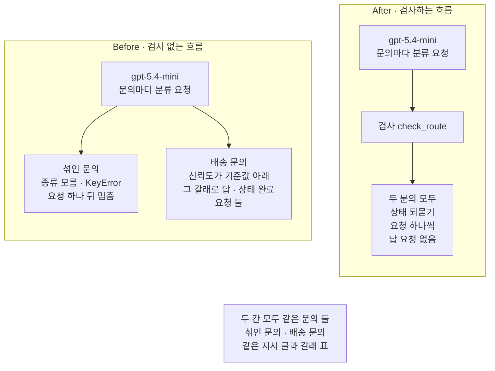
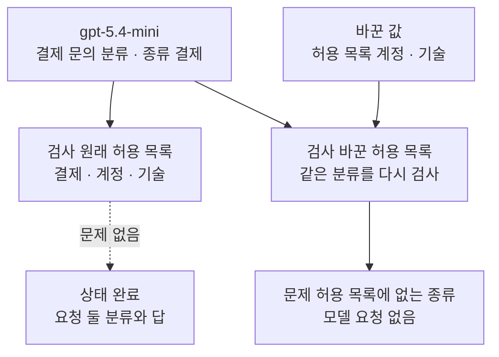

# 02-실패를-처리하는-라우팅

## _src 본문 (HTML 원본)

```html
<!--meta: 강의 0.7h | 실습 1.5h | 코드 notebooks/02-실패를-처리하는-라우팅.ipynb | 새 용어 5 -->
<style>html,body{overflow-x:hidden}.notebook,.nb-cell,.nb-main,.nb-input,.nb-result{min-width:0;max-width:100%}.nb-input pre,.nb-output{box-sizing:border-box;max-width:100%;overflow-x:auto}code.nb-source{display:block!important;width:100%!important;min-width:0!important;overflow-x:auto!important;padding:0!important}</style>
<h2 id="b1"><span class="no">1</span>학습 목표</h2><div class="goal"><ul>
<li>모델이 쓴 문의 종류를 보고 코드가 준비한 갈래 가운데 하나로 보낼 수 있습니다.</li>
<li>종류가 허용 목록에 있는지, 신뢰도가 기준값 이상인지 코드로 검사할 수 있습니다.</li>
<li>검사를 지나지 못한 문의를 오류로 멈추지 않고 되묻기 갈래로 보낼 수 있습니다.</li>
</ul></div>
<h2 id="b2"><span class="no">2</span>이 내용을 배우는 이유</h2><p>고객 문의는 결제, 계정, 기술처럼 종류마다 확인할 것이 다릅니다. 종류마다 지시 글을 따로 두면 그 종류에 맞는 규칙만 모델에 줄 수 있습니다. 그래서 먼저 모델에게 종류를 쓰게 하고, 코드가 그 종류의 갈래를 고릅니다.</p><p>어려운 곳은 모델이 준비하지 않은 종류를 쓰거나, 스스로도 자신 없는 종류를 쓸 때입니다. 종류 이름을 그대로 믿으면 흐름이 오류로 멈추거나 엉뚱한 갈래로 갑니다. 이 절은 갈래를 고르기 전에 분류를 검사하고, 지나지 못한 문의는 고객에게 되묻습니다.</p>
<h2 id="b3"><span class="no">3</span>앞에서 배운 내용</h2><p>Ch 17 01절은 라우팅(routing)을 이렇게 정했습니다. 모델이 쓴 종류 이름을 보고, 코드가 준비한 갈래 가운데 하나로 가는 모양입니다. 고를 수 있는 갈래와 고르는 일이 코드에 있어서, 그 절 규칙으로는 워크플로우입니다. Ch 17 01절은 모델이 썼다고 정한 종류 이름을 손으로 넣어 코드 쪽 갈래만 보았고, 이 절은 실제 모델이 종류를 씁니다.</p><p>01절에서는 요청 도움 함수 <code>ask_json</code>과 기록 한 줄, 게이트를 만들었습니다. 이 절은 <code>ask_json</code>과 <code>print_records</code>를 도구 파일 <code>workflow_tools.py</code>에서 가져와 씁니다. 01절 게이트가 두 요청 사이에서 기획을 본 것처럼, 이 절의 검사는 분류와 답 사이에서 분류를 봅니다.</p><p>Ch 16 01절은 이번 검색 결과로 출처 표시 허용 목록을 만들었습니다. 이 절의 허용 목록은 갈래로 보내도 되는 종류 이름의 목록입니다. Ch 13 03절에서는 점수를 기준값과 견줘 갈래를 골랐습니다. 이 절은 모델이 적은 신뢰도를 기준값과 견줍니다.</p><p>Ch 2 03절에서는 딕셔너리에 없는 키를 대괄호로 읽으면 <code>KeyError</code>가 난다고 말로 배웠습니다. 이 절 Before에서 그 오류가 실제로 납니다. 오류를 받을 때는 Ch 2 05절의 <code>try</code>와 <code>except KeyError as error</code>를 씁니다.</p>
<h2 id="b4"><span class="no">4</span>핵심 개념</h2><h3>비유로 시작하기</h3><p>도자기 공방에서 다 빚은 그릇을 선반에 나눠 올리는 일을 떠올려 봅니다. 벽에는 컵 선반, 접시 선반, 꽃병 선반이 하나씩 있습니다. 그릇 모양을 보고 맞는 선반에 올립니다. 모양을 알 수 없는 덩이는 아무 선반에나 올리지 않고, 작업대에 남겨 두었다가 주문한 사람에게 다시 묻습니다.</p><p>그릇 모양이 모델이 쓴 종류이고, 선반 셋이 갈래 셋입니다. 선반에 없는 모양을 이름대로만 올리려 하면 올릴 곳이 없어 손이 멈춥니다. 작업대에 남겨 두고 묻는 일이 이 절의 되묻기 갈래입니다.</p>
{{img:02-5-모양별-선반과-작업대의-덩이|흰 바탕 그림으로 위쪽 벽에 나무 선반 셋이 나란히 걸려 있고 왼쪽 선반에는 파란 컵 둘, 가운데 선반에는 납작한 접시 둘, 오른쪽 선반에는 초록 꽃병 둘이 놓여 있으며 아래쪽 나무 작업대 가운데에는 모양을 알 수 없는 회색 점토 덩이 하나가 따로 놓인 그림|모양이 분명한 그릇은 모양별 선반 셋에 올리고, 모양을 알 수 없는 덩이 하나는 작업대에 남겨 두었습니다.}}
<p class="look"><b>그림 읽기</b> — 위쪽 벽에 나무 선반 셋이 나란히 걸려 있습니다. 왼쪽 선반에는 파란 컵 둘, 가운데에는 납작한 접시 둘, 오른쪽에는 초록 꽃병 둘이 있습니다. 아래 나무 작업대 가운데에는 모양을 알 수 없는 회색 점토 덩이 하나가 따로 놓여 있습니다. 선반 셋은 갈래 셋이고, 선반에 오른 그릇은 검사를 지나 갈래로 간 문의입니다. 작업대의 덩이는 되묻기 갈래로 간 문의입니다.</p>
<table><thead><tr><th>말</th><th>뜻</th></tr></thead><tbody><tr><td>라우팅(routing)</td><td>모델이 쓴 종류 이름을 보고, 코드가 준비한 갈래 가운데 하나로 가는 모양입니다(Ch 17 01절 뜻). 그릇 모양을 보고 선반을 고르는 일과 같습니다.</td></tr><tr><td>갈래(branch)</td><td>종류마다 준비해 둔 다음 처리입니다. 이 절에서는 종류마다 다른 지시 글로 답을 쓰게 하는 요청입니다. 공방의 선반 하나와 같습니다.</td></tr><tr><td>신뢰도(confidence)</td><td>모델이 자기가 쓴 종류가 맞다고 스스로 적은 0~1 사이 수입니다. 재서 얻은 값이 아닙니다. 그릇을 본 사람이 「아마 컵일 것」이라고 말한 정도와 같습니다.</td></tr><tr><td>기준값(threshold)</td><td>신뢰도를 견줘 갈래로 보낼지 가르는 수입니다. 이 절은 0.75로 둡니다. 「이 정도로 확실할 때만 선반에 올린다」는 약속과 같습니다.</td></tr><tr><td>되묻기(clarification)</td><td>검사를 지나지 못한 문의에 답하지 않고, 고객에게 내용을 더 묻는 갈래입니다. 작업대에 덩이를 남겨 두고 주문한 사람에게 묻는 일과 같습니다.</td></tr></tbody></table>
<p>새 말을 이 절 코드에서 보면 이렇습니다. 라우팅은 함수 <code>route_question</code>이고, 갈래는 딕셔너리 <code>branch_table</code>의 칸 하나입니다. 신뢰도는 분류 딕셔너리의 칸 「신뢰도」이고, 기준값은 변수 <code>threshold</code>입니다. 되묻기는 상태 <code>되묻기</code>와 미리 적은 되묻기 글입니다.</p>
{{mermaid:02-1-종류를-보고-갈래로|위에서 아래로 읽는 그림으로 초록 상자 요청 머리글과 고객 문의에서 보라 상자 gpt-5.4-mini 분류 요청으로, 다시 노란 상자 분류 딕셔너리 칸 둘 종류와 신뢰도로, 다시 파란 상자 검사 check_route 허용 목록과 기준값 0.75로 이어지고, 검사에서 점선 둘이 나뉘어 문제 없음이면 보라 상자 gpt-5.4-mini 갈래 표에서 고른 지시 글로 답 요청을 지나 노란 상자 상태 완료 답으로 가고 문제 있음이면 노란 상자 상태 되묻기 되묻기 글 답 요청 없음으로 가는 그림|모델은 종류와 신뢰도를 쓰고, 코드는 검사를 지난 분류만 그 종류의 갈래로 보냅니다.}}
<p class="look"><b>도식 읽기</b> — 위에서 아래로 읽습니다. 맨 위 초록 상자가 요청 머리글을 붙인 고객 문의이고, 그 아래 보라 상자가 분류 요청입니다. 노란 상자는 모델이 쓴 분류 딕셔너리로, 칸 「종류」와 「신뢰도」가 있습니다. 파란 검사에서 점선이 둘로 나뉩니다. 문제가 없으면 보라 답 요청을 지나 완료로 가고, 문제가 있으면 답 요청 없이 되묻기로 갑니다.</p>
<h3>모델은 종류를 쓰고, 코드가 갈래를 고릅니다</h3><p>분류 요청은 모델에게 칸 「종류」와 「신뢰도」를 JSON 글로 쓰게 합니다. 코드는 칸 「종류」의 이름으로 갈래 표에서 지시 글을 찾습니다. 모델이 쓰는 것은 종류 이름 하나입니다. 어떤 갈래가 있는지와 어느 갈래로 보낼지는 코드에 있습니다.</p><p>그래서 Ch 17 01절 규칙으로 가르면 이 흐름은 워크플로우입니다. 참고 자료의 Anthropic 글도 라우팅을 워크플로우의 한 모양으로 소개합니다. 그 글은 분류가 정확하게 될 때 라우팅이 잘 맞는다고 적습니다.</p>
<h3>검사는 두 가지를 봅니다</h3><p>먼저 종류가 허용 목록에 있는지 봅니다. 허용 목록은 갈래 표의 칸 이름으로 만들어, 갈래가 없는 종류는 목록에도 없습니다. 그다음 신뢰도가 기준값보다 낮은지 봅니다. 하나라도 걸리면 답 요청을 보내지 않고 되묻기 갈래로 갑니다.</p><p>신뢰도는 모델이 스스로 적은 수라 맞을 확률이 아닙니다. 이 절의 기준값 0.75는 흐름을 보여 주려고 정한 값입니다. 라벨이 있는 자료로 기준값을 고르는 일은 이 절에서 하지 않았습니다.</p>
<h3>다른 상황에 적용</h3><p>사내 요청을 인사, 보안, 재무 담당으로 나누는 흐름도 같습니다. 모델이 준비하지 않은 「법무」를 쓰면, 표에서 찾기 전에 막고 요청한 사람에게 되묻습니다. 병원 예약 문의를 진료과로 나눌 때도 모르는 종류를 아무 과로나 보내지 않습니다.</p>
<h3>비교와 경계</h3><p>되묻기는 문의를 버리지 않고 고객에게 한 번 더 묻는 갈래입니다. 섞인 문의를 둘로 나눠 두 갈래에 함께 보내는 방법도 있지만, 이 절에서는 실행하지 않았습니다. 요청 여러 개를 함께 보내는 모양은 03절에서 다룹니다.</p><p>01절 게이트는 두 요청 사이에서 중간 결과의 칸을 보았습니다. 이 절의 검사도 두 요청 사이에 있지만, 검사 결과로 다음 갈래를 고릅니다. 검사를 지나지 못해도 흐름을 오류로 끝내지 않고 되묻기 글을 내놓습니다.</p>
<h2 id="b5"><span class="no">5</span>실행 예제</h2><p>노트북은 먼저 도구 파일에서 01절 함수 둘을 가져옵니다. 결제 문의 하나를 분류하고, 갈래 표에서 그 종류의 지시 글을 찾습니다. 그다음 검사 함수를 만들어 손으로 적은 분류 셋과 모델이 쓴 분류 하나에 걸어 봅니다.</p><p>이 부분에서 모델 요청은 한 번 나갑니다. 노트북 전체로는 여덟 번이고, 자료 파일을 읽거나 새 파일을 쓰지 않습니다.</p>
{{notebook:02-실패를-처리하는-라우팅|example}}
<p class="look"><b>확인할 점</b> — 노트북 3절 출력 <code>종류: 결제</code>와 5절 출력 <code>결제 문의 분류의 문제: []</code>로 결제 문의가 검사를 지나는지 봅니다. 5절 손 확인 출력 <code>모르는 종류: ['허용 목록에 없는 종류']</code>도 봅니다.</p>
{{mermaid:02-2-분류-한-번과-갈래-찾기|위에서 아래로 읽는 그림으로 초록 상자 분류 요청 글 결제 문의에서 보라 상자 gpt-5.4-mini 분류 요청 하나를 지나 노란 상자 종류 결제 기록 한 줄 입력 토큰 126으로 이어지고 거기서 화살표 둘이 나뉘어 왼쪽은 파란 상자 갈래 표에서 종류로 찾기 모델 요청 없음을 지나 노란 상자 결제 갈래 지시 글 결제 문의를 맡은 상담원으로 가고 오른쪽은 파란 상자 검사 check_route 허용 목록과 기준값을 지나 노란 상자 결제 문의 분류의 문제 없음 빈 목록으로 가는 그림|결제 문의를 한 번 분류해 종류 결제를 받고, 코드가 갈래 표에서 결제 갈래를 찾았으며 검사도 지났습니다.}}
<p class="look"><b>도식 읽기</b> — 위에서 아래로 읽습니다. 맨 위 초록 상자가 노트북 3절의 요청 글이고, 보라 상자가 그 분류 요청입니다. 노란 상자 셋은 노트북 3~5절이 출력한 값입니다. 왼쪽 파란 상자는 갈래 표에서 종류로 지시 글을 찾는 코드이고, 오른쪽 파란 상자는 검사 함수입니다. 두 파란 상자는 모델을 다시 부르지 않았습니다.</p>
<h2 id="b6"><span class="no">6</span>실패 확인</h2><p>아래 Before 셀은 모델이 쓴 종류 이름을 검사 없이 갈래 표에서 찾습니다. 넣는 문의는 두 문제가 섞인 문의와, 준비한 갈래가 없는 배송 문의입니다. 이어지는 After 셀은 같은 두 문의를 넣고, 분류와 갈래 찾기 사이에 검사만 더합니다.</p>
{{notebook:02-실패를-처리하는-라우팅|failure}}
{{mermaid:02-3-검사-없는-흐름과-검사하는-흐름|칸 둘이 나란히 있고 아래에 회색 상자가 있는 그림으로 왼쪽 칸 Before 검사 없는 흐름에는 보라 상자 gpt-5.4-mini 문의마다 분류 요청에서 빨간 상자 둘로 갈라져 하나는 섞인 문의 종류 모름 KeyError 요청 하나 뒤 멈춤이고 다른 하나는 배송 문의 신뢰도가 기준값 아래인데 그 갈래로 답 상태 완료 요청 둘이며 오른쪽 칸 After 검사하는 흐름에는 보라 상자 gpt-5.4-mini 문의마다 분류 요청에서 파란 상자 검사 check_route를 지나 노란 상자 두 문의 모두 상태 되묻기 요청 하나씩 답 요청 없음으로 이어지고 맨 아래 회색 상자에 두 칸 모두 같은 문의 둘 섞인 문의와 배송 문의 같은 지시 글과 갈래 표가 적힌 그림|같은 두 문의에서 검사 없는 흐름은 오류로 멈추거나 신뢰도가 낮은 분류로 답했고, 검사하는 흐름은 둘 다 되묻기로 보냈습니다.}}
<p class="look"><b>도식 읽기</b> — 왼쪽 칸이 Before이고 오른쪽 칸이 After입니다. 왼쪽 칸의 빨간 상자 둘이 검사 없는 흐름의 결함입니다. 그 가운데 왼쪽은 모르는 종류에서 오류로 멈춘 섞인 문의이고, 오른쪽은 신뢰도가 낮은데 완료를 알린 배송 문의입니다. 오른쪽 칸은 파란 검사가 두 문의를 노란 되묻기 상자로 보냅니다. 맨 아래 회색 상자는 두 칸에 공통인 사실입니다.</p>
<p>섞인 문의에 모델은 종류 「모름」을 썼습니다. 갈래 표에 그 칸이 없어 <code>KeyError</code>가 났고, 흐름은 분류 요청 한 번 뒤에 멈췄습니다. 노트북 셀이 그 오류를 받지 않았다면 실행이 그 자리에서 끝났습니다.</p><p>배송 문의에 모델은 허용 목록 안의 종류를 썼지만, 신뢰도는 기준값 0.75보다 낮았습니다. 검사 없는 흐름은 그 갈래로 답까지 받고 상태 <code>완료</code>를 알렸습니다. 문제는 흐름이 끝난 뒤 같은 검사를 따로 걸어서야 보였습니다.</p><p>검사하는 흐름은 같은 두 문의를 모두 되묻기 갈래로 보냈고, 답 요청은 보내지 않았습니다. 결제 문의는 검사를 지나 결제 갈래로 답했습니다. 새 커널로 두 번 실행했을 때 상태와 요청 수, 문제 목록은 두 번 모두 같았습니다.</p>
<p>값 바꿔 보기는 허용 목록 하나만 바꿉니다. 목록에서 「결제」를 빼자 같은 결제 문의 분류가 <code>['허용 목록에 없는 종류']</code>로 막혔습니다. 모델이 같은 종류를 써도, 어느 갈래를 열지는 코드가 쥔 목록이 정합니다.</p>
{{mermaid:02-4-허용-목록에서-결제를-빼면|위에서 아래로 읽는 그림으로 보라 상자 gpt-5.4-mini 결제 문의 분류 종류 결제에서 화살표 둘이 나뉘어 왼쪽은 파란 상자 검사 원래 허용 목록 결제 계정 기술에서 점선 문제 없음을 지나 노란 상자 상태 완료 요청 둘 분류와 답으로 가고 오른쪽은 초록 상자 바꾼 값 허용 목록 계정 기술과 함께 파란 상자 검사 바꾼 허용 목록 같은 분류를 다시 검사로 들어가 노란 상자 문제 허용 목록에 없는 종류 모델 요청 없음으로 가는 그림|같은 결제 분류가 원래 허용 목록은 지나 완료됐고, 결제를 뺀 목록에서는 막혔습니다.}}
<p class="look"><b>도식 읽기</b> — 위에서 아래로 읽습니다. 보라 상자의 결제 문의 분류가 왼쪽의 원래 목록과 오른쪽의 바꾼 목록으로 각각 들어갑니다. 왼쪽은 점선 갈래 「문제 없음」을 지나 노란 완료 상자로 갑니다. 오른쪽은 초록 바꾼 값을 쓴 검사라 노란 상자 「허용 목록에 없는 종류」로 끝납니다. 오른쪽 검사는 모델을 다시 부르지 않았습니다.</p>
<h2 id="b7"><span class="no">7</span>주의할 점과 실무 메모</h2><ul><li>노트북을 쓰기 전에 같은 요청을 노트북 밖에서 따로 보냈습니다. 섞인 문의는 다섯 번 모두 종류 「모름」이었고, 결제 문의는 다섯 번 모두 「결제」였습니다. 배송 문의는 열 번 모두 허용 목록 안의 종류에 신뢰도가 기준값보다 낮았습니다.</li><li>같은 요청도 실행한 때에 따라 분류가 달라질 수 있습니다. 배송 문의의 종류는 노트북 밖 열 번에서 결제 여덟 번, 기술 두 번이었습니다. 배송 문의에 모델이 「모름」을 쓰면 7절 Before 둘째 흐름도 <code>KeyError</code>로 멈춥니다.</li><li>배송 문의는 신뢰도가 기준값보다 낮게 나오는 문의를 찾으려고 노트북 밖에서 고른 예입니다. 먼저 보낸 다른 문의(결제 버튼을 누르면 앱 화면이 멈춘다는 문의)는 다섯 번 모두 「기술」에 신뢰도가 높았습니다.</li><li>신뢰도는 모델이 스스로 적은 수입니다. 섞인 문의의 「모름」에도 높은 신뢰도가 붙었습니다. 기준값 0.75는 흐름을 보여 주려고 정한 값이고, 라벨이 있는 자료로 고르지 않았습니다.</li><li>노트북 밖에서 JSON이라는 말을 지시 글에만 두었더니, 서비스가 오류(400)로 요청을 막았습니다. 오류 글은 형식 <code>json_object</code>를 쓰려면 입력 메시지에 json이라는 말이 있어야 한다고 적었습니다. 그래서 요청 머리글에 그 말을 넣었습니다.</li><li>검사 함수는 분류에 칸 「종류」와 「신뢰도」가 있고, 신뢰도가 수라고 봅니다. 칸이 없거나 신뢰도가 글이면 이 함수도 오류로 멈춥니다. 이번 실행에서 두 칸은 매번 있었고 신뢰도는 매번 수였습니다.</li><li>모델이 쓴 글에는 <code>assert</code>를 쓰지 않았습니다. 손으로 적은 분류 셋에 건 검사 동작만 <code>assert</code>로 확인했습니다.</li><li>되묻기 글은 한 문장으로 고정했고 문의마다 다르게 쓰지 않았습니다. 답 내용이 맞는지도 판정하지 않았습니다.</li><li>요청 수는 노트북 한 번에 여덟 번입니다. 토큰 수를 출력하는 요청은 그 가운데 네 번입니다. 나머지 요청도 같은 크기로 보고 요금표를 곱해 어림하면 0.01달러 아래입니다. 요금표는 100만 토큰당 입력 0.75달러, 출력 4.50달러로 셈했고 실제 청구 금액과는 다를 수 있습니다.</li><li>걸린 시간은 재지 않았습니다.</li><li>이 절은 자료 파일을 읽거나 새 파일을 쓰지 않습니다. 01절 함수 둘은 실습 폴더 <code>notebooks/workflow_tools.py</code>에서 가져오고, 커널이 그 폴더에서 시작해야 가져올 수 있습니다. 이 절에서 만든 <code>check_route</code>와 <code>route_question</code>도 같은 파일에 옮겨 두었습니다.</li><li>temperature 값을 0으로 두어도 답 문장이 매번 같다고 보장하지는 않습니다.</li><li>교재 출력은 Linux의 Python 3.12.13과 openai 2.29.0으로 만들었습니다. 다른 판과 Windows·macOS에서는 이번에 실행하지 않았습니다.</li></ul>
<h2 id="b8"><span class="no">8</span>정리와 다음 절</h2><ul><li>모델은 문의 종류와 신뢰도를 JSON 글로 쓰고, 코드는 그 종류로 갈래 표에서 갈래를 골랐습니다.</li><li>검사 없는 흐름은 모르는 종류에서 <code>KeyError</code>로 멈췄고, 신뢰도가 낮은 분류도 갈래로 보냈습니다.</li><li>검사하는 흐름은 같은 두 문의를 되묻기 갈래로 보냈고, 결제 문의는 결제 갈래로 답했습니다.</li></ul><p><strong>다음 학습과 이어지는 지점</strong> — 03절에서는 서로 기다릴 필요가 없는 모델 요청 여러 개를 함께 보내고 결과를 모읍니다.</p>
<h2 id="b9"><span class="no">9</span>복습 문제</h2><details class="quiz" open><summary>문제 4개 · 해설 포함</summary><p class="quiz-q">1. 이 절의 라우팅에서 모델이 정하는 것과 코드가 정하는 것은 무엇인가요?</p><p class="quiz-a">모델은 종류 이름과 신뢰도를 씁니다. 어떤 갈래가 있는지와 어느 갈래로 보낼지는 갈래 표와 검사로 코드가 정합니다. 틀렸다면 「핵심 개념」의 첫 도식을 다시 봅니다.</p><p class="quiz-q">2. 검사 없는 흐름에 섞인 문의를 넣었을 때 무엇이 일어났나요?</p><p class="quiz-a">모델이 종류 「모름」을 썼고, 갈래 표에 없는 키라 <code>KeyError</code>가 났습니다. 분류 요청 한 번 뒤에 답 요청 없이 멈췄습니다. 틀렸다면 노트북 7절을 다시 읽습니다.</p><p class="quiz-q">3. 배송 문의가 검사 없는 흐름에서는 <code>완료</code>였는데 검사하는 흐름에서는 되묻기로 간 까닭은 무엇인가요?</p><p class="quiz-a">종류는 허용 목록 안이었지만 신뢰도가 기준값 0.75보다 낮았습니다. 검사 없는 흐름은 신뢰도를 보지 않고 그 갈래로 답했습니다. 틀렸다면 노트북 7절 끝과 8절을 다시 읽습니다.</p><p class="quiz-q">4. 허용 목록에서 「결제」를 빼면 결제 문의의 분류는 어떻게 되나요?</p><p class="quiz-a">모델이 「결제」를 써도 검사가 「허용 목록에 없는 종류」를 찾습니다. 함수 <code>route_question</code>에 넣으면 되묻기 갈래로 끝나도록 적혀 있습니다. 틀렸다면 노트북 9절을 다시 읽습니다.</p></details>
<h2 id="b10"><span class="no">10</span>참고 자료</h2><ul><li><div><a href="https://www.anthropic.com/engineering/building-effective-agents">Building effective agents</a></div>확인 2026-09-23 · Anthropic 글입니다. 라우팅(routing)을 입력을 가른 뒤 그 종류에 맞춘 다음 일로 보내는 워크플로우로 소개합니다. 분류가 정확하게 될 때 잘 맞는다고 적고, 고객 문의를 종류별 처리로 보내는 예를 듭니다.</li><li><div><a href="https://github.com/openai/openai-python">openai-python</a></div>확인 2026-09-23 · OpenAI 파이썬 SDK 저장소입니다. 이 절은 설치한 2.29.0 판으로 실행했습니다.</li><li><div><a href="https://developers.openai.com/api/docs/models/gpt-5.4-mini">GPT-5.4 mini</a></div>확인 2026-09-23 · OpenAI 모델 문서입니다. 요금은 100만 토큰당 입력 0.75달러, 출력 4.50달러입니다.</li><li>Ch 17 01절 — 라우팅의 뜻과 워크플로우 규칙.</li><li>Ch 16 01절 — 출처 표시 허용 목록.</li><li>Ch 13 03절 — 점수와 기준값으로 갈래 고르기.</li><li>Ch 2 03절·05절 — 딕셔너리 키로 찾기와 <code>try</code>·<code>except</code>.</li></ul>
```

## 노트북 셀 (순서대로)

### [0] markdown {'html': 'skip'}

# 실패를 처리하는 라우팅

**이 노트북에서 할 일**

1. 모델이 쓴 문의 종류를 보고, 코드가 준비한 갈래 가운데 하나로 보냅니다.
2. 종류가 허용 목록에 있는지, 신뢰도가 기준값 이상인지 검사하는 함수를 만듭니다.
3. 검사 없이 종류 이름을 믿으면 흐름이 멈추거나 엉뚱한 갈래로 가는 것을 봅니다(Before).
4. 검사를 지나지 못한 문의를 되묻기 갈래로 보냅니다(After).

**준비물** — 프로젝트 맨 위 폴더의 `.env`에 적어 둔 `OPENAI_API_KEY`를 씁니다.
모델 `gpt-5.4-mini`에 보내는 요청은 노트북 한 번에 여덟 번입니다.
3절에서 한 번, 7절에서 세 번, 8절에서 네 번 나갑니다.

토큰 수를 출력하는 요청은 여덟 번 가운데 네 번입니다.
나머지 요청도 같은 크기로 보고 요금표를 곱해 어림한 예상 비용은 미화 0.01달러 아래입니다.
실제 청구 금액과는 다를 수 있습니다.

자료 파일을 읽거나 새 파일을 쓰지 않습니다.
01절에서 배운 함수 둘은 같은 폴더의 도구 파일 `workflow_tools.py`에서 가져옵니다.
교재 출력을 만든 실행에서는 노트북 전체가 20초 안에 끝났습니다.

**기준 버전** — 첫 셀에서 openai 2.29.0과 python-dotenv 1.2.3을 설치합니다.
교재 출력은 Linux의 Python 3.12.13으로 만들었습니다.
다른 판과 Windows·macOS에서는 이번에 실행하지 않았습니다.

**강의와 실습 범위** — 강의 시간에는 3~6절을 읽습니다.
분류 요청과 갈래 표, 검사 함수를 익히는 자리입니다.
7~9절은 검사 없는 라우팅과 검사하는 라우팅을 이어 실행하는 자리입니다.
이 부분은 실습 시간에 실행합니다.

실습 폴더 `labs/part5/ch18-workflow-patterns`에서 `uv sync --locked`를 실행합니다.
그다음 `notebooks/` 폴더의 이 노트북을 열고, 실습 폴더의 `.venv` 커널을 고릅니다.
첫 셀부터 순서대로 실행합니다.

### [1] markdown {'html': 'skip'}

## 오늘 볼 그림


위에서 아래로 읽습니다. 초록 문의가 보라 분류 요청을 지나 노란 분류 딕셔너리가 됩니다.
파란 검사에서 점선이 둘로 나뉩니다. 문제가 없을 때만 보라 답 요청으로 가고, 문제가 있으면 노란 되묻기로 갑니다.

### [2] markdown {}

## 1. 준비

제목의 라우팅(routing)은 Ch 17 01절에서 정한 말입니다.
모델이 쓴 종류 이름을 보고, 코드가 준비한 갈래 가운데 하나로 가는 모양입니다.
Ch 17 01절은 모델이 썼다고 정한 종류 이름을 손으로 넣어 코드 쪽 갈래만 보았고, 이 절은 실제 모델이 종류를 씁니다.

첫 셀은 패키지 두 개를 설치하고 설치된 판 번호를 출력합니다.
설치에는 몇십 초가 걸릴 수 있습니다.

### [3] code {'execution': {'iopub.execute_input': '2026-09-23T19:57:22.518832Z', 'iopub.status.busy': '2026-09-23T19:57:22.518637Z', 'iopub.status.idle': '2026-09-23T19:57:23.160885Z', 'shell.execute_reply': '2026-09-23T19:57:23.160270Z'}, 'lesson_role': 'setup'}

```python
# 이 절에서 쓰는 패키지를 설치하고 버전을 확인합니다
%pip install -q "openai==2.29.0" "python-dotenv==1.2.3"
from importlib.metadata import version

print("openai:", version("openai"))
print("python-dotenv:", version("python-dotenv"))
```

출력:
```
Note: you may need to restart the kernel to use updated packages.
openai: 2.29.0
python-dotenv: 1.2.3

```

### [4] markdown {}

**결과 읽기** — 출력 줄 `openai: 2.29.0`과 `python-dotenv: 1.2.3`이 실습 폴더 잠금과 같은 판입니다.
이 노트북의 출력은 2026-09-23에 이 판으로 실행한 결과입니다.

앞에서 배운 함수는 `workflow_tools.py`에 모아 두었습니다. 파일을 열면 코드를 볼 수 있습니다. 노트북과 같은 폴더(`notebooks/`)에 있는 파일입니다. 커널이 `notebooks/` 폴더에서 시작해야 이 파일을 가져올 수 있습니다.
다음 셀은 클라이언트 이름과, 01절에서 배운 함수 둘을 가져옵니다.

### [5] code {'execution': {'iopub.execute_input': '2026-09-23T19:57:23.161996Z', 'iopub.status.busy': '2026-09-23T19:57:23.161895Z', 'iopub.status.idle': '2026-09-23T19:57:23.556774Z', 'shell.execute_reply': '2026-09-23T19:57:23.556418Z'}, 'lesson_role': 'setup'}

```python
# 클라이언트 이름 OpenAI와, 01절에서 배운 함수 둘을 도구 파일 workflow_tools.py에서 가져옵니다
from openai import OpenAI

from workflow_tools import ask_json, print_records

print("불러온 이름:", "OpenAI", "ask_json", "print_records")
```

출력:
```
불러온 이름: OpenAI ask_json print_records

```

### [6] markdown {}

**결과 읽기** — 출력 줄 `불러온 이름: OpenAI ask_json print_records`로 이름 셋을 가져왔습니다.
함수 `ask_json`은 요청 한 번을 보내 기록 한 줄을 남기고, 받은 JSON 글을 딕셔너리로 내놓습니다.
함수 `print_records`는 기록 목록을 번호·단계·입력 토큰·출력 토큰 차례로 출력합니다.
두 함수는 01절 노트북에서 정의한 함수와 코드가 같습니다.

## 2. 키와 클라이언트 준비

API 키가 있는지 확인합니다. `True` 값이 나오면 다음으로 넘어갑니다.

### [7] code {'execution': {'iopub.execute_input': '2026-09-23T19:57:23.557613Z', 'iopub.status.busy': '2026-09-23T19:57:23.557534Z', 'iopub.status.idle': '2026-09-23T19:57:23.562582Z', 'shell.execute_reply': '2026-09-23T19:57:23.562269Z'}, 'lesson_role': 'setup'}

```python
# .env 파일에서 OpenAI API 키를 읽습니다(키 값은 출력하지 않습니다)
import os
from dotenv import find_dotenv, load_dotenv

env_path = find_dotenv(usecwd=True)
load_dotenv(env_path)
has_key = os.getenv("OPENAI_API_KEY") is not None
print("OPENAI_API_KEY 설정 여부:", has_key)
assert has_key, "프로젝트 폴더의 .env 파일에 OPENAI_API_KEY를 적어 주세요."
```

출력:
```
OPENAI_API_KEY 설정 여부: True

```

### [8] markdown {}

**결과 읽기** — 출력 줄 `OPENAI_API_KEY 설정 여부: True`로 키를 찾았습니다.
키 값은 출력하지 않습니다.

다음 셀은 01절처럼 `client = OpenAI()` 한 줄로 클라이언트를 만듭니다.
클라이언트는 서비스에 요청을 보내고 응답을 받는 파이썬 객체입니다.

### [9] code {'execution': {'iopub.execute_input': '2026-09-23T19:57:23.563243Z', 'iopub.status.busy': '2026-09-23T19:57:23.563177Z', 'iopub.status.idle': '2026-09-23T19:57:23.590870Z', 'shell.execute_reply': '2026-09-23T19:57:23.590527Z'}}

```python
# OpenAI 서비스에 요청을 보낼 클라이언트를 만듭니다(키는 앞 셀에서 읽은 환경 변수를 씁니다)
client = OpenAI()
print("클라이언트:", type(client).__name__)
```

출력:
```
클라이언트: OpenAI

```

### [10] markdown {}

**결과 읽기** — 출력 줄 `클라이언트: OpenAI`로 클라이언트를 만들었습니다.
이 노트북의 모든 요청은 이 클라이언트 하나로 보냅니다.

## 3. 문의 종류를 쓰게 하는 분류 요청

라우팅의 첫 단계는 분류입니다.
분류 요청은 모델에게 문의의 종류 이름과 신뢰도를 JSON 글로 쓰게 합니다.
종류는 결제·계정·기술 가운데 하나이고, 하나로 정할 수 없으면 「모름」으로 쓰게 합니다.
신뢰도(confidence)는 모델이 자기가 쓴 종류가 맞다고 스스로 적는 0~1 사이 수입니다.
재서 얻은 값이 아니라 모델이 쓴 글의 일부입니다.

### [11] code {'execution': {'iopub.execute_input': '2026-09-23T19:57:23.591514Z', 'iopub.status.busy': '2026-09-23T19:57:23.591455Z', 'iopub.status.idle': '2026-09-23T19:57:23.593439Z', 'shell.execute_reply': '2026-09-23T19:57:23.593079Z'}}

```python
# 분류 단계의 지시 글을 적습니다: 종류 셋과, 하나로 정할 수 없을 때 쓸 이름 「모름」
classify_instructions = "고객 문의를 종류 하나로 가르는 분류 담당입니다. "
classify_instructions = classify_instructions + "종류는 결제, 계정, 기술 가운데 하나로 적습니다. "
classify_instructions = classify_instructions + "하나로 정할 수 없으면 종류를 모름으로 적습니다. "
# 신뢰도는 모델이 스스로 적는 수입니다(재서 얻은 값이 아님)
classify_instructions = classify_instructions + "신뢰도에는 그 종류가 맞다고 보는 정도를 0과 1 사이 수로 적습니다. "
classify_instructions = classify_instructions + '답은 JSON 객체 하나로만 출력합니다: {"종류": "글", "신뢰도": 수}'
print("분류 지시 글:")
print(classify_instructions)
```

출력:
```
분류 지시 글:
고객 문의를 종류 하나로 가르는 분류 담당입니다. 종류는 결제, 계정, 기술 가운데 하나로 적습니다. 하나로 정할 수 없으면 종류를 모름으로 적습니다. 신뢰도에는 그 종류가 맞다고 보는 정도를 0과 1 사이 수로 적습니다. 답은 JSON 객체 하나로만 출력합니다: {"종류": "글", "신뢰도": 수}

```

### [12] markdown {}

**결과 읽기** — 라벨 줄 `분류 지시 글:` 아래 한 줄이 분류 단계의 지시 글입니다.
끝에 답 모양 `{"종류": "글", "신뢰도": 수}`를 적어 두었습니다.

다음 셀은 요청 글을 만듭니다.
01절의 형식 `json_object`는 JSON으로 답하라는 말이 글에 있어야 합니다.
노트북 밖에서 먼저 보내 보니, 서비스는 그 말을 지시 글이 아니라 요청 글에서 찾았습니다.
지시 글에만 그 말을 두자 서비스가 오류(400)로 요청을 막았습니다.
그래서 요청 글 앞에 JSON이라는 말이 든 머리글 한 줄을 붙입니다.

### [13] code {'execution': {'iopub.execute_input': '2026-09-23T19:57:23.594004Z', 'iopub.status.busy': '2026-09-23T19:57:23.593948Z', 'iopub.status.idle': '2026-09-23T19:57:23.595601Z', 'shell.execute_reply': '2026-09-23T19:57:23.595277Z'}}

```python
# 두 단계가 함께 쓸 요청 머리글을 적고, 결제 문의 하나로 요청 글을 만듭니다
# 형식 json_object는 요청 글에 JSON이라는 말이 있어야 해서 머리글에 적어 둡니다
request_head = "아래 고객 문의에 JSON으로 답하세요.\n문의: "
billing_question = "카드에서 같은 요금이 두 번 결제됐어요."
billing_request = request_head + billing_question
print("요청 글:")
print(billing_request)
```

출력:
```
요청 글:
아래 고객 문의에 JSON으로 답하세요.
문의: 카드에서 같은 요금이 두 번 결제됐어요.

```

### [14] markdown {}

**결과 읽기** — 라벨 줄 `요청 글:` 아래 두 줄이 분류 요청 글입니다.
첫 줄이 요청 머리글이고, 줄 `문의:` 뒤가 결제 문의입니다.
뒤에서 보낼 답 요청에도 같은 요청 글을 씁니다.

다음 셀은 이 요청 글로 분류 요청을 한 번 보냅니다.
01절에서 만든 함수 `ask_json`에 단계 이름 「분류」를 넣어 부릅니다.
이 셀에서 모델 요청이 한 번 나갑니다.

### [15] code {'execution': {'iopub.execute_input': '2026-09-23T19:57:23.596237Z', 'iopub.status.busy': '2026-09-23T19:57:23.596175Z', 'iopub.status.idle': '2026-09-23T19:57:25.284639Z', 'shell.execute_reply': '2026-09-23T19:57:25.284229Z'}}

```python
# 분류 요청을 01절 함수 ask_json으로 한 번 보내 분류 딕셔너리를 받습니다(모델 요청 1번)
records = []
billing_decision = ask_json(client, records, "분류", classify_instructions, billing_request)
print("분류:", billing_decision)
print("종류:", billing_decision["종류"])
print("신뢰도:", billing_decision["신뢰도"])
print_records(records)
```

출력:
```
분류: {'종류': '결제', '신뢰도': 0.99}
종류: 결제
신뢰도: 0.99
번호 | 단계 | 입력 토큰 | 출력 토큰
1 | 분류 | 126 | 22

```

### [16] markdown {}

**결과 읽기** — 출력 줄 `종류: 결제`로 모델이 결제 문의를 종류 「결제」로 썼습니다.
라벨 줄 `번호 | 단계 | 입력 토큰 | 출력 토큰` 아래 줄 `1 | 분류 | 126 | 22`가 이 요청의 기록입니다.

출력 줄 `신뢰도:` 뒤 수는 모델이 스스로 적은 수라 실행마다 달라질 수 있습니다.
교재 출력에서는 `신뢰도: 0.99`였습니다.

## 4. 갈래 표

갈래(branch)는 종류마다 준비해 둔 다음 처리입니다.
이 절의 갈래는 종류마다 다른 지시 글로 답을 쓰게 하는 요청입니다.
갈래 표는 종류 이름을 칸 이름으로, 그 갈래의 지시 글을 값으로 둔 딕셔너리입니다.

### [17] code {'execution': {'iopub.execute_input': '2026-09-23T19:57:25.285539Z', 'iopub.status.busy': '2026-09-23T19:57:25.285451Z', 'iopub.status.idle': '2026-09-23T19:57:25.287559Z', 'shell.execute_reply': '2026-09-23T19:57:25.287206Z'}}

```python
# 종류마다 준비한 갈래의 지시 글을 갈래 표(딕셔너리) 하나에 모읍니다
# 세 지시 글의 뒷부분(답 모양)은 같아서 한 번만 적어 붙입니다
answer_tail = ' 한국어 두 문장으로 답하고, 답은 JSON 객체 하나로만 출력합니다: {"답": "글"}'
branch_table = {
    "결제": "결제 문의를 맡은 상담원입니다." + answer_tail,
    "계정": "계정 문의를 맡은 상담원입니다." + answer_tail,
    "기술": "기술 문의를 맡은 상담원입니다." + answer_tail,
}
print("갈래 수:", len(branch_table))
```

출력:
```
갈래 수: 3

```

### [18] markdown {}

**결과 읽기** — 출력 줄 `갈래 수: 3`으로 갈래 셋을 준비했습니다.
「모름」 칸은 두지 않았습니다. 모름에 맞는 상담원을 준비하지 않았기 때문입니다.

다음 셀은 3절 분류의 종류 이름으로 갈래 표에서 지시 글을 찾습니다.
딕셔너리에서 대괄호에 키를 넣어 값을 찾는 모양은 Ch 2 03절에서 배웠습니다.
이 셀은 모델을 부르지 않습니다.

### [19] code {'execution': {'iopub.execute_input': '2026-09-23T19:57:25.288307Z', 'iopub.status.busy': '2026-09-23T19:57:25.288237Z', 'iopub.status.idle': '2026-09-23T19:57:25.290198Z', 'shell.execute_reply': '2026-09-23T19:57:25.289834Z'}}

```python
# 3절 분류의 종류 이름으로 갈래 표에서 지시 글을 찾습니다(모델 요청 없음)
billing_branch = branch_table[billing_decision["종류"]]
print("찾은 갈래의 지시 글:")
print(billing_branch)
```

출력:
```
찾은 갈래의 지시 글:
결제 문의를 맡은 상담원입니다. 한국어 두 문장으로 답하고, 답은 JSON 객체 하나로만 출력합니다: {"답": "글"}

```

### [20] markdown {}

**결과 읽기** — 라벨 줄 `찾은 갈래의 지시 글:` 아래가 결제 갈래의 지시 글입니다.
첫 문장 「결제 문의를 맡은 상담원입니다.」가 이 갈래의 역할입니다.
모델은 종류 이름만 썼고, 어느 지시 글로 갈지는 코드가 표에서 골랐습니다.

## 5. 허용 목록과 기준값 검사

갈래 표에서 찾기 전에 분류를 검사합니다.
허용 목록은 갈래로 보내도 되는 종류 이름의 목록입니다.
Ch 16 01절의 출처 표시 허용 목록처럼, 목록 밖 값은 다음 단계로 넘기지 않습니다.
기준값(threshold)은 신뢰도를 견줄 수입니다.
Ch 13 03절에서 점수를 기준값과 견줘 갈래를 고른 것과 같은 자리입니다.

### [21] code {'execution': {'iopub.execute_input': '2026-09-23T19:57:25.290941Z', 'iopub.status.busy': '2026-09-23T19:57:25.290876Z', 'iopub.status.idle': '2026-09-23T19:57:25.292508Z', 'shell.execute_reply': '2026-09-23T19:57:25.292213Z'}}

```python
# 갈래로 보내도 되는 종류 목록(허용 목록)과, 신뢰도를 견줄 기준값을 정합니다
# 허용 목록은 갈래 표의 칸 이름으로 만들어 갈래가 없는 종류가 끼지 않게 합니다
allowed_kinds = list(branch_table.keys())
threshold = 0.75
print("허용 목록:", allowed_kinds)
print("기준값:", threshold)
```

출력:
```
허용 목록: ['결제', '계정', '기술']
기준값: 0.75

```

### [22] markdown {}

**결과 읽기** — 출력 줄 `허용 목록: ['결제', '계정', '기술']`은 갈래 표의 칸 이름 목록입니다.
갈래 표에서 만들었으므로 갈래가 없는 종류는 목록에도 없습니다.
출력 줄 `기준값: 0.75`는 흐름을 보여 주려고 정한 값이고, 라벨이 있는 자료로 고르지 않았습니다.

다음 셀은 분류를 검사하는 함수입니다.
01절 게이트 `check_plan`처럼 문제를 글 목록으로 내놓고, 문제가 없으면 빈 목록을 내놓습니다.

### [23] code {'execution': {'iopub.execute_input': '2026-09-23T19:57:25.293165Z', 'iopub.status.busy': '2026-09-23T19:57:25.293104Z', 'iopub.status.idle': '2026-09-23T19:57:25.294727Z', 'shell.execute_reply': '2026-09-23T19:57:25.294489Z'}}

```python
# 분류를 검사해 갈래로 보내면 안 되는 까닭을 글 목록으로 내놓습니다(문제가 없으면 빈 목록)
def check_route(decision, allowed_kinds, threshold):
    problems = []
    # 모델이 쓴 종류가 허용 목록에 없으면 문제입니다
    if decision["종류"] not in allowed_kinds:
        problems.append("허용 목록에 없는 종류")
    # 모델이 스스로 적은 신뢰도가 기준값보다 낮아도 문제입니다
    if decision["신뢰도"] < threshold:
        problems.append("신뢰도가 기준값보다 낮음")
    return problems
```

출력:
```

```

### [24] markdown {}

**결과 읽기** — 정의 셀이라 출력이 없습니다.
함수 `check_route`는 분류 딕셔너리와 허용 목록, 기준값을 받습니다.
먼저 칸 「종류」의 값이 허용 목록에 없는지 `not in`으로 봅니다.
그다음 칸 「신뢰도」의 값이 기준값보다 작은지 봅니다.
두 검사는 따로 보므로 문제가 둘 다 나올 수도 있습니다.

다음 셀은 손으로 적은 분류 셋으로 검사 함수를 확인합니다.
모델 글이 아니라 미리 정한 값이라 `assert`로 확인할 수 있습니다.

### [25] code {'execution': {'iopub.execute_input': '2026-09-23T19:57:25.295553Z', 'iopub.status.busy': '2026-09-23T19:57:25.295489Z', 'iopub.status.idle': '2026-09-23T19:57:25.297560Z', 'shell.execute_reply': '2026-09-23T19:57:25.297207Z'}}

```python
# 손으로 적은 분류 셋으로 검사를 확인합니다(모델 글이 아니라 정해 둔 값이라 assert로 봅니다)
known_sample = {"종류": "결제", "신뢰도": 0.9}
unknown_sample = {"종류": "모름", "신뢰도": 0.9}
low_sample = {"종류": "기술", "신뢰도": 0.4}
print("아는 종류·높은 신뢰도:", check_route(known_sample, allowed_kinds, threshold))
print("모르는 종류:", check_route(unknown_sample, allowed_kinds, threshold))
print("낮은 신뢰도:", check_route(low_sample, allowed_kinds, threshold))
assert check_route(unknown_sample, allowed_kinds, threshold) == ["허용 목록에 없는 종류"]
assert check_route(low_sample, allowed_kinds, threshold) == ["신뢰도가 기준값보다 낮음"]
```

출력:
```
아는 종류·높은 신뢰도: []
모르는 종류: ['허용 목록에 없는 종류']
낮은 신뢰도: ['신뢰도가 기준값보다 낮음']

```

### [26] markdown {}

**결과 읽기** — 출력 줄 `아는 종류·높은 신뢰도: []`는 빈 목록이라 통과입니다.
출력 줄 `모르는 종류: ['허용 목록에 없는 종류']`는 신뢰도가 높아도 종류에서 걸렸습니다.
출력 줄 `낮은 신뢰도: ['신뢰도가 기준값보다 낮음']`은 종류는 목록 안이지만 신뢰도에서 걸렸습니다.
마지막 두 줄의 `assert`도 통과했습니다.

다음 셀은 3절에서 모델이 쓴 분류에 같은 검사를 겁니다.

### [27] code {'execution': {'iopub.execute_input': '2026-09-23T19:57:25.298179Z', 'iopub.status.busy': '2026-09-23T19:57:25.298113Z', 'iopub.status.idle': '2026-09-23T19:57:25.300009Z', 'shell.execute_reply': '2026-09-23T19:57:25.299631Z'}}

```python
# 3절에서 모델이 쓴 분류에도 같은 검사를 걸어 봅니다(모델 요청 없음)
billing_problems = check_route(billing_decision, allowed_kinds, threshold)
print("결제 문의 분류의 문제:", billing_problems)
print("문제 수:", len(billing_problems))
```

출력:
```
결제 문의 분류의 문제: []
문제 수: 0

```

### [28] markdown {}

**결과 읽기** — 출력 줄 `결제 문의 분류의 문제: []`와 `문제 수: 0`으로 3절 분류는 검사를 지납니다.
종류 「결제」가 허용 목록에 있고, 신뢰도가 기준값보다 낮지 않기 때문입니다.

## 6. 되묻기 갈래와 흐름 설정

되묻기(clarification)는 검사를 지나지 못한 문의에 답하지 않고, 고객에게 내용을 더 묻는 갈래입니다.
이 갈래는 모델을 부르지 않고, 미리 적어 둔 글을 내놓습니다.

### [29] code {'execution': {'iopub.execute_input': '2026-09-23T19:57:25.300731Z', 'iopub.status.busy': '2026-09-23T19:57:25.300669Z', 'iopub.status.idle': '2026-09-23T19:57:25.302546Z', 'shell.execute_reply': '2026-09-23T19:57:25.302252Z'}}

```python
# 검사를 지나지 못한 문의에 보낼 되묻기 글을 적습니다(이 갈래는 모델을 부르지 않습니다)
ask_back_text = "문의 내용을 조금 더 알려 주세요. 결제, 계정, 기술 가운데 어느 문제인지도 함께 적어 주세요."
print("되묻기 글:", ask_back_text)
```

출력:
```
되묻기 글: 문의 내용을 조금 더 알려 주세요. 결제, 계정, 기술 가운데 어느 문제인지도 함께 적어 주세요.

```

### [30] markdown {}

**결과 읽기** — 출력 줄 `되묻기 글:` 뒤가 고객에게 보낼 글입니다.
세 종류 이름을 함께 적어, 고객이 다시 쓸 때 종류가 드러나게 했습니다.

다음 셀은 라우팅 흐름에 쓸 설정 한 벌을 딕셔너리 하나에 모읍니다.
01절 흐름 설정처럼, 흐름 함수는 이 딕셔너리 하나를 받아 값을 꺼내 씁니다.

### [31] code {'execution': {'iopub.execute_input': '2026-09-23T19:57:25.303288Z', 'iopub.status.busy': '2026-09-23T19:57:25.303212Z', 'iopub.status.idle': '2026-09-23T19:57:25.305339Z', 'shell.execute_reply': '2026-09-23T19:57:25.304887Z'}}

```python
# 라우팅 흐름에 쓸 설정 한 벌을 딕셔너리 하나에 모읍니다
route_setup = {
    "분류 지시 글": classify_instructions,
    "요청 머리글": request_head,
    "갈래 표": branch_table,
    "허용 목록": allowed_kinds,
    "기준값": threshold,
    "되묻기 글": ask_back_text,
}
setup_keys = list(route_setup.keys())
print("설정 칸:", setup_keys)
```

출력:
```
설정 칸: ['분류 지시 글', '요청 머리글', '갈래 표', '허용 목록', '기준값', '되묻기 글']

```

### [32] markdown {}

**결과 읽기** — 출력 줄 `설정 칸: ['분류 지시 글', '요청 머리글', '갈래 표', '허용 목록', '기준값', '되묻기 글']`로 여섯 칸을 모았습니다.

### [33] markdown {'lesson_part': 'before'}

## 7. 검사 없는 라우팅 (Before)

### [34] markdown {'lesson_part': 'before'}

Before 흐름은 모델이 쓴 종류 이름을 검사하지 않고 곧바로 갈래 표에서 찾습니다.
여기에 문의 둘을 넣습니다.
하나는 로그인과 카드 청구가 섞인 문의이고, 하나는 준비한 갈래가 없는 배송 문의입니다.
두 문의는 8절 After 흐름에도 그대로 넣습니다.

### [35] code {'execution': {'iopub.execute_input': '2026-09-23T19:57:25.306037Z', 'iopub.status.busy': '2026-09-23T19:57:25.305971Z', 'iopub.status.idle': '2026-09-23T19:57:25.307713Z', 'shell.execute_reply': '2026-09-23T19:57:25.307306Z'}, 'lesson_part': 'before'}

```python
# Before와 After에 함께 넣을 문의 둘: 두 문제가 섞인 문의와, 준비한 갈래가 없는 배송 문의입니다
mixed_question = "로그인도 안 되고 카드 청구도 이상해요."
delivery_question = "주문한 물건이 아직 안 왔어요."
print("섞인 문의:", mixed_question)
print("배송 문의:", delivery_question)
```

출력:
```
섞인 문의: 로그인도 안 되고 카드 청구도 이상해요.
배송 문의: 주문한 물건이 아직 안 왔어요.

```

### [36] markdown {'lesson_part': 'before'}

**결과 읽기** — 출력 줄 `섞인 문의:`와 `배송 문의:` 뒤가 두 문의입니다.
섞인 문의는 계정과 결제 두 종류에 걸칩니다.
배송 문의는 결제·계정·기술 어디에도 딱 맞지 않습니다.

다음 셀은 검사 없는 라우팅 함수입니다.

### [37] code {'execution': {'iopub.execute_input': '2026-09-23T19:57:25.308355Z', 'iopub.status.busy': '2026-09-23T19:57:25.308293Z', 'iopub.status.idle': '2026-09-23T19:57:25.310405Z', 'shell.execute_reply': '2026-09-23T19:57:25.310034Z'}, 'lesson_part': 'before'}

```python
# 검사 없는 라우팅: 모델이 쓴 종류 이름을 그대로 갈래 표에서 찾아 답합니다(모델 요청 1~2번)
def route_without_check(client, records, setup, question):
    request_text = setup["요청 머리글"] + question
    decision = ask_json(client, records, "분류", setup["분류 지시 글"], request_text)
    branch_instructions = setup["갈래 표"][decision["종류"]]
    written = ask_json(client, records, "답", branch_instructions, request_text)
    return {"상태": "완료", "분류": decision, "문제": [], "답": written["답"]}
```

출력:
```

```

### [38] markdown {'lesson_part': 'before'}

**결과 읽기** — 정의 셀이라 출력이 없습니다.
함수 `route_without_check`는 분류 요청을 보내고, 모델이 쓴 종류 이름으로 곧바로 갈래 표를 찾습니다.
그 갈래의 지시 글로 답 요청을 보내고 상태 `완료`를 내놓습니다.
분류를 보는 곳이 없어 칸 「문제」는 늘 빈 목록입니다.

다음 셀은 섞인 문의를 이 흐름에 넣습니다.
Ch 2 03절에서 배운 대로, 딕셔너리에 없는 키를 대괄호로 읽으면 파이썬은 `KeyError`를 냅니다.
이 셀은 Ch 2 05절의 `try`와 `except KeyError as error`로 그 오류만 받아 이름을 출력합니다.
흐름 함수 안에는 받는 곳이 없으므로, 실제 프로그램이라면 여기서 멈춥니다.

### [39] code {'execution': {'iopub.execute_input': '2026-09-23T19:57:25.310995Z', 'iopub.status.busy': '2026-09-23T19:57:25.310936Z', 'iopub.status.idle': '2026-09-23T19:57:26.870787Z', 'shell.execute_reply': '2026-09-23T19:57:26.869781Z'}, 'lesson_part': 'before'}

```python
# 섞인 문의를 검사 없는 흐름에 넣습니다(모델 요청 1번 뒤 오류가 납니다)
before_mixed_records = []
# 이 셀만 그 오류 이름을 받아 출력합니다(흐름 함수 안에는 받는 곳이 없습니다)
try:
    before_mixed = route_without_check(client, before_mixed_records, route_setup, mixed_question)
    before_mixed_state = before_mixed["상태"]
except KeyError as error:
    before_mixed_state = type(error).__name__
    print("받은 오류:", before_mixed_state, error)
print("요청 수(기록 줄 수):", len(before_mixed_records))
print_records(before_mixed_records)
```

출력:
```
받은 오류: KeyError '모름'
요청 수(기록 줄 수): 1
번호 | 단계 | 입력 토큰 | 출력 토큰
1 | 분류 | 125 | 22

```

### [40] markdown {'lesson_part': 'before'}

**결과 읽기** — 출력 줄 `받은 오류: KeyError '모름'`이 이 흐름의 첫 결함입니다.
모델이 종류 「모름」을 썼고, 갈래 표에 그 칸이 없어 표를 찾는 줄에서 오류가 났습니다.
출력 줄 `요청 수(기록 줄 수): 1`로 분류 요청만 나가고 답 요청 전에 멈췄습니다.
라벨 줄 아래 한 줄 `1 | 분류 | 125 | 22`가 그 분류 요청의 기록입니다.

셀이 오류를 받지 않았다면 이 자리에서 노트북 실행이 끝났을 것입니다.
다음 셀은 배송 문의를 같은 흐름에 넣습니다.
이 셀에서 모델 요청이 두 번 나갑니다.

### [41] code {'execution': {'iopub.execute_input': '2026-09-23T19:57:26.872946Z', 'iopub.status.busy': '2026-09-23T19:57:26.872759Z', 'iopub.status.idle': '2026-09-23T19:57:29.091092Z', 'shell.execute_reply': '2026-09-23T19:57:29.090090Z'}, 'lesson_part': 'before'}

```python
# 배송 문의를 검사 없는 흐름에 넣습니다(모델 요청 2번)
before_delivery_records = []
before_delivery = route_without_check(client, before_delivery_records, route_setup, delivery_question)
print("상태:", before_delivery["상태"])
print("흐름이 알린 문제:", before_delivery["문제"])
print("요청 수(기록 줄 수):", len(before_delivery_records))
print("모델이 쓴 종류:", before_delivery["분류"]["종류"])
print("그 갈래의 지시 글로 받은 답:")
print(before_delivery["답"])
```

출력:
```
상태: 완료
흐름이 알린 문제: []
요청 수(기록 줄 수): 2
모델이 쓴 종류: 결제
그 갈래의 지시 글로 받은 답:
불편을 드려 죄송합니다. 주문번호를 알려주시면 배송 상태를 바로 확인해드리겠습니다.

```

### [42] markdown {'lesson_part': 'before'}

**결과 읽기** — 출력 줄 `상태: 완료`와 `흐름이 알린 문제: []`가 이 흐름이 알려 준 전부입니다.
출력 줄 `요청 수(기록 줄 수): 2`로 답 요청까지 나갔습니다.
모델이 쓴 종류가 허용 목록 안의 이름이라 오류 없이 그 갈래로 갔습니다.

출력 줄 `모델이 쓴 종류:` 뒤 이름과 답 글은 실행마다 달라질 수 있습니다.
교재 출력에서는 `모델이 쓴 종류: 결제`였고, 결제 갈래의 지시 글로 답을 받았습니다.
이 절은 답 내용이 맞는지 판정하지 않았습니다.

다음 셀은 흐름이 끝난 뒤에야 같은 검사 규칙으로, 갈래로 넘어간 분류를 검사합니다.

### [43] code {'execution': {'iopub.execute_input': '2026-09-23T19:57:29.093118Z', 'iopub.status.busy': '2026-09-23T19:57:29.092909Z', 'iopub.status.idle': '2026-09-23T19:57:29.097032Z', 'shell.execute_reply': '2026-09-23T19:57:29.096045Z'}, 'lesson_part': 'before'}

```python
# 흐름이 끝난 뒤에야 같은 검사 규칙으로, 갈래로 넘어간 분류를 검사합니다(모델 요청 없음)
late_problems = check_route(before_delivery["분류"], allowed_kinds, threshold)
print("넘어간 분류의 문제:", late_problems)
print("넘어간 분류의 신뢰도:", before_delivery["분류"]["신뢰도"])
print("기준값:", threshold)
```

출력:
```
넘어간 분류의 문제: ['신뢰도가 기준값보다 낮음']
넘어간 분류의 신뢰도: 0.34
기준값: 0.75

```

### [44] markdown {'lesson_part': 'before'}

**결과 읽기** — 출력 줄 `넘어간 분류의 문제: ['신뢰도가 기준값보다 낮음']`이 이 흐름의 둘째 결함입니다.
모델이 스스로 적은 신뢰도가 출력 줄 `기준값: 0.75`보다 낮았는데도 갈래로 보냈습니다.
그런데도 흐름은 앞 셀에서 상태 `완료`를 알렸습니다.

출력 줄 `넘어간 분류의 신뢰도:` 뒤 수는 실행마다 달라질 수 있습니다.
교재 출력에서는 `넘어간 분류의 신뢰도: 0.34`였습니다.

### [45] markdown {'lesson_part': 'after'}

## 8. 검사하는 라우팅 (After)

### [46] markdown {'lesson_part': 'after'}

After 흐름은 분류와 답 요청 사이에 5절 검사 함수를 둡니다.
검사가 문제를 하나라도 찾으면 답 요청을 보내지 않고 되묻기 갈래로 갑니다.
그때는 상태 `되묻기`와 문제 목록, 되묻기 글을 내놓습니다.

### [47] code {'execution': {'iopub.execute_input': '2026-09-23T19:57:29.098773Z', 'iopub.status.busy': '2026-09-23T19:57:29.098595Z', 'iopub.status.idle': '2026-09-23T19:57:29.102296Z', 'shell.execute_reply': '2026-09-23T19:57:29.101702Z'}, 'lesson_part': 'after'}

```python
# 라우팅: 분류를 검사해 문제가 있으면 되묻기 갈래로, 없으면 그 종류의 갈래로 답합니다(모델 요청 1~2번)
def route_question(client, records, setup, question):
    request_text = setup["요청 머리글"] + question
    decision = ask_json(client, records, "분류", setup["분류 지시 글"], request_text)
    problems = check_route(decision, setup["허용 목록"], setup["기준값"])
    # 문제가 하나라도 있으면 갈래 표를 찾기 전에 되묻기 갈래로 끝냅니다(답 요청 없음)
    if len(problems) > 0:
        return {"상태": "되묻기", "분류": decision, "문제": problems, "답": setup["되묻기 글"]}
    branch_instructions = setup["갈래 표"][decision["종류"]]
    written = ask_json(client, records, "답", branch_instructions, request_text)
    return {"상태": "완료", "분류": decision, "문제": problems, "답": written["답"]}
```

출력:
```

```

### [48] markdown {'lesson_part': 'after'}

**결과 읽기** — 정의 셀이라 출력이 없습니다.
함수 `route_question`은 Before 함수의 분류와 갈래 찾기 사이에 검사 세 줄을 넣었습니다.
분류를 받은 뒤 `check_route`로 검사하고, 문제가 있으면 `return`으로 바로 끝냅니다.
그래서 모르는 종류로 갈래 표를 찾는 줄에는 닿지 않습니다.
마지막 줄의 칸 「문제」에는 빈 목록 대신 검사 결과를 넣습니다.

다음 셀은 7절과 같은 섞인 문의를 이 흐름에 넣습니다.

### [49] code {'execution': {'iopub.execute_input': '2026-09-23T19:57:29.103871Z', 'iopub.status.busy': '2026-09-23T19:57:29.103717Z', 'iopub.status.idle': '2026-09-23T19:57:30.114644Z', 'shell.execute_reply': '2026-09-23T19:57:30.113759Z'}, 'lesson_part': 'after'}

```python
# 같은 섞인 문의를 검사하는 흐름에 넣습니다(모델 요청 1번 — 답 요청은 나가지 않습니다)
after_mixed_records = []
after_mixed = route_question(client, after_mixed_records, route_setup, mixed_question)
print("상태:", after_mixed["상태"])
print("검사가 찾은 문제:", after_mixed["문제"])
print("모델이 쓴 종류:", after_mixed["분류"]["종류"])
print("요청 수(기록 줄 수):", len(after_mixed_records))
print("고객에게 보낼 글:", after_mixed["답"])
```

출력:
```
상태: 되묻기
검사가 찾은 문제: ['허용 목록에 없는 종류']
모델이 쓴 종류: 모름
요청 수(기록 줄 수): 1
고객에게 보낼 글: 문의 내용을 조금 더 알려 주세요. 결제, 계정, 기술 가운데 어느 문제인지도 함께 적어 주세요.

```

### [50] markdown {'lesson_part': 'after'}

**결과 읽기** — 출력 줄 `상태: 되묻기`로 흐름이 되묻기 갈래로 갔습니다.
출력 줄 `검사가 찾은 문제: ['허용 목록에 없는 종류']`와 `모델이 쓴 종류: 모름`이 까닭입니다.
출력 줄 `요청 수(기록 줄 수): 1`로 답 요청은 나가지 않았습니다.
출력 줄 `고객에게 보낼 글:` 뒤가 6절에서 적은 되묻기 글입니다.

다음 셀은 같은 배송 문의를 이 흐름에 넣습니다.

### [51] code {'execution': {'iopub.execute_input': '2026-09-23T19:57:30.116646Z', 'iopub.status.busy': '2026-09-23T19:57:30.116446Z', 'iopub.status.idle': '2026-09-23T19:57:31.224945Z', 'shell.execute_reply': '2026-09-23T19:57:31.224099Z'}, 'lesson_part': 'after'}

```python
# 같은 배송 문의를 검사하는 흐름에 넣습니다(모델 요청 1번 — 답 요청은 나가지 않습니다)
after_delivery_records = []
after_delivery = route_question(client, after_delivery_records, route_setup, delivery_question)
print("상태:", after_delivery["상태"])
print("검사가 찾은 문제:", after_delivery["문제"])
print("모델이 쓴 종류:", after_delivery["분류"]["종류"])
print("요청 수(기록 줄 수):", len(after_delivery_records))
print("고객에게 보낼 글:", after_delivery["답"])
```

출력:
```
상태: 되묻기
검사가 찾은 문제: ['신뢰도가 기준값보다 낮음']
모델이 쓴 종류: 결제
요청 수(기록 줄 수): 1
고객에게 보낼 글: 문의 내용을 조금 더 알려 주세요. 결제, 계정, 기술 가운데 어느 문제인지도 함께 적어 주세요.

```

### [52] markdown {'lesson_part': 'after'}

**결과 읽기** — 출력 줄 `상태: 되묻기`로 배송 문의도 되묻기 갈래로 갔습니다.
출력 줄 `검사가 찾은 문제: ['신뢰도가 기준값보다 낮음']`이 까닭입니다.
출력 줄 `요청 수(기록 줄 수): 1`로 답 요청은 나가지 않았습니다.

출력 줄 `모델이 쓴 종류:` 뒤 이름은 실행마다 달라질 수 있습니다.
교재 출력에서는 `모델이 쓴 종류: 결제`였습니다.
7절과 8절은 분류 요청을 따로 보냈으므로 두 분류가 서로 다를 수 있습니다.

다음 셀은 두 문의를 두 흐름에 넣은 결과를 한 표로 나란히 봅니다.

### [53] code {'execution': {'iopub.execute_input': '2026-09-23T19:57:31.226397Z', 'iopub.status.busy': '2026-09-23T19:57:31.226241Z', 'iopub.status.idle': '2026-09-23T19:57:31.229773Z', 'shell.execute_reply': '2026-09-23T19:57:31.229080Z'}, 'lesson_part': 'after'}

```python
# 두 문의를 두 흐름에 넣은 결과와 요청 수를 한 표로 봅니다
print("문의 | 검사 없는 흐름 | 요청 수 | 검사하는 흐름 | 요청 수")
print("섞인 문의 |", before_mixed_state, "|", len(before_mixed_records), "|", after_mixed["상태"], "|", len(after_mixed_records))
print("배송 문의 |", before_delivery["상태"], "|", len(before_delivery_records), "|", after_delivery["상태"], "|", len(after_delivery_records))
```

출력:
```
문의 | 검사 없는 흐름 | 요청 수 | 검사하는 흐름 | 요청 수
섞인 문의 | KeyError | 1 | 되묻기 | 1
배송 문의 | 완료 | 2 | 되묻기 | 1

```

### [54] markdown {'lesson_part': 'after'}

**결과 읽기** — 라벨 줄 `문의 | 검사 없는 흐름 | 요청 수 | 검사하는 흐름 | 요청 수` 아래 두 줄이 두 문의입니다.
줄 `섞인 문의 | KeyError | 1 | 되묻기 | 1`은 요청 수는 같지만 끝이 다릅니다.
검사 없는 흐름은 오류로 멈췄고, 검사하는 흐름은 되묻기 글을 내놓고 끝났습니다.
줄 `배송 문의 | 완료 | 2 | 되묻기 | 1`은 검사 없는 흐름만 답 요청을 한 번 더 보냈습니다.

다음 셀은 결제 문의를 검사하는 흐름에 넣습니다.
검사를 지나는 문의는 전처럼 그 종류의 갈래로 가는지 봅니다.
이 셀에서 모델 요청이 두 번 나갑니다.

### [55] code {'execution': {'iopub.execute_input': '2026-09-23T19:57:31.231159Z', 'iopub.status.busy': '2026-09-23T19:57:31.230992Z', 'iopub.status.idle': '2026-09-23T19:57:34.215286Z', 'shell.execute_reply': '2026-09-23T19:57:34.214416Z'}, 'lesson_part': 'after'}

```python
# 결제 문의를 검사하는 흐름에 넣습니다(모델 요청 2번 — 검사를 지나 결제 갈래로 답합니다)
billing_records = []
billing_result = route_question(client, billing_records, route_setup, billing_question)
print("상태:", billing_result["상태"])
print("검사가 찾은 문제:", billing_result["문제"])
print("모델이 쓴 종류:", billing_result["분류"]["종류"])
print_records(billing_records)
print("답:")
print(billing_result["답"])
```

출력:
```
상태: 완료
검사가 찾은 문제: []
모델이 쓴 종류: 결제
번호 | 단계 | 입력 토큰 | 출력 토큰
1 | 분류 | 126 | 22
2 | 답 | 70 | 57
답:
불편을 드려 죄송합니다. 결제 내역과 중복 승인 여부를 확인해드릴 수 있도록 카드사명, 결제일시, 금액을 알려주시면 바로 확인하겠습니다.

```

### [56] markdown {'lesson_part': 'after'}

**결과 읽기** — 출력 줄 `상태: 완료`와 `검사가 찾은 문제: []`로 결제 문의는 검사를 지났습니다.
출력 줄 `모델이 쓴 종류: 결제`로 코드가 결제 갈래의 지시 글을 골랐습니다.
라벨 줄 `번호 | 단계 | 입력 토큰 | 출력 토큰` 아래 첫 줄 `1 | 분류 | 126 | 22`가 분류 요청, 둘째 줄이 답 요청의 기록입니다.

라벨 줄 `답:` 아래 글과 둘째 기록 줄의 출력 토큰은 실행마다 달라질 수 있습니다.
교재 출력에서는 둘째 줄이 `2 | 답 | 70 | 57`이었습니다.
이 절은 답 내용이 맞는지 판정하지 않았습니다.

## 9. 값 바꿔 보기 · 허용 목록에서 종류 하나를 빼면

### [57] markdown {'lesson_part': 'after'}

바꿀 값은 허용 목록 하나입니다.
결제 갈래를 잠시 닫는다고 보고, 「결제」를 뺀 목록으로 8절 결제 문의의 분류를 다시 검사합니다.
이 셀은 모델을 부르지 않습니다.

실행 전에 예상해 봅니다.
모델이 쓴 종류는 그대로 「결제」이니, 바꾼 목록에서는 허용 목록에 없는 종류라는 문제가 나올 것입니다.

### [58] code {'execution': {'iopub.execute_input': '2026-09-23T19:57:34.217908Z', 'iopub.status.busy': '2026-09-23T19:57:34.217662Z', 'iopub.status.idle': '2026-09-23T19:57:34.221697Z', 'shell.execute_reply': '2026-09-23T19:57:34.220986Z'}, 'lesson_part': 'after'}

```python
# 바꿀 값은 허용 목록 하나입니다: 「결제」를 뺀 목록으로 8절 결제 문의의 분류를 다시 검사합니다(모델 요청 없음)
narrow_kinds = ["계정", "기술"]
old_problems = check_route(billing_result["분류"], allowed_kinds, threshold)
new_problems = check_route(billing_result["분류"], narrow_kinds, threshold)
print("바꾼 허용 목록:", narrow_kinds)
print("원래 목록의 문제:", old_problems)
print("바꾼 목록의 문제:", new_problems)
```

출력:
```
바꾼 허용 목록: ['계정', '기술']
원래 목록의 문제: []
바꾼 목록의 문제: ['허용 목록에 없는 종류']

```

### [59] markdown {'lesson_part': 'after'}

**결과 읽기** — 출력 줄 `바꾼 허용 목록: ['계정', '기술']`이 바꾼 목록입니다.
출력 줄 `원래 목록의 문제: []`와 `바꾼 목록의 문제: ['허용 목록에 없는 종류']`가 두 목록의 결과입니다.
예상대로 같은 분류가 바꾼 목록에서는 막힙니다.

이 목록을 설정에 넣고 흐름을 다시 실행하지는 않았습니다.
그래도 함수 `route_question`은 문제 목록이 비지 않으면 답 요청 전에 되묻기로 끝나도록 적혀 있습니다.
모델이 같은 종류를 써도, 어느 갈래를 열지는 코드가 쥔 목록이 정합니다.

## 정리

1. 모델은 문의 종류와 신뢰도를 JSON 글로 쓰고, 코드는 그 종류로 갈래 표에서 갈래를 골랐습니다.
2. 검사 없는 흐름은 모르는 종류에서 `KeyError`로 멈췄고, 신뢰도가 낮은 분류도 갈래로 보냈습니다.
3. 검사하는 흐름은 같은 두 문의를 되묻기 갈래로 보냈고, 결제 문의는 결제 갈래로 답했습니다.

03절에서는 서로 기다릴 필요가 없는 모델 요청 여러 개를 함께 보내고 결과를 모읍니다.

## 그림

### 02-1-종류를-보고-갈래로.mmd



모델은 종류와 신뢰도를 쓰고, 코드는 검사를 지난 분류만 그 종류의 갈래로 보냅니다.

### 02-2-분류-한-번과-갈래-찾기.mmd



결제 문의를 한 번 분류해 종류 결제를 받고, 코드가 갈래 표에서 결제 갈래를 찾았으며 검사도 지났습니다.

### 02-3-검사-없는-흐름과-검사하는-흐름.mmd



같은 두 문의에서 검사 없는 흐름은 오류로 멈추거나 신뢰도가 낮은 분류로 답했고, 검사하는 흐름은 둘 다 되묻기로 보냈습니다.

### 02-4-허용-목록에서-결제를-빼면.mmd



같은 결제 분류가 원래 허용 목록은 지나 완료됐고, 결제를 뺀 목록에서는 막혔습니다.

### 02-5-모양별-선반과-작업대의-덩이.prompt.md

# 02-5-모양별-선반과-작업대의-덩이 (Higgsfield 삽화)

설명 대상 문장(본문 b4 비유 단락): 벽에는 컵 선반, 접시 선반, 꽃병 선반이 하나씩 있습니다. 그릇 모양을 보고 맞는 선반에 올립니다. 모양을 알 수 없는 덩이는 아무 선반에나 올리지 않고, 작업대에 남겨 두었다가 주문한 사람에게 다시 묻습니다.

구성 요소와 배치: 흰 바탕 공방 벽 한 장면. **위쪽** 같은 높이에 나란히 걸린 나무 선반 **셋**(= 갈래 셋) — 왼쪽 선반 **컵 둘**, 가운데 선반 **접시 둘**, 오른쪽 선반 **꽃병 둘**(= 종류가 분명해 검사를 지나 그 갈래로 간 문의). **아래** 나무 작업대 가운데에 따로 놓인 **모양을 알 수 없는 회색 점토 덩이 하나**(= 되묻기 갈래로 간 문의). 사람·손·동물·화면·표지판·화살표·울타리·길·선반 이름표 없음.

시선 순서: 왼쪽 컵 선반 → 가운데 접시 선반 → 오른쪽 꽃병 선반 → 아래 작업대의 덩이.

검수 기준: 그림만 보고 「선반은 셋이고 선반마다 같은 모양 그릇 둘」, 「모양을 알 수 없는 덩이 하나는 선반이 아니라 작업대에 따로 있다」가 읽히는가. 글자·숫자·사람이 없는가.

비유 계열: 챕터 리드 결정 8 **「도예」**(01절이 엶, 인계 `§01 → §02` 9번 제안 그대로). 그릇 모양 = 모델이 쓴 종류, 선반 셋 = 갈래 셋(갈래 표), 선반에 오른 그릇 = 검사를 지난 분류, 작업대에 남긴 덩이 = 되묻기. 01절 소품(물레·가마·판·접시)은 이번 그림에 넣지 않았습니다. 「길·갈림길·표지판」(Ch 13)·「바구니·저울」(Ch 15)·「발자국·울타리」(Ch 17)는 쓰지 않았습니다.

## 프롬프트 (1차, 채택)

```text
Simple flat educational illustration, white background, limited soft palette, clean outlines, plain everyday objects, no text, no letters, no numbers, no logos.

A pottery workshop wall seen from the front, large simple objects. On the wall hang exactly three separate plain wooden shelves side by side at the same height. The left shelf holds exactly two identical cups. The middle shelf holds exactly two identical flat plates. The right shelf holds exactly two identical tall vases. Below the shelves stands a wooden worktable, and on the worktable, set apart alone in the middle, sits one rough unshaped lump of grey clay with no clear shape.

No people, no hands, no animals, no screens, no signs, no arrows, no fences, no paths, no labels on the shelves.
```

## 상태

- 2026-09-23 · `nano_banana_pro`(응답 모델 이름 `nano_banana_2`) · 16:9 · 2k · `use_unlim: false` · count 1. 생성 전 잔액 **2579.25**.
- **1차 job `a4ef2e88-1260-4f07-aeb0-710e05b5fdd6` 채택**(재생성 없음). 거래 기록 2026-09-23T19:59:52Z 「Nano Banana Pro −2」 한 줄이 이 절 몫입니다(그 앞 줄 19:26:08Z는 01절). 결과 원본 `16e81e158a75542737c936ec8864887be72a57aa32557bcb991cc55aec53ad22`(2752 × 1536, RGB).
- **그림에서 확인한 것(그림 읽기·alt·캡션에 반영)**: 위쪽에 같은 높이로 나란히 걸린 나무 선반 셋. 왼쪽 선반에 파란 컵 둘, 가운데 선반에 납작한 접시 둘, 오른쪽 선반에 초록 꽃병 둘. 아래 나무 작업대 가운데에 울퉁불퉁한 회색 덩이 하나(돌처럼 보일 수도 있어 본문·alt에서 「회색 점토 덩이」로 적음). 글자·숫자·사람·손·화살표·이름표 없음.
- 저장: 기기 셸에서 결과 URL을 `curl`로 받아 `UV_CACHE_DIR=/tmp/uv-cache uv run --no-project --with pillow`로 RGB·폭 1100px(LANCZOS)로 줄여 `figures/02-5-모양별-선반과-작업대의-덩이.png`(1100 × 614, `7375b8cc2d788cf28cb3955674465b3a2d4016b017292888251b005ffbb90aad`)로 저장했습니다. 원본 2752px는 저장하지 않았습니다(기기 `/tmp/ch18-02/`에 임시 사본).
- 결과 URL을 다시 받아(같은 해시 `16e81e15…`) 같은 폭으로 줄인 그림과 저장 PNG를 픽셀 대조했습니다(`ImageChops.difference` bbox `None`, 세 칸 extrema 모두 `(0, 0)`). 저장한 PNG를 다른 이름(`.cache/ch18-02-view/saved-02-5.png`)으로 복사해 직접 열어 그림 읽기를 썼습니다.

