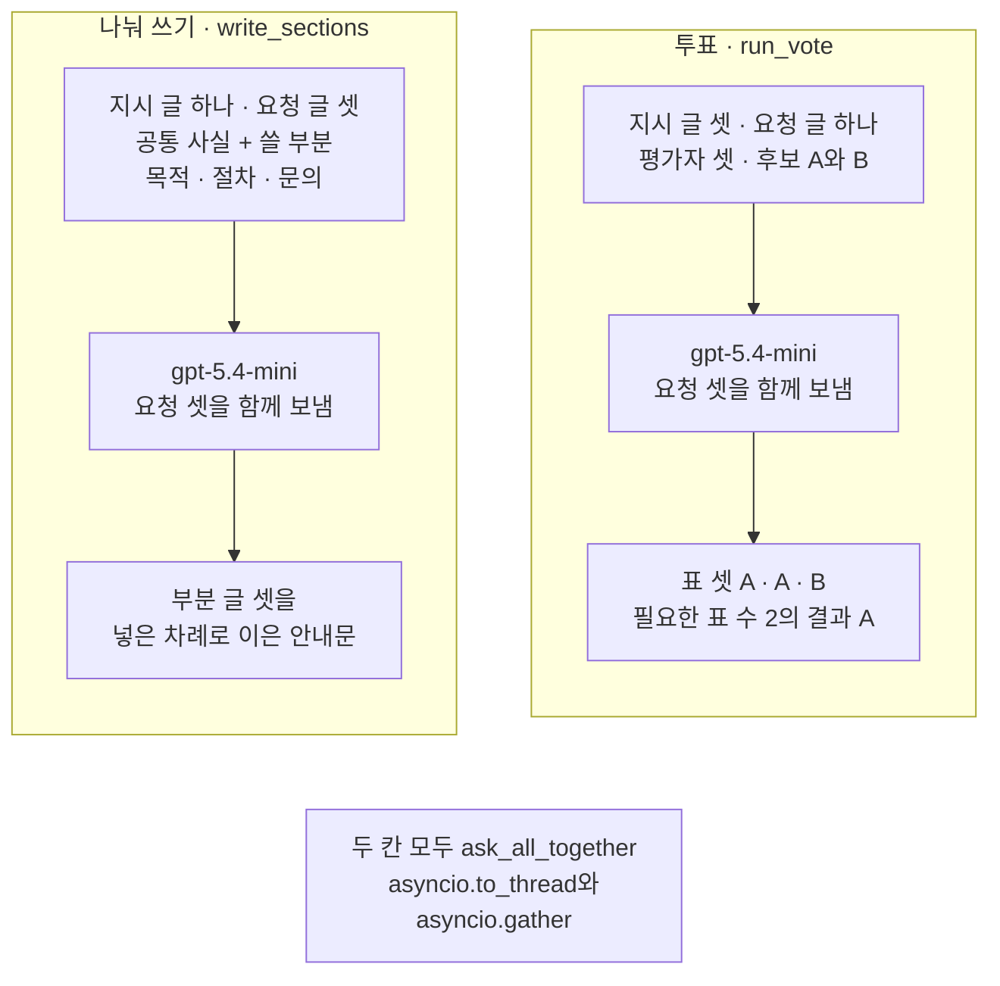
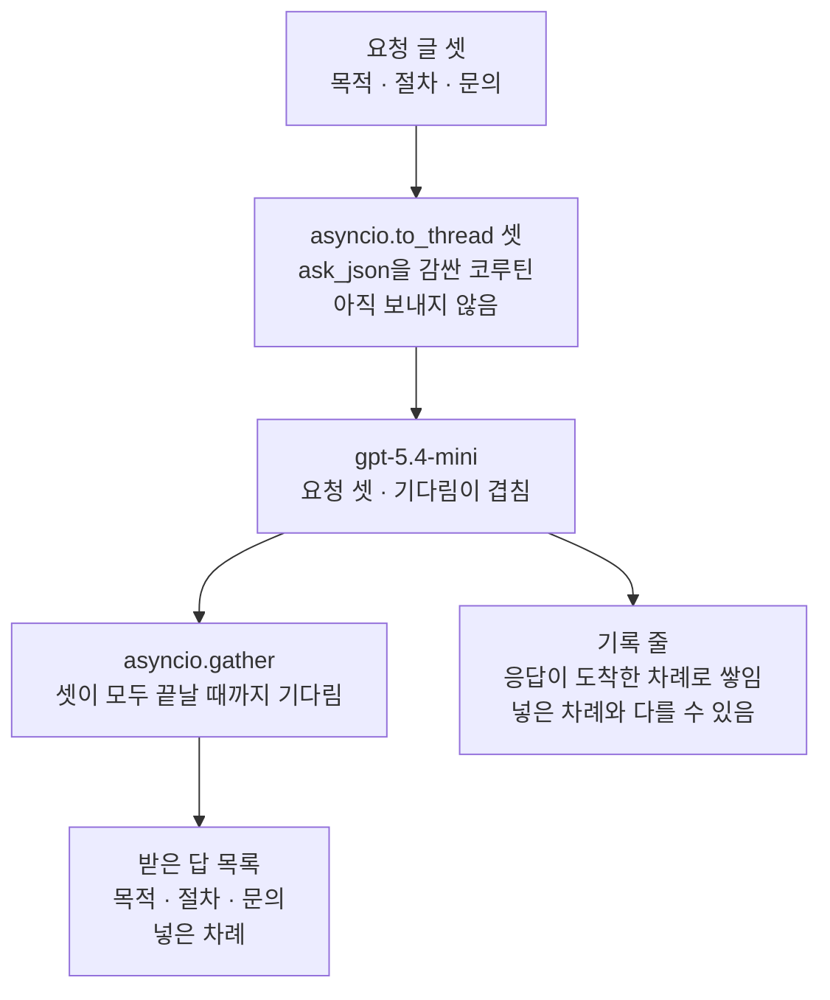
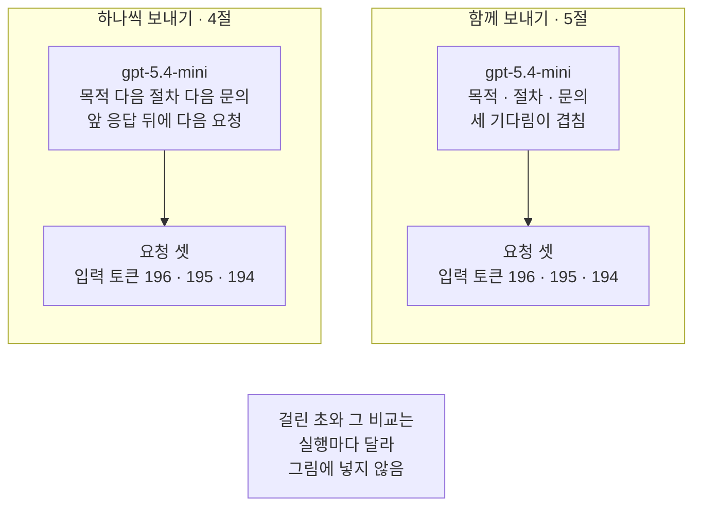
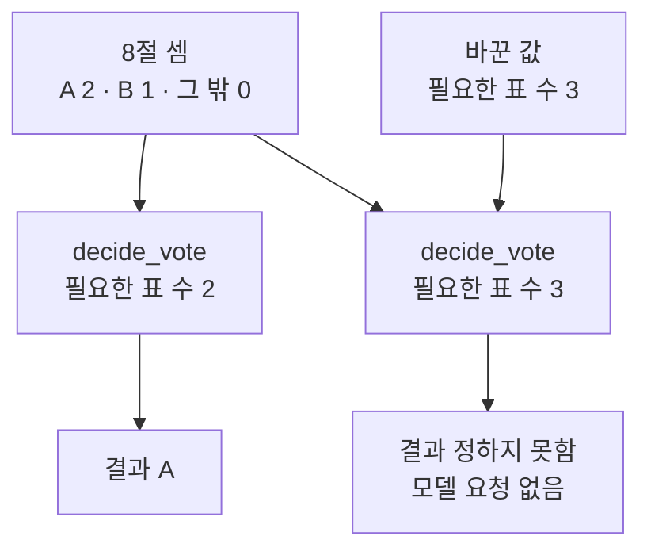

# 03-병렬-섹셔닝과-투표

## _src 본문 (HTML 원본)

```html
<!--meta: 강의 0.7h | 실습 2h | 코드 notebooks/03-병렬-섹셔닝과-투표.ipynb | 새 용어 5 -->
<style>html,body{overflow-x:hidden}.notebook,.nb-cell,.nb-main,.nb-input,.nb-result{min-width:0;max-width:100%}.nb-input pre,.nb-output{box-sizing:border-box;max-width:100%;overflow-x:auto}code.nb-source{display:block!important;width:100%!important;min-width:0!important;overflow-x:auto!important;padding:0!important}</style>
<h2 id="b1"><span class="no">1</span>학습 목표</h2><div class="goal"><ul>
<li>서로 기다릴 필요가 없는 모델 요청 여러 개를 <code>asyncio.to_thread()</code>와 <code>asyncio.gather()</code>로 함께 보낼 수 있습니다.</li>
<li>함께 받은 답 목록의 차례와 기록 줄이 쌓인 차례를 구분해 설명할 수 있습니다.</li>
<li>나눠 쓰기와 투표에서 요청마다 달라지는 것을 구분하고, 표를 코드로 세어 결과를 정할 수 있습니다.</li>
</ul></div>
<h2 id="b2"><span class="no">2</span>이 내용을 배우는 이유</h2><p>사내 안내문의 목적, 절차, 문의 부분은 같은 공통 사실만 있으면 서로의 글을 기다리지 않고 쓸 수 있습니다. 01·02절처럼 요청을 하나씩 보내면 앞 응답을 받을 때까지 다음 요청이 나가지 않습니다. 서로 기다릴 필요가 없는 요청은 함께 보내고, 모두 끝났을 때 한꺼번에 받을 수 있습니다.</p><p>한 글을 여러 기준으로 판단받고 싶을 때도 요청 여러 개가 필요합니다. 같은 두 글을 기준이 다른 평가자 셋에게 함께 보내고, 모인 표는 코드가 셉니다. 이 절은 두 모양을 모두 실제 모델로 실행하고, 요청을 하나씩 보낸 때와 걸린 시간을 견줍니다.</p>
<h2 id="b3"><span class="no">3</span>앞에서 배운 내용</h2><p>Ch 2 12절에서는 비동기 함수를 부르면 코루틴이 나오고, await를 붙여야 실행된다는 것을 보았습니다. 함수 <code>asyncio.gather()</code>에 코루틴 둘을 넣자 0.3초 걸리던 두 확인이 0.2초에 끝났습니다. 그 절은 gather()가 내놓은 목록이 끝난 차례가 아니라 괄호에 넣은 차례라고 확인했습니다. 동기 함수는 <code>asyncio.to_thread()</code>로 다른 스레드에서 불러 함께 기다렸습니다.</p><p>01절에서는 요청 한 번을 보내 기록 한 줄을 남기는 함수 <code>ask_json</code>을 만들었습니다. 이 함수는 응답이 올 때까지 그 줄에서 기다리는 동기 함수입니다. 이 절은 함수를 고치지 않고, Ch 2 12절 After처럼 <code>asyncio.to_thread()</code>로 감싸 함께 보냅니다. 01·02절 흐름 함수가 둔 칸 「상태」도 이 절 흐름 결과에 둡니다.</p><p>01절 단계 잇기는 앞 요청의 답을 다음 요청 글에 넣었고, 02절 라우팅은 분류를 받은 뒤에 답 요청을 보냈습니다. 두 절의 요청은 앞 답을 기다려야 해서 함께 보낼 수 없었습니다. Ch 15 01절에서는 모델에게 답을 판정하게 하는 평가 모델(judge)을 배웠습니다. 이 절의 평가자도 모델이 고른 표를 내놓을 뿐, 정답을 알려 주지는 않습니다.</p>
<h2 id="b4"><span class="no">4</span>핵심 개념</h2><h3>비유로 시작하기</h3><p>도자기 공방에서 컵, 접시, 꽃병을 하나씩 굽는다고 해 봅니다. 셋을 하나씩 가마에 넣으면, 앞 그릇이 다 구워질 때까지 다음 그릇은 기다립니다. 가마 하나에 셋을 함께 넣으면 한 번 기다리는 동안 셋이 함께 구워집니다. 꺼낸 그릇은 넣을 때 정한 자리 차례대로 선반에 놓습니다.</p><p>그릇 셋이 요청 셋이고, 가마 안에서 함께 기다리는 일이 이 절의 함께 보내기입니다. 선반에 놓는 차례가 넣은 자리를 따르는 것처럼, gather()가 내놓는 목록도 넣은 차례를 따릅니다. 서로 다른 그릇 셋이 한 안내문의 서로 다른 부분입니다.</p>
{{img:03-5-가마-하나에-함께-넣은-그릇-셋|흰 바탕 그림으로 벽돌로 쌓은 가마 하나가 앞에서 보이고 둥근 문이 왼쪽으로 활짝 열려 있으며 따뜻한 빛이 도는 가마 안 선반 하나에 왼쪽부터 손잡이 달린 컵 하나, 세워 둔 둥근 접시 하나, 긴 꽃병 하나가 나란히 놓인 그림|서로 다른 그릇 셋을 가마 하나에 함께 넣어, 한 번 기다리는 동안 셋을 함께 굽습니다.}}
<p class="look"><b>그림 읽기</b> — 벽돌 가마 하나의 둥근 문이 왼쪽으로 열려 있습니다. 가마 안에는 선반이 하나 있고, 그 위에 컵과 세워 둔 접시, 긴 꽃병이 나란히 놓여 있습니다. 서로 다른 그릇 셋이 한 가마 안에서 함께 구워지고 있습니다. 그릇 셋은 한 안내문의 부분 셋이고, 가마 하나에 함께 넣은 것이 요청 셋을 함께 보낸 것입니다.</p>
<table><thead><tr><th>말</th><th>뜻</th></tr></thead><tbody><tr><td>함께 보내기(parallelization)</td><td>서로 기다릴 필요가 없는 모델 요청 여러 개를 함께 보내고, 모두 끝났을 때 결과를 모으는 모양입니다. 제목의 병렬이 이 말입니다. 가마 하나에 그릇 여럿을 함께 넣는 일과 같습니다.</td></tr><tr><td>나눠 쓰기(sectioning)</td><td>한 과제를 서로 기다리지 않는 부분으로 나눠, 부분마다 요청 글을 다르게 보내는 함께 보내기입니다. 제목의 섹셔닝이 이 말입니다. 컵, 접시, 꽃병을 한 가마에 함께 굽는 일과 같습니다.</td></tr><tr><td>투표(voting)</td><td>같은 요청 글을 지시 글이 다른 평가자 여럿에게 보내 표를 모으는 함께 보내기입니다. 구운 그릇 둘 가운데 판매대에 올릴 것을 세 사람이 한 표씩 골라 주는 일과 같습니다.</td></tr><tr><td>다수결(majority vote)</td><td>표의 절반보다 많이 받은 쪽으로 정하는 규칙입니다. 반 대표를 과반을 얻은 후보로 뽑는 일과 같습니다.</td></tr><tr><td>필요한 표 수</td><td>한쪽으로 정하는 데 있어야 하는 표의 수입니다. 이 절은 평가자 셋의 다수결로 2를 쓰고, 값 바꿔 보기에서 3으로 올립니다. 02절 기준값처럼 코드가 정해 둔 수입니다.</td></tr></tbody></table>
<p>새 말을 이 절 코드에서 보면 이렇습니다. 함께 보내기는 함수 <code>ask_all_together</code>이고, 안에서 <code>asyncio.to_thread()</code>와 <code>asyncio.gather()</code>를 씁니다. 나눠 쓰기는 함수 <code>write_sections</code>, 투표는 함수 <code>run_vote</code>입니다. 다수결은 함수 <code>decide_vote</code>이고, 필요한 표 수는 변수 <code>needed_votes</code>입니다.</p>
{{mermaid:03-1-나눠-쓰기와-투표|칸 둘이 나란히 있고 아래에 회색 상자가 있는 그림으로 왼쪽 나눠 쓰기 write_sections 칸에서는 초록 상자 지시 글 하나 요청 글 셋 공통 사실과 쓸 부분 목적 절차 문의가 보라 상자 gpt-5.4-mini 요청 셋을 함께 보냄을 지나 노란 상자 부분 글 셋을 넣은 차례로 이은 안내문으로 이어지고 오른쪽 투표 run_vote 칸에서는 초록 상자 지시 글 셋 요청 글 하나 평가자 셋과 후보 A와 B가 보라 상자 gpt-5.4-mini 요청 셋을 함께 보냄을 지나 노란 상자 표 셋 A A B 필요한 표 수 2의 결과 A로 이어지며 맨 아래 회색 상자에 두 칸 모두 ask_all_together asyncio.to_thread와 asyncio.gather가 적힌 그림|나눠 쓰기는 요청 글을, 투표는 지시 글을 요청마다 다르게 두고 요청 셋을 함께 보냅니다.}}
<p class="look"><b>도식 읽기</b> — 칸 둘은 이 절의 두 흐름입니다. 두 칸 모두 보라 상자에서 요청 셋을 함께 보냅니다. 왼쪽 나눠 쓰기는 초록 상자의 지시 글이 하나이고 요청 글이 셋입니다. 오른쪽 투표는 지시 글이 셋이고 요청 글이 하나입니다. 노란 상자는 노트북이 출력한 결과이고, 맨 아래 회색 상자는 두 칸에 공통인 사실입니다.</p>
<h3>나눠 쓰기와 투표는 무엇이 다른가</h3><p>두 모양 모두 요청 셋을 함께 보냅니다. 나눠 쓰기는 지시 글 하나를 함께 쓰고, 요청 글을 부분마다 다르게 만듭니다. 투표는 요청 글 하나를 함께 쓰고, 지시 글을 평가자마다 다르게 둡니다. 나눠 쓰기는 받은 글을 이어 안내문 하나를 만들고, 투표는 받은 표를 세어 결과 하나를 정합니다.</p><p>참고 자료의 Anthropic 글은 함께 보내기를 이 두 모양으로 나눠 소개합니다. 그 글은 부분을 나눠 빨리 끝내고 싶거나, 여러 관점의 답이 필요할 때 이 모양이 잘 맞는다고 적습니다.</p>
<h3>받은 목록의 차례와 기록 줄의 차례</h3><p>함수 <code>gather()</code>가 내놓는 목록은 괄호에 넣은 차례를 따릅니다. 그래서 받은 답 목록의 첫 항목은 늘 첫째로 넣은 요청의 답입니다. 한편 함수 <code>ask_json</code>은 응답을 받은 뒤에 기록 줄을 더합니다. 여러 스레드가 한 기록 목록을 함께 쓰면, 기록 줄은 응답이 도착한 차례로 쌓입니다.</p><p>요청 수는 기록 줄 수로 세므로 차례가 달라도 그대로입니다. 어느 줄이 어느 요청인지는 칸 「단계」로 찾습니다. 기록 줄의 차례를 넣은 차례로 읽지 않습니다.</p>
<h3>다른 상황에 적용</h3><p>보고서의 매출 요약과 고객 의견 요약은 같은 자료만 있으면 함께 쓸 수 있습니다. 두 요약을 인용하는 결론은 두 요약을 받은 뒤에 써야 합니다. 새 규정 초안을 법무, 보안, 현장 담당의 세 기준으로 함께 검토받는 일은 투표 모양입니다.</p>
<h3>비교와 경계</h3><p>함께 보내도 요청 수와 토큰 수는 줄지 않습니다. 이 절에서도 하나씩 보낸 때와 함께 보낸 때 모두 요청이 세 번이었습니다. 달라지는 것은 앞 응답을 기다리는 동안 다음 요청이 나가지 못하는 모양입니다.</p><p>앞 요청의 답이 다음 요청 글에 들어가야 하면 함께 보낼 수 없습니다. 01절 단계 잇기와 02절 라우팅이 그런 차례입니다. 투표의 다수결은 평가자들이 같은 쪽으로 틀리면 틀린 결과를 냅니다.</p>
<h2 id="b5"><span class="no">5</span>실행 예제</h2><p>노트북은 공통 사실 하나로 목적, 절차, 문의 요청 글 셋을 만듭니다. 먼저 셋을 하나씩 보내고, 다음에 <code>asyncio.to_thread()</code>와 <code>gather()</code>로 함께 보내 걸린 초를 견줍니다. 그다음 요청 목록을 함께 보내는 함수로 나눠 쓰기 흐름을 만들어 안내문 하나를 받습니다. 마지막으로 후보 글 둘을 평가자 셋에게 함께 보내 표를 세고, 필요한 표 수를 바꿔 봅니다.</p><p>모델은 <code>gpt-5.4-mini</code>이고 temperature 0으로 부릅니다. 모델 요청은 노트북 한 번에 열두 번입니다. 걸린 초는 기기·네트워크·실행 때에 따라 달라집니다.</p>
{{mermaid:03-2-함께-받은-답과-기록-줄의-차례|위에서 아래로 읽는 그림으로 초록 상자 요청 글 셋 목적 절차 문의에서 회색 상자 asyncio.to_thread 셋 ask_json을 감싼 코루틴 아직 보내지 않음과 보라 상자 gpt-5.4-mini 요청 셋 기다림이 겹침과 회색 상자 asyncio.gather 셋이 모두 끝날 때까지 기다림을 지나 노란 상자 받은 답 목록 목적 절차 문의 넣은 차례로 이어지고 보라 상자에서 따로 노란 상자 기록 줄 응답이 도착한 차례로 쌓임 넣은 차례와 다를 수 있음으로 이어지는 그림|함께 받은 답 목록은 넣은 차례였고, 기록 줄은 응답이 도착한 차례로 쌓였습니다.}}
<p class="look"><b>도식 읽기</b> — 위에서 아래로 읽습니다. 초록 요청 글 셋을 회색 <code>asyncio.to_thread</code>가 코루틴으로 감싸고, 보라 요청 셋이 함께 나갑니다. 왼쪽 아래로 회색 <code>asyncio.gather</code>를 지난 노란 답 목록은 넣은 차례입니다. 오른쪽 노란 기록 줄은 보라 상자에서 바로 이어지고, 응답이 도착한 차례로 쌓였습니다. 회색 상자는 우리가 적은 코드가 아니라 Python 표준 라이브러리 asyncio가 맡는 일입니다.</p>
{{notebook:03-병렬-섹셔닝과-투표}}
<p class="look"><b>확인할 점</b> — 노트북 5절 출력 <code>받은 답의 칸 「부분」 차례: ['목적', '절차', '문의']</code>로 받은 목록이 넣은 차례인지 봅니다. 같은 셀의 기록 줄은 응답이 도착한 차례라 실행마다 달라질 수 있습니다. 교재 출력에서는 하나씩 보낸 걸린 초가 4.751초, 함께 기다린 걸린 초가 1.667초였습니다. 여러분 실행과는 다를 수 있습니다. 8절에서는 셈 <code>{'A': 2, 'B': 1, '그 밖': 0}</code>과 결과 <code>A</code>를 봅니다.</p>
<h2 id="b6"><span class="no">6</span>실험 결과 해석</h2><p>함께 보낸 세 요청의 답 목록은 새 커널 두 번 모두 목적, 절차, 문의로 넣은 차례였습니다. 목록의 차례는 gather()가 정하므로, 늦게 도착한 답도 넣은 자리에 놓입니다. 기록 줄은 응답이 도착한 차례로 쌓입니다. 그래서 넣은 차례와 다를 수 있고, 실행마다 달라질 수 있습니다.</p><p>요청 수는 하나씩 보낸 때와 함께 보낸 때 모두 셋이었고, 요청마다 입력 토큰도 같았습니다. 하나씩 보내면 세 응답을 차례로 기다리고, 함께 보내면 세 기다림이 겹칩니다. 걸린 초와 그 비교는 실행마다 달라질 수 있어 결론에 쓰지 않습니다. 교재 출력 값은 「확인할 점」에 적었습니다.</p>
{{mermaid:03-3-하나씩-보낸-때와-함께-보낸-때|칸 둘이 나란히 있고 아래에 회색 상자가 있는 그림으로 왼쪽 하나씩 보내기 4절 칸에서는 보라 상자 gpt-5.4-mini 목적 다음 절차 다음 문의 앞 응답 뒤에 다음 요청이 노란 상자 요청 셋 입력 토큰 196 195 194로 이어지고 오른쪽 함께 보내기 5절 칸에서는 보라 상자 gpt-5.4-mini 목적 절차 문의 세 기다림이 겹침이 노란 상자 요청 셋 입력 토큰 196 195 194로 이어지며 맨 아래 회색 상자에 걸린 초와 그 비교는 실행마다 달라 그림에 넣지 않음이 적힌 그림|함께 보내도 요청 수와 입력 토큰은 같았고, 달라진 것은 세 응답을 기다리는 모양입니다.}}
<p class="look"><b>도식 읽기</b> — 칸 둘은 노트북 4절과 5절입니다. 두 칸의 노란 상자는 요청 수와 입력 토큰이 같다는 것을 보여 줍니다. 다른 것은 보라 상자의 기다리는 모양입니다. 왼쪽은 앞 응답을 받은 뒤 다음 요청을 보내고, 오른쪽은 세 기다림이 겹칩니다. 맨 아래 회색 상자는 그림에 넣지 않은 값과 비교입니다.</p>
<p>투표에서는 인사 담당과 보안 담당이 후보 A를, 신입 직원이 후보 B를 골랐습니다. 새 커널 두 번과 노트북 밖 다섯 번에서 표가 모두 같았습니다. 필요한 표 수 2에서는 후보 A가 2표로 기준에 닿아 결과가 A였습니다. 이 결과는 이 평가자 셋의 지시 글이 고른 표이고, 어느 글이 더 낫다는 정답이 아닙니다.</p><p>필요한 표 수를 3으로 올리자 같은 셈에서 결과가 「정하지 못함」이 되었습니다. 표는 모델이 쓰지만, 그 표로 무엇을 결과로 삼을지는 코드가 정합니다. 표가 갈린 글을 서둘러 정하지 않으려면 기준을 높이고, 정하지 못한 글은 사람이 보게 둘 수 있습니다.</p>
{{mermaid:03-4-필요한-표-수를-바꾸면|위에서 아래로 읽는 그림으로 왼쪽 위 노란 상자 8절 셈 A 2 B 1 그 밖 0에서 화살표 둘이 아래 파란 상자 둘로 나뉘어 왼쪽은 파란 상자 decide_vote 필요한 표 수 2를 지나 노란 상자 결과 A로 가고 오른쪽은 오른쪽 위 초록 상자 바꾼 값 필요한 표 수 3과 함께 파란 상자 decide_vote 필요한 표 수 3으로 들어가 노란 상자 결과 정하지 못함 모델 요청 없음으로 가는 그림|같은 셈에서도 필요한 표 수를 2에서 3으로 올리자 결과를 정하지 못했습니다.}}
<p class="look"><b>도식 읽기</b> — 위에서 아래로 읽습니다. 왼쪽 위 노란 셈은 노트북 8절 투표의 셈이고, 아래 파란 함수 둘에 함께 들어갑니다. 왼쪽 함수는 필요한 표 수 2로 결과 A를 냈습니다. 오른쪽 함수는 오른쪽 위 초록 바꾼 값 3을 받아 「정하지 못함」을 냈습니다. 오른쪽은 모델을 다시 부르지 않았습니다.</p>
<h2 id="b7"><span class="no">7</span>주의할 점과 실무 메모</h2><ul><li>노트북을 쓰기 전에 같은 요청을 노트북 밖에서 다섯 번씩 보냈습니다. 받은 답 목록은 다섯 번 모두 넣은 차례였고, 함께 기다린 쪽이 다섯 번 모두 짧았습니다. 기록 줄은 다섯 번 모두 넣은 차례와 달랐고, 그 차례도 실행마다 바뀌었습니다. 투표의 표는 다섯 번 모두 A, A, B였습니다.</li><li>같은 요청도 실행한 때에 따라 평가자의 표가 달라질 수 있습니다. 표가 A, B, B로 바뀌면 필요한 표 수 2의 결과는 B가 됩니다.</li><li>클라이언트 하나를 여러 스레드가 함께 써도 되는지는 설치한 판으로 확인했습니다. 설치한 openai 2.29.0 클라이언트는 안에 httpx 0.28.1의 클라이언트를 둡니다. 그 httpx 설명은 클라이언트를 여러 스레드가 함께 써도 된다고 적습니다. 노트북 밖에서 요청 열 개를 함께 두 번 보냈을 때 스무 번 모두 끝까지 받았고, 답이 서로 섞이지 않았습니다.</li><li>세 스레드는 기록 목록 하나에 <code>append</code>로 줄을 더했습니다. 파이썬 문서의 FAQ는 목록 끝에 항목을 더하는 <code>append</code>를 여러 스레드에서도 한 번에 끝나는 동작으로 적습니다. 그래서 줄이 깨지지 않고, 차례만 도착 차례가 됩니다.</li><li>함께 보내는 요청이 많아지면 서비스의 요청 수 제한에 걸릴 수 있습니다. 이 노트북은 요청을 세 개까지만 함께 보냈고, 제한에 걸리는 경우는 이번에 실행하지 않았습니다.</li><li>셀 맨 위의 await 줄은 노트북 도구의 기능입니다. 파이썬 파일로 옮기면 Ch 2 12절처럼 비동기 함수 main 안에 두고 <code>asyncio.run(main())</code>으로 시작합니다. 이 절은 파일로 실행하지 않았습니다.</li><li>후보 글 둘과 평가자 셋의 기준은 흐름을 보여 주려고 이 절에서 정한 값입니다. 후보 A와 B의 자리를 바꿔 다시 보내는 검사(Ch 15 03절)는 하지 않았습니다. 그래서 표가 글 내용 때문인지 자리 때문인지는 가르지 않았습니다.</li><li>필요한 표 수는 평가자 수의 절반보다 많게 둡니다. 절반 이하로 두면 A와 B가 함께 기준에 닿을 수 있고, 함수 <code>decide_vote</code>는 먼저 본 A를 내놓습니다.</li><li>모델이 쓴 글과 표, 잰 초에는 <code>assert</code>를 쓰지 않았습니다. 손으로 적은 표와 셈에 건 동작만 <code>assert</code>로 확인했습니다. 답에 칸 「부분」·「글」·「표」가 없으면 <code>KeyError</code>로 셀이 멈추고, JSON 글이 아니면 <code>json.loads</code>에서 멈춥니다. 이번 실행에서는 그런 답을 받지 않았습니다.</li><li>걸린 초는 방법마다 한 번씩만 쟀습니다. 여러 번 재어 가운데 값을 보지 않았으므로, 몇 배 짧아지는지는 말하지 않습니다. 하나씩 보낸 첫 요청에는 서비스와 연결을 여는 시간이 들어 있을 수 있고, 이 몫은 따로 재지 않았습니다.</li><li>요청 수는 노트북 한 번에 열두 번입니다. 토큰 수를 출력하는 요청은 그 가운데 여섯 번입니다. 나머지 요청도 같은 크기로 보고 요금표를 곱해 어림하면 0.01달러 아래입니다. 요금표는 100만 토큰당 입력 0.75달러, 출력 4.50달러로 셈했고 실제 청구 금액과는 다를 수 있습니다.</li><li>이 절은 자료 파일을 읽거나 새 파일을 쓰지 않습니다. 01절 함수 둘은 실습 폴더 <code>notebooks/workflow_tools.py</code>에서 가져옵니다. 이 절에서 만든 함수 일곱도 같은 파일에 옮겨 두었습니다.</li><li>temperature 값을 0으로 두어도 답 문장이 매번 같다고 보장하지는 않습니다.</li><li>교재 출력은 Linux의 Python 3.12.13과 openai 2.29.0으로 만들었습니다. 다른 판과 Windows·macOS에서는 이번에 실행하지 않았습니다.</li></ul>
<h2 id="b8"><span class="no">8</span>정리와 다음 절</h2><ul><li>서로 기다릴 필요가 없는 요청 셋을 함께 보내도 요청 수는 같았고, 세 응답을 기다리는 시간이 겹쳤습니다.</li><li>함수 <code>gather()</code>가 내놓은 답 목록은 넣은 차례였고, 기록 줄은 응답이 도착한 차례로 쌓였습니다.</li><li>나눠 쓰기는 요청 글을, 투표는 지시 글을 요청마다 다르게 두었고, 표는 코드가 필요한 표 수로 셌습니다.</li></ul><p><strong>다음 학습과 이어지는 지점</strong> — 04절에서는 부분 목록을 코드에 미리 적지 않고, 작업 수와 작업마다 맡길 일을 모델이 정합니다.</p>
<h2 id="b9"><span class="no">9</span>복습 문제</h2><details class="quiz" open><summary>문제 4개 · 해설 포함</summary><p class="quiz-q">1. 나눠 쓰기와 투표에서 요청마다 달라지는 것은 각각 무엇인가요?</p><p class="quiz-a">나눠 쓰기는 지시 글 하나를 함께 쓰고 요청 글을 부분마다 다르게 만듭니다. 투표는 요청 글 하나를 함께 쓰고 지시 글을 평가자마다 다르게 둡니다. 틀렸다면 「핵심 개념」의 첫 도식을 다시 봅니다.</p><p class="quiz-q">2. 함께 보낸 세 요청의 답 목록과 기록 줄은 각각 어떤 차례로 모였나요?</p><p class="quiz-a">답 목록은 gather()에 넣은 차례였습니다. 기록 줄은 스레드마다 응답을 받은 때에 더해져, 응답이 도착한 차례로 쌓였습니다. 틀렸다면 노트북 5절을 다시 읽습니다.</p><p class="quiz-q">3. 글을 요약한 뒤 그 요약을 번역하는 두 요청을 gather()로 함께 보내도 되나요?</p><p class="quiz-a">안 됩니다. 번역 요청 글에 요약 결과가 들어가야 하므로 요약 응답을 받은 뒤에 보내야 합니다. 틀렸다면 「비교와 경계」를 다시 읽습니다.</p><p class="quiz-q">4. 표가 A, B, 고르지 않음이면 필요한 표 수 2의 결과는 무엇인가요?</p><p class="quiz-a">후보 A와 B가 1표씩이라 어느 쪽도 2표에 닿지 못해 「정하지 못함」입니다. 고르지 않은 표는 그 밖으로 셉니다. 틀렸다면 노트북 7절 끝의 손 확인을 다시 봅니다.</p></details>
<h2 id="b10"><span class="no">10</span>참고 자료</h2><ul><li><div><a href="https://www.anthropic.com/engineering/building-effective-agents">Building effective agents</a></div>확인 2026-09-23 · Anthropic 글입니다. 함께 보내기(parallelization)를 나눠 쓰기(sectioning)와 투표(voting) 두 모양으로 소개합니다. 부분을 나눠 빨리 끝내거나 여러 관점의 답이 필요할 때 잘 맞는다고 적습니다.</li><li><div><a href="https://docs.python.org/3.12/library/asyncio-task.html">Coroutines and Tasks</a></div>확인 2026-09-23 · Python 3.12 문서입니다. 함수 gather()가 내놓는 결과 목록은 넣은 차례를 따른다고 적습니다. 함수 to_thread()는 함수를 다른 스레드에서 부르는 코루틴을 내놓는다고 적습니다.</li><li><div><a href="https://docs.python.org/3.12/faq/library.html">Library and Extension FAQ</a></div>확인 2026-09-23 · Python 3.12 문서입니다. 여러 스레드에서도 한 번에 끝나는 동작의 예로 목록의 <code>append</code>를 적습니다.</li><li><div><a href="https://www.python-httpx.org/api/">HTTPX Developer Interface</a></div>확인 2026-09-23 · httpx 문서입니다. 클라이언트를 여러 스레드가 함께 써도 된다고 적습니다. 설치한 0.28.1 판 소스의 설명도 같습니다.</li><li><div><a href="https://github.com/openai/openai-python">openai-python</a></div>확인 2026-09-23 · OpenAI 파이썬 SDK 저장소입니다. 이 절은 설치한 2.29.0 판으로 실행했습니다.</li><li><div><a href="https://developers.openai.com/api/docs/models/gpt-5.4-mini">GPT-5.4 mini</a></div>확인 2026-09-23 · OpenAI 모델 문서입니다. 요금은 100만 토큰당 입력 0.75달러, 출력 4.50달러입니다.</li><li>Ch 2 12절 — 코루틴, await, gather(), to_thread().</li><li>Ch 15 01절·03절 — 평가 모델과 차례 바꾸기 검사.</li></ul>
```

## 노트북 셀 (순서대로)

### [0] markdown {'html': 'skip'}

# 병렬 섹셔닝과 투표

**이 노트북에서 할 일**

1. 서로 기다릴 필요가 없는 요청 셋을 하나씩 보낸 때와 함께 보낸 때를 견줍니다.
2. 함께 받은 답 목록의 차례와, 기록 줄이 쌓인 차례를 나란히 봅니다.
3. 공통 사실 하나를 부분 셋으로 나눠 쓰는 흐름을 함수로 만듭니다.
4. 같은 두 글을 평가자 셋에게 함께 보내 표를 세고, 필요한 표 수로 결과를 정합니다.

**준비물** — 프로젝트 맨 위 폴더의 `.env`에 적어 둔 `OPENAI_API_KEY`를 씁니다.
모델 `gpt-5.4-mini`에 보내는 요청은 노트북 한 번에 열두 번입니다.
4절, 5절, 6절, 8절에서 세 번씩 나갑니다.

토큰 수를 출력하는 요청은 열두 번 가운데 여섯 번입니다.
나머지 요청도 같은 크기로 보고 요금표를 곱해 어림한 예상 비용은 미화 0.01달러 아래입니다.
실제 청구 금액과는 다를 수 있습니다.

자료 파일을 읽거나 새 파일을 쓰지 않습니다.
01절에서 배운 함수 둘은 같은 폴더의 도구 파일 `workflow_tools.py`에서 가져옵니다.
이 절은 걸린 시간을 잽니다. 잰 초는 기기·네트워크·실행 때에 따라 달라집니다.
교재 출력을 만든 실행에서는 노트북 전체가 약 10초 만에 끝났습니다.

**기준 버전** — 첫 셀에서 openai 2.29.0과 python-dotenv 1.2.3을 설치합니다.
교재 출력은 Linux의 Python 3.12.13으로 만들었습니다.
다른 판과 Windows·macOS에서는 이번에 실행하지 않았습니다.

**강의와 실습 범위** — 강의 시간에는 3~5절을 읽습니다.
요청 셋을 하나씩 보낸 때와 함께 보낸 때를 견주는 자리입니다.
6~9절은 나눠 쓰기와 투표를 함수로 만들어 실행하는 자리입니다.
이 부분은 실습 시간에 실행합니다.

실습 폴더 `labs/part5/ch18-workflow-patterns`에서 `uv sync --locked`를 실행합니다.
그다음 `notebooks/` 폴더의 이 노트북을 열고, 실습 폴더의 `.venv` 커널을 고릅니다.
첫 셀부터 순서대로 실행합니다.

### [1] markdown {'html': 'skip'}

## 오늘 볼 그림


칸 둘은 이 절의 두 흐름입니다. 두 칸 모두 보라 상자에서 요청 셋을 함께 보냅니다.
다른 것은 맨 위 초록 상자입니다. 나눠 쓰기는 요청 글이 셋이고, 투표는 지시 글이 셋입니다.

### [2] markdown {}

## 1. 준비

제목의 섹셔닝(sectioning)은 이 절에서 「나눠 쓰기」라고 부릅니다.
공통 사실 하나로 글의 부분 여럿을 요청마다 따로 쓰게 하는 모양입니다.

나눠 쓰기와 투표는 모두 모델 요청 여러 개를 함께 보내는 방식입니다.
이 절은 그 방식을 「함께 보내기(parallelization)」라고 부릅니다.
제목의 병렬이 이 말입니다.

첫 셀은 패키지 두 개를 설치하고 설치된 판 번호를 출력합니다.
설치에는 몇십 초가 걸릴 수 있습니다.

### [3] code {'execution': {'iopub.execute_input': '2026-09-23T20:28:09.017471Z', 'iopub.status.busy': '2026-09-23T20:28:09.017257Z', 'iopub.status.idle': '2026-09-23T20:28:09.625534Z', 'shell.execute_reply': '2026-09-23T20:28:09.624959Z'}, 'lesson_role': 'setup'}

```python
# 이 절에서 쓰는 패키지를 설치하고 버전을 확인합니다
%pip install -q "openai==2.29.0" "python-dotenv==1.2.3"
from importlib.metadata import version

print("openai:", version("openai"))
print("python-dotenv:", version("python-dotenv"))
```

출력:
```
Note: you may need to restart the kernel to use updated packages.
openai: 2.29.0
python-dotenv: 1.2.3

```

### [4] markdown {}

**결과 읽기** — 출력 줄 `openai: 2.29.0`과 `python-dotenv: 1.2.3`이 실습 폴더 잠금과 같은 판입니다.
이 노트북의 출력은 2026-09-23에 이 판으로 실행한 결과입니다.

앞에서 배운 함수는 `workflow_tools.py`에 모아 두었습니다. 파일을 열면 코드를 볼 수 있습니다. 노트북과 같은 폴더(`notebooks/`)에 있는 파일입니다. 커널이 `notebooks/` 폴더에서 시작해야 이 파일을 가져올 수 있습니다.
다음 셀은 Ch 2 12절에서 쓴 모듈 둘과, 01절에서 배운 함수 둘을 가져옵니다.

### [5] code {'execution': {'iopub.execute_input': '2026-09-23T20:28:09.626748Z', 'iopub.status.busy': '2026-09-23T20:28:09.626640Z', 'iopub.status.idle': '2026-09-23T20:28:10.006196Z', 'shell.execute_reply': '2026-09-23T20:28:10.005831Z'}, 'lesson_role': 'setup'}

```python
# 함께 기다리는 모듈 asyncio와 시간을 재는 모듈 time, 클라이언트 이름 OpenAI와 01절 함수 둘을 가져옵니다
import asyncio
import time

from openai import OpenAI

from workflow_tools import ask_json, print_records

print("불러온 이름:", "asyncio", "time", "OpenAI", "ask_json", "print_records")
```

출력:
```
불러온 이름: asyncio time OpenAI ask_json print_records

```

### [6] markdown {}

**결과 읽기** — 출력 줄 `불러온 이름: asyncio time OpenAI ask_json print_records`로 이름 다섯을 가져왔습니다.
모듈 `asyncio`는 요청을 함께 기다릴 때, 모듈 `time`은 걸린 시간을 잴 때 씁니다.
함수 `ask_json`은 요청 한 번을 보내 기록 한 줄을 남기고, 받은 JSON 글을 딕셔너리로 내놓습니다.
함수 `print_records`는 기록 목록을 번호·단계·입력 토큰·출력 토큰 차례로 출력합니다.

## 2. 키와 클라이언트 준비

API 키가 있는지 확인합니다. `True` 값이 나오면 다음으로 넘어갑니다.

### [7] code {'execution': {'iopub.execute_input': '2026-09-23T20:28:10.007017Z', 'iopub.status.busy': '2026-09-23T20:28:10.006951Z', 'iopub.status.idle': '2026-09-23T20:28:10.012218Z', 'shell.execute_reply': '2026-09-23T20:28:10.011855Z'}, 'lesson_role': 'setup'}

```python
# .env 파일에서 OpenAI API 키를 읽습니다(키 값은 출력하지 않습니다)
import os
from dotenv import find_dotenv, load_dotenv

env_path = find_dotenv(usecwd=True)
load_dotenv(env_path)
has_key = os.getenv("OPENAI_API_KEY") is not None
print("OPENAI_API_KEY 설정 여부:", has_key)
assert has_key, "프로젝트 폴더의 .env 파일에 OPENAI_API_KEY를 적어 주세요."
```

출력:
```
OPENAI_API_KEY 설정 여부: True

```

### [8] markdown {}

**결과 읽기** — 출력 줄 `OPENAI_API_KEY 설정 여부: True`로 키를 찾았습니다.
키 값은 출력하지 않습니다.

다음 셀은 01절처럼 `client = OpenAI()` 한 줄로 클라이언트를 만듭니다.
이 절은 이 클라이언트 하나를 여러 스레드가 함께 씁니다.
스레드(thread)는 Ch 2 12절에서 본, 한 프로그램 안에서 따로 진행되는 실행 흐름입니다.

### [9] code {'execution': {'iopub.execute_input': '2026-09-23T20:28:10.012909Z', 'iopub.status.busy': '2026-09-23T20:28:10.012854Z', 'iopub.status.idle': '2026-09-23T20:28:10.040030Z', 'shell.execute_reply': '2026-09-23T20:28:10.039764Z'}}

```python
# OpenAI 서비스에 요청을 보낼 클라이언트를 하나 만듭니다(키는 앞 셀에서 읽은 환경 변수를 씁니다)
client = OpenAI()
print("클라이언트:", type(client).__name__)
```

출력:
```
클라이언트: OpenAI

```

### [10] markdown {}

**결과 읽기** — 출력 줄 `클라이언트: OpenAI`로 클라이언트를 만들었습니다.
이 클라이언트는 HTTP 연결을 맡는 httpx 라이브러리의 클라이언트를 안에 둡니다.
설치한 httpx 0.28.1의 설명은 그 클라이언트를 여러 스레드가 함께 써도 된다고 적습니다.
노트북 밖에서도 이 클라이언트 하나로 요청 열 개를 함께 보내 보았고, 두 번 모두 제 답을 받았습니다.

## 3. 나눠 쓸 재료 — 공통 사실과 부분 셋

사내 안내문 하나를 목적·절차·문의 세 부분으로 나눠 씁니다.
세 부분은 같은 공통 사실만 있으면 되고, 다른 부분의 글을 기다리지 않아도 됩니다.
다음 셀은 세 부분이 함께 쓸 공통 사실을 적습니다.

### [11] code {'execution': {'iopub.execute_input': '2026-09-23T20:28:10.040690Z', 'iopub.status.busy': '2026-09-23T20:28:10.040609Z', 'iopub.status.idle': '2026-09-23T20:28:10.042338Z', 'shell.execute_reply': '2026-09-23T20:28:10.042053Z'}}

```python
# 세 부분이 함께 쓸 공통 사실을 적습니다(날짜·까닭·등록 방법·문의처)
notice_fact = "2026년 10월 15일부터 전 직원 계정에 2단계 인증을 적용합니다. "
notice_fact = notice_fact + "비밀번호만으로는 계정을 지키기 어렵기 때문입니다. "
notice_fact = notice_fact + "등록은 사내 포털의 보안 메뉴에서 인증 앱을 연결하면 됩니다. "
notice_fact = notice_fact + "문의는 help@company.test로 받습니다."
print("공통 사실:")
print(notice_fact)
```

출력:
```
공통 사실:
2026년 10월 15일부터 전 직원 계정에 2단계 인증을 적용합니다. 비밀번호만으로는 계정을 지키기 어렵기 때문입니다. 등록은 사내 포털의 보안 메뉴에서 인증 앱을 연결하면 됩니다. 문의는 help@company.test로 받습니다.

```

### [12] markdown {}

**결과 읽기** — 라벨 줄 `공통 사실:` 아래 한 줄이 공통 사실입니다.
날짜, 까닭, 등록 방법, 문의처가 한 문장씩 들어 있습니다.
문의처 `help@company.test`는 연습용 주소입니다.

다음 셀은 부분 하나를 쓰는 작성자의 지시 글입니다.
세 부분의 요청은 이 지시 글 하나를 함께 씁니다.

### [13] code {'execution': {'iopub.execute_input': '2026-09-23T20:28:10.042900Z', 'iopub.status.busy': '2026-09-23T20:28:10.042832Z', 'iopub.status.idle': '2026-09-23T20:28:10.044699Z', 'shell.execute_reply': '2026-09-23T20:28:10.044456Z'}}

```python
# 부분 하나를 쓰는 작성자의 지시 글을 적습니다: 공통 사실에 없는 것은 지어내지 않게 합니다
write_instructions = "사내 안내문의 한 부분을 쓰는 작성자입니다. "
write_instructions = write_instructions + "공통 사실 가운데 쓸 부분에 맞는 것만 골라 한국어 두 문장으로 씁니다. "
write_instructions = write_instructions + "공통 사실에 없는 날짜·연락처·절차는 지어내지 않습니다. "
# 칸 「부분」에는 부분 이름을 그대로 적게 해, 받은 답이 어느 부분의 답인지 알아볼 수 있게 합니다
write_instructions = write_instructions + '답은 JSON 객체 하나로만 출력합니다: {"부분": "쓸 부분 이름 그대로", "글": "글"}'
print("지시 글:")
print(write_instructions)
```

출력:
```
지시 글:
사내 안내문의 한 부분을 쓰는 작성자입니다. 공통 사실 가운데 쓸 부분에 맞는 것만 골라 한국어 두 문장으로 씁니다. 공통 사실에 없는 날짜·연락처·절차는 지어내지 않습니다. 답은 JSON 객체 하나로만 출력합니다: {"부분": "쓸 부분 이름 그대로", "글": "글"}

```

### [14] markdown {}

**결과 읽기** — 라벨 줄 `지시 글:` 아래 한 줄이 작성자의 지시 글입니다.
끝에 답 모양 `{"부분": "쓸 부분 이름 그대로", "글": "글"}`을 적었습니다.
칸 「부분」은 받은 답이 어느 부분의 답인지 알아보려고 둔 칸입니다.

다음 셀은 요청 글을 만드는 함수입니다.
요청 머리글과 공통 사실 뒤에, 쓸 부분의 이름과 담을 내용을 붙입니다.

### [15] code {'execution': {'iopub.execute_input': '2026-09-23T20:28:10.045291Z', 'iopub.status.busy': '2026-09-23T20:28:10.045240Z', 'iopub.status.idle': '2026-09-23T20:28:10.047004Z', 'shell.execute_reply': '2026-09-23T20:28:10.046678Z'}}

```python
# 요청 머리글과 공통 사실 뒤에, 쓸 부분의 이름과 담을 내용을 붙여 요청 글 하나를 만듭니다
def build_part_request(request_head, fact, part):
    part_lines = "\n쓸 부분: " + part["이름"] + "\n담을 내용: " + part["담을 내용"]
    return request_head + fact + part_lines
```

출력:
```

```

### [16] markdown {}

**결과 읽기** — 정의 셀이라 출력이 없습니다.
함수 `build_part_request`는 요청 머리글, 공통 사실, 부분 딕셔너리 하나를 받습니다.
부분 딕셔너리에는 칸 「이름」과 「담을 내용」이 있습니다.
받은 셋을 차례로 이어 요청 글 하나를 내놓습니다.

다음 셀은 부분 셋을 적고, 부분마다 요청 글을 만듭니다.
요청 머리글에는 JSON이라는 말을 넣습니다.
02절에서 본 것처럼, 형식 `json_object`는 요청 글에 그 말이 있어야 하기 때문입니다.

### [17] code {'execution': {'iopub.execute_input': '2026-09-23T20:28:10.047534Z', 'iopub.status.busy': '2026-09-23T20:28:10.047484Z', 'iopub.status.idle': '2026-09-23T20:28:10.049366Z', 'shell.execute_reply': '2026-09-23T20:28:10.049015Z'}}

```python
# 부분 셋을 적고, 부분마다 요청 글을 하나씩 만듭니다(머리글에 JSON이라는 말을 넣습니다)
request_head = "아래 공통 사실로 안내문의 한 부분을 JSON으로 쓰세요.\n공통 사실: "
purpose_part = {"이름": "목적", "담을 내용": "적용 날짜와 까닭"}
steps_part = {"이름": "절차", "담을 내용": "직원이 할 일"}
contact_part = {"이름": "문의", "담을 내용": "물어볼 곳"}
purpose_request = build_part_request(request_head, notice_fact, purpose_part)
steps_request = build_part_request(request_head, notice_fact, steps_part)
contact_request = build_part_request(request_head, notice_fact, contact_part)
print("목적 부분의 요청 글:")
print(purpose_request)
```

출력:
```
목적 부분의 요청 글:
아래 공통 사실로 안내문의 한 부분을 JSON으로 쓰세요.
공통 사실: 2026년 10월 15일부터 전 직원 계정에 2단계 인증을 적용합니다. 비밀번호만으로는 계정을 지키기 어렵기 때문입니다. 등록은 사내 포털의 보안 메뉴에서 인증 앱을 연결하면 됩니다. 문의는 help@company.test로 받습니다.
쓸 부분: 목적
담을 내용: 적용 날짜와 까닭

```

### [18] markdown {}

**결과 읽기** — 라벨 줄 `목적 부분의 요청 글:` 아래 네 줄이 목적 부분의 요청 글입니다.
첫 줄은 요청 머리글이고, 둘째 줄은 공통 사실입니다.
마지막 두 줄 `쓸 부분: 목적`과 `담을 내용: 적용 날짜와 까닭`만 부분마다 다릅니다.
세 요청 글은 서로의 답을 넣지 않으므로, 어느 것을 먼저 보내도 됩니다.

## 4. 하나씩 보내기

먼저 01·02절처럼 요청 셋을 하나씩 보냅니다.
함수 `ask_json`은 응답이 올 때까지 그 줄에서 기다리는 동기 함수입니다.
그래서 둘째 요청은 첫 응답을 받은 뒤에야 나갑니다.
걸린 시간은 Ch 2 12절처럼 `time.perf_counter()`로 잽니다.
이 셀에서 모델 요청이 세 번 나갑니다.

### [19] code {'execution': {'iopub.execute_input': '2026-09-23T20:28:10.049944Z', 'iopub.status.busy': '2026-09-23T20:28:10.049890Z', 'iopub.status.idle': '2026-09-23T20:28:14.804840Z', 'shell.execute_reply': '2026-09-23T20:28:14.803743Z'}}

```python
# 세 요청을 하나씩 보내고, 셋이 모두 끝날 때까지 걸린 초를 잽니다(모델 요청 3번)
one_by_one_records = []
start_time = time.perf_counter()
purpose_answer = ask_json(client, one_by_one_records, "목적", write_instructions, purpose_request)
steps_answer = ask_json(client, one_by_one_records, "절차", write_instructions, steps_request)
contact_answer = ask_json(client, one_by_one_records, "문의", write_instructions, contact_request)
# 끝난 뒤 시각에서 시작 시각을 빼면 걸린 초입니다
elapsed = time.perf_counter() - start_time
one_by_one_seconds = round(elapsed, 3)
print("받은 답의 칸 「부분」:", purpose_answer["부분"], steps_answer["부분"], contact_answer["부분"])
print("하나씩 보낸 걸린 초:", one_by_one_seconds)
```

출력:
```
받은 답의 칸 「부분」: 목적 절차 문의
하나씩 보낸 걸린 초: 4.751

```

### [20] markdown {}

**결과 읽기** — 출력 줄 `받은 답의 칸 「부분」: 목적 절차 문의`로 세 답이 제 부분에 맞게 왔습니다.
세 요청은 앞 요청이 끝난 뒤에 차례로 나갔습니다.

출력 줄 `하나씩 보낸 걸린 초:` 뒤 수는 실행마다 달라집니다.
교재 출력에서는 `하나씩 보낸 걸린 초: 4.751`이었습니다.

다음 셀은 세 요청의 기록 줄을 출력합니다.

### [21] code {'execution': {'iopub.execute_input': '2026-09-23T20:28:14.807617Z', 'iopub.status.busy': '2026-09-23T20:28:14.807349Z', 'iopub.status.idle': '2026-09-23T20:28:14.811507Z', 'shell.execute_reply': '2026-09-23T20:28:14.810398Z'}}

```python
# 하나씩 보낸 세 요청의 기록 줄을 출력합니다
print("요청 수(기록 줄 수):", len(one_by_one_records))
print_records(one_by_one_records)
```

출력:
```
요청 수(기록 줄 수): 3
번호 | 단계 | 입력 토큰 | 출력 토큰
1 | 목적 | 196 | 54
2 | 절차 | 195 | 70
3 | 문의 | 194 | 57

```

### [22] markdown {}

**결과 읽기** — 출력 줄 `요청 수(기록 줄 수): 3`으로 요청이 세 번 나갔습니다.
라벨 줄 `번호 | 단계 | 입력 토큰 | 출력 토큰` 아래 세 줄은 목적·절차·문의 차례입니다.
하나씩 보냈으므로 기록 줄도 보낸 차례대로 쌓였습니다.
입력 토큰은 `1 | 목적 | 196`, `2 | 절차 | 195`, `3 | 문의 | 194`입니다.

출력 토큰은 모델이 쓴 글의 길이라 실행마다 달라질 수 있습니다.

## 5. 함께 보내기 — asyncio.to_thread()와 gather()

이번에는 같은 세 요청을 함께 보냅니다.
Ch 2 12절 After에서는 동기 함수를 `asyncio.to_thread()`로 다른 스레드에서 불렀습니다.
여기서도 함수 `ask_json`은 고치지 않고, 부르는 모양만 바꿉니다.
괄호에는 함수 이름 `ask_json`을 괄호 없이 넣고, 그 뒤에 인자를 차례로 넣습니다.
다음 셀은 코루틴 셋을 만들기만 하고 아직 요청을 보내지 않습니다.

### [23] code {'execution': {'iopub.execute_input': '2026-09-23T20:28:14.813218Z', 'iopub.status.busy': '2026-09-23T20:28:14.813053Z', 'iopub.status.idle': '2026-09-23T20:28:14.816468Z', 'shell.execute_reply': '2026-09-23T20:28:14.815785Z'}}

```python
# 같은 세 요청을 asyncio.to_thread()로 감싸 코루틴 셋을 만듭니다(부르기만 해서 아직 보내지 않습니다)
together_records = []
# to_thread(함수, 인자들)는 그 함수를 다른 스레드에서 부르는 코루틴을 내놓습니다
purpose_waiting = asyncio.to_thread(ask_json, client, together_records, "목적", write_instructions, purpose_request)
steps_waiting = asyncio.to_thread(ask_json, client, together_records, "절차", write_instructions, steps_request)
contact_waiting = asyncio.to_thread(ask_json, client, together_records, "문의", write_instructions, contact_request)
print("만든 값의 자료형:", type(purpose_waiting).__name__)
print("쌓인 기록 줄 수:", len(together_records))
```

출력:
```
만든 값의 자료형: coroutine
쌓인 기록 줄 수: 0

```

### [24] markdown {}

**결과 읽기** — 출력 줄 `만든 값의 자료형: coroutine`으로 코루틴이 만들어졌습니다.
출력 줄 `쌓인 기록 줄 수: 0`으로 요청은 아직 하나도 나가지 않았습니다.
Ch 2 12절처럼 코루틴은 부르기만 해서는 실행되지 않습니다.
세 코루틴은 기록 목록 `together_records` 하나를 함께 씁니다.

다음 셀은 코루틴 셋을 함수 `asyncio.gather()`에 함께 넣고 await로 기다립니다.
Ch 2 12절처럼 변수 셋을 괄호에 직접 넣습니다.
셀 맨 위에 await 줄을 바로 쓰는 것은 노트북 도구(IPython)의 기능입니다.
이 셀에서 모델 요청이 세 번 나갑니다.

### [25] code {'execution': {'iopub.execute_input': '2026-09-23T20:28:14.817804Z', 'iopub.status.busy': '2026-09-23T20:28:14.817681Z', 'iopub.status.idle': '2026-09-23T20:28:16.489009Z', 'shell.execute_reply': '2026-09-23T20:28:16.488015Z'}}

```python
# 코루틴 셋을 gather()에 함께 넣어, 세 요청이 모두 끝날 때까지 함께 기다립니다(모델 요청 3번)
start_time = time.perf_counter()
together_answers = await asyncio.gather(purpose_waiting, steps_waiting, contact_waiting)
elapsed = time.perf_counter() - start_time
together_seconds = round(elapsed, 3)
print("받은 답 수:", len(together_answers))
print("함께 기다린 걸린 초:", together_seconds)
```

출력:
```
받은 답 수: 3
함께 기다린 걸린 초: 1.667

```

### [26] markdown {}

**결과 읽기** — 출력 줄 `받은 답 수: 3`으로 세 답을 목록 하나로 받았습니다.
세 요청을 보낸 뒤 셋의 응답을 함께 기다렸고, 함수 `gather()`는 셋이 모두 끝난 뒤 목록을 내놓았습니다.

출력 줄 `함께 기다린 걸린 초:` 뒤 수도 실행마다 달라집니다.
교재 출력에서는 `함께 기다린 걸린 초: 1.667`이었습니다.

한 번 기다린 코루틴은 다시 기다릴 수 없어, 이 셀만 다시 실행하면 `RuntimeError`로 멈춥니다.
다시 실행하려면 코루틴을 만드는 앞 셀부터 다시 실행합니다.

다음 셀은 받은 답 목록의 차례와, 기록 줄이 쌓인 차례를 나란히 봅니다.
이 셀은 모델을 부르지 않습니다.

### [27] code {'execution': {'iopub.execute_input': '2026-09-23T20:28:16.491289Z', 'iopub.status.busy': '2026-09-23T20:28:16.491077Z', 'iopub.status.idle': '2026-09-23T20:28:16.495510Z', 'shell.execute_reply': '2026-09-23T20:28:16.494789Z'}}

```python
# gather()가 내놓은 답 목록의 차례와, 기록 줄이 쌓인 차례를 나란히 봅니다(모델 요청 없음)
answer_order = []
for answer in together_answers:
    answer_order.append(answer["부분"])
print("받은 답의 칸 「부분」 차례:", answer_order)
# 기록 줄은 스레드마다 응답을 받은 때에 더해집니다
print_records(together_records)
```

출력:
```
받은 답의 칸 「부분」 차례: ['목적', '절차', '문의']
번호 | 단계 | 입력 토큰 | 출력 토큰
1 | 절차 | 195 | 71
2 | 문의 | 194 | 44
3 | 목적 | 196 | 54

```

### [28] markdown {}

**결과 읽기** — 출력 줄 `받은 답의 칸 「부분」 차례: ['목적', '절차', '문의']`는 gather()에 넣은 차례와 같습니다.
함수 `gather()`가 내놓는 목록은 끝난 차례가 아니라 괄호에 넣은 차례를 따릅니다.
Ch 2 12절에서 본 것과 같고, Python 문서도 같은 내용을 적습니다.
라벨 줄 `번호 | 단계 | 입력 토큰 | 출력 토큰` 아래 세 줄은 기록 줄입니다.
기록 줄은 스레드마다 응답을 받은 때에 더해져, 응답이 도착한 차례로 쌓입니다.

기록 줄의 차례는 실행마다 달라질 수 있습니다.
교재 출력에서는 절차, 문의, 목적 차례로 쌓여 넣은 차례와 달랐습니다.

함께 보낸 세 요청은 차례가 있는 단계가 아닙니다.
그래서 칸 「단계」에 부분 이름을 적어 두고, 어느 줄이 어느 요청인지는 그 칸으로 찾습니다.

세 스레드는 기록 목록 하나에 `append`로 줄을 더했습니다.
파이썬 문서의 FAQ는 목록 끝에 항목을 더하는 `append`를 여러 스레드에서도 한 번에 끝나는 동작으로 적습니다.
그래서 줄이 깨지지 않고, 차례만 도착 차례가 됩니다.

다음 셀은 4절과 5절의 요청 수와 걸린 초를 견줍니다.
이 셀도 모델을 부르지 않습니다.

### [29] code {'execution': {'iopub.execute_input': '2026-09-23T20:28:16.497106Z', 'iopub.status.busy': '2026-09-23T20:28:16.496951Z', 'iopub.status.idle': '2026-09-23T20:28:16.500199Z', 'shell.execute_reply': '2026-09-23T20:28:16.499545Z'}}

```python
# 하나씩 보낸 때와 함께 보낸 때의 요청 수와 걸린 초를 견줍니다(모델 요청 없음)
print("요청 수(기록 줄 수):", len(one_by_one_records), len(together_records))
print("하나씩 보낸 걸린 초:", one_by_one_seconds)
print("함께 기다린 걸린 초:", together_seconds)
print("함께 기다린 쪽이 짧은가:", together_seconds < one_by_one_seconds)
```

출력:
```
요청 수(기록 줄 수): 3 3
하나씩 보낸 걸린 초: 4.751
함께 기다린 걸린 초: 1.667
함께 기다린 쪽이 짧은가: True

```

### [30] markdown {}

**결과 읽기** — 출력 줄 `요청 수(기록 줄 수): 3 3`으로 두 방법 모두 요청을 세 번 보냈습니다.
함께 보내도 요청 수와 입력 토큰은 줄지 않습니다.
출력 줄 `함께 기다린 쪽이 짧은가: True`로 이번 실행에서는 함께 기다린 쪽이 짧았습니다.
하나씩 보내면 세 응답을 차례로 기다리고, 함께 보내면 세 기다림이 겹칩니다.

두 걸린 초는 실행마다 달라집니다.
교재 출력에서는 하나씩 보낸 쪽이 4.751초, 함께 기다린 쪽이 1.667초였습니다.
노트북 밖에서 같은 비교를 다섯 번 했을 때도 다섯 번 모두 함께 기다린 쪽이 짧았습니다.

## 6. 요청 목록을 함께 보내는 함수와 나눠 쓰기

5절은 코루틴을 변수 셋에 담아 gather()에 직접 넣었습니다.
부분 수가 바뀌어도 쓸 수 있게, 요청 목록을 받아 함께 보내는 함수를 만듭니다.
요청 하나는 칸 「단계」·「지시 글」·「요청 글」을 둔 딕셔너리입니다.
함수 안에서 await를 쓰므로, Ch 2 12절처럼 정의 줄을 `async def`로 씁니다.

함수 안에서는 목록 앞에 별표 `*`를 붙여 gather()에 넣습니다.
별표는 목록의 항목을 하나씩 풀어 괄호에 차례로 넣습니다.

### [31] code {'execution': {'iopub.execute_input': '2026-09-23T20:28:16.501372Z', 'iopub.status.busy': '2026-09-23T20:28:16.501284Z', 'iopub.status.idle': '2026-09-23T20:28:16.504300Z', 'shell.execute_reply': '2026-09-23T20:28:16.503823Z'}}

```python
# 요청 딕셔너리 목록을 함께 보내고, 받은 답을 넣은 차례대로 목록 하나로 내놓습니다(모델 요청 = 요청 수)
async def ask_all_together(client, records, requests):
    waitings = []
    for request in requests:
        # 요청마다 ask_json을 다른 스레드에서 부르는 코루틴을 만듭니다(기록 줄은 응답이 도착한 차례로 쌓임)
        waiting = asyncio.to_thread(ask_json, client, records, request["단계"], request["지시 글"], request["요청 글"])
        waitings.append(waiting)
    # 별표 *는 목록 waitings의 항목을 하나씩 풀어 gather() 괄호에 차례로 넣습니다
    answers = await asyncio.gather(*waitings)
    return answers
```

출력:
```

```

### [32] markdown {}

**결과 읽기** — 정의 셀이라 출력이 없습니다.
함수 `ask_all_together`는 클라이언트, 기록 목록, 요청 목록을 받습니다.
요청마다 5절처럼 `asyncio.to_thread()`로 코루틴을 만들어 목록 `waitings`에 모읍니다.
목록이 셋이면 `gather(*waitings)`는 `gather(waitings[0], waitings[1], waitings[2])`와 같습니다.
받은 답 목록은 요청 목록에 넣은 차례이고, 기록 줄은 응답이 도착한 차례로 쌓입니다.

다음 셀은 받은 부분 글을 안내문 하나로 잇는 함수입니다.

### [33] code {'execution': {'iopub.execute_input': '2026-09-23T20:28:16.505723Z', 'iopub.status.busy': '2026-09-23T20:28:16.505581Z', 'iopub.status.idle': '2026-09-23T20:28:16.508174Z', 'shell.execute_reply': '2026-09-23T20:28:16.507746Z'}}

```python
# 받은 답 목록에서 칸 「글」을 차례로 꺼내, 한 줄씩 이어 안내문 하나로 만듭니다
def join_parts(answers):
    notice = ""
    for answer in answers:
        notice = notice + answer["글"] + "\n"
    return notice
```

출력:
```

```

### [34] markdown {}

**결과 읽기** — 정의 셀이라 출력이 없습니다.
함수 `join_parts`는 받은 답 목록에서 칸 「글」을 차례로 꺼내 줄을 바꿔 잇습니다.
답 목록이 넣은 차례이므로, 안내문도 목적·절차·문의 차례가 됩니다.

다음 셀은 나눠 쓰기 흐름에 쓸 설정 한 벌을 모읍니다.
01·02절 흐름 설정처럼, 흐름 함수는 이 딕셔너리 하나를 받아 값을 꺼내 씁니다.

### [35] code {'execution': {'iopub.execute_input': '2026-09-23T20:28:16.509318Z', 'iopub.status.busy': '2026-09-23T20:28:16.509202Z', 'iopub.status.idle': '2026-09-23T20:28:16.512012Z', 'shell.execute_reply': '2026-09-23T20:28:16.511538Z'}}

```python
# 나눠 쓰기 흐름에 쓸 설정 한 벌을 딕셔너리 하나에 모읍니다(3절에서 적은 값 그대로)
sections_setup = {
    "지시 글": write_instructions,
    "요청 머리글": request_head,
    "부분": [purpose_part, steps_part, contact_part],
}
setup_keys = list(sections_setup.keys())
print("설정 칸:", setup_keys)
print("부분 수:", len(sections_setup["부분"]))
```

출력:
```
설정 칸: ['지시 글', '요청 머리글', '부분']
부분 수: 3

```

### [36] markdown {}

**결과 읽기** — 출력 줄 `설정 칸: ['지시 글', '요청 머리글', '부분']`으로 세 칸을 모았습니다.
출력 줄 `부분 수: 3`은 칸 「부분」에 담은 부분 딕셔너리의 수입니다.

다음 셀은 나눠 쓰기 흐름 함수입니다.
부분마다 요청 글을 만들어 요청 목록을 채우고, 함수 `ask_all_together`로 함께 보냅니다.

### [37] code {'execution': {'iopub.execute_input': '2026-09-23T20:28:16.513234Z', 'iopub.status.busy': '2026-09-23T20:28:16.513133Z', 'iopub.status.idle': '2026-09-23T20:28:16.516082Z', 'shell.execute_reply': '2026-09-23T20:28:16.515503Z'}}

```python
# 나눠 쓰기: 지시 글은 하나, 요청 글은 부분마다 다르게 만들어 함께 보내고 받은 글을 잇습니다(모델 요청 = 부분 수)
async def write_sections(client, records, setup, fact):
    requests = []
    for part in setup["부분"]:
        request_text = build_part_request(setup["요청 머리글"], fact, part)
        requests.append({"단계": part["이름"], "지시 글": setup["지시 글"], "요청 글": request_text})
    answers = await ask_all_together(client, records, requests)
    notice = join_parts(answers)
    return {"상태": "완료", "부분": answers, "안내문": notice}
```

출력:
```

```

### [38] markdown {}

**결과 읽기** — 정의 셀이라 출력이 없습니다.
함수 `write_sections`는 모든 요청에 같은 지시 글을 쓰고, 요청 글만 부분마다 다르게 만듭니다.
받은 답 목록은 함수 `join_parts`로 이어 칸 「안내문」에 넣습니다.
01·02절 흐름 함수처럼 흐름 결과에 칸 「상태」를 둡니다.

다음 셀은 3절의 공통 사실로 나눠 쓰기 흐름을 실행합니다.
이 셀에서 모델 요청이 세 번 나갑니다.

### [39] code {'execution': {'iopub.execute_input': '2026-09-23T20:28:16.517170Z', 'iopub.status.busy': '2026-09-23T20:28:16.517067Z', 'iopub.status.idle': '2026-09-23T20:28:17.986758Z', 'shell.execute_reply': '2026-09-23T20:28:17.985892Z'}}

```python
# 나눠 쓰기 흐름에 3절의 공통 사실을 넣습니다(모델 요청 3번 — 부분 셋을 함께 보냄)
sections_records = []
sections_result = await write_sections(client, sections_records, sections_setup, notice_fact)
print("상태:", sections_result["상태"])
print("요청 수(기록 줄 수):", len(sections_records))
print("받은 부분 수:", len(sections_result["부분"]))
print("안내문:")
print(sections_result["안내문"])
```

출력:
```
상태: 완료
요청 수(기록 줄 수): 3
받은 부분 수: 3
안내문:
2026년 10월 15일부터 전 직원 계정에 2단계 인증을 적용합니다. 비밀번호만으로는 계정을 지키기 어렵기 때문입니다.
직원은 사내 포털의 보안 메뉴에서 인증 앱을 연결해 2단계 인증을 등록하면 됩니다. 비밀번호만으로는 계정을 지키기 어려우므로 전 직원 계정에 2단계 인증이 적용됩니다.
문의는 help@company.test로 보내 주시면 됩니다. 계정 등록이나 인증 앱 연결 방법에 대해 궁금한 점이 있으면 이곳으로 물어보세요.


```

### [40] markdown {}

**결과 읽기** — 출력 줄 `상태: 완료`와 `요청 수(기록 줄 수): 3`으로 부분 셋을 함께 보내 흐름을 마쳤습니다.
출력 줄 `받은 부분 수: 3`으로 답도 셋을 받았습니다.
라벨 줄 `안내문:` 아래 세 줄이 부분 셋을 이은 안내문입니다.
첫 줄이 목적, 둘째 줄이 절차, 셋째 줄이 문의 부분의 글입니다.

안내문 글은 모델이 쓴 글이라 실행마다 달라질 수 있습니다.
교재 출력에서 절차 부분은 등록 방법 뒤에 적용 까닭을 한 번 더 적었습니다.
문의 부분에는 공통 사실의 주소가 들어 있었습니다.
이 절은 글 내용이 공통 사실과 맞는지 판정하지 않았습니다.

## 7. 투표 재료 — 후보 글 둘과 평가자 셋

투표(voting)는 같은 글을 평가자 여럿에게 보내 표를 모으는 모양입니다.
이 절의 평가자는 기준이 다른 지시 글을 받은 모델 요청입니다.
Ch 15 01절의 평가 모델(judge)처럼, 표는 모델이 고른 것이지 정답이 아닙니다.
다음 셀은 견줄 후보 글 둘과, 두 글을 함께 담은 투표 요청 글을 적습니다.
후보 글 둘은 흐름을 보여 주려고 이 절에서 손으로 쓴 글입니다.

### [41] code {'execution': {'iopub.execute_input': '2026-09-23T20:28:17.988242Z', 'iopub.status.busy': '2026-09-23T20:28:17.988089Z', 'iopub.status.idle': '2026-09-23T20:28:17.991497Z', 'shell.execute_reply': '2026-09-23T20:28:17.990812Z'}}

```python
# 견줄 후보 글 둘과, 두 글을 함께 담은 투표 요청 글을 적습니다(JSON이라는 말은 첫 줄에)
candidate_a = "2026년 10월 15일부터 전 직원 계정에 2단계 인증을 적용합니다. "
candidate_a = candidate_a + "비밀번호만으로는 계정을 지키기 어렵기 때문입니다. "
candidate_a = candidate_a + "그 전에 사내 포털의 보안 메뉴에서 인증 앱을 연결해 주세요. "
candidate_a = candidate_a + "궁금한 점은 help@company.test로 보내 주세요."
candidate_b = "10월 15일부터 2단계 인증이 켜집니다. 사내 포털 보안 메뉴에서 인증 앱을 지금 연결하세요."
vote_request = "아래 두 안내문 가운데 더 나은 글 하나를 골라 JSON으로 답하세요.\n"
vote_request = vote_request + "A: " + candidate_a + "\nB: " + candidate_b
print("투표 요청 글:")
print(vote_request)
```

출력:
```
투표 요청 글:
아래 두 안내문 가운데 더 나은 글 하나를 골라 JSON으로 답하세요.
A: 2026년 10월 15일부터 전 직원 계정에 2단계 인증을 적용합니다. 비밀번호만으로는 계정을 지키기 어렵기 때문입니다. 그 전에 사내 포털의 보안 메뉴에서 인증 앱을 연결해 주세요. 궁금한 점은 help@company.test로 보내 주세요.
B: 10월 15일부터 2단계 인증이 켜집니다. 사내 포털 보안 메뉴에서 인증 앱을 지금 연결하세요.

```

### [42] markdown {}

**결과 읽기** — 라벨 줄 `투표 요청 글:` 아래 세 줄이 투표 요청 글입니다.
첫 줄에 JSON이라는 말이 있고, 둘째 줄이 후보 A, 셋째 줄이 후보 B입니다.
후보 A는 날짜·까닭·등록 방법·문의처를 모두 담은 네 문장입니다.
후보 B는 날짜와 할 일만 담은 두 문장입니다.

다음 셀은 평가자 셋의 지시 글을 적습니다.
세 지시 글은 가운데 기준 문장만 다릅니다.

### [43] code {'execution': {'iopub.execute_input': '2026-09-23T20:28:17.993000Z', 'iopub.status.busy': '2026-09-23T20:28:17.992897Z', 'iopub.status.idle': '2026-09-23T20:28:17.995292Z', 'shell.execute_reply': '2026-09-23T20:28:17.994796Z'}}

```python
# 평가자 셋의 지시 글을 적습니다: 가운데 기준 문장만 다르고, 앞 문장과 답 모양을 적은 끝 문장은 같습니다
judge_head = " 입장에서 사내 안내문 두 편을 견주는 평가자입니다. "
vote_tail = '더 나은 글 하나를 A 또는 B로 고릅니다. 답은 JSON 객체 하나로만 출력합니다: {"표": "A 또는 B"}'
hr_text = "인사 담당자" + judge_head + "전 직원이 알아야 할 사실(날짜·대상·문의처)이 빠짐없이 들어간 글을 더 낫다고 봅니다. " + vote_tail
security_text = "보안 담당자" + judge_head + "직원이 해야 할 행동과 기한이 분명한 글을 더 낫다고 봅니다. " + vote_tail
newcomer_text = "신입 직원" + judge_head + "처음 읽는 사람이 빨리 이해할 수 있는 짧은 글을 더 낫다고 봅니다. " + vote_tail
print("인사 담당의 지시 글:")
print(hr_text)
```

출력:
```
인사 담당의 지시 글:
인사 담당자 입장에서 사내 안내문 두 편을 견주는 평가자입니다. 전 직원이 알아야 할 사실(날짜·대상·문의처)이 빠짐없이 들어간 글을 더 낫다고 봅니다. 더 나은 글 하나를 A 또는 B로 고릅니다. 답은 JSON 객체 하나로만 출력합니다: {"표": "A 또는 B"}

```

### [44] markdown {}

**결과 읽기** — 라벨 줄 `인사 담당의 지시 글:` 아래 한 줄이 인사 담당 평가자의 지시 글입니다.
끝 문장에 답 모양 `{"표": "A 또는 B"}`를 적었습니다.
보안 담당은 행동과 기한을, 신입 직원은 짧고 빨리 읽히는 글을 기준으로 봅니다.

다음 셀은 평가자 이름과 지시 글을 짝지어 평가자 목록을 만듭니다.

### [45] code {'execution': {'iopub.execute_input': '2026-09-23T20:28:17.996131Z', 'iopub.status.busy': '2026-09-23T20:28:17.996048Z', 'iopub.status.idle': '2026-09-23T20:28:17.998158Z', 'shell.execute_reply': '2026-09-23T20:28:17.997740Z'}}

```python
# 평가자 이름과 지시 글을 짝지어 평가자 목록 하나로 모읍니다
judges = [
    {"이름": "인사 담당", "지시 글": hr_text},
    {"이름": "보안 담당", "지시 글": security_text},
    {"이름": "신입 직원", "지시 글": newcomer_text},
]
judge_names = []
for judge in judges:
    judge_names.append(judge["이름"])
print("평가자:", judge_names)
```

출력:
```
평가자: ['인사 담당', '보안 담당', '신입 직원']

```

### [46] markdown {}

**결과 읽기** — 출력 줄 `평가자: ['인사 담당', '보안 담당', '신입 직원']`이 평가자 목록의 차례입니다.
8절에서 받을 표도 이 차례로 나옵니다.

다음 셀은 표를 세는 함수입니다.
받은 답마다 칸 「표」를 읽어 A, B, 그 밖으로 나눠 셉니다.
평가자가 A나 B가 아닌 글을 쓰면 그 밖으로 셉니다.

### [47] code {'execution': {'iopub.execute_input': '2026-09-23T20:28:17.998863Z', 'iopub.status.busy': '2026-09-23T20:28:17.998798Z', 'iopub.status.idle': '2026-09-23T20:28:18.000579Z', 'shell.execute_reply': '2026-09-23T20:28:18.000237Z'}}

```python
# 받은 답마다 칸 「표」를 읽어 A·B·그 밖으로 나눠 셉니다
def count_votes(answers):
    counts = {"A": 0, "B": 0, "그 밖": 0}
    for answer in answers:
        vote = answer["표"]
        # A도 B도 아닌 표(고르지 않음 등)는 그 밖으로 셉니다
        if vote != "A" and vote != "B":
            vote = "그 밖"
        counts[vote] = counts[vote] + 1
    return counts
```

출력:
```

```

### [48] markdown {}

**결과 읽기** — 정의 셀이라 출력이 없습니다.
함수 `count_votes`는 셈 딕셔너리의 칸 셋 「A」·「B」·「그 밖」을 0으로 두고 시작합니다.
표가 A도 B도 아니면 이름을 「그 밖」으로 바꾼 뒤 그 칸에 1을 더합니다.
Ch 17 01절의 `count = count + 1`처럼, 더한 값을 같은 칸에 다시 넣습니다.

다음 셀은 손으로 적은 답 목록 둘로 표 세기를 확인합니다.
모델 글이 아니라 미리 정한 값이라 `assert`로 확인할 수 있습니다.

### [49] code {'execution': {'iopub.execute_input': '2026-09-23T20:28:18.001366Z', 'iopub.status.busy': '2026-09-23T20:28:18.001302Z', 'iopub.status.idle': '2026-09-23T20:28:18.003461Z', 'shell.execute_reply': '2026-09-23T20:28:18.003107Z'}}

```python
# 손으로 적은 답 목록 둘로 표 세기를 확인합니다(정해 둔 값이라 assert로 봅니다)
hand_answers = [{"표": "A"}, {"표": "A"}, {"표": "B"}]
odd_answers = [{"표": "A"}, {"표": "B"}, {"표": "고르지 않음"}]
hand_counts = count_votes(hand_answers)
odd_counts = count_votes(odd_answers)
print("A·A·B의 셈:", hand_counts)
print("A·B·고르지 않음의 셈:", odd_counts)
assert hand_counts == {"A": 2, "B": 1, "그 밖": 0}
assert odd_counts == {"A": 1, "B": 1, "그 밖": 1}
```

출력:
```
A·A·B의 셈: {'A': 2, 'B': 1, '그 밖': 0}
A·B·고르지 않음의 셈: {'A': 1, 'B': 1, '그 밖': 1}

```

### [50] markdown {}

**결과 읽기** — 출력 줄 `A·A·B의 셈: {'A': 2, 'B': 1, '그 밖': 0}`이 첫 목록의 셈입니다.
출력 줄 `A·B·고르지 않음의 셈: {'A': 1, 'B': 1, '그 밖': 1}`에서 고르지 않은 표는 그 밖으로 셌습니다.
두 `assert` 줄도 통과했습니다.

다수결(majority vote)은 표의 절반보다 많이 받은 쪽으로 정하는 규칙입니다.
반 대표를 뽑을 때 과반을 얻은 후보로 정하는 것과 같습니다.
이 절은 이 규칙을 「필요한 표 수」 하나로 적습니다.
다음 셀은 셈과 필요한 표 수를 받아 결과를 정하는 함수입니다.

### [51] code {'execution': {'iopub.execute_input': '2026-09-23T20:28:18.004186Z', 'iopub.status.busy': '2026-09-23T20:28:18.004115Z', 'iopub.status.idle': '2026-09-23T20:28:18.005973Z', 'shell.execute_reply': '2026-09-23T20:28:18.005645Z'}}

```python
# 셈에서 A나 B가 필요한 표 수 이상을 받았으면 그 이름을, 둘 다 모자라면 「정하지 못함」을 내놓습니다
def decide_vote(counts, needed_votes):
    if counts["A"] >= needed_votes:
        return "A"
    if counts["B"] >= needed_votes:
        return "B"
    return "정하지 못함"
```

출력:
```

```

### [52] markdown {}

**결과 읽기** — 정의 셀이라 출력이 없습니다.
함수 `decide_vote`는 A의 표가 필요한 표 수 이상인지 먼저 보고, 그다음 B를 봅니다.
둘 다 모자라면 「정하지 못함」을 내놓습니다.
필요한 표 수가 절반 이하이면 A와 B가 함께 닿을 수 있고, 그때는 먼저 본 A를 내놓습니다.
그래서 필요한 표 수는 평가자 수의 절반보다 많게 둡니다.

다음 셀은 필요한 표 수를 2로 정하고, 앞 셀의 두 셈으로 결과를 확인합니다.
평가자가 셋이면 절반보다 많은 표는 2표입니다.

### [53] code {'execution': {'iopub.execute_input': '2026-09-23T20:28:18.006604Z', 'iopub.status.busy': '2026-09-23T20:28:18.006529Z', 'iopub.status.idle': '2026-09-23T20:28:18.008304Z', 'shell.execute_reply': '2026-09-23T20:28:18.007999Z'}}

```python
# 필요한 표 수를 평가자 셋의 절반보다 많은 2로 정하고, 손으로 센 두 셈으로 결과를 확인합니다
needed_votes = 2
hand_result = decide_vote(hand_counts, needed_votes)
odd_result = decide_vote(odd_counts, needed_votes)
print("필요한 표 수:", needed_votes)
print("A·A·B의 결과:", hand_result)
print("A·B·고르지 않음의 결과:", odd_result)
assert hand_result == "A"
assert odd_result == "정하지 못함"
```

출력:
```
필요한 표 수: 2
A·A·B의 결과: A
A·B·고르지 않음의 결과: 정하지 못함

```

### [54] markdown {}

**결과 읽기** — 출력 줄 `필요한 표 수: 2`가 이 절의 다수결 기준입니다.
출력 줄 `A·A·B의 결과: A`는 A가 2표로 기준에 닿았기 때문입니다.
출력 줄 `A·B·고르지 않음의 결과: 정하지 못함`은 A와 B 모두 1표라 기준에 못 닿았기 때문입니다.
두 `assert` 줄도 통과했습니다.

## 8. 투표 흐름

다음 셀은 투표 흐름 함수입니다.
모든 요청에 같은 투표 요청 글을 쓰고, 지시 글만 평가자마다 다르게 둡니다.
나눠 쓰기와 반대로, 요청마다 달라지는 칸이 요청 글이 아니라 지시 글입니다.

### [55] code {'execution': {'iopub.execute_input': '2026-09-23T20:28:18.008960Z', 'iopub.status.busy': '2026-09-23T20:28:18.008893Z', 'iopub.status.idle': '2026-09-23T20:28:18.011031Z', 'shell.execute_reply': '2026-09-23T20:28:18.010636Z'}}

```python
# 투표: 요청 글은 하나, 지시 글은 평가자마다 다르게 두고 함께 보내 표를 세어 결과를 정합니다(모델 요청 = 평가자 수)
async def run_vote(client, records, setup, request_text):
    requests = []
    for judge in setup["평가자"]:
        requests.append({"단계": judge["이름"], "지시 글": judge["지시 글"], "요청 글": request_text})
    answers = await ask_all_together(client, records, requests)
    counts = count_votes(answers)
    result = decide_vote(counts, setup["필요한 표 수"])
    return {"상태": "완료", "답": answers, "셈": counts, "결과": result}
```

출력:
```

```

### [56] markdown {}

**결과 읽기** — 정의 셀이라 출력이 없습니다.
함수 `run_vote`는 평가자마다 요청 딕셔너리를 만들고 함수 `ask_all_together`로 함께 보냅니다.
받은 답은 함수 `count_votes`로 세고, 설정의 필요한 표 수로 함수 `decide_vote`가 결과를 정합니다.
흐름 결과에는 칸 「상태」·「답」·「셈」·「결과」를 둡니다.

다음 셀은 7절의 투표 요청 글과 평가자 셋으로 투표 흐름을 실행합니다.
이 셀에서 모델 요청이 세 번 나갑니다.

### [57] code {'execution': {'iopub.execute_input': '2026-09-23T20:28:18.011766Z', 'iopub.status.busy': '2026-09-23T20:28:18.011684Z', 'iopub.status.idle': '2026-09-23T20:28:19.383272Z', 'shell.execute_reply': '2026-09-23T20:28:19.382573Z'}}

```python
# 투표 흐름에 7절의 투표 요청 글을 넣습니다(모델 요청 3번 — 평가자 셋에게 함께 보냄)
vote_setup = {"평가자": judges, "필요한 표 수": needed_votes}
vote_records = []
vote_result = await run_vote(client, vote_records, vote_setup, vote_request)
print("평가자 | 표")
for i in range(len(judges)):
    print(judges[i]["이름"], "|", vote_result["답"][i]["표"])
print("셈:", vote_result["셈"])
print("결과:", vote_result["결과"])
print("요청 수(기록 줄 수):", len(vote_records))
```

출력:
```
평가자 | 표
인사 담당 | A
보안 담당 | A
신입 직원 | B
셈: {'A': 2, 'B': 1, '그 밖': 0}
결과: A
요청 수(기록 줄 수): 3

```

### [58] markdown {}

**결과 읽기** — 라벨 줄 `평가자 | 표` 아래 세 줄이 평가자마다 받은 표입니다.
줄 `인사 담당 | A`, `보안 담당 | A`, `신입 직원 | B`는 평가자 목록의 차례입니다.
출력 줄 `셈: {'A': 2, 'B': 1, '그 밖': 0}`과 `결과: A`로 다수결 결과는 후보 A입니다.
출력 줄 `요청 수(기록 줄 수): 3`으로 평가자 셋에게 요청을 한 번씩 보냈습니다.

같은 요청도 실행한 때에 따라 평가자의 표가 달라질 수 있습니다.
노트북 밖에서 같은 투표를 다섯 번 했을 때는 다섯 번 모두 이 표였습니다.

## 9. 값 바꿔 보기 · 필요한 표 수를 3으로

### [59] markdown {}

바꿀 값은 필요한 표 수 하나입니다.
평가자 셋이 모두 같은 글을 골라야만 정하도록 2를 3으로 올립니다.
8절에서 받은 셈을 그대로 쓰므로 모델을 다시 부르지 않습니다.

실행 전에 예상해 봅니다.
후보 A가 2표이므로, 필요한 표 수 3에서는 「정하지 못함」이 나올 것입니다.

### [60] code {'execution': {'iopub.execute_input': '2026-09-23T20:28:19.384586Z', 'iopub.status.busy': '2026-09-23T20:28:19.384439Z', 'iopub.status.idle': '2026-09-23T20:28:19.387350Z', 'shell.execute_reply': '2026-09-23T20:28:19.386675Z'}}

```python
# 바꿀 값은 필요한 표 수 하나입니다: 2를 3으로 올려 8절 셈에 다시 적용합니다(모델 요청 없음)
strict_votes = 3
old_result = decide_vote(vote_result["셈"], needed_votes)
new_result = decide_vote(vote_result["셈"], strict_votes)
print("8절 셈:", vote_result["셈"])
print("필요한 표 수 2의 결과:", old_result)
print("필요한 표 수 3의 결과:", new_result)
```

출력:
```
8절 셈: {'A': 2, 'B': 1, '그 밖': 0}
필요한 표 수 2의 결과: A
필요한 표 수 3의 결과: 정하지 못함

```

### [61] markdown {}

**결과 읽기** — 출력 줄 `8절 셈: {'A': 2, 'B': 1, '그 밖': 0}`은 8절 결과 그대로입니다.
출력 줄 `필요한 표 수 2의 결과: A`와 `필요한 표 수 3의 결과: 정하지 못함`이 두 기준의 결과입니다.
예상대로 같은 표에서도 기준을 올리자 결과를 정하지 못했습니다.
표는 모델이 쓰지만, 그 표로 무엇을 결과로 삼을지는 코드가 쥔 기준이 정합니다.

## 정리

1. 서로 기다릴 필요가 없는 요청 셋을 함께 보내도 요청 수는 같았고, 세 응답을 기다리는 시간이 겹쳤습니다.
2. 함수 `gather()`가 내놓은 답 목록은 넣은 차례였고, 기록 줄은 응답이 도착한 차례로 쌓였습니다.
3. 나눠 쓰기는 요청 글을, 투표는 지시 글을 요청마다 다르게 두었고, 표는 코드가 필요한 표 수로 셌습니다.

04절에서는 부분 목록을 코드에 미리 적지 않고, 작업 수와 작업마다 맡길 일을 모델이 정합니다.

## 그림

### 03-1-나눠-쓰기와-투표.mmd



나눠 쓰기는 요청 글을, 투표는 지시 글을 요청마다 다르게 두고 요청 셋을 함께 보냅니다.

### 03-2-함께-받은-답과-기록-줄의-차례.mmd



함께 받은 답 목록은 넣은 차례였고, 기록 줄은 응답이 도착한 차례로 쌓였습니다.

### 03-3-하나씩-보낸-때와-함께-보낸-때.mmd



함께 보내도 요청 수와 입력 토큰은 같았고, 달라진 것은 세 응답을 기다리는 모양입니다.

### 03-4-필요한-표-수를-바꾸면.mmd



같은 셈에서도 필요한 표 수를 2에서 3으로 올리자 결과를 정하지 못했습니다.

### 03-5-가마-하나에-함께-넣은-그릇-셋.prompt.md

# 03-5-가마-하나에-함께-넣은-그릇-셋 (Higgsfield 삽화)

설명 대상 문장(본문 b4 비유 단락): 셋을 하나씩 가마에 넣으면, 앞 그릇이 다 구워질 때까지 다음 그릇은 기다립니다. 가마 하나에 셋을 함께 넣으면 한 번 기다리는 동안 셋이 함께 구워집니다. 서로 다른 그릇 셋이 한 안내문의 서로 다른 부분입니다.

구성 요소와 배치: 흰 바탕. 앞에서 본 **벽돌 가마 하나**(그림 대부분을 차지)의 문이 활짝 열려 있음. 가마 안 **선반 하나** 위에 **서로 다른 그릇 셋**이 나란히 — 왼쪽 **컵 하나**, 가운데 세워 둔 **접시 하나**, 오른쪽 **긴 꽃병 하나**(= 나눠 쓰기의 부분 셋, 한 가마 = 함께 보내기). 가마 안에 따뜻한 빛(함께 굽는 중). 사람·손·동물·화면·표지판·화살표·울타리·길 없음.

시선 순서: 가마 전체 → 열린 문 안 선반 → 왼쪽 컵 → 가운데 접시 → 오른쪽 꽃병.

검수 기준: 그림만 보고 「가마는 하나이고, 그 안 한 선반에 서로 다른 그릇 셋이 함께 들어 있다」가 읽히는가. 글자·숫자·사람이 없는가. 흔들리는 초 값이나 개수 이외의 수를 그림에 담지 않는다(글자 없음).

비유 계열: 챕터 리드 결정 8 **「도예」**(01절 물레·가마·판, 02절 선반·작업대에 이어). 가마 하나 = 함께 기다리기, 서로 다른 그릇 셋 = 나눠 쓰기의 부분 셋. 인계 `§02 → §03` 10번 제안(물레 셋) 대신 과제 지시의 「가마 하나에 그릇 여럿을 함께 굽기」를 골랐습니다 — 사람 없이 물레 셋만 그리면 「함께 돈다」가 잘 안 보일 수 있어서입니다. 투표(받침 셋)는 이 그림에 넣지 않고 본문 용어 표의 비유 한 문장으로만 둡니다. 「길·갈림길·표지판」(Ch 13)·「바구니·저울」(Ch 15)·「발자국·울타리」(Ch 17)·돋보기(Ch 22)는 쓰지 않았습니다.

## 프롬프트 (1차, 채택)

```text
Simple flat educational illustration, white background, limited soft palette, clean outlines, plain everyday objects, no text, no letters, no numbers, no logos.

A large brick pottery kiln seen from the front, filling most of the picture, with its arched door wide open. Inside the kiln, on one single shelf, exactly three different clay pieces stand side by side: one cup on the left, one flat plate standing upright in the middle, and one tall vase on the right. All three pieces are inside the same kiln together, with a soft warm glow of heat around them.

No people, no hands, no animals, no screens, no signs, no arrows, no fences, no paths.
```

## 상태

- 2026-09-23 · `nano_banana_pro`(응답 모델 이름 `nano_banana_2`) · 16:9 · 2k · `use_unlim: false` · count 1. 생성 전 잔액 **2577.25**.
- **1차 job `97674e7d-fb0b-4861-8ea9-2ab1c03ca7d2` 채택**(재생성 없음). 거래 기록 **2026-09-23T20:30:33Z 「Nano Banana Pro −2」** 한 줄이 이 절 몫입니다(그 앞 줄 19:59:52Z는 02절, 19:26:08Z는 01절). 결과 원본 `8d5c2ca9054a12cf48f97aefd5b1c683dd3242f533d502684f15eeedb8f23316`(2752 × 1536, RGB).
- **그림에서 확인한 것(그림 읽기·alt·캡션에 반영)**: 앞에서 본 벽돌 가마 하나, 둥근 문이 왼쪽으로 활짝 열림. 가마 안에 따뜻한 빛, 선반 하나. 선반 위 왼쪽부터 손잡이 달린 컵 하나 · 세워 둔 둥근 접시 하나 · 긴 꽃병 하나(모두 셋, 서로 다른 모양). 글자·숫자·사람·손·화살표·표지판 없음.
- 저장: 기기 셸에서 결과 URL을 `curl`로 받아 `UV_CACHE_DIR=/tmp/uv-cache uv run --no-project --with pillow`로 RGB·폭 1100px(LANCZOS)로 줄여 `figures/03-5-가마-하나에-함께-넣은-그릇-셋.png`(1100 × 614, `beeb973a51fbab066bcaea896cce09ad6c587db6bcfeec6915d7381ef789772a`)로 저장했습니다. 원본 2752px는 저장하지 않았습니다(기기 `/tmp/ch18-03/`에 임시 사본).
- 결과 URL을 다시 받아(같은 해시 `8d5c2ca9…`) 같은 폭으로 줄인 그림과 저장 PNG를 픽셀 대조했습니다(`ImageChops.difference` bbox `None`, 세 칸 extrema 모두 `(0, 0)`). 저장한 PNG를 다른 이름(`.cache/ch18-03-view/saved-03-5.png`)으로 복사해 직접 열어 그림 읽기를 썼습니다.

