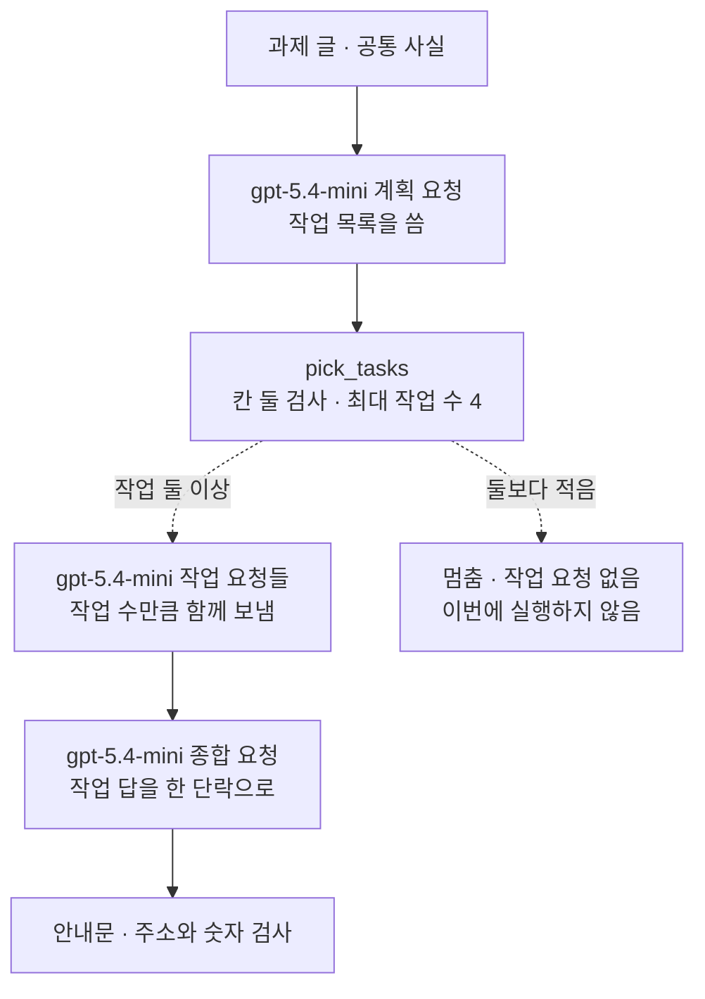
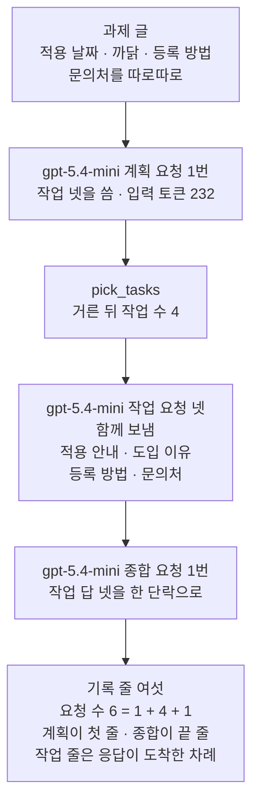
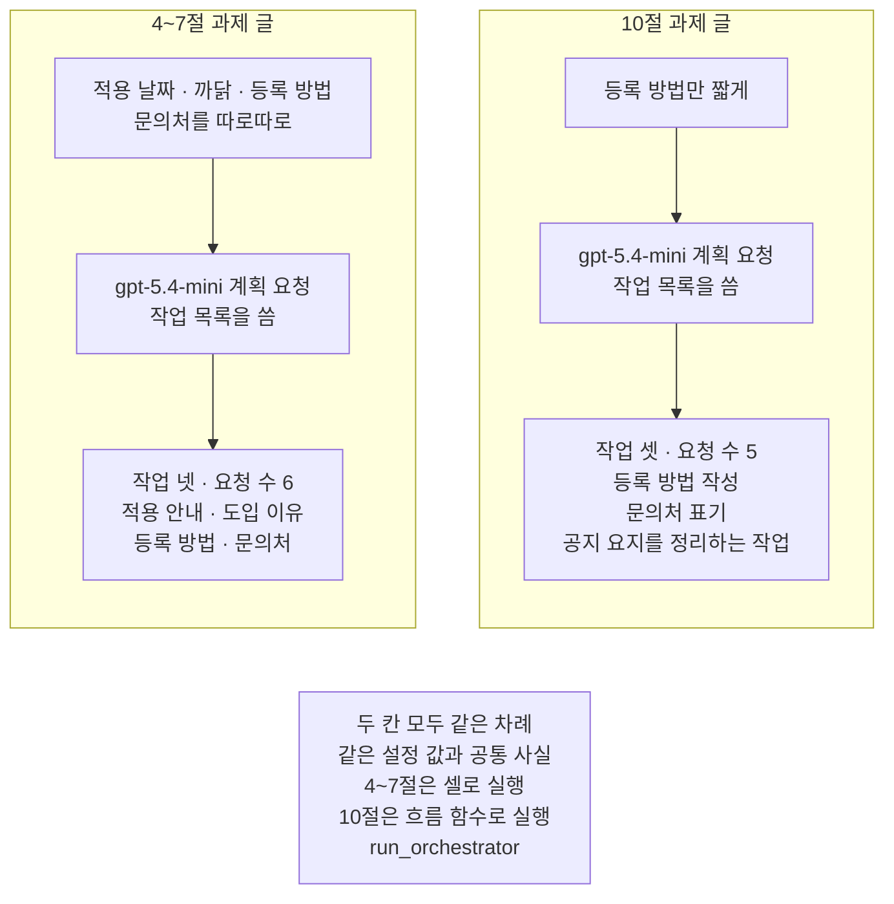
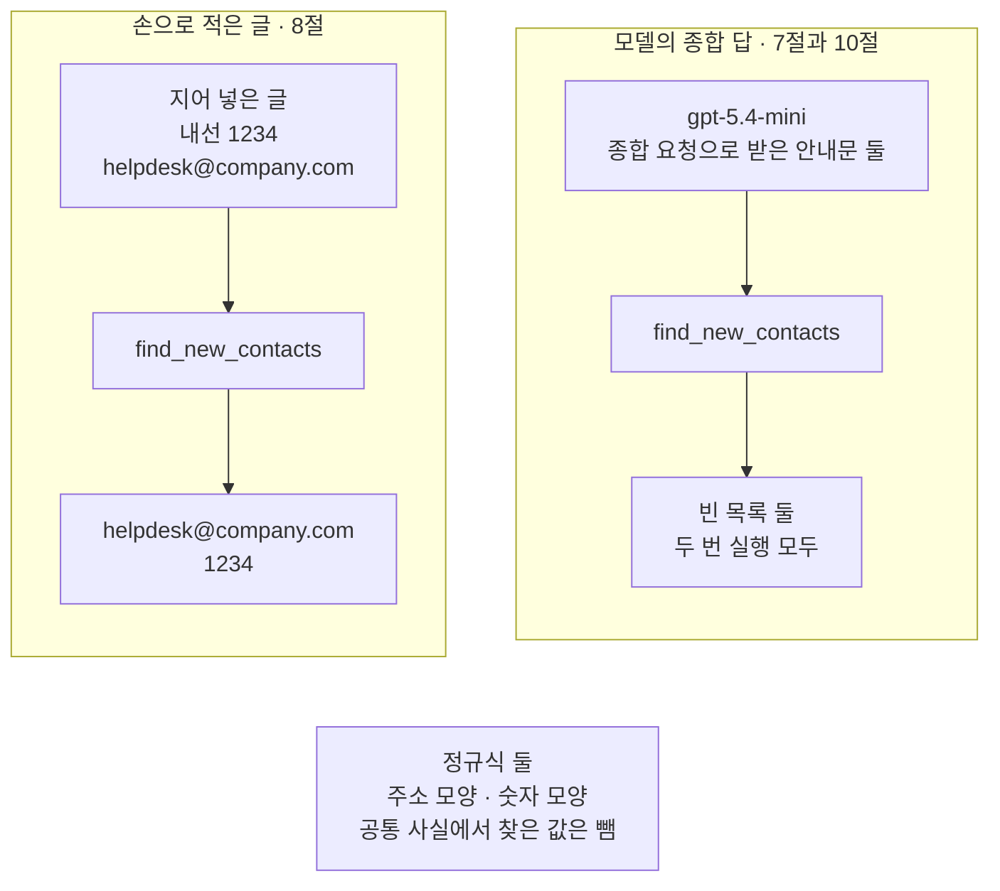

# 04-동적-오케스트레이터와-워커

## _src 본문 (HTML 원본)

```html
<!--meta: 강의 0.7h | 실습 2.5h | 코드 notebooks/04-동적-오케스트레이터와-워커.ipynb | 새 용어 5 -->
<style>html,body{overflow-x:hidden}.notebook,.nb-cell,.nb-main,.nb-input,.nb-result{min-width:0;max-width:100%}.nb-input pre,.nb-output{box-sizing:border-box;max-width:100%;overflow-x:auto}code.nb-source{display:block!important;width:100%!important;min-width:0!important;overflow-x:auto!important;padding:0!important}</style>
<h2 id="b1"><span class="no">1</span>학습 목표</h2><div class="goal"><ul>
<li>계획 모델이 쓴 작업 목록을 코드로 거르고, 작업 수만큼 작업 요청을 만들어 함께 보낼 수 있습니다.</li>
<li>종합 답에 공통 사실 밖의 주소나 숫자가 있는지 정규식 규칙으로 검사할 수 있습니다.</li>
<li>03절 고정 부분 목록과 견줘, 차례와 작업 수를 각각 누가 정하는지 설명할 수 있습니다.</li>
</ul></div>
<h2 id="b2"><span class="no">2</span>이 내용을 배우는 이유</h2><p>03절에서는 안내문을 목적, 절차, 문의 세 부분으로 나눠 함께 썼습니다. 부분 목록은 코드에 미리 적었습니다. 그런데 어떤 과제는 입력마다 필요한 작업이 다릅니다. 여러 파일을 고치는 코드 변경이라면 고칠 파일 수와 파일마다 할 일이 요청마다 달라집니다. 가능한 목록을 모두 코드에 적어 두면 새 과제가 올 때마다 코드를 고쳐야 합니다.</p><p>이 절은 작업 목록을 모델에게 쓰게 합니다. 계획 모델이 과제를 읽고 작업 목록을 쓰면, 코드는 그 목록을 검사해 작업 요청을 함께 보냅니다. 받은 답은 다시 모델에게 보내 안내문 하나로 엮습니다. 모델이 쓰는 값이 늘어난 만큼, 코드가 검사할 자리도 늘어납니다.</p>
<h2 id="b3"><span class="no">3</span>앞에서 배운 내용</h2><p>01절에서는 중간 결과를 코드로 검사해 통과한 것만 다음 단계로 넘기는 게이트를 만들었습니다. 02절에서는 모델이 쓴 종류 이름을 보고 코드가 준비한 갈래 가운데 하나로 보냈습니다. 03절에서는 요청 딕셔너리 목록을 함수 <code>ask_all_together</code>로 함께 보내고, 받은 답을 넣은 차례로 모았습니다. 이 절은 게이트로 작업 목록을 거르고, 목록의 작업 수만큼 요청을 함께 보냅니다.</p><p>Ch 17 01절에서는 실행 기록에서 다음 단계를 누가 골랐는지 보고 워크플로우와 에이전트 후보를 갈랐습니다. 칸 「고른 쪽」이 모두 코드면 워크플로우였습니다. 모델이 쓴 종류로 코드가 갈래를 고르는 라우팅도, 고를 갈래와 고르는 일이 코드에 있어 워크플로우였습니다. 이 절도 같은 규칙으로 흐름을 읽습니다.</p><p>Ch 16 02절에서는 정규식과 함수 <code>re.findall</code>로 글에서 이메일과 전화번호 모양을 찾았습니다. 이 절은 같은 방법으로 종합 답에서 주소와 숫자를 찾아 공통 사실과 견줍니다.</p>
<h2 id="b4"><span class="no">4</span>핵심 개념</h2><h3>비유로 시작하기</h3><p>도자기 공방에 큰 주문이 하나 들어왔다고 해 봅니다. 공방 주인이 주문서를 읽고, 그날 빚을 그릇 수와 그릇마다 모양을 정합니다. 점토를 그 수만큼 덩이로 나눠 도공들에게 맡기면, 도공들은 제 덩이를 함께 빚습니다. 다 빚은 그릇은 주인이 모아 한 벌로 묶어 냅니다. 주문이 바뀌면 나누는 덩이 수와 모양도 바뀝니다.</p><p>주인이 계획 모델이고, 도공들이 작업 모델입니다. 덩이를 나누는 일이 작업 목록을 쓰는 일이고, 한 벌로 묶는 일이 종합입니다. 그래도 나누고, 빚고, 묶는 차례는 공방의 규칙으로 정해져 있습니다. 이 절에서 그 규칙을 적은 곳이 흐름 함수의 코드입니다.</p>
{{img:04-5-큰-덩이를-나눠-빚은-그릇|흰 바탕 그림으로 앞에서 본 긴 나무 작업대 위 왼쪽 끝에 큰 회색 점토 덩이 하나가 있고 가운데에 작은 회색 점토 덩이 넷이 저마다 작은 둥근 나무 받침에 올라 한 줄로 나란히 놓였으며 오른쪽 끝의 둥근 나무 받침 하나 위에 컵 하나, 그릇 하나, 세워 둔 접시 하나, 긴 꽃병 하나가 한 벌로 모여 있는 그림|큰 점토 덩이 하나를 여러 덩이로 나눠 따로 빚고, 다 빚은 그릇을 한 벌로 모읍니다.}}
<p class="look"><b>그림 읽기</b> — 긴 나무 작업대 왼쪽 끝에 큰 회색 점토 덩이 하나가 있습니다. 가운데에는 작은 덩이 넷이 저마다 둥근 받침에 올라 한 줄로 놓여 있습니다. 오른쪽 끝 둥근 받침 하나에는 컵, 그릇, 세워 둔 접시, 긴 꽃병이 한 벌로 모여 있습니다. 큰 덩이가 과제이고, 작은 덩이 넷이 계획 모델이 나눈 작업 넷, 한 받침 위 그릇 넷이 종합한 안내문입니다.</p>
<table><thead><tr><th>말</th><th>뜻</th></tr></thead><tbody><tr><td>작업 나눠 맡기기(orchestrator-workers)</td><td>계획 모델이 과제를 작업으로 나누고, 작업 모델들이 나눠 맡은 뒤, 받은 답을 엮는 모양입니다. 공방 주인이 주문을 덩이로 나눠 도공들에게 맡기는 일과 같습니다.</td></tr><tr><td>계획 모델(오케스트레이터, orchestrator)</td><td>과제를 읽고 작업 목록을 쓰는 요청과, 작업 답을 엮는 종합 요청을 맡는 쪽입니다. 주문서를 읽고 빚을 그릇을 정하는 공방 주인과 같습니다.</td></tr><tr><td>작업 모델(워커, worker)</td><td>작업 목록의 작업 하나를 받아 그 몫의 글을 쓰는 쪽입니다. 나눠 받은 덩이 하나를 빚는 도공과 같습니다. 이 절에서는 계획 모델과 같은 모델이고 지시 글만 다릅니다.</td></tr><tr><td>작업 목록</td><td>계획 모델이 쓴 작업 딕셔너리의 목록입니다. 작업마다 칸 「이름」과 「맡을 일」이 있습니다. 03절 부분 목록과 달리 코드가 아니라 모델의 답에서 옵니다.</td></tr><tr><td>종합(synthesis)</td><td>나눠 받은 답을 모아 결과 하나로 엮는 일입니다. 빚은 그릇을 모아 한 벌로 묶는 일과 같습니다.</td></tr></tbody></table>
<p>새 말을 이 절 코드에서 보면 이렇습니다. 작업 나눠 맡기기 흐름은 함수 <code>run_orchestrator</code>입니다. 계획 모델의 요청은 단계 이름이 「계획」과 「종합」이고, 작업 모델의 요청은 작업 이름을 단계 이름으로 씁니다. 작업 목록은 계획 답의 칸 「작업」이고, 함수 <code>pick_tasks</code>가 거릅니다. 종합 요청 글은 함수 <code>build_summary_request</code>가 만듭니다.</p>
{{mermaid:04-1-작업-나눠-맡기기의-차례|위에서 아래로 읽는 그림으로 초록 상자 과제 글과 공통 사실에서 보라 상자 gpt-5.4-mini 계획 요청 작업 목록을 씀을 지나 파란 상자 pick_tasks 칸 둘 검사 최대 작업 수 4로 이어지고 거기서 점선 둘이 나와 작업 둘 이상이면 보라 상자 gpt-5.4-mini 작업 요청들 작업 수만큼 함께 보냄과 보라 상자 gpt-5.4-mini 종합 요청 작업 답을 한 단락으로를 지나 노란 상자 안내문과 주소 숫자 검사로 가고 둘보다 적으면 회색 상자 멈춤 작업 요청 없음 이번에 실행하지 않음으로 가는 그림|차례는 코드가 정하고, 작업 수와 작업마다 맡을 일은 계획 모델이 씁니다.}}
<p class="look"><b>도식 읽기</b> — 위에서 아래로 읽습니다. 초록 과제 글과 공통 사실이 보라 계획 요청으로 들어가고, 파란 <code>pick_tasks</code>가 작업 목록을 거릅니다. 파란 상자에서 나온 점선은 작업 수에 따라 한쪽으로만 갑니다. 작업이 둘 이상이면 보라 작업 요청들과 보라 종합 요청을 지나 노란 안내문으로 갑니다. 회색 멈춤 갈래는 이번에 실행하지 않았습니다.</p>
<h3>누가 무엇을 정하는가</h3><p>이 절의 흐름에서 요청을 보내는 차례는 코드가 정합니다. 계획 요청을 먼저, 작업 요청들을 다음에, 종합 요청을 마지막에 보냅니다. 작업을 몇 개로 나눌지와 작업마다 무엇을 맡길지는 계획 모델이 정합니다. 그래서 요청 수는 1 + 작업 수 + 1이고, 작업 수에 따라 달라집니다.</p><p>Ch 17 01절 규칙으로 이 흐름을 가르면 워크플로우입니다. Ch 17 01절처럼 단계마다 다음 단계를 고른 쪽을 적어 보면 모두 코드이기 때문입니다. 이 챕터의 기록 줄에는 그 칸을 두지 않았습니다. 모델이 쓴 작업 목록은 02절 라우팅에서 모델이 쓴 종류처럼 코드가 받아 쓰는 값입니다. 참고 자료의 Anthropic 글도 이 모양을 워크플로우의 하나로 소개합니다.</p>
<h3>03절 나눠 쓰기와 무엇이 다른가</h3><p>두 모양 모두 요청 여럿을 함께 보냅니다. 03절은 부분 목록을 코드에 손으로 적었고, 이 절은 작업 목록을 계획 모델이 씁니다. 03절은 받은 글을 코드가 이어 붙였고, 이 절은 받은 답을 종합 요청으로 한 번 더 엮습니다. Anthropic 글도 두 모양의 차이를 작업이 미리 정해져 있는지로 설명합니다.</p>
<h3>모델이 쓴 값은 코드가 검사합니다</h3><p>작업 목록은 모델이 쓴 글이라 약속한 칸이 빠지거나 작업이 너무 많을 수 있습니다. 그래서 작업 요청을 보내기 전에 코드가 작업 목록을 거릅니다. 종합 답도 모델이 쓴 글이라 공통 사실에 없는 연락처가 들어갈 수 있습니다. 지시 글로 먼저 막고, 받은 뒤에는 정규식 규칙으로 한 번 더 검사합니다.</p>
<h3>다른 상황에 적용</h3><p>여러 파일을 고치는 코드 변경 요청은 고칠 파일 수가 요청마다 다릅니다. 계획 모델이 파일 목록을 쓰고, 파일마다 작업 요청을 보낸 뒤 결과를 엮을 수 있습니다. 여러 자료에서 정보를 모으는 조사 과제도 찾을 자료 수가 과제마다 다릅니다. 늘 같은 세 절을 쓰는 월간 보고서라면 03절처럼 목록을 코드에 적는 편이 단순합니다.</p>
<h3>비교와 경계</h3><p>작업을 나눠도 요청 수는 줄지 않습니다. 오히려 계획 요청과 종합 요청이 하나씩 더 붙습니다. 작업 수를 모델이 정하므로 요청 수와 비용도 과제마다 달라질 수 있습니다. 그래서 이 절은 작업 수에 4라는 한도를 코드로 둡니다. 작업 목록이 과제에 맞게 나뉘었는지는 코드가 판정하지 않습니다.</p>
<h2 id="b5"><span class="no">5</span>실행 예제</h2><p>노트북은 03절과 같은 공통 사실과, 신입 직원용 안내문을 쓰라는 과제 글로 시작합니다. 계획 요청으로 작업 목록을 받아 코드로 거르고, 작업 요청을 함께 보낸 뒤 종합 요청으로 안내문 하나를 받습니다. 종합 답은 정규식 규칙으로 검사합니다. 마지막으로 흐름 함수로 묶어 과제 글만 바꿔 실행합니다.</p><p>모델은 <code>gpt-5.4-mini</code>이고 temperature 0으로 부릅니다. 요청 수는 계획 모델이 정한 작업 수에 따라 달라지고, 노트북 한 번에 많아야 열두 번입니다. 걸린 시간은 재지 않았습니다.</p>
{{mermaid:04-2-이번-실행의-요청-차례|위에서 아래로 읽는 그림으로 초록 상자 과제 글 적용 날짜 까닭 등록 방법 문의처를 따로따로에서 보라 상자 gpt-5.4-mini 계획 요청 1번 작업 넷을 씀 입력 토큰 232, 파란 상자 pick_tasks 거른 뒤 작업 수 4, 보라 상자 gpt-5.4-mini 작업 요청 넷 함께 보냄 적용 안내 도입 이유 등록 방법 문의처, 보라 상자 gpt-5.4-mini 종합 요청 1번 작업 답 넷을 한 단락으로를 차례로 지나 노란 상자 기록 줄 여섯 요청 수 6은 1 더하기 4 더하기 1 계획이 첫 줄 종합이 끝 줄 작업 줄은 응답이 도착한 차례로 이어지는 그림|두 번 실행 모두 계획 모델이 작업 넷을 써, 요청은 계획 1번·작업 4번·종합 1번이었습니다.}}
<p class="look"><b>도식 읽기</b> — 위에서 아래로 읽습니다. 초록 과제 글이 보라 계획 요청으로 들어가 작업 넷이 나왔고, 파란 <code>pick_tasks</code>는 넷을 모두 남겼습니다. 보라 작업 요청 넷은 함께 나갔고, 보라 종합 요청이 받은 답을 엮었습니다. 노란 기록 줄은 계획이 첫 줄, 종합이 끝 줄이고, 가운데 작업 줄은 응답이 도착한 차례입니다.</p>
{{notebook:04-동적-오케스트레이터와-워커}}
<p class="look"><b>확인할 점</b> — 노트북 7절 출력 <code>요청 수(기록 줄 수): 6</code>과 <code>1 + 작업 수 + 1: 6</code>이 같은지 봅니다. 기록 줄의 첫 줄은 계획, 마지막 줄은 종합이고, 가운데 작업 줄의 차례는 실행마다 달라질 수 있습니다. 10절에서는 과제 글을 바꾼 흐름의 <code>작업 수(4~7절 → 10절): 4 3</code>을 봅니다. 작업 이름과 안내문 글은 여러분 실행과 다를 수 있습니다.</p>
<h2 id="b6"><span class="no">6</span>실험 결과 해석</h2><p>새 커널 두 번 모두 계획 모델은 작업 넷을 썼고, 이름은 적용 안내, 도입 이유, 등록 방법, 문의처였습니다. 코드는 넷을 모두 남겼고, 작업 요청 넷을 함께 보낸 뒤 종합 요청을 보냈습니다. 요청 수는 두 번 모두 계획 1번, 작업 4번, 종합 1번으로 여섯이었습니다. 계획 답의 맡을 일 문장, 작업 줄의 도착 차례, 안내문 글은 두 번이 서로 달랐습니다.</p><p>작업 넷은 과제 글이 따로따로 담으라고 한 네 항목과 하나씩 짝이 맞습니다. 과제 글이 담을 것을 나눠 적어, 작업 수를 사실상 정해 준 셈입니다. 과제 글에 없는 작업을 모델이 더한 모습은 아래 10절 결과에서 봅니다.</p><p>이 관찰에서 코드가 보장하는 것은 차례입니다. 계획이 기록의 첫 줄, 종합이 끝 줄이고, 요청 수는 늘 1 + 작업 수 + 1입니다. 작업 수와 맡을 일은 모델이 정한 값이라, 같은 과제 글도 실행한 때에 따라 달라질 수 있습니다. 노트북 밖에서 다른 과제 글로 다섯 번 보냈을 때는 한 번 작업 수가 달랐습니다.</p><p>과제 글을 등록 방법만 짧게 알리라는 글로 바꾸자, 두 번 모두 작업이 넷에서 셋으로 줄었습니다. 요청 수도 여섯에서 다섯으로 줄었습니다. 같은 차례와 설정이 과제 글에 따라 다른 작업 목록을 실행한 것입니다. 과제 글은 등록 방법만 담으라고 했지만, 계획 모델은 공지 요지와 문의처 작업도 두었습니다. 작업 목록이 과제에 맞는지는 코드가 판정하지 않았습니다.</p><p>이 절의 종합 요청 글에는 과제 글이 들어가지 않고, 공통 사실 전체와 작업 답이 들어갑니다. 그래서 10절 종합 요청은 「등록 방법만 짧게」라는 과제 글을 받지 않았습니다. 06절에서는 종합 머리글에 과제 글을 넣습니다.</p>
{{mermaid:04-3-과제-글을-바꾸면|칸 둘이 나란히 있고 아래에 회색 상자가 있는 그림으로 왼쪽 4~7절 과제 글 칸에서는 초록 상자 적용 날짜 까닭 등록 방법 문의처를 따로따로가 보라 상자 gpt-5.4-mini 계획 요청 작업 목록을 씀을 지나 노란 상자 작업 넷 요청 수 6 적용 안내 도입 이유 등록 방법 문의처로 이어지고 오른쪽 10절 과제 글 칸에서는 초록 상자 등록 방법만 짧게가 보라 상자 gpt-5.4-mini 계획 요청 작업 목록을 씀을 지나 노란 상자 작업 셋 요청 수 5 등록 방법 작성 문의처 표기 공지 요지를 정리하는 작업으로 이어지며 맨 아래 회색 상자에 두 칸 모두 같은 차례 같은 설정 값과 공통 사실 4~7절은 셀로 실행 10절은 흐름 함수로 실행 run_orchestrator가 적힌 그림|과제 글만 바꾸자 같은 차례와 설정이 작업 넷 대신 작업 셋을 실행했습니다.}}
<p class="look"><b>도식 읽기</b> — 칸 둘은 노트북 4~7절과 10절의 과제 글입니다. 칸마다 초록 과제 글이 보라 계획 요청으로 들어가고, 노란 상자가 출력으로 확인한 작업 목록과 요청 수입니다. 왼쪽은 작업 넷과 요청 여섯, 오른쪽은 작업 셋과 요청 다섯입니다. 오른쪽 칸 첫 작업의 이름은 두 번 실행이 서로 달라 「공지 요지를 정리하는 작업」으로 적었습니다. 맨 아래 회색 상자는 두 칸에 공통인 차례와 설정이고, 10절만 그 차례를 흐름 함수로 묶어 불렀습니다.</p>
<p>종합 답 검사는 두 흐름의 안내문 모두 빈 목록이었습니다. 새 커널 두 번과 노트북 밖 열다섯 번 모두 공통 사실 밖의 주소나 숫자가 나오지 않았습니다. 규칙이 그런 값을 잡는지는 손으로 적은 글로 확인했습니다. 내선 번호와 주소를 지어 넣은 글에서는 둘을 모두 찾았습니다.</p>
{{mermaid:04-4-종합-답-검사|칸 둘이 나란히 있고 아래에 회색 상자가 있는 그림으로 왼쪽 손으로 적은 글 8절 칸에서는 초록 상자 지어 넣은 글 내선 1234 helpdesk@company.com이 파란 상자 find_new_contacts를 지나 노란 상자 helpdesk@company.com 1234로 이어지고 오른쪽 모델의 종합 답 7절과 10절 칸에서는 보라 상자 gpt-5.4-mini 종합 요청으로 받은 안내문 둘이 파란 상자 find_new_contacts를 지나 노란 상자 빈 목록 둘 두 번 실행 모두로 이어지며 맨 아래 회색 상자에 정규식 둘 주소 모양 숫자 모양 공통 사실에서 찾은 값은 뺌이 적힌 그림|같은 규칙이 지어 넣은 주소와 번호는 찾았고, 모델의 종합 답 둘에서는 빈 목록을 냈습니다.}}
<p class="look"><b>도식 읽기</b> — 칸 둘은 같은 파란 함수 <code>find_new_contacts</code>에 넣은 글이 다릅니다. 왼쪽은 노트북 8절에서 손으로 적은 글이고, 노란 결과에 지어 넣은 주소와 번호가 나왔습니다. 오른쪽은 7절과 10절에서 보라 종합 요청으로 받은 안내문 둘이고, 노란 결과는 두 번 실행 모두 빈 목록이었습니다. 맨 아래 회색 상자는 두 칸이 함께 쓴 규칙입니다.</p>
<p>빈 목록이 나왔다고 안내문이 지시 글을 모두 지켰다는 뜻은 아닙니다. 이 규칙이 본 주소와 숫자 모양에서 공통 사실 밖의 값을 찾지 못했다는 뜻입니다. 지시 글은 모델에게 하는 부탁이고, 받은 글이 약속을 지켰는지는 코드가 따로 가립니다. 그래서 이 절은 지시 글로 먼저 막고, 받은 뒤 결정적인 규칙으로 한 번 더 봅니다.</p>
<h2 id="b7"><span class="no">7</span>주의할 점과 실무 메모</h2><ul><li>노트북을 쓰기 전에 계획부터 종합까지 같은 흐름을 노트북 밖에서 과제 글마다 다섯 번씩 보냈습니다. 이 절의 과제 글은 다섯 번 모두 작업 넷이었고, 작업 이름도 다섯 번 같았습니다. 10절에서 바꾼 과제 글은 다섯 번 모두 작업 셋이었습니다.</li><li>같은 과제도 실행한 때에 따라 작업 수가 달라질 수 있습니다. 적용 까닭과 등록 방법, 문의처를 담으라는 다른 과제 글은 다섯 번 가운데 네 번 작업 셋, 한 번 작업 넷이었습니다. 그래서 이 절의 두 과제 글은 작업 수가 다섯 번 모두 같았던 판으로 골랐습니다. 4~7절 과제 글은 담을 것 넷을 따로따로 적어, 작업 수를 사실상 정해 주는 판입니다. 흐름을 보여 주려고 정한 예입니다.</li><li>작업 수가 달라지면 요청 수도 달라집니다. 작업이 넷이면 흐름 한 번에 요청이 여섯 번이고, 셋이면 다섯 번입니다.</li><li>노트북 밖 열다섯 번의 종합 답에는 공통 사실 밖의 주소나 숫자가 한 번도 없었습니다. 그래도 이 검사는 주소와 숫자 모양만 봅니다. 공통 사실에 없는 절차 문장은 잡지 못합니다. 노트북 밖 확인에서도 공통 사실에 없는 등록 단계를 덧붙인 종합 답이 있었습니다.</li><li>주소 모양 정규식은 영문 소문자와 점으로 된 주소만 찾습니다. 붙임표·대문자·숫자가 든 주소는 일부만 찾거나 놓칠 수 있습니다. 공통 사실에 있는 숫자는 다른 뜻으로 쓰여도 지나갑니다.</li><li>이 절의 종합 요청 글에는 과제 글을 넣지 않았습니다. 종합 요청은 공통 사실 전체와 작업 답만 받으므로, 과제 글이 좁힌 범위는 종합 요청 글에 없습니다. 06절은 종합 머리글에 과제 글을 넣었습니다.</li><li>작업이 최소 작업 수보다 적어 멈추는 갈래는 손으로 적은 계획으로 거르기만 확인했습니다. 흐름 함수가 멈추는 경우는 이번에 실행하지 않았습니다.</li><li>계획 답에 칸 「작업」이 없으면 <code>KeyError</code>로 셀이 멈춥니다. 작업 답에 칸 「작업」·「글」이, 종합 답에 칸 「안내문」이 없어도 멈춥니다. 답이 JSON 글이 아니면 <code>json.loads</code>에서 멈춥니다. 이번 실행과 노트북 밖 확인에서는 그런 답을 받지 않았습니다.</li><li>모델이 쓴 작업 목록과 글, 그 글의 검사 결과에는 <code>assert</code>를 쓰지 않았습니다. 손으로 적은 계획과 글에 건 동작만 <code>assert</code>로 확인했습니다.</li><li>계획 모델과 작업 모델은 같은 모델이고 지시 글만 다릅니다. 클라이언트 하나를 여러 스레드가 함께 쓰는 모양은 03절에서 확인한 그대로 썼습니다.</li><li>걸린 시간은 재지 않았습니다. 작업 요청을 함께 보낸 까닭은 03절에서 본 것처럼 서로의 답을 기다릴 필요가 없어서입니다.</li><li>교재 출력을 만든 실행의 요청 수는 11번이고, 토큰 수를 출력하는 요청은 그 가운데 여섯 번입니다. 10절 흐름은 노트북 밖에서 같은 과제 글로 보낸 기록의 토큰 수로 보고 요금표를 곱해 어림하면 0.01달러 아래입니다. 요금표는 100만 토큰당 입력 0.75달러, 출력 4.50달러로 셈했고 실제 청구 금액과는 다를 수 있습니다.</li><li>이 절은 자료 파일을 읽거나 새 파일을 쓰지 않습니다. 01·03절 함수 넷은 실습 폴더 <code>notebooks/workflow_tools.py</code>에서 가져옵니다. 이 절에서 만든 함수 여섯도 같은 파일에 옮겨 두었습니다.</li><li>temperature 값을 0으로 두어도 답 문장이 매번 같다고 보장하지는 않습니다.</li><li>교재 출력은 Linux의 Python 3.12.13과 openai 2.29.0으로 만들었습니다. 다른 판과 Windows·macOS에서는 이번에 실행하지 않았습니다.</li></ul>
<h2 id="b8"><span class="no">8</span>정리와 다음 절</h2><ul><li>계획 모델이 과제를 읽고 작업 목록을 썼고, 코드는 두 칸이 있는 작업만 최대 작업 수까지 걸렀습니다.</li><li>차례는 코드가 정했고, 작업 수와 맡을 일은 모델이 정해 요청 수가 1 + 작업 수 + 1이 되었습니다.</li><li>종합 답은 정규식 규칙으로 검사했고, 과제 글을 바꾸자 같은 흐름이 다른 작업 목록을 실행했습니다.</li></ul><p><strong>다음 학습과 이어지는 지점</strong> — 05절에서는 글을 쓰는 요청과 평가하는 요청을 번갈아 보내고, 코드가 정한 조건으로 멈춥니다.</p>
<h2 id="b9"><span class="no">9</span>복습 문제</h2><details class="quiz" open><summary>문제 4개 · 해설 포함</summary><p class="quiz-q">1. 03절 나눠 쓰기와 이 절의 흐름에서 요청으로 나눌 목록은 각각 누가 적나요?</p><p class="quiz-a">03절은 부분 목록을 코드에 손으로 적었습니다. 이 절은 계획 모델이 과제를 읽고 작업 목록을 쓰고, 코드는 그 목록을 걸러 요청을 만듭니다. 틀렸다면 「핵심 개념」의 「03절 나눠 쓰기와 무엇이 다른가」를 다시 읽습니다.</p><p class="quiz-q">2. 계획 모델이 작업 다섯을 썼는데, 하나에 칸 「맡을 일」이 없습니다. 최대 작업 수가 4이면 요청은 모두 몇 번 나가나요?</p><p class="quiz-a">칸 빠진 작업을 빼면 넷이 남고, 최대 작업 수가 4라 넷이 모두 남습니다. 작업 요청 4번에 계획과 종합을 더해 요청은 모두 6번입니다. 틀렸다면 노트북 5절의 손 확인을 다시 봅니다.</p><p class="quiz-q">3. Ch 17 01절 규칙으로 이 절의 흐름은 워크플로우와 에이전트 후보 가운데 어느 쪽인가요?</p><p class="quiz-a">워크플로우입니다. 계획 다음에 작업 요청들, 그다음에 종합 요청을 보내는 차례를 코드가 고릅니다. Ch 17 01절처럼 고른 쪽을 적어 보면 모두 코드입니다. 모델이 정하는 것은 작업 요청의 수와 맡을 일이라는 값입니다. 틀렸다면 「핵심 개념」의 「누가 무엇을 정하는가」를 다시 읽습니다.</p><p class="quiz-q">4. 종합 답이 「문의는 내선 5678로 해 주세요.」라면 8절 함수 find_new_contacts는 무엇을 내놓나요?</p><p class="quiz-a">목록 <code>['5678']</code>입니다. 주소 모양은 없고, 숫자 5678은 공통 사실의 숫자 목록에 없기 때문입니다. 틀렸다면 노트북 8절의 손 확인을 다시 봅니다.</p></details>
<h2 id="b10"><span class="no">10</span>참고 자료</h2><ul><li><div><a href="https://www.anthropic.com/engineering/building-effective-agents">Building effective agents</a></div>확인 2026-09-23 · Anthropic 글입니다. 가운데 모델이 과제를 나눠 작업 모델에게 맡기고 결과를 엮는 모양을 워크플로우의 하나로 소개합니다. 함께 보내기와 달리 작업이 미리 정해지지 않고 입력을 보고 정해진다고 적습니다.</li><li><div><a href="https://docs.python.org/3.12/library/re.html">re — Regular expression operations</a></div>확인 2026-09-23 · Python 3.12 문서입니다. 함수 findall()은 맞는 부분을 모두 찾아 글의 목록으로 내놓는다고 적습니다. 대괄호 안의 a-z는 영문 소문자 한 글자라고 적습니다.</li><li><div><a href="https://github.com/openai/openai-python">openai-python</a></div>확인 2026-09-23 · OpenAI 파이썬 SDK 저장소입니다. 이 절은 설치한 2.29.0 판으로 실행했습니다.</li><li><div><a href="https://developers.openai.com/api/docs/models/gpt-5.4-mini">GPT-5.4 mini</a></div>확인 2026-09-23 · OpenAI 모델 문서입니다. 요금은 100만 토큰당 입력 0.75달러, 출력 4.50달러입니다.</li><li>Ch 16 02절 — 정규식과 re.findall().</li><li>Ch 17 01절 — 칸 「고른 쪽」으로 워크플로우와 에이전트 후보 가르기.</li><li>Ch 18 03절 — 요청 목록을 함께 보내는 함수 ask_all_together.</li></ul>
```

## 노트북 셀 (순서대로)

### [0] markdown {'html': 'skip'}

# 동적 오케스트레이터와 워커

**이 노트북에서 할 일**

1. 계획 모델에게 과제를 작업 목록으로 나누게 하고, 코드로 작업 목록을 거릅니다.
2. 거른 작업마다 작업 요청을 만들어 함께 보내고, 받은 답을 종합 요청으로 엮습니다.
3. 종합 답에 공통 사실에 없는 주소나 숫자가 있는지 정규식 규칙으로 검사합니다.
4. 과제 글만 바꿔 같은 흐름 함수를 실행하고, 작업 목록과 요청 수를 견줍니다.

**준비물** — 프로젝트 맨 위 폴더의 `.env`에 적어 둔 `OPENAI_API_KEY`를 씁니다.
모델 `gpt-5.4-mini`에 보내는 요청 수는 계획 모델이 정한 작업 수에 따라 달라집니다.
흐름 한 번은 계획 요청 1번, 작업 수만큼의 작업 요청, 종합 요청 1번입니다.
작업 수는 코드가 4개까지로 묶고, 이 노트북은 흐름을 두 번 실행해 많아야 12번 보냅니다.
교재 출력을 만든 실행에서는 11번 보냈습니다.

토큰 수를 출력하는 요청은 11번 가운데 여섯 번입니다.
10절 흐름은 노트북 밖에서 같은 과제 글로 보낸 기록의 토큰 수로 보았습니다.
그렇게 요금표를 곱해 어림한 예상 비용은 미화 0.01달러 아래입니다.
실제 청구 금액과는 다를 수 있습니다.

자료 파일을 읽거나 새 파일을 쓰지 않습니다.
01·03절에서 배운 함수 넷은 같은 폴더의 도구 파일 `workflow_tools.py`에서 가져옵니다.
걸린 시간은 재지 않습니다. 교재 출력을 만든 실행에서는 노트북 전체가 약 12초 만에 끝났습니다.

**기준 버전** — 첫 셀에서 openai 2.29.0과 python-dotenv 1.2.3을 설치합니다.
교재 출력은 Linux의 Python 3.12.13으로 만들었습니다.
다른 판과 Windows·macOS에서는 이번에 실행하지 않았습니다.

**강의와 실습 범위** — 강의 시간에는 3~5절을 읽습니다.
계획 모델이 쓴 작업 목록을 코드가 거르는 자리입니다.
6~10절은 작업 요청을 함께 보내고, 종합 답을 검사하고, 흐름 함수로 묶는 자리입니다.
이 부분은 실습 시간에 실행합니다.

실습 폴더 `labs/part5/ch18-workflow-patterns`에서 `uv sync --locked`를 실행합니다.
그다음 `notebooks/` 폴더의 이 노트북을 열고, 실습 폴더의 `.venv` 커널을 고릅니다.
첫 셀부터 순서대로 실행합니다.

### [1] markdown {'html': 'skip'}

## 오늘 볼 그림


위에서 아래로 읽습니다. 보라 상자 셋이 이 절에서 보내는 요청 세 가지입니다.
파란 상자에서 나온 점선은 작업 수에 따라 한쪽으로만 갑니다. 회색 멈춤 갈래는 이번에 실행하지 않았습니다.

### [2] markdown {}

## 1. 준비

제목의 오케스트레이터(orchestrator)는 일을 나눠 맡기고 결과를 엮는 쪽입니다.
워커(worker)는 나눠 받은 일을 하는 쪽입니다.
이 절은 둘을 각각 「계획 모델」과 「작업 모델」이라고 부릅니다.
둘 다 같은 모델 `gpt-5.4-mini`이고, 지시 글만 다릅니다.

이 모양 전체는 「작업 나눠 맡기기(orchestrator-workers)」라고 부릅니다.
제목의 「동적」은 작업 목록을 코드에 미리 적지 않고, 입력을 보고 모델이 정한다는 뜻입니다.
첫 셀은 패키지 두 개를 설치하고 설치된 판 번호를 출력합니다.
설치에는 몇십 초가 걸릴 수 있습니다.

### [3] code {'execution': {'iopub.execute_input': '2026-09-23T20:58:44.144691Z', 'iopub.status.busy': '2026-09-23T20:58:44.144493Z', 'iopub.status.idle': '2026-09-23T20:58:44.771565Z', 'shell.execute_reply': '2026-09-23T20:58:44.770886Z'}, 'lesson_role': 'setup'}

```python
# 이 절에서 쓰는 패키지를 설치하고 버전을 확인합니다
%pip install -q "openai==2.29.0" "python-dotenv==1.2.3"
from importlib.metadata import version

print("openai:", version("openai"))
print("python-dotenv:", version("python-dotenv"))
```

출력:
```
Note: you may need to restart the kernel to use updated packages.
openai: 2.29.0
python-dotenv: 1.2.3

```

### [4] markdown {}

**결과 읽기** — 출력 줄 `openai: 2.29.0`과 `python-dotenv: 1.2.3`이 실습 폴더 잠금과 같은 판입니다.
이 노트북의 출력은 2026-09-23에 이 판으로 실행한 결과입니다.

앞에서 배운 함수는 `workflow_tools.py`에 모아 두었습니다. 파일을 열면 코드를 볼 수 있습니다. 노트북과 같은 폴더(`notebooks/`)에 있는 파일입니다. 커널이 `notebooks/` 폴더에서 시작해야 이 파일을 가져올 수 있습니다.
다음 셀은 정규식 모듈과 클라이언트 이름, 01·03절에서 배운 함수 넷을 가져옵니다.

### [5] code {'execution': {'iopub.execute_input': '2026-09-23T20:58:44.772877Z', 'iopub.status.busy': '2026-09-23T20:58:44.772742Z', 'iopub.status.idle': '2026-09-23T20:58:45.152972Z', 'shell.execute_reply': '2026-09-23T20:58:45.152557Z'}, 'lesson_role': 'setup'}

```python
# 정규식 모듈 re와 클라이언트 이름 OpenAI, 01·03절 함수 넷을 가져옵니다
import re

from openai import OpenAI

from workflow_tools import ask_all_together, ask_json, join_parts, print_records

print("불러온 이름:", "re", "OpenAI", "ask_all_together", "ask_json", "join_parts", "print_records")
```

출력:
```
불러온 이름: re OpenAI ask_all_together ask_json join_parts print_records

```

### [6] markdown {}

**결과 읽기** — 출력 줄 `불러온 이름: re OpenAI ask_all_together ask_json join_parts print_records`로 이름 여섯을 가져왔습니다.
모듈 `re`는 Ch 16 02절에서 개인정보 모양을 찾을 때 쓴 정규식 모듈입니다.
함수 `ask_json`과 `print_records`는 01절에서 배웠습니다.
함수 `ask_all_together`는 03절에서 배운 함수로, 요청 목록을 함께 보내고 받은 답을 넣은 차례로 내놓습니다.
함수 `join_parts`도 03절 함수로, 받은 답마다 칸 「글」을 꺼내 한 줄씩 잇습니다.

## 2. 키와 클라이언트 준비

API 키가 있는지 확인합니다. `True` 값이 나오면 다음으로 넘어갑니다.

### [7] code {'execution': {'iopub.execute_input': '2026-09-23T20:58:45.153714Z', 'iopub.status.busy': '2026-09-23T20:58:45.153635Z', 'iopub.status.idle': '2026-09-23T20:58:45.158240Z', 'shell.execute_reply': '2026-09-23T20:58:45.157953Z'}, 'lesson_role': 'setup'}

```python
# .env 파일에서 OpenAI API 키를 읽습니다(키 값은 출력하지 않습니다)
import os
from dotenv import find_dotenv, load_dotenv

env_path = find_dotenv(usecwd=True)
load_dotenv(env_path)
has_key = os.getenv("OPENAI_API_KEY") is not None
print("OPENAI_API_KEY 설정 여부:", has_key)
assert has_key, "프로젝트 폴더의 .env 파일에 OPENAI_API_KEY를 적어 주세요."
```

출력:
```
OPENAI_API_KEY 설정 여부: True

```

### [8] markdown {}

**결과 읽기** — 출력 줄 `OPENAI_API_KEY 설정 여부: True`로 키를 찾았습니다.
키 값은 출력하지 않습니다.

다음 셀은 01·03절처럼 `client = OpenAI()` 한 줄로 클라이언트를 만듭니다.
이 절도 03절처럼 이 클라이언트 하나를 여러 스레드가 함께 씁니다.

### [9] code {'execution': {'iopub.execute_input': '2026-09-23T20:58:45.158906Z', 'iopub.status.busy': '2026-09-23T20:58:45.158825Z', 'iopub.status.idle': '2026-09-23T20:58:45.190982Z', 'shell.execute_reply': '2026-09-23T20:58:45.190631Z'}}

```python
# OpenAI 서비스에 요청을 보낼 클라이언트를 하나 만듭니다(키는 앞 셀에서 읽은 환경 변수를 씁니다)
client = OpenAI()
print("클라이언트:", type(client).__name__)
```

출력:
```
클라이언트: OpenAI

```

### [10] markdown {}

**결과 읽기** — 출력 줄 `클라이언트: OpenAI`로 클라이언트를 만들었습니다.
클라이언트 하나를 여러 스레드가 함께 써도 되는지는 03절에서 설치한 판의 설명과 실행으로 확인했습니다.

## 3. 과제와 공통 사실 — 계획 모델에게 줄 재료

이 절도 03절처럼 2단계 인증 안내문을 씁니다.
다만 안내문을 어떤 작업으로 나눌지는 코드에 적지 않고 계획 모델에게 맡깁니다.
다음 셀은 03절과 같은 공통 사실을 적습니다. 이 절의 모든 요청이 이 공통 사실을 씁니다.

### [11] code {'execution': {'iopub.execute_input': '2026-09-23T20:58:45.191715Z', 'iopub.status.busy': '2026-09-23T20:58:45.191649Z', 'iopub.status.idle': '2026-09-23T20:58:45.193422Z', 'shell.execute_reply': '2026-09-23T20:58:45.193150Z'}}

```python
# 모든 요청이 함께 쓸 공통 사실을 적습니다(03절과 같은 날짜·까닭·등록 방법·문의처)
notice_fact = "2026년 10월 15일부터 전 직원 계정에 2단계 인증을 적용합니다. "
notice_fact = notice_fact + "비밀번호만으로는 계정을 지키기 어렵기 때문입니다. "
notice_fact = notice_fact + "등록은 사내 포털의 보안 메뉴에서 인증 앱을 연결하면 됩니다. "
notice_fact = notice_fact + "문의는 help@company.test로 받습니다."
print("공통 사실:")
print(notice_fact)
```

출력:
```
공통 사실:
2026년 10월 15일부터 전 직원 계정에 2단계 인증을 적용합니다. 비밀번호만으로는 계정을 지키기 어렵기 때문입니다. 등록은 사내 포털의 보안 메뉴에서 인증 앱을 연결하면 됩니다. 문의는 help@company.test로 받습니다.

```

### [12] markdown {}

**결과 읽기** — 라벨 줄 `공통 사실:` 아래 한 줄이 03절과 같은 공통 사실입니다.
날짜, 까닭, 등록 방법, 문의처가 한 문장씩 들어 있습니다.
문의처 `help@company.test`는 연습용 주소입니다.
8절에서는 안내문에 이 주소 말고 다른 주소가 들어갔는지 코드로 검사합니다.

다음 셀은 계획 모델의 지시 글입니다.
과제를 서로 기다리지 않는 작업으로 나누고, 작업 수는 2~4개로 정하게 합니다.

### [13] code {'execution': {'iopub.execute_input': '2026-09-23T20:58:45.194070Z', 'iopub.status.busy': '2026-09-23T20:58:45.194008Z', 'iopub.status.idle': '2026-09-23T20:58:45.195951Z', 'shell.execute_reply': '2026-09-23T20:58:45.195646Z'}}

```python
# 계획 모델의 지시 글을 적습니다: 과제를 서로 기다리지 않는 작업 2~4개로 나누게 합니다
plan_instructions = "사내 안내문 과제를 작업으로 나누는 계획 모델입니다. "
plan_instructions = plan_instructions + "과제와 공통 사실을 읽고, 서로의 글을 기다리지 않고 따로 쓸 수 있는 작업으로 나눕니다. "
plan_instructions = plan_instructions + "작업은 2개 이상 4개 이하로 정합니다. "
# 작업마다 칸 「이름」과 「맡을 일」을 두게 해, 코드가 두 칸으로 작업 요청을 만들 수 있게 합니다
plan_instructions = plan_instructions + '답은 JSON 객체 하나로만 출력합니다: {"작업": [{"이름": "짧은 작업 이름", "맡을 일": "한 문장"}]}'
print("계획 지시 글:")
print(plan_instructions)
```

출력:
```
계획 지시 글:
사내 안내문 과제를 작업으로 나누는 계획 모델입니다. 과제와 공통 사실을 읽고, 서로의 글을 기다리지 않고 따로 쓸 수 있는 작업으로 나눕니다. 작업은 2개 이상 4개 이하로 정합니다. 답은 JSON 객체 하나로만 출력합니다: {"작업": [{"이름": "짧은 작업 이름", "맡을 일": "한 문장"}]}

```

### [14] markdown {}

**결과 읽기** — 라벨 줄 `계획 지시 글:` 아래 한 줄이 계획 모델의 지시 글입니다.
끝에 답 모양 `{"작업": [{"이름": "짧은 작업 이름", "맡을 일": "한 문장"}]}`을 적었습니다.
칸 「작업」은 작업 딕셔너리의 목록이고, 작업마다 칸 「이름」과 「맡을 일」을 둡니다.
작업을 몇 개 쓸지는 모델이 정하고, 지시 글은 2개 이상 4개 이하라는 범위만 줍니다.

다음 셀은 과제 글을 적고 계획 요청 글을 만듭니다.
02절에서 본 것처럼 요청 머리글에 JSON이라는 말을 넣습니다.

### [15] code {'execution': {'iopub.execute_input': '2026-09-23T20:58:45.196473Z', 'iopub.status.busy': '2026-09-23T20:58:45.196423Z', 'iopub.status.idle': '2026-09-23T20:58:45.198224Z', 'shell.execute_reply': '2026-09-23T20:58:45.197909Z'}}

```python
# 과제 글을 적고, 요청 머리글과 공통 사실을 붙여 계획 요청 글을 만듭니다(머리글에 JSON이라는 말을 넣습니다)
task_text = "신입 직원이 처음 읽을 2단계 인증 안내문을 쓰세요. 적용 날짜, 까닭, 등록 방법, 문의처를 따로따로 담습니다."
plan_head = "아래 과제를 작업으로 나눠 JSON으로 답하세요.\n과제: "
plan_request = plan_head + task_text + "\n공통 사실: " + notice_fact
print("계획 요청 글:")
print(plan_request)
```

출력:
```
계획 요청 글:
아래 과제를 작업으로 나눠 JSON으로 답하세요.
과제: 신입 직원이 처음 읽을 2단계 인증 안내문을 쓰세요. 적용 날짜, 까닭, 등록 방법, 문의처를 따로따로 담습니다.
공통 사실: 2026년 10월 15일부터 전 직원 계정에 2단계 인증을 적용합니다. 비밀번호만으로는 계정을 지키기 어렵기 때문입니다. 등록은 사내 포털의 보안 메뉴에서 인증 앱을 연결하면 됩니다. 문의는 help@company.test로 받습니다.

```

### [16] markdown {}

**결과 읽기** — 라벨 줄 `계획 요청 글:` 아래 세 줄이 계획 요청 글입니다.
첫 줄은 요청 머리글이고, 둘째 줄이 과제 글, 셋째 줄이 공통 사실입니다.
과제 글은 적용 날짜, 까닭, 등록 방법, 문의처를 따로따로 담으라고 합니다.
작업을 몇 개로 나눌지와 작업 이름은 과제 글에 적지 않았습니다.

## 4. 계획 요청 — 계획 모델이 작업 목록을 씁니다

계획 모델에게 요청을 한 번 보내 작업 목록을 받습니다.
기록 목록 `records`는 이 절의 계획·작업·종합 요청이 함께 씁니다.
이 셀에서 모델 요청이 한 번 나갑니다.

### [17] code {'execution': {'iopub.execute_input': '2026-09-23T20:58:45.198767Z', 'iopub.status.busy': '2026-09-23T20:58:45.198704Z', 'iopub.status.idle': '2026-09-23T20:58:47.523966Z', 'shell.execute_reply': '2026-09-23T20:58:47.523437Z'}}

```python
# 계획 모델에 요청을 한 번 보내 작업 목록을 받습니다(모델 요청 1번)
records = []
plan = ask_json(client, records, "계획", plan_instructions, plan_request)
print("받은 작업 수:", len(plan["작업"]))
# 작업 딕셔너리를 한 줄씩 그대로 출력합니다(칸이 빠진 작업이 있어도 멈추지 않게)
print("작업 목록:")
for task in plan["작업"]:
    print(task)
```

출력:
```
받은 작업 수: 4
작업 목록:
{'이름': '적용 안내', '맡을 일': '2026년 10월 15일부터 전 직원 계정에 2단계 인증을 적용한다는 날짜와 적용 범위를 정리한다.'}
{'이름': '도입 이유', '맡을 일': '비밀번호만으로는 계정을 지키기 어렵다는 까닭을 짧고 분명하게 설명한다.'}
{'이름': '등록 방법', '맡을 일': '사내 포털의 보안 메뉴에서 인증 앱을 연결하는 등록 절차를 안내한다.'}
{'이름': '문의처', '맡을 일': '문의 이메일 help@company.test를 안내문에 넣어 추가 질문을 받을 수 있게 한다.'}

```

### [18] markdown {}

**결과 읽기** — 출력 줄 `받은 작업 수: 4`로 계획 모델이 작업 넷을 썼습니다.
라벨 줄 `작업 목록:` 아래 네 줄이 작업 딕셔너리이고, 작업마다 칸 「이름」과 「맡을 일」이 있습니다.
작업 이름은 적용 안내, 도입 이유, 등록 방법, 문의처입니다.
이 목록은 코드가 아니라 모델의 답에서 왔습니다.

칸 「맡을 일」의 문장은 실행마다 달라질 수 있습니다.
작업 수와 작업 이름도 실행한 때에 따라 달라질 수 있습니다.
노트북 밖에서 같은 요청을 다섯 번 보냈을 때는 다섯 번 모두 이 네 이름이었습니다.

작업 넷은 과제 글이 따로따로 담으라고 한 네 항목과 하나씩 짝이 맞습니다.
과제 글이 담을 것을 나눠 적어, 작업 수를 사실상 정해 준 셈입니다.
과제 글에 없는 작업을 모델이 더하는 모습은 10절에서 봅니다.

## 5. 작업 목록 거르기 — 코드가 검사합니다

계획 모델의 답은 약속한 모양이 아닐 수 있습니다.
칸이 빠진 작업이 있거나, 작업이 너무 많거나 적을 수 있습니다.
01절 게이트처럼, 다음 단계로 넘기기 전에 코드로 거릅니다.
다음 셀은 두 칸이 모두 있는 작업만, 정한 수까지 골라 내놓는 함수입니다.

### [19] code {'execution': {'iopub.execute_input': '2026-09-23T20:58:47.524860Z', 'iopub.status.busy': '2026-09-23T20:58:47.524784Z', 'iopub.status.idle': '2026-09-23T20:58:47.527011Z', 'shell.execute_reply': '2026-09-23T20:58:47.526618Z'}}

```python
# 계획의 작업 가운데 칸 「이름」과 「맡을 일」이 모두 있는 것만, 정한 수까지 골라 내놓습니다
def pick_tasks(plan, max_tasks):
    tasks = []
    for task in plan["작업"]:
        # 작업 요청을 만들 때 두 칸을 모두 쓰므로, 하나라도 없으면 뺍니다
        if "이름" in task and "맡을 일" in task:
            tasks.append(task)
    # 정한 수보다 많으면 앞에서부터 그 수만큼만 씁니다
    return tasks[:max_tasks]
```

출력:
```

```

### [20] markdown {}

**결과 읽기** — 정의 셀이라 출력이 없습니다.
함수 `pick_tasks`는 계획 딕셔너리와 최대 작업 수를 받습니다.
칸 「이름」과 「맡을 일」이 모두 있는 작업만 새 목록에 담습니다.
마지막 줄의 `[:max_tasks]`는 Ch 2에서 배운 목록 자르기로, 앞에서부터 그 수만큼만 남깁니다.

다음 셀은 손으로 적은 계획 둘로 이 함수를 확인합니다.
모델 글이 아니라 미리 정한 값이라 `assert`로 확인할 수 있습니다.

### [21] code {'execution': {'iopub.execute_input': '2026-09-23T20:58:47.527760Z', 'iopub.status.busy': '2026-09-23T20:58:47.527689Z', 'iopub.status.idle': '2026-09-23T20:58:47.530027Z', 'shell.execute_reply': '2026-09-23T20:58:47.529709Z'}}

```python
# 손으로 적은 계획 둘로 작업 거르기를 확인합니다(정해 둔 값이라 assert로 봅니다)
full_task = {"이름": "날짜 알림", "맡을 일": "적용 날짜를 알립니다"}
long_plan = {"작업": [full_task, {"이름": "빈 작업"}, full_task, full_task, full_task, full_task]}
thin_plan = {"작업": [full_task, {"이름": "빈 작업"}]}
long_tasks = pick_tasks(long_plan, 4)
thin_tasks = pick_tasks(thin_plan, 4)
print("작업 여섯(칸 빠진 작업 하나) → 남은 작업 수:", len(long_tasks))
print("작업 둘(칸 빠진 작업 하나) → 남은 작업 수:", len(thin_tasks))
assert len(long_tasks) == 4
assert len(thin_tasks) == 1
```

출력:
```
작업 여섯(칸 빠진 작업 하나) → 남은 작업 수: 4
작업 둘(칸 빠진 작업 하나) → 남은 작업 수: 1

```

### [22] markdown {}

**결과 읽기** — 출력 줄 `작업 여섯(칸 빠진 작업 하나) → 남은 작업 수: 4`는 칸 빠진 작업을 뺀 다섯 가운데 앞 넷입니다.
출력 줄 `작업 둘(칸 빠진 작업 하나) → 남은 작업 수: 1`은 쓸 수 있는 작업이 하나뿐인 경우입니다.
두 `assert` 줄도 통과했습니다.

작업이 하나뿐이면 나눠 맡길 까닭이 없습니다.
그래서 이 절은 최소 작업 수를 2로 두고, 그보다 적으면 작업 요청을 보내지 않고 멈춥니다.
다음 셀은 두 한도를 정하고, 4절에서 받은 계획을 거릅니다.

### [23] code {'execution': {'iopub.execute_input': '2026-09-23T20:58:47.530672Z', 'iopub.status.busy': '2026-09-23T20:58:47.530600Z', 'iopub.status.idle': '2026-09-23T20:58:47.532759Z', 'shell.execute_reply': '2026-09-23T20:58:47.532424Z'}}

```python
# 작업 수의 위아래 한도를 정하고, 4절에서 받은 계획을 거릅니다(모델 요청 없음)
max_tasks = 4
min_tasks = 2
tasks = pick_tasks(plan, max_tasks)
task_names = []
for task in tasks:
    task_names.append(task["이름"])
print("거른 뒤 작업 수:", len(tasks))
print("최소 작업 수 이상인가:", len(tasks) >= min_tasks)
print("작업 이름:", task_names)
```

출력:
```
거른 뒤 작업 수: 4
최소 작업 수 이상인가: True
작업 이름: ['적용 안내', '도입 이유', '등록 방법', '문의처']

```

### [24] markdown {}

**결과 읽기** — 출력 줄 `거른 뒤 작업 수: 4`로 작업 넷이 모두 남았습니다.
네 작업 모두 두 칸이 있었고, 최대 작업 수 4를 넘지 않았기 때문입니다.
출력 줄 `최소 작업 수 이상인가: True`로 작업 요청을 보낼 수 있습니다.
라벨 `작업 이름:` 뒤 목록이 6절에서 작업 요청의 단계 이름이 됩니다.

다음 셀은 03절에서 코드에 적은 부분 목록과 이 작업 목록을 나란히 봅니다.
이 셀은 모델을 부르지 않습니다.

### [25] code {'execution': {'iopub.execute_input': '2026-09-23T20:58:47.533395Z', 'iopub.status.busy': '2026-09-23T20:58:47.533331Z', 'iopub.status.idle': '2026-09-23T20:58:47.535188Z', 'shell.execute_reply': '2026-09-23T20:58:47.534851Z'}}

```python
# 03절에서 코드에 적은 부분 목록과, 이번에 계획 모델이 쓴 작업 목록을 나란히 봅니다(모델 요청 없음)
fixed_parts = ["목적", "절차", "문의"]
print("03절 부분 목록:", fixed_parts)
print("이번 작업 목록:", task_names)
print("두 목록이 같은가:", task_names == fixed_parts)
```

출력:
```
03절 부분 목록: ['목적', '절차', '문의']
이번 작업 목록: ['적용 안내', '도입 이유', '등록 방법', '문의처']
두 목록이 같은가: False

```

### [26] markdown {}

**결과 읽기** — 출력 줄 `03절 부분 목록: ['목적', '절차', '문의']`는 03절에서 코드에 손으로 적은 부분 이름입니다.
출력 줄 `이번 작업 목록: ['적용 안내', '도입 이유', '등록 방법', '문의처']`는 계획 모델의 답에서 온 이름입니다.
출력 줄 `두 목록이 같은가: False`로 두 목록은 다릅니다.
03절은 과제와 상관없이 부분 셋을 썼고, 이 절의 목록은 과제 글을 읽은 모델이 썼습니다.

다만 두 목록은 이름부터 달라 `False`가 나온 것입니다.
목록이 모델의 답에서 왔다는 것은 4절 셀이 `plan["작업"]`을 읽는 코드와 10절 결과로 봅니다.

## 6. 작업 요청 함께 보내기 — 작업 모델이 나눠 씁니다

거른 작업마다 작업 모델에게 보낼 요청을 만듭니다.
모든 작업 요청은 지시 글 하나를 함께 쓰고, 요청 글만 작업마다 다릅니다.
03절 나눠 쓰기와 같은 모양입니다.
다음 셀은 작업 모델의 지시 글입니다.

### [27] code {'execution': {'iopub.execute_input': '2026-09-23T20:58:47.535848Z', 'iopub.status.busy': '2026-09-23T20:58:47.535776Z', 'iopub.status.idle': '2026-09-23T20:58:47.537936Z', 'shell.execute_reply': '2026-09-23T20:58:47.537497Z'}}

```python
# 작업 모델의 지시 글을 적습니다: 모든 작업 요청이 이 지시 글 하나를 함께 씁니다
task_instructions = "사내 안내문의 작업 하나를 맡아 쓰는 작성자입니다. "
task_instructions = task_instructions + "공통 사실 가운데 맡은 일에 맞는 것만 골라 한국어 두 문장으로 씁니다. "
task_instructions = task_instructions + "공통 사실에 없는 날짜·연락처·절차는 지어내지 않습니다. "
# 칸 「작업」에 작업 이름을 그대로 적게 해, 받은 답이 어느 작업의 답인지 알아볼 수 있게 합니다
task_instructions = task_instructions + '답은 JSON 객체 하나로만 출력합니다: {"작업": "맡을 작업 이름 그대로", "글": "글"}'
print("작업 지시 글:")
print(task_instructions)
```

출력:
```
작업 지시 글:
사내 안내문의 작업 하나를 맡아 쓰는 작성자입니다. 공통 사실 가운데 맡은 일에 맞는 것만 골라 한국어 두 문장으로 씁니다. 공통 사실에 없는 날짜·연락처·절차는 지어내지 않습니다. 답은 JSON 객체 하나로만 출력합니다: {"작업": "맡을 작업 이름 그대로", "글": "글"}

```

### [28] markdown {}

**결과 읽기** — 라벨 줄 `작업 지시 글:` 아래 한 줄이 작업 모델의 지시 글입니다.
03절 작성자의 지시 글처럼 공통 사실에 없는 날짜·연락처·절차는 지어내지 않게 했습니다.
답 모양의 칸 「작업」은 받은 답이 어느 작업의 답인지 알아보려고 둔 칸입니다.

다음 셀은 작업마다 요청 딕셔너리를 만드는 함수입니다.
03절 함수 `ask_all_together`가 받는 모양대로 칸 「단계」·「지시 글」·「요청 글」을 둡니다.

### [29] code {'execution': {'iopub.execute_input': '2026-09-23T20:58:47.538564Z', 'iopub.status.busy': '2026-09-23T20:58:47.538500Z', 'iopub.status.idle': '2026-09-23T20:58:47.540315Z', 'shell.execute_reply': '2026-09-23T20:58:47.539934Z'}}

```python
# 작업마다 요청 딕셔너리(단계·지시 글·요청 글)를 만들어 요청 목록 하나로 내놓습니다
def build_task_requests(instructions_text, task_head, fact, tasks):
    requests = []
    for task in tasks:
        # 요청 글 = 요청 머리글 + 공통 사실 + 맡을 작업의 이름과 맡을 일
        task_lines = "\n맡을 작업: " + task["이름"] + "\n맡을 일: " + task["맡을 일"]
        request_text = task_head + fact + task_lines
        requests.append({"단계": task["이름"], "지시 글": instructions_text, "요청 글": request_text})
    return requests
```

출력:
```

```

### [30] markdown {}

**결과 읽기** — 정의 셀이라 출력이 없습니다.
함수 `build_task_requests`는 지시 글, 요청 머리글, 공통 사실, 작업 목록을 받습니다.
작업마다 요청 글을 만들고, 칸 「단계」에는 작업 이름을 넣습니다.
작업이 몇 개든 같은 코드로 요청 목록을 만듭니다.

다음 셀은 5절에서 거른 작업으로 요청 목록을 만들고, 첫 요청을 출력합니다.

### [31] code {'execution': {'iopub.execute_input': '2026-09-23T20:58:47.540946Z', 'iopub.status.busy': '2026-09-23T20:58:47.540887Z', 'iopub.status.idle': '2026-09-23T20:58:47.542856Z', 'shell.execute_reply': '2026-09-23T20:58:47.542604Z'}}

```python
# 5절에서 거른 작업으로 작업 요청 목록을 만듭니다(머리글에 JSON이라는 말을 넣습니다)
task_head = "아래 공통 사실로 맡은 작업의 글을 JSON으로 쓰세요.\n공통 사실: "
task_requests = build_task_requests(task_instructions, task_head, notice_fact, tasks)
first_request = task_requests[0]
print("요청 수:", len(task_requests))
print("첫 요청의 단계:", first_request["단계"])
print("첫 요청의 요청 글:")
print(first_request["요청 글"])
```

출력:
```
요청 수: 4
첫 요청의 단계: 적용 안내
첫 요청의 요청 글:
아래 공통 사실로 맡은 작업의 글을 JSON으로 쓰세요.
공통 사실: 2026년 10월 15일부터 전 직원 계정에 2단계 인증을 적용합니다. 비밀번호만으로는 계정을 지키기 어렵기 때문입니다. 등록은 사내 포털의 보안 메뉴에서 인증 앱을 연결하면 됩니다. 문의는 help@company.test로 받습니다.
맡을 작업: 적용 안내
맡을 일: 2026년 10월 15일부터 전 직원 계정에 2단계 인증을 적용한다는 날짜와 적용 범위를 정리한다.

```

### [32] markdown {}

**결과 읽기** — 출력 줄 `요청 수: 4`로 작업마다 요청 딕셔너리를 하나씩 만들었습니다.
출력 줄 `첫 요청의 단계: 적용 안내`는 첫 작업의 이름입니다.
라벨 줄 `첫 요청의 요청 글:` 아래 네 줄이 첫 요청 글입니다.
요청 머리글과 공통 사실 뒤에 맡을 작업과 맡을 일이 한 줄씩 붙었습니다.

맡을 일 줄은 4절 계획 답의 문장이라 실행마다 달라질 수 있습니다.

다음 셀은 요청 목록을 03절 함수 `ask_all_together`로 함께 보냅니다.
셀 맨 위의 await 줄은 03절처럼 노트북 도구(IPython)의 기능입니다.
이 셀에서 모델 요청이 작업 수만큼 나갑니다.

### [33] code {'execution': {'iopub.execute_input': '2026-09-23T20:58:47.543506Z', 'iopub.status.busy': '2026-09-23T20:58:47.543441Z', 'iopub.status.idle': '2026-09-23T20:58:49.050621Z', 'shell.execute_reply': '2026-09-23T20:58:49.049875Z'}}

```python
# 작업 요청 목록을 03절 함수 ask_all_together로 함께 보냅니다(모델 요청 = 작업 수)
task_answers = await ask_all_together(client, records, task_requests)
answer_names = []
for answer in task_answers:
    answer_names.append(answer["작업"])
print("받은 답 수:", len(task_answers))
print("받은 답의 칸 「작업」 차례:", answer_names)
print("작업 이름 차례와 같은가:", answer_names == task_names)
```

출력:
```
받은 답 수: 4
받은 답의 칸 「작업」 차례: ['적용 안내', '도입 이유', '등록 방법', '문의처']
작업 이름 차례와 같은가: True

```

### [34] markdown {}

**결과 읽기** — 출력 줄 `받은 답 수: 4`로 작업 요청 넷의 답을 받았습니다.
출력 줄 `받은 답의 칸 「작업」 차례: ['적용 안내', '도입 이유', '등록 방법', '문의처']`는 작업 목록의 차례와 같습니다.
출력 줄 `작업 이름 차례와 같은가: True`로 모델은 칸 「작업」에 작업 이름을 그대로 적었습니다.
03절처럼 함수 `ask_all_together`가 내놓은 답 목록은 넣은 차례입니다.

## 7. 종합 요청 — 작업 답을 안내문 하나로 엮습니다

종합(synthesis)은 나눠 받은 답을 모아 결과 하나로 엮는 일입니다.
03절 나눠 쓰기에서는 받은 글을 코드가 줄만 바꿔 이었습니다.
이 절은 작업 답을 모델에게 한 번 더 보내 한 단락으로 엮게 합니다.
이 종합 요청도 계획 모델이 맡는 일로 봅니다.
다음 셀은 종합 요청의 지시 글입니다.

### [35] code {'execution': {'iopub.execute_input': '2026-09-23T20:58:49.052511Z', 'iopub.status.busy': '2026-09-23T20:58:49.052345Z', 'iopub.status.idle': '2026-09-23T20:58:49.056805Z', 'shell.execute_reply': '2026-09-23T20:58:49.055758Z'}}

```python
# 종합 요청의 지시 글을 적습니다: 작업 답을 한 단락으로 엮고, 공통 사실에 없는 연락처·번호는 쓰지 않게 합니다
summary_instructions = "작업 답들을 엮어 사내 안내문 하나로 만드는 편집자입니다. "
summary_instructions = summary_instructions + "겹치는 내용은 한 번만 남기고, 한국어 한 단락으로 씁니다. "
summary_instructions = summary_instructions + "공통 사실에 없는 날짜·연락처·번호는 쓰지 않습니다. "
summary_instructions = summary_instructions + '답은 JSON 객체 하나로만 출력합니다: {"안내문": "글"}'
print("종합 지시 글:")
print(summary_instructions)
```

출력:
```
종합 지시 글:
작업 답들을 엮어 사내 안내문 하나로 만드는 편집자입니다. 겹치는 내용은 한 번만 남기고, 한국어 한 단락으로 씁니다. 공통 사실에 없는 날짜·연락처·번호는 쓰지 않습니다. 답은 JSON 객체 하나로만 출력합니다: {"안내문": "글"}

```

### [36] markdown {}

**결과 읽기** — 라벨 줄 `종합 지시 글:` 아래 한 줄이 종합 요청의 지시 글입니다.
겹치는 내용은 한 번만 남기고 한 단락으로 쓰게 했습니다.
공통 사실에 없는 날짜·연락처·번호도 쓰지 않게 했습니다.
모델이 이 지시를 따랐는지는 8절에서 코드로 검사합니다.

다음 셀은 종합 요청 글을 만드는 함수입니다.

### [37] code {'execution': {'iopub.execute_input': '2026-09-23T20:58:49.058754Z', 'iopub.status.busy': '2026-09-23T20:58:49.058555Z', 'iopub.status.idle': '2026-09-23T20:58:49.061616Z', 'shell.execute_reply': '2026-09-23T20:58:49.060870Z'}}

```python
# 종합 요청 글을 만듭니다: 머리글과 공통 사실 뒤에, 받은 작업 답의 글을 차례로 이어 붙입니다
def build_summary_request(summary_head, fact, answers):
    # 03절 함수 join_parts는 답마다 칸 「글」을 꺼내 넣은 차례로 한 줄씩 잇습니다
    answers_text = join_parts(answers)
    return summary_head + fact + "\n작업 답:\n" + answers_text
```

출력:
```

```

### [38] markdown {}

**결과 읽기** — 정의 셀이라 출력이 없습니다.
함수 `build_summary_request`는 요청 머리글과 공통 사실 뒤에 작업 답의 글을 붙입니다.
작업 답의 글은 함수 `join_parts`가 넣은 차례대로 한 줄씩 잇습니다.

다음 셀은 종합 요청을 보내 안내문 하나를 받습니다.
이 셀에서 모델 요청이 한 번 나갑니다.

### [39] code {'execution': {'iopub.execute_input': '2026-09-23T20:58:49.063157Z', 'iopub.status.busy': '2026-09-23T20:58:49.063012Z', 'iopub.status.idle': '2026-09-23T20:58:50.382732Z', 'shell.execute_reply': '2026-09-23T20:58:50.381624Z'}}

```python
# 계획 모델에 종합 요청을 한 번 보내 안내문 하나를 받습니다(모델 요청 1번)
summary_head = "아래 공통 사실과 작업 답을 엮어 안내문 하나를 JSON으로 쓰세요.\n공통 사실: "
summary_request = build_summary_request(summary_head, notice_fact, task_answers)
summary = ask_json(client, records, "종합", summary_instructions, summary_request)
notice = summary["안내문"]
print("안내문:")
print(notice)
```

출력:
```
안내문:
2026년 10월 15일부터 전 직원 계정에 2단계 인증이 적용됩니다. 비밀번호만으로는 계정을 지키기 어렵기 때문에 보안을 강화하기 위한 조치이며, 등록은 사내 포털의 보안 메뉴에서 인증 앱을 연결하면 완료됩니다. 문의는 help@company.test로 보내 주시기 바랍니다.

```

### [40] markdown {}

**결과 읽기** — 라벨 줄 `안내문:` 아래 한 줄이 종합 요청으로 받은 안내문입니다.
작업 넷의 답을 한 단락으로 엮었고, 공통 사실의 주소 `help@company.test`가 들어 있습니다.

안내문 글은 모델이 쓴 글이라 실행마다 달라질 수 있습니다.
교재 출력에서는 날짜, 까닭, 등록 방법, 문의처를 세 문장에 담았습니다.

다음 셀은 이 절에서 보낸 요청의 기록 줄을 출력합니다.
요청 수를 작업 수로 셈한 값도 함께 봅니다.

### [41] code {'execution': {'iopub.execute_input': '2026-09-23T20:58:50.385086Z', 'iopub.status.busy': '2026-09-23T20:58:50.384879Z', 'iopub.status.idle': '2026-09-23T20:58:50.389509Z', 'shell.execute_reply': '2026-09-23T20:58:50.388695Z'}}

```python
# 계획·작업·종합 요청의 기록 줄을 출력하고, 요청 수를 작업 수로 셈한 값과 견줍니다(모델 요청 없음)
expected_count = 1 + len(tasks) + 1
print("요청 수(기록 줄 수):", len(records))
print("1 + 작업 수 + 1:", expected_count)
print_records(records)
```

출력:
```
요청 수(기록 줄 수): 6
1 + 작업 수 + 1: 6
번호 | 단계 | 입력 토큰 | 출력 토큰
1 | 계획 | 232 | 161
2 | 등록 방법 | 219 | 54
3 | 문의처 | 218 | 54
4 | 도입 이유 | 224 | 57
5 | 적용 안내 | 231 | 72
6 | 종합 | 349 | 90

```

### [42] markdown {}

**결과 읽기** — 출력 줄 `요청 수(기록 줄 수): 6`과 `1 + 작업 수 + 1: 6`이 같습니다.
계획 요청 한 번, 작업 요청 네 번, 종합 요청 한 번입니다.
라벨 줄 `번호 | 단계 | 입력 토큰 | 출력 토큰` 아래 첫 줄 `1 | 계획 | 232`가 계획 요청입니다.
마지막 줄은 종합 요청이고, 가운데 네 줄은 03절처럼 응답이 도착한 차례로 쌓인 작업 요청입니다.

작업 요청 줄의 차례와 토큰 수는 실행마다 달라질 수 있습니다.
교재 출력에서는 등록 방법, 문의처, 도입 이유, 적용 안내 차례로 쌓였습니다.
어느 줄이 어느 작업인지는 칸 「단계」로 찾습니다.

## 8. 종합 답 검사 — 공통 사실에 없는 주소와 숫자

지시 글에 쓰지 말라고 적어도, 모델이 공통 사실에 없는 연락처를 쓸 수 있습니다.
그래서 종합 답을 코드 규칙으로 한 번 더 검사합니다.
규칙은 Ch 16 02절에서 배운 정규식과 함수 `re.findall`로 적습니다.
종합 답에서 주소 모양과 숫자 모양을 찾고, 공통 사실에 없는 것을 골라냅니다.

- 주소 모양 정규식의 대괄호 `[a-z]`는 영문 소문자 한 글자입니다. Ch 16 02절 `[1-4]`와 같은 범위 표기입니다.
- 역슬래시를 붙인 `\.`는 점 글자 그대로입니다. 대괄호 밖의 점은 아무 글자 하나라는 뜻이라 역슬래시를 붙였습니다.
- 숫자 모양 정규식 `\d+`는 숫자 한 글자 이상이 이어진 덩어리입니다.
- Ch 16 02절 이메일 정규식의 `\w`는 한글도 받아, 주소 뒤 조사까지 묶었습니다. 그래서 영문 소문자만 받게 했습니다.

### [43] code {'execution': {'iopub.execute_input': '2026-09-23T20:58:50.390956Z', 'iopub.status.busy': '2026-09-23T20:58:50.390803Z', 'iopub.status.idle': '2026-09-23T20:58:50.394609Z', 'shell.execute_reply': '2026-09-23T20:58:50.393860Z'}}

```python
# 주소 모양과 숫자 모양의 정규식을 적고, 공통 사실에서 먼저 찾아 봅니다
address_pattern = r"[a-z]+@[a-z]+\.[a-z]+"
number_pattern = r"\d+"
contact_patterns = [address_pattern, number_pattern]
print("공통 사실의 주소:", re.findall(address_pattern, notice_fact))
print("공통 사실의 숫자:", re.findall(number_pattern, notice_fact))
```

출력:
```
공통 사실의 주소: ['help@company.test']
공통 사실의 숫자: ['2026', '10', '15', '2']

```

### [44] markdown {}

**결과 읽기** — 출력 줄 `공통 사실의 주소: ['help@company.test']`로 주소 하나를 찾았습니다.
주소 뒤 조사 「로」는 `[a-z]`에 맞지 않아 빠졌습니다.
출력 줄 `공통 사실의 숫자: ['2026', '10', '15', '2']`는 날짜와 「2단계」의 숫자입니다.
이 두 목록에 없는 주소나 숫자가 종합 답에 있으면 공통 사실 밖의 값으로 봅니다.

다음 셀은 그 규칙을 함수로 적습니다.

### [45] code {'execution': {'iopub.execute_input': '2026-09-23T20:58:50.396103Z', 'iopub.status.busy': '2026-09-23T20:58:50.395976Z', 'iopub.status.idle': '2026-09-23T20:58:50.398958Z', 'shell.execute_reply': '2026-09-23T20:58:50.398334Z'}}

```python
# 검사할 글에서 정규식에 맞는 값 가운데, 공통 사실에서는 찾을 수 없는 것만 목록으로 내놓습니다
def find_new_contacts(text, fact, patterns):
    new_items = []
    for pattern in patterns:
        # 같은 정규식으로 공통 사실에서 찾은 목록에 없으면 공통 사실 밖의 값입니다
        fact_items = re.findall(pattern, fact)
        for item in re.findall(pattern, text):
            if item not in fact_items:
                new_items.append(item)
    return new_items
```

출력:
```

```

### [46] markdown {}

**결과 읽기** — 정의 셀이라 출력이 없습니다.
함수 `find_new_contacts`는 검사할 글, 공통 사실, 정규식 목록을 받습니다.
정규식마다 공통 사실에서 먼저 찾고, 검사할 글에서 찾은 값 가운데 거기 없는 것만 모읍니다.
모델을 부르지 않으므로 같은 글에는 늘 같은 목록을 내놓습니다.

다음 셀은 손으로 적은 글 둘로 규칙을 확인합니다.
하나는 공통 사실에 없는 내선 번호와 주소를 지어 넣은 글이고, 하나는 공통 사실만 쓴 글입니다.

### [47] code {'execution': {'iopub.execute_input': '2026-09-23T20:58:50.400408Z', 'iopub.status.busy': '2026-09-23T20:58:50.400261Z', 'iopub.status.idle': '2026-09-23T20:58:50.403264Z', 'shell.execute_reply': '2026-09-23T20:58:50.402868Z'}}

```python
# 손으로 적은 글 둘로 검사 규칙을 확인합니다(정해 둔 값이라 assert로 봅니다)
made_up = "등록이 어려우면 내선 1234나 helpdesk@company.com으로 문의해 주세요."
kept = "10월 15일 전에 등록하고, 문의는 help@company.test로 보내 주세요."
made_up_items = find_new_contacts(made_up, notice_fact, contact_patterns)
kept_items = find_new_contacts(kept, notice_fact, contact_patterns)
print("지어낸 연락처가 든 글:", made_up_items)
print("공통 사실만 쓴 글:", kept_items)
assert made_up_items == ["helpdesk@company.com", "1234"]
assert kept_items == []
```

출력:
```
지어낸 연락처가 든 글: ['helpdesk@company.com', '1234']
공통 사실만 쓴 글: []

```

### [48] markdown {}

**결과 읽기** — 출력 줄 `지어낸 연락처가 든 글: ['helpdesk@company.com', '1234']`로 지어낸 주소와 내선 번호를 모두 찾았습니다.
출력 줄 `공통 사실만 쓴 글: []`은 날짜 숫자와 주소가 모두 공통 사실에 있어 빈 목록입니다.
두 `assert` 줄도 통과했습니다.

다음 셀은 7절에서 받은 종합 답을 같은 규칙으로 검사합니다.
이 셀은 모델을 부르지 않습니다.

### [49] code {'execution': {'iopub.execute_input': '2026-09-23T20:58:50.404402Z', 'iopub.status.busy': '2026-09-23T20:58:50.404273Z', 'iopub.status.idle': '2026-09-23T20:58:50.407161Z', 'shell.execute_reply': '2026-09-23T20:58:50.406610Z'}}

```python
# 7절에서 받은 종합 답을 같은 규칙으로 검사합니다(모델 요청 없음)
new_items = find_new_contacts(notice, notice_fact, contact_patterns)
print("공통 사실에 없는 주소·숫자:", new_items)
print("공통 사실의 주소가 들어 있는가:", "help@company.test" in notice)
```

출력:
```
공통 사실에 없는 주소·숫자: []
공통 사실의 주소가 들어 있는가: True

```

### [50] markdown {}

**결과 읽기** — 출력 줄 `공통 사실에 없는 주소·숫자: []`로 종합 답에서 공통 사실 밖의 주소나 숫자를 찾지 못했습니다.
출력 줄 `공통 사실의 주소가 들어 있는가: True`로 문의처 주소는 들어 있습니다.
이 결과는 이번에 받은 종합 답 하나를 검사한 것입니다.

모델이 쓴 글이라 다른 실행에서는 다른 결과가 나올 수 있습니다.
노트북 밖에서 과제 글 셋으로 흐름을 다섯 번씩 보내 보았습니다.
그때 받은 종합 답 열다섯 개도 모두 빈 목록이었습니다.
빈 목록이 나와도, 이 규칙이 보는 것은 주소와 숫자 모양뿐입니다.

## 9. 흐름 함수로 묶기

4~7절에서 한 차례를 함수로 묶어, 과제 글만 바꿔 다시 쓸 수 있게 합니다.
먼저 계획 요청을 보내고 작업 목록을 거르는 함수를 만듭니다.
계획 요청 글은 3절과 같은 식으로 만듭니다.

### [51] code {'execution': {'iopub.execute_input': '2026-09-23T20:58:50.408362Z', 'iopub.status.busy': '2026-09-23T20:58:50.408257Z', 'iopub.status.idle': '2026-09-23T20:58:50.410777Z', 'shell.execute_reply': '2026-09-23T20:58:50.410202Z'}}

```python
# 계획 요청을 한 번 보내고, 받은 계획을 거른 작업 목록을 내놓습니다(모델 요청 1번)
def plan_tasks(client, records, setup, task_text, fact):
    plan_request = setup["계획 머리글"] + task_text + "\n공통 사실: " + fact
    plan = ask_json(client, records, "계획", setup["계획 지시 글"], plan_request)
    return pick_tasks(plan, setup["최대 작업 수"])
```

출력:
```

```

### [52] markdown {}

**결과 읽기** — 정의 셀이라 출력이 없습니다.
함수 `plan_tasks`는 계획 요청을 한 번 보내고, 받은 계획을 함수 `pick_tasks`로 거른 작업 목록을 내놓습니다.
요청 머리글과 지시 글, 최대 작업 수는 설정 딕셔너리 `setup`에서 꺼냅니다.

다음 셀은 작업 나눠 맡기기 흐름 함수입니다.
작업이 최소 작업 수보다 적으면 01절 게이트처럼 작업 요청을 보내기 전에 멈춥니다.
함수 안에서 await를 쓰므로 03절처럼 정의 줄을 `async def`로 씁니다.

### [53] code {'execution': {'iopub.execute_input': '2026-09-23T20:58:50.411888Z', 'iopub.status.busy': '2026-09-23T20:58:50.411772Z', 'iopub.status.idle': '2026-09-23T20:58:50.415157Z', 'shell.execute_reply': '2026-09-23T20:58:50.414643Z'}}

```python
# 작업 나눠 맡기기 흐름: 계획 → 작업 요청들을 함께 → 종합의 차례를 코드가 정합니다(모델 요청 = 1 + 작업 수 + 1)
async def run_orchestrator(client, records, setup, task_text, fact):
    tasks = plan_tasks(client, records, setup, task_text, fact)
    # 작업이 최소 작업 수보다 적으면 작업 요청을 보내기 전에 멈춥니다
    if len(tasks) < setup["최소 작업 수"]:
        return {"상태": "멈춤", "작업": tasks, "답": [], "안내문": ""}
    requests = build_task_requests(setup["작업 지시 글"], setup["작업 머리글"], fact, tasks)
    answers = await ask_all_together(client, records, requests)
    summary_request = build_summary_request(setup["종합 머리글"], fact, answers)
    summary = ask_json(client, records, "종합", setup["종합 지시 글"], summary_request)
    return {"상태": "완료", "작업": tasks, "답": answers, "안내문": summary["안내문"]}
```

출력:
```

```

### [54] markdown {}

**결과 읽기** — 정의 셀이라 출력이 없습니다.
함수 `run_orchestrator`는 계획, 작업 목록 거르기, 작업 요청 함께 보내기, 종합 요청을 차례로 합니다.
이 차례는 함수 코드에 적혀 있어 실행마다 같습니다.
달라지는 것은 계획 모델이 쓴 작업 목록, 곧 작업 요청의 수와 맡을 일입니다.
흐름 결과에는 01~03절처럼 칸 「상태」를 둡니다.

Ch 17 01절 규칙으로 이 흐름을 가르면 워크플로우입니다.
이 챕터의 기록 줄에는 다음 단계를 고른 쪽을 적는 칸이 없습니다.
계획 다음에 작업 요청을, 그다음에 종합 요청을 보내라고 고르는 쪽이 모두 코드이기 때문입니다.
모델이 쓴 작업 목록은 02절에서 모델이 쓴 종류처럼, 코드가 받아 쓰는 값입니다.
다음 셀은 이 흐름에 쓸 설정 한 벌을 모읍니다.

### [55] code {'execution': {'iopub.execute_input': '2026-09-23T20:58:50.416409Z', 'iopub.status.busy': '2026-09-23T20:58:50.416302Z', 'iopub.status.idle': '2026-09-23T20:58:50.419250Z', 'shell.execute_reply': '2026-09-23T20:58:50.418683Z'}}

```python
# 나눠 맡기기 흐름에 쓸 설정 한 벌을 딕셔너리 하나에 모읍니다(3~7절에서 적은 값 그대로)
orchestrator_setup = {
    "계획 지시 글": plan_instructions, "계획 머리글": plan_head,
    "최대 작업 수": max_tasks, "최소 작업 수": min_tasks,
    "작업 지시 글": task_instructions, "작업 머리글": task_head,
    "종합 지시 글": summary_instructions, "종합 머리글": summary_head,
}
setup_keys = list(orchestrator_setup.keys())
print("설정 칸 수:", len(setup_keys))
print("설정 칸:", setup_keys)
```

출력:
```
설정 칸 수: 8
설정 칸: ['계획 지시 글', '계획 머리글', '최대 작업 수', '최소 작업 수', '작업 지시 글', '작업 머리글', '종합 지시 글', '종합 머리글']

```

### [56] markdown {}

**결과 읽기** — 출력 줄 `설정 칸 수: 8`로 여덟 칸을 모았습니다.
라벨 `설정 칸:` 뒤 목록은 계획·작업·종합 요청의 지시 글과 머리글, 작업 수의 두 한도입니다.
값은 3~7절에서 적은 것을 그대로 넣었습니다.

## 10. 값 바꿔 보기 · 과제 글 바꾸기

### [57] markdown {}

바꿀 값은 과제 글 하나입니다.
등록 방법만 짧게 알리는 안내문을 쓰라고 바꿉니다.
공통 사실과 설정은 그대로 두고, 9절 흐름 함수를 실행합니다.

실행 전에 예상해 봅니다.
담을 것이 줄었으니 계획 모델이 작업을 더 적게 나눌 것입니다.
작업이 줄면 작업 요청도 줄고, 요청 수는 여전히 1 + 작업 수 + 1일 것입니다.
이 셀에서 모델 요청이 1 + 작업 수 + 1번 나갑니다.

### [58] code {'execution': {'iopub.execute_input': '2026-09-23T20:58:50.420559Z', 'iopub.status.busy': '2026-09-23T20:58:50.420444Z', 'iopub.status.idle': '2026-09-23T20:58:56.141885Z', 'shell.execute_reply': '2026-09-23T20:58:56.140916Z'}}

```python
# 과제 글 하나만 바꿔 흐름 함수를 실행합니다(모델 요청 = 1 + 작업 수 + 1)
short_task_text = "2단계 인증 등록 방법만 짧게 알리는 안내문을 쓰세요."
short_records = []
short_result = await run_orchestrator(client, short_records, orchestrator_setup, short_task_text, notice_fact)
short_names = []
for task in short_result["작업"]:
    short_names.append(task["이름"])
print("상태:", short_result["상태"])
print("작업 이름:", short_names)
print("작업 수(4~7절 → 10절):", len(tasks), len(short_names))
print("요청 수(4~7절 → 10절):", len(records), len(short_records))
```

출력:
```
상태: 완료
작업 이름: ['핵심 메시지 정리', '등록 방법 작성', '문의처 표기']
작업 수(4~7절 → 10절): 4 3
요청 수(4~7절 → 10절): 6 5

```

### [59] markdown {}

**결과 읽기** — 출력 줄 `상태: 완료`로 흐름 함수가 계획부터 종합까지 마쳤습니다.
출력 줄 `작업 수(4~7절 → 10절): 4 3`으로 과제 글을 바꾸자 작업이 넷에서 셋으로 줄었습니다.
출력 줄 `요청 수(4~7절 → 10절): 6 5`는 두 흐름 모두 1 + 작업 수 + 1입니다.
예상대로 같은 차례와 설정이 과제 글에 따라 다른 작업 목록을 실행했습니다.

라벨 `작업 이름:` 뒤 목록은 실행마다 달라질 수 있습니다.
교재 출력에서는 핵심 메시지 정리, 등록 방법 작성, 문의처 표기였습니다.
과제 글은 등록 방법만 담으라고 했지만, 계획 모델은 공지 요지와 문의처 작업도 두었습니다.

다음 셀은 바꾼 과제의 안내문을 출력하고, 8절 규칙으로 검사합니다.
이 셀은 모델을 부르지 않습니다.

### [60] code {'execution': {'iopub.execute_input': '2026-09-23T20:58:56.143792Z', 'iopub.status.busy': '2026-09-23T20:58:56.143617Z', 'iopub.status.idle': '2026-09-23T20:58:56.147809Z', 'shell.execute_reply': '2026-09-23T20:58:56.146887Z'}}

```python
# 바꾼 과제의 안내문을 출력하고, 8절 규칙으로 검사합니다(모델 요청 없음)
short_notice = short_result["안내문"]
short_items = find_new_contacts(short_notice, notice_fact, contact_patterns)
print("안내문:")
print(short_notice)
print("공통 사실에 없는 주소·숫자:", short_items)
```

출력:
```
안내문:
2026년 10월 15일부터 전 직원 계정에 2단계 인증이 적용됩니다. 비밀번호만으로는 계정을 지키기 어렵기 때문에 보안을 강화하기 위한 조치이며, 등록은 사내 포털의 보안 메뉴에서 인증 앱을 연결하면 완료됩니다. 문의는 help@company.test로 보내주시기 바랍니다.
공통 사실에 없는 주소·숫자: []

```

### [61] markdown {}

**결과 읽기** — 라벨 줄 `안내문:` 아래 한 줄이 바꾼 과제로 받은 안내문입니다.
출력 줄 `공통 사실에 없는 주소·숫자: []`로 이 안내문에서도 공통 사실 밖의 주소나 숫자를 찾지 못했습니다.

안내문 글은 실행마다 달라질 수 있습니다.
교재 출력의 안내문은 등록 방법만이 아니라 날짜와 까닭, 문의처도 담았습니다.

이 절의 종합 요청 글에는 과제 글이 들어가지 않고, 공통 사실 전체와 작업 답이 들어갑니다.
그래서 종합 요청은 「등록 방법만 짧게」라는 과제 글을 받지 않았습니다.
06절에서는 종합 머리글에 과제 글을 넣습니다.

## 정리

1. 계획 모델이 과제를 읽고 작업 목록을 썼고, 코드는 두 칸이 있는 작업만 최대 작업 수까지 걸렀습니다.
2. 차례는 코드가 정했고, 작업 수와 맡을 일은 모델이 정해 요청 수가 1 + 작업 수 + 1이 되었습니다.
3. 종합 답은 정규식 규칙으로 검사했고, 과제 글을 바꾸자 같은 흐름이 다른 작업 목록을 실행했습니다.

05절에서는 글을 쓰는 요청과 평가하는 요청을 번갈아 보내고, 코드가 정한 조건으로 멈춥니다.

## 그림

### 04-1-작업-나눠-맡기기의-차례.mmd



차례는 코드가 정하고, 작업 수와 작업마다 맡을 일은 계획 모델이 씁니다.

### 04-2-이번-실행의-요청-차례.mmd



두 번 실행 모두 계획 모델이 작업 넷을 써, 요청은 계획 1번·작업 4번·종합 1번이었습니다.

### 04-3-과제-글을-바꾸면.mmd



과제 글만 바꾸자 같은 차례와 설정이 작업 넷 대신 작업 셋을 실행했습니다.

### 04-4-종합-답-검사.mmd



같은 규칙이 지어 넣은 주소와 번호는 찾았고, 모델의 종합 답 둘에서는 빈 목록을 냈습니다.

### 04-5-큰-덩이를-나눠-빚은-그릇.prompt.md

# 04-5-큰-덩이를-나눠-빚은-그릇 (Higgsfield 삽화)

설명 대상 문장(본문 b4 비유 단락): 공방 주인이 주문서를 읽고, 그날 빚을 그릇 수와 그릇마다 모양을 정합니다. 점토를 그 수만큼 덩이로 나눠 도공들에게 맡기면, 도공들은 제 덩이를 함께 빚습니다. 다 빚은 그릇은 주인이 모아 한 벌로 묶어 냅니다.

구성 요소와 배치: 흰 바탕. 앞에서 본 **긴 나무 작업대 하나**(그림 대부분). 작업대 **왼쪽 끝에 큰 회색 점토 덩이 하나**(= 과제). **가운데에 작은 회색 점토 덩이 넷**이 한 줄로, 저마다 **작은 둥근 나무 받침 하나**에 올라 있음(= 계획 모델이 나눈 작업 넷 — 노트북 4~7절 두 번 실행 모두 작업 넷). **오른쪽 끝에 둥근 나무 받침 하나**, 그 위에 **서로 다른 그릇 넷**(컵·그릇·세운 접시·긴 꽃병)이 한 벌로 모여 있음(= 작업 답 넷을 엮은 종합 안내문). 사람·손·동물·화면·표지판·화살표·울타리·길 없음.

시선 순서: 왼쪽 큰 덩이 → 가운데 작은 덩이 넷 → 오른쪽 한 받침 위 그릇 넷.

검수 기준: 그림만 보고 「큰 덩이 하나가 같은 크기 덩이 넷으로 나뉘었고, 다 빚은 그릇 넷이 한 자리에 한 벌로 모였다」가 읽히는가. 덩이 넷·그릇 넷을 셀 수 있는가. 글자·숫자·사람이 없는가.

비유 계열: 챕터 리드 결정 8 **「도예」**(01 물레·가마·판, 02 선반·작업대, 03 가마 하나에 그릇 셋에 이어 같은 공방 안). 인계 `§03 → §04` 10번 제안(작업대 위 큰 점토 덩이 옆에 나눈 작은 덩이)을 따르고, 종합을 보이려고 오른쪽에 「한 받침 위 그릇 한 벌」을 더했습니다. 공방 주인·도공(사람)은 그리지 않고 본문 비유 문장으로만 둡니다. 「길·갈림길·표지판」(Ch 13)·「바구니·저울」(Ch 15)·「발자국·울타리」(Ch 17)·「쟁반」(앞 챕터)·돋보기(Ch 22)는 쓰지 않았습니다(오른쪽 받침은 둥근 나무 받침).

## 프롬프트 (1차, 채택)

```text
Simple flat educational illustration, white background, limited soft palette, clean outlines, plain everyday objects, no text, no letters, no numbers, no logos.

A long wooden pottery workbench seen from the front. On the far left of the bench sits one large lump of grey clay. In the middle of the bench, exactly four smaller lumps of grey clay stand in a row, evenly spaced, each on its own small round wooden board. On the far right of the bench, exactly four finished clay pieces of different shapes - one cup, one bowl, one small plate standing upright, and one tall vase - stand close together on one single round wooden stand, as one matching set.

No people, no hands, no animals, no screens, no signs, no arrows, no fences, no paths.
```

## 상태

- 2026-09-23 · `nano_banana_pro`(응답 모델 이름 `nano_banana_2`) · 16:9 · 2k · `use_unlim: false` · count 1. 생성 전 잔액 **2575.25**.
- **1차 job `c7f30333-1a25-4576-a30b-2a310068c6ae` 채택**(재생성 없음). 거래 기록 **2026-09-23T21:02:16Z 「Nano Banana Pro −2」** 한 줄이 이 절 몫입니다(그 앞 줄 20:30:33Z는 03절, 19:59:52Z는 02절, 19:26:08Z는 01절). 결과 원본 `18fc9ba17233ff721437f29a8d3ab8e5d87b39b5bf6c04c945eeff76224ae1fe`(2752 × 1536, RGB).
- **그림에서 확인한 것(그림 읽기·alt·캡션에 반영)**: 앞에서 본 긴 나무 작업대 하나. 왼쪽 끝 큰 회색 점토 덩이 하나. 가운데 작은 회색 덩이 넷이 저마다 둥근 나무 받침에 올라 한 줄로 고르게 놓임(세어 봄: 넷). 오른쪽 끝 둥근 나무 받침 하나 위에 손잡이 달린 컵 하나 · 세워 둔 둥근 접시 하나 · 긴 꽃병 하나 · 앞쪽 그릇 하나(세어 봄: 넷, 모두 다른 모양). 글자·숫자·사람·손·화살표·표지판 없음.
- 저장: 기기 셸에서 결과 URL을 `curl`로 받아 `UV_CACHE_DIR=/tmp/uv-cache uv run --no-project --with pillow`로 RGB·폭 1100px(LANCZOS)로 줄여 `figures/04-5-큰-덩이를-나눠-빚은-그릇.png`(1100 × 614, `0ac930033b8993aab53971822702c245878d825cddcc065571f6d193ac6db2a2`)로 저장했습니다. 원본 2752px는 저장하지 않았습니다(기기 `/tmp/ch18-04/`에 임시 사본).
- 결과 URL을 다시 받아(같은 해시 `18fc9ba1…`) 같은 폭으로 줄인 그림과 저장 PNG를 픽셀 대조했습니다(`ImageChops.difference` bbox `None`, 세 칸 extrema 모두 `(0, 0)`). 저장한 PNG를 다른 이름(`.cache/ch18-04-view/saved-04-5.png`)으로 복사해 직접 열어 그림 읽기를 썼습니다.

