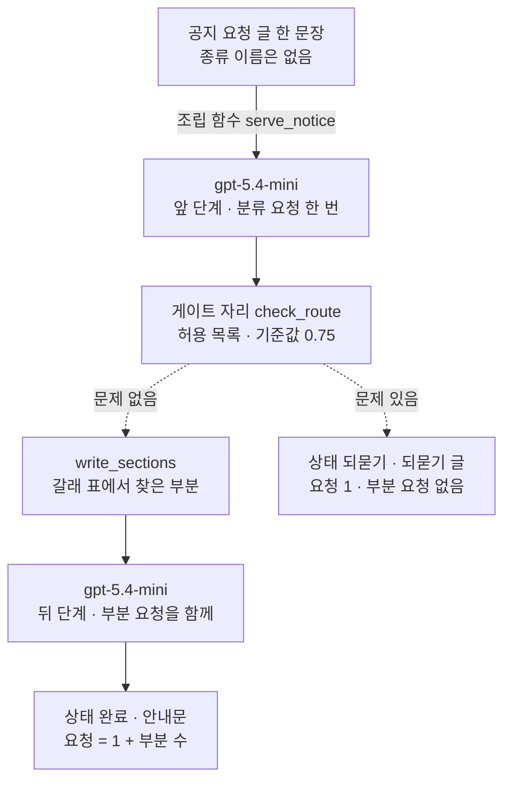
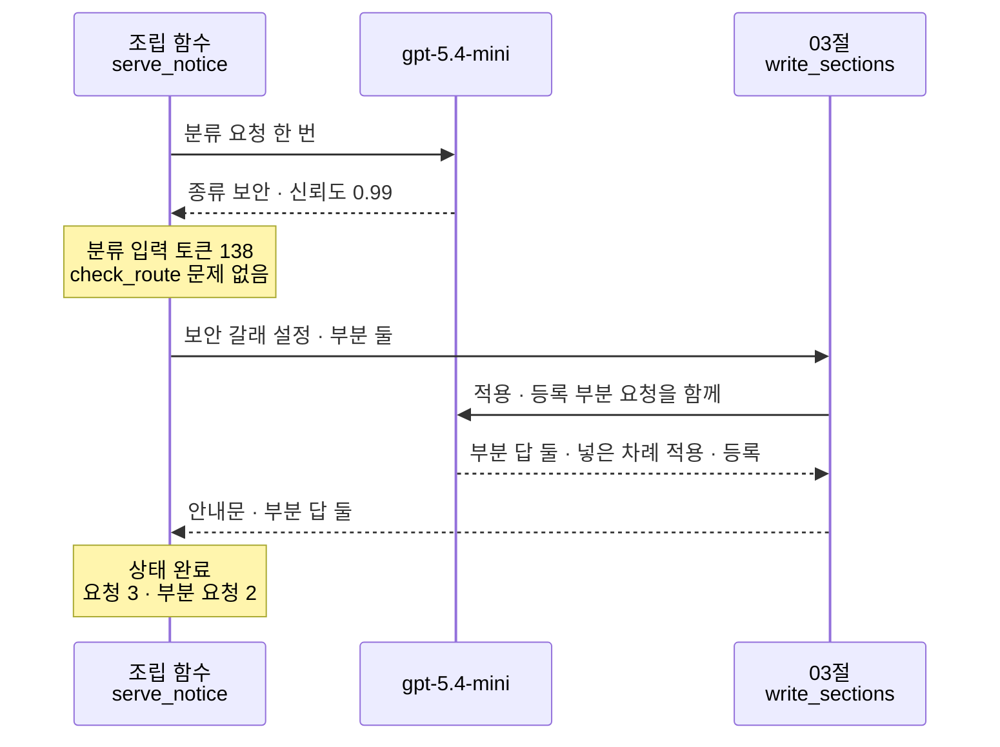
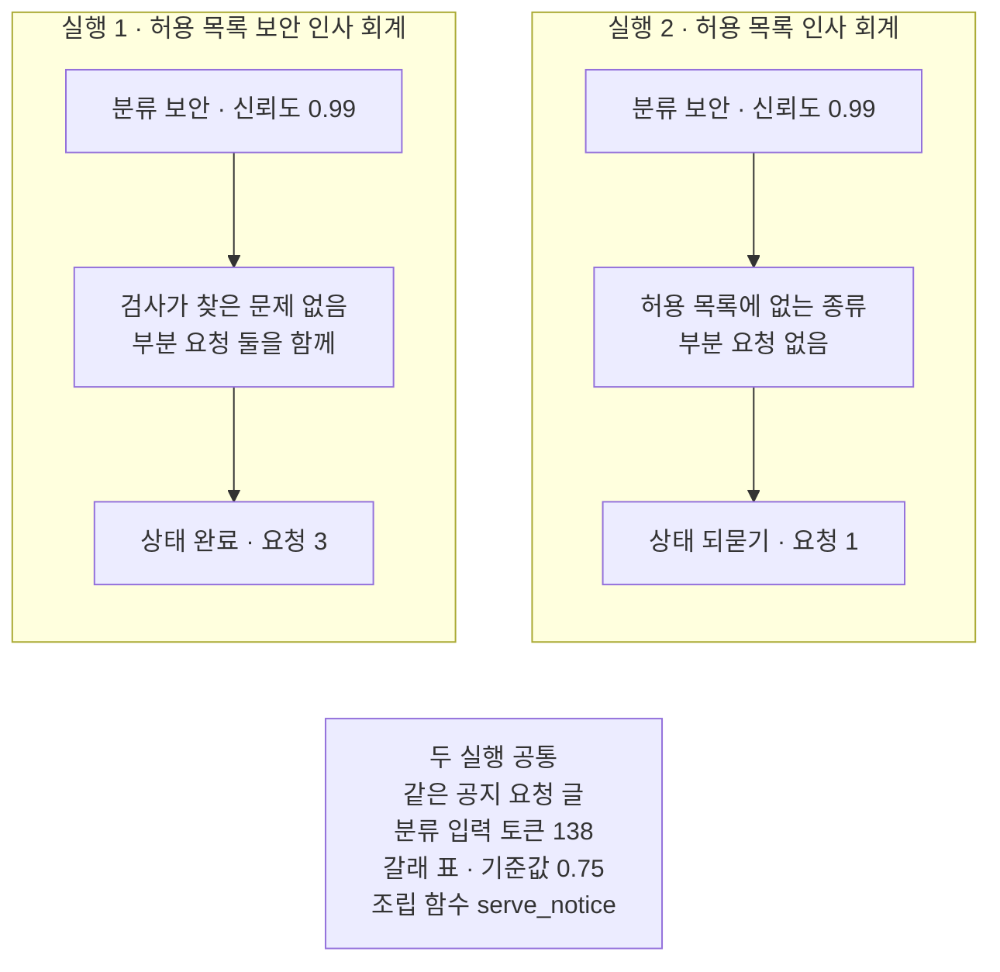

# 07-워크플로우-패턴-실습

## _src 본문 (HTML 원본)

```html
<!--meta: 실습 30분 | 코드 notebooks/07-워크플로우-패턴-실습.ipynb | 새 용어 0 -->
<style>html,body{overflow-x:hidden}.notebook,.nb-cell,.nb-main,.nb-input,.nb-result{min-width:0;max-width:100%}.nb-input pre,.nb-output{box-sizing:border-box;max-width:100%;overflow-x:auto}code.nb-source{display:block!important;width:100%!important;min-width:0!important;overflow-x:auto!important;padding:0!important}</style>
<h2 id="b1"><span class="no">1</span>학습 목표</h2><div class="goal"><ul>
<li>01·02·03절 함수를 조립 함수 하나로 이어, 공지 요청의 분류·검사·나눠 쓰기를 한 흐름으로 처리할 수 있습니다.</li>
<li>검사를 뒤 단계 앞에 둔 흐름에서, 검사 결과가 요청 수를 정하는 것을 기록 줄로 확인할 수 있습니다.</li>
<li>허용 목록 하나만 바꿔 다시 실행하고, 두 실행의 상태와 요청 수를 견줄 수 있습니다.</li>
</ul></div>
<h2 id="b2"><span class="no">2</span>이 내용을 배우는 이유</h2><p>이 챕터에서는 워크플로우 다섯 패턴을 절마다 따로 만들었습니다. 06절은 같은 과제를 다섯 흐름에 따로 넣어 견줬습니다. 실제 일에서는 한 흐름 안에 여러 패턴을 이어 붙이기도 합니다. 종류를 먼저 가른 뒤, 그 종류에 맞는 부분들을 함께 쓰는 식입니다.</p>
<p>이번 실습은 새 공지 요청 하나에 02절 라우팅 검사와 03절 나눠 쓰기를 이어 붙입니다. 둘 사이에는 01절 게이트처럼 검사를 둡니다. 허용 목록 하나만 바꿔 한 번 더 실행하고, 두 실행을 한 표로 견줍니다.</p>
<p>이번 절은 이 챕터의 실습입니다. 01~06절에서 쓴 이름과 문법만 쓰고 따로 내는 과제는 없습니다. 강사와 함께 노트북 셀을 차례로 실행합니다.</p>
<p><strong>이 절의 질문</strong> — 라우팅 검사와 나눠 쓰기를 한 흐름으로 이으면, 요청 수는 누가 정할까요? 허용 목록 하나를 바꾸면 무엇이 달라지고, 무엇이 그대로일까요?</p>
<h2 id="b3"><span class="no">3</span>앞에서 배운 내용</h2><p>이번 실습은 아래 절에서 배운 함수를 도구 파일 <code>workflow_tools.py</code>에서 그대로 가져옵니다.</p>
<table><thead><tr><th>절</th><th>배운 것</th><th>실습에서 쓰는 곳</th></tr></thead><tbody>
<tr><td>01절</td><td>요청 한 번을 보내고 기록 한 줄을 남기는 <code>ask_json()</code>, 기록 줄을 출력하는 <code>print_records()</code>, 두 단계 사이에서 중간 결과를 검사하는 게이트</td><td>분류 요청, 요청 수 세기, 조립 함수의 게이트 자리</td></tr>
<tr><td>02절</td><td>분류 지시 글과 요청 머리글, 허용 목록과 기준값으로 분류를 검사하는 <code>check_route()</code>, 갈래 표, 되묻기 갈래</td><td>앞 단계의 분류와 게이트 자리의 검사, 창구 설정 여섯 칸, 실행 2의 되묻기</td></tr>
<tr><td>03절</td><td>부분 요청 글을 만드는 <code>build_part_request()</code>, 부분 요청을 함께 보내고 잇는 <code>write_sections()</code>, 넣은 차례와 도착 차례</td><td>뒤 단계의 나눠 쓰기, 갈래 표의 값, 기록 줄 읽기</td></tr>
<tr><td>05·06절</td><td>설정 딕셔너리를 <code>copy()</code>로 복사해 한 칸만 바꾸기, 앞의 세 흐름은 요청 수를 코드가 정한다는 관찰</td><td>실행 2의 창구 설정, 두 실행의 요청 수를 실행 전에 세기</td></tr>
</tbody></table>
<p>세 절을 고른 까닭은 요청 수를 코드가 정하는 흐름이기 때문입니다. 06절에서 단계 잇기·라우팅·나눠 쓰기의 요청 수는 두 번 모두 코드가 정한 수였습니다. 그래서 두 실행의 요청 수를 실행 전에 셀 수 있고, 모델 요청도 30분 실습에 맞게 적습니다. 01절 흐름 함수 <code>run_gated_chain()</code>은 기획·작성 요청이 둘 더 들어 그대로 쓰지 않고, 두 단계 사이에 검사를 두는 모양만 가져옵니다.</p>
<p>다른 기능은 쓰지 않습니다. 04절 작업 나눠 맡기기와 05절 쓰고 평가하기 반복은 요청 수를 모델 답이 정합니다. 한 번만 넣어도 요청이 많게는 여섯 번이라 이 실습의 요청 수를 넘기 쉽습니다. 03절 투표는 표를 매기는 요청이 셋 더 들어 뺐습니다. 06절 비교 표와 걸린 초도 06절 실험을 되풀이하지 않으려고 쓰지 않습니다.</p>
<h2 id="b4"><span class="no">4</span>핵심 개념</h2><h3>비유로 시작하기</h3>
<p>01절부터 쓴 도예 공방에 앞 절 소품을 함께 놓아 봅니다. 흙덩이는 공지 요청입니다. 흙을 살펴 어느 그릇으로 빚을지 정하는 일은 02절 분류와 검사입니다. 물레 여럿이 함께 도는 모습은 03절 나눠 쓰기입니다. 오늘 공방은 같은 흙을 두 번 받습니다.</p>
{{img:07-4-물레-둘의-그릇과-탁자-위-덩이|흰 바탕 그림으로 왼쪽 긴 나무 작업대 위에 둥근 물레 둘이 나란히 놓이고 물레마다 같은 모양의 손잡이 달린 회색 컵이 하나씩 올라 있으며, 오른쪽에 빈 틈을 두고 따로 선 작은 나무 탁자 위에 모양을 잡지 않은 회색 흙덩이 하나만 놓인 그림|같은 흙을 두 번 받아, 한 번은 물레 둘이 함께 그릇 둘을 빚었고 한 번은 빚지 않고 따로 둔 탁자에 남겼습니다.}}
<p class="look"><b>그림 읽기</b> — 왼쪽 긴 나무 작업대 위에 둥근 물레 둘이 나란히 놓여 있습니다. 물레마다 같은 모양의 회색 컵이 하나씩 올라 있습니다. 오른쪽에는 빈 틈을 두고 작은 나무 탁자가 따로 서 있습니다. 그 위에는 모양을 잡지 않은 회색 흙덩이 하나만 놓여 있습니다.</p>
<p class="look">왼쪽은 실행 1입니다. 검사를 지난 흙이 물레 둘에서 함께 빚어져 컵 둘이 되었고, 부분 요청 둘을 함께 보낸 것과 같습니다. 오른쪽은 실행 2입니다. 같은 흙이 창구에서 받지 않는 종류라 빚지 않고 탁자에 그대로 남았습니다. 02절 삽화에서 작업대에 남은 덩이처럼 되묻기 갈래입니다.</p>
<h3>실습 조립의 구성</h3>
{{mermaid:07-1-라우팅-검사-뒤-나눠-쓰기|위에서 아래로 읽는 그림으로 초록 상자 공지 요청 글 한 문장 종류 이름은 없음에서 화살표 라벨 조립 함수 serve_notice를 지나 보라 상자 gpt-5.4-mini 앞 단계 분류 요청 한 번과 파란 상자 게이트 자리 check_route 허용 목록 기준값 0.75로 이어지고, 점선 둘이 나뉘어 문제 없음이면 왼쪽 파란 상자 write_sections 갈래 표에서 찾은 부분과 보라 상자 gpt-5.4-mini 뒤 단계 부분 요청을 함께를 지나 노란 상자 상태 완료 안내문 요청 = 1 + 부분 수로 가고, 문제 있음이면 오른쪽 노란 상자 상태 되묻기 되묻기 글 요청 1 부분 요청 없음으로 가는 그림|공지 요청 하나를 분류하고, 게이트 자리의 검사를 지난 요청만 그 종류 갈래의 부분 요청으로 함께 씁니다.}}
<p class="look"><b>도식 읽기</b> — 위에서 아래로 읽습니다. 초록 공지 요청 글이 조립 함수 <code>serve_notice</code>에 들어가 보라 분류 요청 한 번을 지납니다. 파란 게이트 자리 <code>check_route</code>에서 점선이 둘로 나뉩니다. 문제가 없으면 왼쪽 파란 <code>write_sections</code>와 보라 부분 요청을 지나 노란 완료 상자로 갑니다. 문제가 있으면 오른쪽 노란 되묻기 상자로 가고, 부분 요청은 하나도 나가지 않습니다.</p>
<p class="look">두 보라 상자만 실제로 모델을 부른 자리입니다. 노란 두 상자는 실행 1과 실행 2에서 각각 출력으로 확인한 상태입니다.</p>
<table><thead><tr><th>함수</th><th>하는 일</th><th>가져온 곳</th></tr></thead><tbody>
<tr><td><code>serve_notice()</code></td><td>공지 요청 하나를 분류하고, 검사를 지나면 그 종류 갈래의 부분을 함께 써서 흐름 결과를 내놓음</td><td>01~03절 함수를 이 절이 묶은 조립 함수</td></tr>
<tr><td><code>summarize_run()</code>·<code>print_summaries()</code></td><td>실행 한 번의 허용 목록·종류·상태·요청 수·부분 요청 수를 모으고, 실행마다 한 줄로 출력</td><td>이 절의 기록 장치</td></tr>
<tr><td><code>ask_json()</code>·<code>print_records()</code></td><td>요청 한 번과 기록 한 줄, 기록 줄 출력</td><td>01절</td></tr>
<tr><td><code>check_route()</code></td><td>허용 목록과 기준값으로 분류를 검사해 문제 목록을 내놓음</td><td>02절</td></tr>
<tr><td><code>write_sections()</code>·<code>build_part_request()</code></td><td>부분 요청을 함께 보내고 이음, 부분 요청 글을 만듦</td><td>03절</td></tr>
</tbody></table>
<h3>두 번의 실행</h3>
<p>실행 1은 창구 설정 그대로 공지 요청을 넣습니다. 허용 목록은 보안·인사·회계 셋입니다. 실행 2는 허용 목록 하나만 바꿔 보안을 뺍니다. 공지 요청 글과 분류 지시 글, 갈래 표, 기준값, 조립 함수는 두 실행이 같습니다.</p>
<p>허용 목록은 모델에게 보내는 글에 들어가지 않습니다. 코드가 분류를 받은 뒤 검사할 때만 씁니다. 그래서 두 실행의 분류 요청 글은 글자까지 같습니다.</p>
<h3>비교와 경계</h3>
<p>02절 라우팅 흐름은 검사를 지나면 갈래의 답 요청을 한 번 보냈습니다. 이 실습의 창구는 그 자리에서 부분 요청을 부분 수만큼 함께 보냅니다. 그래서 검사를 지났을 때 요청 수는 1 + 부분 수이고, 갈래 표에 적은 부분 수가 정합니다. 검사는 무엇을 받을지 정할 뿐, 받은 안내문이 맞게 쓰였는지는 보지 않습니다.</p>
<h2 id="b5"><span class="no">5</span>실행 예제</h2>
<p>노트북은 먼저 공통 사실과 새 공지 요청 글, 분류 지시 글을 적고 분류 요청 글을 미리 만듭니다. 그다음 종류마다 나눠 쓸 부분을 적어 갈래 표와 창구 설정을 만듭니다. 기록 장치와 조립 함수를 만든 뒤 실행 1과 실행 2를 차례로 합니다. 마지막에 두 실행을 한 표로 견주고, 줄어든 요청 수를 셉니다.</p>
<p>실제 OpenAI 모델을 부릅니다. 교재 출력은 2026-09-23에 실행한 결과입니다. 모델은 <code>gpt-5.4-mini</code>이고 temperature 0으로 부릅니다.</p>
<p>교재 출력에서 요청은 실행 1이 3번, 실행 2가 1번으로 모두 4번이었습니다. 요금표로 어림한 예상 비용은 0.01달러 아래이고, 청구 금액과는 다를 수 있습니다. 새로 쓰는 파일은 없습니다.</p>
{{notebook:07-워크플로우-패턴-실습}}
<p class="look"><b>확인할 점</b> — 노트북 5절 기록에서 첫 줄이 분류이고, 부분 줄이 둘인지 봅니다. 노트북 7절 표에서 두 실행의 상태와 요청 수를 견줍니다. 노트북 7절 마지막 셀에서 <code>줄어든 요청 수: 2</code>를 봅니다. 부분 기록 줄의 차례와 출력 토큰, 안내문 글은 여러분의 실행에서 교재 출력과 다를 수 있습니다. 분류 종류와 신뢰도도 실행한 때에 따라 달라질 수 있습니다.</p>
<h3>실행 1의 실제 순서</h3>
{{mermaid:07-2-실행-1의-실제-순서|위에서 아래로 읽는 차례 그림으로 조립 함수 serve_notice와 모델 gpt-5.4-mini와 03절 write_sections 세 세로줄이 있고, 조립 함수가 모델에 분류 요청 한 번을 보내 종류 보안 신뢰도 0.99를 받은 뒤 노란 메모 분류 입력 토큰 138 check_route 문제 없음이 있고, 조립 함수가 write_sections에 보안 갈래 설정 부분 둘을 넘기면 write_sections가 모델에 적용 등록 부분 요청을 함께 보내 부분 답 둘을 넣은 차례 적용 등록으로 받고, 조립 함수에 안내문과 부분 답 둘을 내놓은 뒤 노란 메모 상태 완료 요청 3 부분 요청 2가 적힌 그림|실행 1은 분류 요청 한 번 뒤 검사를 지나, 보안 갈래의 부분 요청 둘을 함께 보냈습니다.}}
<p class="look"><b>도식 읽기</b> — 위에서 아래로 읽는 차례 그림이고, 세로줄은 왼쪽부터 조립 함수, 모델, 03절 <code>write_sections</code>입니다. 조립 함수가 분류 요청을 보내고, 점선으로 종류 보안과 신뢰도 0.99를 받습니다. 첫 노란 메모는 그 응답 뒤에 남은 분류 입력 토큰과 검사 결과입니다. 그다음 <code>write_sections</code> 함수가 적용·등록 부분 요청을 함께 보내고, 부분 답 둘을 넣은 차례로 받습니다. 마지막 노란 메모의 상태와 요청 수는 새 커널 두 번과 노트북 밖 다섯 번에서 모두 같았습니다.</p>
<p class="look">기록 줄에서 부분 두 줄의 차례는 도착 차례라 새 커널 두 번이 달랐고, 그래서 그림에 넣지 않았습니다. 차례 그림의 세로줄 머리 상자는 색을 칠하지 않은 기본 회색입니다.</p>
<h2 id="b6"><span class="no">6</span>실험 결과 해석</h2>
<p>두 실행은 허용 목록 하나만 달랐습니다.</p>
<table><thead><tr><th>실행</th><th>허용 목록</th><th>분류 종류</th><th>상태</th><th>요청 수</th><th>부분 요청 수</th></tr></thead><tbody>
<tr><td>실행 1</td><td>보안, 인사, 회계</td><td>보안</td><td>완료</td><td>3</td><td>2</td></tr>
<tr><td>실행 2</td><td>인사, 회계</td><td>보안</td><td>되묻기</td><td>1</td><td>0</td></tr>
</tbody></table>
<p>두 실행 모두 분류 요청은 종류를 보안으로 적었습니다. 실행 1은 보안이 허용 목록에 있어 검사를 지났습니다. 그래서 보안 갈래의 부분 둘을 함께 써서, 요청이 세 번이었습니다.</p>
<p>실행 2는 같은 분류가 허용 목록에 없는 종류라 검사에 걸렸습니다. 조립 함수는 부분 요청을 하나도 보내지 않고 되묻기 글로 끝났습니다. 줄어든 요청 수 2는 보안 갈래의 부분 수와 같습니다.</p>
{{mermaid:07-3-허용-목록-셋과-둘|칸 둘이 나란히 있고 아래 가운데에 회색 상자가 있는 그림으로 왼쪽 실행 1 허용 목록 보안 인사 회계 칸에는 노란 상자 분류 보안 신뢰도 0.99, 검사가 찾은 문제 없음 부분 요청 둘을 함께, 상태 완료 요청 3이 위에서 아래로 있고, 오른쪽 실행 2 허용 목록 인사 회계 칸에는 노란 상자 분류 보안 신뢰도 0.99, 허용 목록에 없는 종류 부분 요청 없음, 상태 되묻기 요청 1이 위에서 아래로 있으며, 회색 상자에 두 실행 공통 같은 공지 요청 글, 분류 입력 토큰 138, 갈래 표 기준값 0.75, 조립 함수 serve_notice가 적힌 그림|허용 목록에서 보안만 빼자, 같은 분류가 검사에 걸려 부분 요청 둘이 나가지 않았습니다.}}
<p class="look"><b>도식 읽기</b> — 왼쪽 칸이 실행 1, 오른쪽 칸이 실행 2이고, 칸마다 위에서 아래로 읽습니다. 두 칸의 맨 위 노란 상자는 같은 분류입니다. 가운데 상자에서 두 칸이 갈립니다. 실행 1은 검사를 지나 부분 요청 둘을 보냈고, 실행 2는 허용 목록에 없는 종류라 보내지 않았습니다. 맨 아래 회색 상자는 두 실행의 출력과 설정에서 모두 확인한 공통 사실입니다.</p>
<p>두 실행에서 바뀐 것은 코드가 쥔 허용 목록 하나입니다. 분류 요청 글이 같아서 입력 토큰도 두 실행 모두 138이었습니다. 모델이 쓴 종류와 신뢰도도 두 실행이 같았습니다. 모델 답이 같아도 허용 목록 하나로 뒤 단계 요청을 보낼지가 갈렸습니다.</p>
<p>이 흐름의 요청 수는 실행 전에 셀 수 있습니다. 검사를 지나면 1 + 부분 수, 걸리면 1입니다. 06절에서 본 앞의 세 흐름처럼 요청 수를 코드가 정했습니다. 다만 검사를 지날지는 분류 요청의 답에 달려 있습니다. 모델이 다른 종류나 낮은 신뢰도를 적으면 실행 1도 되묻기로 끝날 수 있습니다.</p>
<p>노트북 5·6·7절의 상태와 분류, 요청 수, 분류 요청 입력 토큰은 새 커널로 두 번 실행했을 때 두 번 모두 같았습니다. 노트북 밖에서 같은 두 실행을 다섯 번 보냈을 때도 같았습니다. 부분 기록 줄의 도착 차례는 새 커널 두 번이 달랐습니다. 출력 토큰과 안내문 글도 실행마다 달라질 수 있어 결론에 쓰지 않았습니다.</p>
<h2 id="b7"><span class="no">7</span>주의할 점과 실무 메모</h2>
<ul>
<li><strong>새 공지 요청 글과 부분 목록은 실행 전에 정했습니다.</strong> 요청 글은 이 절에서 적은 글이고, 실제 직원이 보낸 글이 아닙니다. 종류마다 나눠 쓸 부분도 이 절에서 정한 값입니다.</li>
<li><strong>노트북 밖에서 먼저 흔들림을 확인했습니다.</strong> 노트북을 실행하기 전에 같은 두 실행을 다섯 번 보냈습니다. 다섯 번 모두 분류는 보안이었고, 실행 1은 완료·요청 3번, 실행 2는 되묻기·요청 1번이었습니다.</li>
<li><strong>같은 요청도 실행한 때에 따라 모델이 다른 종류나 신뢰도를 적을 수 있습니다.</strong> 그러면 검사 결과와 요청 수가 달라집니다. 신뢰도는 모델이 스스로 적은 수이고, 재서 얻은 값이 아닙니다.</li>
<li><strong>실행 2의 허용 목록은 흐름을 보여 주려고 정한 예입니다.</strong> 이번 주 보안 공지는 보안팀이 직접 쓰기로 했다고 정했습니다.</li>
<li><strong>인사·회계 갈래는 이번 실행에서 부르지 않았습니다.</strong> 창구가 받을 수 있는 종류를 보이려고 부분만 적었습니다. 세 갈래가 같은 공통 사실을 받는 모양도 실습을 짧게 하려고 정한 것입니다. 실제 창구라면 종류마다 사실을 따로 받아야 합니다.</li>
<li><strong>부분 요청 둘은 함께 보내므로 기록 줄은 응답이 도착한 차례로 쌓입니다.</strong> 부분 답의 목록은 03절에서 본 대로 넣은 차례입니다.</li>
<li><strong>검사는 무엇을 받을지만 정합니다.</strong> 안내문 문장이 좋은지, 공통 사실에 없는 내용을 지어냈는지는 보지 않았습니다.</li>
<li><strong>걸린 시간은 재지 않았습니다.</strong> 예상 비용도 노트북에서 셈하지 않았고, 요금표로 어림한 값만 준비물에 적었습니다.</li>
<li><strong>분류 답에 칸 「종류」나 「신뢰도」가 없으면 <code>KeyError</code>로 셀이 멈춥니다.</strong> 부분 답에 칸 「글」이 없거나 답이 JSON 글이 아닐 때도 멈춥니다. 이번 실행과 노트북 밖 확인에서는 그런 답을 받지 않았습니다.</li>
<li><strong>모델이 쓴 글에는 <code>assert</code>를 쓰지 않았습니다.</strong> 이 절은 파일을 쓰지 않아, 실행 요약은 커널을 다시 시작하면 사라집니다.</li>
<li><strong>temperature 값을 0으로 두어도 답 문장이 매번 같다고 보장하지는 않습니다.</strong> 안내문 글과 출력 토큰은 실행마다 달라질 수 있습니다.</li>
<li><strong>교재 출력은 Linux의 Python 3.12.13으로 만들었습니다.</strong> 패키지는 openai 2.29.0과 python-dotenv 1.2.3입니다. 다른 판과 Windows·macOS에서는 이번에 실행하지 않았습니다.</li>
</ul>
<h2 id="b8"><span class="no">8</span>정리와 다음 절</h2>
<ul>
<li>02절 라우팅 검사와 03절 나눠 쓰기를 01절 단계 잇기처럼 한 조립 함수로 이어, 공지 요청 하나를 처리했습니다.</li>
<li>검사를 지난 실행 1은 분류 1번과 부분 2번으로 요청이 3번이었고, 안내문을 받았습니다.</li>
<li>허용 목록에서 보안만 빼자 같은 분류가 검사에 걸려 되묻기로 끝났고, 부분 요청 2번이 나가지 않았습니다.</li>
</ul>
<p><strong>다음 학습과 이어지는 지점</strong> — 이 절로 Ch 18이 끝납니다. Ch 19에서는 함수를 도구로 만들고, 모델이 도구 설명을 보고 고르게 합니다.</p>
<h2 id="b9"><span class="no">9</span>복습 문제</h2>
<details class="quiz" open><summary>문제 4개 · 해설 포함</summary>
<p class="quiz-q">1. [하] 두 실행에서 바꾼 값은 무엇입니까?</p>
<p class="quiz-a">허용 목록 하나입니다. 실행 1은 보안·인사·회계이고 실행 2는 인사·회계입니다. 공지 요청 글과 분류 지시 글, 갈래 표, 기준값, 조립 함수는 같게 두었습니다.</p>
<p class="quiz-q">2. [중] 보안 갈래의 부분을 셋으로 늘리면, 실행 1의 요청은 몇 번 나가나요?</p>
<p class="quiz-a">네 번입니다. 분류 요청 한 번과 부분마다 한 번씩 세 번입니다. 부분 수는 모델이 아니라 갈래 표가 정합니다. 틀렸다면 「핵심 개념」의 「비교와 경계」를 다시 읽습니다.</p>
<p class="quiz-q">3. [중] 실행 2에서 요청이 한 번뿐이었던 까닭은 무엇입니까?</p>
<p class="quiz-a">분류 종류 보안이 허용 목록에 없어 게이트 자리의 검사에 걸렸기 때문입니다. 조립 함수는 <code>return</code>으로 바로 끝나 부분 요청을 보내지 않았습니다. 틀렸다면 노트북 4절 조립 함수와 6절을 다시 봅니다.</p>
<p class="quiz-q">4. [상] 동료가 「검사를 부분 요청 뒤로 옮겨도 결과는 같다」고 말합니다. 이 절 결과로 무엇이라고 답하나요?</p>
<p class="quiz-a">상태는 똑같이 되묻기로 끝낼 수 있어도 요청 수가 다르다고 답합니다. 검사를 뒤로 옮기면 실행 2도 부분 요청 둘을 먼저 보내 요청이 세 번이 됩니다. 이 절에서는 검사를 앞에 두어 요청이 한 번이었습니다. 검사를 뒤에 둔 모양은 이번에 실행하지 않았고, 요청 수만 센 것입니다. 받지 않을 요청은 뒤 단계 요청을 보내기 전에 거르는 것이 01절 게이트 자리의 뜻입니다.</p>
</details>
<h2 id="b10"><span class="no">10</span>참고 자료</h2>
<ul>
<li>01절 — 두 단계 사이에 게이트를 두고, 요청 한 번에 기록 한 줄을 남긴 자리.</li>
<li>02절 — 분류 요청과 검사, 갈래 표, 되묻기 갈래를 만든 자리.</li>
<li>03절 — 부분 요청을 함께 보내 나눠 쓰기를 만든 자리.</li>
<li>06절 — 같은 과제로 다섯 흐름의 요청 수를 견준 자리.</li>
<li>기준 버전은 openai 2.29.0과 python-dotenv 1.2.3입니다. 교재 출력은 Linux의 Python 3.12.13으로 만들었습니다.</li>
</ul>
```

## 노트북 셀 (순서대로)

### [0] markdown {'html': 'skip'}

# 워크플로우 패턴 실습: 공지 요청을 라우팅 검사 뒤 나눠 쓰고 허용 목록 바꾸기

**이 노트북에서 할 일**

1. 새 공지 요청 하나와, 종류마다 나눠 쓸 부분을 적은 창구 설정을 만듭니다.
2. 라우팅 검사를 지난 요청만 나눠 쓰기로 보내는 조립 함수로 공지 요청을 처리합니다.
3. 허용 목록 하나만 바꿔 다시 실행하고, 두 실행의 상태와 요청 수를 한 표로 견줍니다.

**준비물** — 프로젝트 맨 위 폴더의 `.env`에 적어 둔 `OPENAI_API_KEY`를 씁니다.
모델은 `gpt-5.4-mini`이고, 조립 함수 한 번에 요청이 많아야 세 번 나갑니다.
분류 요청 한 번과, 검사를 지났을 때 부분마다 한 번씩입니다.

노트북은 조립 함수를 두 번 부르므로 모델 요청은 여섯 번을 넘지 않습니다.
교재 출력에서는 실행 1이 3번, 실행 2가 1번으로 모두 4번이었습니다.
요금표로 어림한 예상 비용은 0.01달러 아래이고, 청구 금액이 아닙니다.

자료 파일을 읽거나 새 파일을 쓰지 않습니다.
01~03절에서 배운 함수는 같은 폴더의 도구 파일 `workflow_tools.py`에서 가져옵니다.
걸린 시간은 재지 않습니다. 교재 출력을 만든 실행에서는 노트북 전체가 약 5초 만에 끝났습니다.

**기준 버전** — 첫 셀에서 openai 2.29.0과 python-dotenv 1.2.3을 설치합니다.
교재 출력은 Linux의 Python 3.12.13으로 만들었습니다.
다른 판과 Windows·macOS에서는 이번에 실행하지 않았습니다.

**실습 범위** — 이 절은 챕터 끝 실습 절이고 30분 안에 끝나는 분량입니다.
강사와 함께 첫 셀부터 차례로 실행하고, 따로 내는 과제는 없습니다.
01~06절에서 쓴 이름과 문법만 씁니다.

실습 폴더 `labs/part5/ch18-workflow-patterns`에서 `uv sync --locked`를 실행합니다.
그다음 `notebooks/` 폴더의 이 노트북을 열고, 실습 폴더의 `.venv` 커널을 고릅니다.
첫 셀부터 순서대로 실행합니다.

### [1] markdown {'html': 'skip'}

## 오늘 볼 그림


위에서 아래로 읽습니다. 초록 공지 요청 글이 조립 함수 `serve_notice`에 들어가 보라 분류 요청 한 번을 지납니다. 파란 게이트 자리 `check_route`에서 점선이 둘로 나뉩니다. 문제가 없으면 왼쪽 파란 `write_sections`와 보라 부분 요청을 지나 노란 완료 상자로 갑니다. 문제가 있으면 오른쪽 노란 되묻기 상자로 가고, 부분 요청은 하나도 나가지 않습니다.

### [2] markdown {}

## 1. 준비

이번 절은 이 챕터의 실습입니다.
01~06절에서 쓴 이름과 문법만 쓰고 따로 내는 과제는 없습니다.
첫 셀은 패키지 두 개를 설치하고 설치된 판 번호를 출력합니다.
설치에는 몇십 초가 걸릴 수 있습니다.

### [3] code {'execution': {'iopub.execute_input': '2026-09-23T22:41:25.636161Z', 'iopub.status.busy': '2026-09-23T22:41:25.635988Z', 'iopub.status.idle': '2026-09-23T22:41:26.286859Z', 'shell.execute_reply': '2026-09-23T22:41:26.286199Z'}, 'lesson_role': 'setup'}

```python
# 이 절에서 쓰는 패키지를 설치하고 버전을 확인합니다
%pip install -q "openai==2.29.0" "python-dotenv==1.2.3"
from importlib.metadata import version

print("openai:", version("openai"))
print("python-dotenv:", version("python-dotenv"))
```

출력:
```
Note: you may need to restart the kernel to use updated packages.
openai: 2.29.0
python-dotenv: 1.2.3

```

### [4] markdown {}

**결과 읽기** — 출력 줄 `openai: 2.29.0`과 `python-dotenv: 1.2.3`이 실습 폴더 잠금과 같은 판입니다.
이 노트북의 출력은 2026-09-23에 이 판으로 실행한 결과입니다.

앞에서 배운 함수는 `workflow_tools.py`에 모아 두었습니다. 파일을 열면 코드를 볼 수 있습니다. 노트북과 같은 폴더(`notebooks/`)에 있는 파일입니다. 커널이 `notebooks/` 폴더에서 시작해야 이 파일을 가져올 수 있습니다.
다음 셀은 클라이언트 이름과, 01~03절에서 배운 함수 다섯을 가져옵니다.

### [5] code {'execution': {'iopub.execute_input': '2026-09-23T22:41:26.288330Z', 'iopub.status.busy': '2026-09-23T22:41:26.288201Z', 'iopub.status.idle': '2026-09-23T22:41:26.712271Z', 'shell.execute_reply': '2026-09-23T22:41:26.711826Z'}, 'lesson_role': 'setup'}

```python
# 클라이언트 이름 OpenAI와, 01~03절에서 배운 함수 다섯을 도구 파일 workflow_tools.py에서 가져옵니다
from openai import OpenAI

from workflow_tools import ask_json, build_part_request, check_route, print_records, write_sections

print("01절:", "ask_json", "print_records")
print("02절:", "check_route")
print("03절:", "build_part_request", "write_sections")
```

출력:
```
01절: ask_json print_records
02절: check_route
03절: build_part_request write_sections

```

### [6] markdown {}

**결과 읽기** — 출력 세 줄이 절마다 가져온 함수 이름입니다.
01절 함수 `ask_json`은 요청 한 번을 보내고 기록 한 줄을 남깁니다.
함수 `print_records`는 그 기록 줄을 줄마다 출력합니다.
02절 함수 `check_route`는 분류를 검사해 문제 목록을 내놓습니다.
03절 함수 `write_sections`는 부분 요청을 함께 보내고, 함수 `build_part_request`는 부분 요청 글을 만듭니다.

API 키가 있는지 확인합니다. `True` 값이 나오면 다음으로 넘어갑니다.

### [7] code {'execution': {'iopub.execute_input': '2026-09-23T22:41:26.713111Z', 'iopub.status.busy': '2026-09-23T22:41:26.713048Z', 'iopub.status.idle': '2026-09-23T22:41:26.718750Z', 'shell.execute_reply': '2026-09-23T22:41:26.718408Z'}, 'lesson_role': 'setup'}

```python
# .env 파일에서 OpenAI API 키를 읽습니다(키 값은 출력하지 않습니다)
import os
from dotenv import find_dotenv, load_dotenv

env_path = find_dotenv(usecwd=True)
load_dotenv(env_path)
has_key = os.getenv("OPENAI_API_KEY") is not None
print("OPENAI_API_KEY 설정 여부:", has_key)
assert has_key, "프로젝트 폴더의 .env 파일에 OPENAI_API_KEY를 적어 주세요."
```

출력:
```
OPENAI_API_KEY 설정 여부: True

```

### [8] markdown {}

**결과 읽기** — 출력 줄 `OPENAI_API_KEY 설정 여부: True`로 키를 찾았습니다.
키 값은 출력하지 않습니다.

다음 셀은 01~06절처럼 `client = OpenAI()` 한 줄로 클라이언트를 만듭니다.

### [9] code {'execution': {'iopub.execute_input': '2026-09-23T22:41:26.719401Z', 'iopub.status.busy': '2026-09-23T22:41:26.719340Z', 'iopub.status.idle': '2026-09-23T22:41:26.753527Z', 'shell.execute_reply': '2026-09-23T22:41:26.753218Z'}}

```python
# OpenAI 서비스에 요청을 보낼 클라이언트를 하나 만듭니다(키는 앞 셀에서 읽은 환경 변수를 씁니다)
client = OpenAI()
print("클라이언트:", type(client).__name__)
```

출력:
```
클라이언트: OpenAI

```

### [10] markdown {}

**결과 읽기** — 출력 줄 `클라이언트: OpenAI`로 클라이언트를 만들었습니다.
두 실행의 요청은 모두 이 클라이언트 하나로 보냅니다.

## 2. 상황과 재료

사내 공지 창구 하나를 만든다고 해 봅니다.
직원이 공지 요청 글을 보내면, 창구는 먼저 요청의 종류를 가릅니다.
검사를 지난 요청만 그 종류의 갈래로 보내, 안내문의 부분들을 함께 씁니다.
검사에 걸린 요청은 되묻기 글로 끝냅니다.

다음 셀은 03~06절과 같은 공통 사실을 적습니다.
안내문의 부분들은 이 글에 있는 사실만 씁니다.

### [11] code {'execution': {'iopub.execute_input': '2026-09-23T22:41:26.754145Z', 'iopub.status.busy': '2026-09-23T22:41:26.754073Z', 'iopub.status.idle': '2026-09-23T22:41:26.755805Z', 'shell.execute_reply': '2026-09-23T22:41:26.755537Z'}}

```python
# 안내문의 부분들이 함께 쓸 공통 사실을 적습니다(01~06절과 같은 날짜·까닭·등록 방법·문의처)
notice_fact = "2026년 10월 15일부터 전 직원 계정에 2단계 인증을 적용합니다. "
notice_fact = notice_fact + "비밀번호만으로는 계정을 지키기 어렵기 때문입니다. "
notice_fact = notice_fact + "등록은 사내 포털의 보안 메뉴에서 인증 앱을 연결하면 됩니다. "
notice_fact = notice_fact + "문의는 help@company.test로 받습니다."
print("공통 사실:")
print(notice_fact)
```

출력:
```
공통 사실:
2026년 10월 15일부터 전 직원 계정에 2단계 인증을 적용합니다. 비밀번호만으로는 계정을 지키기 어렵기 때문입니다. 등록은 사내 포털의 보안 메뉴에서 인증 앱을 연결하면 됩니다. 문의는 help@company.test로 받습니다.

```

### [12] markdown {}

**결과 읽기** — 라벨 줄 `공통 사실:` 아래 한 줄이 03~06절과 같은 공통 사실입니다.
날짜, 까닭, 등록 방법, 문의처가 한 문장씩 들어 있습니다.
코드 셀 첫 줄 주석은 「01~06절과 같은」이라고 적었지만, 이 공통 사실은 03절부터 썼습니다.
01·02절은 비밀번호 재설정 안내문과 고객 문의라는 다른 과제를 썼습니다.

다음 셀은 이 실습의 새 공지 요청 글을 적습니다.
이 절에서 실행 전에 정한 글이고, 실제 직원이 보낸 글이 아닙니다.

### [13] code {'execution': {'iopub.execute_input': '2026-09-23T22:41:26.756332Z', 'iopub.status.busy': '2026-09-23T22:41:26.756280Z', 'iopub.status.idle': '2026-09-23T22:41:26.757532Z', 'shell.execute_reply': '2026-09-23T22:41:26.757330Z'}}

```python
# 이 실습의 새 공지 요청 글을 적습니다(이 절에서 실행 전에 정한 글이고, 실제 직원이 보낸 글이 아닙니다)
notice_request = "전 직원 계정에 2단계 인증을 적용한다는 공지를 올려 주세요."
print("공지 요청:", notice_request)
print("출처:", "이 절에서 실행 전에 적은 글")
```

출력:
```
공지 요청: 전 직원 계정에 2단계 인증을 적용한다는 공지를 올려 주세요.
출처: 이 절에서 실행 전에 적은 글

```

### [14] markdown {}

**결과 읽기** — 출력 줄 `공지 요청:` 뒤 한 문장이 창구에 넣을 요청 글입니다.
출력 줄 `출처: 이 절에서 실행 전에 적은 글`처럼 요청 글은 실행 전에 적었습니다.
요청 글에는 종류 이름이 없습니다. 종류는 분류 요청이 적습니다.

다음 셀은 분류 지시 글을 적습니다.
02절 분류 지시 글과 모양이 같고, 종류는 06절처럼 보안·인사·회계 셋입니다.

### [15] code {'execution': {'iopub.execute_input': '2026-09-23T22:41:26.758053Z', 'iopub.status.busy': '2026-09-23T22:41:26.758005Z', 'iopub.status.idle': '2026-09-23T22:41:26.759711Z', 'shell.execute_reply': '2026-09-23T22:41:26.759401Z'}}

```python
# 분류 단계의 지시 글을 적습니다: 종류 셋과, 하나로 정할 수 없을 때 쓸 이름 「모름」
classify_instructions = "사내 공지 요청을 종류 하나로 가르는 분류 담당입니다. "
classify_instructions = classify_instructions + "종류는 보안, 인사, 회계 가운데 하나로 적습니다. "
classify_instructions = classify_instructions + "하나로 정할 수 없으면 종류를 모름으로 적습니다. "
# 신뢰도는 모델이 스스로 적는 수입니다(재서 얻은 값이 아님)
classify_instructions = classify_instructions + "신뢰도에는 그 종류가 맞다고 보는 정도를 0과 1 사이 수로 적습니다. "
classify_instructions = classify_instructions + '답은 JSON 객체 하나로만 출력합니다: {"종류": "글", "신뢰도": 수}'
print("분류 지시 글:")
print(classify_instructions)
```

출력:
```
분류 지시 글:
사내 공지 요청을 종류 하나로 가르는 분류 담당입니다. 종류는 보안, 인사, 회계 가운데 하나로 적습니다. 하나로 정할 수 없으면 종류를 모름으로 적습니다. 신뢰도에는 그 종류가 맞다고 보는 정도를 0과 1 사이 수로 적습니다. 답은 JSON 객체 하나로만 출력합니다: {"종류": "글", "신뢰도": 수}

```

### [16] markdown {}

**결과 읽기** — 라벨 줄 `분류 지시 글:` 아래 한 줄이 분류 지시 글입니다.
06절 분류 지시 글과 첫 문장만 다르고, 종류 셋과 답 모양은 같습니다.
신뢰도는 모델이 스스로 적는 수이고, 재서 얻은 값이 아닙니다.

다음 셀은 분류 요청 글을 미리 만들어 봅니다.
요청 머리글 뒤에 공지 요청 글을 붙입니다.
02절에서 본 대로, 형식 `json_object`는 요청 글에 JSON이라는 말이 있어야 합니다.

### [17] code {'execution': {'iopub.execute_input': '2026-09-23T22:41:26.760292Z', 'iopub.status.busy': '2026-09-23T22:41:26.760227Z', 'iopub.status.idle': '2026-09-23T22:41:26.761776Z', 'shell.execute_reply': '2026-09-23T22:41:26.761522Z'}}

```python
# 분류 요청 글을 미리 만들어 봅니다: 요청 머리글 + 공지 요청 글(아직 모델을 부르지 않습니다)
# 형식 json_object는 요청 글에 JSON이라는 말이 있어야 해서 머리글에 적어 둡니다
classify_head = "아래 공지 요청에 JSON으로 답하세요.\n요청: "
classify_request = classify_head + notice_request
print("분류 요청 글:")
print(classify_request)
```

출력:
```
분류 요청 글:
아래 공지 요청에 JSON으로 답하세요.
요청: 전 직원 계정에 2단계 인증을 적용한다는 공지를 올려 주세요.

```

### [18] markdown {}

**결과 읽기** — 라벨 줄 `분류 요청 글:` 아래 두 줄이 분류 요청에 보낼 글입니다.
첫 줄이 요청 머리글이고, 둘째 줄 `요청:` 뒤가 공지 요청 글입니다.
실행 1과 실행 2는 이 글을 그대로 보냅니다.

## 3. 갈래 표와 창구 설정

02절에서는 갈래 표의 값이 갈래의 지시 글이었습니다.
이 실습은 갈래 표의 값을 03절 나눠 쓰기 설정으로 둡니다.
그래서 검사를 지난 요청은 그 종류의 부분들을 함께 보내 안내문을 씁니다.

다음 셀은 부분 하나를 쓰는 작성자의 지시 글과 요청 머리글을 03절 글 그대로 적습니다.

### [19] code {'execution': {'iopub.execute_input': '2026-09-23T22:41:26.762363Z', 'iopub.status.busy': '2026-09-23T22:41:26.762306Z', 'iopub.status.idle': '2026-09-23T22:41:26.764222Z', 'shell.execute_reply': '2026-09-23T22:41:26.763876Z'}}

```python
# 부분 하나를 쓰는 작성자의 지시 글과 요청 머리글을 적습니다(03절에서 적은 글 그대로)
section_instructions = "사내 안내문의 한 부분을 쓰는 작성자입니다. "
section_instructions = section_instructions + "공통 사실 가운데 쓸 부분에 맞는 것만 골라 한국어 두 문장으로 씁니다. "
section_instructions = section_instructions + "공통 사실에 없는 날짜·연락처·절차는 지어내지 않습니다. "
section_instructions = section_instructions + '답은 JSON 객체 하나로만 출력합니다: {"부분": "쓸 부분 이름 그대로", "글": "글"}'
section_head = "아래 공통 사실로 안내문의 한 부분을 JSON으로 쓰세요.\n공통 사실: "
print("부분 지시 글:")
print(section_instructions)
```

출력:
```
부분 지시 글:
사내 안내문의 한 부분을 쓰는 작성자입니다. 공통 사실 가운데 쓸 부분에 맞는 것만 골라 한국어 두 문장으로 씁니다. 공통 사실에 없는 날짜·연락처·절차는 지어내지 않습니다. 답은 JSON 객체 하나로만 출력합니다: {"부분": "쓸 부분 이름 그대로", "글": "글"}

```

### [20] markdown {}

**결과 읽기** — 라벨 줄 `부분 지시 글:` 아래 한 줄이 03절 지시 글과 같은 글입니다.
부분마다 한국어 두 문장으로 쓰고, 공통 사실에 없는 날짜·연락처·절차는 지어내지 않게 합니다.
변수 `section_head`는 03절 요청 머리글이고, 여기에도 JSON이라는 말이 있습니다.

다음 셀은 종류마다 나눠 쓸 부분 목록을 적습니다.
부분 하나에 요청이 한 번 나가므로, 부분 수가 곧 뒤 단계의 요청 수입니다.
부분은 이 절에서 실행 전에 정한 값입니다.

### [21] code {'execution': {'iopub.execute_input': '2026-09-23T22:41:26.764816Z', 'iopub.status.busy': '2026-09-23T22:41:26.764764Z', 'iopub.status.idle': '2026-09-23T22:41:26.766613Z', 'shell.execute_reply': '2026-09-23T22:41:26.766334Z'}}

```python
# 종류마다 나눠 쓸 부분 목록을 적습니다(부분 하나에 요청 한 번 — 이 절에서 실행 전에 정한 값)
security_parts = [{"이름": "적용", "담을 내용": "적용 날짜와 대상"}]
security_parts.append({"이름": "등록", "담을 내용": "등록 방법과 문의처 주소"})
hr_parts = [{"이름": "대상", "담을 내용": "대상과 날짜"}, {"이름": "신청", "담을 내용": "신청 방법과 문의처"}]
account_parts = [{"이름": "대상", "담을 내용": "대상과 날짜"}, {"이름": "제출", "담을 내용": "제출 방법과 문의처"}]
print("보안 갈래 부분:")
print(security_parts)
print("부분 수 | 보안", len(security_parts), "| 인사", len(hr_parts), "| 회계", len(account_parts))
```

출력:
```
보안 갈래 부분:
[{'이름': '적용', '담을 내용': '적용 날짜와 대상'}, {'이름': '등록', '담을 내용': '등록 방법과 문의처 주소'}]
부분 수 | 보안 2 | 인사 2 | 회계 2

```

### [22] markdown {}

**결과 읽기** — 라벨 줄 `보안 갈래 부분:` 아래 목록이 보안 갈래의 부분 둘입니다.
적용 부분은 적용 날짜와 대상, 등록 부분은 등록 방법과 문의처 주소를 맡습니다.
출력 줄 `부분 수 | 보안 2 | 인사 2 | 회계 2`처럼 갈래마다 부분이 둘입니다.
인사·회계 갈래의 부분은 창구가 받을 수 있는 종류를 보이려고 적었습니다.

다음 셀은 종류마다 03절 나눠 쓰기 설정을 만들어 갈래 표 하나에 모읍니다.

### [23] code {'execution': {'iopub.execute_input': '2026-09-23T22:41:26.767239Z', 'iopub.status.busy': '2026-09-23T22:41:26.767180Z', 'iopub.status.idle': '2026-09-23T22:41:26.769048Z', 'shell.execute_reply': '2026-09-23T22:41:26.768731Z'}}

```python
# 종류마다 03절 나눠 쓰기 설정(지시 글·요청 머리글·부분)을 만들어 갈래 표 하나에 모읍니다
security_setup = {"지시 글": section_instructions, "요청 머리글": section_head, "부분": security_parts}
hr_setup = {"지시 글": section_instructions, "요청 머리글": section_head, "부분": hr_parts}
account_setup = {"지시 글": section_instructions, "요청 머리글": section_head, "부분": account_parts}
branch_table = {"보안": security_setup, "인사": hr_setup, "회계": account_setup}
branch_kinds = list(branch_table.keys())
security_keys = list(security_setup.keys())
print("갈래 표의 종류:", branch_kinds)
print("보안 갈래의 칸:", security_keys)
```

출력:
```
갈래 표의 종류: ['보안', '인사', '회계']
보안 갈래의 칸: ['지시 글', '요청 머리글', '부분']

```

### [24] markdown {}

**결과 읽기** — 출력 줄 `갈래 표의 종류: ['보안', '인사', '회계']`로 종류 셋의 갈래를 모았습니다.
출력 줄 `보안 갈래의 칸: ['지시 글', '요청 머리글', '부분']`은 03절 나눠 쓰기 설정과 같은 세 칸입니다.
세 갈래는 지시 글과 요청 머리글이 같고, 부분 목록만 다릅니다.

다음 셀은 보안 갈래 첫 부분의 요청 글을 03절 함수 `build_part_request`로 미리 만듭니다.
03절 함수 `write_sections`도 부분마다 이 함수로 요청 글을 만듭니다.

### [25] code {'execution': {'iopub.execute_input': '2026-09-23T22:41:26.769618Z', 'iopub.status.busy': '2026-09-23T22:41:26.769566Z', 'iopub.status.idle': '2026-09-23T22:41:26.771284Z', 'shell.execute_reply': '2026-09-23T22:41:26.770941Z'}}

```python
# 보안 갈래 첫 부분의 요청 글을 03절 함수로 미리 만들어 봅니다(아직 모델을 부르지 않습니다)
first_part_request = build_part_request(section_head, notice_fact, security_parts[0])
print("적용 부분의 요청 글:")
print(first_part_request)
```

출력:
```
적용 부분의 요청 글:
아래 공통 사실로 안내문의 한 부분을 JSON으로 쓰세요.
공통 사실: 2026년 10월 15일부터 전 직원 계정에 2단계 인증을 적용합니다. 비밀번호만으로는 계정을 지키기 어렵기 때문입니다. 등록은 사내 포털의 보안 메뉴에서 인증 앱을 연결하면 됩니다. 문의는 help@company.test로 받습니다.
쓸 부분: 적용
담을 내용: 적용 날짜와 대상

```

### [26] markdown {}

**결과 읽기** — 라벨 줄 `적용 부분의 요청 글:` 아래 네 줄이 적용 부분 요청에 보낼 글입니다.
첫 두 줄은 머리글과 공통 사실입니다.
셋째 줄 `쓸 부분: 적용`과 넷째 줄 `담을 내용: 적용 날짜와 대상`이 부분마다 다른 자리입니다.

다음 셀은 창구 설정 한 벌을 모읍니다.
02절 라우팅 설정과 같은 여섯 칸이고, 갈래 표의 값만 03절 나눠 쓰기 설정입니다.
허용 목록은 02절처럼 갈래 표의 칸 이름으로 만들고, 기준값도 02절과 같은 0.75입니다.

### [27] code {'execution': {'iopub.execute_input': '2026-09-23T22:41:26.771830Z', 'iopub.status.busy': '2026-09-23T22:41:26.771777Z', 'iopub.status.idle': '2026-09-23T22:41:26.773784Z', 'shell.execute_reply': '2026-09-23T22:41:26.773442Z'}}

```python
# 창구 설정 한 벌: 02절 라우팅 설정과 같은 여섯 칸이고, 갈래 표의 값만 03절 나눠 쓰기 설정입니다
desk_setup = {"분류 지시 글": classify_instructions, "요청 머리글": classify_head, "갈래 표": branch_table}
# 허용 목록은 02절처럼 갈래 표의 칸 이름으로 만들어, 갈래가 없는 종류가 끼지 않게 합니다
desk_setup["허용 목록"] = branch_kinds
desk_setup["기준값"] = 0.75
desk_setup["되묻기 글"] = "이 창구에서 바로 쓸 수 없는 공지 요청입니다. 공지 종류와 담당 팀을 적어 다시 보내 주세요."
print("설정 칸 수:", len(desk_setup))
print("허용 목록:", desk_setup["허용 목록"])
print("기준값:", desk_setup["기준값"])
```

출력:
```
설정 칸 수: 6
허용 목록: ['보안', '인사', '회계']
기준값: 0.75

```

### [28] markdown {}

**결과 읽기** — 출력 줄 `설정 칸 수: 6`으로 02절과 같은 여섯 칸을 모았습니다.
출력 줄 `허용 목록: ['보안', '인사', '회계']`가 실행 1의 허용 목록입니다.
되묻기 글은 검사에 걸린 요청에 보낼 글이고, 되묻기 갈래는 모델을 부르지 않습니다.

## 4. 기록 장치와 조립 함수

실행마다 볼 값은 다섯입니다.
허용 목록, 분류 종류, 상태, 요청 수, 부분 요청 수입니다.
요청 수는 01절에서 정한 대로 기록 줄 수입니다.
부분 요청 수는 뒤 단계에서 받은 부분 답의 수입니다.

다음 셀은 실행 한 번의 값을 실행 요약 딕셔너리 하나로 모으는 함수입니다.

### [29] code {'execution': {'iopub.execute_input': '2026-09-23T22:41:26.774329Z', 'iopub.status.busy': '2026-09-23T22:41:26.774279Z', 'iopub.status.idle': '2026-09-23T22:41:26.775885Z', 'shell.execute_reply': '2026-09-23T22:41:26.775552Z'}}

```python
# 기록 장치: 실행 한 번의 허용 목록·분류 종류·상태·요청 수·부분 요청 수를 실행 요약 딕셔너리 하나에 모읍니다
def summarize_run(setup, records, result):
    summary = {"허용 목록": setup["허용 목록"], "종류": result["분류"]["종류"], "상태": result["상태"]}
    # 요청 수는 01절에서 정한 대로 기록 줄 수이고, 부분 요청 수는 받은 부분 답의 수입니다
    summary["요청 수"] = len(records)
    summary["부분 요청 수"] = len(result["부분"])
    return summary
```

출력:
```

```

### [30] markdown {}

**결과 읽기** — 정의 셀이라 출력이 없습니다.
함수 `summarize_run`은 창구 설정, 기록 목록, 흐름 결과를 받습니다.
흐름 결과의 칸 「부분」은 받은 부분 답의 목록이고, 되묻기로 끝나면 빈 목록입니다.

다음 셀은 이 실습의 기록 장치입니다.
실행 요약 여러 개를 받아 실행마다 한 줄로 출력합니다.

### [31] code {'execution': {'iopub.execute_input': '2026-09-23T22:41:26.776509Z', 'iopub.status.busy': '2026-09-23T22:41:26.776460Z', 'iopub.status.idle': '2026-09-23T22:41:26.778135Z', 'shell.execute_reply': '2026-09-23T22:41:26.777848Z'}}

```python
# 기록 장치: 실행 요약을 실행마다 한 줄로 출력합니다
def print_summaries(summaries):
    print("허용 목록 | 종류 | 상태 | 요청 수 | 부분 요청 수")
    for summary in summaries:
        print(summary["허용 목록"], "|", summary["종류"], "|", summary["상태"], "|", summary["요청 수"], "|", summary["부분 요청 수"])
```

출력:
```

```

### [32] markdown {}

**결과 읽기** — 정의 셀이라 출력이 없습니다.
함수 `print_summaries`는 라벨 줄을 먼저 출력하고, 실행 요약 하나마다 한 줄씩 출력합니다.
칸은 01절 기록 줄 출력처럼 세로 막대로 나눕니다.

다음 셀은 이 실습의 조립 함수입니다.
01절 단계 잇기처럼 두 단계를 잇고, 그 사이 게이트 자리에 02절 검사를 둡니다.
앞 단계는 02절 분류 요청이고, 뒤 단계는 03절 나눠 쓰기입니다.
뒤 단계는 분류가 적은 종류로 갈래 표에서 나눠 쓰기 설정을 찾습니다.
함수 안 주석에 어느 절에서 배운 일인지 적었습니다.

### [33] code {'execution': {'iopub.execute_input': '2026-09-23T22:41:26.778760Z', 'iopub.status.busy': '2026-09-23T22:41:26.778707Z', 'iopub.status.idle': '2026-09-23T22:41:26.780763Z', 'shell.execute_reply': '2026-09-23T22:41:26.780433Z'}}

```python
# 조립 함수: 01절처럼 두 단계를 잇고 그 사이 게이트 자리에 02절 검사를 둡니다(모델 요청 = 분류 1 + 부분 수, 걸리면 1)
async def serve_notice(client, records, setup, request_text, fact):
    # 앞 단계(02절 라우팅): 요청 머리글과 공지 요청 글로 분류 요청을 한 번 보냅니다
    decision = ask_json(client, records, "분류", setup["분류 지시 글"], setup["요청 머리글"] + request_text)
    # 게이트 자리(01절): 02절 검사에 걸리면 뒤 단계 요청을 하나도 보내지 않고 되묻기로 끝냅니다
    problems = check_route(decision, setup["허용 목록"], setup["기준값"])
    if len(problems) > 0:
        return {"상태": "되묻기", "분류": decision, "문제": problems, "부분": [], "안내문": setup["되묻기 글"]}
    # 뒤 단계(03절 나눠 쓰기): 그 종류 갈래의 설정으로 부분 요청을 함께 보냅니다(요청 = 부분 수)
    written = await write_sections(client, records, setup["갈래 표"][decision["종류"]], fact)
    return {"상태": "완료", "분류": decision, "문제": problems, "부분": written["부분"], "안내문": written["안내문"]}
```

출력:
```

```

### [34] markdown {}

**결과 읽기** — 정의 셀이라 출력이 없습니다.
함수 `serve_notice`는 클라이언트, 기록 목록, 창구 설정, 공지 요청 글, 공통 사실을 받습니다.
검사에 걸리면 `return`으로 바로 끝나, 부분 요청을 하나도 보내지 않습니다.
그래서 요청 수는 검사를 지나면 1 + 부분 수이고, 걸리면 1입니다.

04절 흐름 함수처럼 `async def` 안에서 동기 함수 `ask_json`과 `await`를 함께 씁니다.
부를 때는 03절처럼 셀 맨 위에서 `await`를 붙입니다.
흐름 결과는 02절 흐름 결과의 칸 「답」 자리에 칸 「안내문」을 두고, 칸 「부분」을 더한 모양입니다.

## 5. 실행 1 · 허용 목록 셋

실행 1은 창구 설정 그대로 공지 요청을 넣습니다.
허용 목록은 보안·인사·회계 셋이고, 기준값은 0.75입니다.

실행 전에 예상해 봅니다.
요청 글이 2단계 인증 공지라, 분류 요청은 종류를 보안으로 적을 것입니다.
보안이 허용 목록에 있고 신뢰도가 기준값 이상이면 검사를 지나 보안 갈래로 갑니다.
그러면 분류 1번과 부분 2번, 모두 세 번 요청할 것입니다.

### [35] code {'execution': {'iopub.execute_input': '2026-09-23T22:41:26.781335Z', 'iopub.status.busy': '2026-09-23T22:41:26.781276Z', 'iopub.status.idle': '2026-09-23T22:41:29.642348Z', 'shell.execute_reply': '2026-09-23T22:41:29.641384Z'}}

```python
# 실행 1: 창구 설정 그대로 공지 요청을 넣습니다(모델 요청 = 분류 1 + 부분 수)
records_one = []
result_one = await serve_notice(client, records_one, desk_setup, notice_request, notice_fact)
print("상태:", result_one["상태"])
print("분류:", result_one["분류"])
print("검사가 찾은 문제:", result_one["문제"])
print_records(records_one)
```

출력:
```
상태: 완료
분류: {'종류': '보안', '신뢰도': 0.99}
검사가 찾은 문제: []
번호 | 단계 | 입력 토큰 | 출력 토큰
1 | 분류 | 138 | 22
2 | 등록 | 196 | 46
3 | 적용 | 194 | 48

```

### [36] markdown {}

**결과 읽기** — 출력 줄 `상태: 완료`와 `검사가 찾은 문제: []`로 검사를 지나 뒤 단계까지 갔습니다.
출력 줄 `분류: {'종류': '보안', '신뢰도': 0.99}`에서 종류는 보안이고, 신뢰도는 기준값보다 높습니다.
라벨 줄 `번호 | 단계 | 입력 토큰 | 출력 토큰` 아래 세 줄이 기록이고, 요청은 예상대로 세 번이었습니다.
첫 줄 `1 | 분류 | 138 | 22`가 분류 요청이고, 나머지 두 줄이 적용·등록 부분 요청입니다.

부분 두 줄의 차례는 응답이 도착한 차례라 실행마다 달라질 수 있습니다.
교재 출력에서는 등록 줄이 먼저였고, 새 커널로 한 번 더 실행했을 때는 적용 줄이 먼저였습니다.
부분 요청의 출력 토큰도 실행마다 달라질 수 있어 결론에 쓰지 않습니다.
노트북 밖에서 같은 두 실행을 다섯 번 보냈을 때도 분류와 요청 수는 다섯 번 모두 같았습니다.

### [37] code {'execution': {'iopub.execute_input': '2026-09-23T22:41:29.644398Z', 'iopub.status.busy': '2026-09-23T22:41:29.644206Z', 'iopub.status.idle': '2026-09-23T22:41:29.647685Z', 'shell.execute_reply': '2026-09-23T22:41:29.647102Z'}}

```python
# 실행 1에서 받은 부분 답의 칸 「부분」 차례와, 넣은 차례로 이은 안내문을 봅니다(모델 요청 없음)
part_order = []
for answer in result_one["부분"]:
    part_order.append(answer["부분"])
print("받은 부분 차례:", part_order)
print("안내문:")
print(result_one["안내문"])
```

출력:
```
받은 부분 차례: ['적용', '등록']
안내문:
2026년 10월 15일부터 전 직원 계정에 2단계 인증을 적용합니다. 적용 대상은 전 직원 계정입니다.
등록은 사내 포털의 보안 메뉴에서 인증 앱을 연결하면 됩니다. 문의는 help@company.test로 보내 주시기 바랍니다.


```

### [38] markdown {}

**결과 읽기** — 출력 줄 `받은 부분 차례: ['적용', '등록']`은 넣은 차례 그대로입니다.
03절에서 본 것처럼, 함께 보낸 요청의 답 목록은 기록 줄 차례와 달리 넣은 차례를 지킵니다.
라벨 줄 `안내문:` 아래 두 줄이 부분 답의 글을 넣은 차례로 이은 안내문입니다.

안내문 글은 실행마다 달라질 수 있어 이 실습의 결론에 쓰지 않습니다.
검사는 무엇을 받을지만 정하고, 안내문이 맞게 쓰였는지는 보지 않습니다.

다음 셀은 실행 1의 값을 실행 요약으로 모아 한 줄로 봅니다.

### [39] code {'execution': {'iopub.execute_input': '2026-09-23T22:41:29.648668Z', 'iopub.status.busy': '2026-09-23T22:41:29.648559Z', 'iopub.status.idle': '2026-09-23T22:41:29.650876Z', 'shell.execute_reply': '2026-09-23T22:41:29.650237Z'}}

```python
# 실행 1의 요약을 한 줄로 보고, 부분 요청 수가 보안 갈래의 부분 수와 같은지 봅니다(모델 요청 없음)
summary_one = summarize_run(desk_setup, records_one, result_one)
print_summaries([summary_one])
print("보안 갈래의 부분 수:", len(security_parts))
print("부분 요청 수가 부분 수와 같은가:", summary_one["부분 요청 수"] == len(security_parts))
```

출력:
```
허용 목록 | 종류 | 상태 | 요청 수 | 부분 요청 수
['보안', '인사', '회계'] | 보안 | 완료 | 3 | 2
보안 갈래의 부분 수: 2
부분 요청 수가 부분 수와 같은가: True

```

### [40] markdown {}

**결과 읽기** — 라벨 줄 `허용 목록 | 종류 | 상태 | 요청 수 | 부분 요청 수` 아래 한 줄이 실행 1의 요약입니다.
출력 줄 `['보안', '인사', '회계'] | 보안 | 완료 | 3 | 2`를 봅니다.
출력 줄 `부분 요청 수가 부분 수와 같은가: True`로 부분 요청 수가 보안 갈래의 부분 수와 같습니다.
요청 수 3은 분류 1번과 부분 2번을 더한 수입니다.

## 6. 실행 2 · 보안을 뺀 허용 목록

바꿀 값은 허용 목록 하나입니다. 보안을 빼고 인사·회계만 남깁니다.
이번 주 보안 공지는 보안팀이 직접 쓰기로 했다고 정한 설정입니다.
공지 요청 글과 분류 지시 글, 갈래 표, 기준값, 조립 함수는 실행 1과 같습니다.
다음 셀은 05절처럼 창구 설정을 `copy()`로 복사해 허용 목록 한 칸만 바꿉니다.

### [41] code {'execution': {'iopub.execute_input': '2026-09-23T22:41:29.651647Z', 'iopub.status.busy': '2026-09-23T22:41:29.651534Z', 'iopub.status.idle': '2026-09-23T22:41:29.653716Z', 'shell.execute_reply': '2026-09-23T22:41:29.653365Z'}}

```python
# 실행 2의 설정: 바꿀 값은 허용 목록 하나입니다. 창구 설정을 복사해 보안을 뺀 목록으로 바꿉니다
narrow_setup = desk_setup.copy()
narrow_setup["허용 목록"] = ["인사", "회계"]
# 여섯 칸 가운데 두 설정의 값이 같은 칸만 모아, 바뀐 칸이 허용 목록 하나인지 봅니다
same_keys = []
for key in list(desk_setup.keys()):
    if narrow_setup[key] == desk_setup[key]:
        same_keys.append(key)
print("실행 2 허용 목록:", narrow_setup["허용 목록"])
print("그대로인 칸:", same_keys)
```

출력:
```
실행 2 허용 목록: ['인사', '회계']
그대로인 칸: ['분류 지시 글', '요청 머리글', '갈래 표', '기준값', '되묻기 글']

```

### [42] markdown {}

**결과 읽기** — 출력 줄 `실행 2 허용 목록: ['인사', '회계']`가 바꾼 값입니다.
출력 줄 `그대로인 칸:` 뒤 목록에 허용 목록을 뺀 다섯 칸이 있습니다.
복사한 딕셔너리의 한 칸에 새 목록을 넣었으므로, 실행 1의 허용 목록은 그대로 남습니다.

실행 전에 예상해 봅니다.
분류 요청 글은 실행 1과 글자까지 같으니, 분류는 이번에도 보안일 것입니다.
보안이 허용 목록에 없으니 검사에 걸려 되묻기로 끝날 것입니다.
그러면 부분 요청은 나가지 않고, 요청은 분류 한 번뿐일 것입니다.

### [43] code {'execution': {'iopub.execute_input': '2026-09-23T22:41:29.654395Z', 'iopub.status.busy': '2026-09-23T22:41:29.654326Z', 'iopub.status.idle': '2026-09-23T22:41:30.747078Z', 'shell.execute_reply': '2026-09-23T22:41:30.745520Z'}}

```python
# 실행 2: 같은 공지 요청을 바꾼 설정으로 넣습니다(모델 요청 = 분류 1, 검사에 걸리면 부분 요청 없음)
records_two = []
result_two = await serve_notice(client, records_two, narrow_setup, notice_request, notice_fact)
print("상태:", result_two["상태"])
print("분류:", result_two["분류"])
print("검사가 찾은 문제:", result_two["문제"])
print("요청자에게 보낼 글:", result_two["안내문"])
print_records(records_two)
```

출력:
```
상태: 되묻기
분류: {'종류': '보안', '신뢰도': 0.99}
검사가 찾은 문제: ['허용 목록에 없는 종류']
요청자에게 보낼 글: 이 창구에서 바로 쓸 수 없는 공지 요청입니다. 공지 종류와 담당 팀을 적어 다시 보내 주세요.
번호 | 단계 | 입력 토큰 | 출력 토큰
1 | 분류 | 138 | 22

```

### [44] markdown {}

**결과 읽기** — 출력 줄 `상태: 되묻기`와 `검사가 찾은 문제: ['허용 목록에 없는 종류']`로 검사에 걸렸습니다.
출력 줄 `분류: {'종류': '보안', '신뢰도': 0.99}`는 실행 1과 같은 분류입니다.
라벨 줄 아래 기록은 `1 | 분류 | 138 | 22` 한 줄뿐이고, 부분 요청은 나가지 않았습니다.
출력 줄 `요청자에게 보낼 글:` 뒤가 창구 설정의 되묻기 글입니다. 예상과 맞았습니다.

새 커널로 한 번 더 실행했을 때도 이 셀의 출력은 같았습니다.
노트북 밖에서 같은 두 실행을 다섯 번 보냈을 때도 분류는 모두 보안 0.99였고, 실행 2는 모두 되묻기였습니다.

## 7. 두 실행 견주기

다음 셀은 두 실행의 요약을 한 표로 견주고, 두 실행의 분류 종류가 같은지 봅니다.

### [45] code {'execution': {'iopub.execute_input': '2026-09-23T22:41:30.749031Z', 'iopub.status.busy': '2026-09-23T22:41:30.748938Z', 'iopub.status.idle': '2026-09-23T22:41:30.751441Z', 'shell.execute_reply': '2026-09-23T22:41:30.751021Z'}}

```python
# 두 실행의 요약을 한 표로 견주고, 두 실행의 분류 종류가 같은지 봅니다(모델 요청 없음)
summary_two = summarize_run(narrow_setup, records_two, result_two)
print_summaries([summary_one, summary_two])
print("두 실행의 분류 종류가 같은가:", result_one["분류"]["종류"] == result_two["분류"]["종류"])
```

출력:
```
허용 목록 | 종류 | 상태 | 요청 수 | 부분 요청 수
['보안', '인사', '회계'] | 보안 | 완료 | 3 | 2
['인사', '회계'] | 보안 | 되묻기 | 1 | 0
두 실행의 분류 종류가 같은가: True

```

### [46] markdown {}

**결과 읽기** — 라벨 줄 아래 두 줄을 견줍니다.
출력 줄 `['보안', '인사', '회계'] | 보안 | 완료 | 3 | 2`가 실행 1입니다.
출력 줄 `['인사', '회계'] | 보안 | 되묻기 | 1 | 0`이 실행 2입니다.
출력 줄 `두 실행의 분류 종류가 같은가: True`로 모델이 쓴 종류는 같았습니다.
같은 분류가 허용 목록 하나 때문에 다른 갈래로 갔습니다.

다음 셀은 두 실행의 첫 기록 줄을 나란히 봅니다.
기록 첫 줄 `[0]`은 늘 분류 요청의 줄이고, 두 실행의 분류 요청 글은 글자까지 같습니다.

### [47] code {'execution': {'iopub.execute_input': '2026-09-23T22:41:30.752196Z', 'iopub.status.busy': '2026-09-23T22:41:30.752105Z', 'iopub.status.idle': '2026-09-23T22:41:30.754080Z', 'shell.execute_reply': '2026-09-23T22:41:30.753682Z'}}

```python
# 두 실행의 첫 기록 줄(분류 요청)을 나란히 봅니다: 요청 글이 같으면 입력 토큰도 같습니다
first_one = records_one[0]
first_two = records_two[0]
print("첫 줄 단계 | 실행 1", first_one["단계"], "| 실행 2", first_two["단계"])
print("분류 요청 입력 토큰 | 실행 1", first_one["입력 토큰"], "| 실행 2", first_two["입력 토큰"])
print("입력 토큰이 같은가:", first_one["입력 토큰"] == first_two["입력 토큰"])
```

출력:
```
첫 줄 단계 | 실행 1 분류 | 실행 2 분류
분류 요청 입력 토큰 | 실행 1 138 | 실행 2 138
입력 토큰이 같은가: True

```

### [48] markdown {}

**결과 읽기** — 출력 줄 `첫 줄 단계 | 실행 1 분류 | 실행 2 분류`로 두 첫 줄 모두 분류 요청입니다.
출력 줄 `분류 요청 입력 토큰 | 실행 1 138 | 실행 2 138`과 `입력 토큰이 같은가: True`를 봅니다.
허용 목록은 모델에게 보내는 글에 들어가지 않으므로, 분류 요청은 두 실행이 같았습니다.

다음 셀은 실행 2가 보내지 않은 요청 수를 셉니다.

### [49] code {'execution': {'iopub.execute_input': '2026-09-23T22:41:30.754784Z', 'iopub.status.busy': '2026-09-23T22:41:30.754711Z', 'iopub.status.idle': '2026-09-23T22:41:30.756573Z', 'shell.execute_reply': '2026-09-23T22:41:30.756260Z'}}

```python
# 실행 2가 보내지 않은 요청 수를 셉니다: 실행 1의 기록 줄 수에서 실행 2의 기록 줄 수를 뺍니다
saved_count = len(records_one) - len(records_two)
print("줄어든 요청 수:", saved_count)
print("보안 갈래의 부분 수와 같은가:", saved_count == len(security_parts))
```

출력:
```
줄어든 요청 수: 2
보안 갈래의 부분 수와 같은가: True

```

### [50] markdown {}

**결과 읽기** — 출력 줄 `줄어든 요청 수: 2`와 `보안 갈래의 부분 수와 같은가: True`를 봅니다.
실행 2는 검사에 걸려 보안 갈래의 부분 요청 둘을 보내지 않았습니다.
검사를 부분 요청 앞에 두었기 때문에, 받지 않을 요청에 뒤 단계 요청이 나가지 않았습니다.

## 정리

1. 02절 라우팅 검사와 03절 나눠 쓰기를 01절 단계 잇기처럼 한 조립 함수로 이어, 공지 요청 하나를 처리했습니다.
2. 검사를 지난 실행 1은 분류 1번과 부분 2번으로 요청이 3번이었고, 안내문을 받았습니다.
3. 허용 목록에서 보안만 빼자 같은 분류가 검사에 걸려 되묻기로 끝났고, 부분 요청 2번이 나가지 않았습니다.

이 절로 Ch 18이 끝납니다.
Ch 19에서는 함수를 도구로 만들고, 모델이 도구 설명을 보고 고르게 합니다.

## 그림

### 07-1-라우팅-검사-뒤-나눠-쓰기.mmd



공지 요청 하나를 분류하고, 게이트 자리의 검사를 지난 요청만 그 종류 갈래의 부분 요청으로 함께 씁니다.

### 07-2-실행-1의-실제-순서.mmd



실행 1은 분류 요청 한 번 뒤 검사를 지나, 보안 갈래의 부분 요청 둘을 함께 보냈습니다.

### 07-3-허용-목록-셋과-둘.mmd



허용 목록에서 보안만 빼자, 같은 분류가 검사에 걸려 부분 요청 둘이 나가지 않았습니다.

### 07-4-물레-둘의-그릇과-탁자-위-덩이.prompt.md

# 07-4-물레-둘의-그릇과-탁자-위-덩이 (Higgsfield 삽화)

설명 대상 문장(본문 b4 비유 단락): 흙덩이는 공지 요청입니다. 흙을 살펴 어느 그릇으로 빚을지 정하는 일은 02절 분류와 검사입니다. 물레 여럿이 함께 도는 모습은 03절 나눠 쓰기입니다. 오늘 공방은 같은 흙을 두 번 받습니다.

구성 요소와 배치: 흰 바탕, 앞에서 본 도예 공방. **왼쪽 긴 나무 작업대 위 물레 둘**이 나란히, 물레마다 **같은 모양의 회색 컵 하나**(= 실행 1: 검사를 지나 부분 요청 둘을 함께 보내 안내문의 부분 둘을 받음). **오른쪽, 빈 틈을 두고 따로 선 작은 나무 탁자 위 모양을 잡지 않은 회색 흙덩이 하나**(= 실행 2: 같은 흙이 허용 목록에 없는 종류라 부분 요청 없이 되묻기로 끝남 — 02절 삽화 「작업대 위 덩이 = 되묻기」와 같은 뜻). 사람·손·동물·화면·표지판·화살표·울타리·길 없음.

시선 순서: 왼쪽 물레 둘과 컵 둘 → 오른쪽 탁자 위 덩이 하나.

검수 기준: 그림만 보고 「한쪽은 둘로 빚어졌고, 다른 쪽 흙은 빚지 않고 따로 남았다」가 읽히는가. 물레 둘·컵 둘·덩이 하나를 셀 수 있는가. 글자·숫자·사람이 없는가.

비유 계열: 챕터 리드 결정 8 **「도예」** — 앞 삽화 소품을 한 장면에(01 물레, 02 작업대에 남은 덩이, 03 여럿이 함께 빚기). 인계 「§06 → 실습(07)」 10번 제안(실행 1·2의 차이 하나가 보이게, 하나는 따로 둔 작업대에)을 따랐습니다. 「길·갈림길·표지판」(Ch 13)·「바구니·저울」(Ch 15)·「발자국·울타리」(Ch 17)·돋보기(Ch 22)는 쓰지 않았습니다.

## 프롬프트 1차 (채택)

```text
Simple flat educational illustration, white background, limited soft palette, clean outlines, plain everyday objects, no text, no letters, no numbers, no logos. A plain pottery workshop seen straight from the front, large and simple. On the left: a long wooden workbench holding exactly two potter's wheels side by side, and on each wheel sits exactly one small finished grey cup; the two cups have the same shape. On the right, clearly set apart with empty space between: a separate small wooden side table with exactly one unshaped round lump of grey clay sitting alone on it. Nothing else on the side table. No people, no hands, no animals, no screens, no signs, no arrows, no fences, no paths.
```

## 상태

- 2026-09-23 · `nano_banana_pro`(응답 모델 이름 `nano_banana_2`) · 16:9 · 2k · `use_unlim: false` · count 1. 생성 전 잔액 **2569.25**.
- **1차 job `6b8af5b0-909d-4149-a5a6-29e045363621` 채택**(재생성 0회). 거래 기록 **22:43:42Z 「Nano Banana Pro −2」** = 이 절 몫 **2크레딧**, 잔액 2567.25. 결과 원본 `ab5ea15c1c0d0e6e4fd46a1a576fd8172fd825d08e3a6e15b61b60376aee94ff`(2752 × 1536).
- **그림에서 확인한 것(그림 읽기·alt에 반영)**: 왼쪽 긴 나무 작업대(왼쪽 끝은 그림 가장자리에서 잘림) 위에 둥근 물레 머리 **둘**(세어 봄) · 물레마다 손잡이 달린 회색 컵 **하나씩, 둘 모두 같은 모양** · 오른쪽에 빈 틈을 두고 따로 선 작은 나무 탁자 **하나** · 그 위 모양을 잡지 않은 회색 흙덩이 **하나**. 바닥 선 하나. 글자·숫자·사람·손·화살표·표지판 없음. 물레는 받침대 없이 작업대 위에 놓인 둥근 판 모양으로 그려졌습니다(그림 읽기에는 「둥근 물레」로만 적음).
- 저장: 기기 셸에서 결과 URL을 `curl`로 받아 `UV_CACHE_DIR=/tmp/uv-cache uv run --no-project --with pillow`로 RGB·폭 1100px(LANCZOS)로 줄여 `figures/07-4-물레-둘의-그릇과-탁자-위-덩이.png`(1100 × 614, `659850b59bbbbc22171232933c7d83b29bf05313942c196040622f97d542f739`)로 저장했습니다. 원본 2752px는 저장하지 않았습니다(기기 `/tmp/ch18-07/img/`에 임시 사본).
- 결과 URL을 다시 받아(같은 해시 `ab5ea15c…`) 같은 폭으로 줄인 그림과 저장 PNG를 픽셀 대조했습니다(`ImageChops.difference` bbox `None`, 세 칸 extrema 모두 `(0, 0)`). 저장한 PNG를 다른 이름(`.cache/ch18-07-view/saved-07-4.png`)으로 복사해 직접 열어 그림 읽기를 썼습니다.

