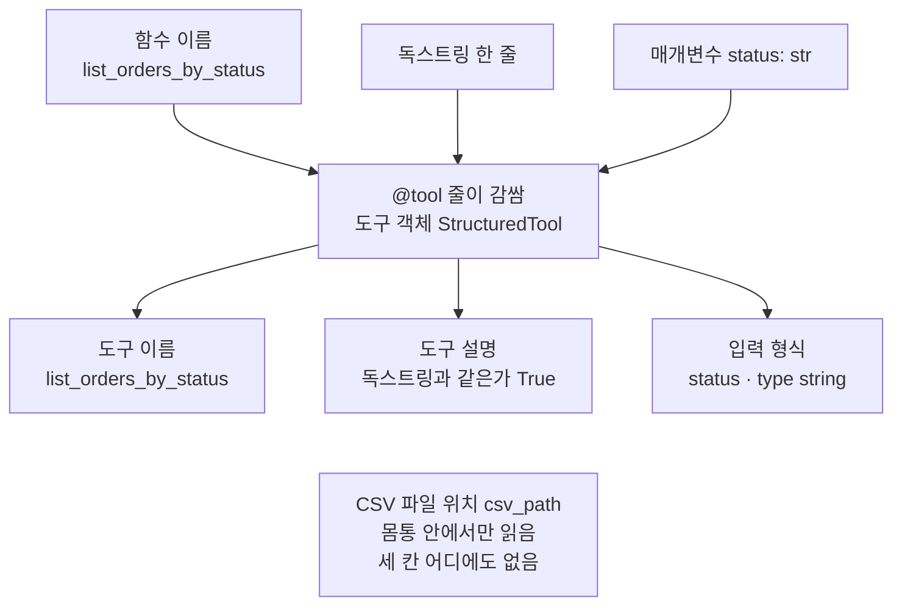
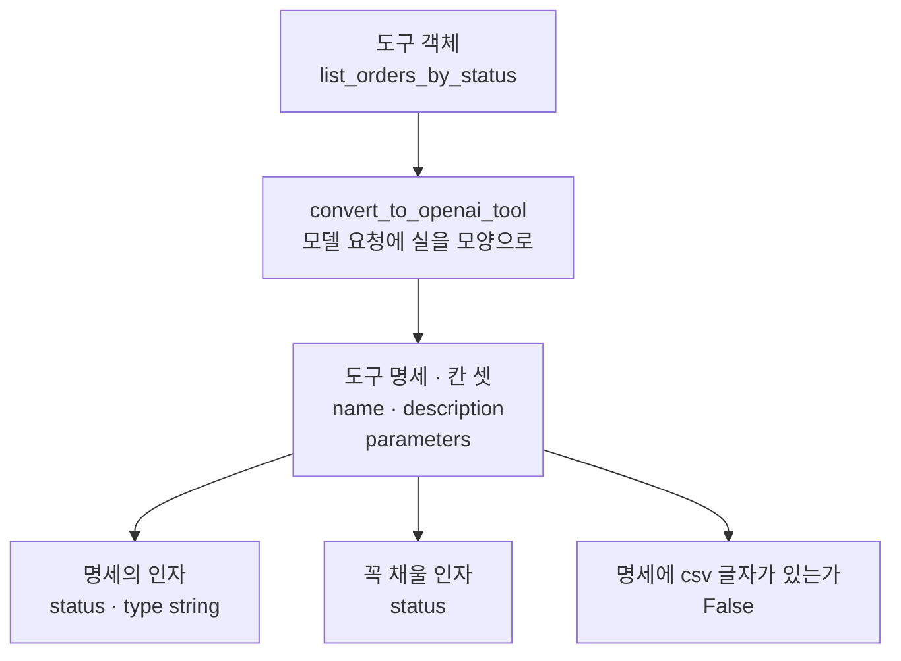
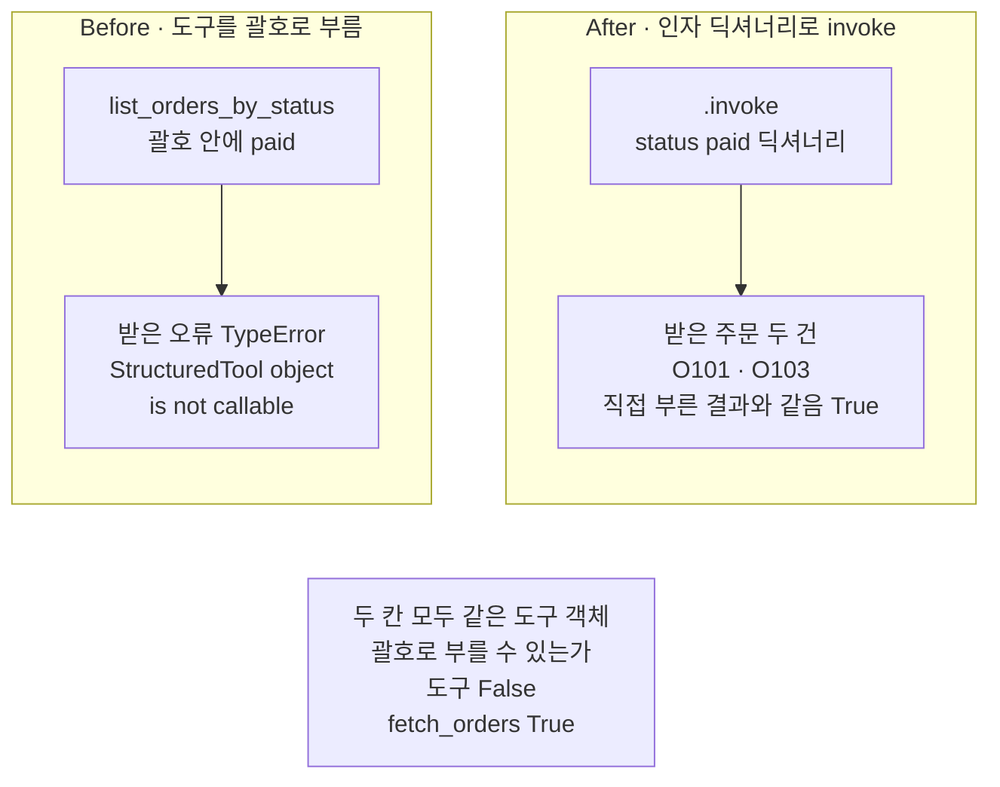
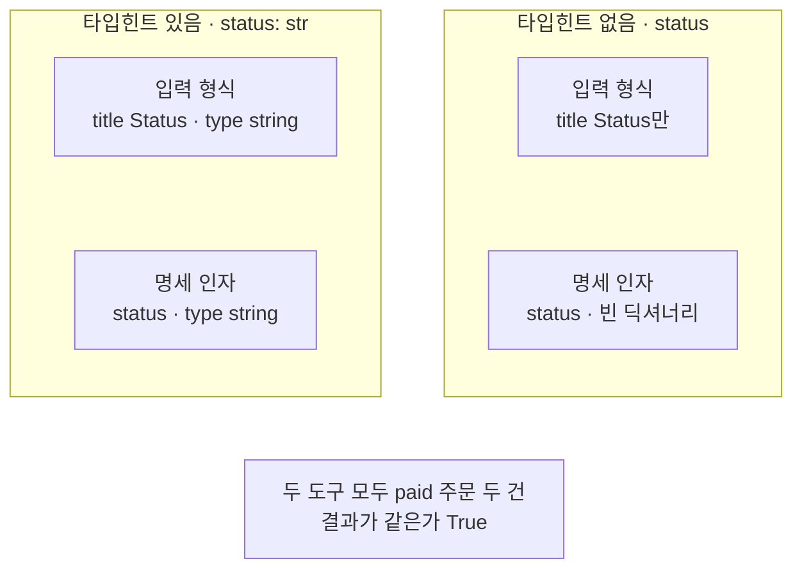

# 01-tool과-Ch4-함수-재사용

## _src 본문 (HTML 원본)

```html
<!--meta: 강의 1h | 실습 2h | 코드 notebooks/01-tool과-Ch4-함수-재사용.ipynb | 새 용어 5 -->
<style>html,body{overflow-x:hidden}.notebook,.nb-cell,.nb-main,.nb-input,.nb-result{min-width:0;max-width:100%}.nb-input pre,.nb-output{box-sizing:border-box;max-width:100%;overflow-x:auto}code.nb-source{display:block!important;width:100%!important;min-width:0!important;overflow-x:auto!important;padding:0!important}</style>
<h2 id="b1"><span class="no">1</span>학습 목표</h2><div class="goal"><ul>
<li>Ch 4 함수를 도구 파일에서 가져와 부르고, <code>@tool</code> 줄로 도구로 감쌀 수 있습니다.</li>
<li>도구 이름·설명·입력 형식이 함수의 어느 부분에서 오는지 출력으로 짚을 수 있습니다.</li>
<li>도구를 괄호가 아니라 <code>.invoke</code>에 인자 딕셔너리를 넣어 부를 수 있습니다.</li>
</ul></div>
<h2 id="b2"><span class="no">2</span>이 내용을 배우는 이유</h2><p>Ch 4에서는 사람이 상태 값을 정해 주문 조회 함수를 불렀습니다. 이 챕터는 같은 함수를 모델이 고를 수 있게 만듭니다. 모델에게는 함수 몸통이 아니라 이름과 설명, 채울 칸만 전해집니다.</p><p>그래서 함수를 고치지 않고, 모델이 읽을 이름·설명·입력 형식을 겉에 붙입니다. CSV 파일 위치처럼 모델이 고를 일이 아닌 값은 겉에 드러내지 않습니다. 이 절은 그 겉을 만드는 방법과, 겉을 붙인 뒤 부르는 방법을 봅니다.</p><p>제목의 tool은 도구라는 뜻입니다. 이 절은 모델을 부르지 않습니다. 모델에게 도구를 알려 주고 고르게 하는 일은 04절과 05절에서 합니다.</p>
<h2 id="b3"><span class="no">3</span>앞에서 배운 내용</h2><p><a href="../../part1/ch04-data-tools/01-Pandas로-표-다루기.html">Ch 4 01절</a>은 주문 CSV를 읽어 한 상태의 주문만 딕셔너리 목록으로 내놓는 함수 <code>fetch_orders</code>를 만들었습니다. 같은 절은 실습 폴더 <code>data_tools.py</code>에도 같은 이름의 판이 있다고 적었습니다. 그 판은 CSV 파일 위치를 먼저 받고, 상태는 키워드 인자 <code>status=</code>로 받습니다. 이 절은 Ch 4 01절이 약속한 대로 그 판을 씁니다.</p><p>그 판을 이 챕터 도구 파일 <code>order_tools.py</code>로 옮겼습니다. 옮기면서 자료형 표시와 설명 글을 빼고 주석을 달았습니다. Ch 4 실습 폴더는 Part 5 실습 묶음에 함께 들어 있어 두 파일을 나란히 열어 볼 수 있습니다. 이 도구 파일은 <a href="../../part1/ch02-python/07-모듈과-타입힌트.html">Ch 2 07절</a>에서 임시 폴더에 만든 같은 이름의 모듈과는 다른 파일입니다. 가져오기가 현재 작업 폴더에서 파일을 찾는 것은 그 절에서 본 그대로입니다.</p><p><a href="../../part1/ch02-python/07-모듈과-타입힌트.html">Ch 2 07절</a>은 매개변수 뒤에 자료형을 적는 타입힌트를 배웠고, 타입힌트가 값을 검사하지 않는다고 배웠습니다. <a href="../../part1/ch02-python/09-데코레이터와-컨텍스트-매니저.html">Ch 2 09절</a>은 함수 위의 <code>@</code> 줄이 아래 함수를 감싸 같은 이름에 담는다고 배웠습니다. 이 절의 <code>@tool</code> 줄도 같은 규칙으로 읽습니다. Ch 2 09절은 건너뛸 수 있는 절이라, 배우지 않았다면 이 절 「핵심 개념」의 풀이로 시작하고 그 절을 함께 읽어 보세요.</p><p>Ch 17 03절에서는 모델이 도구 이름을 JSON 글로 적고, 코드가 그 이름을 함수 <code>run_tool</code>에 넘겨 정해 둔 글을 받았습니다. 그 도구 흉내는 주문 번호 같은 값을 받지 않았습니다. 이 챕터의 도구는 인자를 받는 함수이고, LangChain이 이름·설명·입력 형식을 붙입니다.</p><p>Ch 7 05절은 도구를 알려 주지 않은 요청의 도구 호출 목록(<code>tool_calls</code>)이 빈 목록이라는 것을 보았습니다. 도구를 알려 주면 이 목록이 차는 모습은 04절에서 봅니다. Before 셀에서 오류 하나만 받아 출력하는 <code>try</code>와 <code>except 오류이름 as error</code>는 Ch 2 05절 모양입니다.</p>
<h2 id="b4"><span class="no">4</span>핵심 개념</h2><h3>비유로 시작하기</h3><p>식당을 떠올려 봅니다. 주방에는 요리법이 있지만, 손님은 요리법을 보지 않고 메뉴판을 보고 고릅니다. 메뉴판 한 줄에는 요리 그림과 짧은 소개, 주문할 때 적는 칸이 있습니다. 손님은 주문 전표에 고른 값을 적어 내주는 창에 넣고, 요리는 그 창으로 나옵니다.</p><p>이 절에서는 Ch 4 함수가 요리법이고, 도구로 감싸는 일이 메뉴판에 올리는 일입니다. 도구 이름과 설명, 입력 형식이 메뉴판 한 줄입니다. 주방 창고 위치를 메뉴판에 적지 않듯, CSV 파일 위치도 도구에 드러내지 않습니다. 인자 딕셔너리는 주문 전표이고, <code>.invoke</code>로 부르는 일은 전표를 창에 넣는 일입니다.</p>
{{img:01-5-메뉴판과-주문-전표|흰 바탕 그림으로 가운데 초록 벽이 식당을 두 방으로 나누고 벽에 창 하나가 뚫려 있으며, 왼쪽 방 벽의 메뉴판에는 국수 그릇 그림 아래 옅은 동그라미 셋이 있는 카드 한 장이 붙어 있고, 창턱에는 동그라미 셋 가운데 둘째 것만 주황으로 칠한 작은 주문 전표 한 장이 놓여 있으며, 오른쪽 방 주방에는 조리대 위에 펼친 요리책과 김이 나는 냄비를 올린 화덕이 있는 그림|요리법은 벽 안쪽 주방에 두고, 손님 쪽에는 메뉴판만 걸며, 주문은 전표로 창을 거쳐 들어갑니다.}}
<p class="look"><b>그림 읽기</b> — 가운데 초록 벽이 식당을 두 방으로 나누고, 벽에는 창 하나가 뚫려 있습니다. 왼쪽 방 메뉴판의 카드 한 장에는 국수 그릇 그림과 옅은 동그라미 셋이 있습니다. 창턱의 작은 주문 전표 한 장에는 세 동그라미 가운데 둘째 것만 칠해져 있습니다. 오른쪽 방 주방에는 펼친 요리책과 김이 나는 냄비가 있습니다. 카드는 도구, 전표는 인자 딕셔너리, 벽 안쪽 요리책은 함수 몸통입니다.</p>
<p class="look">카드의 동그라미 셋은 도구 설명 글에 적은 상태 셋이라는 안내입니다. 전표에 칠한 동그라미 하나는 고른 값 하나입니다. 입력 형식이 정한 것은 인자 <code>status</code>가 글이라는 것뿐입니다. 셋 밖의 글을 적은 전표가 어떻게 되는지는 02절에서 봅니다.</p>
<table><thead><tr><th>말</th><th>뜻</th></tr></thead><tbody><tr><td>도구(tool)</td><td>모델이 고를 수 있게 이름·설명·입력 형식을 붙여 감싼 함수입니다. 메뉴판에 올린 요리와 같습니다.</td></tr><tr><td>도구 설명(description)</td><td>도구가 하는 일을 적은 글입니다. 도구로 감싼 함수의 독스트링이 들어갑니다. 메뉴 그림 옆의 짧은 소개와 같습니다.</td></tr><tr><td>독스트링(docstring)</td><td>함수 첫 줄에 큰따옴표 세 개로 감싸 적는 설명 글입니다. 요리법 카드 맨 위의 한 줄 소개와 같습니다.</td></tr><tr><td>입력 형식(스키마, schema)</td><td>도구가 받는 인자의 이름과 자료형을 적은 틀입니다. 메뉴판 한 줄의 「주문할 때 적는 칸」과 같습니다.</td></tr><tr><td>도구 명세(tool definition)</td><td>도구 이름·설명·입력 형식을 모델 요청에 실을 모양으로 한 딕셔너리에 모은 것입니다. 메뉴판에 올라간 한 줄 전체와 같습니다.</td></tr></tbody></table>
<p>새 말을 이 절 코드에서 보면 이렇습니다. 도구는 <code>@tool</code> 줄 아래 함수 <code>list_orders_by_status</code>이고, 종류 이름은 <code>StructuredTool</code>입니다. 도구 설명은 속성 <code>description</code>, 입력 형식은 속성 <code>args</code>에 들어 있습니다. 도구 명세는 함수 <code>convert_to_openai_tool</code>이 내놓은 딕셔너리입니다.</p>
{{mermaid:01-1-함수에서-도구로|위에서 아래로 읽는 그림으로 맨 위 파란 상자 셋 함수 이름 list_orders_by_status, 독스트링 한 줄, 매개변수 status str이 가운데 회색 상자 @tool 줄이 감쌈 도구 객체 StructuredTool로 모이고, 거기서 아래 노란 상자 셋 도구 이름 list_orders_by_status, 도구 설명 독스트링과 같은가 True, 입력 형식 status type string으로 나뉘며, 맨 아래 초록 상자에 CSV 파일 위치 csv_path는 몸통 안에서만 읽어 세 칸 어디에도 없다고 적힌 그림|함수 이름은 도구 이름으로, 독스트링은 도구 설명으로, 매개변수와 타입힌트는 입력 형식으로 옮겨 가고 CSV 파일 위치는 빠집니다.}}
<p class="look"><b>도식 읽기</b> — 위에서 아래로 읽습니다. 맨 위 파란 상자 셋이 우리가 적은 함수의 세 부분이고, 차례대로 아래 노란 상자 셋이 됩니다. 가운데 회색 상자는 LangChain의 <code>@tool</code> 줄이 만든 도구 객체입니다. 노란 상자 셋은 노트북 4절이 출력한 도구 이름·설명·입력 형식입니다. 맨 아래 초록 상자의 CSV 파일 위치는 몸통 안에서만 읽혀 노란 칸 셋 어디에도 없습니다.</p>
<h3>데코레이터 줄과 같은 이름</h3><p>함수 위의 <code>@tool</code> 줄은 데코레이터 줄입니다. 데코레이터 줄은 함수 위에 붙여 그 함수를 다른 것으로 감싸는 표시입니다. 요리법 카드에 「메뉴판에 올림」 표를 붙이는 일과 비슷합니다. 이 절에서는 이 줄이 아래 함수를 도구로 등록합니다.</p><p>파이썬은 함수를 만든 뒤 곧바로 <code>tool</code>에 넣고, <code>tool</code>이 만든 도구를 같은 이름에 담습니다. 그래서 <code>def</code>로 만든 이름에 함수가 아니라 도구가 남습니다. 도구 객체는 괄호로 부를 수 없어, 함수처럼 부르면 멈춥니다. 이 절의 Before가 이 장면입니다.</p>
<h3>독스트링과 타입힌트</h3><p>도구 설명은 함수의 독스트링에서 옵니다. 설치한 langchain-core 1.6.2 소스를 보면, 독스트링도 따로 준 설명도 없으면 도구를 만들지 않고 오류를 냅니다. 이 동작은 노트북에서 실행하지 않았습니다.</p><p>입력 형식은 매개변수 이름과 타입힌트에서 옵니다. 타입힌트 <code>str</code>은 입력 형식에서 글을 뜻하는 <code>string</code>이 됩니다. 이 챕터는 타입힌트를 도구로 감쌀 함수의 매개변수에만 적습니다. 도구 파일의 평범한 함수와 노트북의 다른 함수에는 적지 않습니다.</p>
<h3>다른 상황에 적용</h3><p>재고를 찾는 함수를 도구로 만든다면 상품 번호는 모델이 채울 인자로 둘 수 있습니다. 창고 자료 파일의 위치나 접속 정보는 코드가 정해 둡니다. 도구 명세에는 모델이 골라야 하는 값만 드러냅니다.</p>
<h3>비교와 경계</h3><p>도구로 감싸도 Ch 4 함수가 하는 일은 바뀌지 않습니다. 없는 상태 이름을 넣었을 때 무엇이 나오는지는 이번에 보지 않았습니다. 입력 형식이 알려 주는 것은 인자 <code>status</code>가 글이라는 것뿐입니다. 고를 수 있는 상태 셋은 도구 설명 글에만 적혀 있습니다.</p><p>도구 명세를 모델 요청에 싣는 메서드(<code>bind_tools</code>)는 04절에서 처음 씁니다. 설치한 langchain-openai 1.6.0 소스를 보면 그 메서드도 도구마다 <code>convert_to_openai_tool</code>로 명세를 만듭니다. 명세가 실제 요청에 실린 모습은 이 절에서 보지 않았습니다.</p>
<h2 id="b5"><span class="no">5</span>실행 예제</h2><p>노트북은 먼저 Ch 4 함수를 도구 파일에서 가져와 주문 전체와 결제된 주문을 읽습니다. 그다음 함수를 도구로 감싸고, 도구의 종류와 안에 든 함수를 봅니다. 마지막으로 도구 이름·설명·입력 형식과 도구 명세를 출력합니다.</p><p>이 절은 모델을 부르지 않습니다. 읽는 파일은 주문 CSV 하나이고, 쓰는 파일은 없습니다.</p>
{{notebook:01-tool과-Ch4-함수-재사용|example}}
<p class="look"><b>확인할 점</b> — 노트북 3절 출력 <code>list_orders_by_status의 종류: StructuredTool</code>로 이름에 도구가 담겼는지 봅니다. 노트북 4절 출력 <code>꼭 채울 인자: ['status']</code>와 <code>명세에 csv 글자가 있는가: False</code>로 모델이 채울 칸이 상태 하나뿐인지 봅니다.</p>
{{mermaid:01-2-도구-명세의-칸|위에서 아래로 읽는 그림으로 회색 상자 도구 객체 list_orders_by_status에서 회색 상자 convert_to_openai_tool 모델 요청에 실을 모양으로를 지나 노란 상자 도구 명세 칸 셋 name description parameters에 닿고, 거기서 화살표 셋이 나뉘어 노란 상자 명세의 인자 status type string, 노란 상자 꼭 채울 인자 status, 노란 상자 명세에 csv 글자가 있는가 False로 가는 그림|도구 명세에는 이름·설명·입력 형식 칸 셋만 있고, 모델이 채울 인자는 status 하나이며 CSV 파일 위치는 없습니다.}}
<p class="look"><b>도식 읽기</b> — 위에서 아래로 읽습니다. 회색 상자 둘은 LangChain이 준 도구 객체와 함수입니다. 가운데 노란 상자가 노트북 4절이 출력한 도구 명세의 칸 셋입니다. 아래 노란 상자 셋은 그 명세에서 꺼낸 값으로, 모두 4절 출력에 있습니다. 모델이 채울 인자는 상태 하나이고, 명세 어디에도 csv 글자가 없습니다.</p>
<h2 id="b6"><span class="no">6</span>실패 확인</h2><p>아래 Before 셀은 도구를 Ch 4 함수처럼 괄호로 부릅니다. 이어지는 After 셀은 같은 상태를 인자 딕셔너리로 만들어 <code>.invoke</code>에 넣습니다.</p>
{{notebook:01-tool과-Ch4-함수-재사용|failure}}
{{mermaid:01-3-괄호로-부르기와-invoke로-부르기|칸 둘이 나란히 있고 아래에 회색 상자가 있는 그림으로 왼쪽 칸 Before 도구를 괄호로 부름에는 파란 상자 list_orders_by_status 괄호 안에 paid에서 빨간 상자 받은 오류 TypeError StructuredTool object is not callable로 이어지고 오른쪽 칸 After 인자 딕셔너리로 invoke에는 파란 상자 invoke 괄호 안에 status paid 딕셔너리에서 노란 상자 받은 주문 두 건 O101 O103 직접 부른 결과와 같음 True로 이어지며 맨 아래 회색 상자에 두 칸 모두 같은 도구 객체 괄호로 부를 수 있는가 도구 False 함수 fetch_orders True가 적힌 그림|같은 도구를 괄호로 부르면 TypeError로 멈추고, 인자 딕셔너리로 invoke하면 결제된 주문 두 건을 받습니다.}}
<p class="look"><b>도식 읽기</b> — 왼쪽 칸이 Before이고 오른쪽 칸이 After입니다. 두 칸은 같은 도구에 같은 상태 paid를 넣습니다. 왼쪽 빨간 상자는 도구를 괄호로 부른 결함 결과로, 노트북 5절 출력의 오류 이름과 오류 글입니다. 오른쪽 노란 상자는 6절에서 받은 주문 두 건과 직접 부른 결과와의 비교입니다. 맨 아래 회색 상자는 두 칸에 공통인 사실로, 5절 둘째 셀의 출력입니다.</p>
<p>괄호로 부른 줄은 <code>TypeError</code>로 멈췄습니다. 오류 글은 도구 객체를 괄호로 부를 수 없다는 뜻이었습니다. 내장 함수 <code>callable</code>도 도구 이름에는 <code>False</code>를 내놓았습니다. 주문 자료의 문제가 아니라 부르는 방법의 문제입니다.</p><p>인자 딕셔너리로 부르자 결제된 주문 두 건 <code>O101</code>·<code>O103</code>을 받았습니다. 2절에서 함수를 직접 부른 결과와 같았고, 취소된 주문 <code>O104</code>에서도 같았습니다. 새 커널로 두 번 실행했을 때 출력은 두 번 모두 같았습니다.</p>
<p>값 바꿔 보기는 매개변수의 자료형 표시 하나만 뺍니다. 입력 형식에서 칸 <code>type</code>이 빠지고, 도구 명세의 인자 자리도 비었습니다. 도구가 내놓은 주문은 그대로였습니다. 타입힌트는 결과가 아니라 모델이 읽을 입력 형식을 바꿉니다.</p>
{{mermaid:01-4-타입힌트를-빼면|칸 둘이 나란히 있고 아래에 회색 상자가 있는 그림으로 왼쪽 칸 타입힌트 있음 status str에는 노란 상자 입력 형식 title Status와 type string 아래 노란 상자 명세 인자 status type string이 있고 오른쪽 칸 타입힌트 없음 status에는 노란 상자 입력 형식 title Status만 아래 노란 상자 명세 인자 status 빈 딕셔너리가 있으며 맨 아래 회색 상자에 두 도구 모두 paid 주문 두 건 결과가 같은가 True가 적힌 그림|타입힌트를 빼면 입력 형식과 도구 명세에서 자료형 칸이 빠지지만, 도구가 내놓은 주문은 같습니다.}}
<p class="look"><b>도식 읽기</b> — 왼쪽 칸이 타입힌트를 적은 3절 도구이고, 오른쪽 칸이 타입힌트만 뺀 7절 도구입니다. 두 칸의 노란 상자 넷은 모두 노트북 7절 출력입니다. 오른쪽 칸에서는 입력 형식의 칸 type이 없고, 명세의 인자 자리도 빈 딕셔너리입니다. 맨 아래 회색 상자는 두 도구에 공통인 결과로, 같은 인자를 넣었을 때 주문이 같았습니다.</p>
<h2 id="b7"><span class="no">7</span>주의할 점과 실무 메모</h2><ul><li>이 절은 모델을 부르지 않았습니다. 모델 요청은 0번이고 API 키도 쓰지 않았습니다.</li><li>도구로 감싼 이름은 함수가 아니라 도구 객체입니다. 괄호로 부르지 말고 <code>.invoke</code>에 인자 딕셔너리를 넣습니다.</li><li>인자 딕셔너리의 키 이름은 입력 형식의 인자 이름과 같게 적습니다. 키 이름이 틀리거나 값의 자료형이 다를 때의 결과는 이번에 보지 않았습니다.</li><li>독스트링이 없으면 오류를 낸다는 것은 설치한 langchain-core 1.6.2 소스에서 확인했습니다. 노트북에서는 실행하지 않았습니다.</li><li>도구 명세가 모델 요청에 실린다는 것은 설치한 langchain-openai 1.6.0 소스에서 확인했습니다. 실제 요청은 04절에서 봅니다.</li><li>도구 파일의 <code>fetch_orders</code>는 Ch 4 실습 폴더 판에서 자료형 표시와 설명 글을 뺀 판입니다. Ch 4 01절 노트북 판은 파일 이름과 상태를 위치 인자로 받아 모양이 다릅니다.</li><li>없는 상태 이름을 넣었을 때의 결과는 이번에 보지 않았습니다.</li><li>걸린 시간은 재지 않았습니다.</li><li>이 절은 파일을 쓰지 않습니다.</li><li>교재 출력은 Linux의 Python 3.12.13으로 만들었습니다. 다른 판과 Windows·macOS에서는 이번에 실행하지 않았습니다.</li></ul>
<h2 id="b8"><span class="no">8</span>정리와 다음 절</h2><ul><li>Ch 4 함수 <code>fetch_orders</code>를 도구 파일에서 가져와 부르고, <code>@tool</code> 줄로 도구로 감쌌습니다.</li><li>도구 이름은 함수 이름, 도구 설명은 독스트링, 입력 형식은 매개변수와 타입힌트에서 왔습니다.</li><li>도구를 괄호로 부르면 <code>TypeError</code>로 멈췄고, <code>.invoke</code>에 인자 딕셔너리를 넣자 직접 부른 결과와 같았습니다.</li></ul><p><strong>다음 학습과 이어지는 지점</strong> — 02절에서는 Ch 6 03절의 양식 클래스로 도구의 입력 형식을 더 자세히 적습니다.</p>
<h2 id="b9"><span class="no">9</span>복습 문제</h2><details class="quiz" open><summary>문제 4개 · 해설 포함</summary><p class="quiz-q">1. 도구 이름·도구 설명·입력 형식은 각각 함수의 어느 부분에서 오나요?</p><p class="quiz-a">도구 이름은 함수 이름, 도구 설명은 독스트링, 입력 형식은 매개변수 이름과 타입힌트에서 옵니다. 틀렸다면 노트북 4절을 다시 읽습니다.</p><p class="quiz-q">2. <code>list_orders_by_status("paid")</code>가 <code>TypeError</code>로 멈춘 까닭은 무엇인가요?</p><p class="quiz-a"><code>@tool</code> 줄이 같은 이름에 함수 대신 도구 객체를 담았고, 도구 객체는 괄호로 부를 수 없기 때문입니다. 틀렸다면 노트북 3절과 5절을 다시 읽습니다.</p><p class="quiz-q">3. 도구를 부를 때 <code>.invoke</code> 괄호 안에는 무엇을 넣고, 키 이름은 무엇과 같아야 하나요?</p><p class="quiz-a">인자 이름과 값을 짝지은 딕셔너리 하나를 넣습니다. 이 절에서는 <code>{"status": "paid"}</code>이고, 키 이름은 입력 형식의 인자 이름과 같게 적습니다. 틀렸다면 노트북 6절을 다시 읽습니다.</p><p class="quiz-q">4. 매개변수의 타입힌트를 뺀 도구는 무엇이 달라졌고, 무엇이 같았나요?</p><p class="quiz-a">입력 형식과 도구 명세에서 자료형 칸이 빠졌습니다. 같은 인자를 넣었을 때 내놓은 주문은 같았습니다. 틀렸다면 노트북 7절을 다시 읽습니다.</p></details>
<h2 id="b10"><span class="no">10</span>참고 자료</h2><ul><li><div><a href="https://docs.langchain.com/oss/python/langchain/tools">LangChain Tools</a></div>확인 2026-09-24 · LangChain 문서입니다. 도구 이름은 함수 이름에서, 설명은 독스트링에서 온다고 적습니다. 타입힌트가 입력 형식을 정하므로 꼭 적으라고 합니다.</li><li><div><a href="https://github.com/langchain-ai/langchain">langchain-ai/langchain</a></div>확인 2026-09-24 · LangChain 저장소입니다. 독스트링이 없을 때의 오류와 도구 명세 만드는 함수는 설치한 langchain-core 1.6.2 판 소스에서 읽었습니다. 명세를 요청에 싣는 메서드는 langchain-openai 1.6.0 판 소스에서 읽었습니다.</li><li><div><a href="https://docs.python.org/3.12/library/functions.html#callable">Python 내장 함수 callable</a></div>확인 2026-09-24 · 괄호로 부를 수 있는 값인지 알려 주는 함수의 설명입니다.</li><li>Ch 4 01절 — 주문 조회 함수와 실습 폴더 판.</li><li>Ch 2 07절·09절 — 타입힌트와 데코레이터 줄.</li><li>Ch 17 03절 — 모델이 JSON 글로 도구 이름을 고른 루프.</li></ul>
```

## 노트북 셀 (순서대로)

### [0] markdown {'html': 'skip'}

# tool과 Ch 4 함수 재사용

**이 노트북에서 할 일**

1. Ch 4에서 배운 주문 조회 함수 `fetch_orders`를 도구 파일에서 가져와 그대로 부릅니다.
2. 함수 위에 `@tool` 줄을 붙여 도구로 감싸고, 도구 이름·설명·입력 형식이 어디서 오는지 봅니다.
3. 도구를 Ch 4 함수처럼 괄호로 부르면 멈추는 것을 봅니다(Before).
4. 도구를 인자 딕셔너리와 함께 `.invoke`로 불러, 함수를 직접 부른 결과와 견줍니다(After).

**준비물** — 이 절은 모델을 부르지 않습니다.
모델 요청은 0번이라 API 키가 필요 없고, 드는 비용도 없습니다.
도구를 만들고 부르는 일은 모두 파이썬 안에서 끝나기 때문입니다.
모델에게 도구를 알려 주는 일은 04절부터 합니다.

읽는 파일은 실습 폴더의 `data/orders.csv` 하나이고, 새로 쓰는 파일은 없습니다.
Ch 4 함수는 같은 폴더의 도구 파일 `order_tools.py`에서 가져옵니다.
교재 출력을 만든 실행에서는 노트북 전체가 3초 안에 끝났습니다.

**기준 버전** — 첫 셀에서 패키지 셋을 설치합니다.
langchain 1.4.0, langchain-core 1.6.2, pandas 3.0.5입니다.
교재 출력은 Linux의 Python 3.12.13으로 만들었습니다.
다른 판과 Windows·macOS에서는 이번에 실행하지 않았습니다.

**강의와 실습 범위** — 강의 시간에는 2~4절을 읽습니다.
Ch 4 함수를 도구로 감싸고, 도구의 이름·설명·입력 형식을 보는 자리입니다.
5~7절은 도구를 잘못 불러 보고, 고쳐 부르고, 값을 바꿔 보는 자리입니다.
이 부분은 실습 시간에 실행합니다.

실습 폴더 `labs/part5/ch19-model-tools`에서 `uv sync --locked`를 실행합니다.
그다음 `notebooks/` 폴더의 이 노트북을 열고, 실습 폴더의 `.venv` 커널을 고릅니다.
첫 셀부터 순서대로 실행합니다.

### [1] markdown {'html': 'skip'}

## 오늘 볼 그림


위에서 아래로 읽습니다. 맨 위 파란 상자 셋이 우리가 적은 함수의 세 부분입니다.
가운데 회색 상자는 LangChain의 `@tool` 줄이 만든 도구 객체입니다.
아래 노란 상자 셋이 도구에 붙은 이름·설명·입력 형식이고, 맨 아래 초록 CSV 파일 위치는 그 세 칸에 없습니다.

### [2] markdown {}

## 1. 준비

이 절은 Ch 4의 주문 조회 함수를 모델이 고를 수 있는 도구로 감쌉니다.
제목의 tool은 도구라는 뜻이고, 이 교재는 「도구」라고 부릅니다.

첫 셀은 패키지 세 개를 설치하고 설치된 판 번호를 출력합니다.
설치에는 몇십 초가 걸릴 수 있습니다.

### [3] code {'execution': {'iopub.execute_input': '2026-09-24T00:55:12.001098Z', 'iopub.status.busy': '2026-09-24T00:55:12.000932Z', 'iopub.status.idle': '2026-09-24T00:55:12.704665Z', 'shell.execute_reply': '2026-09-24T00:55:12.703990Z'}, 'lesson_role': 'setup'}

```python
# 이 절에서 쓰는 패키지를 설치하고 버전을 확인합니다
%pip install -q "langchain==1.4.0" "langchain-core==1.6.2" "pandas==3.0.5"
from importlib.metadata import version

print("langchain:", version("langchain"))
print("langchain-core:", version("langchain-core"))
print("pandas:", version("pandas"))
```

출력:
```
Note: you may need to restart the kernel to use updated packages.
langchain: 1.4.0
langchain-core: 1.6.2
pandas: 3.0.5

```

### [4] markdown {}

**결과 읽기** — 출력 줄 `langchain: 1.4.0`·`langchain-core: 1.6.2`·`pandas: 3.0.5`가 실습 폴더 잠금과 같은 판입니다.
이 노트북의 출력은 2026-09-24에 이 판으로 실행한 결과입니다.

앞에서 배운 함수는 `order_tools.py`에 모아 두었습니다. 파일을 열면 코드를 볼 수 있습니다. 노트북과 같은 폴더(`notebooks/`)에 있는 파일입니다. 커널이 `notebooks/` 폴더에서 시작해야 이 파일을 가져올 수 있습니다.

Ch 2 07절에서 임시 폴더에 만든 같은 이름의 모듈과는 다른 파일입니다.
가져오기가 현재 작업 폴더에서 파일을 찾는 것은 그 절에서 본 그대로입니다.

다음 셀은 이 절에서 쓸 이름 넷을 가져옵니다.
함수 `tool`은 함수를 도구로 감쌀 때 쓰는 LangChain 이름입니다.
함수 `convert_to_openai_tool`은 4절에서 도구 명세를 볼 때 씁니다.
모듈 `os`는 그다음 준비 셀에서 CSV 파일 위치를 찾을 때 씁니다.

### [5] code {'execution': {'iopub.execute_input': '2026-09-24T00:55:12.705794Z', 'iopub.status.busy': '2026-09-24T00:55:12.705702Z', 'iopub.status.idle': '2026-09-24T00:55:13.692562Z', 'shell.execute_reply': '2026-09-24T00:55:13.692162Z'}, 'lesson_role': 'setup'}

```python
# CSV 파일 위치를 찾을 os, 도구를 만드는 tool, 도구 명세를 만드는 함수, Ch 4 함수를 가져옵니다
import os

from langchain.tools import tool
from langchain_core.utils.function_calling import convert_to_openai_tool

from order_tools import fetch_orders

print("가져온 이름:", "os", "tool", "convert_to_openai_tool", "fetch_orders")
```

출력:
```
가져온 이름: os tool convert_to_openai_tool fetch_orders

```

### [6] markdown {}

**결과 읽기** — 출력 줄 `가져온 이름: os tool convert_to_openai_tool fetch_orders`로 이름 넷을 가져왔습니다.
함수 `fetch_orders`는 Ch 4 실습 폴더 `data_tools.py`에 있던 판을 이 챕터 도구 파일로 옮긴 것입니다.
옮기면서 자료형 표시와 설명 글을 빼고 주석을 달았습니다.

다음 셀은 주문 CSV 파일이 있는 프로젝트 맨 위 폴더를 찾습니다.
노트북은 보통 `notebooks/` 폴더에서 열리지만, 실행 도구가 다른 자리에서 시작할 수도 있습니다.
그래서 후보 세 곳을 차례로 보고, 파일이 있는 첫 자리에서 `break`로 멈춥니다.
함수 `os.path.exists`는 그 자리에 파일이 있으면 `True`를 내놓습니다.

### [7] code {'execution': {'iopub.execute_input': '2026-09-24T00:55:13.693321Z', 'iopub.status.busy': '2026-09-24T00:55:13.693201Z', 'iopub.status.idle': '2026-09-24T00:55:13.695452Z', 'shell.execute_reply': '2026-09-24T00:55:13.695104Z'}, 'lesson_role': 'setup'}

```python
# 노트북을 어느 폴더에서 열어도 주문 CSV를 찾게 후보 세 곳을 차례로 봅니다
candidates = [".", "../../..", "../../../.."]
root_path = None
for candidate in candidates:
    if os.path.exists(candidate + "/labs/part5/ch19-model-tools/data/orders.csv"):
        root_path = candidate
        break
print("찾은 프로젝트 맨 위:", root_path)
assert root_path is not None, "notebooks 폴더나 실습 폴더 맨 위에서 노트북을 열어 주세요."
# CSV 파일 위치는 노트북이 정해 두는 값입니다(모델이 고를 값이 아님)
csv_path = root_path + "/labs/part5/ch19-model-tools/data/orders.csv"
```

출력:
```
찾은 프로젝트 맨 위: .

```

### [8] markdown {}

**결과 읽기** — 출력 줄 `찾은 프로젝트 맨 위: .`은 교재 출력을 프로젝트 맨 위에서 실행했다는 뜻입니다.
교재 출력은 실행 도구에 도구 파일 폴더를 따로 알려 준 실행이라 `.`이 찍혔습니다.
노트북을 `notebooks/` 폴더에서 열면 이 줄에 `../../../..`가 찍힙니다.
셀 안의 안내 글은 실습 폴더 맨 위도 적었지만, 도구 파일을 가져오려면 `notebooks/` 폴더에서 열어야 합니다.

변수 `csv_path`에 CSV 파일 위치를 담았습니다.
이 위치는 모델이 고를 값이 아니라 노트북이 정해 두는 값입니다.

## 2. Ch 4 함수 다시 부르기

Ch 4 01절은 주문 CSV를 읽어 한 상태의 주문만 딕셔너리 목록으로 내놓는 함수를 만들었습니다.
그 절의 노트북 판은 파일 이름과 상태를 위치 인자로 받았습니다.
Ch 4 실습 폴더 판은 CSV 파일 위치를 먼저 받고, 상태는 키워드 인자 `status=`로 받습니다.
이 챕터는 Ch 4 01절이 약속한 대로 실습 폴더 판을 씁니다.

함수 머리의 별표 `*`는 그 뒤 인자를 이름을 붙여서만 넘기게 하는 표시입니다.
인자 `status=None`은 상태를 넘기지 않으면 `None`이 들어간다는 표시입니다.
그때 함수는 모든 줄을 남깁니다.
다음 셀은 상태를 고르지 않고 CSV 파일 위치만 넣어 부릅니다.

### [9] code {'execution': {'iopub.execute_input': '2026-09-24T00:55:13.696008Z', 'iopub.status.busy': '2026-09-24T00:55:13.695950Z', 'iopub.status.idle': '2026-09-24T00:55:13.703453Z', 'shell.execute_reply': '2026-09-24T00:55:13.703126Z'}}

```python
# Ch 4 함수에 CSV 파일 위치만 넣어, 상태를 고르지 않은 주문 전체를 읽습니다
all_rows = fetch_orders(csv_path)
print("주문 수:", len(all_rows))
print("주문 목록:")
for row in all_rows:
    print(row)
```

출력:
```
주문 수: 4
주문 목록:
{'order_id': 'O101', 'customer_id': 'C001', 'status': 'paid', 'amount': 32000}
{'order_id': 'O102', 'customer_id': 'C002', 'status': 'pending', 'amount': 18000}
{'order_id': 'O103', 'customer_id': 'C001', 'status': 'paid', 'amount': 27000}
{'order_id': 'O104', 'customer_id': 'C003', 'status': 'cancelled', 'amount': 9000}

```

### [10] markdown {}

**결과 읽기** — 출력 줄 `주문 수: 4`로 주문 네 줄을 읽었습니다.
라벨 줄 `주문 목록:` 아래 네 줄이 주문 하나씩입니다.
줄마다 칸 넷이 든 딕셔너리이고, 주문 번호는 `O101`부터 `O104`까지입니다.

다음 셀은 첫 줄의 칸 이름과 칸마다 값의 자료형을 봅니다.
Ch 4 01절에서 자료형을 먼저 확인하던 습관을 이어 갑니다.

### [11] code {'execution': {'iopub.execute_input': '2026-09-24T00:55:13.704011Z', 'iopub.status.busy': '2026-09-24T00:55:13.703962Z', 'iopub.status.idle': '2026-09-24T00:55:13.705676Z', 'shell.execute_reply': '2026-09-24T00:55:13.705334Z'}}

```python
# 첫 주문 한 줄의 칸 이름과, 칸마다 값의 자료형을 봅니다
first_row = all_rows[0]
row_keys = list(first_row.keys())
print("칸 이름:", row_keys)
for key in first_row:
    print(key, "|", type(first_row[key]).__name__)
```

출력:
```
칸 이름: ['order_id', 'customer_id', 'status', 'amount']
order_id | str
customer_id | str
status | str
amount | int

```

### [12] markdown {}

**결과 읽기** — 출력 줄 `칸 이름: ['order_id', 'customer_id', 'status', 'amount']`가 네 칸입니다.
아래 네 줄에서 칸 `amount`만 `int`이고, 나머지 셋은 `str`입니다.

함수는 `dtype`에 딕셔너리를 넣어 주문 번호와 고객 번호 두 칸만 글자로 읽습니다.
Ch 4 01절이 말만 하고 실행하지 않았던 방법입니다(글자로 둘 칸만 따로 정하기).
금액 칸은 정수로 남습니다.
다만 이 CSV의 번호에는 글자 O·C가 섞여 있어, `dtype` 없이 읽어도 같은 자료형이 나옵니다.
차이는 Ch 4 01절이 예로 든 01234처럼 앞자리 0이 있는 번호에서 납니다.

다음 셀은 키워드 인자 `status="paid"`로 결제된 주문만 읽습니다.

### [13] code {'execution': {'iopub.execute_input': '2026-09-24T00:55:13.706202Z', 'iopub.status.busy': '2026-09-24T00:55:13.706146Z', 'iopub.status.idle': '2026-09-24T00:55:13.709565Z', 'shell.execute_reply': '2026-09-24T00:55:13.709336Z'}}

```python
# 키워드 인자 status=로 상태를 골라 결제된(paid) 주문만 읽습니다(Ch 4 함수를 직접 부름)
paid_rows = fetch_orders(csv_path, status="paid")
print("결제된 주문 수:", len(paid_rows))
for row in paid_rows:
    print(row["order_id"], "|", row["status"], "|", row["amount"])
```

출력:
```
결제된 주문 수: 2
O101 | paid | 32000
O103 | paid | 27000

```

### [14] markdown {}

**결과 읽기** — 출력 줄 `결제된 주문 수: 2` 아래에 `O101 | paid | 32000`과 `O103 | paid | 27000`이 보입니다.
이 결과는 6절에서 도구로 부른 결과와 견줍니다.

## 3. 함수를 도구로 감싸기

도구(tool)는 모델이 필요할 때 고를 수 있게 이름·설명·입력 형식을 붙여 감싼 함수입니다.
식당으로 치면 주방의 요리를 메뉴판에 한 줄로 올리는 일과 같습니다.
이 절에서는 Ch 4 함수를 부르는 작은 함수를 만들고, 그 함수를 도구로 감쌉니다.

함수 위의 `@tool` 줄은 데코레이터 줄입니다.
데코레이터 줄은 함수 위에 붙여 그 함수를 다른 것으로 감싸는 표시입니다.
요리법 카드에 「메뉴판에 올림」 표를 붙이는 일과 비슷합니다.
다음 셀에서는 `@tool` 줄이 아래 함수를 도구로 등록합니다.

파이썬은 함수를 만든 뒤 곧바로 `tool`에 넣고, `tool`이 만든 도구를 같은 이름에 담습니다.
Ch 2 09절의 `@` 줄과 같은 규칙입니다.
Ch 2에서 건너뛸 수 있는 절이라, 배우지 않았다면 함께 읽어 보세요.

독스트링(docstring)은 함수 첫 줄에 큰따옴표 세 개로 감싸 적는 설명 글입니다.
요리법 카드 맨 위에 적는 한 줄 소개와 같습니다.
도구로 감싸면 이 글이 도구 설명이 됩니다.

매개변수 `status: str`의 `: str`은 Ch 2 07절에서 배운 타입힌트입니다.
Ch 2 07절에서는 타입힌트가 값을 검사하지 않는다고 배웠습니다.
도구에서는 이 표시가 입력 형식의 자료형으로 들어갑니다.
이 챕터는 타입힌트를 도구로 감쌀 함수의 매개변수에만 적습니다.

몸통은 Ch 4 함수를 부르는 한 줄입니다.
CSV 파일 위치는 인자로 받지 않고 1절에서 정한 `csv_path`를 씁니다.
파일 위치는 모델이 고를 값이 아니기 때문입니다.
손님이 메뉴를 고를 때 주방 창고 위치까지 고르지 않는 것과 같습니다.

### [15] code {'execution': {'iopub.execute_input': '2026-09-24T00:55:13.710109Z', 'iopub.status.busy': '2026-09-24T00:55:13.710058Z', 'iopub.status.idle': '2026-09-24T00:55:13.712578Z', 'shell.execute_reply': '2026-09-24T00:55:13.712266Z'}}

```python
# Ch 4 함수를 부르는 작은 함수를 도구로 감쌉니다(CSV 파일 위치는 노트북이 정하고, 상태만 인자로 받습니다)
@tool
def list_orders_by_status(status: str):
    """주문 상태(paid, pending, cancelled)를 받아 그 상태의 주문 목록을 찾습니다."""
    # 몸통은 Ch 4 함수를 한 번 부르는 한 줄입니다
    return fetch_orders(csv_path, status=status)
```

출력:
```

```

### [16] markdown {}

**결과 읽기** — 정의 셀이라 출력이 없습니다.
함수 `list_orders_by_status`는 상태 글 하나를 받아 그 상태의 주문 목록을 내놓습니다.

다음 셀은 `@tool` 줄을 지난 뒤 두 이름에 무엇이 담겼는지 종류를 봅니다.

### [17] code {'execution': {'iopub.execute_input': '2026-09-24T00:55:13.713131Z', 'iopub.status.busy': '2026-09-24T00:55:13.713081Z', 'iopub.status.idle': '2026-09-24T00:55:13.714518Z', 'shell.execute_reply': '2026-09-24T00:55:13.714340Z'}}

```python
# @tool 줄을 지난 뒤 두 이름에 무엇이 담겼는지 종류를 봅니다
print("fetch_orders의 종류:", type(fetch_orders).__name__)
print("list_orders_by_status의 종류:", type(list_orders_by_status).__name__)
```

출력:
```
fetch_orders의 종류: function
list_orders_by_status의 종류: StructuredTool

```

### [18] markdown {}

**결과 읽기** — 출력 줄 `fetch_orders의 종류: function`은 도구 파일에서 가져온 평범한 함수입니다.
출력 줄 `list_orders_by_status의 종류: StructuredTool`은 이 이름이 함수가 아니라 도구를 가리킨다는 뜻입니다.
이름 `StructuredTool`은 LangChain이 입력 형식이 있는 도구에 붙이는 종류 이름입니다.
앞 셀에서 `def`로 함수를 만들었지만, `@tool` 줄이 같은 이름에 도구를 담았습니다.

다음 셀은 도구 안에 감싸 둔 원래 함수를 꺼내 봅니다.
원래 함수는 도구 객체의 속성 `func`에 들어 있습니다.

### [19] code {'execution': {'iopub.execute_input': '2026-09-24T00:55:13.715030Z', 'iopub.status.busy': '2026-09-24T00:55:13.714984Z', 'iopub.status.idle': '2026-09-24T00:55:13.716532Z', 'shell.execute_reply': '2026-09-24T00:55:13.716327Z'}}

```python
# 도구 안에 감싸 둔 원래 함수를 속성 func로 꺼내 종류와 이름을 봅니다
inner_function = list_orders_by_status.func
print("func의 종류:", type(inner_function).__name__)
print("func의 이름:", inner_function.__name__)
```

출력:
```
func의 종류: function
func의 이름: list_orders_by_status

```

### [20] markdown {}

**결과 읽기** — 출력 줄 `func의 종류: function`과 `func의 이름: list_orders_by_status`가 보입니다.
원래 함수가 도구 안에 들어 있습니다.
도구로 감싼 일은 함수를 고친 것이 아니라 바깥에서 감싼 것입니다.

## 4. 도구 이름·설명·입력 형식

도구에는 모델이 읽을 칸 셋이 붙습니다.
도구 이름(name), 도구 설명(description), 입력 형식(args)입니다.
다음 셀은 앞의 둘을 출력하고, 도구 설명이 독스트링과 같은지 봅니다.

### [21] code {'execution': {'iopub.execute_input': '2026-09-24T00:55:13.717104Z', 'iopub.status.busy': '2026-09-24T00:55:13.717052Z', 'iopub.status.idle': '2026-09-24T00:55:13.718682Z', 'shell.execute_reply': '2026-09-24T00:55:13.718328Z'}}

```python
# 도구 이름은 함수 이름에서, 도구 설명은 독스트링에서 옵니다
print("도구 이름:", list_orders_by_status.name)
print("도구 설명:", list_orders_by_status.description)
# 함수의 속성 __doc__에는 독스트링이 들어 있습니다
print("독스트링과 같은가:", list_orders_by_status.description == inner_function.__doc__)
```

출력:
```
도구 이름: list_orders_by_status
도구 설명: 주문 상태(paid, pending, cancelled)를 받아 그 상태의 주문 목록을 찾습니다.
독스트링과 같은가: True

```

### [22] markdown {}

**결과 읽기** — 출력 줄 `도구 이름: list_orders_by_status`는 함수 이름과 같습니다.
출력 줄 `도구 설명:` 뒤 글은 3절에서 적은 독스트링입니다.
출력 줄 `독스트링과 같은가: True`로 두 글이 같습니다.
설명 글에 적은 상태 셋(paid, pending, cancelled)은 모델이 읽을 안내입니다.

다음 셀은 입력 형식을 봅니다.
입력 형식(스키마, schema)은 도구가 받는 인자의 이름과 자료형을 적은 틀입니다.
메뉴판의 「맵기 선택」 칸처럼, 주문할 때 채울 칸을 알려 줍니다.
도구 객체의 속성 `args`에 딕셔너리로 들어 있습니다.

### [23] code {'execution': {'iopub.execute_input': '2026-09-24T00:55:13.719265Z', 'iopub.status.busy': '2026-09-24T00:55:13.719215Z', 'iopub.status.idle': '2026-09-24T00:55:13.721401Z', 'shell.execute_reply': '2026-09-24T00:55:13.721011Z'}}

```python
# 입력 형식(args)은 매개변수 이름과 타입힌트에서 옵니다
print("입력 형식:", list_orders_by_status.args)
arg_names = list(list_orders_by_status.args.keys())
print("모델이 채울 인자:", arg_names)
```

출력:
```
입력 형식: {'status': {'title': 'Status', 'type': 'string'}}
모델이 채울 인자: ['status']

```

### [24] markdown {}

**결과 읽기** — 출력 줄 `입력 형식: {'status': {'title': 'Status', 'type': 'string'}}`에서 인자는 `status` 하나입니다.
칸 `type`의 값 `string`은 글이라는 뜻이고, 타입힌트 `str`에서 왔습니다.
칸 `title`은 인자 이름의 첫 글자를 대문자로 바꿔 만든 제목입니다.
출력 줄 `모델이 채울 인자: ['status']`에 CSV 파일 위치는 없습니다.

다음 셀은 이 도구를 모델 요청에 실을 모양으로 바꿔 봅니다.
도구 명세(tool definition)는 도구 이름·설명·입력 형식을 한 딕셔너리에 모은 것입니다.
메뉴판에 올라간 한 줄 전체와 같습니다.
함수 `convert_to_openai_tool`은 도구를 받아 OpenAI 모델이 읽는 모양의 도구 명세를 내놓습니다.
이 셀은 모델을 부르지 않고 모양만 만듭니다.

### [25] code {'execution': {'iopub.execute_input': '2026-09-24T00:55:13.721907Z', 'iopub.status.busy': '2026-09-24T00:55:13.721866Z', 'iopub.status.idle': '2026-09-24T00:55:13.723618Z', 'shell.execute_reply': '2026-09-24T00:55:13.723260Z'}}

```python
# 도구를 모델 요청에 실을 모양(도구 명세)으로 바꿔 봅니다(모델 요청 없음)
tool_spec = convert_to_openai_tool(list_orders_by_status)
print("도구 명세:")
print(tool_spec)
```

출력:
```
도구 명세:
{'type': 'function', 'function': {'name': 'list_orders_by_status', 'description': '주문 상태(paid, pending, cancelled)를 받아 그 상태의 주문 목록을 찾습니다.', 'parameters': {'properties': {'status': {'type': 'string'}}, 'required': ['status'], 'type': 'object'}}}

```

### [26] markdown {}

**결과 읽기** — 라벨 줄 `도구 명세:` 아래 한 줄이 도구 명세입니다.
맨 바깥 칸 `type`의 값은 `function`이고, 칸 `function` 안에 이름·설명·입력 형식이 들어 있습니다.

다음 셀은 명세의 칸을 하나씩 꺼내 봅니다.
마지막 줄은 명세 전체를 글로 바꿔 `csv`라는 글자가 들어 있는지 봅니다.

### [27] code {'execution': {'iopub.execute_input': '2026-09-24T00:55:13.724146Z', 'iopub.status.busy': '2026-09-24T00:55:13.724089Z', 'iopub.status.idle': '2026-09-24T00:55:13.725857Z', 'shell.execute_reply': '2026-09-24T00:55:13.725512Z'}}

```python
# 도구 명세에서 이름·설명·입력 형식이 들어간 칸을 꺼내고, CSV 파일 위치가 있는지 봅니다
function_part = tool_spec["function"]
part_keys = list(function_part.keys())
print("명세의 칸:", part_keys)
print("명세의 인자:", function_part["parameters"]["properties"])
print("꼭 채울 인자:", function_part["parameters"]["required"])
print("명세에 csv 글자가 있는가:", "csv" in str(tool_spec))
```

출력:
```
명세의 칸: ['name', 'description', 'parameters']
명세의 인자: {'status': {'type': 'string'}}
꼭 채울 인자: ['status']
명세에 csv 글자가 있는가: False

```

### [28] markdown {}

**결과 읽기** — 출력 줄 `명세의 칸: ['name', 'description', 'parameters']`가 도구 이름·설명·입력 형식 자리입니다.
출력 줄 `명세의 인자: {'status': {'type': 'string'}}`와 `꼭 채울 인자: ['status']`로 채울 인자는 상태 하나입니다.
출력 줄 `명세에 csv 글자가 있는가: False`로 CSV 파일 위치는 명세에 없습니다.
명세의 칸이 셋뿐이라 함수 몸통도 들어 있지 않습니다.

모델에게 도구를 알려 주는 메서드(`bind_tools`)는 04절에서 처음 씁니다.
설치한 langchain-openai 1.6.0 소스를 보면 그 메서드도 도구마다 이 함수로 명세를 만듭니다.
명세가 실제 요청에 실린 모습은 이 절에서 보지 않았습니다.

### [29] markdown {'lesson_part': 'before'}

## 5. 도구를 함수처럼 부르기 (Before)

### [30] markdown {'lesson_part': 'before'}

이제 도구를 불러 주문을 받아 봅니다.
Ch 4에서는 함수 이름 뒤에 괄호를 붙여 인자를 넣었습니다.
도구도 이름이 같으니 같은 버릇대로 `list_orders_by_status("paid")`처럼 부르기 쉽습니다.

다음 셀은 이 버릇대로 부릅니다.
이 셀만 Ch 2 05절 모양으로 그 오류 이름을 받아 출력하고, 셀은 끝까지 갑니다.
오류를 받지 않는 실제 프로그램이라면 여기서 멈춥니다.

### [31] code {'execution': {'iopub.execute_input': '2026-09-24T00:55:13.726428Z', 'iopub.status.busy': '2026-09-24T00:55:13.726383Z', 'iopub.status.idle': '2026-09-24T00:55:13.728053Z', 'shell.execute_reply': '2026-09-24T00:55:13.727726Z'}, 'lesson_part': 'before'}

```python
# Ch 4 함수를 부르던 버릇대로 도구를 괄호로 부릅니다(이 셀만 그 오류를 받아 출력합니다)
try:
    before_rows = list_orders_by_status("paid")
    print("받은 주문 수:", len(before_rows))
except TypeError as error:
    print("받은 오류:", type(error).__name__)
    print("오류 글:", error)
```

출력:
```
받은 오류: TypeError
오류 글: 'StructuredTool' object is not callable

```

### [32] markdown {'lesson_part': 'before'}

**결과 읽기** — 출력 줄 `받은 오류: TypeError`로 괄호로 부른 줄에서 멈췄습니다.
출력 줄 `오류 글: 'StructuredTool' object is not callable`은 도구 객체를 괄호로 부를 수 없다는 뜻입니다.
받은 주문 수를 출력하는 줄까지 가지 못했습니다.
3절에서 본 것처럼 이 이름에는 함수가 아니라 도구가 담겨 있기 때문입니다.

다음 셀은 두 이름을 괄호로 부를 수 있는지 봅니다.
파이썬 내장 함수 `callable`은 괄호로 부를 수 있는 값이면 `True`를 내놓습니다.

### [33] code {'execution': {'iopub.execute_input': '2026-09-24T00:55:13.728612Z', 'iopub.status.busy': '2026-09-24T00:55:13.728568Z', 'iopub.status.idle': '2026-09-24T00:55:13.730055Z', 'shell.execute_reply': '2026-09-24T00:55:13.729736Z'}, 'lesson_part': 'before'}

```python
# 두 이름을 괄호로 부를 수 있는지 내장 함수 callable로 봅니다
print("fetch_orders를 괄호로 부를 수 있는가:", callable(fetch_orders))
print("list_orders_by_status를 괄호로 부를 수 있는가:", callable(list_orders_by_status))
```

출력:
```
fetch_orders를 괄호로 부를 수 있는가: True
list_orders_by_status를 괄호로 부를 수 있는가: False

```

### [34] markdown {'lesson_part': 'before'}

**결과 읽기** — 출력 줄 `fetch_orders를 괄호로 부를 수 있는가: True`는 도구 파일의 함수입니다.
출력 줄 `list_orders_by_status를 괄호로 부를 수 있는가: False`는 도구입니다.
주문 자료의 문제가 아니라 부르는 방법의 문제입니다.

### [35] markdown {'lesson_part': 'after'}

## 6. 인자 딕셔너리로 부르기 (After)

### [36] markdown {'lesson_part': 'after'}

도구는 메서드 `.invoke`로 부릅니다.
괄호 안에는 인자 이름을 키로, 넣을 값을 값으로 짝지은 딕셔너리 하나를 넣습니다.
키 이름은 4절 입력 형식의 인자 이름 `status`와 같게 적습니다.
식당으로 치면 주문 전표에 칸 이름과 고른 값을 적어 내주는 창에 넣는 일입니다.

04절부터는 모델이 도구 이름과 이런 인자 딕셔너리를 적어 보냅니다.
그 요청을 받아 도구를 부르는 일은 프로그램이 합니다.

### [37] code {'execution': {'iopub.execute_input': '2026-09-24T00:55:13.730649Z', 'iopub.status.busy': '2026-09-24T00:55:13.730609Z', 'iopub.status.idle': '2026-09-24T00:55:13.735709Z', 'shell.execute_reply': '2026-09-24T00:55:13.735394Z'}, 'lesson_part': 'after'}

```python
# 같은 상태를 인자 딕셔너리 하나로 만들어 .invoke에 넣습니다
after_rows = list_orders_by_status.invoke({"status": "paid"})
print("받은 주문 수:", len(after_rows))
for row in after_rows:
    print(row["order_id"], "|", row["status"], "|", row["amount"])
```

출력:
```
받은 주문 수: 2
O101 | paid | 32000
O103 | paid | 27000

```

### [38] markdown {'lesson_part': 'after'}

**결과 읽기** — 출력 줄 `받은 주문 수: 2`로 이번에는 멈추지 않고 주문을 받았습니다.
두 줄 `O101 | paid | 32000`과 `O103 | paid | 27000`이 결제된 주문입니다.

다음 셀은 2절에서 함수를 직접 부른 결과와 견줍니다.
CSV 파일에서 정해지는 값이라 `assert`로 확인할 수 있습니다.

### [39] code {'execution': {'iopub.execute_input': '2026-09-24T00:55:13.736195Z', 'iopub.status.busy': '2026-09-24T00:55:13.736149Z', 'iopub.status.idle': '2026-09-24T00:55:13.737592Z', 'shell.execute_reply': '2026-09-24T00:55:13.737337Z'}, 'lesson_part': 'after'}

```python
# 2절에서 Ch 4 함수를 직접 부른 결과와 도구로 부른 결과를 견줍니다
print("직접 부른 결과와 같은가:", paid_rows == after_rows)
print("도구가 내놓은 값의 종류:", type(after_rows).__name__)
# CSV 파일에서 정해지는 값이라 assert로 확인합니다
assert paid_rows == after_rows
```

출력:
```
직접 부른 결과와 같은가: True
도구가 내놓은 값의 종류: list

```

### [40] markdown {'lesson_part': 'after'}

**결과 읽기** — 출력 줄 `직접 부른 결과와 같은가: True`로 두 목록이 같습니다.
출력 줄 `도구가 내놓은 값의 종류: list`로 도구도 함수처럼 딕셔너리 목록을 내놓습니다.
마지막 줄의 `assert`도 통과했습니다.

다음 셀은 다른 상태 하나로 같은 비교를 한 번 더 합니다.
2절 주문 목록에서 취소된(cancelled) 주문은 한 줄뿐이었습니다.

### [41] code {'execution': {'iopub.execute_input': '2026-09-24T00:55:13.738162Z', 'iopub.status.busy': '2026-09-24T00:55:13.738114Z', 'iopub.status.idle': '2026-09-24T00:55:13.741616Z', 'shell.execute_reply': '2026-09-24T00:55:13.741264Z'}, 'lesson_part': 'after'}

```python
# 취소된(cancelled) 주문을 함수와 도구로 한 번씩 불러 견줍니다
direct_rows = fetch_orders(csv_path, status="cancelled")
tool_rows = list_orders_by_status.invoke({"status": "cancelled"})
print("도구가 내놓은 주문:", tool_rows)
print("직접 부른 결과와 같은가:", direct_rows == tool_rows)
assert direct_rows == tool_rows
```

출력:
```
도구가 내놓은 주문: [{'order_id': 'O104', 'customer_id': 'C003', 'status': 'cancelled', 'amount': 9000}]
직접 부른 결과와 같은가: True

```

### [42] markdown {'lesson_part': 'after'}

**결과 읽기** — 출력 줄 `도구가 내놓은 주문:` 뒤 목록에는 `O104` 한 줄이 있습니다.
출력 줄 `직접 부른 결과와 같은가: True`로 이 상태에서도 두 결과가 같습니다.
빈 목록끼리 같은 것이 아니라, 실제 주문 한 줄이 같습니다.

## 7. 값 바꿔 보기 · 타입힌트를 빼면

### [43] markdown {'lesson_part': 'after'}

바꿀 값은 매개변수의 자료형 표시 `: str` 하나입니다.
독스트링과 몸통은 3절 도구와 같게 적습니다.
두 도구를 함께 보려고 함수 이름만 다르게 붙입니다.
LangChain 문서는 도구로 감쌀 함수에 타입힌트를 꼭 적으라고 합니다.

실행 전에 예상해 봅니다.
입력 형식에서 칸 `type`이 빠지고, 도구가 내놓는 주문은 그대로일 것입니다.

### [44] code {'execution': {'iopub.execute_input': '2026-09-24T00:55:13.742150Z', 'iopub.status.busy': '2026-09-24T00:55:13.742097Z', 'iopub.status.idle': '2026-09-24T00:55:13.744465Z', 'shell.execute_reply': '2026-09-24T00:55:13.744067Z'}, 'lesson_part': 'after'}

```python
# 타입힌트만 뺀 같은 도구를 하나 더 만듭니다(두 도구를 함께 보려고 함수 이름만 다르게 붙입니다)
@tool
def list_orders_no_hint(status):
    """주문 상태(paid, pending, cancelled)를 받아 그 상태의 주문 목록을 찾습니다."""
    # 몸통은 3절 도구와 같은 한 줄입니다
    return fetch_orders(csv_path, status=status)
```

출력:
```

```

### [45] markdown {'lesson_part': 'after'}

**결과 읽기** — 정의 셀이라 출력이 없습니다.
3절 도구와 견주면 매개변수에 `: str`이 없습니다.

다음 셀은 두 도구의 입력 형식과 도구 명세의 인자 칸을 나란히 봅니다.
각 줄 앞에 어느 도구의 값인지 적어 두었습니다.

### [46] code {'execution': {'iopub.execute_input': '2026-09-24T00:55:13.745020Z', 'iopub.status.busy': '2026-09-24T00:55:13.744977Z', 'iopub.status.idle': '2026-09-24T00:55:13.747156Z', 'shell.execute_reply': '2026-09-24T00:55:13.746807Z'}, 'lesson_part': 'after'}

```python
# 두 도구의 입력 형식과, 도구 명세에 들어간 인자 칸을 나란히 봅니다
no_hint_spec = convert_to_openai_tool(list_orders_no_hint)
no_hint_properties = no_hint_spec["function"]["parameters"]["properties"]
print("타입힌트 있음 | 입력 형식:", list_orders_by_status.args)
print("타입힌트 없음 | 입력 형식:", list_orders_no_hint.args)
print("타입힌트 있음 | 명세 인자:", function_part["parameters"]["properties"])
print("타입힌트 없음 | 명세 인자:", no_hint_properties)
```

출력:
```
타입힌트 있음 | 입력 형식: {'status': {'title': 'Status', 'type': 'string'}}
타입힌트 없음 | 입력 형식: {'status': {'title': 'Status'}}
타입힌트 있음 | 명세 인자: {'status': {'type': 'string'}}
타입힌트 없음 | 명세 인자: {'status': {}}

```

### [47] markdown {'lesson_part': 'after'}

**결과 읽기** — 출력 줄 `타입힌트 없음 | 입력 형식: {'status': {'title': 'Status'}}`에는 칸 `type`이 없습니다.
출력 줄 `타입힌트 없음 | 명세 인자: {'status': {}}`에서도 인자 `status`의 자료형 자리가 비었습니다.
예상대로 자료형 표시를 빼자 입력 형식과 도구 명세에서 자료형이 빠졌습니다.

다음 셀은 타입힌트를 뺀 도구에 6절과 같은 인자 딕셔너리를 넣습니다.

### [48] code {'execution': {'iopub.execute_input': '2026-09-24T00:55:13.747693Z', 'iopub.status.busy': '2026-09-24T00:55:13.747650Z', 'iopub.status.idle': '2026-09-24T00:55:13.750372Z', 'shell.execute_reply': '2026-09-24T00:55:13.750041Z'}, 'lesson_part': 'after'}

```python
# 타입힌트를 뺀 도구에 같은 인자 딕셔너리를 넣어, 내놓은 주문이 같은지 봅니다
no_hint_rows = list_orders_no_hint.invoke({"status": "paid"})
print("받은 주문 수:", len(no_hint_rows))
print("타입힌트 있는 도구와 결과가 같은가:", no_hint_rows == after_rows)
```

출력:
```
받은 주문 수: 2
타입힌트 있는 도구와 결과가 같은가: True

```

### [49] markdown {'lesson_part': 'after'}

**결과 읽기** — 출력 줄 `받은 주문 수: 2`와 `타입힌트 있는 도구와 결과가 같은가: True`로 주문 결과는 같습니다.
타입힌트는 도구가 내놓는 값을 바꾸지 않았고, 모델이 읽을 입력 형식을 바꿨습니다.
잘못된 자료형의 값을 넣었을 때 두 도구가 어떻게 다른지는 이번에 보지 않았습니다.

## 정리

1. Ch 4 함수 `fetch_orders`를 도구 파일에서 가져와 부르고, `@tool` 줄로 도구로 감쌌습니다.
2. 도구 이름은 함수 이름, 도구 설명은 독스트링, 입력 형식은 매개변수와 타입힌트에서 왔습니다.
3. 도구를 괄호로 부르면 `TypeError`로 멈췄고, `.invoke`에 인자 딕셔너리를 넣자 직접 부른 결과와 같았습니다.

02절에서는 Ch 6 03절의 양식 클래스로 도구의 입력 형식을 더 자세히 적습니다.

## 그림

### 01-1-함수에서-도구로.mmd



함수 이름은 도구 이름으로, 독스트링은 도구 설명으로, 매개변수와 타입힌트는 입력 형식으로 옮겨 가고 CSV 파일 위치는 빠집니다.

### 01-2-도구-명세의-칸.mmd



도구 명세에는 이름·설명·입력 형식 칸 셋만 있고, 모델이 채울 인자는 status 하나이며 CSV 파일 위치는 없습니다.

### 01-3-괄호로-부르기와-invoke로-부르기.mmd



같은 도구를 괄호로 부르면 TypeError로 멈추고, 인자 딕셔너리로 invoke하면 결제된 주문 두 건을 받습니다.

### 01-4-타입힌트를-빼면.mmd



타입힌트를 빼면 입력 형식과 도구 명세에서 자료형 칸이 빠지지만, 도구가 내놓은 주문은 같습니다.

### 01-5-메뉴판과-주문-전표.prompt.md

# 01-5-메뉴판과-주문-전표 (Higgsfield 삽화)

설명 대상 문장(본문 b4 비유 단락): 손님은 요리법을 보지 않고 메뉴판을 보고 고릅니다. 메뉴판 한 줄에는 요리 그림과 짧은 소개, 고를 칸이 있습니다. 손님은 주문 전표에 고른 값을 적어 내주는 창에 넣습니다. 이 절에서는 Ch 4 함수가 요리법이고, 도구로 감싸는 일이 메뉴판에 올리는 일입니다.

구성 요소와 배치: 벽 하나로 나뉜 식당 단면. **왼쪽 방(손님 쪽)** 벽의 메뉴판에 **그림 카드 한 장**(국수 그릇 그림 + **동그라미 셋** = 도구 하나와 고를 수 있는 상태 셋). **가운데 벽의 창 하나**(= 내주는 창, `.invoke`), 창턱에 **주문 전표 한 장**(동그라미 셋 가운데 **하나만 칠함** = 인자 딕셔너리 `{"status": ...}`). **오른쪽 방(주방)** 조리대에 **펼친 요리책**(= 함수 몸통과 CSV 파일 위치, 손님에게 안 보임)과 냄비·화덕. 사람·손·동물·화면·쟁반·화살표·글자 없음.

시선 순서: 왼쪽 메뉴판 카드 → 가운데 창턱의 전표 → 오른쪽 주방의 요리책.

검수 기준: 그림만 보고 「카드는 한 장이고 동그라미는 셋」, 「전표는 한 장이고 동그라미 하나만 칠해졌다」, 「요리책은 벽 안쪽 주방에 있고 메뉴판 쪽에는 없다」가 읽히는가. 글자·숫자·사람·쟁반이 없는가.

비유 계열: 챕터 리드 결정 8 **「식당 주문 전표와 내주는 창」**(이 절이 엶). 쟁반은 쓰지 않습니다(Ch 9~ 계열과 겹침). 옛 `_src`의 「주문서」도 Ch 2와 겹쳐 쓰지 않습니다.

## 프롬프트 (1차, 채택)

```text
Simple flat educational illustration, white background, limited soft palette, clean outlines, plain everyday objects, no text, no letters, no numbers, no logos.

A cutaway view of a small restaurant, large simple objects, split into two rooms by one vertical wall in the center. The wall has one open serving window. Right room is the kitchen: a stove with a pot, and an open recipe book lying on the counter. Left room is the dining side: one menu board hangs on the wall holding exactly one large picture card, a drawing of a noodle bowl with a row of exactly three small empty circles below it. On the ledge of the serving window lies exactly one small paper order slip showing the same row of three circles, with only the middle circle filled in.

No people, no hands, no animals, no screens, no trays, no arrows, no writing anywhere.
```

## 상태

- 2026-09-24 · `nano_banana_pro`(응답 모델 이름 `nano_banana_2`) · 16:9 · 2k · `use_unlim: false` · count 1. 생성 전 잔액 **2567.25**.
- **1차 job `c55f5e4e-6129-4ef7-995c-47987eb3e918` 채택**(재생성 없음). 거래 기록 2026-09-24T00:52:26Z 「Nano Banana Pro −2」 한 줄이 이 절 몫입니다(결과 파일 이름 `hf_20260924_005226_c55f5e4e…`와 시각이 같음). 결과 원본 `c8eaaa3baa27f919137f5b9662f7eeb83cf8498affcea68edcbe84935ef03001`(2752 × 1536, RGB).
- **그림에서 확인한 것(그림 읽기·alt·캡션에 반영)**: 가운데 연초록 벽이 식당 단면을 두 방으로 나누고, 벽에 창 하나가 뚫려 있습니다. 왼쪽 방 벽에 끈으로 건 나무 메뉴판, 그 위 카드 한 장에 김이 나는 국수 그릇(젓가락)과 그 아래 옅은 베이지 동그라미 셋. 창턱에 흰 전표 한 장, 동그라미 셋 가운데 둘째만 주황으로 칠함(원본을 확대해 확인). 오른쪽 방 주방 조리대에 펼친 고리 제본 요리책, 화덕 위 김이 나는 냄비. 글자·숫자·사람·손·쟁반·화살표 없음. 전표는 1100px 그림에서 작게 보이지만 동그라미 셋과 주황 하나가 보입니다.
- 저장: 기기 셸에서 결과 URL을 `curl`로 받아 `UV_CACHE_DIR=/tmp/uv-cache uv run --no-project --with pillow`로 RGB·폭 1100px로 줄여 `figures/01-5-메뉴판과-주문-전표.png`(1100 × 614, `deb1a9e292fa23de6bf021ae1863c133e0fab06d49a0d3eb3ffdd3fc35dad014`)로 저장했습니다. 원본 2752px는 저장하지 않았습니다(기기 `/tmp/ch19-01/`에만).
- 결과 URL을 다시 받아(같은 해시 `c8eaaa3b…`) 같은 폭으로 줄인 그림과 저장 PNG를 픽셀 대조했습니다(`ImageChops.difference` bbox `None`, 세 칸 extrema 모두 `(0, 0)`). 저장한 PNG를 다른 이름(`.cache/ch19-01-view/saved-01-5.png`)으로 복사해 직접 열어 그림 읽기를 썼습니다.

