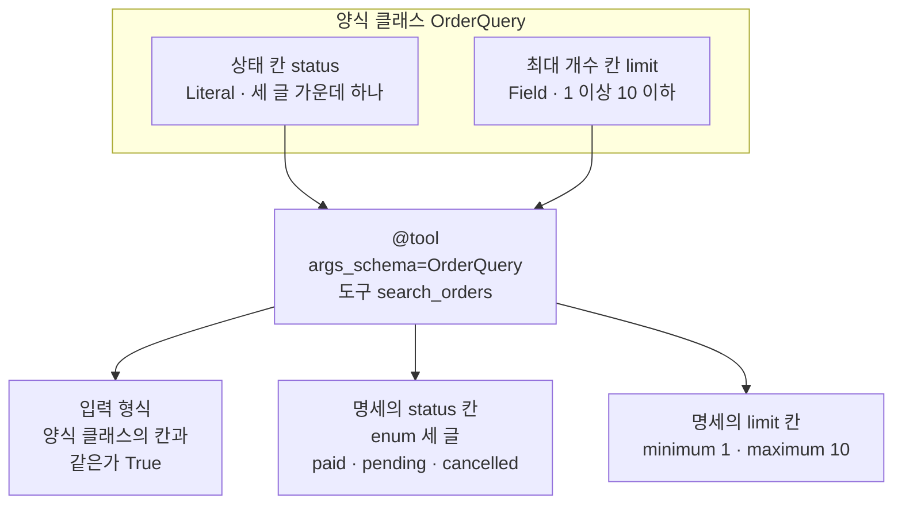
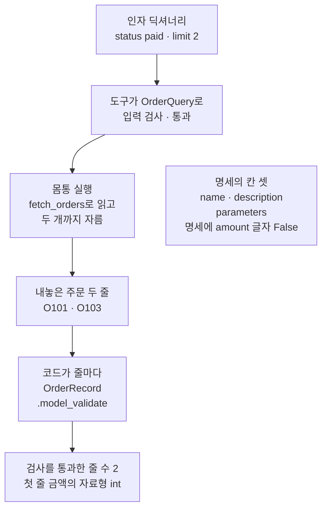
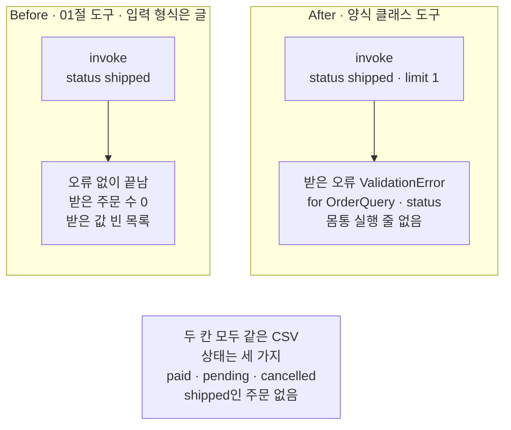
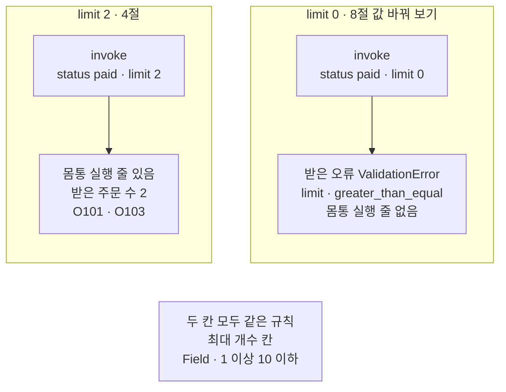

# 02-Pydantic-인자와-반환-스키마

## _src 본문 (HTML 원본)

```html
<!--meta: 강의 1h | 실습 2h | 코드 notebooks/02-Pydantic-인자와-반환-스키마.ipynb | 새 용어 5 -->
<style>html,body{overflow-x:hidden}.notebook,.nb-cell,.nb-main,.nb-input,.nb-result{min-width:0;max-width:100%}.nb-input pre,.nb-output{box-sizing:border-box;max-width:100%;overflow-x:auto}code.nb-source{display:block!important;width:100%!important;min-width:0!important;overflow-x:auto!important;padding:0!important}</style>
<h2 id="b1"><span class="no">1</span>학습 목표</h2><div class="goal"><ul>
<li>양식 클래스의 <code>Literal</code>과 <code>Field()</code>로 도구의 입력 형식에 고를 수 있는 값과 범위를 적을 수 있습니다.</li>
<li>인자 있는 <code>@tool(args_schema=…)</code> 줄로 붙인 입력 형식이 규칙 밖의 값을 몸통 실행 전에 막는 것을 출력으로 짚을 수 있습니다.</li>
<li>도구가 내놓은 값을 양식 클래스로 코드에서 검사하고, 이 검사가 도구 명세에 없다는 것을 설명할 수 있습니다.</li>
</ul></div>
<h2 id="b2"><span class="no">2</span>이 내용을 배우는 이유</h2><p>01절 도구의 입력 형식은 인자 <code>status</code>가 글이라는 것만 알려 주었습니다. 고를 수 있는 상태 셋은 도구 설명 글에만 적혀 있었습니다. 설명 글은 읽는 쪽을 위한 안내이고, 도구가 값을 검사하는 규칙은 아닙니다. 그래서 목록에 없는 상태가 들어와도 도구는 그 값으로 CSV를 찾아 빈 목록을 내놓습니다.</p><p>이 절은 고를 수 있는 값과 범위를 입력 형식에 직접 적습니다. 그러면 규칙 밖의 값은 도구 몸통이 실행되기 전에 막힙니다. 막힌 자리에서 걸린 칸과 넣은 값을 알려 주므로 잘못을 찾기 쉽습니다.</p><p>제목의 Pydantic은 양식 클래스 <code>BaseModel</code>을 주는 라이브러리 이름입니다. 제목의 반환 스키마는 도구가 내놓는 값의 칸을 코드로 검사하는 틀을 뜻합니다. 이 틀은 도구 명세에 들어가지 않아 모델에게 전해지지 않습니다. 이 절도 01절처럼 모델을 부르지 않습니다.</p>
<h2 id="b3"><span class="no">3</span>앞에서 배운 내용</h2><p><a href="01-tool과-Ch4-함수-재사용.html">01절</a>은 Ch 4 함수 <code>fetch_orders</code>를 부르는 작은 함수를 <code>@tool</code> 줄로 감싸 도구 <code>list_orders_by_status</code>를 만들었습니다. 01절에서 본 것처럼 입력 형식은 매개변수 이름과 타입힌트에서 왔고, 도구는 <code>.invoke</code>에 인자 딕셔너리를 넣어 불렀습니다. 없는 상태 이름을 넣었을 때의 결과는 01절에서 보지 않았고, 이 절에서 봅니다.</p><p><a href="../../part2/ch06-langchain-start/03-구조화-출력과-검증.html">Ch 6 03절</a>은 칸과 규칙을 적은 양식 클래스 <code>StudyCard</code>를 만들었습니다. 함수 <code>Field()</code>의 규칙 <code>ge=1</code>·<code>le=3</code>과 규칙 밖의 값에서 나는 값 검사 오류 <code>ValidationError</code>를 그 절에서 보았습니다. 양식을 JSON 스키마 모양으로 바꾸는 메서드 <code>model_json_schema()</code>도 그 절에서 썼습니다. 같은 절의 Before는 범위를 설명 글에만 적은 양식이 9를 그대로 받는 장면이었습니다. 이 절의 Before도 고를 수 있는 값을 설명 글에만 적은 도구입니다.</p><p>양식 클래스는 <a href="../../part1/ch02-python/10-Pydantic.html">Ch 2 10절</a>에서 자세히 다룹니다. 그 절은 Ch 19의 도구 입력 규칙에서 <code>BaseModel</code>과 <code>Field()</code>를 다시 만난다고 적었습니다. Ch 2에서 건너뛸 수 있는 절이라, 배우지 않았다면 Ch 6 03절의 풀이로 읽으면 됩니다.</p><p><a href="../../part1/ch04-data-tools/03-SQL로-조회-함수-만들기.html">Ch 4 03절</a>의 Before는 셀이 오류 없이 끝났지만 다른 고객의 주문을 꺼낸 장면이었습니다. 이 절의 Before도 오류 없이 끝나서 잘못을 알아채기 어려운 결함입니다. 오류 하나만 받아 출력하는 <code>try</code>와 <code>except 오류이름 as error</code>는 Ch 2 05절 모양입니다.</p>
<h2 id="b4"><span class="no">4</span>핵심 개념</h2><h3>비유로 시작하기</h3><p>01절의 식당을 다시 떠올립니다. 손님은 주문 전표에 고른 값을 적어 내주는 창에 넣습니다. 전표의 칸이 아무 글이나 적는 빈칸이면, 메뉴에 없는 요리를 적은 전표도 창을 지나 주방에 들어갑니다. 주방은 그 요리를 찾지 못하고 빈 접시를 내보냅니다.</p><p>칸이 동그라미 셋으로 정해진 전표라면, 동그라미 밖에 적은 전표를 창 앞에서 막을 수 있습니다. 막힌 전표는 주방에 들어가지 않습니다. 01절 그림의 동그라미는 설명 글의 안내였고, 그 도구의 입력 형식이 정한 칸은 글을 적는 빈칸 하나였습니다. 그래서 이 절에서 빈칸 전표는 01절 도구의 입력 형식이고, 동그라미 셋 전표는 양식 클래스로 적은 입력 형식입니다. 창 앞에서 전표를 살피는 일이 입력 검사입니다.</p><p>요리가 나갈 때 주방 쪽에서 접시를 한 번 더 살필 수도 있습니다. 이 확인은 손님이 보는 메뉴판에 적히지 않습니다. 도구가 내놓은 값을 코드가 검사하는 일이 이것과 같습니다.</p>
{{img:02-5-칸이-정해진-전표와-닫힌-창|흰 바탕 그림으로 연초록 벽에 나무 틀 창 두 개가 나란히 있고, 왼쪽 창은 열려 있어 창턱 안쪽에 빈 흰 접시 한 장이 놓여 있고 그 앞 전표 한 장에는 빈 네모 칸 하나와 그 오른쪽에 주황 별 하나가 그려져 있으며, 오른쪽 창은 나무 덧문이 내려와 닫혀 있고 창턱의 전표 한 장에는 빈 동그라미 셋이 한 줄로 있고 세로 줄 너머 오른쪽 끝에 같은 주황 별이 그려져 있는 그림|빈칸 전표는 무엇을 적어도 창을 지나 빈 접시가 나오고, 동그라미 셋 밖에 적은 전표 앞에서는 창이 닫힙니다.}}
<p class="look"><b>그림 읽기</b> — 연초록 벽에 창 두 개가 나란히 있습니다. 왼쪽 창은 열려 있고, 창턱 안쪽에 빈 흰 접시 한 장이 놓여 있습니다. 그 앞 전표에는 빈 네모 칸 하나와 주황 별 하나가 있습니다. 오른쪽 창은 나무 덧문이 내려와 닫혔고, 창턱 전표에는 빈 동그라미 셋과 세로 줄 너머의 같은 주황 별이 있습니다. 주황 별은 메뉴에 없는 주문 <code>shipped</code>이고, 왼쪽은 01절 도구, 오른쪽은 양식 클래스를 붙인 도구입니다.</p>
<table><thead><tr><th>말</th><th>뜻</th></tr></thead><tbody><tr><td>양식 클래스(BaseModel)</td><td>칸마다 자료형과 규칙을 적어 값을 검사하는 클래스입니다. Ch 6 03절에서 쓴 말입니다. 칸 이름이 인쇄된 신청서 양식과 같습니다.</td></tr><tr><td>고를 수 있는 값(Literal)</td><td>칸에 적을 수 있는 값을 몇 개로 정해 두는 표시입니다. 전표의 동그라미 셋과 같습니다.</td></tr><tr><td>입력 형식 클래스(args_schema)</td><td>도구의 입력 형식을 매개변수 대신 정하는 양식 클래스입니다. <code>@tool</code> 괄호 안에 줍니다. 전표 양식 자체와 같습니다.</td></tr><tr><td>입력 검사</td><td>도구가 몸통을 실행하기 전에 인자 딕셔너리를 입력 형식의 규칙에 맞춰 보는 일입니다. 창 앞에서 전표를 살피는 일과 같습니다. <a href="../../part4/ch16-guardrails/01-입출력-출처-검증.html">Ch 16 01절</a>의 입력 검사(모델을 부르기 전에 사용자 질문을 보는 일)와는 보는 값과 자리가 다릅니다.</td></tr><tr><td>내놓는 값 검사 틀(반환 스키마)</td><td>도구가 내놓은 값의 칸을 코드가 따로 검사하는 양식 클래스입니다. 도구 명세에 들어가지 않습니다. 주방 쪽에서 나가는 접시를 살피는 일과 같습니다.</td></tr></tbody></table>
<p>새 말을 이 절 코드에서 보면 이렇습니다. 양식 클래스는 <code>OrderQuery</code>와 <code>OrderRecord</code>입니다. 고를 수 있는 값은 상태 칸의 <code>Literal["paid", "pending", "cancelled"]</code>입니다. 입력 형식 클래스는 <code>@tool(args_schema=OrderQuery)</code> 줄의 <code>OrderQuery</code>이고, 입력 검사에 걸리면 값 검사 오류 <code>ValidationError</code>가 납니다. 내놓는 값 검사 틀은 코드가 <code>OrderRecord.model_validate</code>로 부르는 검사입니다.</p>
{{mermaid:02-1-양식-클래스에서-도구-명세로|위에서 아래로 읽는 그림으로 맨 위 칸 양식 클래스 OrderQuery 안에 파란 상자 둘 상태 칸 status Literal 세 글 가운데 하나와 최대 개수 칸 limit Field 1 이상 10 이하가 나란히 있고, 이 칸에서 회색 상자 @tool args_schema=OrderQuery 도구 search_orders로 이어지며, 거기서 노란 상자 셋 입력 형식 양식 클래스의 칸과 같은가 True, 명세의 status 칸 enum 세 글 paid pending cancelled, 명세의 limit 칸 minimum 1 maximum 10으로 나뉘는 그림|양식 클래스에 적은 고를 수 있는 값과 범위가 도구의 입력 형식과 도구 명세에 그대로 들어갑니다.}}
<p class="look"><b>도식 읽기</b> — 위에서 아래로 읽습니다. 맨 위 칸이 우리가 적은 양식 클래스 <code>OrderQuery</code>이고, 파란 상자 둘이 그 칸 둘입니다. 가운데 회색 상자는 LangChain의 <code>@tool</code> 줄이 이 양식을 입력 형식으로 붙여 만든 도구입니다. 아래 노란 상자 셋은 노트북 4절이 출력한 입력 형식과 도구 명세의 두 칸입니다. 고를 수 있는 값 셋과 범위 1~10이 명세까지 그대로 들어갑니다.</p>
<h3>괄호가 있는 @tool 줄</h3><p>01절의 <code>@tool</code> 줄은 괄호 없이 아래 함수를 도구로 등록했습니다. 이 절의 <code>@tool(args_schema=OrderQuery)</code> 줄도 아래 함수를 도구로 등록합니다. 다른 점은 괄호 안에 입력 형식을 따로 준다는 것입니다. 그러면 입력 형식은 매개변수의 이름과 타입힌트가 아니라 양식 클래스의 칸에서 옵니다. 그래서 이 절의 도구 함수는 매개변수에 타입힌트를 적지 않고, 이름만 칸 이름과 같게 적습니다.</p>
<h3>고를 수 있는 값과 범위</h3><p>상태 칸의 <code>Literal["paid", "pending", "cancelled"]</code>은 괄호 안 세 글 가운데 하나만 적을 수 있다는 표시입니다. JSON 스키마 모양으로 바꾸면 칸 <code>enum</code>에 세 글이 목록으로 들어갑니다. 최대 개수 칸의 <code>Field(ge=1, le=10)</code>은 1 이상 10 이하라는 규칙입니다. 이 규칙은 칸 <code>minimum</code>과 <code>maximum</code>이 됩니다. 두 규칙 모두 도구 명세에 그대로 실립니다.</p>
<h3>도구가 내놓는 값의 검사</h3><p>도구 명세의 칸은 이름·설명·입력 형식 셋뿐입니다. 도구가 내놓는 값의 모양을 적을 칸이 없어서, 그 모양은 모델에게 전해지지 않습니다. 그래서 이 절의 <code>OrderRecord</code>는 도구에 붙이지 않고, 코드가 도구가 내놓은 줄을 하나씩 검사할 때 부릅니다. 메서드 <code>model_validate</code>는 딕셔너리 하나를 받아 칸 규칙으로 검사하고, 통과하면 양식 객체를 내놓습니다.</p>
<h3>다른 상황에 적용</h3><p>호텔 예약 도구라면 객실 등급은 고를 수 있는 값으로, 인원은 1 이상의 범위로 적을 수 있습니다. 체크인 날짜가 체크아웃 날짜보다 앞서는지처럼 두 칸 사이의 관계는 칸 하나의 규칙이 아닙니다. 그런 규칙을 적는 방법은 이번에 다루지 않았습니다.</p>
<h3>비교와 경계</h3><p>입력 검사는 값이 규칙 안에 있는지만 봅니다. 규칙 안의 상태라도 그 상태의 주문이 CSV에 있는지는 도구 몸통이 찾아봐야 압니다. 이 CSV에는 세 상태 모두 주문이 있어서, 규칙 안의 상태로 빈 목록을 받는 장면은 이번에 보지 않았습니다. 고를 수 있는 값을 바꾸면 양식 클래스와 도구 설명을 함께 고쳐야 합니다.</p>
<h2 id="b5"><span class="no">5</span>실행 예제</h2><p>노트북은 먼저 01절 도구를 다시 적고 입력 형식을 봅니다. 그다음 양식 클래스 <code>OrderQuery</code>를 만들고, 그 클래스를 입력 형식으로 붙인 도구 <code>search_orders</code>를 만듭니다. 마지막으로 도구가 내놓은 주문 두 줄을 양식 클래스 <code>OrderRecord</code>로 검사합니다.</p><p>이 절은 모델을 부르지 않습니다. 읽는 파일은 주문 CSV 하나이고, 쓰는 파일은 없습니다.</p>
{{notebook:02-Pydantic-인자와-반환-스키마|example}}
<p class="look"><b>확인할 점</b> — 노트북 4절 출력 <code>양식 클래스의 칸과 같은가: True</code>로 입력 형식이 양식 클래스에서 왔는지 봅니다. 노트북 5절 출력 <code>검사를 통과한 줄 수: 2</code>와 <code>명세에 amount 글자가 있는가: False</code>로 내놓은 값의 검사가 도구 명세 밖에 있는지 봅니다.</p>
{{mermaid:02-2-입력-검사와-내놓은-값-검사|위에서 아래로 읽는 그림으로 초록 상자 인자 딕셔너리 status paid limit 2에서 회색 상자 도구가 OrderQuery로 입력 검사 통과, 파란 상자 몸통 실행 fetch_orders로 읽고 두 개까지 자름, 노란 상자 내놓은 주문 두 줄 O101 O103, 파란 상자 코드가 줄마다 OrderRecord.model_validate, 노란 상자 검사를 통과한 줄 수 2 첫 줄 금액의 자료형 int로 차례로 이어지고, 오른쪽에 화살표 없이 떨어진 노란 상자에 명세의 칸 셋 name description parameters 명세에 amount 글자 False가 적힌 그림|입력 검사는 도구 안에서 몸통보다 먼저 일어나고, 내놓은 값의 검사는 도구 밖에서 코드가 따로 부르며 도구 명세에 들어가지 않습니다.}}
<p class="look"><b>도식 읽기</b> — 위에서 아래로 읽습니다. 초록 상자는 노트북 4절에서 손으로 정한 인자 딕셔너리입니다. 회색 상자는 도구가 양식 클래스로 하는 입력 검사이고, 그다음 파란 몸통이 실행됩니다. 노란 두 줄을 받은 뒤, 5절 코드가 양식 클래스 <code>OrderRecord</code>로 줄마다 검사합니다. 오른쪽에 떨어진 노란 상자는 5절 출력으로, 도구 명세에 금액 칸 이름이 없다는 것을 보여 줍니다.</p>
<h2 id="b6"><span class="no">6</span>실패 확인</h2><p>아래 Before 셀은 01절 도구에 CSV에 없는 상태 <code>shipped</code>를 넣습니다. 이어지는 After 셀은 같은 상태를 양식 클래스를 붙인 도구에 넣습니다.</p>
{{notebook:02-Pydantic-인자와-반환-스키마|failure}}
{{mermaid:02-3-없는-상태-shipped를-넣으면|칸 둘이 나란히 있고 아래에 회색 상자가 있는 그림으로 왼쪽 칸 Before 01절 도구 입력 형식은 글에는 파란 상자 invoke status shipped에서 빨간 상자 오류 없이 끝남 받은 주문 수 0 받은 값 빈 목록으로 이어지고, 오른쪽 칸 After 양식 클래스 도구에는 파란 상자 invoke status shipped limit 1에서 노란 상자 받은 오류 ValidationError for OrderQuery status 몸통 실행 줄 없음으로 이어지며, 맨 아래 회색 상자에 두 칸 모두 같은 CSV 상태는 세 가지 paid pending cancelled shipped인 주문 없음이 적힌 그림|없는 상태 shipped를 넣으면 01절 도구는 오류 없이 빈 목록을 내놓고, 양식 클래스를 붙인 도구는 몸통 실행 전에 막습니다.}}
<p class="look"><b>도식 읽기</b> — 왼쪽 칸이 Before이고 오른쪽 칸이 After입니다. 두 칸 모두 CSV에 없는 상태 shipped를 넣습니다. 왼쪽 빨간 상자는 노트북 6절의 결함 결과로, 오류 없이 빈 목록을 받았습니다. 오른쪽 노란 상자는 7절에서 받아 출력한 값 검사 오류이고, 몸통이 찍는 줄이 없었습니다. 맨 아래 회색 상자는 두 칸이 같은 CSV를 읽는다는 공통 사실로, 6절 둘째 셀의 출력입니다.</p>
<p>01절 도구는 <code>shipped</code>에도 오류 없이 빈 목록을 내놓았습니다. 주문 CSV의 상태는 세 가지뿐이라, 이 빈 목록은 입력이 틀려서 나온 값입니다. 그런데 도구의 출력만으로는 주문이 없는 경우와 가를 수 없었습니다.</p><p>양식 클래스를 붙인 도구는 같은 상태에서 값 검사 오류를 냈습니다. 오류 글은 걸린 칸 <code>status</code>와 넣은 값을 알려 주었습니다. 몸통이 찍는 줄이 없어서, 몸통이 실행되기 전에 막혔다는 것도 출력으로 보였습니다. 규칙 안의 <code>pending</code>에서는 두 도구의 결과가 같았습니다. 새 커널로 두 번 실행했을 때 출력은 두 번 모두 같았습니다.</p>
<p>값 바꿔 보기는 최대 개수만 2에서 0으로 바꿉니다. 이번에는 칸 <code>limit</code>의 범위 규칙에 걸려 값 검사 오류가 났고, 몸통은 실행되지 않았습니다.</p>
{{mermaid:02-4-최대-개수를-0으로|칸 둘이 나란히 있고 아래에 회색 상자가 있는 그림으로 왼쪽 칸 limit 2 4절에는 파란 상자 invoke status paid limit 2에서 노란 상자 몸통 실행 줄 있음 받은 주문 수 2 O101 O103으로 이어지고, 오른쪽 칸 limit 0 8절 값 바꿔 보기에는 파란 상자 invoke status paid limit 0에서 노란 상자 받은 오류 ValidationError limit greater_than_equal 몸통 실행 줄 없음으로 이어지며, 맨 아래 회색 상자에 두 칸 모두 같은 규칙 최대 개수 칸 Field 1 이상 10 이하가 적힌 그림|최대 개수만 2에서 0으로 바꾸면 범위 규칙에 걸려 몸통 실행 전에 값 검사 오류가 납니다.}}
<p class="look"><b>도식 읽기</b> — 왼쪽 칸은 노트북 4절에서 최대 개수 2로 부른 결과이고, 오른쪽 칸은 8절에서 0으로만 바꾼 결과입니다. 두 칸의 노란 상자는 모두 노트북 출력입니다. 오른쪽에서는 칸 limit의 범위 규칙에 걸렸고, 몸통이 찍는 줄이 없었습니다. 맨 아래 회색 상자는 두 칸에 공통인 양식 클래스의 규칙입니다.</p>
<h2 id="b7"><span class="no">7</span>주의할 점과 실무 메모</h2><ul><li>이 절은 모델을 부르지 않았습니다. 모델 요청은 0번이고 API 키도 쓰지 않았습니다.</li><li>도구 설명 글에 고를 수 있는 값을 적어도, 01절 도구는 그 값을 검사하지 않았습니다. 규칙은 입력 형식에 적습니다.</li><li>값 검사 오류를 받아 빈 목록으로 바꾸면 Before와 같은 결함이 됩니다. 이 절은 그 오류를 셀에서 받아 출력만 했습니다.</li><li>이 절의 도구 함수에는 매개변수 타입힌트를 적지 않았습니다. 입력 형식은 <code>@tool</code> 괄호 안의 양식 클래스에서 왔습니다.</li><li>도구 함수에 내놓는 값의 자료형 표시를 붙여도 도구 명세에는 들어가지 않았습니다. 이 확인은 설치한 langchain-core 1.6.2로 노트북 밖에서 했고, 노트북에서는 실행하지 않았습니다. 이 챕터는 그 표시를 쓰지 않습니다.</li><li>노트북 5절의 금액이 음수인 줄은 검사를 보이려고 셀에서 직접 만든 값입니다. 주문 CSV에는 그런 줄이 없습니다.</li><li>금액 칸 자료형은 CSV 값과 같은 정수 <code>int</code>로 적었습니다. 검사를 통과한 뒤에도 금액이 정수로 남은 것을 출력으로 확인했습니다.</li><li>양식 클래스는 도구 파일에 옮기지 않았습니다. 도구 파일에는 평범한 함수만 둡니다.</li><li>걸린 시간은 재지 않았습니다. 이 절은 파일을 쓰지 않습니다.</li><li>교재 출력은 Linux의 Python 3.12.13으로 만들었습니다. 다른 판과 Windows·macOS에서는 이번에 실행하지 않았습니다.</li></ul>
<h2 id="b8"><span class="no">8</span>정리와 다음 절</h2><ul><li>양식 클래스의 <code>Literal</code>과 <code>Field(ge=1, le=10)</code>이 입력 형식과 도구 명세에 값 목록과 범위로 들어갔습니다.</li><li>01절 도구는 없는 상태 <code>shipped</code>에 오류 없이 빈 목록을 내놓았고, 양식 클래스를 붙인 도구는 몸통 실행 전에 막았습니다.</li><li>도구가 내놓은 값은 다른 양식 클래스로 코드에서 검사했고, 이 검사는 도구 명세에 들어가지 않았습니다.</li></ul><p><strong>다음 학습과 이어지는 지점</strong> — 03절에서는 모델이 읽을 도구 이름과 도구 설명을 어떻게 적으면 좋은지 봅니다.</p>
<h2 id="b9"><span class="no">9</span>복습 문제</h2><details class="quiz" open><summary>문제 4개 · 해설 포함</summary><p class="quiz-q">1. 01절 도구에 <code>shipped</code>를 넣었을 때 무엇이 나왔고, 그것이 왜 결함인가요?</p><p class="quiz-a">오류 없이 빈 목록이 나왔습니다. 주문이 없는 경우와 입력이 틀린 경우를 가를 수 없어 잘못을 알아채지 못합니다. 틀렸다면 노트북 6절을 다시 읽습니다.</p><p class="quiz-q">2. <code>@tool(args_schema=OrderQuery)</code>로 만든 도구의 입력 형식은 어디서 오나요?</p><p class="quiz-a">양식 클래스 <code>OrderQuery</code>의 칸에서 옵니다. 노트북 4절 출력 <code>양식 클래스의 칸과 같은가: True</code>가 그 근거입니다. 틀렸다면 노트북 4절을 다시 읽습니다.</p><p class="quiz-q">3. 양식 클래스를 붙인 도구에 <code>shipped</code>를 넣었을 때, 몸통이 실행되지 않았다는 것은 어떻게 알 수 있나요?</p><p class="quiz-a">몸통 첫 줄이 찍는 <code>몸통 실행</code> 줄이 출력에 없었습니다. 오류 글의 첫 줄도 입력 양식 <code>OrderQuery</code>의 검사에서 걸렸다고 알려 줍니다. 틀렸다면 노트북 7절을 다시 읽습니다.</p><p class="quiz-q">4. 양식 클래스 <code>OrderRecord</code>의 검사는 모델에게 전해지나요?</p><p class="quiz-a">전해지지 않습니다. 도구 명세의 칸은 셋뿐이고 명세에 <code>amount</code> 글자가 없었습니다. 도구가 내놓은 값을 코드가 쓰기 전에 부르는 검사입니다. 틀렸다면 노트북 5절을 다시 읽습니다.</p></details>
<h2 id="b10"><span class="no">10</span>참고 자료</h2><ul><li><div><a href="https://docs.langchain.com/oss/python/langchain/tools">LangChain Tools</a></div>확인 2026-09-24 · LangChain 문서입니다. 도구 인자를 양식 클래스로 적는 예와 <code>Literal</code>로 값을 정하는 예가 있습니다. 도구가 내놓는 값의 양식은 다루지 않습니다.</li><li><div><a href="https://pydantic.dev/docs/validation/2.12/concepts/models/">Pydantic Models</a></div>확인 2026-09-24 · Pydantic 2.12 문서입니다. 메서드 <code>model_validate</code>가 딕셔너리를 받아 검사한다고 적습니다.</li><li><div><a href="https://docs.python.org/3.12/library/typing.html#typing.Literal">Python typing.Literal</a></div>확인 2026-09-24 · 정해진 값만 적을 수 있다는 표시의 설명입니다.</li><li>01절 — 도구 이름·설명·입력 형식과 <code>.invoke</code>.</li><li>Ch 6 03절 — 양식 클래스와 <code>Field()</code> 규칙.</li><li>Ch 2 10절 — 양식 클래스 자세히.</li><li>Ch 4 03절 — 오류 없이 끝나는 결함.</li></ul>
```

## 노트북 셀 (순서대로)

### [0] markdown {'html': 'skip'}

# Pydantic 인자와 반환 스키마

**이 노트북에서 할 일**

1. Ch 6 03절의 양식 클래스로 도구의 입력 형식을 적고, 도구 명세에 무엇이 들어가는지 봅니다.
2. 도구가 내놓은 주문 줄을 다른 양식 클래스로 코드에서 검사합니다.
3. 없는 상태 이름을 넣으면 01절 도구가 오류 없이 빈 목록을 내놓는 것을 봅니다(Before).
4. 양식 클래스를 붙인 도구가 같은 값을 몸통 실행 전에 막는 것을 봅니다(After).

**준비물** — 이 절은 모델을 부르지 않습니다.
모델 요청은 0번이라 API 키가 필요 없고, 드는 비용도 없습니다.
입력 형식 검사는 도구를 부르는 프로그램 안에서 일어나서 모델 없이 볼 수 있기 때문입니다.
모델이 도구 명세를 읽고 인자를 적어 보내는 장면은 04절부터 봅니다.

읽는 파일은 실습 폴더의 `data/orders.csv` 하나이고, 새로 쓰는 파일은 없습니다.
Ch 4 함수 `fetch_orders`는 같은 폴더의 도구 파일 `order_tools.py`에서 가져옵니다.
교재 출력을 만든 실행에서는 노트북 전체가 3초 안에 끝났습니다.

**기준 버전** — 첫 셀에서 패키지 넷을 설치합니다.
판은 langchain 1.4.0, langchain-core 1.6.2입니다.
함께 설치하는 pandas는 3.0.5, pydantic은 2.12.5입니다.
교재 출력은 Linux의 Python 3.12.13으로 만들었습니다.
다른 판과 Windows·macOS에서는 이번에 실행하지 않았습니다.

**강의와 실습 범위** — 강의 시간에는 2~5절을 읽습니다.
양식 클래스로 입력 형식을 적고, 도구가 내놓은 값을 검사하는 자리입니다.
6~8절은 없는 상태를 넣어 보고, 막는 모습을 보고, 값을 바꿔 보는 자리입니다.
이 부분은 실습 시간에 실행합니다.

실습 폴더 `labs/part5/ch19-model-tools`에서 `uv sync --locked`를 실행합니다.
그다음 `notebooks/` 폴더의 이 노트북을 열고, 실습 폴더의 `.venv` 커널을 고릅니다.
첫 셀부터 순서대로 실행합니다.

### [1] markdown {'html': 'skip'}

## 오늘 볼 그림


위에서 아래로 읽습니다. 맨 위 칸이 우리가 적은 양식 클래스이고, 파란 상자 둘이 그 칸 둘입니다.
가운데 회색 상자는 LangChain의 `@tool` 줄이 양식 클래스를 입력 형식으로 붙여 만든 도구입니다.
아래 노란 상자 셋은 노트북 4절이 출력한 입력 형식과 도구 명세의 두 칸입니다.

### [2] markdown {}

## 1. 준비

이 절은 01절 도구의 입력 형식에 고를 수 있는 값과 범위를 적습니다.
제목의 Pydantic은 Ch 6 03절에서 쓴 양식 클래스 `BaseModel`을 주는 라이브러리 이름입니다.
제목의 반환 스키마는 도구가 내놓는 값의 칸을 코드로 검사하는 틀을 뜻합니다.
이 틀은 모델에게 전해지지 않고, 그 까닭은 5절에서 출력으로 봅니다.

첫 셀은 패키지 네 개를 설치하고 설치된 판 번호를 출력합니다.
설치에는 몇십 초가 걸릴 수 있습니다.

### [3] code {'execution': {'iopub.execute_input': '2026-09-24T01:24:21.901518Z', 'iopub.status.busy': '2026-09-24T01:24:21.901360Z', 'iopub.status.idle': '2026-09-24T01:24:22.584640Z', 'shell.execute_reply': '2026-09-24T01:24:22.584130Z'}, 'lesson_role': 'setup'}

```python
# 이 절에서 쓰는 패키지를 설치하고 버전을 확인합니다
%pip install -q "langchain==1.4.0" "langchain-core==1.6.2" "pandas==3.0.5" "pydantic==2.12.5"
from importlib.metadata import version

print("langchain:", version("langchain"))
print("langchain-core:", version("langchain-core"))
print("pandas:", version("pandas"))
print("pydantic:", version("pydantic"))
```

출력:
```
Note: you may need to restart the kernel to use updated packages.
langchain: 1.4.0
langchain-core: 1.6.2
pandas: 3.0.5
pydantic: 2.12.5

```

### [4] markdown {}

**결과 읽기** — 출력 줄 `langchain: 1.4.0`·`langchain-core: 1.6.2`·`pandas: 3.0.5`·`pydantic: 2.12.5`가 실습 폴더 잠금과 같은 판입니다.
이 노트북의 출력은 2026-09-24에 이 판으로 실행한 결과입니다.

앞에서 배운 함수는 `order_tools.py`에 모아 두었습니다. 파일을 열면 코드를 볼 수 있습니다. 노트북과 같은 폴더(`notebooks/`)에 있는 파일입니다. 커널이 `notebooks/` 폴더에서 시작해야 이 파일을 가져올 수 있습니다.

다음 셀은 이 절에서 쓸 이름 여덟을 가져옵니다.
이름 `Literal`은 3절에서 칸에 적을 수 있는 값을 몇 개로 정할 때 씁니다.
이름 `BaseModel`·`Field`·`ValidationError`는 Ch 6 03절에서 쓴 양식 틀·칸 규칙·값 검사 오류입니다.
함수 `tool`과 `convert_to_openai_tool`은 01절에서 쓴 이름입니다.

### [5] code {'execution': {'iopub.execute_input': '2026-09-24T01:24:22.585763Z', 'iopub.status.busy': '2026-09-24T01:24:22.585676Z', 'iopub.status.idle': '2026-09-24T01:24:23.567805Z', 'shell.execute_reply': '2026-09-24T01:24:23.567414Z'}, 'lesson_role': 'setup'}

```python
# CSV 위치를 찾을 os, 칸 값을 정하는 Literal, 양식 클래스 이름들, 도구를 만드는 이름들, Ch 4 함수를 가져옵니다
import os
from typing import Literal

from langchain.tools import tool
from langchain_core.utils.function_calling import convert_to_openai_tool
from pydantic import BaseModel, Field, ValidationError

from order_tools import fetch_orders

print("가져온 이름:", "os", "Literal", "tool", "convert_to_openai_tool")
print("가져온 이름:", "BaseModel", "Field", "ValidationError", "fetch_orders")
```

출력:
```
가져온 이름: os Literal tool convert_to_openai_tool
가져온 이름: BaseModel Field ValidationError fetch_orders

```

### [6] markdown {}

**결과 읽기** — 출력 두 줄에 가져온 이름 여덟이 보입니다.
함수 `fetch_orders`는 01절처럼 도구 파일에서 가져왔습니다.

다음 셀은 01절과 같은 방법으로 주문 CSV가 있는 프로젝트 맨 위 폴더를 찾습니다.
후보 세 곳을 차례로 보고, 파일이 있는 첫 자리에서 `break`로 멈춥니다.

### [7] code {'execution': {'iopub.execute_input': '2026-09-24T01:24:23.568637Z', 'iopub.status.busy': '2026-09-24T01:24:23.568522Z', 'iopub.status.idle': '2026-09-24T01:24:23.570783Z', 'shell.execute_reply': '2026-09-24T01:24:23.570439Z'}, 'lesson_role': 'setup'}

```python
# 노트북을 어느 폴더에서 열어도 주문 CSV를 찾게 후보 세 곳을 차례로 봅니다
candidates = [".", "../../..", "../../../.."]
root_path = None
for candidate in candidates:
    if os.path.exists(candidate + "/labs/part5/ch19-model-tools/data/orders.csv"):
        root_path = candidate
        break
print("찾은 프로젝트 맨 위:", root_path)
assert root_path is not None, "notebooks 폴더나 실습 폴더 맨 위에서 노트북을 열어 주세요."
# CSV 파일 위치는 노트북이 정해 두는 값입니다(모델이 고를 값이 아님)
csv_path = root_path + "/labs/part5/ch19-model-tools/data/orders.csv"
```

출력:
```
찾은 프로젝트 맨 위: .

```

### [8] markdown {}

**결과 읽기** — 출력 줄 `찾은 프로젝트 맨 위: .`은 교재 출력을 프로젝트 맨 위에서 실행했다는 뜻입니다.
교재 출력은 실행 도구에 도구 파일 폴더를 따로 알려 준 실행이라 `.`이 찍혔습니다.
노트북을 `notebooks/` 폴더에서 열면 이 줄에 `../../../..`가 찍힙니다.
셀 안의 안내 글은 실습 폴더 맨 위도 적었지만, 도구 파일을 가져오려면 `notebooks/` 폴더에서 열어야 합니다.
변수 `csv_path`에 CSV 파일 위치를 담았습니다.

## 2. 01절 도구 다시 보기

01절은 Ch 4 함수를 부르는 작은 함수를 `@tool` 줄로 감싸 도구를 만들었습니다.
이 노트북은 01절 노트북과 따로 실행되므로, 다음 셀에 01절 3절 셀을 그대로 다시 적습니다.
6절 Before에서 이 도구를 씁니다.

### [9] code {'execution': {'iopub.execute_input': '2026-09-24T01:24:23.571388Z', 'iopub.status.busy': '2026-09-24T01:24:23.571334Z', 'iopub.status.idle': '2026-09-24T01:24:23.574177Z', 'shell.execute_reply': '2026-09-24T01:24:23.573927Z'}}

```python
# Ch 4 함수를 부르는 작은 함수를 도구로 감쌉니다(CSV 파일 위치는 노트북이 정하고, 상태만 인자로 받습니다)
@tool
def list_orders_by_status(status: str):
    """주문 상태(paid, pending, cancelled)를 받아 그 상태의 주문 목록을 찾습니다."""
    # 몸통은 Ch 4 함수를 한 번 부르는 한 줄입니다
    return fetch_orders(csv_path, status=status)
```

출력:
```

```

### [10] markdown {}

**결과 읽기** — 정의 셀이라 출력이 없습니다.
함수 `list_orders_by_status`는 상태 글 하나를 받아 그 상태의 주문 목록을 내놓는 도구가 되었습니다.

다음 셀은 이 도구의 입력 형식과 도구 설명을 다시 봅니다.

### [11] code {'execution': {'iopub.execute_input': '2026-09-24T01:24:23.574712Z', 'iopub.status.busy': '2026-09-24T01:24:23.574662Z', 'iopub.status.idle': '2026-09-24T01:24:23.576618Z', 'shell.execute_reply': '2026-09-24T01:24:23.576253Z'}}

```python
# 01절 도구의 입력 형식과 도구 설명을 다시 봅니다
print("입력 형식:", list_orders_by_status.args)
print("도구 설명:", list_orders_by_status.description)
```

출력:
```
입력 형식: {'status': {'title': 'Status', 'type': 'string'}}
도구 설명: 주문 상태(paid, pending, cancelled)를 받아 그 상태의 주문 목록을 찾습니다.

```

### [12] markdown {}

**결과 읽기** — 출력 줄 `입력 형식: {'status': {'title': 'Status', 'type': 'string'}}`는 01절 4절 출력과 같습니다.
입력 형식이 알려 주는 것은 인자 `status`가 글이라는 것뿐입니다.
고를 수 있는 상태 셋 `paid, pending, cancelled`는 출력 줄 `도구 설명:` 뒤 글에만 있습니다.

설명 글에 적은 상태 셋을 도구가 검사하는지는 6절에서 봅니다.

## 3. 양식 클래스로 고를 수 있는 값 적기

Ch 6 03절은 칸과 규칙을 적은 양식 클래스 `StudyCard`를 만들었습니다.
클래스 이름 뒤 괄호에 `BaseModel`을 적으면, 칸마다 적은 자료형과 규칙으로 값을 검사하는 양식이 됩니다.
양식 클래스는 Ch 2 10절에서 자세히 다룹니다.
Ch 2에서 건너뛸 수 있는 절이라, 배우지 않았다면 칸과 규칙을 적은 양식으로 읽으면 됩니다.

이번 양식 클래스 `OrderQuery`에는 칸이 둘입니다.
상태 칸의 `Literal["paid", "pending", "cancelled"]`은 괄호 안 세 글 가운데 하나만 적을 수 있다는 표시입니다.
최대 개수 칸의 `Field(ge=1, le=10)`은 Ch 6 03절처럼 1 이상 10 이하라는 규칙입니다.
식당으로 치면 상태 칸은 동그라미 셋 가운데 하나를 칠하는 전표 칸입니다.

### [13] code {'execution': {'iopub.execute_input': '2026-09-24T01:24:23.577165Z', 'iopub.status.busy': '2026-09-24T01:24:23.577096Z', 'iopub.status.idle': '2026-09-24T01:24:23.579168Z', 'shell.execute_reply': '2026-09-24T01:24:23.578907Z'}}

```python
# 주문 상태와 최대 개수 두 칸을 가진 주문 찾기 양식을 정합니다
class OrderQuery(BaseModel):
    # 상태 칸에는 괄호 안 세 글 가운데 하나만 적을 수 있습니다
    status: Literal["paid", "pending", "cancelled"] = Field(description="찾을 주문 상태")
    # 최대 개수 칸은 1 이상 10 이하의 정수입니다
    limit: int = Field(ge=1, le=10, description="받을 주문의 최대 개수")
```

출력:
```

```

### [14] markdown {}

**결과 읽기** — 정의 셀이라 출력이 없습니다.
두 칸 모두 기본값을 적지 않아, 두 칸 모두 꼭 채워야 하는 칸입니다.

다음 셀은 규칙 안의 값으로 양식 객체 하나를 직접 만듭니다.
Ch 6 03절에서 카드 하나를 키워드 인자로 만든 것과 같은 방법입니다.

### [15] code {'execution': {'iopub.execute_input': '2026-09-24T01:24:23.579851Z', 'iopub.status.busy': '2026-09-24T01:24:23.579801Z', 'iopub.status.idle': '2026-09-24T01:24:23.581481Z', 'shell.execute_reply': '2026-09-24T01:24:23.581233Z'}}

```python
# 규칙 안의 값으로 양식 객체 하나를 직접 만들고 칸 값을 읽습니다(도구 없음)
sample_query = OrderQuery(status="paid", limit=2)
print("양식 객체:", sample_query)
print("상태 칸:", sample_query.status)
print("최대 개수 칸:", sample_query.limit)
```

출력:
```
양식 객체: status='paid' limit=2
상태 칸: paid
최대 개수 칸: 2

```

### [16] markdown {}

**결과 읽기** — 출력 줄 `양식 객체: status='paid' limit=2`로 두 칸에 값이 들어갔습니다.
칸 값은 `sample_query.status`처럼 점 뒤에 칸 이름을 적어 꺼냅니다.

다음 셀은 Ch 6 03절에서 쓴 메서드 `model_json_schema()`로 양식을 JSON 스키마 모양 딕셔너리로 바꿉니다.
칸마다 규칙이 어떤 이름으로 적히는지 봅니다.

### [17] code {'execution': {'iopub.execute_input': '2026-09-24T01:24:23.582064Z', 'iopub.status.busy': '2026-09-24T01:24:23.582017Z', 'iopub.status.idle': '2026-09-24T01:24:23.583732Z', 'shell.execute_reply': '2026-09-24T01:24:23.583468Z'}}

```python
# 양식 클래스를 JSON 스키마 모양 딕셔너리로 바꿔 칸마다 적힌 규칙을 봅니다
query_schema = OrderQuery.model_json_schema()
print("status 칸:", query_schema["properties"]["status"])
print("limit 칸:", query_schema["properties"]["limit"])
print("꼭 채울 칸:", query_schema["required"])
```

출력:
```
status 칸: {'description': '찾을 주문 상태', 'enum': ['paid', 'pending', 'cancelled'], 'title': 'Status', 'type': 'string'}
limit 칸: {'description': '받을 주문의 최대 개수', 'maximum': 10, 'minimum': 1, 'title': 'Limit', 'type': 'integer'}
꼭 채울 칸: ['status', 'limit']

```

### [18] markdown {}

**결과 읽기** — 출력 줄 `status 칸:`에서 칸 `enum`의 값 `['paid', 'pending', 'cancelled']`가 고를 수 있는 값 목록입니다.
출력 줄 `limit 칸:`에는 범위 `'maximum': 10`과 `'minimum': 1`이 들어 있습니다.
출력 줄 `꼭 채울 칸: ['status', 'limit']`로 두 칸 모두 꼭 채워야 합니다.

칸 `description`에는 함수 `Field()`에 적은 설명 글이 들어갔습니다.

## 4. 양식 클래스를 도구에 붙이기

01절의 `@tool` 줄은 괄호 없이 썼습니다.
이번 `@tool(args_schema=OrderQuery)` 줄도 아래 함수를 도구로 등록하고, 괄호 안에 입력 형식을 따로 줍니다.
인자 `args_schema`에 양식 클래스를 주면, 입력 형식은 매개변수가 아니라 그 양식 클래스에서 옵니다.
그래서 이 셀의 매개변수에는 타입힌트를 적지 않고, 이름만 양식의 칸 이름과 같게 적습니다.

몸통은 두 줄입니다.
첫 줄은 몸통이 실행되었는지 보이려고 받은 값을 출력합니다.
둘째 줄은 Ch 4 함수로 그 상태의 주문을 읽고, 슬라이싱 `[:limit]`로 앞에서부터 최대 개수만큼 자릅니다.

### [19] code {'execution': {'iopub.execute_input': '2026-09-24T01:24:23.584294Z', 'iopub.status.busy': '2026-09-24T01:24:23.584246Z', 'iopub.status.idle': '2026-09-24T01:24:23.585886Z', 'shell.execute_reply': '2026-09-24T01:24:23.585586Z'}}

```python
# 양식 클래스를 입력 형식으로 붙여 주문 찾기 도구를 만듭니다(매개변수 이름은 칸 이름과 같게)
@tool(args_schema=OrderQuery)
def search_orders(status, limit):
    """주문 상태와 최대 개수를 받아 그 상태의 주문을 최대 개수만큼 찾습니다."""
    # 몸통이 실행되었는지 보이려고 받은 값을 먼저 출력합니다
    print("몸통 실행 | 상태:", status, "| 최대 개수:", limit)
    # Ch 4 함수로 그 상태의 주문을 읽고, 앞에서부터 최대 개수만큼 잘라 내놓습니다
    return fetch_orders(csv_path, status=status)[:limit]
```

출력:
```

```

### [20] markdown {}

**결과 읽기** — 정의 셀이라 출력이 없습니다.
함수 `search_orders`는 상태와 최대 개수를 받는 도구가 되었습니다.

다음 셀은 이 도구의 입력 형식이 3절에서 본 양식의 칸 규칙과 같은지 봅니다.

### [21] code {'execution': {'iopub.execute_input': '2026-09-24T01:24:23.586402Z', 'iopub.status.busy': '2026-09-24T01:24:23.586353Z', 'iopub.status.idle': '2026-09-24T01:24:23.588559Z', 'shell.execute_reply': '2026-09-24T01:24:23.588211Z'}}

```python
# 도구의 입력 형식이 양식 클래스의 칸 규칙과 같은지 봅니다
search_args = search_orders.args
arg_names = list(search_args.keys())
print("입력 형식의 인자:", arg_names)
print("양식 클래스의 칸과 같은가:", search_args == query_schema["properties"])
```

출력:
```
입력 형식의 인자: ['status', 'limit']
양식 클래스의 칸과 같은가: True

```

### [22] markdown {}

**결과 읽기** — 출력 줄 `입력 형식의 인자: ['status', 'limit']`에 인자 둘이 있습니다.
출력 줄 `양식 클래스의 칸과 같은가: True`로 입력 형식은 3절 양식의 칸 규칙과 같습니다.
01절 도구의 입력 형식에는 `'type': 'string'`뿐이었지만, 이번에는 값 목록과 범위가 함께 있습니다.

다음 셀은 01절처럼 도구 명세를 만들어, 모델이 읽을 모양에 무엇이 들어가는지 봅니다.
이 셀도 모델을 부르지 않고 모양만 만듭니다.

### [23] code {'execution': {'iopub.execute_input': '2026-09-24T01:24:23.589089Z', 'iopub.status.busy': '2026-09-24T01:24:23.589031Z', 'iopub.status.idle': '2026-09-24T01:24:23.590971Z', 'shell.execute_reply': '2026-09-24T01:24:23.590666Z'}}

```python
# 도구를 모델 요청에 실을 모양(도구 명세)으로 바꿔 인자 칸을 봅니다(모델 요청 없음)
search_spec = convert_to_openai_tool(search_orders)
spec_parameters = search_spec["function"]["parameters"]
print("명세의 status 칸:", spec_parameters["properties"]["status"])
print("명세의 limit 칸:", spec_parameters["properties"]["limit"])
print("꼭 채울 인자:", spec_parameters["required"])
```

출력:
```
명세의 status 칸: {'description': '찾을 주문 상태', 'enum': ['paid', 'pending', 'cancelled'], 'type': 'string'}
명세의 limit 칸: {'description': '받을 주문의 최대 개수', 'maximum': 10, 'minimum': 1, 'type': 'integer'}
꼭 채울 인자: ['status', 'limit']

```

### [24] markdown {}

**결과 읽기** — 출력 줄 `명세의 status 칸:`에도 `'enum': ['paid', 'pending', 'cancelled']`가 있습니다.
출력 줄 `명세의 limit 칸:`에는 `'maximum': 10`과 `'minimum': 1`이 있습니다.
출력 줄 `꼭 채울 인자: ['status', 'limit']`로 두 인자 모두 꼭 채워야 합니다.

칸 `title`만 빠졌고, 설명과 규칙은 그대로 명세에 실렸습니다.
이제 고를 수 있는 상태 셋이 설명 글이 아니라 입력 형식에 적혀 있습니다.
명세가 실제 모델 요청에 실린 모습은 04절에서 봅니다.

다음 셀은 규칙 안의 값으로 도구를 부릅니다.
결제된(paid) 주문을 최대 두 개 받습니다.

### [25] code {'execution': {'iopub.execute_input': '2026-09-24T01:24:23.591542Z', 'iopub.status.busy': '2026-09-24T01:24:23.591490Z', 'iopub.status.idle': '2026-09-24T01:24:23.600693Z', 'shell.execute_reply': '2026-09-24T01:24:23.600388Z'}}

```python
# 규칙 안의 값으로 도구를 부릅니다(결제된 주문을 최대 두 개)
paid_rows = search_orders.invoke({"status": "paid", "limit": 2})
print("받은 주문 수:", len(paid_rows))
for row in paid_rows:
    print(row)
```

출력:
```
몸통 실행 | 상태: paid | 최대 개수: 2
받은 주문 수: 2
{'order_id': 'O101', 'customer_id': 'C001', 'status': 'paid', 'amount': 32000}
{'order_id': 'O103', 'customer_id': 'C001', 'status': 'paid', 'amount': 27000}

```

### [26] markdown {}

**결과 읽기** — 첫 줄 `몸통 실행 | 상태: paid | 최대 개수: 2`는 몸통이 실행되며 찍은 줄입니다.
출력 줄 `받은 주문 수: 2` 아래 두 줄이 주문 `O101`과 `O103`입니다.
줄마다 칸 넷 `order_id`·`customer_id`·`status`·`amount`가 든 딕셔너리입니다.

## 5. 도구가 내놓은 값 검사하기

3절 양식 클래스는 도구에 들어가는 값을 검사했습니다.
도구가 내놓은 값도 양식 클래스로 검사할 수 있습니다.
1절에서 푼 제목의 뜻처럼, 이 검사는 도구에 붙이지 않고 코드가 따로 부릅니다.

양식 클래스 `OrderRecord`에는 CSV의 네 칸을 적습니다.
상태 칸은 3절과 같은 세 글만 받고, 금액 칸은 0 이상의 정수만 받습니다.
01절 2절에서 본 대로 금액 칸 값은 정수라, 자료형을 `int`로 적습니다.

### [27] code {'execution': {'iopub.execute_input': '2026-09-24T01:24:23.601272Z', 'iopub.status.busy': '2026-09-24T01:24:23.601223Z', 'iopub.status.idle': '2026-09-24T01:24:23.603230Z', 'shell.execute_reply': '2026-09-24T01:24:23.602923Z'}}

```python
# 도구가 내놓는 주문 한 줄의 칸 넷을 적은 양식을 정합니다(코드가 따로 부르는 검사용)
class OrderRecord(BaseModel):
    order_id: str
    customer_id: str
    # 상태 칸은 입력 양식과 같은 세 글만 받습니다
    status: Literal["paid", "pending", "cancelled"]
    # 금액 칸은 0 이상의 정수입니다
    amount: int = Field(ge=0)
```

출력:
```

```

### [28] markdown {}

**결과 읽기** — 정의 셀이라 출력이 없습니다.
칸 `order_id`와 `customer_id`에는 자료형만 적고 규칙은 붙이지 않았습니다.

다음 셀은 4절에서 받은 두 줄을 하나씩 이 양식으로 검사합니다.
메서드 `model_validate`는 딕셔너리 하나를 받아 칸 규칙으로 검사합니다.
규칙에 맞으면 양식 객체를 내놓고, 어긋나면 값 검사 오류를 냅니다.

### [29] code {'execution': {'iopub.execute_input': '2026-09-24T01:24:23.603704Z', 'iopub.status.busy': '2026-09-24T01:24:23.603654Z', 'iopub.status.idle': '2026-09-24T01:24:23.605628Z', 'shell.execute_reply': '2026-09-24T01:24:23.605237Z'}}

```python
# 도구가 내놓은 주문 줄을 하나씩 OrderRecord 양식으로 검사합니다
checked_records = []
for row in paid_rows:
    # 규칙에 맞으면 양식 객체를 내놓고, 어긋나면 값 검사 오류를 냅니다
    record = OrderRecord.model_validate(row)
    checked_records.append(record)
print("검사를 통과한 줄 수:", len(checked_records))
for record in checked_records:
    print(record)
print("첫 줄 금액의 자료형:", type(checked_records[0].amount).__name__)
```

출력:
```
검사를 통과한 줄 수: 2
order_id='O101' customer_id='C001' status='paid' amount=32000
order_id='O103' customer_id='C001' status='paid' amount=27000
첫 줄 금액의 자료형: int

```

### [30] markdown {}

**결과 읽기** — 출력 줄 `검사를 통과한 줄 수: 2`로 두 줄 모두 칸 규칙에 맞았습니다.
아래 두 줄의 `amount=32000`과 `amount=27000`은 CSV 금액 그대로입니다.
출력 줄 `첫 줄 금액의 자료형: int`로 금액은 정수로 남았습니다.

통과한 줄만 보면 이 검사가 하는 일이 드러나지 않습니다.
다음 셀은 금액이 음수인 줄을 이 셀에서 직접 만들어 같은 검사에 넣습니다.
주문 CSV에는 없는, 규칙을 보이려고 만든 줄입니다.
이 셀만 그 오류를 받아 출력합니다.

### [31] code {'execution': {'iopub.execute_input': '2026-09-24T01:24:23.606124Z', 'iopub.status.busy': '2026-09-24T01:24:23.606078Z', 'iopub.status.idle': '2026-09-24T01:24:23.607847Z', 'shell.execute_reply': '2026-09-24T01:24:23.607545Z'}}

```python
# 금액이 음수인 줄을 이 셀에서 직접 만들어 같은 검사에 넣습니다(CSV에 없는 줄, 이 셀만 오류를 받아 출력)
made_row = {"order_id": "O105", "customer_id": "C004", "status": "paid", "amount": -9000}
try:
    made_record = OrderRecord.model_validate(made_row)
    print("검사를 통과한 줄:", made_record)
except ValidationError as error:
    print("받은 오류:", type(error).__name__)
    print("오류 글:")
    print(error)
```

출력:
```
받은 오류: ValidationError
오류 글:
1 validation error for OrderRecord
amount
  Input should be greater than or equal to 0 [type=greater_than_equal, input_value=-9000, input_type=int]
    For further information visit https://errors.pydantic.dev/2.12/v/greater_than_equal

```

### [32] markdown {}

**결과 읽기** — 출력 줄 `받은 오류: ValidationError`로 만든 줄은 검사를 통과하지 못했습니다.
라벨 줄 `오류 글:` 아래 첫 줄 `1 validation error for OrderRecord`는 이 양식의 검사에서 걸렸다는 뜻입니다.
그 아래 `amount` 줄이 걸린 칸이고, `input_value=-9000`이 넣은 값입니다.

도구가 내놓은 값을 코드가 쓰기 전에 이렇게 한 번 검사할 수 있습니다.
오류를 받지 않는 실제 프로그램이라면 여기서 멈춥니다.

다음 셀은 이 검사 틀이 모델에게 전해지는지 봅니다.
4절에서 만든 도구 명세의 칸 이름을 꺼내고, 금액 칸 이름이 명세에 있는지 봅니다.

### [33] code {'execution': {'iopub.execute_input': '2026-09-24T01:24:23.608333Z', 'iopub.status.busy': '2026-09-24T01:24:23.608293Z', 'iopub.status.idle': '2026-09-24T01:24:23.609806Z', 'shell.execute_reply': '2026-09-24T01:24:23.609518Z'}}

```python
# 4절 도구 명세의 칸을 꺼내고, 내놓는 값의 칸 이름 amount가 명세에 있는지 봅니다
spec_keys = list(search_spec["function"].keys())
print("명세의 칸:", spec_keys)
print("명세에 amount 글자가 있는가:", "amount" in str(search_spec))
```

출력:
```
명세의 칸: ['name', 'description', 'parameters']
명세에 amount 글자가 있는가: False

```

### [34] markdown {}

**결과 읽기** — 출력 줄 `명세의 칸: ['name', 'description', 'parameters']`는 01절에서 본 칸 셋과 같습니다.
출력 줄 `명세에 amount 글자가 있는가: False`로 금액 칸 이름은 명세에 없습니다.
도구 명세에는 도구가 내놓는 값의 모양을 적는 칸이 없습니다.

그래서 양식 클래스 `OrderRecord`는 모델이 읽는 형식이 아닙니다.
도구가 내놓은 값을 코드가 쓰기 전에 보는 검사입니다.

### [35] markdown {'lesson_part': 'before'}

## 6. 없는 상태 넣어 보기 (Before)

### [36] markdown {'lesson_part': 'before'}

이제 01절이 보지 않은 경우를 봅니다.
01절 도구에 CSV에 없는 상태 이름 `shipped`(배송됨)를 넣습니다.
사람이든 모델이든 목록에 없는 글을 인자로 적을 수 있습니다.

실행 전에 예상해 봅니다.
01절 도구의 입력 형식은 글이면 받으므로, 오류는 나지 않을 것입니다.

### [37] code {'execution': {'iopub.execute_input': '2026-09-24T01:24:23.610323Z', 'iopub.status.busy': '2026-09-24T01:24:23.610280Z', 'iopub.status.idle': '2026-09-24T01:24:23.613053Z', 'shell.execute_reply': '2026-09-24T01:24:23.612741Z'}, 'lesson_part': 'before'}

```python
# 01절 도구에 CSV에 없는 상태 shipped를 넣습니다
shipped_rows = list_orders_by_status.invoke({"status": "shipped"})
print("받은 주문 수:", len(shipped_rows))
print("받은 값:", shipped_rows)
```

출력:
```
받은 주문 수: 0
받은 값: []

```

### [38] markdown {'lesson_part': 'before'}

**결과 읽기** — 출력 줄 `받은 주문 수: 0`과 `받은 값: []`로 셀은 오류 없이 끝났습니다.
도구는 빈 목록을 내놓았습니다.
이 목록만 보면 「그 상태의 주문이 없다」와 「상태 이름이 틀렸다」를 가를 수 없습니다.

Ch 4 03절 Before처럼 셀은 오류 없이 끝났지만, 잘못된 입력은 드러나지 않았습니다.

다음 셀은 CSV에 실제로 어떤 상태가 있는지 주문마다 봅니다.
Ch 4 함수에 상태를 넣지 않으면 모든 줄을 내놓습니다(01절 2절).

### [39] code {'execution': {'iopub.execute_input': '2026-09-24T01:24:23.613576Z', 'iopub.status.busy': '2026-09-24T01:24:23.613537Z', 'iopub.status.idle': '2026-09-24T01:24:23.615833Z', 'shell.execute_reply': '2026-09-24T01:24:23.615531Z'}, 'lesson_part': 'before'}

```python
# CSV에 실제로 있는 상태를 주문마다 봅니다(상태를 고르지 않고 전체를 읽음)
all_rows = fetch_orders(csv_path)
print("CSV의 주문 수:", len(all_rows))
for row in all_rows:
    print(row["order_id"], "|", row["status"])
```

출력:
```
CSV의 주문 수: 4
O101 | paid
O102 | pending
O103 | paid
O104 | cancelled

```

### [40] markdown {'lesson_part': 'before'}

**결과 읽기** — 출력 줄 `CSV의 주문 수: 4` 아래 네 줄의 상태는 `paid`·`pending`·`cancelled` 셋뿐입니다.
상태가 `shipped`인 줄은 없습니다.

그러니 앞 셀의 빈 목록은 주문이 없어서가 아니라 입력이 틀려서 나온 값입니다.
01절 도구의 입력 형식은 글이면 무엇이든 받아서, 이 잘못을 도구가 알려 주지 않았습니다.

### [41] markdown {'lesson_part': 'after'}

## 7. 양식 클래스로 막기 (After)

### [42] markdown {'lesson_part': 'after'}

같은 상태 `shipped`를 4절 도구 `search_orders`에 넣습니다.
이 도구는 최대 개수도 꼭 채울 인자라서 1을 함께 넣습니다.
이 셀만 값 검사 오류를 받아 출력하고, 셀은 끝까지 갑니다.

실행 전에 예상해 봅니다.
상태 칸 규칙에 걸려, 몸통이 찍는 줄 없이 오류가 날 것입니다.

### [43] code {'execution': {'iopub.execute_input': '2026-09-24T01:24:23.616345Z', 'iopub.status.busy': '2026-09-24T01:24:23.616302Z', 'iopub.status.idle': '2026-09-24T01:24:23.618092Z', 'shell.execute_reply': '2026-09-24T01:24:23.617830Z'}, 'lesson_part': 'after'}

```python
# 같은 상태 shipped를 양식 클래스를 붙인 도구에 넣습니다(이 셀만 그 오류를 받아 출력합니다)
try:
    after_rows = search_orders.invoke({"status": "shipped", "limit": 1})
    print("받은 주문 수:", len(after_rows))
except ValidationError as error:
    print("받은 오류:", type(error).__name__)
    print("오류 글:")
    print(error)
```

출력:
```
받은 오류: ValidationError
오류 글:
1 validation error for OrderQuery
status
  Input should be 'paid', 'pending' or 'cancelled' [type=literal_error, input_value='shipped', input_type=str]
    For further information visit https://errors.pydantic.dev/2.12/v/literal_error

```

### [44] markdown {'lesson_part': 'after'}

**결과 읽기** — 출력 줄 `받은 오류: ValidationError`로 이번에는 멈췄습니다.
라벨 줄 `오류 글:` 아래 첫 줄 `1 validation error for OrderQuery`는 입력 양식의 검사에서 걸렸다는 뜻입니다.
그 아래 `status` 줄이 걸린 칸이고, `input_value='shipped'`가 넣은 값입니다.
출력에 `몸통 실행` 줄이 없으니, 몸통은 실행되지 않았습니다.

오류 글의 `Input should be 'paid', 'pending' or 'cancelled'`는 세 글 가운데 하나를 넣으라는 뜻입니다.
오류를 받지 않는 실제 프로그램이라면 여기서 멈춥니다.
조용히 빈 목록을 받는 것보다, 멈추고 걸린 칸을 알려 주는 쪽이 잘못을 찾기 쉽습니다.

다음 셀은 규칙 안의 상태 `pending`을 두 도구에 한 번씩 넣어 견줍니다.
대기 중(pending)인 주문은 CSV에 한 줄뿐이라, 최대 개수를 1로 둡니다.
이 값은 CSV 파일에서 정해져서 `assert`로 확인할 수 있습니다.

### [45] code {'execution': {'iopub.execute_input': '2026-09-24T01:24:23.618696Z', 'iopub.status.busy': '2026-09-24T01:24:23.618646Z', 'iopub.status.idle': '2026-09-24T01:24:23.622659Z', 'shell.execute_reply': '2026-09-24T01:24:23.622324Z'}, 'lesson_part': 'after'}

```python
# 규칙 안의 상태 pending을 두 도구에 한 번씩 넣어 결과를 견줍니다
old_rows = list_orders_by_status.invoke({"status": "pending"})
new_rows = search_orders.invoke({"status": "pending", "limit": 1})
print("01절 도구:", old_rows)
print("양식 클래스 도구:", new_rows)
print("두 결과가 같은가:", old_rows == new_rows)
# CSV 파일에서 정해지는 값이라 assert로 확인합니다
assert old_rows == new_rows
```

출력:
```
몸통 실행 | 상태: pending | 최대 개수: 1
01절 도구: [{'order_id': 'O102', 'customer_id': 'C002', 'status': 'pending', 'amount': 18000}]
양식 클래스 도구: [{'order_id': 'O102', 'customer_id': 'C002', 'status': 'pending', 'amount': 18000}]
두 결과가 같은가: True

```

### [46] markdown {'lesson_part': 'after'}

**결과 읽기** — 첫 줄 `몸통 실행 | 상태: pending | 최대 개수: 1`로 이번에는 몸통이 실행되었습니다.
두 도구 모두 주문 `O102` 한 줄을 내놓았고, 출력 줄 `두 결과가 같은가: True`로 같습니다.
마지막 줄의 `assert`도 통과했습니다.

양식 클래스는 규칙 안의 값에서는 결과를 바꾸지 않았습니다.
규칙 밖의 값만 몸통 앞에서 막았습니다.

## 8. 값 바꿔 보기 · 최대 개수를 0으로

### [47] markdown {'lesson_part': 'after'}

바꿀 값은 최대 개수 `limit` 하나입니다.
4절에서 넣은 2를 0으로 바꾸고, 상태는 `paid` 그대로 둡니다.
이 셀도 그 오류만 받아 출력합니다.

실행 전에 예상해 봅니다.
최대 개수 칸의 규칙 `ge=1`에 걸려, 몸통 실행 없이 오류가 날 것입니다.

### [48] code {'execution': {'iopub.execute_input': '2026-09-24T01:24:23.623166Z', 'iopub.status.busy': '2026-09-24T01:24:23.623110Z', 'iopub.status.idle': '2026-09-24T01:24:23.624685Z', 'shell.execute_reply': '2026-09-24T01:24:23.624483Z'}, 'lesson_part': 'after'}

```python
# 최대 개수 limit만 2에서 0으로 바꿔 넣습니다(이 셀만 그 오류를 받아 출력합니다)
try:
    zero_rows = search_orders.invoke({"status": "paid", "limit": 0})
    print("받은 주문 수:", len(zero_rows))
except ValidationError as error:
    print("받은 오류:", type(error).__name__)
    print("오류 글:")
    print(error)
```

출력:
```
받은 오류: ValidationError
오류 글:
1 validation error for OrderQuery
limit
  Input should be greater than or equal to 1 [type=greater_than_equal, input_value=0, input_type=int]
    For further information visit https://errors.pydantic.dev/2.12/v/greater_than_equal

```

### [49] markdown {'lesson_part': 'after'}

**결과 읽기** — 출력 줄 `받은 오류: ValidationError` 아래 오류 글에서 걸린 칸은 `limit`입니다.
오류 글의 `Input should be greater than or equal to 1`은 1 이상이어야 한다는 뜻입니다.
오류 글의 `input_value=0`이 넣은 값이고, 이번에도 `몸통 실행` 줄이 없습니다.
예상대로 범위 규칙도 몸통 앞에서 값을 막았습니다.

## 정리

1. 양식 클래스의 `Literal`과 `Field(ge=1, le=10)`이 입력 형식과 도구 명세에 값 목록과 범위로 들어갔습니다.
2. 01절 도구는 없는 상태 `shipped`에 오류 없이 빈 목록을 내놓았고, 양식 클래스를 붙인 도구는 몸통 실행 전에 막았습니다.
3. 도구가 내놓은 값은 다른 양식 클래스로 코드에서 검사했고, 이 검사는 도구 명세에 들어가지 않았습니다.

03절에서는 모델이 읽을 도구 이름과 도구 설명을 어떻게 적으면 좋은지 봅니다.

## 그림

### 02-1-양식-클래스에서-도구-명세로.mmd



양식 클래스에 적은 고를 수 있는 값과 범위가 도구의 입력 형식과 도구 명세에 그대로 들어갑니다.

### 02-2-입력-검사와-내놓은-값-검사.mmd



입력 검사는 도구 안에서 몸통보다 먼저 일어나고, 내놓은 값의 검사는 도구 밖에서 코드가 따로 부르며 도구 명세에 들어가지 않습니다.

### 02-3-없는-상태-shipped를-넣으면.mmd



없는 상태 shipped를 넣으면 01절 도구는 오류 없이 빈 목록을 내놓고, 양식 클래스를 붙인 도구는 몸통 실행 전에 막습니다.

### 02-4-최대-개수를-0으로.mmd



최대 개수만 2에서 0으로 바꾸면 범위 규칙에 걸려 몸통 실행 전에 값 검사 오류가 납니다.

### 02-5-칸이-정해진-전표와-닫힌-창.prompt.md

# 02-5-칸이-정해진-전표와-닫힌-창 (Higgsfield 삽화)

설명 대상 문장(본문 b4 비유 단락): 전표의 칸이 아무 글이나 적는 빈칸이면, 메뉴에 없는 요리를 적은 전표도 창을 지나 주방에 들어갑니다. 주방은 그 요리를 찾지 못하고 빈 접시를 내보냅니다. 칸이 동그라미 셋으로 정해진 전표라면, 동그라미 밖에 적은 전표를 창 앞에서 막을 수 있습니다.

구성 요소와 배치: 01절 삽화와 같은 식당 벽(연초록). **창 두 개가 나란히**. **왼쪽 창(Before · 01절 도구)** 은 열려 있고, 창턱 안쪽에 **빈 흰 접시 한 장**(= 빈 목록 `[]`), 앞에 **전표 한 장**(빈 네모 칸 = 글이면 무엇이든 받는 입력 형식 + **주황 별** = 메뉴에 없는 `shipped`). **오른쪽 창(After · 양식 클래스 도구)** 은 **나무 덧문이 내려와 닫힘**(= 몸통 실행 전에 막음), 창턱에 **전표 한 장**(빈 동그라미 셋 = `Literal` 세 글 + 동그라미 밖의 **같은 주황 별**). 사람·손·동물·화면·쟁반·화살표·글자 없음. 자물쇠·울타리(앞 챕터 계열)도 쓰지 않음.

시선 순서: 왼쪽 전표의 주황 별 → 왼쪽 창 안의 빈 접시 → 오른쪽 전표의 동그라미 셋과 그 밖의 주황 별 → 닫힌 덧문.

검수 기준: 그림만 보고 「창은 둘이고 왼쪽만 열려 있다」, 「왼쪽 창 안의 접시는 비어 있다」, 「두 전표에 같은 주황 별이 있다」, 「오른쪽 전표의 동그라미는 셋이고 별은 그 밖에 있다」가 읽히는가. 글자·숫자·사람·쟁반이 없는가.

비유 계열: 챕터 리드 결정 8 **「식당 주문 전표와 내주는 창」**(01절이 엶). 01절 삽화의 벽·창·전표 동그라미 셋을 이어 씀.

## 프롬프트 1차 (탈락)

```text
Simple flat educational illustration, white background, limited soft palette, clean outlines, plain everyday objects, no text, no letters, no numbers, no logos.

A front view of one light green restaurant wall with exactly two serving windows side by side, large simple objects. Left window is open: on its ledge, large and close to the front, lies one paper order slip with one big empty rectangle, and a small orange star is drawn inside the rectangle. Just behind that slip, inside the open left window, sits one empty white plate with nothing on it. Right window is fully closed by a lowered wooden shutter: on its ledge, large and close to the front, lies one paper order slip with a row of exactly three empty circles, and the same small orange star is drawn outside the circles, to the right of the third circle.

No people, no hands, no animals, no screens, no trays, no arrows, no writing anywhere.
```

## 프롬프트 2차 (채택)

```text
Simple flat educational illustration, white background, limited soft palette, clean outlines, plain everyday objects, no text, no letters, no numbers, no logos.

A front view of one light green restaurant wall with exactly two serving windows side by side, large simple objects. Left window is open: on its ledge, large and close to the front, lies one paper order slip with one big empty rectangle, and a small orange star is drawn inside the rectangle. Just behind that slip, inside the open left window, sits one empty white plate with nothing on it. Right window is fully closed by a lowered wooden shutter: on its ledge, large and close to the front, lies one paper order slip with a row of exactly three empty circles on its left half. The same small orange star is drawn alone on the far right edge of this slip, with a wide empty gap between the star and the circles, not touching any circle.

No people, no hands, no animals, no screens, no trays, no arrows, no writing anywhere.
```

## 상태

- 2026-09-24 · `nano_banana_pro`(응답 모델 이름 `nano_banana_2`) · 16:9 · 2k · `use_unlim: false` · count 1. 생성 전 잔액 **2565.25**.
- **1차 job `bda00c54-c0d7-401e-9d50-6018b75006cd` 탈락** — 거래 기록 2026-09-24T01:20:12Z 「Nano Banana Pro −2」(결과 파일 `hf_20260924_012012_bda00c54…`). 원본 `11713089…`(2752 × 1536). 탈락 사유: 오른쪽 전표의 주황 별이 셋째 동그라미 테두리에 겹쳐(원본을 잘라 확대해 확인) 「셋째 동그라미를 골랐다」로도 읽혀, 「동그라미 밖에 적은 주문」 관계가 흐려짐. 왼쪽(별이 네모 칸 안, 빈 접시)은 맞았음.
- **2차 job `d8b4bd0e-cf29-4130-9215-1005809ffa45` 채택**(재생성 1회, 한도 안) — 거래 기록 2026-09-24T01:21:25Z 「Nano Banana Pro −2」(결과 파일 `hf_20260924_012125_d8b4bd0e…`). 원본 `6622f77a2a856dd89fc5f410ebc71b9c26585e2648af934a9adb21d4c58b1954`(2752 × 1536, RGB). **이 절 몫 합계 4크레딧**(두 줄).
- **그림에서 확인한 것(그림 읽기·alt·캡션에 반영)**: 연초록 벽에 나무 틀 창 두 개가 나란히 있습니다. 왼쪽 창은 열려 있고(안쪽은 짙은 초록 벽) 흰 창턱 안쪽에 빈 흰 접시 한 장, 앞쪽에 창턱 끝으로 걸쳐진 연노랑 전표 한 장 — 빈 네모 칸 하나와 **그 오른쪽 바깥**에 주황 별 하나(프롬프트는 칸 안이었지만 칸 밖에 그려짐, 원본 확대로 확인). 오른쪽 창은 나무 덧문이 끝까지 내려와 닫혔고, 창턱의 얇은 전표 한 장에 빈 동그라미 셋이 한 줄로 있고, 짧은 세로 줄 너머 오른쪽 끝에 주황 별 하나(동그라미에 닿지 않음). 글자·숫자·사람·손·쟁반·화살표 없음.
- 채택 판단: 두 전표 모두 같은 주황 별이 표시 칸 밖에 있어 「같은 입력」이 짝지어 보이고, 열린 창의 빈 접시와 닫힌 덧문이 Before·After를 가릅니다. 왼쪽 별이 칸 밖에 놓인 점은 「빈칸 전표는 어디에 무엇을 적어도 걸러 내지 않는다」로 읽을 수 있어 그림 읽기에는 보이는 그대로(「빈 네모 칸 하나와 주황 별 하나」)만 적었습니다. 오른쪽 전표가 1100px에서 얇게 보이는 점과 함께 강사 확인 대상입니다.
- 저장: 기기 셸에서 결과 URL을 `curl`로 받아 `UV_CACHE_DIR=/tmp/uv-cache uv run --no-project --with pillow`로 RGB·폭 1100px(LANCZOS)로 줄여 `figures/02-5-칸이-정해진-전표와-닫힌-창.png`(1100 × 614, `37b09f231c37c9f3c2412fe704a489b31db301064933f867e37eac9fb0f54a7d`)로 저장했습니다. 원본 2752px는 기기 `/tmp/ch19-02/`에만 있습니다.
- 결과 URL을 다시 받아(같은 해시 `6622f77a…`) 같은 폭으로 줄인 그림과 저장 PNG를 픽셀 대조했습니다(`ImageChops.difference` bbox `None`, 세 칸 extrema 모두 `(0, 0)`). 저장한 PNG를 다른 이름(`.cache/ch19-02-view/saved-02-5.png`)으로 복사해 직접 열어 그림 읽기를 썼습니다.

