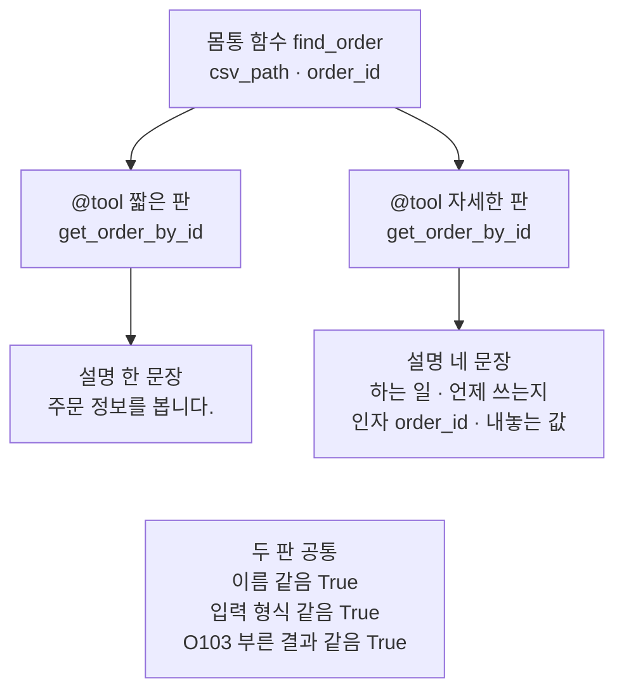
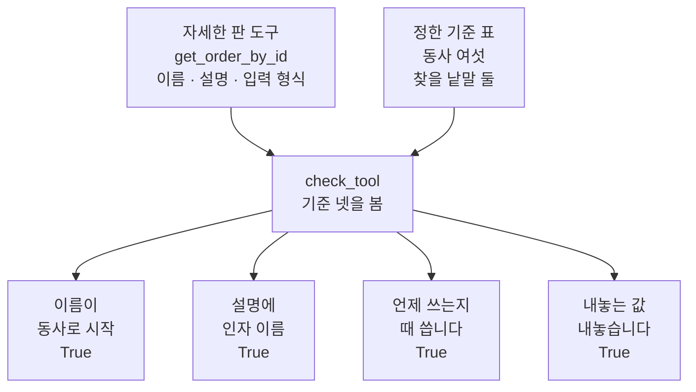
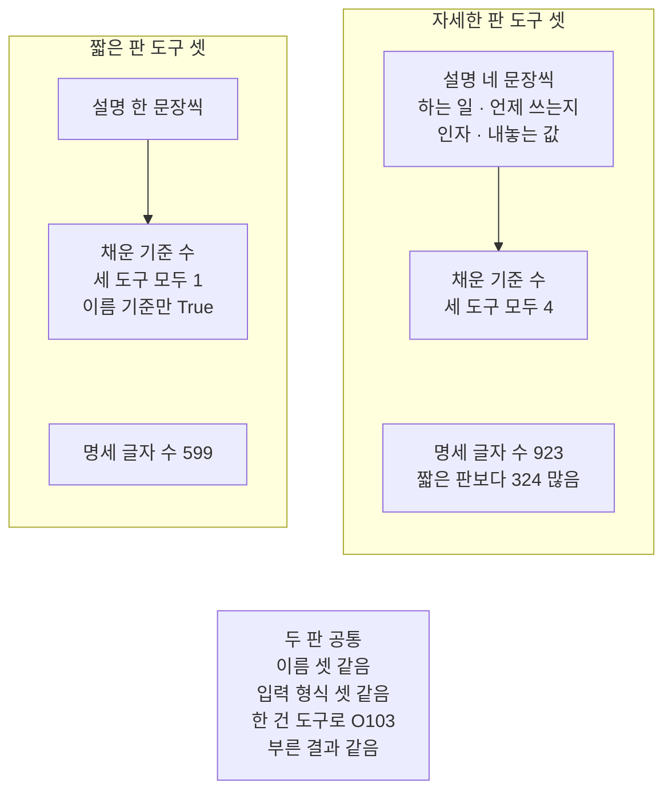
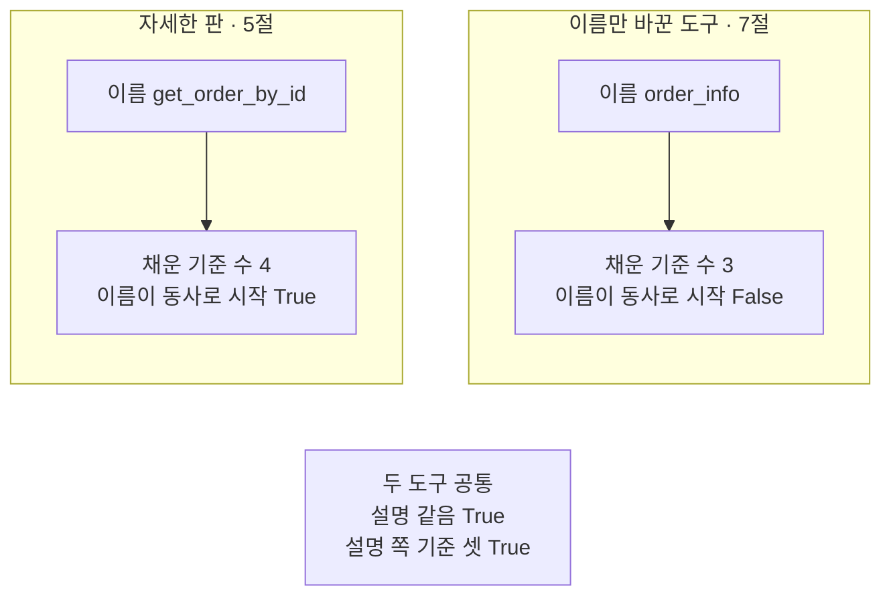

# 03-좋은-도구-이름과-설명

## _src 본문 (HTML 원본)

```html
<!--meta: 강의 1h | 실습 1h | 코드 notebooks/03-좋은-도구-이름과-설명.ipynb | 새 용어 5 -->
<style>html,body{overflow-x:hidden}.notebook,.nb-cell,.nb-main,.nb-input,.nb-result{min-width:0;max-width:100%}.nb-input pre,.nb-output{box-sizing:border-box;max-width:100%;overflow-x:auto}code.nb-source{display:block!important;width:100%!important;min-width:0!important;overflow-x:auto!important;padding:0!important}</style>
<h2 id="b1"><span class="no">1</span>학습 목표</h2><div class="goal"><ul>
<li>도구 설명에 하는 일·언제 쓰는지·인자 뜻·내놓는 값을 나눠 적을 수 있습니다.</li>
<li>같은 몸통 함수에 설명만 다른 두 판을 붙여, 이 절에서 정한 기준 넷으로 코드로 견줄 수 있습니다.</li>
<li>설명 길이와 도구 수에 따라 명세 글자 수가 늘어나는 것을 출력으로 짚을 수 있습니다.</li>
</ul></div>
<h2 id="b2"><span class="no">2</span>이 내용을 배우는 이유</h2><p>모델은 도구의 몸통 코드를 보지 않습니다. 모델이 읽는 것은 01절에서 본 도구 명세, 곧 이름·설명·입력 형식입니다. 02절에서 본 것처럼 설명 글은 값을 막는 규칙도 아닙니다. 설명은 모델이 어느 도구를 고를지 정할 때 읽는 안내 글입니다.</p><p>그래서 설명에 무엇을 적을지가 중요합니다. 세 회사 문서(OpenAI·Anthropic·LangChain)는 설명에 적을 것을 권합니다. 하는 일, 언제 쓰는지, 인자의 뜻, 내놓는 값, 한계 들입니다. 이 절은 그 권고를 바탕으로 코드로 셀 수 있는 기준 넷을 정하고, 설명만 다른 두 판의 명세를 견줍니다.</p><p>이 절도 01·02절처럼 모델을 부르지 않습니다. 기준을 채운 설명이 모델의 도구 선택을 실제로 바꾸는지는 04절에서 확인할 물음입니다.</p>
<h2 id="b3"><span class="no">3</span>앞에서 배운 내용</h2><p><a href="01-tool과-Ch4-함수-재사용.html">01절</a>은 Ch 4 함수를 부르는 작은 함수를 <code>@tool</code> 줄로 감싸 도구로 만들었습니다. 01절에서 본 것처럼 함수 이름은 도구 이름이, 독스트링은 도구 설명이 됩니다. 매개변수와 타입힌트는 입력 형식이 됩니다. 함수 <code>convert_to_openai_tool</code>은 이 셋을 모델 요청에 실을 모양의 도구 명세로 모았습니다.</p><p><a href="02-Pydantic-인자와-반환-스키마.html">02절</a>은 도구 설명에 상태 셋을 적어도, 없는 상태 <code>shipped</code>가 막히지 않는 것을 보였습니다. 값을 막는 일은 양식 클래스로 적은 입력 형식의 몫이었습니다. 그 절에서 양식 칸의 <code>Field(description=…)</code>는 명세의 칸 설명에 그대로 실렸습니다. 이 절은 양식 클래스를 쓰지 않고, 인자의 뜻을 도구 설명 글에 적습니다.</p><p>도구 파일 <code>order_tools.py</code>의 <code>fetch_orders</code>는 01절처럼 가져옵니다. 파일이 있는 첫 자리에서 <code>break</code>로 멈추는 반복은 01절 자리 찾기 셀과 같은 모양입니다.</p>
<h2 id="b4"><span class="no">4</span>핵심 개념</h2><h3>비유로 시작하기</h3><p>01절의 식당을 다시 떠올립니다. 이번에는 카드가 걸린 자리를 도구 이름, 카드의 그림을 도구 설명으로 봅니다. 메뉴판에 카드 셋이 걸려 있는데 그림이 모두 흐리다면, 손님은 어느 카드가 무엇인지 가르기 어렵습니다. 그림이 저마다 뚜렷하면 카드마다 무엇이 나오는지 보입니다.</p><p>이 절에서 흐린 카드 셋은 짧은 판 설명이고, 뚜렷한 카드 셋은 자세한 판 설명입니다. 두 메뉴판의 카드 자리와 주방 요리법은 같습니다. 도구 이름과 몸통 함수가 두 판에서 같은 것과 같습니다. 손님이 뚜렷한 메뉴판에서 실제로 더 잘 고르는지는 손님에게 물어봐야 압니다. 이 절은 카드만 견주고, 손님에 해당하는 모델에게 묻는 일은 04절에서 합니다.</p>
{{img:03-5-흐린-카드와-뚜렷한-카드|흰 바탕 그림으로 연초록 벽에 나무 메뉴판 두 개가 나란히 걸려 있고, 두 메뉴판 모두 같은 자리에 종이 카드 세 장이 한 줄로 붙어 있으며, 왼쪽 메뉴판 카드 셋에는 모두 비슷한 흐린 회색 얼룩만 있고, 오른쪽 메뉴판 카드 셋에는 차례로 작은 그릇 네 개가 한 줄로 놓인 그림, 국수가 담긴 큰 그릇 하나, 금화 더미가 뚜렷하게 그려진 그림|메뉴판 두 개의 카드 셋은 자리가 같고, 왼쪽 카드 그림은 흐려 서로 가르기 어렵고 오른쪽 카드 그림은 저마다 뚜렷합니다.}}
<p class="look"><b>그림 읽기</b> — 연초록 벽에 나무 메뉴판 두 개가 나란히 걸려 있습니다. 두 메뉴판 모두 같은 자리에 카드 세 장이 한 줄로 붙어 있습니다. 왼쪽 카드 셋에는 비슷한 흐린 회색 얼룩만 있어 서로 가를 수 없습니다. 오른쪽 카드 셋에는 작은 그릇 네 개, 국수가 담긴 큰 그릇 하나, 금화 더미가 저마다 뚜렷합니다. 카드 자리는 도구 이름이고, 오른쪽 세 그림은 차례로 목록·한 건·합계 도구의 자세한 설명입니다.</p>
<table><thead><tr><th>말</th><th>뜻</th></tr></thead><tbody><tr><td>몸통 함수</td><td>도구로 감싸기 전에 실제 일을 하는 평범한 함수입니다. 주방의 요리법과 같습니다.</td></tr><tr><td>동사로 시작하는 이름</td><td>하는 일을 뜻하는 동사를 앞에, 대상을 뒤에 밑줄로 이어 붙인 도구 이름입니다. 「볶음밥 만들기」처럼 동작이 먼저 보이는 이름입니다.</td></tr><tr><td>사용 조건</td><td>그 도구를 언제 쓰는지 적은 설명 문장입니다. 「여럿이 나눠 먹을 때」 같은 메뉴 소개와 같습니다.</td></tr><tr><td>설명 기준</td><td>도구 이름과 설명을 코드로 확인하려고 이 절에서 정한 네 가지 물음입니다. 메뉴 카드를 점검하는 목록과 같습니다.</td></tr><tr><td>명세 글자 수</td><td>도구 명세를 JSON 글로 바꿔 센 글자 수입니다. 토큰 수와는 다릅니다. 메뉴판 글의 길이와 같습니다.</td></tr></tbody></table>
<p>새 말을 이 절 코드에서 보면 이렇습니다. 몸통 함수는 <code>find_order</code>와 <code>sum_orders</code>입니다. 동사로 시작하는 이름은 <code>get_order_by_id</code>처럼 동사 <code>get</code>으로 시작합니다. 사용 조건은 설명의 「… 있을 때 씁니다」 문장입니다. 설명 기준은 함수 <code>check_tool</code>이 보고, 명세 글자 수는 함수 <code>spec_length</code>가 셉니다.</p>
{{mermaid:03-1-같은-몸통에-두-가지-설명|위에서 아래로 읽는 그림으로 맨 위 파란 상자 몸통 함수 find_order csv_path order_id에서 회색 상자 둘 @tool 짧은 판 get_order_by_id와 @tool 자세한 판 get_order_by_id로 갈라지고, 왼쪽 아래 노란 상자에 설명 한 문장 주문 정보를 봅니다, 오른쪽 아래 노란 상자에 설명 네 문장 하는 일 언제 쓰는지 인자 order_id 내놓는 값이 있으며, 맨 아래 회색 상자에 두 판 공통 이름 같음 True 입력 형식 같음 True O103 부른 결과 같음 True가 적힌 그림|같은 몸통 함수를 감싼 두 판은 이름·입력 형식·부른 결과가 같고, 모델이 읽을 설명만 다릅니다.}}
<p class="look"><b>도식 읽기</b> — 위에서 아래로 읽습니다. 맨 위 파란 상자는 노트북 2절에서 적은 몸통 함수입니다. 회색 상자 둘은 <code>@tool</code> 줄이 같은 이름으로 감싼 두 판의 도구입니다. 노란 상자 둘은 3절과 4절이 출력한 두 판의 설명입니다. 맨 아래 회색 상자는 4절 출력으로 확인한 두 판의 공통점입니다.</p>
<h3>기준 넷과 근거</h3><p>이 절의 기준 넷은 아래 표와 같습니다. 근거 문서는 2026-09-24에 확인했습니다. 설명 첫 문장의 하는 일이 뚜렷한지는 코드로 세지 않고 사람이 읽습니다.</p>
<table><thead><tr><th>기준</th><th>코드로 보는 법</th><th>근거</th></tr></thead><tbody><tr><td>이름이 동사로 시작</td><td>이름을 밑줄로 나눈 첫 낱말이 동사 표에 있는가</td><td>이 절이 정함. LangChain 문서는 밑줄로 낱말을 잇는 이름을 권함</td></tr><tr><td>설명에 인자 이름</td><td>입력 형식의 인자 이름이 설명 글에 있는가</td><td>OpenAI·Anthropic 문서의 매개변수 뜻 적기</td></tr><tr><td>언제 쓰는지</td><td>설명에 「때 씁니다」가 있는가</td><td>Anthropic·LangChain 문서의 언제 쓰는지 적기</td></tr><tr><td>내놓는 값</td><td>설명에 「내놓습니다」가 있는가</td><td>OpenAI 문서의 출력이 뜻하는 것 적기</td></tr></tbody></table>
<p>OpenAI 문서는 함수의 목적과 각 매개변수, 출력이 무엇을 뜻하는지 분명히 적으라고 합니다. 언제 쓰는지와 쓰지 않는지는 시스템 메시지에 적으라고 합니다. Anthropic 문서는 하는 일·언제 쓰는지·매개변수 뜻·한계를 설명에 적으라고 합니다. 설명은 적어도 3~4문장으로 적으라고도 권합니다. LangChain 문서는 독스트링이 도구 설명이 되어, 모델이 언제 쓸지 알게 돕는다고 적습니다.</p>
<h3>한 줄로 적은 독스트링</h3><p>이 절의 자세한 판은 독스트링 네 문장을 한 줄에 적었습니다. 여러 줄로 나눠 적으면 둘째 줄부터 줄 앞 빈칸까지 도구 설명에 들어갑니다. 그 빈칸도 명세 글자 수에 더해집니다. 이 동작은 노트북 밖에서 확인했습니다.</p>
<h3>다른 상황에 적용</h3><p>도서관 도구라면 <code>search_books_by_title</code>은 제목 낱말로 책 목록을 찾고, <code>get_book_by_isbn</code>은 책 한 권을 찾습니다. 사용 조건에는 「질문에 제목만 있을 때」와 「ISBN 번호가 있을 때」처럼 질문의 모양을 적습니다. 내놓는 값에는 목록인지 한 건인지, 없을 때 무엇을 내놓는지 적습니다.</p>
<h3>비교와 경계</h3><p>설명 기준은 낱말이 있는지만 봅니다. 「때 씁니다」가 있어도 틀린 사용 조건일 수 있고, 그것은 사람이 읽어야 압니다. 설명은 값을 막지 않으므로, 고를 수 있는 값을 지키는 일은 02절의 입력 형식이 맡습니다. 기준을 채운 설명이 모델의 선택을 낫게 하는지는 이 절에서 보지 않았습니다. 글자 수는 토큰 수가 아니고, 요청에 실리는 모양과도 띄어쓰기 등이 다를 수 있습니다.</p><p>이름 기준도 이 챕터에서만 쓰는 기준입니다. Anthropic 문서는 여러 서비스의 도구가 섞이면 <code>github_list_prs</code>처럼 서비스 이름을 앞에 붙이라고 권합니다. 그런 이름은 첫 낱말이 동사 표에 없어 이 절의 이름 기준을 채우지 못합니다. 도구가 한 곳에 모인 이 챕터라서 동사로 시작하는 이름을 기준으로 삼았습니다.</p>
<h2 id="b5"><span class="no">5</span>실행 예제</h2><p>노트북은 먼저 몸통 함수 둘을 만들고 불러 봅니다. 그다음 같은 이름에 설명만 다른 두 판의 도구 셋을 만듭니다. 이름·입력 형식·부른 결과가 같은지 확인한 뒤, 기준 넷과 명세 글자 수로 두 판을 견줍니다.</p><p>이 절은 모델을 부르지 않습니다. 읽는 파일은 주문 CSV 하나이고, 쓰는 파일은 없습니다.</p>
{{notebook:03-좋은-도구-이름과-설명}}
<p class="look"><b>확인할 점</b> — 노트북 4절 출력 <code>이름 같음: True</code>와 <code>입력 형식 같음: True</code>로 두 판이 설명만 다른지 봅니다. 노트북 5절 출력 <code>채운 기준 수: 1</code>과 <code>채운 기준 수: 4</code>로 두 판이 어느 기준에서 갈렸는지 봅니다.</p>
{{mermaid:03-2-기준-넷으로-도구-하나-보기|위에서 아래로 읽는 그림으로 맨 위에 회색 상자 자세한 판 도구 get_order_by_id 이름 설명 입력 형식과 초록 상자 정한 기준 표 동사 여섯 찾을 낱말 둘이 나란히 있고, 두 상자에서 파란 상자 check_tool 기준 넷을 봄으로 모인 뒤, 아래 노란 상자 넷 이름이 동사로 시작 True, 설명에 인자 이름 True, 언제 쓰는지 때 씁니다 True, 내놓는 값 내놓습니다 True로 나뉘는 그림|기준 표와 도구 하나를 함수 check_tool에 넣으면 기준 넷마다 True나 False가 나옵니다.}}
<p class="look"><b>도식 읽기</b> — 위에서 아래로 읽습니다. 회색 상자는 4절에서 만든 자세한 판 한 건 도구이고, 초록 상자는 5절에서 정한 기준 표입니다. 파란 상자 <code>check_tool</code>이 두 상자를 받아 기준 넷을 봅니다. 아래 노란 상자 넷은 5절 출력에서 이 도구의 네 칸 값입니다. 네 칸 모두 동사나 낱말이 있는지만 보는 검사입니다.</p>
<h2 id="b6"><span class="no">6</span>실험 결과 해석</h2><p>실험에서 바꾼 것은 도구 설명 하나입니다. 도구 이름·입력 형식·몸통 줄은 두 판이 같았습니다. 같은 인자로 부른 한 건 도구의 결과도 두 판이 같았습니다.</p>
<table><thead><tr><th>도구</th><th>짧은 판 채운 기준</th><th>자세한 판 채운 기준</th></tr></thead><tbody><tr><td>도구 셋 각각(목록·한 건·합계)</td><td>1 (이름만)</td><td>4</td></tr><tr><td>명세 글자 수(셋 합)</td><td>599</td><td>923</td></tr></tbody></table>
{{mermaid:03-3-짧은-판과-자세한-판|칸 둘이 나란히 있고 아래에 회색 상자가 있는 그림으로 왼쪽 칸 짧은 판 도구 셋에는 파란 상자 설명 한 문장씩에서 노란 상자 채운 기준 수 세 도구 모두 1 이름 기준만 True로 이어지고 그 아래 노란 상자 명세 글자 수 599가 있으며, 오른쪽 칸 자세한 판 도구 셋에는 파란 상자 설명 네 문장씩에서 노란 상자 채운 기준 수 세 도구 모두 4로 이어지고 그 아래 노란 상자 명세 글자 수 923 짧은 판보다 324 많음이 있고, 맨 아래 회색 상자에 두 판 공통 이름 셋 같음 입력 형식 셋 같음 한 건 도구로 O103 부른 결과 같음이 적힌 그림|짧은 판은 이름 기준 하나만, 기준에 맞춰 쓴 자세한 판은 넷을 채웠고, 자세한 판 명세가 324자 길었습니다.}}
<p class="look"><b>도식 읽기</b> — 왼쪽 칸이 짧은 판, 오른쪽 칸이 자세한 판입니다. 칸마다 위 파란 상자는 우리가 적은 설명이고, 아래 노란 상자 둘은 5절과 6절의 출력입니다. 두 노란 상자는 차례가 아니라 나란히 놓은 값이라 화살표 없이 두었습니다. 맨 아래 회색 상자는 4절 출력으로 확인한 두 판의 공통점입니다.</p>
<p>두 판은 이름 기준을 모두 채웠습니다. 짧은 판 설명에는 인자 이름·사용 조건·내놓는 값이 없어, 설명 쪽 기준 셋을 모두 놓쳤습니다. 자세한 판은 네 기준을 모두 채웠고, 대신 명세가 324자 길어졌습니다. 자세한 판 도구를 하나·둘·셋으로 늘리자 명세 글자 수는 309, 610, 923으로 늘었습니다. 새 커널로 두 번 실행했을 때 출력은 두 번 모두 같았습니다.</p>
<p>자세한 판 설명은 이 절의 낱말 표와 인자 이름에 맞춰 쓴, 흐름을 보여 주려고 정한 예입니다. 그래서 채운 기준 수 1과 4는 실행 전에 정해진 값입니다. 이 표로 볼 것은 짧은 판이 어느 기준을 놓쳤는가입니다. 코드로 새로 알게 된 값은 명세 글자 수 599·923과 도구 수에 따른 309·610·923입니다. 기준을 채운 자세한 판이 모델의 도구 선택을 낫게 하는지는 04절에서 모델로 확인합니다.</p>
<p>값 바꿔 보기는 반대로 설명을 두고 이름만 <code>order_info</code>로 바꿨습니다. 이름 기준 하나만 <code>False</code>로 바뀌었고, 설명 쪽 기준 셋은 그대로 채웠습니다.</p>
{{mermaid:03-4-이름만-바꾸면|칸 둘이 나란히 있고 아래에 회색 상자가 있는 그림으로 왼쪽 칸 자세한 판에는 파란 상자 이름 get_order_by_id에서 노란 상자 채운 기준 수 4 이름이 동사로 시작 True로 이어지고, 오른쪽 칸 이름만 바꾼 도구에는 파란 상자 이름 order_info에서 노란 상자 채운 기준 수 3 이름이 동사로 시작 False로 이어지며, 맨 아래 회색 상자에 두 도구 공통 설명 같음 True 설명 쪽 기준 셋 True가 적힌 그림|설명은 두고 이름만 order_info로 바꾸자 이름 기준 하나만 False가 되었고 설명 쪽 기준 셋은 그대로였습니다.}}
<p class="look"><b>도식 읽기</b> — 왼쪽 칸은 5절의 자세한 판 한 건 도구이고, 오른쪽 칸은 7절에서 이름만 바꾼 도구입니다. 두 칸의 노란 상자는 모두 노트북 출력입니다. 오른쪽에서는 이름 기준만 False로 바뀌었습니다. 맨 아래 회색 상자는 7절 출력으로 확인한 두 도구의 공통점입니다.</p>
<h2 id="b7"><span class="no">7</span>주의할 점과 실무 메모</h2><ul><li>이 절은 모델을 부르지 않았습니다. 모델 요청은 0번이고 API 키도 쓰지 않았습니다.</li><li>기준 넷과 동사 표·낱말 표는 공식 문서의 권고를 바탕으로 이 절에서 정한 것입니다. 공식 문서가 정한 검사 규칙이 아닙니다.</li><li>자세한 판 설명은 낱말 표의 「때 씁니다」·「내놓습니다」와 인자 이름이 들어가게 썼습니다. 동사 표도 이 절의 도구 이름에 맞춰 골랐습니다. 그래서 채운 기준 수는 실행 전에 정해진 값이고, 흐름을 보여 주려고 정한 예입니다. 코드로 새로 알게 된 값은 명세 글자 수입니다.</li><li>설명 기준은 낱말이 있는지만 봅니다. 사용 조건이 맞는지, 하는 일이 뚜렷한지는 사람이 읽어야 합니다.</li><li>기준을 채운 설명이면 모델이 도구를 더 잘 고르는지는 이 절에서 보지 않았습니다. 04절에서 확인할 물음입니다.</li><li>명세 글자 수는 토큰 수가 아닙니다. 실제 요청에 실리는 모양과 띄어쓰기 등이 다를 수 있어, 요청 크기로 읽지 않습니다.</li><li>독스트링을 여러 줄로 적으면 줄 앞 빈칸이 설명에 들어갔습니다. Python 3.12.13과 langchain-core 1.6.2로 노트북 밖에서 확인했습니다. 노트북에서는 실행하지 않았습니다.</li><li>짧은 판과 자세한 판은 같은 이름으로 다시 정의했습니다. 셀을 순서대로 실행해야 목록 둘에 두 판이 따로 담깁니다.</li><li>OpenAI 문서는 언제 쓰는지를 시스템 메시지에 적으라고 하고, Anthropic 문서는 설명에 적으라고 합니다. 이 절은 설명에 적었습니다.</li><li>몸통 함수 <code>find_order</code>와 <code>sum_orders</code>는 같은 본문으로 도구 파일에 옮겨 두었습니다. 04절부터 가져옵니다.</li><li>걸린 시간은 재지 않았습니다. 이 절은 파일을 쓰지 않습니다.</li><li>교재 출력은 Linux의 Python 3.12.13으로 만들었습니다. 다른 판과 Windows·macOS에서는 이번에 실행하지 않았습니다.</li></ul>
<h2 id="b8"><span class="no">8</span>정리와 다음 절</h2><ul><li>같은 몸통 함수에 설명만 다른 두 판을 붙이자, 이름·입력 형식과 부른 결과는 같았습니다.</li><li>이 절에서 정한 기준 넷으로 보면 짧은 판은 이름 기준 하나만 채웠고, 그 기준에 맞춰 쓴 자세한 판은 넷을 채웠습니다.</li><li>자세한 판의 명세 글자 수는 324자 늘었고, 도구가 늘수록 명세 글자 수도 늘었습니다.</li></ul><p><strong>다음 학습과 이어지는 지점</strong> — 04절에서는 모델에게 도구 명세를 보내, 설명을 보고 도구를 고르는지 봅니다.</p>
<h2 id="b9"><span class="no">9</span>복습 문제</h2><details class="quiz" open><summary>문제 4개 · 해설 포함</summary><p class="quiz-q">1. 모델이 도구를 고를 때 읽는 것은 무엇이고, 읽지 않는 것은 무엇인가요?</p><p class="quiz-a">도구 명세의 이름·설명·입력 형식을 읽고, 몸통 함수의 코드는 읽지 않습니다. 틀렸다면 01절 도구 명세와 이 절 본문 2 「이 내용을 배우는 이유」를 다시 읽습니다.</p><p class="quiz-q">2. 이 절의 두 판이 설명만 다르다는 것은 어떤 출력으로 알 수 있나요?</p><p class="quiz-a">노트북 4절 출력의 <code>이름 같음: True</code>와 <code>입력 형식 같음: True</code>입니다. 같은 인자로 부른 결과도 <code>두 결과가 같은가: True</code>였습니다. 틀렸다면 노트북 4절을 다시 읽습니다.</p><p class="quiz-q">3. 자세한 판이 기준 넷을 모두 채웠다면, 모델이 이 도구를 더 잘 고른다고 말할 수 있나요?</p><p class="quiz-a">말할 수 없습니다. 기준은 이 절에서 정한 것이고, 자세한 판은 그 기준에 맞춰 쓴 글입니다. 모델에게 요청을 보내 보지도 않았습니다. 04절에서 확인할 물음입니다. 틀렸다면 노트북 5절 끝과 본문 7 「주의할 점과 실무 메모」를 다시 읽습니다.</p><p class="quiz-q">4. 명세 글자 수 923을 모델이 읽는 토큰 수로 읽어도 되나요?</p><p class="quiz-a">안 됩니다. 글자 수는 토큰 수와 다르고, 실제 요청에 실리는 모양도 다를 수 있습니다. 틀렸다면 노트북 6절을 다시 읽습니다.</p></details>
<h2 id="b10"><span class="no">10</span>참고 자료</h2><ul><li><div><a href="https://developers.openai.com/api/docs/guides/function-calling">OpenAI Function calling</a></div>확인 2026-09-24 · 함수 이름·매개변수·출력의 뜻을 분명히 적으라고 권합니다. 언제 쓰는지는 시스템 메시지에 적으라고 합니다.</li><li><div><a href="https://platform.claude.com/docs/en/agents-and-tools/tool-use/define-tools">Anthropic Define tools</a></div>확인 2026-09-24 · 하는 일·언제 쓰는지·매개변수 뜻·한계를 적고, 설명을 적어도 3~4문장으로 쓰라고 권합니다.</li><li><div><a href="https://docs.langchain.com/oss/python/langchain/tools">LangChain Tools</a></div>확인 2026-09-24 · 독스트링이 도구 설명이 되고, 이름은 밑줄로 낱말을 잇는 모양을 권합니다.</li><li>01절 — 도구 이름·설명·입력 형식과 도구 명세.</li><li>02절 — 설명 글과 입력 형식의 차이.</li></ul>
```

## 노트북 셀 (순서대로)

### [0] markdown {'html': 'skip'}

# 좋은 도구 이름과 설명

**이 노트북에서 할 일**

1. 주문 한 건 찾기와 금액 합계 세기의 몸통 함수 둘을 만듭니다.
2. 같은 몸통 함수에 설명만 다른 도구 두 판을 붙이고 명세를 견줍니다.
3. 이 절에서 정한 기준 넷으로 두 판의 이름과 설명을 코드로 봅니다.
4. 명세 글자 수를 세고, 이름만 바꾼 도구를 같은 기준으로 봅니다.

**준비물** — 이 절은 모델을 부르지 않습니다.
모델 요청은 0번이라 API 키가 필요 없고, 드는 비용도 없습니다.
도구 명세는 파이썬 안에서 만들어져서 모델 없이 볼 수 있기 때문입니다.
모델이 이 명세를 읽고 도구를 고르는 장면은 04절에서 봅니다.

읽는 파일은 실습 폴더의 `data/orders.csv` 하나이고, 새로 쓰는 파일은 없습니다.
Ch 4 함수 `fetch_orders`는 같은 폴더의 도구 파일 `order_tools.py`에서 가져옵니다.
교재 출력을 만든 실행에서는 노트북 전체가 3초 안에 끝났습니다.

**기준 버전** — 첫 셀에서 패키지 셋을 설치합니다.
판은 langchain 1.4.0, langchain-core 1.6.2, pandas 3.0.5입니다.
교재 출력은 Linux의 Python 3.12.13으로 만들었습니다.
다른 판과 Windows·macOS에서는 이번에 실행하지 않았습니다.

**강의와 실습 범위** — 강의 시간에는 2~5절을 읽습니다.
몸통 함수를 만들고, 두 판의 도구를 기준으로 견주는 자리입니다.
6~7절은 명세 글자 수를 세고 이름만 바꿔 보는 자리입니다.
이 부분은 실습 시간에 실행합니다.

실습 폴더 `labs/part5/ch19-model-tools`에서 `uv sync --locked`를 실행합니다.
그다음 `notebooks/` 폴더의 이 노트북을 열고, 실습 폴더의 `.venv` 커널을 고릅니다.
첫 셀부터 순서대로 실행합니다.

### [1] markdown {'html': 'skip'}

## 오늘 볼 그림


위에서 아래로 읽습니다. 맨 위 파란 상자는 2절에서 적은 몸통 함수입니다.
회색 상자 둘은 `@tool` 줄이 같은 이름으로 감싼 두 판의 도구입니다.
노란 상자 둘은 3절과 4절이 출력한 두 판의 설명입니다.
맨 아래 회색 상자는 4절 출력으로 확인한 두 판의 공통점입니다.

### [2] markdown {}

## 1. 준비

이 절은 모델이 읽을 도구 이름과 도구 설명을 어떻게 적을지 봅니다.
02절에서 본 것처럼 설명 글은 값을 막는 규칙이 아니고, 모델이 읽는 안내 글입니다.
그래서 이 절은 모델을 부르지 않고, 모델이 읽게 될 명세 글 자체를 견줍니다.
견주는 기준은 공식 문서의 권고를 바탕으로 이 절에서 정합니다.

첫 셀은 패키지 세 개를 설치하고 설치된 판 번호를 출력합니다.
설치에는 몇십 초가 걸릴 수 있습니다.

### [3] code {'execution': {'iopub.execute_input': '2026-09-24T01:48:05.967770Z', 'iopub.status.busy': '2026-09-24T01:48:05.967696Z', 'iopub.status.idle': '2026-09-24T01:48:06.671871Z', 'shell.execute_reply': '2026-09-24T01:48:06.671268Z'}, 'lesson_role': 'setup'}

```python
# 이 절에서 쓰는 패키지를 설치하고 버전을 확인합니다
%pip install -q "langchain==1.4.0" "langchain-core==1.6.2" "pandas==3.0.5"
from importlib.metadata import version

print("langchain:", version("langchain"))
print("langchain-core:", version("langchain-core"))
print("pandas:", version("pandas"))
```

출력:
```
Note: you may need to restart the kernel to use updated packages.
langchain: 1.4.0
langchain-core: 1.6.2
pandas: 3.0.5

```

### [4] markdown {}

**결과 읽기** — 출력 줄 `langchain: 1.4.0`·`langchain-core: 1.6.2`·`pandas: 3.0.5`가 실습 폴더 잠금과 같은 판입니다.
이 노트북의 출력은 2026-09-24에 이 판으로 실행한 결과입니다.

앞에서 배운 함수는 `order_tools.py`에 모아 두었습니다. 파일을 열면 코드를 볼 수 있습니다. 노트북과 같은 폴더(`notebooks/`)에 있는 파일입니다. 커널이 `notebooks/` 폴더에서 시작해야 이 파일을 가져올 수 있습니다.

다음 셀은 이 절에서 쓸 이름 다섯을 가져옵니다.
모듈 `json`은 6절에서 도구 명세를 JSON 글로 바꿀 때 씁니다.
함수 `tool`과 `convert_to_openai_tool`은 01절에서 쓴 이름입니다.

### [5] code {'execution': {'iopub.execute_input': '2026-09-24T01:48:06.672934Z', 'iopub.status.busy': '2026-09-24T01:48:06.672840Z', 'iopub.status.idle': '2026-09-24T01:48:07.707982Z', 'shell.execute_reply': '2026-09-24T01:48:07.707699Z'}, 'lesson_role': 'setup'}

```python
# CSV 위치를 찾을 os, 명세를 글로 바꿀 json, 도구를 만드는 이름들, Ch 4 함수를 가져옵니다
import json
import os

from langchain.tools import tool
from langchain_core.utils.function_calling import convert_to_openai_tool

from order_tools import fetch_orders

print("가져온 이름:", "json", "os", "tool", "convert_to_openai_tool", "fetch_orders")
```

출력:
```
가져온 이름: json os tool convert_to_openai_tool fetch_orders

```

### [6] markdown {}

**결과 읽기** — 출력 줄에 가져온 이름 다섯이 보입니다.
함수 `fetch_orders`는 01절처럼 도구 파일에서 가져왔습니다.

다음 셀은 01절과 같은 방법으로 주문 CSV가 있는 프로젝트 맨 위 폴더를 찾습니다.
후보 세 곳을 차례로 보고, 파일이 있는 첫 자리에서 `break`로 멈춥니다.

### [7] code {'execution': {'iopub.execute_input': '2026-09-24T01:48:07.708850Z', 'iopub.status.busy': '2026-09-24T01:48:07.708735Z', 'iopub.status.idle': '2026-09-24T01:48:07.710947Z', 'shell.execute_reply': '2026-09-24T01:48:07.710572Z'}, 'lesson_role': 'setup'}

```python
# 노트북을 어느 폴더에서 열어도 주문 CSV를 찾게 후보 세 곳을 차례로 봅니다
candidates = [".", "../../..", "../../../.."]
root_path = None
for candidate in candidates:
    if os.path.exists(candidate + "/labs/part5/ch19-model-tools/data/orders.csv"):
        root_path = candidate
        break
print("찾은 프로젝트 맨 위:", root_path)
assert root_path is not None, "notebooks 폴더나 실습 폴더 맨 위에서 노트북을 열어 주세요."
# CSV 파일 위치는 노트북이 정해 두는 값입니다(모델이 고를 값이 아님)
csv_path = root_path + "/labs/part5/ch19-model-tools/data/orders.csv"
```

출력:
```
찾은 프로젝트 맨 위: .

```

### [8] markdown {}

**결과 읽기** — 출력 줄 `찾은 프로젝트 맨 위: .`은 교재 출력을 프로젝트 맨 위에서 실행했다는 뜻입니다.
교재 출력은 실행 도구에 도구 파일 폴더를 따로 알려 준 실행이라 `.`이 찍혔습니다.
노트북을 `notebooks/` 폴더에서 열면 이 줄에 `../../../..`가 찍힙니다.
셀 안의 안내 글은 실습 폴더 맨 위도 적었지만, 도구 파일을 가져오려면 `notebooks/` 폴더에서 열어야 합니다.
변수 `csv_path`에 CSV 파일 위치를 담았습니다.

## 2. 몸통 함수 둘 만들기

01절 도구의 몸통은 Ch 4 함수를 한 번 부르는 한 줄이었습니다.
이 절은 주문 한 건 찾기와 금액 합계 세기를 더해 도구를 셋으로 늘립니다.
도구로 감싸기 전에 실제 일을 하는 평범한 함수를 이 절에서는 몸통 함수라고 부릅니다.
식당으로 치면 주방의 요리법이고, 손님은 이 코드를 보지 않습니다.

다음 셀은 주문 번호 하나로 주문 한 줄을 찾는 몸통 함수 `find_order`를 만듭니다.
모든 주문을 차례로 보다가, 번호가 같은 줄을 만나면 `break`로 멈춥니다.
끝까지 없으면 처음에 담아 둔 `None`을 그대로 내놓습니다.

### [9] code {'execution': {'iopub.execute_input': '2026-09-24T01:48:07.711522Z', 'iopub.status.busy': '2026-09-24T01:48:07.711463Z', 'iopub.status.idle': '2026-09-24T01:48:07.713202Z', 'shell.execute_reply': '2026-09-24T01:48:07.712835Z'}}

```python
# 주문 번호 하나로 주문 한 줄을 찾는 몸통 함수입니다(없으면 None을 내놓습니다)
def find_order(csv_path, order_id):
    found = None
    # 모든 주문을 읽고, 번호가 같은 줄을 만나면 담고 멈춥니다
    for row in fetch_orders(csv_path):
        if row["order_id"] == order_id:
            found = row
            break
    return found
```

출력:
```

```

### [10] markdown {}

**결과 읽기** — 정의 셀이라 출력이 없습니다.
함수 `find_order`는 CSV 파일 위치와 주문 번호를 인자로 받습니다.
CSV 파일 위치도 인자로 받아서, 노트북에서 만든 이름을 함수 안에서 바로 읽지 않습니다.

다음 셀은 있는 번호 `O103`과 CSV에 없는 번호 `O999`로 한 번씩 부릅니다.

### [11] code {'execution': {'iopub.execute_input': '2026-09-24T01:48:07.713768Z', 'iopub.status.busy': '2026-09-24T01:48:07.713710Z', 'iopub.status.idle': '2026-09-24T01:48:07.721179Z', 'shell.execute_reply': '2026-09-24T01:48:07.720840Z'}}

```python
# 있는 주문 번호 O103과 없는 번호 O999로 한 번씩 찾습니다
print("O103:", find_order(csv_path, "O103"))
print("O999:", find_order(csv_path, "O999"))
```

출력:
```
O103: {'order_id': 'O103', 'customer_id': 'C001', 'status': 'paid', 'amount': 27000}
O999: None

```

### [12] markdown {}

**결과 읽기** — 출력 줄 `O103:` 뒤에 칸 넷이 든 딕셔너리 한 줄이 있습니다.
금액 칸은 `'amount': 27000`이고, 상태 칸은 `'paid'`입니다.
출력 줄 `O999: None`은 그 번호의 주문이 CSV에 없다는 뜻입니다.

다음 셀은 주문 상태 하나로 주문 수와 금액 합계를 세는 몸통 함수 `sum_orders`를 만듭니다.
합계는 `total = total + row["amount"]`처럼 금액을 한 줄씩 더해 만듭니다.

### [13] code {'execution': {'iopub.execute_input': '2026-09-24T01:48:07.721775Z', 'iopub.status.busy': '2026-09-24T01:48:07.721716Z', 'iopub.status.idle': '2026-09-24T01:48:07.723488Z', 'shell.execute_reply': '2026-09-24T01:48:07.723197Z'}}

```python
# 주문 상태 하나로 그 상태의 주문 수와 금액 합계를 세는 몸통 함수입니다
def sum_orders(csv_path, status):
    rows = fetch_orders(csv_path, status=status)
    total = 0
    # 줄마다 금액을 더해 합계를 만듭니다
    for row in rows:
        total = total + row["amount"]
    return {"status": status, "count": len(rows), "total": total}
```

출력:
```

```

### [14] markdown {}

**결과 읽기** — 정의 셀이라 출력이 없습니다.
함수 `sum_orders`는 상태·주문 수·합계 세 칸을 딕셔너리로 내놓습니다.
주문 수는 Ch 4 함수가 내놓은 목록의 길이 `len(rows)`입니다.

다음 셀은 결제된(paid) 주문의 수와 금액 합계를 셉니다.

### [15] code {'execution': {'iopub.execute_input': '2026-09-24T01:48:07.724039Z', 'iopub.status.busy': '2026-09-24T01:48:07.723988Z', 'iopub.status.idle': '2026-09-24T01:48:07.726957Z', 'shell.execute_reply': '2026-09-24T01:48:07.726701Z'}}

```python
# 결제된(paid) 주문의 수와 금액 합계를 셉니다
paid_summary = sum_orders(csv_path, "paid")
print("paid 합계:", paid_summary)
```

출력:
```
paid 합계: {'status': 'paid', 'count': 2, 'total': 59000}

```

### [16] markdown {}

**결과 읽기** — 출력 줄 `paid 합계: {'status': 'paid', 'count': 2, 'total': 59000}`에서 주문 수는 2입니다.
합계 `59000`은 결제된 두 주문의 금액 32000과 27000을 더한 값입니다.
두 몸통 함수는 이 절에서 처음 적었고, 같은 본문을 도구 파일에도 옮겨 두었습니다.
04절부터는 두 함수를 도구 파일에서 가져옵니다.

## 3. 짧은 판 도구 셋

이제 세 가지 일을 도구로 감쌉니다.
도구 이름은 셋 모두 하는 일을 뜻하는 영어 동사로 시작하게 지었습니다.
목록 찾기는 `list_orders_by_status`, 한 건 찾기는 `get_order_by_id`, 합계는 `sum_amounts_by_status`입니다.
이 절은 같은 이름에 설명만 다른 두 판을 만들어 견줍니다.

먼저 설명을 짧은 한 문장만 적은 판입니다.
다음 셀은 01절처럼 Ch 4 함수를 부르는 목록 도구입니다.

### [17] code {'execution': {'iopub.execute_input': '2026-09-24T01:48:07.727518Z', 'iopub.status.busy': '2026-09-24T01:48:07.727456Z', 'iopub.status.idle': '2026-09-24T01:48:07.730107Z', 'shell.execute_reply': '2026-09-24T01:48:07.729801Z'}}

```python
# 짧은 판: 주문 목록 도구에 설명을 짧은 한 문장만 적습니다
@tool
def list_orders_by_status(status: str):
    """주문을 찾습니다."""
    return fetch_orders(csv_path, status=status)
```

출력:
```

```

### [18] markdown {}

**결과 읽기** — 정의 셀이라 출력이 없습니다.
함수 이름과 몸통 줄은 01절 도구와 같고, 독스트링만 한 문장 「주문을 찾습니다.」로 짧습니다.

다음 두 셀도 같은 모양으로 한 건 도구와 합계 도구를 만듭니다.
몸통은 2절의 몸통 함수를 한 번 부르는 한 줄입니다.

### [19] code {'execution': {'iopub.execute_input': '2026-09-24T01:48:07.730608Z', 'iopub.status.busy': '2026-09-24T01:48:07.730560Z', 'iopub.status.idle': '2026-09-24T01:48:07.732644Z', 'shell.execute_reply': '2026-09-24T01:48:07.732369Z'}}

```python
# 짧은 판: 주문 한 건 도구에 설명을 짧은 한 문장만 적습니다
@tool
def get_order_by_id(order_id: str):
    """주문 정보를 봅니다."""
    return find_order(csv_path, order_id)
```

출력:
```

```

### [20] markdown {}

**결과 읽기** — 정의 셀이라 출력이 없습니다.
몸통 줄은 몸통 함수 `find_order`에 CSV 파일 위치와 주문 번호를 넘깁니다.
모델이 채울 인자는 `order_id` 하나이고, CSV 파일 위치는 노트북이 정합니다.

다음 셀은 금액 합계 도구입니다.

### [21] code {'execution': {'iopub.execute_input': '2026-09-24T01:48:07.733166Z', 'iopub.status.busy': '2026-09-24T01:48:07.733110Z', 'iopub.status.idle': '2026-09-24T01:48:07.735278Z', 'shell.execute_reply': '2026-09-24T01:48:07.734995Z'}}

```python
# 짧은 판: 금액 합계 도구에 설명을 짧은 한 문장만 적습니다
@tool
def sum_amounts_by_status(status: str):
    """주문 금액을 봅니다."""
    return sum_orders(csv_path, status)
```

출력:
```

```

### [22] markdown {}

**결과 읽기** — 정의 셀이라 출력이 없습니다.
이 도구도 모델이 채울 인자는 `status` 하나입니다.

다음 셀은 짧은 판 도구 셋을 목록 `short_tools`에 담고 이름과 설명을 봅니다.

### [23] code {'execution': {'iopub.execute_input': '2026-09-24T01:48:07.735786Z', 'iopub.status.busy': '2026-09-24T01:48:07.735733Z', 'iopub.status.idle': '2026-09-24T01:48:07.737242Z', 'shell.execute_reply': '2026-09-24T01:48:07.736991Z'}}

```python
# 짧은 판 도구 셋을 목록에 담고 도구마다 이름과 설명을 봅니다
short_tools = [list_orders_by_status, get_order_by_id, sum_amounts_by_status]
for one_tool in short_tools:
    print(one_tool.name, "|", one_tool.description)
```

출력:
```
list_orders_by_status | 주문을 찾습니다.
get_order_by_id | 주문 정보를 봅니다.
sum_amounts_by_status | 주문 금액을 봅니다.

```

### [24] markdown {}

**결과 읽기** — 출력 세 줄에서 세로 줄 앞이 도구 이름, 뒤가 도구 설명입니다.
설명은 `주문을 찾습니다.`·`주문 정보를 봅니다.`·`주문 금액을 봅니다.`로 모두 한 문장입니다.
세 설명 모두 목록인지 한 건인지 합계인지를 가르지 않습니다.
어떤 질문에 쓰는지, 인자에 무엇을 넣는지, 무엇을 내놓는지도 없습니다.

## 4. 자세한 판 도구 셋

이번에는 같은 이름으로 도구를 다시 만들고, 설명을 네 문장으로 적습니다.
네 문장은 하는 일·언제 쓰는지·인자 뜻·내놓는 값입니다.
순서는 OpenAI·Anthropic·LangChain 문서의 도구 설명 권고를 모아 이 절에서 정했습니다.
같은 이름에 새 도구가 담겨도, 3절 목록 `short_tools`에 담은 짧은 판 도구는 그대로 남습니다.

다음 셀은 목록 도구의 자세한 판입니다.

### [25] code {'execution': {'iopub.execute_input': '2026-09-24T01:48:07.737846Z', 'iopub.status.busy': '2026-09-24T01:48:07.737802Z', 'iopub.status.idle': '2026-09-24T01:48:07.740276Z', 'shell.execute_reply': '2026-09-24T01:48:07.739872Z'}}

```python
# 자세한 판: 같은 이름의 목록 도구에 하는 일·사용 조건·인자·내놓는 값을 네 문장으로 적습니다
@tool
def list_orders_by_status(status: str):
    """주문 상태로 주문 목록을 찾습니다. 한 상태의 주문을 여러 건 볼 때 씁니다. 인자 status는 paid, pending, cancelled 가운데 하나입니다. 그 상태의 주문 줄을 딕셔너리 목록으로 내놓습니다."""
    return fetch_orders(csv_path, status=status)
```

출력:
```

```

### [26] markdown {}

**결과 읽기** — 정의 셀이라 출력이 없습니다.
이름 `list_orders_by_status`에는 이제 자세한 판 도구가 담겼습니다.
몸통 줄은 3절 짧은 판과 같고, 독스트링만 네 문장으로 바뀌었습니다.
독스트링을 여러 줄로 나눠 적으면 둘째 줄부터 줄 앞 빈칸까지 설명에 들어갑니다.
그래서 네 문장을 한 줄에 적었습니다.

다음 두 셀도 한 건 도구와 합계 도구를 같은 이름으로 다시 만듭니다.

### [27] code {'execution': {'iopub.execute_input': '2026-09-24T01:48:07.740781Z', 'iopub.status.busy': '2026-09-24T01:48:07.740735Z', 'iopub.status.idle': '2026-09-24T01:48:07.742705Z', 'shell.execute_reply': '2026-09-24T01:48:07.742476Z'}}

```python
# 자세한 판: 같은 이름의 한 건 도구에 하는 일·사용 조건·인자·내놓는 값을 네 문장으로 적습니다
@tool
def get_order_by_id(order_id: str):
    """주문 번호로 주문 한 건을 찾습니다. 질문에 O103 같은 주문 번호가 있을 때 씁니다. 인자 order_id는 찾을 주문 번호입니다. 그 주문 한 줄을 딕셔너리로 내놓고, 없으면 None을 내놓습니다."""
    return find_order(csv_path, order_id)
```

출력:
```

```

### [28] markdown {}

**결과 읽기** — 정의 셀이라 출력이 없습니다.
설명 둘째 문장이 이 도구를 언제 쓰는지 적습니다.
질문에 주문 번호가 있으면 이 도구를 쓰라는 안내입니다.

다음 셀은 합계 도구의 자세한 판입니다.

### [29] code {'execution': {'iopub.execute_input': '2026-09-24T01:48:07.743240Z', 'iopub.status.busy': '2026-09-24T01:48:07.743190Z', 'iopub.status.idle': '2026-09-24T01:48:07.745480Z', 'shell.execute_reply': '2026-09-24T01:48:07.745115Z'}}

```python
# 자세한 판: 같은 이름의 합계 도구에 하는 일·사용 조건·인자·내놓는 값을 네 문장으로 적습니다
@tool
def sum_amounts_by_status(status: str):
    """주문 상태로 주문 수와 금액 합계를 셉니다. 주문 목록 대신 개수나 합계를 물을 때 씁니다. 인자 status는 paid, pending, cancelled 가운데 하나입니다. 상태·주문 수·합계를 딕셔너리로 내놓습니다."""
    return sum_orders(csv_path, status)
```

출력:
```

```

### [30] markdown {}

**결과 읽기** — 정의 셀이라 출력이 없습니다.
합계 도구의 설명은 주문 목록 대신 개수나 합계를 물을 때 쓴다고 적습니다.
목록 도구와 같은 인자 `status`를 받지만, 내놓는 값이 다릅니다.

다음 셀은 자세한 판 도구 셋을 목록 `detailed_tools`에 담습니다.
그리고 짧은 판과 이름·입력 형식이 같은지 도구마다 봅니다.

### [31] code {'execution': {'iopub.execute_input': '2026-09-24T01:48:07.745934Z', 'iopub.status.busy': '2026-09-24T01:48:07.745887Z', 'iopub.status.idle': '2026-09-24T01:48:07.749282Z', 'shell.execute_reply': '2026-09-24T01:48:07.748903Z'}}

```python
# 자세한 판 도구 셋을 목록에 담고, 짧은 판과 이름·입력 형식이 같은지 도구마다 봅니다
detailed_tools = [list_orders_by_status, get_order_by_id, sum_amounts_by_status]
for position in range(len(detailed_tools)):
    short_tool = short_tools[position]
    detailed_tool = detailed_tools[position]
    same_name = short_tool.name == detailed_tool.name
    same_args = short_tool.args == detailed_tool.args
    print(detailed_tool.name, "| 이름 같음:", same_name, "| 입력 형식 같음:", same_args)
```

출력:
```
list_orders_by_status | 이름 같음: True | 입력 형식 같음: True
get_order_by_id | 이름 같음: True | 입력 형식 같음: True
sum_amounts_by_status | 이름 같음: True | 입력 형식 같음: True

```

### [32] markdown {}

**결과 읽기** — 출력 세 줄 모두 `이름 같음: True`와 `입력 형식 같음: True`입니다.
두 판은 도구 이름과 입력 형식이 같고, 도구 설명만 다릅니다.
몸통 줄도 두 판이 같아서, 이 절의 두 판은 설명 하나만 바꾼 비교입니다.

다음 셀은 자세한 판 도구마다 설명 글을 출력합니다.

### [33] code {'execution': {'iopub.execute_input': '2026-09-24T01:48:07.749856Z', 'iopub.status.busy': '2026-09-24T01:48:07.749813Z', 'iopub.status.idle': '2026-09-24T01:48:07.751509Z', 'shell.execute_reply': '2026-09-24T01:48:07.751219Z'}}

```python
# 자세한 판 도구마다 설명 글을 봅니다(짧은 판 설명은 3절에서 출력했습니다)
for one_tool in detailed_tools:
    print("도구", one_tool.name, "설명:")
    print(one_tool.description)
```

출력:
```
도구 list_orders_by_status 설명:
주문 상태로 주문 목록을 찾습니다. 한 상태의 주문을 여러 건 볼 때 씁니다. 인자 status는 paid, pending, cancelled 가운데 하나입니다. 그 상태의 주문 줄을 딕셔너리 목록으로 내놓습니다.
도구 get_order_by_id 설명:
주문 번호로 주문 한 건을 찾습니다. 질문에 O103 같은 주문 번호가 있을 때 씁니다. 인자 order_id는 찾을 주문 번호입니다. 그 주문 한 줄을 딕셔너리로 내놓고, 없으면 None을 내놓습니다.
도구 sum_amounts_by_status 설명:
주문 상태로 주문 수와 금액 합계를 셉니다. 주문 목록 대신 개수나 합계를 물을 때 씁니다. 인자 status는 paid, pending, cancelled 가운데 하나입니다. 상태·주문 수·합계를 딕셔너리로 내놓습니다.

```

### [34] markdown {}

**결과 읽기** — 라벨 줄 `도구 get_order_by_id 설명:` 아래 설명은 네 문장입니다.
첫 문장 `주문 번호로 주문 한 건을 찾습니다.`가 하는 일입니다.
둘째 문장은 언제 쓰는지, 셋째 문장은 인자 `order_id`의 뜻입니다.
넷째 문장은 내놓는 값이고, 주문이 없을 때 `None`을 내놓는다는 것까지 적었습니다.

설명을 바꾸면 도구가 하는 일도 바뀔까요?
다음 셀은 두 판의 한 건 도구를 같은 인자 딕셔너리로 불러 결과를 견줍니다.
목록의 둘째 자리 `[1]`에 한 건 도구가 있습니다.

### [35] code {'execution': {'iopub.execute_input': '2026-09-24T01:48:07.752014Z', 'iopub.status.busy': '2026-09-24T01:48:07.751963Z', 'iopub.status.idle': '2026-09-24T01:48:07.757935Z', 'shell.execute_reply': '2026-09-24T01:48:07.757616Z'}}

```python
# 두 판의 주문 한 건 도구를 같은 인자 딕셔너리로 불러 결과를 견줍니다
short_answer = short_tools[1].invoke({"order_id": "O103"})
detailed_answer = detailed_tools[1].invoke({"order_id": "O103"})
print("짧은 판:", short_answer)
print("자세한 판:", detailed_answer)
print("두 결과가 같은가:", short_answer == detailed_answer)
# 같은 몸통 함수가 CSV에서 찾는 값이라 assert로 확인합니다
assert short_answer == detailed_answer
```

출력:
```
짧은 판: {'order_id': 'O103', 'customer_id': 'C001', 'status': 'paid', 'amount': 27000}
자세한 판: {'order_id': 'O103', 'customer_id': 'C001', 'status': 'paid', 'amount': 27000}
두 결과가 같은가: True

```

### [36] markdown {}

**결과 읽기** — 두 판 모두 주문 `O103` 한 줄을 내놓았고, 출력 줄 `두 결과가 같은가: True`로 같습니다.
마지막 줄의 `assert`도 통과했습니다.
설명은 모델이 읽는 글이라, 도구를 부른 결과는 바꾸지 않습니다.
설명이 바꿀 수 있는 것은 모델이 이 도구를 고를지 말지이고, 그것은 04절에서 봅니다.

## 5. 이 절에서 정한 기준 넷

두 판을 눈으로만 보면 「자세한 판이 낫다」는 느낌만 남습니다.
그래서 이 절은 코드로 셀 수 있는 기준 넷을 정합니다.
이름이 동사로 시작하는지, 설명에 인자 이름이 있는지 봅니다.
설명에 「때 씁니다」와 「내놓습니다」가 있는지도 봅니다.

다음 셀은 이 기준을 코드로 셀 때 쓸 표 둘을 만듭니다.

### [37] code {'execution': {'iopub.execute_input': '2026-09-24T01:48:07.758419Z', 'iopub.status.busy': '2026-09-24T01:48:07.758370Z', 'iopub.status.idle': '2026-09-24T01:48:07.759958Z', 'shell.execute_reply': '2026-09-24T01:48:07.759708Z'}}

```python
# 이 절에서 정한 기준 표: 설명에서 찾을 낱말과, 이름의 첫 낱말로 볼 동사
check_words = {"언제 쓰는지": "때 씁니다", "내놓는 값": "내놓습니다"}
verbs = ["list", "get", "find", "search", "sum", "count"]
print("설명에서 찾을 낱말:", check_words)
print("이름 첫 낱말로 볼 동사:", verbs)
```

출력:
```
설명에서 찾을 낱말: {'언제 쓰는지': '때 씁니다', '내놓는 값': '내놓습니다'}
이름 첫 낱말로 볼 동사: ['list', 'get', 'find', 'search', 'sum', 'count']

```

### [38] markdown {}

**결과 읽기** — 라벨 줄 `설명에서 찾을 낱말:` 뒤 딕셔너리는 기준 이름과 찾을 낱말의 짝 둘입니다.
라벨 줄 `이름 첫 낱말로 볼 동사:` 뒤 목록은 이 절이 고른 동사 여섯입니다.
두 표는 공식 문서가 정한 것이 아니라 이 절에서 정한 것입니다.
낱말이 있는지만 보므로, 뜻이 바르게 적혔는지는 사람이 읽어야 합니다.

다음 셀은 도구 하나를 받아 기준 넷을 보는 함수 `check_tool`을 만듭니다.
이름은 밑줄로 나눈 첫 낱말이 동사 표에 있는지 봅니다.
메서드 `split("_")`는 글을 밑줄마다 잘라 목록으로 내놓습니다.

### [39] code {'execution': {'iopub.execute_input': '2026-09-24T01:48:07.760482Z', 'iopub.status.busy': '2026-09-24T01:48:07.760440Z', 'iopub.status.idle': '2026-09-24T01:48:07.762165Z', 'shell.execute_reply': '2026-09-24T01:48:07.761907Z'}}

```python
# 도구 하나를 기준 넷으로 보고, 기준마다 True·False를 담은 딕셔너리를 내놓습니다
def check_tool(one_tool, check_words, verbs):
    first_word = one_tool.name.split("_")[0]
    arg_names = list(one_tool.args.keys())
    result = {}
    result["이름이 동사로 시작"] = first_word in verbs
    # 이 절의 도구는 인자가 하나씩이라 첫 인자 이름만 봅니다
    result["설명에 인자 이름"] = arg_names[0] in one_tool.description
    for label in check_words:
        result[label] = check_words[label] in one_tool.description
    return result
```

출력:
```

```

### [40] markdown {}

**결과 읽기** — 정의 셀이라 출력이 없습니다.
함수 `check_tool`은 기준 네 칸에 `True`나 `False`를 담은 딕셔너리를 내놓습니다.
인자 이름은 입력 형식 `.args`의 첫 키를 씁니다.
이 절의 도구는 인자가 하나씩이라 첫 키만 보면 됩니다.

다음 셀은 결과 딕셔너리에서 `True`인 기준이 몇 개인지 세는 함수입니다.

### [41] code {'execution': {'iopub.execute_input': '2026-09-24T01:48:07.762699Z', 'iopub.status.busy': '2026-09-24T01:48:07.762655Z', 'iopub.status.idle': '2026-09-24T01:48:07.764188Z', 'shell.execute_reply': '2026-09-24T01:48:07.763923Z'}}

```python
# 기준 결과 딕셔너리에서 True인 기준이 몇 개인지 셉니다
def count_met(result):
    met = 0
    for label in result:
        if result[label]:
            met = met + 1
    return met
```

출력:
```

```

### [42] markdown {}

**결과 읽기** — 정의 셀이라 출력이 없습니다.
함수 `count_met`는 채운 기준 수를 정수 하나로 내놓습니다.

다음 셀은 짧은 판 도구 셋을 기준 넷으로 봅니다.
실행 전에 예상해 봅니다.
이름은 셋 모두 동사로 시작하니 채우고, 설명 쪽 기준 셋은 채우지 못할 것입니다.

### [43] code {'execution': {'iopub.execute_input': '2026-09-24T01:48:07.764614Z', 'iopub.status.busy': '2026-09-24T01:48:07.764574Z', 'iopub.status.idle': '2026-09-24T01:48:07.766212Z', 'shell.execute_reply': '2026-09-24T01:48:07.765897Z'}}

```python
# 짧은 판 도구마다 기준 넷의 결과와 채운 기준 수를 봅니다
for one_tool in short_tools:
    short_result = check_tool(one_tool, check_words, verbs)
    print(one_tool.name, "| 채운 기준 수:", count_met(short_result))
    print(short_result)
```

출력:
```
list_orders_by_status | 채운 기준 수: 1
{'이름이 동사로 시작': True, '설명에 인자 이름': False, '언제 쓰는지': False, '내놓는 값': False}
get_order_by_id | 채운 기준 수: 1
{'이름이 동사로 시작': True, '설명에 인자 이름': False, '언제 쓰는지': False, '내놓는 값': False}
sum_amounts_by_status | 채운 기준 수: 1
{'이름이 동사로 시작': True, '설명에 인자 이름': False, '언제 쓰는지': False, '내놓는 값': False}

```

### [44] markdown {}

**결과 읽기** — 세 도구 모두 `채운 기준 수: 1`입니다.
딕셔너리를 보면 `'이름이 동사로 시작': True`만 채웠고 나머지 셋은 `False`입니다.
예상대로 짧은 판 설명에는 인자 이름·언제 쓰는지·내놓는 값이 하나도 없었습니다.

다음 셀은 같은 기준으로 자세한 판 도구 셋을 봅니다.

### [45] code {'execution': {'iopub.execute_input': '2026-09-24T01:48:07.766730Z', 'iopub.status.busy': '2026-09-24T01:48:07.766686Z', 'iopub.status.idle': '2026-09-24T01:48:07.768466Z', 'shell.execute_reply': '2026-09-24T01:48:07.768110Z'}}

```python
# 자세한 판 도구마다 기준 넷의 결과와 채운 기준 수를 봅니다
for one_tool in detailed_tools:
    detailed_result = check_tool(one_tool, check_words, verbs)
    print(one_tool.name, "| 채운 기준 수:", count_met(detailed_result))
    print(detailed_result)
```

출력:
```
list_orders_by_status | 채운 기준 수: 4
{'이름이 동사로 시작': True, '설명에 인자 이름': True, '언제 쓰는지': True, '내놓는 값': True}
get_order_by_id | 채운 기준 수: 4
{'이름이 동사로 시작': True, '설명에 인자 이름': True, '언제 쓰는지': True, '내놓는 값': True}
sum_amounts_by_status | 채운 기준 수: 4
{'이름이 동사로 시작': True, '설명에 인자 이름': True, '언제 쓰는지': True, '내놓는 값': True}

```

### [46] markdown {}

**결과 읽기** — 세 도구 모두 `채운 기준 수: 4`이고, 딕셔너리의 네 칸이 모두 `True`입니다.
두 판은 이름이 같아 이름 기준은 같았고, 설명 쪽 기준 셋에서만 갈렸습니다.
이 결과는 자세한 판이 이 절에서 정한 기준을 채웠다는 뜻입니다.

다만 자세한 판 설명은 이 기준의 낱말에 맞춰 쓴 예라, 1과 4는 실행 전에 정해진 값입니다.
흐름을 보여 주려고 정한 예이고, 이 표로 볼 것은 짧은 판이 어느 기준을 놓쳤는가입니다.
코드로 새로 알게 되는 값은 6절의 명세 글자 수입니다.
기준을 채운 설명이면 모델이 도구를 더 잘 고르는지는 아직 모릅니다.
그것은 04절에서 모델로 확인할 물음입니다.

## 6. 명세 글자 수

설명을 자세히 적으면 모델이 읽을 글도 길어집니다.
다음 셀은 도구 목록을 받아 도구마다 명세를 JSON 글로 바꾸고, 글자 수를 모두 더합니다.
함수 `json.dumps`는 딕셔너리를 JSON 글로 바꿉니다.
인자 `ensure_ascii=False`는 한글을 알파벳 부호로 바꾸지 않고 글자 그대로 둡니다.

### [47] code {'execution': {'iopub.execute_input': '2026-09-24T01:48:07.768969Z', 'iopub.status.busy': '2026-09-24T01:48:07.768922Z', 'iopub.status.idle': '2026-09-24T01:48:07.770596Z', 'shell.execute_reply': '2026-09-24T01:48:07.770270Z'}}

```python
# 도구 목록을 받아 도구마다 명세를 JSON 글로 바꾸고, 글자 수를 모두 더해 내놓습니다
def spec_length(tools):
    total = 0
    for one_tool in tools:
        spec = convert_to_openai_tool(one_tool)
        # 한글을 글자 그대로 두고 JSON 글로 바꿉니다
        spec_text = json.dumps(spec, ensure_ascii=False)
        total = total + len(spec_text)
    return total
```

출력:
```

```

### [48] markdown {}

**결과 읽기** — 정의 셀이라 출력이 없습니다.
함수 `spec_length`는 도구 명세마다 센 글자 수를 모두 더한 정수를 내놓습니다.
글자 수는 토큰 수와 다릅니다.
모델이 읽는 토큰 수는 요청을 보내야 알 수 있어, 이 절에서는 세지 않습니다.

다음 셀은 두 판 도구 셋의 명세 글자 수를 견줍니다.
실행 전에 예상해 봅니다.
설명이 한 문장에서 네 문장으로 늘었으니, 자세한 판이 더 길 것입니다.

### [49] code {'execution': {'iopub.execute_input': '2026-09-24T01:48:07.771125Z', 'iopub.status.busy': '2026-09-24T01:48:07.771081Z', 'iopub.status.idle': '2026-09-24T01:48:07.772742Z', 'shell.execute_reply': '2026-09-24T01:48:07.772417Z'}}

```python
# 두 판 도구 셋의 명세 글자 수를 견줍니다
short_length = spec_length(short_tools)
detailed_length = spec_length(detailed_tools)
print("짧은 판 명세 글자 수:", short_length)
print("자세한 판 명세 글자 수:", detailed_length)
print("늘어난 글자 수:", detailed_length - short_length)
```

출력:
```
짧은 판 명세 글자 수: 599
자세한 판 명세 글자 수: 923
늘어난 글자 수: 324

```

### [50] markdown {}

**결과 읽기** — 출력 줄 `짧은 판 명세 글자 수: 599`와 `자세한 판 명세 글자 수: 923`입니다.
출력 줄 `늘어난 글자 수: 324`만큼 자세한 판이 깁니다.
이름과 입력 형식은 같으니, 늘어난 글자는 모두 설명에서 왔습니다.
기준을 채운 설명은 모델이 읽을 글을 늘립니다.

이 글자 수는 명세를 이 셀의 방법으로 JSON 글로 바꾼 값입니다.
실제 요청에 실리는 모양은 띄어쓰기 등이 다를 수 있어, 요청 크기로 읽지 않습니다.

다음 셀은 자세한 판 도구를 하나·둘·셋으로 늘리며 명세 글자 수를 봅니다.
슬라이싱 `[:count]`로 목록 앞에서부터 도구를 그 수만큼 고릅니다.

### [51] code {'execution': {'iopub.execute_input': '2026-09-24T01:48:07.773295Z', 'iopub.status.busy': '2026-09-24T01:48:07.773252Z', 'iopub.status.idle': '2026-09-24T01:48:07.774828Z', 'shell.execute_reply': '2026-09-24T01:48:07.774548Z'}}

```python
# 자세한 판 도구를 하나·둘·셋으로 늘리며 명세 글자 수를 봅니다
for count in [1, 2, 3]:
    chosen_tools = detailed_tools[:count]
    print("도구 수:", count, "| 명세 글자 수:", spec_length(chosen_tools))
```

출력:
```
도구 수: 1 | 명세 글자 수: 309
도구 수: 2 | 명세 글자 수: 610
도구 수: 3 | 명세 글자 수: 923

```

### [52] markdown {}

**결과 읽기** — 명세 글자 수는 도구 하나에서 `309`, 둘에서 `610`, 셋에서 `923`입니다.
도구 명세는 도구마다 하나씩 더해져서, 도구가 늘수록 글자 수도 늘었습니다.
도구 셋일 때의 `923`은 앞 셀의 자세한 판 글자 수와 같습니다.
모델이 이 글을 읽을 때 드는 토큰은 이번에 세지 않았습니다.

## 7. 값 바꿔 보기 · 이름만 바꾸기

4절에서는 이름을 두고 설명만 바꿨습니다.
이번에는 설명을 두고 이름만 바꿉니다.
자세한 판 한 건 도구와 설명·몸통이 같고, 이름만 `order_info`인 도구를 만듭니다.
이 이름에는 대상(order)만 있고 하는 일을 뜻하는 동사가 없습니다.

### [53] code {'execution': {'iopub.execute_input': '2026-09-24T01:48:07.775386Z', 'iopub.status.busy': '2026-09-24T01:48:07.775340Z', 'iopub.status.idle': '2026-09-24T01:48:07.777694Z', 'shell.execute_reply': '2026-09-24T01:48:07.777355Z'}}

```python
# 이름만 order_info로 바꾸고, 설명과 몸통은 자세한 판 한 건 도구와 같게 적습니다
@tool
def order_info(order_id: str):
    """주문 번호로 주문 한 건을 찾습니다. 질문에 O103 같은 주문 번호가 있을 때 씁니다. 인자 order_id는 찾을 주문 번호입니다. 그 주문 한 줄을 딕셔너리로 내놓고, 없으면 None을 내놓습니다."""
    return find_order(csv_path, order_id)
```

출력:
```

```

### [54] markdown {}

**결과 읽기** — 정의 셀이라 출력이 없습니다.
독스트링은 4절 자세한 판 한 건 도구와 같은 글로 적었습니다.

다음 셀은 이 도구를 같은 기준 넷으로 봅니다.
실행 전에 예상해 봅니다.
이름 기준만 채우지 못하고, 설명 쪽 기준 셋은 그대로 채울 것입니다.

### [55] code {'execution': {'iopub.execute_input': '2026-09-24T01:48:07.778246Z', 'iopub.status.busy': '2026-09-24T01:48:07.778203Z', 'iopub.status.idle': '2026-09-24T01:48:07.780262Z', 'shell.execute_reply': '2026-09-24T01:48:07.779889Z'}}

```python
# 이름만 바꾼 도구를 같은 기준 넷으로 보고, 설명이 자세한 판과 같은지 봅니다
renamed_result = check_tool(order_info, check_words, verbs)
print(order_info.name, "| 채운 기준 수:", count_met(renamed_result))
print(renamed_result)
print("설명이 자세한 판과 같은가:", order_info.description == get_order_by_id.description)
```

출력:
```
order_info | 채운 기준 수: 3
{'이름이 동사로 시작': False, '설명에 인자 이름': True, '언제 쓰는지': True, '내놓는 값': True}
설명이 자세한 판과 같은가: True

```

### [56] markdown {}

**결과 읽기** — 출력 줄 `order_info | 채운 기준 수: 3`에서 기준 하나가 줄었습니다.
딕셔너리에서 `'이름이 동사로 시작': False`만 바뀌었고, 설명 쪽 세 칸은 `True`입니다.
출력 줄 `설명이 자세한 판과 같은가: True`로 설명은 그대로입니다.
이름 기준과 설명 기준은 서로 다른 칸을 보므로, 한쪽을 바꿔도 다른 쪽은 그대로였습니다.

## 정리

1. 같은 몸통 함수에 설명만 다른 두 판을 붙이자, 이름·입력 형식과 부른 결과는 같았습니다.
2. 이 절에서 정한 기준 넷으로 보면 짧은 판은 이름 기준 하나만 채웠고, 그 기준에 맞춰 쓴 자세한 판은 넷을 채웠습니다.
3. 자세한 판의 명세 글자 수는 324자 늘었고, 도구가 늘수록 명세 글자 수도 늘었습니다.

04절에서는 모델에게 도구 명세를 보내, 설명을 보고 도구를 고르는지 봅니다.

## 그림

### 03-1-같은-몸통에-두-가지-설명.mmd



같은 몸통 함수를 감싼 두 판은 이름·입력 형식·부른 결과가 같고, 모델이 읽을 설명만 다릅니다.

### 03-2-기준-넷으로-도구-하나-보기.mmd



기준 표와 도구 하나를 함수 check_tool에 넣으면 기준 넷마다 True나 False가 나옵니다.

### 03-3-짧은-판과-자세한-판.mmd



짧은 판은 이름 기준 하나만, 기준에 맞춰 쓴 자세한 판은 넷을 채웠고, 자세한 판 명세가 324자 길었습니다.

### 03-4-이름만-바꾸면.mmd



설명은 두고 이름만 order_info로 바꾸자 이름 기준 하나만 False가 되었고 설명 쪽 기준 셋은 그대로였습니다.

### 03-5-흐린-카드와-뚜렷한-카드.prompt.md

# 03-5-흐린-카드와-뚜렷한-카드 (Higgsfield 삽화)

설명 대상 문장(본문 b4 비유 단락): 메뉴판에 카드 셋이 걸려 있는데 그림이 모두 흐리다면, 손님은 어느 카드가 무엇인지 가르기 어렵습니다. 그림이 저마다 뚜렷하면 카드마다 무엇이 나오는지 보입니다. 이 절에서 흐린 카드 셋은 짧은 판 설명이고, 뚜렷한 카드 셋은 자세한 판 설명입니다. 두 메뉴판의 카드 자리와 주방 요리법은 같습니다.

구성 요소와 배치: 01절 삽화와 같은 식당 벽(연초록). **나무 메뉴판 두 개가 나란히**. 두 메뉴판 모두 **같은 자리에 카드 세 장이 한 줄로**(= 도구 셋, 이름이 같음). **왼쪽 메뉴판(짧은 판)** 카드 셋은 모두 **비슷한 흐린 회색 얼룩**(= 한 문장 설명, 서로 가를 수 없음). **오른쪽 메뉴판(자세한 판)** 카드 셋은 뚜렷한 그림 — 첫째 **작은 그릇 여럿이 한 줄**(= 목록 도구 `list_orders_by_status`), 둘째 **큰 국수 그릇 하나**(= 한 건 도구 `get_order_by_id`), 셋째 **금화 더미**(= 합계 도구 `sum_amounts_by_status`). 사람·손·동물·화면·쟁반·화살표·글자 없음. 02절의 덧문·주황 별·빈 접시는 쓰지 않음.

시선 순서: 왼쪽 메뉴판의 흐린 카드 셋 → 오른쪽 메뉴판의 같은 자리 카드 셋 → 오른쪽 카드 셋의 서로 다른 그림.

검수 기준: 그림만 보고 「메뉴판은 둘이고 카드는 각각 셋이며 자리가 같다」, 「왼쪽 카드 셋은 서로 가를 수 없다」, 「오른쪽 카드 셋은 그릇 여럿·그릇 하나·동전 더미로 서로 다르다」가 읽히는가. 글자·숫자·사람·쟁반이 없는가.

비유 계열: 챕터 리드 결정 8 **「식당 주문 전표와 내주는 창」**(01절이 엶). 01 인계 제안 「03 — 메뉴판 카드 셋, 그림이 뚜렷한 카드와 흐린 카드」를 따름.

## 프롬프트 (1차, 채택)

```text
Simple flat educational illustration, white background, limited soft palette, clean outlines, plain everyday objects, no text, no letters, no numbers, no logos.

A front view of one light green restaurant wall with exactly two wooden menu boards hanging side by side, large and close to the front. Each board holds exactly three large paper cards in one row, in the same positions on both boards. Left board: all three cards show the same pale grey blurry smudge, faded and alike, impossible to tell apart. Right board: the three cards show clear, distinct drawings: the first card shows a row of four small bowls, the second card shows one single large noodle bowl, the third card shows a small stack of round gold coins.

No people, no hands, no animals, no screens, no trays, no arrows, no writing anywhere.
```

## 상태

- 2026-09-24 · `nano_banana_pro`(응답 모델 이름 `nano_banana_2`) · 16:9 · 2k · `use_unlim: false` · count 1. 생성 전 잔액 **2561.25**.
- **1차 job `42cda76f-0a0f-4afb-a6b1-d2b7b3da0cf1` 채택**(재생성 없음). 거래 기록 2026-09-24T01:49:58Z 「Nano Banana Pro −2」 한 줄이 이 절 몫입니다(결과 파일 이름 `hf_20260924_014958_42cda76f…`와 시각이 같음). 결과 원본 `e0d3d3fa20ed40b5cd69175aad0394cd4dff43428f5928acfd7bb138ee928be5`(2752 × 1536, RGB).
- **그림에서 확인한 것(그림 읽기·alt·캡션에 반영)**: 연초록 벽(흰 바탕 위 직사각형)에 끈으로 건 나무 메뉴판 두 개가 나란히 있습니다. 두 메뉴판 모두 같은 자리에 흰 종이 카드 세 장이 한 줄로 붙어 있습니다. 왼쪽 카드 셋에는 모양이 비슷한 흐린 회색 얼룩만 있습니다. 오른쪽 카드 셋은 왼쪽부터 작은 파란 그릇 네 개가 한 줄(빈 그릇), 국수와 푸른 잎이 담긴 큰 파란 그릇 하나, 금화 더미(원본을 잘라 확대해 확인 — 여러 겹으로 쌓임)입니다. 글자·숫자·사람·손·쟁반·화살표 없음.
- 저장: 기기 셸에서 결과 URL을 `curl`로 받아 `UV_CACHE_DIR=/tmp/uv-cache uv run --no-project --with pillow`로 RGB·폭 1100px(LANCZOS)로 줄여 `figures/03-5-흐린-카드와-뚜렷한-카드.png`(1100 × 614, `15abfc9a59716d328786cd81eba09620a68bb1dc2f231ca2e9884ea3d56e8762`)로 저장했습니다. 원본 2752px는 기기 `/tmp/ch19-03/`에만 있습니다.
- 결과 URL을 다시 받아(같은 해시 `e0d3d3fa…`) 같은 폭으로 줄인 그림과 저장 PNG를 픽셀 대조했습니다(`ImageChops.difference` bbox `None`, 세 칸 extrema 모두 `(0, 0)`). 저장한 PNG를 다른 이름(`.cache/ch19-03-view/saved-03-5.png`)으로 복사해 직접 열어 그림 읽기를 썼습니다.

