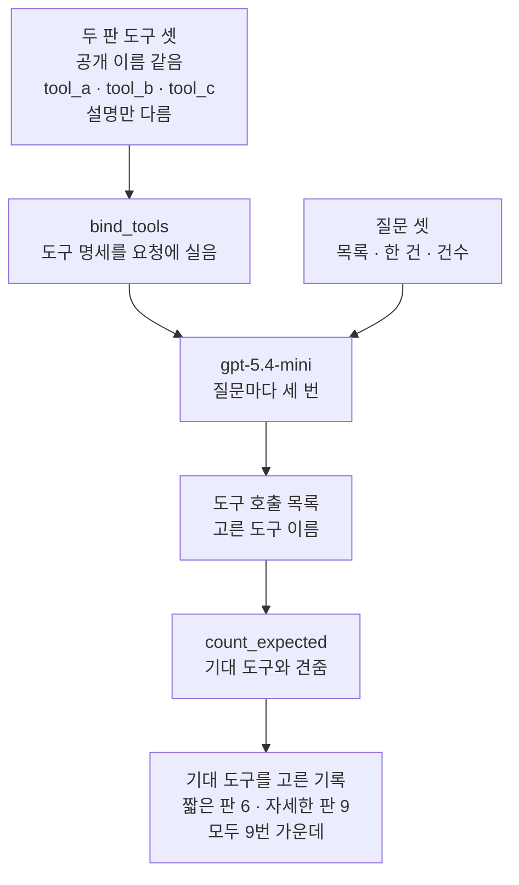
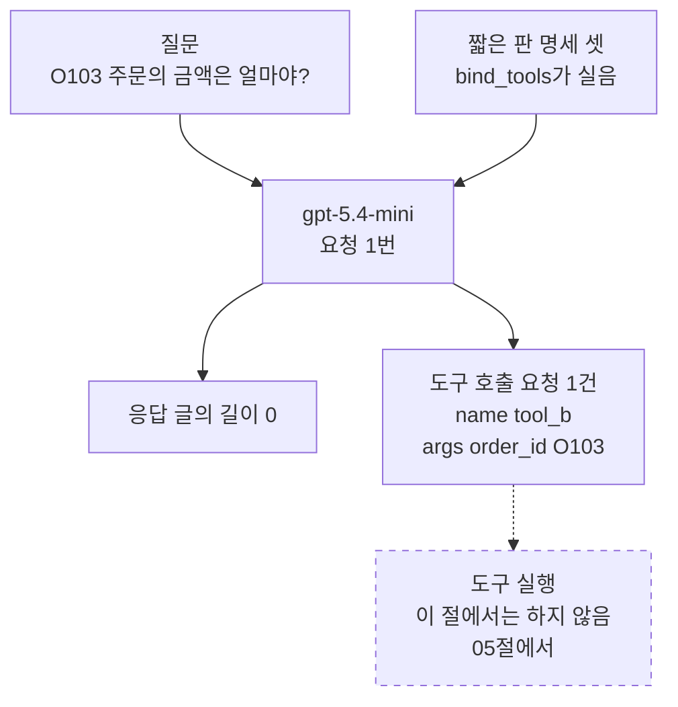
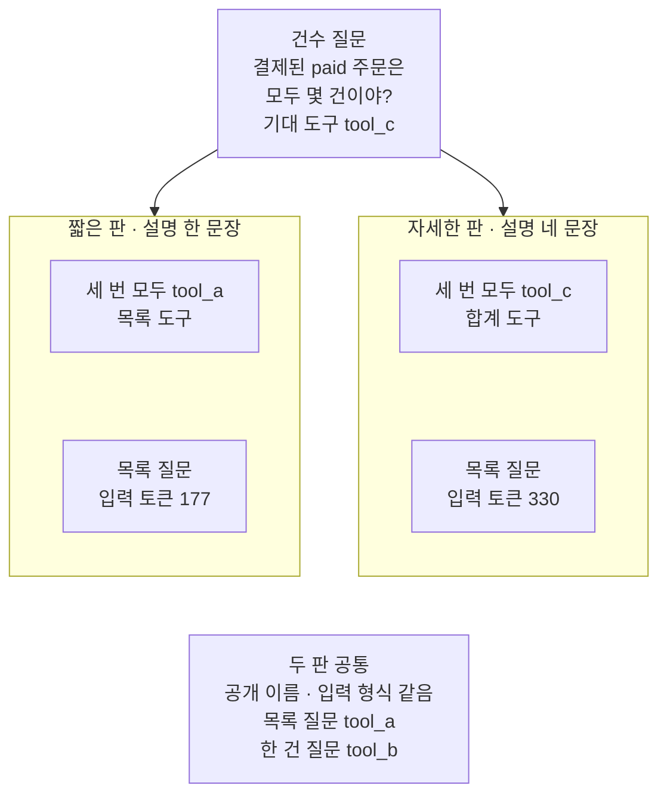
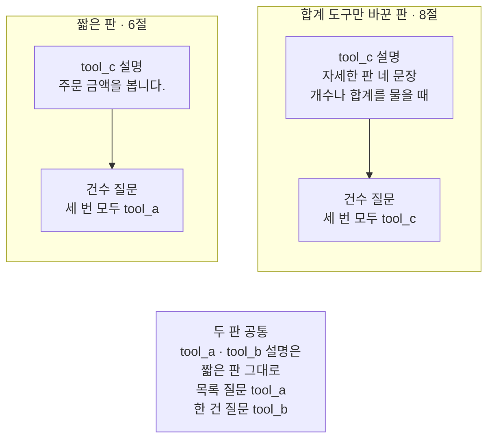

# 04-설명만으로-도구-선택하기

## _src 본문 (HTML 원본)

```html
<!--meta: 강의 1h | 실습 2h | 코드 notebooks/04-설명만으로-도구-선택하기.ipynb | 새 용어 5 -->
<style>html,body{overflow-x:hidden}.notebook,.nb-cell,.nb-main,.nb-input,.nb-result{min-width:0;max-width:100%}.nb-input pre,.nb-output{box-sizing:border-box;max-width:100%;overflow-x:auto}code.nb-source{display:block!important;width:100%!important;min-width:0!important;overflow-x:auto!important;padding:0!important}</style>
<h2 id="b1"><span class="no">1</span>학습 목표</h2><div class="goal"><ul>
<li>메서드 <code>bind_tools</code>로 모델에게 도구를 알려 주고, 응답의 도구 호출 목록에서 고른 도구를 읽을 수 있습니다.</li>
<li>공개 이름과 입력 형식을 같게 두고 설명만 바꾼 두 판에서, 고른 도구를 기대 도구와 견줄 수 있습니다.</li>
<li>도구 설명의 길이에 따라 입력 토큰과 예상 비용이 달라지는 것을 출력으로 짚을 수 있습니다.</li>
</ul></div>
<h2 id="b2"><span class="no">2</span>이 내용을 배우는 이유</h2><p>03절은 설명만 다른 두 판의 명세를 견주었지만, 모델에게 보내지는 않았습니다. 기준을 채운 설명이 모델의 선택을 실제로 바꾸는지는 이 절의 물음으로 남겼습니다. 이 절은 두 판을 모델에게 알려 주고, 같은 질문에 어느 도구를 고르는지 봅니다.</p><p>이때 도구 이름이 걸림돌이 됩니다. 03절의 <code>get_order_by_id</code>처럼 이름이 하는 일을 드러내면, 모델은 설명을 읽지 않고도 고를 수 있습니다. 그러면 설명이 선택을 바꾸는지 가를 수 없습니다. 그래서 이 절은 두 판의 공개 이름을 <code>tool_a</code>처럼 역할이 안 보이는 글로 똑같이 가립니다.</p><p>이 절은 이 챕터에서 처음 모델을 부르는 절입니다. 모델에게 도구를 알려 주는 메서드 <code>bind_tools</code>도 이 절에서 처음 씁니다. 모델은 도구 이름과 인자를 적어 보낼 뿐이고, 도구를 실제로 부르는 일은 05절에서 합니다.</p>
<h2 id="b3"><span class="no">3</span>앞에서 배운 내용</h2><p><a href="01-tool과-Ch4-함수-재사용.html">01절</a>은 함수를 <code>@tool</code> 줄로 감싸 도구로 만들고, 함수 <code>convert_to_openai_tool</code>로 도구 명세를 보았습니다. 그 절은 모델이 도구 이름과 인자 딕셔너리를 적어 보내면 프로그램이 도구를 부른다고 적었습니다. 이 절은 그 앞 단계, 곧 모델이 적어 보내는 장면을 봅니다.</p><p><a href="03-좋은-도구-이름과-설명.html">03절</a>은 같은 몸통 함수에 설명만 다른 짧은 판과 자세한 판을 붙였습니다. 짧은 판은 한 문장, 자세한 판은 하는 일·언제 쓰는지·인자 뜻·내놓는 값 네 문장이었습니다. 이 절은 두 판의 설명 글을 그대로 쓰고, 몸통 함수 <code>find_order</code>·<code>sum_orders</code>는 도구 파일에서 가져옵니다.</p><p><a href="../../part2/ch07-prompt-engineering/05-CoT와-ReAct의-경계.html">Ch 7 05절</a>에서는 응답 객체의 도구 호출 목록(<code>tool_calls</code>)을 보았습니다. 도구를 알려 주지 않은 요청이라 그 목록은 비어 있었습니다. <a href="../ch17-agent-overview/03-모델-도구-루프와-정지-조건.html">Ch 17 03절</a>의 모델은 다음 도구 이름을 JSON 글로 적었고, 코드가 <code>json.loads</code>로 읽었습니다. 이 절은 도구를 알려 주고, 모델이 고른 도구를 도구 호출 목록으로 받습니다.</p><p><a href="../../part2/ch06-langchain-start/06-토큰-비용-지연-비교.html">Ch 6 06절</a>에서는 응답의 <code>usage_metadata</code>로 토큰 수를 읽고, 함수 <code>estimate_cost</code>로 예상 비용을 셌습니다. 이 절은 그 함수를 도구 파일에 옮겨 가져오고, 두 판의 입력 토큰과 예상 비용을 견줍니다.</p>
<h2 id="b4"><span class="no">4</span>핵심 개념</h2><h3>비유로 시작하기</h3><p>01절부터 이어 온 식당을 다시 떠올립니다. 03절에서는 카드 그림이 흐린 메뉴판과 뚜렷한 메뉴판을 견주었습니다. 이번에는 손님이 실제로 고르는 장면입니다. 카드 위 이름표는 모두 비워 두었고, 손님은 그림만 보고 고른 카드 자리를 전표에 표시합니다.</p><p>이 절에서 비운 이름표는 가린 공개 이름 <code>tool_a</code>·<code>tool_b</code>·<code>tool_c</code>입니다. 카드 그림은 도구 설명이고, 손님은 모델입니다. 전표에 표시한 자리가 도구 호출 요청입니다. 주방이 요리를 만드는 일, 곧 도구를 실행하는 일은 이 절에서 하지 않습니다.</p>
{{img:04-5-이름표-없는-카드와-전표|흰 바탕 그림으로 연초록 벽에 나무 메뉴판 하나가 걸려 있고, 메뉴판에 종이 카드 세 장이 집게로 한 줄 붙어 있으며, 카드마다 바로 위 벽에 아무것도 적히지 않은 같은 모양의 작은 나무 이름표가 하나씩 걸려 있고, 카드 그림은 왼쪽부터 작은 그릇 네 개, 국수가 담긴 큰 그릇 하나, 금화 더미이며, 아래 나무 선반 앞쪽에 큰 종이 전표 한 장이 놓여 있고 전표의 네모 세 칸 가운데 오른쪽 칸 하나만 짙은 파랑으로 칠해진 그림|이름표가 모두 비어 있어도 카드 그림은 저마다 뚜렷하고, 전표는 세 칸 가운데 오른쪽 칸 하나만 칠해 금화 카드를 골랐습니다.}}
<p class="look"><b>그림 읽기</b> — 연초록 벽의 나무 메뉴판에 카드 세 장이 한 줄로 붙어 있습니다. 카드마다 바로 위 벽에 작은 나무 이름표가 하나씩 걸려 있고, 셋 모두 비어 있고 모양도 같습니다. 카드 그림은 왼쪽부터 작은 그릇 네 개, 국수 큰 그릇 하나, 금화 더미입니다. 아래 선반 앞쪽의 전표에는 네모 세 칸이 있고, 오른쪽 칸 하나만 칠해져 있습니다. 빈 이름표는 가린 공개 이름, 그림은 자세한 판 설명, 칠한 칸은 모델이 고른 합계 도구입니다.</p>
<table><thead><tr><th>말</th><th>뜻</th></tr></thead><tbody><tr><td>공개 이름</td><td>모델에게 보이는 도구 이름입니다. 메뉴 카드 위에 붙은 이름표와 같습니다.</td></tr><tr><td>도구 알려 주기(bind_tools)</td><td>모델 객체에 도구 명세 목록을 붙여, 요청마다 함께 싣게 하는 일입니다. 손님 자리에 메뉴판을 놓아 두는 일과 같습니다.</td></tr><tr><td>도구 호출 요청</td><td>모델이 응답에 적어 보낸 「이 도구를 이 인자로 불러 달라」는 한 건입니다. 주문 전표 한 장과 같습니다.</td></tr><tr><td>기대 도구</td><td>질문마다 실행 전에 사람이 정해 둔, 골라야 할 도구입니다. 시험지의 정답표와 같습니다.</td></tr><tr><td>선택 채점</td><td>고른 도구 이름이 기대 도구와 같은지 세는 일입니다. 인자는 보지 않습니다. 정답표로 답안의 번호만 맞춰 보는 일과 같습니다.</td></tr></tbody></table>
<p>새 말을 이 절 코드에서 보면 이렇습니다. 공개 이름은 <code>@tool("tool_a")</code>의 괄호 안 글입니다. 도구 알려 주기는 <code>model.bind_tools(short_tools, parallel_tool_calls=False)</code> 한 줄입니다. 도구 호출 요청은 <code>response.tool_calls</code> 목록의 딕셔너리 한 건이고, 칸 <code>name</code>·<code>args</code>·<code>id</code>·<code>type</code>을 담습니다. 기대 도구는 딕셔너리 <code>expected_tools</code>의 값이고, 선택 채점은 함수 <code>count_expected</code>가 합니다.</p>
{{mermaid:04-1-이름을-가린-두-판과-채점|위에서 아래로 읽는 그림으로 맨 위 회색 상자 두 판 도구 셋 공개 이름 같음 tool_a tool_b tool_c 설명만 다름에서 회색 상자 bind_tools 도구 명세를 요청에 실음으로 이어지고, 그 오른쪽 초록 상자 질문 셋 목록 한 건 건수와 함께 보라 상자 gpt-5.4-mini 질문마다 세 번으로 모인 뒤, 노란 상자 도구 호출 목록 고른 도구 이름과 파란 상자 count_expected 기대 도구와 견줌을 거쳐 노란 상자 기대 도구를 고른 기록 짧은 판 6 자세한 판 9 모두 9번 가운데로 끝나는 그림|공개 이름을 가리고 설명만 다른 두 판을 모델에게 알려 준 뒤, 고른 도구를 기대 도구와 견주면 짧은 판 6번·자세한 판 9번이 맞았습니다.}}
<p class="look"><b>도식 읽기</b> — 위에서 아래로 읽습니다. 맨 위 회색 상자는 3·4절에서 만든 두 판의 도구 셋입니다. 회색 상자 <code>bind_tools</code>가 명세를 요청에 싣고, 그 오른쪽 초록 질문 셋과 함께 보라 상자 모델로 갑니다. 노란 상자 도구 호출 목록에서 고른 도구 이름을 읽어, 파란 상자 함수가 기대 도구와 견줍니다. 맨 아래 노란 상자는 6절 출력입니다.</p>
<h3>이름을 가리는 까닭</h3><p>이 절의 실험 변수는 도구 설명 하나입니다. 두 판은 공개 이름, 입력 형식, 몸통 함수, 질문, 모델 설정이 모두 같습니다. 공개 이름을 <code>list_orders_by_status</code>처럼 두면 이름이 역할을 알려 주어, 설명의 몫을 따로 볼 수 없습니다. 그래서 공개 이름을 두 판 모두 <code>tool_a</code>·<code>tool_b</code>·<code>tool_c</code>로 가렸습니다. 실제 도구에서는 03절처럼 하는 일이 드러나는 이름을 씁니다.</p>
<p>인자 이름은 가리지 않았습니다. 한 건 도구의 인자 <code>order_id</code>는 두 판 모두 그대로 보입니다. 목록 도구와 합계 도구는 인자 이름이 <code>status</code>로 같아, 둘 사이는 설명으로만 가를 수 있습니다.</p>
<h3>다른 상황에 적용</h3><p>도서관 도구라면 책 목록을 찾는 도구와 권수를 세는 도구가 같은 인자 <code>author</code>를 받을 수 있습니다. 「이 작가 책은 몇 권이야?」에 모델이 어느 도구를 고르는지는 두 도구의 설명에 달려 있습니다. 이름을 가린 채 설명만 바꿔 보내 보면, 설명이 선택을 바꾸는지 볼 수 있습니다.</p>
<h3>비교와 경계</h3><p>이 절의 결과는 한 모델과 한 날짜, 질문 셋에서 본 것입니다. 두 판의 선택이 갈린 곳은 건수 질문 하나였습니다. 그러니 「자세한 설명이면 모델이 늘 기대 도구를 고른다」고 말할 수는 없습니다. 기대 도구는 이 절이 정한 역할 나눔이고, 목록 도구를 골라도 프로그램이 줄 수를 세면 건수는 답할 수 있습니다.</p>
<h2 id="b5"><span class="no">5</span>실행 예제</h2><p>노트북은 먼저 공개 이름을 가린 두 판의 도구 셋을 만들고, 공개 이름과 입력 형식이 같은지 확인합니다. 그다음 메서드 <code>bind_tools</code>로 짧은 판을 알려 주고 질문 하나를 보내 도구 호출 목록을 읽습니다. 질문 셋을 두 판에 세 번씩 보내 선택을 채점하고, 입력 토큰과 예상 비용을 견줍니다. 마지막으로 합계 도구 설명 하나만 바꿔 다시 보냅니다.</p><p>모델은 <code>gpt-5.4-mini</code>이고, temperature 0과 추론 끔(<code>reasoning_effort="none"</code>)으로 부릅니다. 모델 요청은 모두 28번이고, 도구는 실행하지 않습니다.</p>
{{notebook:04-설명만으로-도구-선택하기}}
<p class="look"><b>확인할 점</b> — 노트북 5절 출력 <code>응답 글의 길이: 0</code>과 <code>도구 호출 요청 수: 1</code>로 모델이 글 대신 도구 호출 요청을 적었는지 봅니다. 노트북 6절 출력 <code>짧은 판 | 기대 도구를 고른 기록: 6 / 9</code>와 <code>자세한 판 | 기대 도구를 고른 기록: 9 / 9</code>로 두 판이 어느 질문에서 갈렸는지 봅니다.</p>
{{mermaid:04-2-질문-하나와-도구-호출-요청|위에서 아래로 읽는 그림으로 맨 위에 초록 상자 질문 O103 주문의 금액은 얼마야와 회색 상자 짧은 판 명세 셋 bind_tools가 실음이 나란히 있고, 두 상자가 보라 상자 gpt-5.4-mini 요청 1번으로 모인 뒤, 아래에 노란 상자 응답 글의 길이 0과 노란 상자 도구 호출 요청 1건 name tool_b args order_id O103이 나란히 있고, 노란 상자 도구 호출 요청에서 점선 화살표가 회색 점선 상자 도구 실행 이 절에서는 하지 않음 05절로 가는 그림|질문 하나에 모델은 글 대신 도구 호출 요청 한 건(tool_b, order_id O103)을 적어 보냈고, 도구 실행은 이 절에서 하지 않았습니다.}}
<p class="look"><b>도식 읽기</b> — 위에서 아래로 읽습니다. 초록 질문과 회색 명세 셋이 보라 모델 요청 한 번으로 모입니다. 아래 노란 상자 둘은 노트북 5절의 출력입니다. 모델은 글로 답하지 않고 도구 호출 요청 한 건을 적었습니다. 점선 화살표 끝의 회색 점선 상자는 이번에 하지 않은 단계이고, 05절에서 합니다.</p>
<h2 id="b6"><span class="no">6</span>실험 결과 해석</h2><p>실험에서 바꾼 것은 도구 설명 하나입니다. 질문마다 세 번씩 보낸 요청에서 고른 도구는 아래 표와 같았습니다. 세 번은 모두 같은 도구였습니다.</p>
<table><thead><tr><th>질문</th><th>기대 도구</th><th>짧은 판</th><th>자세한 판</th><th>합계 도구만 바꾼 판</th></tr></thead><tbody><tr><td>결제된(paid) 주문 목록을 보여 줘.</td><td><code>tool_a</code></td><td><code>tool_a</code> 세 번</td><td><code>tool_a</code> 세 번</td><td><code>tool_a</code> 세 번</td></tr><tr><td>O103 주문의 금액은 얼마야?</td><td><code>tool_b</code></td><td><code>tool_b</code> 세 번</td><td><code>tool_b</code> 세 번</td><td><code>tool_b</code> 세 번</td></tr><tr><td>결제된(paid) 주문은 모두 몇 건이야?</td><td><code>tool_c</code></td><td><code>tool_a</code> 세 번</td><td><code>tool_c</code> 세 번</td><td><code>tool_c</code> 세 번</td></tr><tr><td>기대 도구를 고른 기록</td><td></td><td>6 / 9</td><td>9 / 9</td><td>9 / 9</td></tr></tbody></table>
{{mermaid:04-3-건수-질문에서-갈린-선택|위에 초록 상자 건수 질문 결제된 paid 주문은 모두 몇 건이야 기대 도구 tool_c가 있고, 아래에 칸 둘이 나란히 있는 그림으로 왼쪽 칸 짧은 판 설명 한 문장에는 노란 상자 세 번 모두 tool_a 목록 도구와 노란 상자 목록 질문 입력 토큰 177이 있고, 오른쪽 칸 자세한 판 설명 네 문장에는 노란 상자 세 번 모두 tool_c 합계 도구와 노란 상자 목록 질문 입력 토큰 330이 있으며, 맨 아래 회색 상자에 두 판 공통 공개 이름 입력 형식 같음 목록 질문 tool_a 한 건 질문 tool_b가 적힌 그림|건수 질문에서 짧은 판은 세 번 모두 목록 도구 tool_a를, 자세한 판은 세 번 모두 합계 도구 tool_c를 골랐습니다.}}
<p class="look"><b>도식 읽기</b> — 맨 위 초록 상자는 두 판에 똑같이 보낸 건수 질문입니다. 왼쪽 칸이 짧은 판, 오른쪽 칸이 자세한 판이고, 노란 상자는 모두 6·7절의 출력입니다. 칸마다 아래 노란 상자는 목록 질문의 입력 토큰이라, 위 상자와 화살표로 잇지 않았습니다. 맨 아래 회색 상자는 두 판 출력에서 모두 확인한 공통점입니다.</p>
<p>목록 질문과 한 건 질문은 두 판 모두 기대 도구를 골랐습니다. 건수 질문에서만 짧은 판은 목록 도구 <code>tool_a</code>를, 자세한 판은 합계 도구 <code>tool_c</code>를 골랐습니다. 짧은 판의 목록 도구 설명 「주문을 찾습니다.」는 건수를 물을 때 쓰는지 알려 주지 않았습니다. 자세한 판의 합계 도구 설명은 개수나 합계를 물을 때 쓴다고 적었습니다. 새 커널로 두 번 실행했을 때 고른 도구는 두 번 모두 같았습니다.</p>
<p>설명이 길어진 값도 치렀습니다. 같은 목록 질문의 입력 토큰은 짧은 판 177, 자세한 판 330으로 153 늘었습니다. 질문과 공개 이름, 입력 형식이 같으니 늘어난 토큰은 설명의 몫입니다. 요청 9번의 예상 비용도 자세한 판이 더 컸습니다.</p>
<p>값 바꿔 보기는 짧은 판 셋에서 합계 도구 <code>tool_c</code>의 설명 하나만 자세한 판 네 문장으로 바꿨습니다. 목록 도구 설명은 짧은 판 그대로였지만, 건수 질문의 선택은 세 번 모두 <code>tool_c</code>로 바뀌었습니다. 바꾼 설명 네 문장에는 하는 일(주문 수와 금액 합계)과 사용 조건(개수나 합계를 물을 때)이 함께 있습니다. 그 가운데 어느 문장이 선택을 바꿨는지는 이번에 가르지 않았습니다.</p>
{{mermaid:04-4-합계-도구-설명만-바꾸면|칸 둘이 나란히 있고 아래에 회색 상자가 있는 그림으로 왼쪽 칸 짧은 판 셋에는 파란 상자 tool_c 설명 주문 금액을 봅니다에서 노란 상자 건수 질문 세 번 모두 tool_a로 이어지고, 오른쪽 칸 합계 도구만 바꾼 판에는 파란 상자 tool_c 설명 자세한 판 네 문장에서 노란 상자 건수 질문 세 번 모두 tool_c로 이어지며, 맨 아래 회색 상자에 두 판 공통 tool_a tool_b 설명은 짧은 판 그대로 목록 질문 tool_a 한 건 질문 tool_b가 적힌 그림|짧은 판 셋에서 합계 도구 tool_c의 설명 하나만 자세한 판으로 바꾸자, 건수 질문의 선택이 세 번 모두 tool_c로 바뀌었습니다.}}
<p class="look"><b>도식 읽기</b> — 왼쪽 칸은 6절의 짧은 판이고, 오른쪽 칸은 8절에서 합계 도구 설명 하나만 바꾼 판입니다. 칸마다 위 파란 상자는 우리가 적은 tool_c 설명이고, 아래 노란 상자는 노트북 출력입니다. 맨 아래 회색 상자는 두 판 출력에서 모두 확인한 공통점입니다. 나머지 두 도구의 설명은 두 판이 같습니다.</p>
<h2 id="b7"><span class="no">7</span>주의할 점과 실무 메모</h2><ul><li>노트북을 실행하기 전에 노트북 밖에서 세 판을 다섯 번씩 보냈습니다. 짧은 판·자세한 판·합계 도구만 바꾼 판 모두, 질문마다 고른 도구가 다섯 번 같았습니다. 같은 요청도 실행한 때에 따라 모델이 고르는 도구가 달라질 수 있습니다.</li><li>질문 셋과 기대 도구, 공개 이름 <code>tool_a</code>·<code>tool_b</code>·<code>tool_c</code>는 흐름을 보여 주려고 이 절에서 정한 예입니다. 질문 셋은 노트북 밖 확인 전에 정했고, 확인 뒤 바꾸지 않았습니다.</li><li>기대 도구는 03절 자세한 판 설명의 사용 조건을 보고 정했습니다. 건수 질문에 목록 도구를 고른 것도, 프로그램이 줄 수를 세면 답할 수는 있습니다. 그래서 두 판의 맞은 기록 수는 이 절이 정한 역할 나눔과 맞은 수이고, 설명의 좋고 나쁨을 잰 점수가 아닙니다.</li><li>채점은 도구 이름만 봅니다. 인자는 채점하지 않았고, 노트북 밖 확인에서는 인자도 다섯 번 모두 같았습니다.</li><li>모델 답에는 <code>assert</code>를 걸지 않았습니다. 이 절에서는 도구 호출 요청이 없거나 둘 이상인 응답을 받지 않았습니다.</li><li>인자 <code>parallel_tool_calls=False</code>로 한 응답에 도구 호출 요청을 하나까지만 받았습니다. 여럿을 받는 경우는 05절에서 봅니다.</li><li>설명은 독스트링에 적었습니다. <code>@tool("tool_a", description=…)</code>처럼 괄호 안에 줄 수도 있습니다. 노트북 밖에서 확인해 보니 모델에게 가는 명세는 두 모양이 같았습니다.</li><li>시스템 메시지 없이 질문 한 줄만 보냈습니다. OpenAI 문서는 언제 쓰는지를 시스템 메시지에 적으라고 하지만, 이 절은 03절처럼 설명에만 적었습니다.</li><li>도구는 실행하지 않았습니다. 모델이 적어 보낸 도구 호출 요청을 받아 도구를 부르는 일은 05절에서 합니다.</li><li>예상 비용은 2026-09-17 요금표로 어림한 값이고 청구 금액이 아닙니다. 노트북 밖에서 보낸 요청 마흔여섯 번의 캐시 입력은 모두 0이었습니다.</li><li>걸린 시간은 재지 않았습니다. 이 절은 파일을 읽지도 쓰지도 않습니다.</li><li>교재 출력은 Linux의 Python 3.12.13으로 만들었습니다. 다른 판과 Windows·macOS에서는 이번에 실행하지 않았습니다.</li></ul>
<h2 id="b8"><span class="no">8</span>정리와 다음 절</h2><ul><li>메서드 <code>bind_tools</code>로 도구를 알려 주자, 모델은 글 대신 도구 호출 요청을 적어 보냈습니다.</li><li>공개 이름을 가리고 설명만 바꾸자, 건수 질문에서 짧은 판은 목록 도구, 자세한 판은 합계 도구를 골랐습니다.</li><li>자세한 판은 설명이 길어 요청마다 입력 토큰과 예상 비용이 늘었습니다.</li></ul><p><strong>다음 학습과 이어지는 지점</strong> — 05절에서는 한 응답에 도구 호출 요청이 여럿 오는 경우를 보고, 도구를 실제로 실행합니다.</p>
<h2 id="b9"><span class="no">9</span>복습 문제</h2><details class="quiz" open><summary>문제 4개 · 해설 포함</summary><p class="quiz-q">1. 이 절이 두 판의 공개 이름을 <code>tool_a</code>처럼 똑같이 가린 까닭은 무엇인가요?</p><p class="quiz-a">이름이 하는 일을 드러내면 모델이 설명을 읽지 않고도 고를 수 있어, 설명의 몫을 가를 수 없기 때문입니다. 틀렸다면 본문 4 「핵심 개념」의 「이름을 가리는 까닭」을 다시 읽습니다.</p><p class="quiz-q">2. 모델이 도구 호출 요청을 보냈을 때, 도구는 실행되었나요?</p><p class="quiz-a">아닙니다. 모델은 도구 이름과 인자를 적어 보냈을 뿐이고, 도구를 부르는 일은 프로그램이 합니다. 이 절은 도구를 실행하지 않았습니다. 틀렸다면 노트북 5절을 다시 읽습니다.</p><p class="quiz-q">3. 건수 질문에서 두 판은 각각 어느 도구를 골랐고, 두 판의 차이는 무엇이었나요?</p><p class="quiz-a">짧은 판은 목록 도구 <code>tool_a</code>, 자세한 판은 합계 도구 <code>tool_c</code>를 세 번 모두 골랐습니다. 두 판은 설명만 달랐습니다. 틀렸다면 노트북 6절을 다시 읽습니다.</p><p class="quiz-q">4. 이 결과로 「자세한 설명이면 모델이 늘 기대 도구를 고른다」고 말할 수 있나요?</p><p class="quiz-a">말할 수 없습니다. 한 모델과 한 날짜, 질문 셋의 결과이고, 두 판이 갈린 곳은 건수 질문 하나였습니다. 틀렸다면 본문 4의 「비교와 경계」와 본문 7 「주의할 점과 실무 메모」를 다시 읽습니다.</p></details>
<h2 id="b10"><span class="no">10</span>참고 자료</h2><ul><li><div><a href="https://docs.langchain.com/oss/python/langchain/models">LangChain Models · Tool calling</a></div>확인 2026-09-24 · 도구는 <code>bind_tools</code>로 모델에 알려 주고, 응답에는 도구 실행 요청이 담긴다고 적습니다. 요청한 도구를 실행하는 일은 사용자 몫이라고 적습니다.</li><li><div><a href="https://developers.openai.com/api/docs/guides/function-calling">OpenAI Function calling</a></div>확인 2026-09-24 · 인자 <code>parallel_tool_calls</code>를 false로 두면 여러 함수 호출을 끈다고 적습니다. 함수 정의는 입력 토큰으로 요금이 매겨진다고도 적습니다.</li><li>langchain-openai 1.6.0 소스 <code>chat_models/base.py</code> — 메서드 <code>bind_tools</code>가 도구마다 <code>convert_to_openai_tool</code>로 명세를 만듭니다(2436행).</li><li>01절 — 도구 명세와 <code>.invoke</code>.</li><li>03절 — 짧은 판과 자세한 판의 설명.</li><li>Ch 6 06절 — 사용량과 요금표, 함수 <code>estimate_cost</code>.</li><li>Ch 7 05절 — 도구 호출 목록 <code>tool_calls</code>.</li></ul>
```

## 노트북 셀 (순서대로)

### [0] markdown {'html': 'skip'}

# 설명만으로 도구 선택하기

**이 노트북에서 할 일**

1. 공개 이름을 가리고 설명만 다른 도구 두 판을 만듭니다.
2. 메서드 `bind_tools`로 모델에게 도구를 알려 주고, 도구 호출 목록을 읽습니다.
3. 같은 질문 셋을 두 판에 세 번씩 보내, 고른 도구를 기대 도구와 견줍니다.
4. 입력 토큰과 예상 비용을 보고, 합계 도구의 설명만 바꿔 다시 봅니다.

**준비물** — 프로젝트 폴더의 `.env` 파일에 `OPENAI_API_KEY`가 있어야 합니다.
모델은 `gpt-5.4-mini`이고, 모델 요청은 모두 28번입니다.
5절에서 1번, 6절에서 두 판에 9번씩, 8절에서 9번을 보냅니다.
요금표로 센 예상 비용은 모두 합쳐 0.01달러 아래이고, 청구 금액이 아닙니다.

모델은 도구를 고르기만 하고, 이 노트북은 도구를 실행하지 않습니다.
그래서 주문 CSV는 자리만 찾아 두고 읽지 않으며, 새로 쓰는 파일도 없습니다.
Ch 4 함수와 03절 몸통 함수, Ch 6 06절 함수는 도구 파일 `order_tools.py`에서 가져옵니다.
교재 출력을 만든 실행에서는 노트북 전체가 30초 안에 끝났습니다.
모델 응답을 기다리는 시간은 네트워크와 실행 때에 따라 달라집니다.

**기준 버전** — 첫 셀에서 패키지 다섯을 설치합니다.
판은 langchain 1.4.0, langchain-core 1.6.2, langchain-openai 1.6.0입니다.
pandas 3.0.5와 python-dotenv 1.2.3도 함께 설치합니다.
교재 출력은 Linux의 Python 3.12.13으로 만들었습니다.
다른 판과 Windows·macOS에서는 이번에 실행하지 않았습니다.

**강의와 실습 범위** — 강의 시간에는 2~6절을 읽습니다.
이름을 가린 두 판을 만들고, 모델이 고른 도구를 견주는 자리입니다.
7~8절은 입력 토큰과 예상 비용을 보고 설명 하나만 바꿔 보는 자리입니다.
이 부분은 실습 시간에 실행합니다.

실습 폴더 `labs/part5/ch19-model-tools`에서 `uv sync --locked`를 실행합니다.
그다음 `notebooks/` 폴더의 이 노트북을 열고, 실습 폴더의 `.venv` 커널을 고릅니다.
첫 셀부터 순서대로 실행합니다.

### [1] markdown {'html': 'skip'}

## 오늘 볼 그림


위에서 아래로 읽습니다. 맨 위 회색 상자는 3·4절에서 만든 두 판의 도구 셋입니다.
회색 상자 `bind_tools`가 명세를 요청에 싣고, 그 오른쪽 초록 질문 셋과 함께 보라 상자 모델로 갑니다.
노란 상자 도구 호출 목록에서 고른 도구 이름을 읽어, 파란 상자 함수가 기대 도구와 견줍니다.
맨 아래 노란 상자는 6절 출력입니다.

### [2] markdown {}

## 1. 준비

03절은 설명만 다른 두 판의 명세를 견주었지만, 모델에게 보내지는 않았습니다.
이 절은 두 판을 모델에게 알려 주고, 같은 질문에 어느 도구를 고르는지 봅니다.
이 챕터에서 모델을 부르는 첫 절이라, 준비 셀에 API 키 확인과 모델 준비가 더해집니다.

첫 셀은 패키지 다섯 개를 설치하고 설치된 판 번호를 출력합니다.
설치에는 몇십 초가 걸릴 수 있습니다.

### [3] code {'execution': {'iopub.execute_input': '2026-09-24T02:15:19.355355Z', 'iopub.status.busy': '2026-09-24T02:15:19.355190Z', 'iopub.status.idle': '2026-09-24T02:15:20.045932Z', 'shell.execute_reply': '2026-09-24T02:15:20.045406Z'}, 'lesson_role': 'setup'}

```python
# 이 절에서 쓰는 패키지를 설치하고 버전을 확인합니다
%pip install -q "langchain==1.4.0" "langchain-core==1.6.2" "langchain-openai==1.6.0" "pandas==3.0.5" "python-dotenv==1.2.3"
from importlib.metadata import version

print("langchain:", version("langchain"))
print("langchain-core:", version("langchain-core"))
print("langchain-openai:", version("langchain-openai"))
print("pandas:", version("pandas"))
print("python-dotenv:", version("python-dotenv"))
```

출력:
```
Note: you may need to restart the kernel to use updated packages.
langchain: 1.4.0
langchain-core: 1.6.2
langchain-openai: 1.6.0
pandas: 3.0.5
python-dotenv: 1.2.3

```

### [4] markdown {}

**결과 읽기** — 출력 줄 `langchain: 1.4.0`·`langchain-core: 1.6.2`·`langchain-openai: 1.6.0`이 보입니다.
출력 줄 `pandas: 3.0.5`와 `python-dotenv: 1.2.3`도 잠금과 같은 판입니다.
이 노트북의 출력은 2026-09-24에 이 판으로 실행한 결과입니다.

앞에서 배운 함수는 `order_tools.py`에 모아 두었습니다. 파일을 열면 코드를 볼 수 있습니다. 노트북과 같은 폴더(`notebooks/`)에 있는 파일입니다. 커널이 `notebooks/` 폴더에서 시작해야 이 파일을 가져올 수 있습니다.

다음 셀은 이 절에서 쓸 이름을 가져옵니다.
함수 `init_chat_model`은 Ch 6에서 모델을 만들 때 쓴 함수입니다.
도구 파일에서는 Ch 4 함수 `fetch_orders`와 03절 몸통 함수 둘을 가져옵니다.
Ch 6 06절 함수 `estimate_cost`는 이 절에서 도구 파일에 옮겨 처음 가져옵니다.

### [5] code {'execution': {'iopub.execute_input': '2026-09-24T02:15:20.046974Z', 'iopub.status.busy': '2026-09-24T02:15:20.046889Z', 'iopub.status.idle': '2026-09-24T02:15:20.947884Z', 'shell.execute_reply': '2026-09-24T02:15:20.947478Z'}, 'lesson_role': 'setup'}

```python
# 모델과 도구를 만드는 이름, 명세를 보는 함수, 도구 파일의 함수 넷을 가져옵니다
import os

from langchain.chat_models import init_chat_model
from langchain.tools import tool
from langchain_core.utils.function_calling import convert_to_openai_tool

from order_tools import estimate_cost, fetch_orders, find_order, sum_orders

print("가져온 이름:", "os", "init_chat_model", "tool", "convert_to_openai_tool")
```

출력:
```
가져온 이름: os init_chat_model tool convert_to_openai_tool

```

### [6] markdown {}

**결과 읽기** — 출력 줄에 가져온 이름 넷이 보입니다.
도구 파일에서 가져온 함수 넷은 셀의 `from order_tools import …` 줄에 적혀 있습니다.
함수 `estimate_cost`는 Ch 6 06절 노트북과 같은 본문입니다.

다음 셀은 01~03절과 같은 방법으로 주문 CSV가 있는 프로젝트 맨 위 폴더를 찾습니다.
도구 몸통이 쓸 CSV 파일 위치를 정해 두지만, 이 절에서는 도구를 실행하지 않습니다.

### [7] code {'execution': {'iopub.execute_input': '2026-09-24T02:15:20.948670Z', 'iopub.status.busy': '2026-09-24T02:15:20.948565Z', 'iopub.status.idle': '2026-09-24T02:15:20.950529Z', 'shell.execute_reply': '2026-09-24T02:15:20.950339Z'}, 'lesson_role': 'setup'}

```python
# 노트북을 어느 폴더에서 열어도 주문 CSV를 찾게 후보 세 곳을 차례로 봅니다
candidates = [".", "../../..", "../../../.."]
root_path = None
for candidate in candidates:
    if os.path.exists(candidate + "/labs/part5/ch19-model-tools/data/orders.csv"):
        root_path = candidate
        break
print("찾은 프로젝트 맨 위:", root_path)
assert root_path is not None, "notebooks 폴더나 실습 폴더 맨 위에서 노트북을 열어 주세요."
# CSV 파일 위치는 노트북이 정해 두는 값입니다(모델이 고를 값이 아님)
csv_path = root_path + "/labs/part5/ch19-model-tools/data/orders.csv"
```

출력:
```
찾은 프로젝트 맨 위: .

```

### [8] markdown {}

**결과 읽기** — 출력 줄 `찾은 프로젝트 맨 위: .`은 교재 출력을 프로젝트 맨 위에서 실행했다는 뜻입니다.
교재 출력은 실행 도구에 도구 파일 폴더를 따로 알려 준 실행이라 `.`이 찍혔습니다.
노트북을 `notebooks/` 폴더에서 열면 이 줄에 `../../../..`가 찍힙니다.
셀 안의 안내 글은 실습 폴더 맨 위도 적었지만, 도구 파일을 가져오려면 `notebooks/` 폴더에서 열어야 합니다.

## 2. 키와 모델 준비

이 절부터 모델에게 요청을 보냅니다.
모델은 Ch 6부터 써 온 `gpt-5.4-mini`이고, 과정의 같은 설정으로 부릅니다.

### [9] markdown {}

API 키가 있는지 확인합니다. `True` 값이 나오면 다음으로 넘어갑니다.

### [10] code {'execution': {'iopub.execute_input': '2026-09-24T02:15:20.951124Z', 'iopub.status.busy': '2026-09-24T02:15:20.951069Z', 'iopub.status.idle': '2026-09-24T02:15:20.955622Z', 'shell.execute_reply': '2026-09-24T02:15:20.955368Z'}, 'lesson_role': 'setup'}

```python
# .env 파일에서 OpenAI API 키를 읽습니다(키 값은 출력하지 않습니다)
import os
from dotenv import find_dotenv, load_dotenv

env_path = find_dotenv(usecwd=True)
load_dotenv(env_path)
has_key = os.getenv("OPENAI_API_KEY") is not None
print("OPENAI_API_KEY 설정 여부:", has_key)
assert has_key, "프로젝트 폴더의 .env 파일에 OPENAI_API_KEY를 적어 주세요."
```

출력:
```
OPENAI_API_KEY 설정 여부: True

```

### [11] markdown {}

실습에 쓸 모델을 준비합니다.
temperature 값을 0으로 두어도, 모델이 고르는 도구가 매번 같다고 보장하지는 않습니다.

### [12] code {'execution': {'iopub.execute_input': '2026-09-24T02:15:20.956190Z', 'iopub.status.busy': '2026-09-24T02:15:20.956121Z', 'iopub.status.idle': '2026-09-24T02:15:21.901211Z', 'shell.execute_reply': '2026-09-24T02:15:21.900860Z'}}

```python
# 실습에 쓸 모델을 준비합니다
model = init_chat_model(
    "openai:gpt-5.4-mini",
    temperature=0,
    reasoning_effort="none",
)
print("모델 이름:", model.model_name)
print("temperature:", model.temperature)
```

출력:
```
모델 이름: gpt-5.4-mini
temperature: 0.0

```

### [13] markdown {}

**결과 읽기** — 모델 이름 `gpt-5.4-mini`, temperature `0.0`이 보이면 준비가 끝났습니다.
이 노트북의 출력은 2026-09-24에 이 모델로 실행한 결과입니다.

### [14] markdown {}

## 3. 이름을 가린 짧은 판 도구 셋

03절에서는 같은 이름에 설명만 다른 두 판을 만들었습니다.
그 이름은 `get_order_by_id`처럼 하는 일을 드러냈습니다.
이름만 보고도 고를 수 있다면, 설명이 선택을 바꾸는지 가를 수 없습니다.
그래서 이 절은 두 판의 공개 이름을 똑같이 가립니다.

공개 이름은 모델에게 보이는 도구 이름입니다.
식당으로 치면 메뉴 카드 위에 붙은 이름표입니다.
이 절에서는 공개 이름을 `tool_a`·`tool_b`·`tool_c`로 두어, 이름표를 비워 둔 셈으로 만듭니다.

다음 셀은 목록 도구를 공개 이름 `tool_a`로 만듭니다.
02절 `@tool(args_schema=…)`처럼, 이번에는 괄호 안에 공개 이름을 따로 줍니다.
독스트링은 03절 짧은 판 목록 도구와 같은 한 문장입니다.

### [15] code {'execution': {'iopub.execute_input': '2026-09-24T02:15:21.901900Z', 'iopub.status.busy': '2026-09-24T02:15:21.901841Z', 'iopub.status.idle': '2026-09-24T02:15:21.904633Z', 'shell.execute_reply': '2026-09-24T02:15:21.904335Z'}}

```python
# 짧은 판: 목록 도구를 공개 이름 tool_a로 만들고 설명은 한 문장만 적습니다
@tool("tool_a")
def short_list(status: str):
    """주문을 찾습니다."""
    return fetch_orders(csv_path, status=status)
```

출력:
```

```

### [16] markdown {}

**결과 읽기** — 정의 셀이라 출력이 없습니다.
이름 `short_list`에는 01절에서 본 것처럼 함수가 아니라 도구가 담깁니다.
파이썬에서 부르는 이름은 `short_list`이지만, 모델이 보는 이름은 괄호 안의 `tool_a`입니다.

다음 두 셀도 같은 모양으로 한 건 도구 `tool_b`와 합계 도구 `tool_c`를 만듭니다.
몸통은 도구 파일에서 가져온 03절 몸통 함수를 한 번 부르는 한 줄입니다.

### [17] code {'execution': {'iopub.execute_input': '2026-09-24T02:15:21.905149Z', 'iopub.status.busy': '2026-09-24T02:15:21.905086Z', 'iopub.status.idle': '2026-09-24T02:15:21.907680Z', 'shell.execute_reply': '2026-09-24T02:15:21.907292Z'}}

```python
# 짧은 판: 한 건 도구를 공개 이름 tool_b로 만들고 설명은 한 문장만 적습니다
@tool("tool_b")
def short_get(order_id: str):
    """주문 정보를 봅니다."""
    return find_order(csv_path, order_id)
```

출력:
```

```

### [18] markdown {}

**결과 읽기** — 정의 셀이라 출력이 없습니다.
모델이 채울 인자는 `order_id` 하나이고, CSV 파일 위치는 노트북이 정합니다.

다음 셀은 합계 도구입니다.

### [19] code {'execution': {'iopub.execute_input': '2026-09-24T02:15:21.908215Z', 'iopub.status.busy': '2026-09-24T02:15:21.908158Z', 'iopub.status.idle': '2026-09-24T02:15:21.910562Z', 'shell.execute_reply': '2026-09-24T02:15:21.910212Z'}}

```python
# 짧은 판: 합계 도구를 공개 이름 tool_c로 만들고 설명은 한 문장만 적습니다
@tool("tool_c")
def short_sum(status: str):
    """주문 금액을 봅니다."""
    return sum_orders(csv_path, status)
```

출력:
```

```

### [20] markdown {}

**결과 읽기** — 정의 셀이라 출력이 없습니다.
목록 도구와 합계 도구는 인자 이름이 `status`로 같습니다.
그래서 두 도구는 공개 이름도 인자도 역할을 드러내지 않고, 설명만 다릅니다.

다음 셀은 짧은 판 도구 셋을 목록 `short_tools`에 담고 공개 이름과 설명을 봅니다.

### [21] code {'execution': {'iopub.execute_input': '2026-09-24T02:15:21.911097Z', 'iopub.status.busy': '2026-09-24T02:15:21.911047Z', 'iopub.status.idle': '2026-09-24T02:15:21.912556Z', 'shell.execute_reply': '2026-09-24T02:15:21.912350Z'}}

```python
# 짧은 판 도구 셋을 목록에 담고, 모델이 볼 공개 이름과 설명을 봅니다
short_tools = [short_list, short_get, short_sum]
for one_tool in short_tools:
    print(one_tool.name, "|", one_tool.description)
```

출력:
```
tool_a | 주문을 찾습니다.
tool_b | 주문 정보를 봅니다.
tool_c | 주문 금액을 봅니다.

```

### [22] markdown {}

**결과 읽기** — 출력 세 줄에서 세로 줄 앞이 공개 이름, 뒤가 도구 설명입니다.
공개 이름은 `tool_a`·`tool_b`·`tool_c`이고, 함수 이름은 출력에 없습니다.
설명은 `주문을 찾습니다.`·`주문 정보를 봅니다.`·`주문 금액을 봅니다.`로 03절 짧은 판과 같습니다.

## 4. 자세한 판 도구 셋

이번에는 같은 공개 이름으로 도구 셋을 하나 더 만들고, 03절 자세한 판 설명을 적습니다.
설명은 하는 일·언제 쓰는지·인자 뜻·내놓는 값 네 문장입니다.
함수 이름은 `detailed_list`처럼 다르게 지어, 3절의 짧은 판 도구도 그대로 남깁니다.

다음 셀은 목록 도구의 자세한 판입니다.

### [23] code {'execution': {'iopub.execute_input': '2026-09-24T02:15:21.913043Z', 'iopub.status.busy': '2026-09-24T02:15:21.912999Z', 'iopub.status.idle': '2026-09-24T02:15:21.915236Z', 'shell.execute_reply': '2026-09-24T02:15:21.914920Z'}}

```python
# 자세한 판: 같은 공개 이름 tool_a에 03절 자세한 판 설명 네 문장을 적습니다
@tool("tool_a")
def detailed_list(status: str):
    """주문 상태로 주문 목록을 찾습니다. 한 상태의 주문을 여러 건 볼 때 씁니다. 인자 status는 paid, pending, cancelled 가운데 하나입니다. 그 상태의 주문 줄을 딕셔너리 목록으로 내놓습니다."""
    return fetch_orders(csv_path, status=status)
```

출력:
```

```

### [24] markdown {}

**결과 읽기** — 정의 셀이라 출력이 없습니다.
독스트링은 03절 자세한 판 목록 도구의 설명과 같은 글입니다.
공개 이름 `tool_a`와 몸통 줄은 3절 짧은 판과 같습니다.

다음 두 셀도 한 건 도구와 합계 도구의 자세한 판을 만듭니다.

### [25] code {'execution': {'iopub.execute_input': '2026-09-24T02:15:21.915745Z', 'iopub.status.busy': '2026-09-24T02:15:21.915692Z', 'iopub.status.idle': '2026-09-24T02:15:21.918021Z', 'shell.execute_reply': '2026-09-24T02:15:21.917767Z'}}

```python
# 자세한 판: 같은 공개 이름 tool_b에 03절 자세한 판 설명 네 문장을 적습니다
@tool("tool_b")
def detailed_get(order_id: str):
    """주문 번호로 주문 한 건을 찾습니다. 질문에 O103 같은 주문 번호가 있을 때 씁니다. 인자 order_id는 찾을 주문 번호입니다. 그 주문 한 줄을 딕셔너리로 내놓고, 없으면 None을 내놓습니다."""
    return find_order(csv_path, order_id)
```

출력:
```

```

### [26] markdown {}

**결과 읽기** — 정의 셀이라 출력이 없습니다.
설명 둘째 문장이 질문에 주문 번호가 있을 때 이 도구를 쓴다고 적습니다.

다음 셀은 합계 도구의 자세한 판입니다.

### [27] code {'execution': {'iopub.execute_input': '2026-09-24T02:15:21.918462Z', 'iopub.status.busy': '2026-09-24T02:15:21.918420Z', 'iopub.status.idle': '2026-09-24T02:15:21.920565Z', 'shell.execute_reply': '2026-09-24T02:15:21.920251Z'}}

```python
# 자세한 판: 같은 공개 이름 tool_c에 03절 자세한 판 설명 네 문장을 적습니다
@tool("tool_c")
def detailed_sum(status: str):
    """주문 상태로 주문 수와 금액 합계를 셉니다. 주문 목록 대신 개수나 합계를 물을 때 씁니다. 인자 status는 paid, pending, cancelled 가운데 하나입니다. 상태·주문 수·합계를 딕셔너리로 내놓습니다."""
    return sum_orders(csv_path, status)
```

출력:
```

```

### [28] markdown {}

**결과 읽기** — 정의 셀이라 출력이 없습니다.
설명 둘째 문장은 주문 목록 대신 개수나 합계를 물을 때 쓴다고 적습니다.
짧은 판의 합계 도구 설명에는 이런 사용 조건이 없었습니다.

다음 셀은 자세한 판 도구 셋을 목록 `detailed_tools`에 담습니다.
그리고 짧은 판과 공개 이름·입력 형식이 같은지 도구마다 봅니다.

### [29] code {'execution': {'iopub.execute_input': '2026-09-24T02:15:21.921091Z', 'iopub.status.busy': '2026-09-24T02:15:21.921051Z', 'iopub.status.idle': '2026-09-24T02:15:21.924344Z', 'shell.execute_reply': '2026-09-24T02:15:21.923977Z'}}

```python
# 자세한 판 도구 셋을 목록에 담고, 짧은 판과 공개 이름·입력 형식이 같은지 도구마다 봅니다
detailed_tools = [detailed_list, detailed_get, detailed_sum]
for position in range(len(detailed_tools)):
    short_tool = short_tools[position]
    detailed_tool = detailed_tools[position]
    same_name = short_tool.name == detailed_tool.name
    same_args = short_tool.args == detailed_tool.args
    print(detailed_tool.name, "| 이름 같음:", same_name, "| 입력 형식 같음:", same_args)
```

출력:
```
tool_a | 이름 같음: True | 입력 형식 같음: True
tool_b | 이름 같음: True | 입력 형식 같음: True
tool_c | 이름 같음: True | 입력 형식 같음: True

```

### [30] markdown {}

**결과 읽기** — 출력 세 줄 모두 `이름 같음: True`와 `입력 형식 같음: True`입니다.
두 판은 공개 이름과 입력 형식이 같고, 도구 설명만 다릅니다.
모델이 두 판에서 다른 도구를 고른다면, 그 차이는 설명에서 온 것입니다.

## 5. 모델에게 도구 알려 주기

지금까지 만든 도구는 파이썬 안에만 있고, 모델은 아직 모릅니다.
모델에게 도구를 알려 주는 메서드가 `bind_tools`입니다.
이 메서드는 도구마다 도구 명세를 만들어, 요청마다 함께 싣는 모델 객체를 새로 내놓습니다.
손님 자리에 메뉴판을 놓아 두는 일과 같습니다.

다음 셀은 짧은 판 도구 셋을 알려 준 모델 객체 `short_model`을 만듭니다.
인자 `parallel_tool_calls=False`는 한 응답에 도구 호출 요청을 하나까지만 담게 합니다.
여럿을 담는 경우는 05절에서 봅니다.
이 셀은 요청을 보내지 않고, 요청에 실을 명세만 봅니다.

### [31] code {'execution': {'iopub.execute_input': '2026-09-24T02:15:21.924855Z', 'iopub.status.busy': '2026-09-24T02:15:21.924805Z', 'iopub.status.idle': '2026-09-24T02:15:21.926768Z', 'shell.execute_reply': '2026-09-24T02:15:21.926425Z'}}

```python
# 짧은 판 도구 셋을 알려 준 모델 객체를 만들고, 요청에 실을 명세를 봅니다(요청은 아직 없음)
short_model = model.bind_tools(short_tools, parallel_tool_calls=False)
# 속성 kwargs에는 요청마다 덧붙일 값이 딕셔너리로 들어 있습니다
sent_tools = short_model.kwargs["tools"]
print("실어 보낼 명세 수:", len(sent_tools))
print("첫 명세:", sent_tools[0])
print("convert_to_openai_tool과 같은가:", sent_tools[0] == convert_to_openai_tool(short_list))
```

출력:
```
실어 보낼 명세 수: 3
첫 명세: {'type': 'function', 'function': {'name': 'tool_a', 'description': '주문을 찾습니다.', 'parameters': {'properties': {'status': {'type': 'string'}}, 'required': ['status'], 'type': 'object'}}}
convert_to_openai_tool과 같은가: True

```

### [32] markdown {}

**결과 읽기** — 출력 줄 `실어 보낼 명세 수: 3`은 도구 셋의 명세가 모두 실린다는 뜻입니다.
라벨 `첫 명세:` 뒤 딕셔너리의 이름 칸은 `tool_a`이고, 설명 칸은 짧은 판 한 문장입니다.
함수 이름 `short_list`는 명세에 없습니다.
출력 줄 `convert_to_openai_tool과 같은가: True`로, 01절 함수가 만든 명세와 같은 모양을 싣습니다.

다음 셀은 이 모델에게 질문 하나를 보냅니다.
Ch 7 05절에서 도구를 알려 주지 않은 요청은 도구 호출 목록(`tool_calls`)이 비어 있었습니다.
이번에는 도구를 알려 주었으니, 모델이 도구를 고르면 이 목록이 찹니다.

### [33] code {'execution': {'iopub.execute_input': '2026-09-24T02:15:21.927351Z', 'iopub.status.busy': '2026-09-24T02:15:21.927307Z', 'iopub.status.idle': '2026-09-24T02:15:23.921372Z', 'shell.execute_reply': '2026-09-24T02:15:23.920738Z'}}

```python
# 짧은 판 도구를 알려 준 모델에게 질문 하나를 보냅니다(모델 요청 1번)
response = short_model.invoke("O103 주문의 금액은 얼마야?")
print("응답 글의 길이:", len(response.content))
print("도구 호출 요청 수:", len(response.tool_calls))
print("도구 호출 목록:", response.tool_calls)
```

출력:
```
응답 글의 길이: 0
도구 호출 요청 수: 1
도구 호출 목록: [{'name': 'tool_b', 'args': {'order_id': 'O103'}, 'id': 'call_Oh4fLW9GRYPltf53ddp4s6L2', 'type': 'tool_call'}]

```

### [34] markdown {}

**결과 읽기** — 출력 줄 `응답 글의 길이: 0`은 모델이 글로 답하지 않았다는 뜻입니다.
출력 줄 `도구 호출 요청 수: 1`처럼 목록에는 딕셔너리 하나가 들어 있습니다.
칸 `name`은 공개 이름 `tool_b`, 칸 `args`는 인자 딕셔너리 `{'order_id': 'O103'}`입니다.
칸 `id`는 요청마다 새로 붙는 번호라 실행마다 다르고, 05절에서 씁니다.

이 딕셔너리 한 건을 도구 호출 요청이라고 부릅니다.
「이 도구를 이 인자로 불러 달라」고 모델이 적어 보낸 것이고, 주문 전표 한 장과 같습니다.
모델은 도구를 실행하지 않았고, 이 노트북도 실행하지 않습니다.
01절에서 본 것처럼 도구를 부르는 일은 프로그램이 하고, 그 일은 05절에서 합니다.

## 6. 질문 셋을 두 판에 보내기

이제 두 판을 같은 질문 셋으로 견줍니다.
질문은 주문 목록·주문 한 건·주문 건수를 하나씩 묻습니다.
질문마다 골라야 할 도구를 실행 전에 정해 두었고, 이를 기대 도구라고 부릅니다.
시험지의 정답표처럼 실행하기 전에 적어 두는 값이고, 딕셔너리 `expected_tools`의 값입니다.

건수 질문의 기대 도구는 합계 도구 `tool_c`입니다.
03절 자세한 판 설명이 개수나 합계를 물을 때 쓴다고 정했기 때문입니다.
다음 셀은 질문 셋과 기대 도구, 질문마다 보낼 횟수를 정합니다.

### [35] code {'execution': {'iopub.execute_input': '2026-09-24T02:15:23.922538Z', 'iopub.status.busy': '2026-09-24T02:15:23.922445Z', 'iopub.status.idle': '2026-09-24T02:15:23.924841Z', 'shell.execute_reply': '2026-09-24T02:15:23.924342Z'}}

```python
# 질문 셋과 기대 도구: 03절 자세한 판 설명의 사용 조건을 보고 실행 전에 정했습니다
expected_tools = {
    "결제된(paid) 주문 목록을 보여 줘.": "tool_a",
    "O103 주문의 금액은 얼마야?": "tool_b",
    "결제된(paid) 주문은 모두 몇 건이야?": "tool_c",
}
repeats = 3
print("질문 수:", len(expected_tools), "| 질문마다 보낼 횟수:", repeats)
```

출력:
```
질문 수: 3 | 질문마다 보낼 횟수: 3

```

### [36] markdown {}

**결과 읽기** — 출력 줄 `질문 수: 3 | 질문마다 보낼 횟수: 3`입니다.
한 판에 요청을 9번 보냅니다.

다음 셀은 응답 하나에서 도구 호출 목록의 도구 이름만 모으는 함수입니다.
딕셔너리마다 칸 `name`의 값을 꺼내 목록에 담습니다.

### [37] code {'execution': {'iopub.execute_input': '2026-09-24T02:15:23.925809Z', 'iopub.status.busy': '2026-09-24T02:15:23.925726Z', 'iopub.status.idle': '2026-09-24T02:15:23.927835Z', 'shell.execute_reply': '2026-09-24T02:15:23.927432Z'}}

```python
# 응답 하나에서 도구 호출 목록의 도구 이름만 모아 목록으로 내놓습니다
def tool_call_names(response):
    names = []
    for call in response.tool_calls:
        names.append(call["name"])
    return names
```

출력:
```

```

### [38] markdown {}

**결과 읽기** — 정의 셀이라 출력이 없습니다.
함수 `tool_call_names`는 도구 이름 목록을 내놓습니다.
모델이 도구를 고르지 않으면 빈 목록이 나옵니다.

다음 셀은 질문마다 정한 횟수만큼 요청을 보내고 기록하는 함수입니다.
기록 한 줄은 요청 한 번이고, 질문·고른 도구·사용량 세 칸을 담습니다.

### [39] code {'execution': {'iopub.execute_input': '2026-09-24T02:15:23.928621Z', 'iopub.status.busy': '2026-09-24T02:15:23.928542Z', 'iopub.status.idle': '2026-09-24T02:15:23.930699Z', 'shell.execute_reply': '2026-09-24T02:15:23.930410Z'}}

```python
# 질문마다 정한 횟수만큼 요청을 보내고, 고른 도구 이름과 사용량을 기록합니다
def ask_questions(bound_model, expected_tools, repeats):
    records = []
    for question in expected_tools:
        for turn in range(repeats):
            response = bound_model.invoke(question)
            names = tool_call_names(response)
            records.append({"질문": question, "고른 도구": names, "사용량": response.usage_metadata})
    return records
```

출력:
```

```

### [40] markdown {}

**결과 읽기** — 정의 셀이라 출력이 없습니다.
함수 `ask_questions`는 질문 수 곱하기 횟수만큼 요청을 보냅니다.
사용량은 Ch 6 06절처럼 응답의 `usage_metadata`에서 읽습니다.

다음 셀은 짧은 판 모델로 질문 셋을 세 번씩 보냅니다.
실행 전에 예상해 봅니다.
한 건 질문은 인자 `order_id`가 있는 `tool_b`를 고를 것입니다.
목록과 건수 질문은 설명만으로 가려야 해서, 어느 쪽을 고를지 알 수 없습니다.

### [41] code {'execution': {'iopub.execute_input': '2026-09-24T02:15:23.931577Z', 'iopub.status.busy': '2026-09-24T02:15:23.931505Z', 'iopub.status.idle': '2026-09-24T02:15:32.721910Z', 'shell.execute_reply': '2026-09-24T02:15:32.720986Z'}}

```python
# 짧은 판 도구 셋으로 질문 셋을 세 번씩 보냅니다(모델 요청 9번)
short_records = ask_questions(short_model, expected_tools, repeats)
for record in short_records:
    print(record["질문"], "|", record["고른 도구"])
```

출력:
```
결제된(paid) 주문 목록을 보여 줘. | ['tool_a']
결제된(paid) 주문 목록을 보여 줘. | ['tool_a']
결제된(paid) 주문 목록을 보여 줘. | ['tool_a']
O103 주문의 금액은 얼마야? | ['tool_b']
O103 주문의 금액은 얼마야? | ['tool_b']
O103 주문의 금액은 얼마야? | ['tool_b']
결제된(paid) 주문은 모두 몇 건이야? | ['tool_a']
결제된(paid) 주문은 모두 몇 건이야? | ['tool_a']
결제된(paid) 주문은 모두 몇 건이야? | ['tool_a']

```

### [42] markdown {}

**결과 읽기** — 목록 질문 세 줄은 모두 `['tool_a']`, 한 건 질문 세 줄은 모두 `['tool_b']`입니다.
건수 질문 세 줄은 모두 `['tool_a']`입니다.
짧은 판에서 모델은 건수 질문에 기대 도구 `tool_c`가 아니라 목록 도구를 골랐습니다.
짧은 판 설명 셋에는 건수를 물을 때 어느 도구를 쓰는지 적혀 있지 않았습니다.

다음 셀은 자세한 판 도구 셋을 알려 준 모델을 만들고, 같은 질문 셋을 세 번씩 보냅니다.
실행 전에 예상해 봅니다.
합계 도구 설명에 개수를 물을 때 쓴다고 적었으니, 건수 질문에 `tool_c`를 고를 것입니다.

### [43] code {'execution': {'iopub.execute_input': '2026-09-24T02:15:32.724553Z', 'iopub.status.busy': '2026-09-24T02:15:32.724355Z', 'iopub.status.idle': '2026-09-24T02:15:40.254545Z', 'shell.execute_reply': '2026-09-24T02:15:40.253546Z'}}

```python
# 자세한 판 도구 셋을 알려 준 모델로 같은 질문 셋을 세 번씩 보냅니다(모델 요청 9번)
detailed_model = model.bind_tools(detailed_tools, parallel_tool_calls=False)
detailed_records = ask_questions(detailed_model, expected_tools, repeats)
for record in detailed_records:
    print(record["질문"], "|", record["고른 도구"])
```

출력:
```
결제된(paid) 주문 목록을 보여 줘. | ['tool_a']
결제된(paid) 주문 목록을 보여 줘. | ['tool_a']
결제된(paid) 주문 목록을 보여 줘. | ['tool_a']
O103 주문의 금액은 얼마야? | ['tool_b']
O103 주문의 금액은 얼마야? | ['tool_b']
O103 주문의 금액은 얼마야? | ['tool_b']
결제된(paid) 주문은 모두 몇 건이야? | ['tool_c']
결제된(paid) 주문은 모두 몇 건이야? | ['tool_c']
결제된(paid) 주문은 모두 몇 건이야? | ['tool_c']

```

### [44] markdown {}

**결과 읽기** — 건수 질문 세 줄이 모두 `['tool_c']`로 바뀌었습니다.
목록 질문은 `['tool_a']`, 한 건 질문은 `['tool_b']`로 짧은 판과 같습니다.
두 판은 설명만 달랐고, 선택이 갈린 곳은 건수 질문 하나였습니다.

다음 셀은 기록마다 고른 도구가 기대 도구 하나뿐인지 보고 그 수를 세는 함수입니다.
고른 도구 이름만 보고 인자는 보지 않으므로, 이 절에서는 선택 채점이라고 부릅니다.
정답표로 답안의 번호만 맞춰 보는 일과 같습니다.

### [45] code {'execution': {'iopub.execute_input': '2026-09-24T02:15:40.256583Z', 'iopub.status.busy': '2026-09-24T02:15:40.256412Z', 'iopub.status.idle': '2026-09-24T02:15:40.260782Z', 'shell.execute_reply': '2026-09-24T02:15:40.259853Z'}}

```python
# 기록마다 고른 도구가 기대 도구 하나뿐인지 보고, 맞은 기록 수를 셉니다
def count_expected(records, expected_tools):
    matched = 0
    for record in records:
        expected = [expected_tools[record["질문"]]]
        if record["고른 도구"] == expected:
            matched = matched + 1
    return matched
```

출력:
```

```

### [46] markdown {}

**결과 읽기** — 정의 셀이라 출력이 없습니다.
함수 `count_expected`는 기대 도구를 고른 기록 수를 정수로 내놓습니다.
도구를 고르지 않았거나 둘 이상 골랐으면 맞지 않은 기록으로 셉니다.

다음 셀은 두 판의 기록을 같은 함수로 셉니다.

### [47] code {'execution': {'iopub.execute_input': '2026-09-24T02:15:40.262442Z', 'iopub.status.busy': '2026-09-24T02:15:40.262314Z', 'iopub.status.idle': '2026-09-24T02:15:40.265295Z', 'shell.execute_reply': '2026-09-24T02:15:40.264611Z'}}

```python
# 두 판에서 기대 도구를 고른 기록 수를 견줍니다
short_matched = count_expected(short_records, expected_tools)
detailed_matched = count_expected(detailed_records, expected_tools)
print("짧은 판 | 기대 도구를 고른 기록:", short_matched, "/", len(short_records))
print("자세한 판 | 기대 도구를 고른 기록:", detailed_matched, "/", len(detailed_records))
```

출력:
```
짧은 판 | 기대 도구를 고른 기록: 6 / 9
자세한 판 | 기대 도구를 고른 기록: 9 / 9

```

### [48] markdown {}

**결과 읽기** — 출력 줄 `짧은 판 | 기대 도구를 고른 기록: 6 / 9`입니다.
출력 줄 `자세한 판 | 기대 도구를 고른 기록: 9 / 9`입니다.
짧은 판에서 맞지 않은 세 기록은 모두 건수 질문이었습니다.
노트북 밖에서 두 판을 다섯 번씩 보냈을 때도, 질문마다 고른 도구는 다섯 번 모두 같았습니다.

## 7. 입력 토큰과 예상 비용

03절에서는 명세 글자 수를 셌고, 토큰 수는 요청을 보내야 안다고 했습니다.
이제 요청을 보냈으니 사용량의 입력 토큰을 볼 수 있습니다.
다음 셀은 두 판의 첫 기록, 곧 같은 목록 질문의 입력 토큰을 견줍니다.

### [49] code {'execution': {'iopub.execute_input': '2026-09-24T02:15:40.266671Z', 'iopub.status.busy': '2026-09-24T02:15:40.266558Z', 'iopub.status.idle': '2026-09-24T02:15:40.269428Z', 'shell.execute_reply': '2026-09-24T02:15:40.268837Z'}}

```python
# 두 판의 첫 기록(목록 질문)에서 입력 토큰 수를 견줍니다
short_input = short_records[0]["사용량"]["input_tokens"]
detailed_input = detailed_records[0]["사용량"]["input_tokens"]
print("짧은 판 입력 토큰:", short_input)
print("자세한 판 입력 토큰:", detailed_input)
print("늘어난 입력 토큰:", detailed_input - short_input)
```

출력:
```
짧은 판 입력 토큰: 177
자세한 판 입력 토큰: 330
늘어난 입력 토큰: 153

```

### [50] markdown {}

**결과 읽기** — 출력 줄 `짧은 판 입력 토큰: 177`과 `자세한 판 입력 토큰: 330`입니다.
출력 줄 `늘어난 입력 토큰: 153`만큼 자세한 판 요청이 깁니다.
질문 글과 공개 이름, 입력 형식이 같으니 늘어난 토큰은 설명이 길어진 몫입니다.
도구 명세는 요청마다 입력으로 실려, 설명이 길면 입력 토큰도 늘어납니다.

다음 셀은 기록마다 예상 비용을 세어 더하는 함수입니다.
Ch 6 06절 함수 `estimate_cost`에 기록의 사용량과 요금 셋을 넘깁니다.
예상 비용은 요금표로 어림한 값이고 청구 금액이 아닙니다.

### [51] code {'execution': {'iopub.execute_input': '2026-09-24T02:15:40.270683Z', 'iopub.status.busy': '2026-09-24T02:15:40.270580Z', 'iopub.status.idle': '2026-09-24T02:15:40.273165Z', 'shell.execute_reply': '2026-09-24T02:15:40.272630Z'}}

```python
# 기록마다 사용량으로 예상 비용을 세어 모두 더합니다(Ch 6 06절 함수 estimate_cost를 씁니다)
def records_cost(records, prices):
    total = 0
    for record in records:
        cost = estimate_cost(
            record["사용량"], prices["ordinary_input"], prices["cached_input"], prices["output"]
        )
        total = total + cost
    return total
```

출력:
```

```

### [52] markdown {}

**결과 읽기** — 정의 셀이라 출력이 없습니다.
함수 `records_cost`는 기록 목록의 예상 비용 합을 달러로 내놓습니다.

다음 셀은 Ch 6 06절 요금표로 두 판의 예상 비용을 셉니다.
노트북 밖에서 이 절의 요청을 보냈을 때 캐시 입력은 모두 0이었습니다.

### [53] code {'execution': {'iopub.execute_input': '2026-09-24T02:15:40.274391Z', 'iopub.status.busy': '2026-09-24T02:15:40.274296Z', 'iopub.status.idle': '2026-09-24T02:15:40.276893Z', 'shell.execute_reply': '2026-09-24T02:15:40.276518Z'}}

```python
# Ch 6 06절 요금표(100만 토큰당 달러)로 두 판 요청의 예상 비용을 셉니다(요청 없음)
pricing_date = "2026-09-17"
mini_prices = {"ordinary_input": 0.75, "cached_input": 0.075, "output": 4.50}
short_cost = records_cost(short_records, mini_prices)
detailed_cost = records_cost(detailed_records, mini_prices)
print("요금 확인 날짜:", pricing_date)
print("짧은 판 요청 9번 예상 비용(달러):", round(short_cost, 6))
print("자세한 판 요청 9번 예상 비용(달러):", round(detailed_cost, 6))
```

출력:
```
요금 확인 날짜: 2026-09-17
짧은 판 요청 9번 예상 비용(달러): 0.001906
자세한 판 요청 9번 예상 비용(달러): 0.002938

```

### [54] markdown {}

**결과 읽기** — 출력 줄 `요금 확인 날짜: 2026-09-17`은 Ch 6 06절 요금표를 확인한 날짜입니다.
짧은 판 요청 9번은 `0.001906`달러, 자세한 판 요청 9번은 `0.002938`달러입니다.
노트북 밖 확인에서 출력 토큰 수는 두 판이 질문마다 같아, 비용 차이는 입력 토큰 몫입니다.
5절의 요청 1번과 8절의 요청 9번은 이 합에 넣지 않았습니다.

## 8. 값 바꿔 보기 · 합계 도구 설명만 바꾸기

바꿀 값은 합계 도구의 설명 하나입니다.
짧은 판 셋에서 `tool_c`만 자세한 판으로 바꾸고, `tool_a`·`tool_b`는 짧은 판 그대로 둡니다.
같은 질문 셋을 세 번씩 보냅니다.
실행 전에 예상해 봅니다.
건수 질문의 선택이 `tool_c`로 바뀌고, 나머지 두 질문은 그대로일 것입니다.

### [55] code {'execution': {'iopub.execute_input': '2026-09-24T02:15:40.277924Z', 'iopub.status.busy': '2026-09-24T02:15:40.277821Z', 'iopub.status.idle': '2026-09-24T02:15:47.036032Z', 'shell.execute_reply': '2026-09-24T02:15:47.035184Z'}}

```python
# 바꿀 값: 짧은 판 셋에서 합계 도구 하나만 자세한 판으로 바꿔 알려 줍니다(모델 요청 9번)
mixed_tools = [short_list, short_get, detailed_sum]
mixed_model = model.bind_tools(mixed_tools, parallel_tool_calls=False)
mixed_records = ask_questions(mixed_model, expected_tools, repeats)
for record in mixed_records:
    print(record["질문"], "|", record["고른 도구"])
```

출력:
```
결제된(paid) 주문 목록을 보여 줘. | ['tool_a']
결제된(paid) 주문 목록을 보여 줘. | ['tool_a']
결제된(paid) 주문 목록을 보여 줘. | ['tool_a']
O103 주문의 금액은 얼마야? | ['tool_b']
O103 주문의 금액은 얼마야? | ['tool_b']
O103 주문의 금액은 얼마야? | ['tool_b']
결제된(paid) 주문은 모두 몇 건이야? | ['tool_c']
결제된(paid) 주문은 모두 몇 건이야? | ['tool_c']
결제된(paid) 주문은 모두 몇 건이야? | ['tool_c']

```

### [56] markdown {}

**결과 읽기** — 건수 질문 세 줄이 모두 `['tool_c']`입니다.
목록 질문은 `['tool_a']`, 한 건 질문은 `['tool_b']`로 짧은 판과 같습니다.
합계 도구 설명을 자세한 판 네 문장으로 바꾸자, 건수 질문의 선택이 바뀌었습니다.
네 문장 가운데 어느 문장이 선택을 바꿨는지는 이번에 가르지 않았습니다.

다음 셀은 이 판의 기록을 같은 함수로 셉니다.

### [57] code {'execution': {'iopub.execute_input': '2026-09-24T02:15:47.038792Z', 'iopub.status.busy': '2026-09-24T02:15:47.038591Z', 'iopub.status.idle': '2026-09-24T02:15:47.042017Z', 'shell.execute_reply': '2026-09-24T02:15:47.041448Z'}}

```python
# 합계 도구만 바꾼 판에서 기대 도구를 고른 기록 수를 셉니다
mixed_matched = count_expected(mixed_records, expected_tools)
print("합계 도구만 바꾼 판 | 기대 도구를 고른 기록:", mixed_matched, "/", len(mixed_records))
```

출력:
```
합계 도구만 바꾼 판 | 기대 도구를 고른 기록: 9 / 9

```

### [58] markdown {}

**결과 읽기** — 출력 줄 `합계 도구만 바꾼 판 | 기대 도구를 고른 기록: 9 / 9`입니다.
짧은 판의 여섯 기록에서 건수 질문 세 기록만큼 늘었습니다.
목록 도구의 설명은 짧은 판 그대로인데도, 모델은 건수 질문에 합계 도구를 골랐습니다.

선택을 바꾼 것은 합계 도구 설명을 자세한 판 네 문장으로 바꾼 일이었습니다.
네 문장에는 하는 일(주문 수와 금액 합계)과 사용 조건(개수나 합계를 물을 때)이 함께 있습니다.
어느 문장이 선택을 바꿨는지는 이번에 가르지 않았습니다.

## 정리

1. `bind_tools`로 도구를 알려 주자, 모델은 글 대신 도구 호출 요청을 적어 보냈습니다.
2. 공개 이름을 가리고 설명만 바꾸자, 건수 질문에서 짧은 판은 목록 도구, 자세한 판은 합계 도구를 골랐습니다.
3. 자세한 판은 설명이 길어 요청마다 입력 토큰과 예상 비용이 늘었습니다.

05절에서는 한 응답에 도구 호출 요청이 여럿 오는 경우를 보고, 도구를 실제로 실행합니다.

## 그림

### 04-1-이름을-가린-두-판과-채점.mmd



공개 이름을 가리고 설명만 다른 두 판을 모델에게 알려 준 뒤, 고른 도구를 기대 도구와 견주면 짧은 판 6번·자세한 판 9번이 맞았습니다.

### 04-2-질문-하나와-도구-호출-요청.mmd



질문 하나에 모델은 글 대신 도구 호출 요청 한 건(tool_b, order_id O103)을 적어 보냈고, 도구 실행은 이 절에서 하지 않았습니다.

### 04-3-건수-질문에서-갈린-선택.mmd



건수 질문에서 짧은 판은 세 번 모두 목록 도구 tool_a를, 자세한 판은 세 번 모두 합계 도구 tool_c를 골랐습니다.

### 04-4-합계-도구-설명만-바꾸면.mmd



짧은 판 셋에서 합계 도구 tool_c의 설명 하나만 자세한 판으로 바꾸자, 건수 질문의 선택이 세 번 모두 tool_c로 바뀌었습니다.

### 04-5-이름표-없는-카드와-전표.prompt.md

# 04-5-이름표-없는-카드와-전표 (Higgsfield 삽화)

설명 대상 문장(본문 b4 비유 단락): 이번에는 손님이 실제로 고르는 장면입니다. 카드 위 이름표는 모두 비워 두었고, 손님은 그림만 보고 고른 카드 자리를 전표에 표시합니다. 이 절에서 비운 이름표는 가린 공개 이름 `tool_a`·`tool_b`·`tool_c`입니다. 카드 그림은 도구 설명이고, 손님은 모델입니다. 전표에 표시한 자리가 도구 호출 요청입니다.

구성 요소와 배치: 01·03절 삽화와 같은 식당 벽(연초록). **나무 메뉴판 하나**에 **카드 세 장이 한 줄로**(= 도구 셋). 카드마다 위에 **아무것도 적히지 않은 같은 모양의 작은 나무 이름표**(= 가린 공개 이름, 두 판이 같음). 카드 그림은 03절 뚜렷한 카드와 같은 물건 — 왼쪽 **작은 그릇 네 개**(목록 도구) · 가운데 **큰 국수 그릇 하나**(한 건 도구) · 오른쪽 **금화 더미**(합계 도구) = 자세한 판 설명. 앞쪽 창턱(선반)에 **큰 종이 전표 한 장**, 전표에 **네모 세 칸이 한 줄**, **오른쪽 칸 하나만 짙은 파랑으로 칠함**(= 건수 질문에 모델이 고른 합계 도구, 사람 없이 「골랐다」를 전표 표시로). 사람·손·동물·화면·쟁반·화살표·글자 없음. 02절의 덧문·주황 별·빈 접시, 03절의 흐린 카드 메뉴판 둘은 되풀이하지 않음.

시선 순서: 빈 이름표 셋 → 카드 그림 셋 → 전표의 칠한 오른쪽 칸 → 같은 자리의 금화 카드.

검수 기준: 그림만 보고 「이름표 셋은 비어 있고 같다」, 「카드 그림 셋은 서로 다르다」, 「전표의 세 칸 가운데 오른쪽 하나만 칠해져 있고 그 자리가 금화 카드와 맞는다」가 읽히는가. 글자·숫자·사람·쟁반이 없는가.

비유 계열: 챕터 리드 결정 8 **「식당 주문 전표와 내주는 창」**. 03 인계 11항의 04 제안(이름표 자리가 비어 있는 카드 셋과, 창턱 전표에 한 카드 자리만 표시된 장면)을 따름.

## 프롬프트 (1차, 채택)

```text
Simple flat educational illustration, white background, limited soft palette, clean outlines, plain everyday objects, no text, no letters, no numbers, no logos.

A front view of one light green restaurant wall with one wooden menu board, large and close to the front. The board holds exactly three large paper cards in one row. Above each card hangs one small, identical, completely blank wooden name plate with nothing on it. The cards show clear drawings: the left card a row of four small bowls, the middle card one large noodle bowl, the right card a stack of round gold coins. Below the board, on a wooden window sill close to the front, lies one large paper order slip with exactly three empty square boxes in one row; only the right box is filled solid dark blue, the other two are empty.

No people, no hands, no animals, no screens, no trays, no arrows, no writing anywhere.
```

## 상태

- 2026-09-24 · `nano_banana_pro`(응답 모델 이름 `nano_banana_2`) · 16:9 · 2k · `use_unlim: false` · count 1. 생성 전 잔액 **2559.25**.
- **1차 job `8f1b33d0-df7b-4493-830d-6c8ea1b702cf` 채택**(재생성 없음). 거래 기록 **2026-09-24T02:19:07Z 「Nano Banana Pro −2」** 한 줄이 이 절 몫입니다(결과 파일 이름 `hf_20260924_021907_8f1b33d0…`와 시각이 같음). 결과 원본 `f7d879327f27e6a5a01d25c11f8f05b1a62421adc1d459abcd7a82637161d952`(2752 × 1536).
- **그림에서 확인한 것(그림 읽기·alt·캡션에 반영)**: 흰 바탕 위 연초록 벽에 나무 메뉴판 하나가 있고, 흰 종이 카드 세 장이 회색 집게로 한 줄 붙어 있습니다. 카드마다 바로 위 벽에 못과 끈으로 건 작은 나무 이름표가 하나씩, 모두 셋이고 셋 모두 비어 있으며 모양이 같습니다(이름표는 카드가 아니라 메뉴판 위 벽에 걸림). 카드 그림은 왼쪽부터 작은 파란 그릇 네 개가 한 줄, 김이 나는 국수 큰 그릇 하나(젓가락 한 벌), 금화 더미(여러 줄로 쌓임)입니다. 아래 나무 선반 앞쪽에 큰 종이 전표 한 장이 놓여 있고(아래 가장자리에서 잘림), 전표의 네모 세 칸 가운데 오른쪽 칸만 짙은 파랑으로 칠해져 있습니다. 벽 오른쪽 가장자리에 작은 턱이 하나 있습니다(관계와 무관). 글자·숫자·사람·손·쟁반·화살표 없음.
- 저장: 기기 셸에서 결과 URL을 `curl`로 받아 `UV_CACHE_DIR=/tmp/uv-cache uv run --no-project --with pillow`로 RGB·폭 1100px(LANCZOS)로 줄여 `figures/04-5-이름표-없는-카드와-전표.png`(1100 × 614, `086da2c54cc831a373ed9d484c8d3870f6ff4676370cef1428d9c280c3c8e33b`)로 저장했습니다. 원본 2752px는 기기 `/tmp/ch19-04/`에만 있습니다.
- 결과 URL을 다시 받아(같은 해시 `f7d87932…`) 같은 폭으로 줄인 그림과 저장 PNG를 픽셀 대조했습니다(`ImageChops.difference` bbox `None`, 세 칸 extrema 모두 `(0, 0)`). 저장한 PNG를 다른 이름(`.cache/ch19-04-view/saved-04-5.png`)으로 복사해 직접 열어 그림 읽기를 썼습니다.

