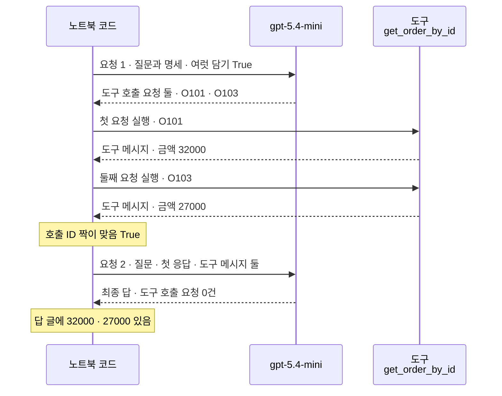
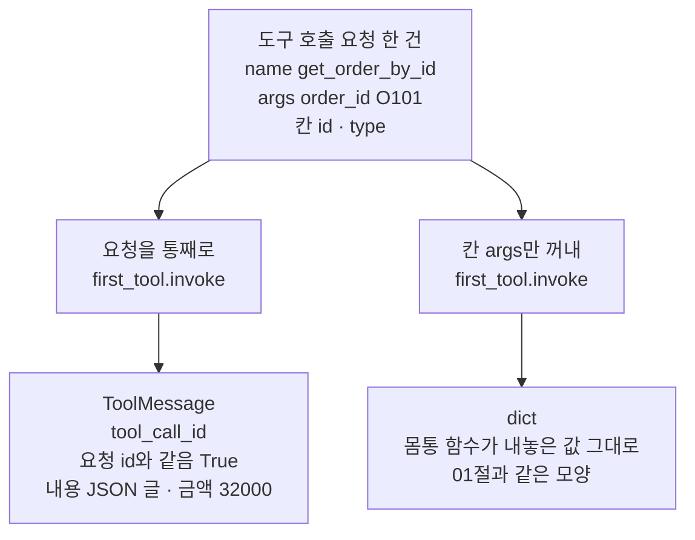
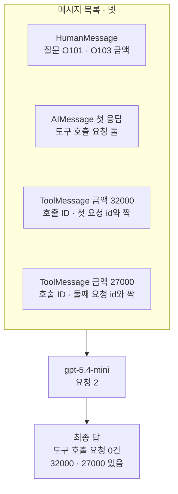
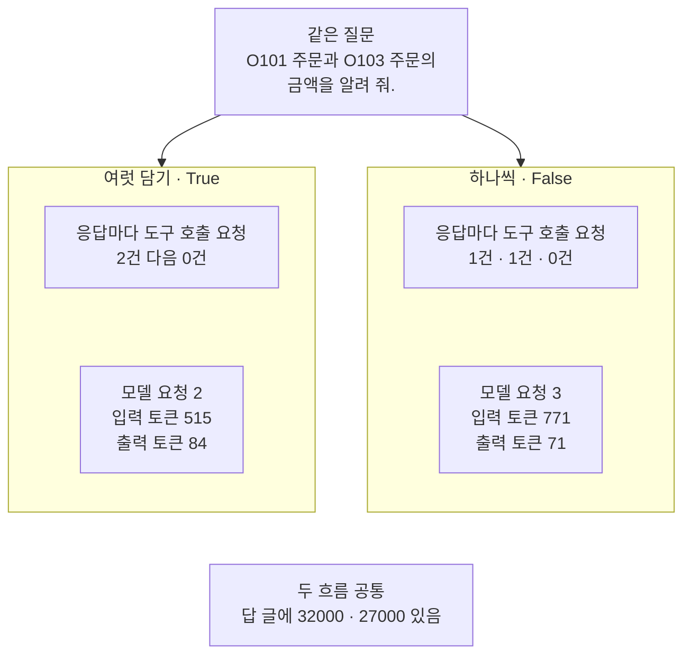

# 05-bind_tools와-병렬-호출

## _src 본문 (HTML 원본)

```html
<!--meta: 강의 1h | 실습 2h | 코드 notebooks/05-bind_tools와-병렬-호출.ipynb | 새 용어 5 -->
<style>html,body{overflow-x:hidden}.notebook,.nb-cell,.nb-main,.nb-input,.nb-result{min-width:0;max-width:100%}.nb-input pre,.nb-output{box-sizing:border-box;max-width:100%;overflow-x:auto}code.nb-source{display:block!important;width:100%!important;min-width:0!important;overflow-x:auto!important;padding:0!important}</style>
<h2 id="b1"><span class="no">1</span>학습 목표</h2><div class="goal"><ul>
<li>인자 <code>parallel_tool_calls</code>로 도구를 알려 주고, 한 응답에 온 도구 호출 요청 여럿을 읽을 수 있습니다.</li>
<li>도구 호출 요청을 차례로 실행해 도구 메시지를 만들고, 호출 ID로 요청과 짝을 맞출 수 있습니다.</li>
<li>도구 메시지를 보내 최종 답을 받고, 한 응답에 하나씩 받는 흐름과 요청 수를 견줄 수 있습니다.</li>
</ul></div>
<h2 id="b2"><span class="no">2</span>이 내용을 배우는 이유</h2><p>04절에서 모델은 도구 호출 요청을 적어 보냈지만, 도구는 아무도 실행하지 않았습니다. 요청만으로는 주문 금액을 알 수 없습니다. 프로그램이 요청을 받아 도구를 실행하고, 그 결과를 모델에게 다시 보내야 모델이 답을 적을 수 있습니다.</p><p>질문 하나가 결과를 여럿 필요로 할 때도 있습니다. 주문 둘의 금액을 물으면 도구를 두 번 불러야 합니다. 모델은 이런 요청 둘을 한 응답에 함께 적어 보낼 수 있습니다. 제목의 「병렬 호출」은 이렇게 한 응답 안에 도구 호출 요청이 여럿 오는 것을 뜻합니다.</p><p>요청이 여럿이면 결과도 여럿이라, 어느 결과가 어느 요청의 것인지 짝을 맞춰야 합니다. 이 절은 그 짝을 맞추는 호출 ID를 직접 확인합니다. Ch 20에서는 <code>ToolNode</code>가 이 실행을 맡습니다. 그 전에 프로그램이 하는 일을 이 절에서 손으로 해 봅니다.</p>
<h2 id="b3"><span class="no">3</span>앞에서 배운 내용</h2><p><a href="01-tool과-Ch4-함수-재사용.html">01절</a>에서는 메서드 <code>.invoke</code>에 인자 딕셔너리를 넣어 도구를 불렀습니다. 그 절은 도구를 부르는 일은 프로그램이 한다고 적었습니다. 이 절은 모델이 적어 보낸 요청으로 프로그램이 도구를 부릅니다.</p><p><a href="04-설명만으로-도구-선택하기.html">04절</a>에서는 메서드 <code>bind_tools</code>로 도구를 알려 주고, 도구 호출 목록(<code>tool_calls</code>)을 읽었습니다. 목록의 딕셔너리 한 건이 도구 호출 요청이고, 칸 <code>name</code>·<code>args</code>·<code>id</code>·<code>type</code>을 담습니다. 그 절은 인자 <code>parallel_tool_calls=False</code>로 요청을 하나까지만 받았고, 칸 <code>id</code>는 쓰지 않았습니다. 이 절은 값을 <code>True</code>로 두어 요청을 여럿 받고, 칸 <code>id</code>를 씁니다. 몸통 함수 <code>find_order</code>는 <a href="03-좋은-도구-이름과-설명.html">03절</a>, 함수 <code>tool_call_names</code>는 04절에서 도구 파일에 옮긴 것을 가져옵니다.</p><p><a href="../../part4/ch13-langgraph-basics/04-add_messages-리듀서.html">Ch 13 04절</a>에서는 질문을 <code>HumanMessage</code>로, 모델 답을 <code>AIMessage</code>로 담은 메시지 목록을 보았습니다. 이 절은 그 목록에 도구 메시지를 더해 모델에게 다시 보냅니다. <a href="../ch17-agent-overview/03-모델-도구-루프와-정지-조건.html">Ch 17 03절</a>의 루프에서는 모델이 다음 도구 이름을 JSON 글로 적었고, 바퀴 한도로 요청 수를 묶었습니다. 이 절의 값 바꿔 보기도 바퀴 한도를 둔 루프로 도구 호출 요청을 처리합니다.</p><p><a href="../ch18-workflow-patterns/03-병렬-섹셔닝과-투표.html">Ch 18 03절</a>의 함께 보내기는 모델 요청 여럿을 동시에 보내는 일이었습니다. 이 절에서 여럿인 것은 모델 응답 하나에 담긴 도구 호출 요청이고, 프로그램은 그 요청을 차례로 실행합니다. 두 일은 서로 다릅니다. <a href="../../part2/ch06-langchain-start/06-토큰-비용-지연-비교.html">Ch 6 06절</a>의 함수 <code>estimate_cost</code>로 두 흐름의 예상 비용도 견줍니다.</p>
<h2 id="b4"><span class="no">4</span>핵심 개념</h2><h3>비유로 시작하기</h3><p>01절부터 이어 온 식당을 다시 떠올립니다. 이번에는 손님이 전표 한 장에 같은 국수를 두 그릇 적습니다. 주방은 두 그릇을 차례로 만들고, 그릇마다 전표에 꽂힌 것과 같은 색 집게를 꽂습니다. 그리고 두 그릇을 창으로 함께 내보냅니다.</p><p>손님은 모델이고, 전표 한 장은 모델의 응답 하나입니다. 전표에 적은 주문 둘은 도구 호출 요청 둘이고, 주방은 도구를 실행하는 프로그램입니다. 창으로 나온 그릇은 도구 메시지입니다. 같은 요리라 그릇만 보고는 어느 주문의 것인지 알기 어려워, 같은 색 집게가 짝을 알려 줍니다. 이 집게가 호출 ID입니다.</p>
{{img:05-5-전표-하나와-집게-짝|흰 바탕 그림으로 연초록 벽에 나무 틀 창이 하나 있고, 창 안쪽 주방에 냄비 하나를 올린 가스레인지가 보이며, 창턱 위에 국수가 담긴 같은 모양의 흰 그릇 두 개가 나란히 놓여 있고, 왼쪽 그릇 가장자리에는 빨간 빨래집게, 오른쪽 그릇 가장자리에는 파란 빨래집게가 꽂혀 있으며, 창턱 앞 가장자리에 큰 종이 전표 한 장이 걸려 있고 전표 위쪽에 작은 빨간 집게와 작은 파란 집게가 나란히 꽂혀 있는 그림|전표 한 장에 꽂힌 집게 두 색이 창으로 나온 두 그릇의 집게 색과 하나씩 짝을 이룹니다.}}
<p class="look"><b>그림 읽기</b> — 연초록 벽의 나무 틀 창 안쪽으로 냄비 하나를 올린 가스레인지가 보입니다. 창턱에는 국수가 담긴 흰 그릇 두 개가 나란히 있고, 두 그릇은 모양이 같습니다. 왼쪽 그릇에는 빨간 집게, 오른쪽 그릇에는 파란 집게가 꽂혀 있습니다. 창턱 앞 가장자리에 걸린 전표 한 장에는 작은 빨간 집게와 파란 집게가 나란히 꽂혀 있습니다. 전표 한 장은 응답 하나, 같은 그릇 둘은 도구 메시지 둘, 같은 색 집게는 호출 ID입니다.</p>
<table><thead><tr><th>말</th><th>뜻</th></tr></thead><tbody><tr><td>도구 실행</td><td>프로그램이 도구 호출 요청을 받아 그 도구를 부르는 일입니다. 주방이 전표를 보고 요리를 만드는 일과 같습니다.</td></tr><tr><td>도구 메시지(ToolMessage)</td><td>도구 실행 결과를 모델에게 보낼 메시지로 담은 것입니다. 창으로 내보내는 그릇과 같습니다.</td></tr><tr><td>호출 ID(tool_call_id)</td><td>도구 메시지가 어느 도구 호출 요청의 결과인지 알리는 번호입니다. 요청의 칸 <code>id</code>를 그대로 옮겨 적습니다. 그릇과 전표에 꽂은 같은 색 집게와 같습니다.</td></tr><tr><td>여럿 담기(parallel_tool_calls)</td><td>한 응답에 도구 호출 요청을 여럿 담아도 되는지 정하는 인자입니다. 전표 한 장에 주문을 여럿 적어도 되는지와 같습니다.</td></tr><tr><td>도구 찾기 표</td><td>공개 이름을 키, 도구를 값으로 둔 딕셔너리입니다. 주방 벽에 붙은 요리 담당표와 같습니다.</td></tr></tbody></table>
<p>새 말을 이 절 코드에서 보면 이렇습니다. 도구 실행은 <code>first_tool.invoke(first_call)</code>처럼 요청을 통째로 도구에 넣는 한 줄입니다. 도구 메시지는 그 줄이 내놓은 <code>ToolMessage</code>이고, 호출 ID는 그 칸 <code>tool_call_id</code>입니다. 여럿 담기는 <code>model.bind_tools(tools, parallel_tool_calls=True)</code>의 인자입니다. 도구 찾기 표는 딕셔너리 <code>tools_by_name</code>입니다.</p>
{{mermaid:05-1-요청-둘을-실행하고-함께-보내기|세로선 셋이 있는 차례 그림으로 왼쪽부터 노트북 코드, gpt-5.4-mini, 도구 get_order_by_id입니다. 노트북 코드가 모델에 요청 1 질문과 명세 여럿 담기 True를 보내고, 모델이 도구 호출 요청 둘 O101 O103을 적어 보냅니다. 노트북 코드가 도구에 첫 요청 O101을 실행해 도구 메시지 금액 32000을 받고, 둘째 요청 O103을 실행해 도구 메시지 금액 27000을 받습니다. 노란 메모 호출 ID 짝이 맞음 True 뒤에 노트북 코드가 모델에 요청 2 질문 첫 응답 도구 메시지 둘을 보내고, 모델이 최종 답 도구 호출 요청 0건을 보내며, 마지막 노란 메모에 답 글에 32000 27000 있음이 적힌 그림|한 응답에 온 도구 호출 요청 둘을 노트북 코드가 차례로 실행하고, 도구 메시지 둘을 함께 보내 최종 답을 받았습니다.}}
<p class="look"><b>도식 읽기</b> — 위에서 아래로 읽고, 세로선은 왼쪽부터 노트북 코드, 모델, 도구입니다. 요청 1의 응답에 도구 호출 요청 둘이 함께 옵니다. 노트북 코드가 두 요청을 차례로 도구에 넣어 도구 메시지 둘을 받습니다. 요청 2에 도구 메시지 둘을 함께 싣자, 모델이 도구 호출 요청 없이 최종 답을 적습니다. 노란 메모는 노트북 4·5절 출력입니다.</p>
<h3>차례로 실행하고 함께 보내기</h3><p>모델이 한 응답에 요청 둘을 적어도, 이 절의 프로그램은 <code>for</code>로 하나씩 차례로 실행합니다. 두 도구 메시지는 둘째 모델 요청 하나에 함께 실어 보냅니다. 요청 둘을 한꺼번에 실행하는 방법은 이 절에서 다루지 않습니다. 걸린 시간도 이번에 재지 않았습니다.</p>
<h3>다른 상황에 적용</h3><p>도서관 도구라면 「이 책 둘의 반납일을 알려 줘」에 책 찾기 도구 요청이 두 건 올 수 있습니다. 프로그램은 두 요청을 실행하고, 도구 메시지마다 요청의 <code>id</code>를 적어 보냅니다. 같은 도구의 결과 둘이라도, 호출 ID로 어느 책의 결과인지 짝이 맞습니다.</p>
<h3>비교와 경계</h3><p>이 절의 결과는 한 모델과 한 날짜, 질문 하나에서 본 것입니다. 한 응답에 요청이 두 건 온 것은 모델이 그렇게 적었기 때문이고, 값 <code>True</code>는 여럿을 허용할 뿐입니다. 그러니 「<code>True</code>로 두면 늘 한 번에 온다」고 말할 수는 없습니다. 반대로 값 <code>False</code>는 한 응답에 도구 호출 요청을 하나까지만 담게 합니다.</p>
<h2 id="b5"><span class="no">5</span>실행 예제</h2><p>노트북은 먼저 도구 하나를 여럿 담기로 알려 주고, 주문 둘의 금액을 묻는 질문을 보냅니다. 첫 응답의 도구 호출 요청 두 건을 도구 찾기 표로 차례로 실행해, 도구 메시지 둘을 만듭니다. 요청의 <code>id</code>와 도구 메시지의 호출 ID가 짝이 맞는지 확인하고, 메시지 목록을 다시 보내 최종 답을 받습니다. 마지막으로 여럿 담기를 끄고 같은 질문을 처리해 두 흐름을 견줍니다.</p><p>모델은 <code>gpt-5.4-mini</code>이고, temperature 0과 추론 끔(<code>reasoning_effort="none"</code>)으로 부릅니다. 모델 요청은 모두 5번입니다.</p>
{{notebook:05-bind_tools와-병렬-호출}}
<p class="look"><b>확인할 점</b> — 노트북 3절 출력 <code>도구 호출 요청 수: 2</code>로 한 응답에 요청이 두 건 왔는지 봅니다. 노트북 4절 출력 <code>짝이 맞는가: True</code>로 도구 메시지마다 요청의 <code>id</code>가 옮겨졌는지 봅니다. 노트북 5절 출력 <code>도구 호출 요청 수: 0</code>과 두 금액 줄로 최종 답을 확인합니다.</p>
{{mermaid:05-2-요청을-통째로-넣으면-도구-메시지|위에서 아래로 읽는 그림으로 맨 위 노란 상자 도구 호출 요청 한 건 name get_order_by_id args order_id O101 칸 id type에서 두 갈래로 나뉩니다. 왼쪽은 파란 상자 요청을 통째로 first_tool.invoke를 거쳐 노란 상자 ToolMessage tool_call_id 요청 id와 같음 True 내용 JSON 글 금액 32000으로, 오른쪽은 파란 상자 칸 args만 꺼내 first_tool.invoke를 거쳐 노란 상자 dict 몸통 함수가 내놓은 값 그대로 01절과 같은 모양으로 가는 그림|같은 요청이라도 통째로 넣으면 도구 메시지가, 칸 args만 넣으면 01절처럼 딕셔너리가 나왔습니다.}}
<p class="look"><b>도식 읽기</b> — 위에서 아래로 읽습니다. 맨 위 노란 상자는 3절에서 받은 첫 도구 호출 요청입니다. 왼쪽 갈래는 요청을 통째로 넣은 4절 셀이고, 도구 메시지가 나왔습니다. 오른쪽 갈래는 칸 args만 넣은 다음 셀이고, 딕셔너리가 나왔습니다. 아래 노란 상자 둘은 두 셀의 출력입니다.</p>
{{mermaid:05-3-메시지-목록과-호출-ID|위에서 아래로 읽는 그림으로 맨 위 칸 메시지 목록 넷 안에 초록 상자 HumanMessage 질문 O101 O103 금액, 노란 상자 AIMessage 첫 응답 도구 호출 요청 둘, 노란 상자 ToolMessage 금액 32000 첫 요청 id와 짝, 노란 상자 ToolMessage 금액 27000 둘째 요청 id와 짝이 차례로 있고, 칸에서 보라 상자 gpt-5.4-mini 요청 2로 이어진 뒤 노란 상자 최종 답 도구 호출 요청 0건 32000 27000 있음으로 끝나는 그림|둘째 요청에는 질문, 첫 응답, 도구 메시지 둘을 차례로 실었고, 도구 메시지마다 요청 id가 호출 ID로 적혀 있었습니다.}}
<p class="look"><b>도식 읽기</b> — 위에서 아래로 읽습니다. 맨 위 칸은 5절에서 만든 메시지 목록이고, 네 상자가 목록의 차례입니다. 노란 도구 메시지 둘에는 각각 짝이 되는 요청 id가 호출 ID로 적혀 있습니다. 목록 전체가 보라 모델 요청 하나로 가고, 맨 아래 노란 상자는 5절 출력입니다.</p>
<h2 id="b6"><span class="no">6</span>실험 결과 해석</h2><p>실험에서 바꾼 것은 인자 <code>parallel_tool_calls</code> 하나입니다. 질문과 도구는 두 흐름이 같았고, 결과는 아래 표와 같았습니다.</p>
<table><thead><tr><th>항목</th><th>여럿 담기(<code>True</code>)</th><th>하나씩(<code>False</code>)</th></tr></thead><tbody><tr><td>응답마다 도구 호출 요청 수</td><td>2 → 0</td><td>1 → 1 → 0</td></tr><tr><td>모델 요청 수</td><td>2</td><td>3</td></tr><tr><td>입력 토큰 합</td><td>515</td><td>771</td></tr><tr><td>출력 토큰 합</td><td>84</td><td>71</td></tr><tr><td>예상 비용(달러)</td><td>0.000764</td><td>0.000898</td></tr><tr><td>답 글에 두 금액</td><td>있음</td><td>있음</td></tr></tbody></table>
{{mermaid:05-4-여럿-담기와-하나씩|위에 초록 상자 같은 질문 O101 주문과 O103 주문의 금액을 알려 줘가 있고 아래에 칸 둘이 나란히 있는 그림으로 왼쪽 칸 여럿 담기 True에는 노란 상자 응답마다 도구 호출 요청 2건 다음 0건과 노란 상자 모델 요청 2 입력 토큰 515 출력 토큰 84가 있고, 오른쪽 칸 하나씩 False에는 노란 상자 응답마다 도구 호출 요청 1건 1건 0건과 노란 상자 모델 요청 3 입력 토큰 771 출력 토큰 71이 있으며, 맨 아래 회색 상자에 두 흐름 공통 답 글에 32000 27000 있음이 적힌 그림|여럿 담기를 끄자 도구 호출 요청이 응답마다 한 건씩 나뉘어 와서, 모델 요청이 2번에서 3번으로 늘었습니다.}}
<p class="look"><b>도식 읽기</b> — 맨 위 초록 상자는 두 흐름에 똑같이 보낸 질문입니다. 왼쪽 칸이 여럿 담기, 오른쪽 칸이 하나씩이고, 노란 상자는 모두 5~7절의 출력입니다. 칸마다 아래 상자는 흐름 전체의 합이라, 위 상자와 화살표로 잇지 않았습니다. 맨 아래 회색 상자는 두 흐름 출력에서 모두 확인한 공통점입니다.</p>
<p>여럿 담기에서는 첫 응답에 두 주문의 요청이 함께 왔습니다. 프로그램이 두 요청을 차례로 실행하고 도구 메시지 둘을 한 요청에 실어 보내자, 모델이 최종 답을 적었습니다. 하나씩 흐름에서는 O101 요청과 O103 요청이 응답 두 번에 나뉘어 왔고, 셋째 응답이 최종 답이었습니다. 새 커널로 두 번 실행했을 때 두 흐름의 요청 수와 토큰 합은 두 번 모두 같았습니다.</p>
<p>하나씩 흐름은 요청이 하나 더 들어, 입력 토큰 합이 늘었습니다. 요청마다 질문과 그때까지의 메시지를 다시 싣기 때문입니다. 출력 토큰 합은 오히려 하나씩 흐름이 적었고, 이번 질문에서는 예상 비용이 여럿 담기 쪽이 작았습니다. 두 흐름 모두 답 글에는 두 금액이 들어 있었습니다.</p>
<h2 id="b7"><span class="no">7</span>주의할 점과 실무 메모</h2><ul><li>노트북을 실행하기 전에 노트북 밖에서 두 흐름을 다섯 번씩 보냈습니다. 도구 호출 요청 수와 인자, 답 글의 두 금액이 다섯 번 모두 같았습니다. 같은 요청도 실행한 때에 따라 모델이 보내는 요청 수가 달라질 수 있습니다.</li><li>질문 「O101 주문과 O103 주문의 금액을 알려 줘.」와 도구 하나는 흐름을 보여 주려고 이 절에서 정한 예입니다. 질문에는 도구를 몇 번 부르라는 말을 넣지 않았습니다.</li><li>도구 호출 요청 수와 답 글에는 <code>assert</code>를 걸지 않았습니다. 모델이 정하는 값이기 때문입니다. 셀의 <code>assert</code>는 호출 ID 목록이 요청의 <code>id</code> 목록과 같은지에만 걸었습니다.</li><li>칸 <code>id</code>의 값은 요청마다 새로 붙어 실행마다 다릅니다. 그래서 본문에 옮겨 적지 않았습니다.</li><li>답 글은 모델이 적은 문장이라 실행마다 달라질 수 있습니다. 결론에는 코드로 센 표지, 곧 쉼표를 뺀 답 글에 두 금액이 있는지만 썼습니다.</li><li>프로그램은 두 요청을 <code>for</code>로 차례로 실행했습니다. 걸린 시간은 재지 않았고, 요청을 한꺼번에 실행하는 방법도 다루지 않았습니다.</li><li>인자 <code>parallel_tool_calls</code>를 아예 빼면 요청에 그 값이 실리지 않습니다. 설치한 langchain-openai 1.6.0 소스와 보내지 않은 요청 본문으로 확인했습니다.</li><li>도구 메시지의 내용은 도구가 내놓은 딕셔너리를 JSON 글로 바꾼 것입니다. 설치한 langchain-core 1.6.2 소스에서 확인했습니다.</li><li>값 바꿔 보기의 반복 함수 <code>ask_until_answer</code>는 넘겨받은 메시지 목록에 응답과 도구 메시지를 바로 이어 붙입니다. 넘긴 목록 자체가 늘어나므로, 부를 때마다 새 목록을 만들어 넘깁니다. 06절 Before는 함수가 오류로 멈춘 뒤에도 이 목록에 남은 응답을 봅니다.</li><li>도구가 오류를 낼 때는 이 절에서 보지 않았습니다. 도구 오류는 06절에서 다룹니다.</li><li>예상 비용은 2026-09-17 요금표로 어림한 값이고 청구 금액이 아닙니다. 합친 사용량으로 셌고, 노트북 밖 확인에서 캐시 입력은 모두 0이었습니다.</li><li>교재 출력은 Linux의 Python 3.12.13으로 만들었습니다. 다른 판과 Windows·macOS에서는 이번에 실행하지 않았습니다.</li></ul>
<h2 id="b8"><span class="no">8</span>정리와 다음 절</h2><ul><li>한 응답에 도구 호출 요청이 두 건 왔고, 프로그램이 두 요청을 차례로 실행했습니다.</li><li>도구 메시지마다 요청의 <code>id</code>가 호출 ID로 옮겨져, 요청과 결과의 짝이 맞았습니다.</li><li>하나씩만 담게 하자 모델 요청이 2번에서 3번으로 늘었고, 두 흐름의 답 글에는 두 금액이 모두 있었습니다.</li></ul><p><strong>다음 학습과 이어지는 지점</strong> — 06절에서는 도구 오류를 모델에게 알리는 방법과, 읽기·쓰기 도구 나누기를 봅니다.</p>
<h2 id="b9"><span class="no">9</span>복습 문제</h2><details class="quiz" open><summary>문제 4개 · 해설 포함</summary><p class="quiz-q">1. 모델이 도구 호출 요청을 보낸 뒤, 도구는 누가 실행하나요?</p><p class="quiz-a">프로그램이 실행합니다. 모델은 도구 이름과 인자를 적어 보낼 뿐이고, 이 절에서는 함수 <code>run_tool_calls</code>가 요청을 도구에 넣었습니다. 틀렸다면 노트북 4절을 다시 읽습니다.</p><p class="quiz-q">2. 같은 도구를 두 번 부른 결과 둘을 어떻게 요청과 짝지었나요?</p><p class="quiz-a">도구 메시지마다 요청의 <code>id</code>를 호출 ID(<code>tool_call_id</code>)로 옮겨 적었습니다. 도구 이름이 같아도 호출 ID로 짝이 맞습니다. 틀렸다면 본문 4 「핵심 개념」의 용어 표와 노트북 4절을 다시 읽습니다.</p><p class="quiz-q">3. 여럿 담기를 끄자 무엇이 달라졌나요?</p><p class="quiz-a">응답마다 도구 호출 요청이 한 건씩 와서 모델 요청이 2번에서 3번으로 늘었습니다. 두 흐름 모두 답 글에는 두 금액이 있었습니다. 틀렸다면 노트북 6·7절을 다시 읽습니다.</p><p class="quiz-q">4. Ch 18 03절의 함께 보내기와 이 절의 한 응답 안 요청 여럿은 무엇이 다른가요?</p><p class="quiz-a">함께 보내기는 모델 요청 여럿을 동시에 보냈습니다. 이 절은 모델 응답 하나에 도구 호출 요청이 여럿 담겼고, 프로그램이 그 요청을 차례로 실행했습니다. 틀렸다면 본문 3 「앞에서 배운 내용」을 다시 읽습니다.</p></details>
<h2 id="b10"><span class="no">10</span>참고 자료</h2><ul><li><div><a href="https://docs.langchain.com/oss/python/langchain/models">LangChain Models · Tool calling</a></div>확인 2026-09-24 · 모델이 요청한 도구를 실행해 결과를 모델에게 보내야 한다고 적습니다. 도구 메시지의 <code>tool_call_id</code>가 원래 도구 호출과 짝이 맞는다고도 적습니다. 여러 도구를 한 번에 부르는 기능은 <code>parallel_tool_calls=False</code>로 끌 수 있다고 적습니다.</li><li><div><a href="https://developers.openai.com/api/docs/guides/function-calling">OpenAI Function calling</a></div>확인 2026-09-24 · 모델 응답에 함수 호출이 없거나, 하나이거나, 여럿일 수 있다고 적습니다. 모델이 함수를 부르면 실행해 결과를 보내는 일은 사용자 몫이라고 적습니다.</li><li>langchain-openai 1.6.0 소스 <code>chat_models/base.py</code> — 메서드 <code>bind_tools</code>는 값이 있을 때만 <code>parallel_tool_calls</code>를 싣습니다(2427~2428행).</li><li>langchain-core 1.6.2 소스 <code>tools/base.py</code> — 칸 <code>type</code>이 <code>tool_call</code>이면 칸 <code>id</code>를 꺼냅니다(함수 <code>_prep_run_args</code>의 1369~1371행).</li><li>langchain-core 1.6.2 소스 <code>tools/base.py</code> — 결과를 <code>ToolMessage</code>에 JSON 글로 담습니다(1390·1471행).</li><li>01절 — 도구와 <code>.invoke</code>.</li><li>04절 — <code>bind_tools</code>와 도구 호출 요청.</li><li>Ch 13 04절 — 메시지 목록과 <code>HumanMessage</code>.</li><li>Ch 17 03절 — 루프와 바퀴 한도.</li><li>Ch 18 03절 — 함께 보내기.</li></ul>
```

## 노트북 셀 (순서대로)

### [0] markdown {'html': 'skip'}

# bind_tools와 병렬 호출

**이 노트북에서 할 일**

1. 주문 둘을 묻는 질문에, 모델이 한 응답에 도구 호출 요청을 몇 건 보내는지 봅니다.
2. 도구 호출 요청을 프로그램이 차례로 실행해 도구 메시지를 만들고, 호출 ID로 짝을 맞춥니다.
3. 도구 메시지를 모델에게 보내 최종 답을 받고, 두 금액이 들어 있는지 셉니다.
4. 한 응답에 하나씩만 담게 바꿔, 모델 요청 수와 토큰을 견줍니다.

**준비물** — 프로젝트 폴더의 `.env` 파일에 `OPENAI_API_KEY`가 있어야 합니다.
모델은 `gpt-5.4-mini`이고, 모델 요청은 모두 5번입니다.
3절과 5절에서 1번씩, 6절에서 3번을 보냅니다.
요금표로 센 예상 비용은 모두 합쳐 0.01달러 아래이고, 청구 금액이 아닙니다.

도구는 주문 한 건을 찾는 도구 하나이고, 실습 폴더의 주문 CSV를 읽기만 합니다.
새로 쓰는 파일은 없습니다.
03·04절 함수와 Ch 6 06절 함수는 도구 파일 `order_tools.py`에서 가져옵니다.
교재 출력을 만든 실행에서는 노트북 전체가 10초 안에 끝났습니다.
모델 응답을 기다리는 시간은 네트워크와 실행 때에 따라 달라집니다.

**기준 버전** — 첫 셀에서 패키지 다섯을 설치합니다.
판은 langchain 1.4.0, langchain-core 1.6.2, langchain-openai 1.6.0입니다.
pandas 3.0.5와 python-dotenv 1.2.3도 함께 설치합니다.
교재 출력은 Linux의 Python 3.12.13으로 만들었습니다.
다른 판과 Windows·macOS에서는 이번에 실행하지 않았습니다.

**강의와 실습 범위** — 강의 시간에는 2~5절을 읽습니다.
도구 호출 요청 둘을 실행하고, 도구 메시지를 보내 최종 답을 받는 자리입니다.
6~7절은 여럿 담기를 끄고 두 흐름의 요청 수와 예상 비용을 견주는 자리입니다.
이 부분은 실습 시간에 실행합니다.

실습 폴더 `labs/part5/ch19-model-tools`에서 `uv sync --locked`를 실행합니다.
그다음 `notebooks/` 폴더의 이 노트북을 열고, 실습 폴더의 `.venv` 커널을 고릅니다.
첫 셀부터 순서대로 실행합니다.

### [1] markdown {'html': 'skip'}

## 오늘 볼 그림


위에서 아래로 읽고, 세로선은 왼쪽부터 노트북 코드, 모델, 도구입니다.
요청 1의 응답에 도구 호출 요청 둘이 함께 옵니다.
노트북 코드가 두 요청을 차례로 도구에 넣어 도구 메시지 둘을 받습니다.
요청 2에 도구 메시지 둘을 함께 싣자, 모델이 도구 호출 요청 없이 최종 답을 적습니다.
노란 메모는 노트북 4·5절 출력입니다.

### [2] markdown {}

## 1. 준비

04절은 모델이 적어 보낸 도구 호출 요청을 읽기만 하고, 도구는 실행하지 않았습니다.
이 절은 그 요청을 프로그램이 받아 도구를 실행하고, 결과를 모델에게 다시 보냅니다.
제목의 「병렬 호출」은 한 응답 안에 도구 호출 요청이 여럿 오는 것을 뜻합니다.

첫 셀은 패키지 다섯 개를 설치하고 설치된 판 번호를 출력합니다.
설치에는 몇십 초가 걸릴 수 있습니다.

### [3] code {'execution': {'iopub.execute_input': '2026-09-24T02:47:54.732484Z', 'iopub.status.busy': '2026-09-24T02:47:54.732304Z', 'iopub.status.idle': '2026-09-24T02:47:55.380757Z', 'shell.execute_reply': '2026-09-24T02:47:55.380196Z'}, 'lesson_role': 'setup'}

```python
# 이 절에서 쓰는 패키지를 설치하고 버전을 확인합니다
%pip install -q "langchain==1.4.0" "langchain-core==1.6.2" "langchain-openai==1.6.0" "pandas==3.0.5" "python-dotenv==1.2.3"
from importlib.metadata import version

print("langchain:", version("langchain"))
print("langchain-core:", version("langchain-core"))
print("langchain-openai:", version("langchain-openai"))
print("pandas:", version("pandas"))
print("python-dotenv:", version("python-dotenv"))
```

출력:
```
Note: you may need to restart the kernel to use updated packages.
langchain: 1.4.0
langchain-core: 1.6.2
langchain-openai: 1.6.0
pandas: 3.0.5
python-dotenv: 1.2.3

```

### [4] markdown {}

**결과 읽기** — 출력 줄 `langchain: 1.4.0`·`langchain-core: 1.6.2`·`langchain-openai: 1.6.0`이 보입니다.
출력 줄 `pandas: 3.0.5`와 `python-dotenv: 1.2.3`도 잠금과 같은 판입니다.
이 노트북의 출력은 2026-09-24에 이 판으로 실행한 결과입니다.

앞에서 배운 함수는 `order_tools.py`에 모아 두었습니다. 파일을 열면 코드를 볼 수 있습니다. 노트북과 같은 폴더(`notebooks/`)에 있는 파일입니다. 커널이 `notebooks/` 폴더에서 시작해야 이 파일을 가져올 수 있습니다.

다음 셀은 이 절에서 쓸 이름을 가져옵니다.
메시지 클래스 `HumanMessage`는 Ch 13 04절에서 질문 메시지를 만들 때 썼습니다.
도구 파일에서는 03절 몸통 함수 `find_order`와 04절 함수 `tool_call_names`를 가져옵니다.
Ch 6 06절 함수 `estimate_cost`는 04절에서 도구 파일에 옮긴 판입니다.

### [5] code {'execution': {'iopub.execute_input': '2026-09-24T02:47:55.381852Z', 'iopub.status.busy': '2026-09-24T02:47:55.381763Z', 'iopub.status.idle': '2026-09-24T02:47:56.124570Z', 'shell.execute_reply': '2026-09-24T02:47:56.124130Z'}, 'lesson_role': 'setup'}

```python
# 모델·도구·메시지를 만드는 이름과 도구 파일의 함수 셋을 가져옵니다
import json
import os

from langchain.chat_models import init_chat_model
from langchain.tools import tool
from langchain_core.messages import HumanMessage

from order_tools import estimate_cost, find_order, tool_call_names

print("가져온 이름:", "json", "os", "init_chat_model", "tool", "HumanMessage")
```

출력:
```
가져온 이름: json os init_chat_model tool HumanMessage

```

### [6] markdown {}

**결과 읽기** — 출력 줄에 가져온 이름 다섯이 보입니다.
도구 파일에서 가져온 함수 셋은 셀의 `from order_tools import …` 줄에 적혀 있습니다.
모듈 `json`은 Ch 17 03절처럼 JSON 글을 딕셔너리로 바꿀 때 씁니다.

다음 셀은 01~04절과 같은 방법으로 주문 CSV가 있는 프로젝트 맨 위 폴더를 찾습니다.
이 절은 도구를 실행하므로, 도구 몸통이 이 CSV 파일을 읽습니다.

### [7] code {'execution': {'iopub.execute_input': '2026-09-24T02:47:56.125316Z', 'iopub.status.busy': '2026-09-24T02:47:56.125217Z', 'iopub.status.idle': '2026-09-24T02:47:56.127457Z', 'shell.execute_reply': '2026-09-24T02:47:56.127177Z'}, 'lesson_role': 'setup'}

```python
# 노트북을 어느 폴더에서 열어도 주문 CSV를 찾게 후보 세 곳을 차례로 봅니다
candidates = [".", "../../..", "../../../.."]
root_path = None
for candidate in candidates:
    if os.path.exists(candidate + "/labs/part5/ch19-model-tools/data/orders.csv"):
        root_path = candidate
        break
print("찾은 프로젝트 맨 위:", root_path)
assert root_path is not None, "notebooks 폴더나 실습 폴더 맨 위에서 노트북을 열어 주세요."
# CSV 파일 위치는 노트북이 정해 두는 값입니다(모델이 고를 값이 아님)
csv_path = root_path + "/labs/part5/ch19-model-tools/data/orders.csv"
```

출력:
```
찾은 프로젝트 맨 위: .

```

### [8] markdown {}

**결과 읽기** — 출력 줄 `찾은 프로젝트 맨 위: .`은 교재 출력을 프로젝트 맨 위에서 실행했다는 뜻입니다.
교재 출력은 실행 도구에 도구 파일 폴더를 따로 알려 준 실행이라 `.`이 찍혔습니다.
노트북을 `notebooks/` 폴더에서 열면 이 줄에 `../../../..`가 찍힙니다.
셀 안의 안내 글은 실습 폴더 맨 위도 적었지만, 도구 파일을 가져오려면 `notebooks/` 폴더에서 열어야 합니다.

## 2. 키와 모델 준비

모델은 04절과 같은 `gpt-5.4-mini`이고, 과정의 같은 설정으로 부릅니다.

### [9] markdown {}

API 키가 있는지 확인합니다. `True` 값이 나오면 다음으로 넘어갑니다.

### [10] code {'execution': {'iopub.execute_input': '2026-09-24T02:47:56.128025Z', 'iopub.status.busy': '2026-09-24T02:47:56.127977Z', 'iopub.status.idle': '2026-09-24T02:47:56.133375Z', 'shell.execute_reply': '2026-09-24T02:47:56.133089Z'}, 'lesson_role': 'setup'}

```python
# .env 파일에서 OpenAI API 키를 읽습니다(키 값은 출력하지 않습니다)
import os
from dotenv import find_dotenv, load_dotenv

env_path = find_dotenv(usecwd=True)
load_dotenv(env_path)
has_key = os.getenv("OPENAI_API_KEY") is not None
print("OPENAI_API_KEY 설정 여부:", has_key)
assert has_key, "프로젝트 폴더의 .env 파일에 OPENAI_API_KEY를 적어 주세요."
```

출력:
```
OPENAI_API_KEY 설정 여부: True

```

### [11] markdown {}

실습에 쓸 모델을 준비합니다.
temperature 값을 0으로 두어도, 모델이 보내는 도구 호출 요청이 매번 같다고 보장하지는 않습니다.

### [12] code {'execution': {'iopub.execute_input': '2026-09-24T02:47:56.133986Z', 'iopub.status.busy': '2026-09-24T02:47:56.133935Z', 'iopub.status.idle': '2026-09-24T02:47:57.139857Z', 'shell.execute_reply': '2026-09-24T02:47:57.139557Z'}}

```python
# 실습에 쓸 모델을 준비합니다
model = init_chat_model(
    "openai:gpt-5.4-mini",
    temperature=0,
    reasoning_effort="none",
)
print("모델 이름:", model.model_name)
print("temperature:", model.temperature)
```

출력:
```
모델 이름: gpt-5.4-mini
temperature: 0.0

```

### [13] markdown {}

**결과 읽기** — 모델 이름 `gpt-5.4-mini`, temperature `0.0`이 보이면 준비가 끝났습니다.
이 노트북의 출력은 2026-09-24에 이 모델로 실행한 결과입니다.

### [14] markdown {}

## 3. 도구를 알려 주고 질문 하나 보내기

이 절에서 쓰는 도구는 주문 한 건을 찾는 도구 하나입니다.
04절은 설명의 몫만 보려고 공개 이름을 가렸지만, 이 절은 가릴 까닭이 없습니다.
그래서 03절 이름 `get_order_by_id`와 03절 자세한 판 설명을 그대로 씁니다.

다음 셀은 03절 자세한 판 한 건 도구와 같은 정의로 도구를 만듭니다.
몸통은 도구 파일에서 가져온 03절 몸통 함수 `find_order`를 부르는 한 줄입니다.

### [15] code {'execution': {'iopub.execute_input': '2026-09-24T02:47:57.140683Z', 'iopub.status.busy': '2026-09-24T02:47:57.140623Z', 'iopub.status.idle': '2026-09-24T02:47:57.143425Z', 'shell.execute_reply': '2026-09-24T02:47:57.143011Z'}}

```python
# 03절 이름과 자세한 판 설명으로 주문 한 건 도구를 만듭니다
@tool
def get_order_by_id(order_id: str):
    """주문 번호로 주문 한 건을 찾습니다. 질문에 O103 같은 주문 번호가 있을 때 씁니다. 인자 order_id는 찾을 주문 번호입니다. 그 주문 한 줄을 딕셔너리로 내놓고, 없으면 None을 내놓습니다."""
    return find_order(csv_path, order_id)
```

출력:
```

```

### [16] markdown {}

**결과 읽기** — 정의 셀이라 출력이 없습니다.
독스트링은 03절 자세한 판 설명 네 문장과 같은 글입니다.
둘째 문장은 질문에 주문 번호가 있을 때 이 도구를 쓴다고 적습니다.

다음 셀은 이 도구 하나를 목록에 담아, 메서드 `bind_tools`로 모델에게 알려 줍니다.
04절은 인자 `parallel_tool_calls=False`로 한 응답에 도구 호출 요청을 하나까지만 받았습니다.
이번에는 값을 `True`로 두어, 한 응답에 여럿을 담아도 되게 합니다.
이 절에서는 이 인자를 여럿 담기라고 부릅니다.

### [17] code {'execution': {'iopub.execute_input': '2026-09-24T02:47:57.144046Z', 'iopub.status.busy': '2026-09-24T02:47:57.143998Z', 'iopub.status.idle': '2026-09-24T02:47:57.146639Z', 'shell.execute_reply': '2026-09-24T02:47:57.146252Z'}}

```python
# 도구 하나를 목록에 담아 모델에게 알려 주고, 요청에 실을 값을 봅니다(요청은 아직 없음)
tools = [get_order_by_id]
# 인자 parallel_tool_calls=True는 한 응답에 도구 호출 요청을 여럿 담아도 되게 합니다
parallel_model = model.bind_tools(tools, parallel_tool_calls=True)
print("실어 보낼 명세 수:", len(parallel_model.kwargs["tools"]))
print("여럿 담기:", parallel_model.kwargs["parallel_tool_calls"])
```

출력:
```
실어 보낼 명세 수: 1
여럿 담기: True

```

### [18] markdown {}

**결과 읽기** — 출력 줄 `실어 보낼 명세 수: 1`은 도구 하나의 명세가 실린다는 뜻입니다.
출력 줄 `여럿 담기: True`처럼, 인자 값도 요청마다 함께 실립니다.
인자를 아예 빼면 요청에 이 값이 실리지 않고, OpenAI 기본값에 맡깁니다.
이것은 노트북 밖에서 보내지 않은 요청 본문으로만 확인했습니다.

다음 셀은 주문 둘의 금액을 묻는 질문을 보냅니다.
질문은 Ch 13 04절처럼 `HumanMessage`로 감싸 메시지 목록 `messages`에 담습니다.
질문에는 도구를 몇 번 부르라는 말을 넣지 않았습니다.
실행 전에 예상해 봅니다.
주문이 둘이니, 한 응답에 도구 호출 요청이 두 건 올 것입니다.

### [19] code {'execution': {'iopub.execute_input': '2026-09-24T02:47:57.147210Z', 'iopub.status.busy': '2026-09-24T02:47:57.147153Z', 'iopub.status.idle': '2026-09-24T02:47:58.819250Z', 'shell.execute_reply': '2026-09-24T02:47:58.818390Z'}}

```python
# 주문 둘의 금액을 묻는 질문을 메시지 목록에 담아 보냅니다(모델 요청 1번)
question = "O101 주문과 O103 주문의 금액을 알려 줘."
messages = [HumanMessage(content=question)]
response = parallel_model.invoke(messages)
print("응답 글의 길이:", len(response.content))
print("도구 호출 요청 수:", len(response.tool_calls))
print("도구 이름:", tool_call_names(response))
```

출력:
```
응답 글의 길이: 0
도구 호출 요청 수: 2
도구 이름: ['get_order_by_id', 'get_order_by_id']

```

### [20] markdown {}

**결과 읽기** — 출력 줄 `응답 글의 길이: 0`은 모델이 글로 답하지 않았다는 뜻입니다.
출력 줄 `도구 호출 요청 수: 2`처럼, 한 응답에 도구 호출 요청이 두 건 왔습니다.
출력 줄 `도구 이름: ['get_order_by_id', 'get_order_by_id']`로 두 건 모두 같은 도구입니다.
이것이 제목에서 말한, 한 응답 안의 도구 호출 요청 여럿입니다.

Ch 18 03절의 함께 보내기는 모델 요청 여럿을 동시에 보내는 일이었습니다.
이 절에서 여럿인 것은 응답 하나에 담긴 도구 호출 요청이고, 모델 요청은 한 번입니다.

다음 셀은 도구 호출 요청마다 인자와 칸 `id`를 봅니다.

### [21] code {'execution': {'iopub.execute_input': '2026-09-24T02:47:58.820727Z', 'iopub.status.busy': '2026-09-24T02:47:58.820620Z', 'iopub.status.idle': '2026-09-24T02:47:58.823181Z', 'shell.execute_reply': '2026-09-24T02:47:58.822672Z'}}

```python
# 도구 호출 요청마다 인자와 칸 id를 봅니다(id는 요청 한 건마다 붙는 번호입니다)
for call in response.tool_calls:
    print("인자:", call["args"], "| id:", call["id"])
```

출력:
```
인자: {'order_id': 'O101'} | id: call_JkzAFO2EYycUw3MHzODDrlUH
인자: {'order_id': 'O103'} | id: call_i6SAi5xF9LSTX4EuV5I2sU2E

```

### [22] markdown {}

**결과 읽기** — 첫 줄 인자는 `{'order_id': 'O101'}`, 둘째 줄 인자는 `{'order_id': 'O103'}`입니다.
칸 `id`는 요청 한 건마다 붙는 번호이고, 두 줄의 값이 서로 다릅니다.
값은 요청을 보낼 때마다 새로 붙어 실행마다 달라지므로, 여기에 옮겨 적지 않습니다.
같은 도구를 두 번 부르니, 도구 이름만으로는 두 요청을 가를 수 없습니다.
두 요청을 가르는 표시는 이 칸 `id`입니다.

## 4. 도구 실행과 도구 메시지

모델은 도구를 실행하지 않고, 도구 호출 요청을 적어 보낼 뿐입니다.
요청을 받아 그 도구를 부르는 일은 프로그램이 하고, 이를 도구 실행이라고 부릅니다.
식당으로 치면 주방이 전표를 보고 요리를 만드는 일입니다.

프로그램은 요청의 칸 `name`에 적힌 공개 이름으로 도구를 찾아야 합니다.
다음 셀은 공개 이름을 키, 도구를 값으로 둔 딕셔너리를 만듭니다.
이 딕셔너리를 도구 찾기 표라고 부르고, 주방 벽에 붙은 요리 담당표와 같습니다.

### [23] code {'execution': {'iopub.execute_input': '2026-09-24T02:47:58.824374Z', 'iopub.status.busy': '2026-09-24T02:47:58.824275Z', 'iopub.status.idle': '2026-09-24T02:47:58.826963Z', 'shell.execute_reply': '2026-09-24T02:47:58.826374Z'}}

```python
# 공개 이름을 키, 도구를 값으로 둔 도구 찾기 표를 만듭니다
tools_by_name = {}
for one_tool in tools:
    tools_by_name[one_tool.name] = one_tool
table_keys = list(tools_by_name.keys())
print("표의 키:", table_keys)
```

출력:
```
표의 키: ['get_order_by_id']

```

### [24] markdown {}

**결과 읽기** — 출력 줄 `표의 키: ['get_order_by_id']`처럼 키는 공개 이름 하나입니다.
이 절의 도구는 하나지만, 도구가 여럿이어도 같은 방법으로 찾습니다.

다음 셀은 첫 도구 호출 요청 한 건을 도구에 통째로 넣어 실행합니다.
01절에서는 메서드 `.invoke`에 인자 딕셔너리를 넣었습니다.
이번에는 칸 `name`·`args`·`id`·`type`을 모두 담은 요청 딕셔너리를 넣습니다.

### [25] code {'execution': {'iopub.execute_input': '2026-09-24T02:47:58.828027Z', 'iopub.status.busy': '2026-09-24T02:47:58.827916Z', 'iopub.status.idle': '2026-09-24T02:47:58.840675Z', 'shell.execute_reply': '2026-09-24T02:47:58.840211Z'}}

```python
# 첫 도구 호출 요청 한 건을 도구에 통째로 넣어 실행합니다(모델 요청 없음)
first_call = response.tool_calls[0]
first_tool = tools_by_name[first_call["name"]]
first_message = first_tool.invoke(first_call)
print("내놓은 값의 종류:", type(first_message).__name__)
print("tool_call_id가 요청 id와 같은가:", first_message.tool_call_id == first_call["id"])
print("내용:", first_message.content)
```

출력:
```
내놓은 값의 종류: ToolMessage
tool_call_id가 요청 id와 같은가: True
내용: {"order_id": "O101", "customer_id": "C001", "status": "paid", "amount": 32000}

```

### [26] markdown {}

**결과 읽기** — 출력 줄 `내놓은 값의 종류: ToolMessage`처럼, 도구가 도구 메시지를 내놓았습니다.
도구 메시지(ToolMessage)는 도구 실행 결과를 모델에게 보낼 메시지로 담은 것입니다.
식당으로 치면 창으로 내보내는 접시입니다.
출력 줄 `tool_call_id가 요청 id와 같은가: True`는 요청의 `id`가 그대로 옮겨졌다는 뜻입니다.

도구 메시지의 칸 `tool_call_id`를 이 절에서는 호출 ID라고 부릅니다.
어느 도구 호출 요청의 결과인지 알리는 번호이고, 접시와 전표에 꽂은 같은 색 집게와 같습니다.
라벨 `내용:` 뒤 글은 주문 O101 한 줄이고, 도구가 내놓은 딕셔너리가 JSON 글로 바뀐 것입니다.

다음 셀은 같은 요청에서 칸 `args`만 꺼내 도구에 넣어 봅니다.
01절처럼 인자 딕셔너리만 넣는 모양입니다.

### [27] code {'execution': {'iopub.execute_input': '2026-09-24T02:47:58.841602Z', 'iopub.status.busy': '2026-09-24T02:47:58.841513Z', 'iopub.status.idle': '2026-09-24T02:47:58.845624Z', 'shell.execute_reply': '2026-09-24T02:47:58.845209Z'}}

```python
# 같은 요청에서 칸 args만 꺼내 넣으면, 01절처럼 인자 딕셔너리만 넣은 모양이 됩니다
plain_value = first_tool.invoke(first_call["args"])
print("내놓은 값의 종류:", type(plain_value).__name__)
print("내놓은 값:", plain_value)
```

출력:
```
내놓은 값의 종류: dict
내놓은 값: {'order_id': 'O101', 'customer_id': 'C001', 'status': 'paid', 'amount': 32000}

```

### [28] markdown {}

**결과 읽기** — 출력 줄 `내놓은 값의 종류: dict`처럼, 이번에는 딕셔너리가 나왔습니다.
라벨 `내놓은 값:` 뒤 딕셔너리는 01절처럼 몸통 함수가 내놓은 값 그대로입니다.
요청을 통째로 넣어야 칸 `id`가 도구에 전해지고, 도구 메시지가 만들어집니다.
설치한 langchain-core 1.6.2 소스도 칸 `type`이 `tool_call`인 딕셔너리만 이렇게 다룹니다.

다음 셀은 응답에 담긴 도구 호출 요청을 받은 차례대로 모두 실행하는 함수입니다.
요청마다 도구 찾기 표에서 도구를 찾고, 요청을 통째로 넣어 도구 메시지를 모읍니다.

### [29] code {'execution': {'iopub.execute_input': '2026-09-24T02:47:58.846538Z', 'iopub.status.busy': '2026-09-24T02:47:58.846470Z', 'iopub.status.idle': '2026-09-24T02:47:58.848796Z', 'shell.execute_reply': '2026-09-24T02:47:58.848365Z'}}

```python
# 응답의 도구 호출 요청을 받은 차례대로 하나씩 실행해, 도구 메시지 목록을 내놓습니다
def run_tool_calls(response, tools_by_name):
    tool_messages = []
    for call in response.tool_calls:
        # 공개 이름으로 도구를 찾고, 요청을 통째로 넣어 도구 메시지를 받습니다
        one_tool = tools_by_name[call["name"]]
        tool_messages.append(one_tool.invoke(call))
    return tool_messages
```

출력:
```

```

### [30] markdown {}

**결과 읽기** — 정의 셀이라 출력이 없습니다.
함수 `run_tool_calls`는 도구 메시지 목록을 내놓습니다.
요청을 `for`로 하나씩 실행하므로, 두 요청은 차례로 실행됩니다.

다음 셀은 첫 응답의 도구 호출 요청 두 건을 이 함수로 실행합니다.
모델 요청은 없고, 도구가 주문 CSV를 읽습니다.

### [31] code {'execution': {'iopub.execute_input': '2026-09-24T02:47:58.849664Z', 'iopub.status.busy': '2026-09-24T02:47:58.849587Z', 'iopub.status.idle': '2026-09-24T02:47:58.854345Z', 'shell.execute_reply': '2026-09-24T02:47:58.854013Z'}}

```python
# 첫 응답의 도구 호출 요청을 모두 실행합니다(모델 요청 없음, 도구가 주문 CSV를 읽음)
tool_messages = run_tool_calls(response, tools_by_name)
print("도구 메시지 수:", len(tool_messages))
for message in tool_messages:
    print("내용:", message.content)
```

출력:
```
도구 메시지 수: 2
내용: {"order_id": "O101", "customer_id": "C001", "status": "paid", "amount": 32000}
내용: {"order_id": "O103", "customer_id": "C001", "status": "paid", "amount": 27000}

```

### [32] markdown {}

**결과 읽기** — 출력 줄 `도구 메시지 수: 2`로, 요청 두 건마다 도구 메시지가 하나씩 생겼습니다.
라벨 `내용:` 뒤 두 줄은 주문 O101과 O103의 한 줄입니다.
금액은 첫 줄이 `32000`, 둘째 줄이 `27000`입니다.

다음 셀은 요청의 `id` 목록과 도구 메시지의 호출 ID 목록을 같은 차례로 견줍니다.
이 목록은 코드가 옮겨 적은 값이라 매번 같아야 하므로, `assert`로 확인합니다.
도구 호출 요청이 몇 건 오는지는 모델이 정하므로, 출력으로만 봅니다.

### [33] code {'execution': {'iopub.execute_input': '2026-09-24T02:47:58.855162Z', 'iopub.status.busy': '2026-09-24T02:47:58.855090Z', 'iopub.status.idle': '2026-09-24T02:47:58.857500Z', 'shell.execute_reply': '2026-09-24T02:47:58.857055Z'}}

```python
# 도구 호출 요청의 id 목록과 도구 메시지의 호출 ID 목록을 같은 차례로 견줍니다
request_ids = []
for call in response.tool_calls:
    request_ids.append(call["id"])
message_ids = []
for message in tool_messages:
    message_ids.append(message.tool_call_id)
print("요청 수:", len(request_ids), "| 도구 메시지 수:", len(message_ids))
print("짝이 맞는가:", request_ids == message_ids)
assert request_ids == message_ids, "도구 메시지마다 같은 차례의 요청 id가 옮겨져야 합니다"
```

출력:
```
요청 수: 2 | 도구 메시지 수: 2
짝이 맞는가: True

```

### [34] markdown {}

**결과 읽기** — 출력 줄 `요청 수: 2 | 도구 메시지 수: 2`로 두 수가 같습니다.
출력 줄 `짝이 맞는가: True`처럼, 도구 메시지마다 같은 차례의 요청 `id`가 적혀 있습니다.
LangChain 문서는 호출 ID가 모델이 결과와 요청을 짝짓게 돕는다고 적습니다.

## 5. 도구 메시지를 보내 최종 답 받기

도구 메시지는 모델에게 보내야 쓰입니다.
둘째 요청에는 질문, 첫 응답, 도구 메시지 둘을 이 차례로 담습니다.
호출 ID가 가리키는 요청이 첫 응답에 들어 있기 때문입니다.
다음 셀은 첫 응답과 도구 메시지를 메시지 목록 `messages`에 이어 붙입니다.

### [35] code {'execution': {'iopub.execute_input': '2026-09-24T02:47:58.858207Z', 'iopub.status.busy': '2026-09-24T02:47:58.858125Z', 'iopub.status.idle': '2026-09-24T02:47:58.860259Z', 'shell.execute_reply': '2026-09-24T02:47:58.859895Z'}}

```python
# 둘째 요청에 실을 목록을 만듭니다: 질문 → 첫 응답 → 도구 메시지 둘
messages.append(response)
for message in tool_messages:
    messages.append(message)
print("메시지 목록의 차례:")
for message in messages:
    print(type(message).__name__)
```

출력:
```
메시지 목록의 차례:
HumanMessage
AIMessage
ToolMessage
ToolMessage

```

### [36] markdown {}

**결과 읽기** — 라벨 줄 `메시지 목록의 차례:` 아래 네 줄이 목록에 담긴 차례입니다.
질문 `HumanMessage`, 첫 응답 `AIMessage`, 도구 메시지 `ToolMessage` 둘입니다.
주방이 두 접시를 차례로 만들어 창으로 함께 내보내듯, 도구 메시지 둘을 한 요청에 싣습니다.

다음 셀은 이 목록을 같은 모델에 보내 최종 답을 받습니다.
실행 전에 예상해 봅니다.
도구 메시지에 두 금액이 모두 있으니, 모델은 도구 호출 요청 없이 글로 답할 것입니다.

### [37] code {'execution': {'iopub.execute_input': '2026-09-24T02:47:58.861044Z', 'iopub.status.busy': '2026-09-24T02:47:58.860979Z', 'iopub.status.idle': '2026-09-24T02:47:59.660001Z', 'shell.execute_reply': '2026-09-24T02:47:59.659121Z'}}

```python
# 메시지 목록을 같은 모델에 보내 최종 답을 받습니다(모델 요청 1번)
final = parallel_model.invoke(messages)
print("도구 호출 요청 수:", len(final.tool_calls))
print("답 글:")
print(final.content)
```

출력:
```
도구 호출 요청 수: 0
답 글:
O101 주문 금액은 32,000원이고, O103 주문 금액은 27,000원입니다.

```

### [38] markdown {}

**결과 읽기** — 출력 줄 `도구 호출 요청 수: 0`은 모델이 더 부를 도구 없이 글로 답했다는 뜻입니다.
라벨 줄 `답 글:` 아래가 모델이 적은 최종 답입니다.

답 글의 문장은 실행마다 달라질 수 있어, 여기에 옮겨 적지 않습니다.
답 글에 두 금액이 들어 있는지는 코드로 셉니다.
다음 셀은 목록 끝의 답 글에 도구 메시지마다 금액이 들어 있는지 출력하는 함수입니다.

### [39] code {'execution': {'iopub.execute_input': '2026-09-24T02:47:59.661514Z', 'iopub.status.busy': '2026-09-24T02:47:59.661376Z', 'iopub.status.idle': '2026-09-24T02:47:59.665293Z', 'shell.execute_reply': '2026-09-24T02:47:59.664450Z'}}

```python
# 목록 끝 답 글에서 쉼표를 빼고, 도구 메시지마다 금액이 답 글에 들어 있는지 출력합니다
def check_amounts(messages):
    answer_text = messages[-1].content.replace(",", "")
    for message in messages:
        if type(message).__name__ == "ToolMessage":
            # 도구 메시지 내용은 JSON 글이라 딕셔너리로 바꿔 금액을 꺼냅니다
            amount = json.loads(message.content)["amount"]
            print("금액", amount, "| 답 글에 있는가:", str(amount) in answer_text)
```

출력:
```

```

### [40] markdown {}

**결과 읽기** — 정의 셀이라 출력이 없습니다.
함수 `check_amounts`는 답 글에서 쉼표를 빼고, 금액 숫자가 들어 있는지 봅니다.
답 글에 금액을 쉼표를 넣어 적어도 찾을 수 있게 하려는 것입니다.
금액은 Ch 17 03절처럼 `json.loads`로 도구 메시지 내용을 딕셔너리로 바꿔 꺼냅니다.

다음 셀은 최종 답을 목록 끝에 붙이고, 이 함수로 두 금액을 셉니다.

### [41] code {'execution': {'iopub.execute_input': '2026-09-24T02:47:59.666630Z', 'iopub.status.busy': '2026-09-24T02:47:59.666499Z', 'iopub.status.idle': '2026-09-24T02:47:59.669166Z', 'shell.execute_reply': '2026-09-24T02:47:59.668604Z'}}

```python
# 최종 답을 목록 끝에 붙이고, 두 금액이 답 글에 있는지 셉니다
messages.append(final)
check_amounts(messages)
```

출력:
```
금액 32000 | 답 글에 있는가: True
금액 27000 | 답 글에 있는가: True

```

### [42] markdown {}

**결과 읽기** — 출력 줄 `금액 32000 | 답 글에 있는가: True`입니다.
출력 줄 `금액 27000 | 답 글에 있는가: True`입니다.
최종 답이 도구 메시지 두 개의 금액을 모두 담았습니다.
노트북 밖에서 같은 요청을 다섯 번 보냈을 때도 다섯 번 모두 두 금액이 있었습니다.

## 6. 값 바꿔 보기 · 한 응답에 하나씩만 담기

바꿀 값은 인자 `parallel_tool_calls` 하나이고, `True`를 `False`로 바꿉니다.
질문과 도구는 그대로입니다.
한 응답에 도구 호출 요청이 하나까지만 오므로, 주문 둘을 끝내려면 여러 번 오가야 합니다.

다음 셀은 이 일을 되풀이하는 함수입니다.
응답에 도구 호출 요청이 있으면 실행해 도구 메시지를 붙이고, 모델에게 다시 묻습니다.
도구 호출 요청이 없는 응답이 오면 최종 답이라 멈춥니다.
Ch 17 03절 루프처럼 바퀴 한도를 두어, 모델 요청이 그 수를 넘지 않게 합니다.

### [43] code {'execution': {'iopub.execute_input': '2026-09-24T02:47:59.670378Z', 'iopub.status.busy': '2026-09-24T02:47:59.670285Z', 'iopub.status.idle': '2026-09-24T02:47:59.672892Z', 'shell.execute_reply': '2026-09-24T02:47:59.672364Z'}}

```python
# 도구 호출 요청이 없는 응답이 올 때까지 도구를 실행하고 다시 묻습니다(바퀴 한도까지)
def ask_until_answer(bound_model, messages, tools_by_name, turn_limit):
    for turn in range(turn_limit):
        response = bound_model.invoke(messages)
        messages.append(response)
        # 도구 호출 요청이 없으면 최종 답이라 멈춥니다
        if len(response.tool_calls) == 0:
            break
        for message in run_tool_calls(response, tools_by_name):
            messages.append(message)
    return messages
```

출력:
```

```

### [44] markdown {}

**결과 읽기** — 정의 셀이라 출력이 없습니다.
함수 `ask_until_answer`는 받은 메시지 목록에 응답과 도구 메시지를 이어 붙입니다.
그리고 그 목록을 내놓습니다.

새 목록을 만들지 않고 넘겨받은 목록에 바로 붙이므로, 넘긴 목록 자체가 늘어납니다.
그래서 부를 때마다 새 목록을 만들어 넘깁니다.
바퀴 한 번에 모델 요청이 한 번입니다.

다음 셀은 `parallel_tool_calls=False`로 알려 준 모델로 같은 질문을 처리합니다.
바퀴 한도는 5로 둡니다.
실행 전에 예상해 봅니다.
응답마다 요청이 한 건씩 와서, 모델 요청은 O101·O103·최종 답의 세 번일 것입니다.

### [45] code {'execution': {'iopub.execute_input': '2026-09-24T02:47:59.674009Z', 'iopub.status.busy': '2026-09-24T02:47:59.673908Z', 'iopub.status.idle': '2026-09-24T02:48:01.858209Z', 'shell.execute_reply': '2026-09-24T02:48:01.857120Z'}}

```python
# 바꿀 값: parallel_tool_calls=False로 알려 준 모델로 같은 질문을 끝까지 처리합니다
single_model = model.bind_tools(tools, parallel_tool_calls=False)
turn_limit = 5
single_messages = [HumanMessage(content=question)]
single_messages = ask_until_answer(single_model, single_messages, tools_by_name, turn_limit)
print("메시지 목록의 차례:")
for message in single_messages:
    print(type(message).__name__)
```

출력:
```
메시지 목록의 차례:
HumanMessage
AIMessage
ToolMessage
AIMessage
ToolMessage
AIMessage

```

### [46] markdown {}

**결과 읽기** — 라벨 줄 `메시지 목록의 차례:` 아래 여섯 줄입니다.
응답 `AIMessage`가 세 번 나오고, 그 사이마다 도구 메시지 `ToolMessage`가 하나씩 있습니다.
여럿 담기에서는 응답 두 번 사이에 도구 메시지 둘이 한꺼번에 있었습니다.

다음 셀은 응답마다 도구 호출 요청 수와 인자를 봅니다.

### [47] code {'execution': {'iopub.execute_input': '2026-09-24T02:48:01.860307Z', 'iopub.status.busy': '2026-09-24T02:48:01.860102Z', 'iopub.status.idle': '2026-09-24T02:48:01.863926Z', 'shell.execute_reply': '2026-09-24T02:48:01.863417Z'}}

```python
# 하나씩 흐름에서 모델 응답마다 도구 호출 요청 수와 인자를 봅니다
for message in single_messages:
    if type(message).__name__ == "AIMessage":
        print("응답 | 도구 호출 요청 수:", len(message.tool_calls))
        for call in message.tool_calls:
            print("  인자:", call["args"])
```

출력:
```
응답 | 도구 호출 요청 수: 1
  인자: {'order_id': 'O101'}
응답 | 도구 호출 요청 수: 1
  인자: {'order_id': 'O103'}
응답 | 도구 호출 요청 수: 0

```

### [48] markdown {}

**결과 읽기** — 첫 응답은 도구 호출 요청 한 건이고, 인자는 `{'order_id': 'O101'}`입니다.
둘째 응답도 한 건이고, 인자는 `{'order_id': 'O103'}`입니다.
셋째 응답은 `응답 | 도구 호출 요청 수: 0`으로 최종 답입니다.
한 응답에 하나씩만 담게 하자, 두 주문의 요청이 응답 두 번에 나뉘어 왔습니다.

다음 셀은 이 흐름에서도 답 글에 두 금액이 있는지 셉니다.

### [49] code {'execution': {'iopub.execute_input': '2026-09-24T02:48:01.865462Z', 'iopub.status.busy': '2026-09-24T02:48:01.865343Z', 'iopub.status.idle': '2026-09-24T02:48:01.867903Z', 'shell.execute_reply': '2026-09-24T02:48:01.867408Z'}}

```python
# 하나씩 흐름의 최종 답에도 두 금액이 있는지 셉니다
check_amounts(single_messages)
```

출력:
```
금액 32000 | 답 글에 있는가: True
금액 27000 | 답 글에 있는가: True

```

### [50] markdown {}

**결과 읽기** — 출력 두 줄 모두 `답 글에 있는가: True`입니다.
하나씩 흐름에서도 최종 답이 두 금액을 담았습니다.
두 흐름은 답에 쓴 금액이 같고, 거기까지 오간 횟수가 다릅니다.

## 7. 두 흐름의 요청 수와 예상 비용

다음 셀은 메시지 목록에서 모델 응답만 골라 요청 수와 입력·출력 토큰을 더하는 함수입니다.
사용량은 Ch 6 06절처럼 응답의 `usage_metadata`에서 읽습니다.

### [51] code {'execution': {'iopub.execute_input': '2026-09-24T02:48:01.869183Z', 'iopub.status.busy': '2026-09-24T02:48:01.869058Z', 'iopub.status.idle': '2026-09-24T02:48:01.871888Z', 'shell.execute_reply': '2026-09-24T02:48:01.871427Z'}}

```python
# 메시지 목록에서 모델 응답만 골라 요청 수와 입력·출력 토큰을 더합니다
def sum_usage(messages):
    total = {"requests": 0, "input_tokens": 0, "output_tokens": 0}
    for message in messages:
        if type(message).__name__ == "AIMessage":
            usage = message.usage_metadata
            total["requests"] = total["requests"] + 1
            total["input_tokens"] = total["input_tokens"] + usage["input_tokens"]
            total["output_tokens"] = total["output_tokens"] + usage["output_tokens"]
    return total
```

출력:
```

```

### [52] markdown {}

**결과 읽기** — 정의 셀이라 출력이 없습니다.
함수 `sum_usage`는 칸 셋(`requests`·`input_tokens`·`output_tokens`)을 담은 딕셔너리를 내놓습니다.
토큰 칸 이름은 `usage_metadata`와 같게 지었습니다.

다음 셀은 두 흐름의 메시지 목록을 이 함수로 견줍니다.

### [53] code {'execution': {'iopub.execute_input': '2026-09-24T02:48:01.873095Z', 'iopub.status.busy': '2026-09-24T02:48:01.872995Z', 'iopub.status.idle': '2026-09-24T02:48:01.875621Z', 'shell.execute_reply': '2026-09-24T02:48:01.875085Z'}}

```python
# 두 흐름의 모델 요청 수와 토큰 합을 견줍니다(요청 없음)
parallel_usage = sum_usage(messages)
single_usage = sum_usage(single_messages)
print("여럿 담기 |", parallel_usage)
print("하나씩 |", single_usage)
```

출력:
```
여럿 담기 | {'requests': 2, 'input_tokens': 515, 'output_tokens': 84}
하나씩 | {'requests': 3, 'input_tokens': 771, 'output_tokens': 71}

```

### [54] markdown {}

**결과 읽기** — 여럿 담기 줄은 `'requests': 2`, `'input_tokens': 515`, `'output_tokens': 84`입니다.
하나씩 줄은 `'requests': 3`, `'input_tokens': 771`, `'output_tokens': 71`입니다.
하나씩 흐름은 모델 요청이 한 번 늘고, 입력 토큰 합도 늘었습니다.
요청마다 질문과 그때까지의 메시지를 다시 싣기 때문입니다.
출력 토큰 합은 오히려 하나씩 흐름이 적었습니다.

다음 셀은 Ch 6 06절 요금표로 두 흐름의 예상 비용을 셉니다.
합친 사용량에는 캐시 입력 칸이 없어, 함수 `estimate_cost`는 입력을 모두 일반 입력 요금으로 셉니다.
노트북 밖에서 이 절의 요청을 보냈을 때 캐시 입력은 모두 0이었습니다.

### [55] code {'execution': {'iopub.execute_input': '2026-09-24T02:48:01.876609Z', 'iopub.status.busy': '2026-09-24T02:48:01.876521Z', 'iopub.status.idle': '2026-09-24T02:48:01.879525Z', 'shell.execute_reply': '2026-09-24T02:48:01.878903Z'}}

```python
# Ch 6 06절 요금표(100만 토큰당 달러)로 두 흐름의 예상 비용을 셉니다(요청 없음)
pricing_date = "2026-09-17"
input_rate = 0.75
cached_input_rate = 0.075
output_rate = 4.50
parallel_cost = estimate_cost(parallel_usage, input_rate, cached_input_rate, output_rate)
single_cost = estimate_cost(single_usage, input_rate, cached_input_rate, output_rate)
print("요금 확인 날짜:", pricing_date)
print("여럿 담기 예상 비용(달러):", round(parallel_cost, 6))
print("하나씩 예상 비용(달러):", round(single_cost, 6))
```

출력:
```
요금 확인 날짜: 2026-09-17
여럿 담기 예상 비용(달러): 0.000764
하나씩 예상 비용(달러): 0.000898

```

### [56] markdown {}

**결과 읽기** — 출력 줄 `요금 확인 날짜: 2026-09-17`은 Ch 6 06절 요금표를 확인한 날짜입니다.
여럿 담기는 `0.000764`달러, 하나씩은 `0.000898`달러입니다.
이번 질문에서는 한 응답에 여럿을 담은 흐름이 요청도 적고 예상 비용도 작았습니다.
예상 비용은 요금표로 어림한 값이고 청구 금액이 아닙니다.

## 정리

1. 한 응답에 도구 호출 요청이 두 건 왔고, 프로그램이 두 요청을 차례로 실행했습니다.
2. 도구 메시지마다 요청의 `id`가 호출 ID로 옮겨져, 요청과 결과의 짝이 맞았습니다.
3. 하나씩만 담게 하자 모델 요청이 2번에서 3번으로 늘었고, 두 흐름의 답 글에는 두 금액이 모두 있었습니다.

06절에서는 도구 오류를 모델에게 알리는 방법과, 읽기·쓰기 도구 나누기를 봅니다.

## 그림

### 05-1-요청-둘을-실행하고-함께-보내기.mmd



한 응답에 온 도구 호출 요청 둘을 노트북 코드가 차례로 실행하고, 도구 메시지 둘을 함께 보내 최종 답을 받았습니다.

### 05-2-요청을-통째로-넣으면-도구-메시지.mmd



같은 요청이라도 통째로 넣으면 도구 메시지가, 칸 args만 넣으면 01절처럼 딕셔너리가 나왔습니다.

### 05-3-메시지-목록과-호출-ID.mmd



둘째 요청에는 질문, 첫 응답, 도구 메시지 둘을 차례로 실었고, 도구 메시지마다 요청 id가 호출 ID로 적혀 있었습니다.

### 05-4-여럿-담기와-하나씩.mmd



여럿 담기를 끄자 도구 호출 요청이 응답마다 한 건씩 나뉘어 와서, 모델 요청이 2번에서 3번으로 늘었습니다.

### 05-5-전표-하나와-집게-짝.prompt.md

# 05-5-전표-하나와-집게-짝 (Higgsfield 삽화)

설명 대상 문장(본문 b4 비유 단락): 이번에는 손님이 전표 한 장에 같은 국수를 두 그릇 적습니다. 주방은 두 그릇을 차례로 만들고, 그릇마다 전표에 꽂힌 것과 같은 색 집게를 꽂습니다. 그리고 두 그릇을 창으로 함께 내보냅니다. … 같은 요리라 그릇만 보고는 어느 주문의 것인지 알기 어려워, 같은 색 집게가 짝을 알려 줍니다. 이 집게가 호출 ID입니다.

구성 요소와 배치: 01~04절 삽화와 같은 식당 벽(연초록). 벽 가운데 **나무 틀 창 하나**(= 도구 메시지를 내보내는 창). 창턱 위에 **같은 모양의 흰 국수 그릇 두 개**가 나란히, 크게, 앞쪽에(= 같은 도구의 도구 메시지 둘). **왼쪽 그릇 가장자리에 빨간 빨래집게 하나, 오른쪽 그릇에 파란 빨래집게 하나**(= 호출 ID). 그릇 앞 창턱에 **큰 종이 전표 한 장**(= 응답 하나), 전표 위쪽 가장자리에 **작은 빨간 집게와 작은 파란 집게가 나란히** 꽂힘(= 한 응답 안의 도구 호출 요청 둘과 각 요청의 `id`). 창 안쪽 주방에 냄비 하나. 사람·손·동물·화면·쟁반·화살표·글자·숫자 없음. 02절의 덧문·주황 별·빈 접시, 03절의 흐린 카드, 04절의 빈 이름표·칠한 네모 칸·회색 집게는 되풀이하지 않음. Ch 20 02 「택배 송장 번호」와 겹치지 않게 번호 없이 색으로만 짝을 보임.

시선 순서: 전표 한 장 → 전표 위 집게 두 색 → 창턱의 같은 그릇 둘 → 그릇마다 꽂힌 같은 색 집게.

검수 기준: 그림만 보고 「전표는 한 장이고 집게가 두 색(빨강·파랑) 꽂혀 있다」, 「그릇은 둘이고 모양이 같다」, 「그릇마다 전표의 집게와 같은 색 집게가 하나씩 꽂혀 있다」가 읽히는가. 글자·숫자·사람·쟁반이 없는가.

비유 계열: 챕터 리드 결정 8 **「식당 주문 전표와 내주는 창」**. 01 인계 제안(「한 장에 주문 둘을 적은 전표와 창으로 나온 접시 둘 — 접시에 짝 번호 대신 같은 색 집게」)과 04 인계 11항(집게는 뚜렷한 두 색)을 따름.

## 프롬프트 (1차, 채택)

```text
Simple flat educational illustration, white background, limited soft palette, clean outlines, plain everyday objects, no text, no letters, no numbers, no logos.

A front view of one light green restaurant wall with one wooden serving window in the middle; through the window a small stove with one pot is visible. On the wooden window sill, large and close to the front, sit exactly two identical white bowls of noodles side by side. One bright red clothespin is clipped on the rim of the left bowl, and one bright blue clothespin is clipped on the rim of the right bowl. In front of the two bowls, lying flat on the sill, is one large blank paper order ticket; on its top edge exactly two small clothespins are clipped side by side, one bright red and one bright blue.

No people, no hands, no animals, no screens, no trays, no arrows, no writing anywhere.
```

## 상태

- 2026-09-24 · `nano_banana_pro`(응답 모델 이름 `nano_banana_2`) · 16:9 · 2k · `use_unlim: false` · count 1. 생성 전 잔액 **2557.25**.
- **1차 job `2c99f9d6-154f-49ce-a403-ba3decc0a885` 채택**(재생성 없음). 거래 기록 **2026-09-24T02:50:09Z 「Nano Banana Pro −2」** 한 줄이 이 절 몫입니다(결과 파일 이름 `hf_20260924_025009_2c99f9d6…`와 시각이 같음). 결과 원본 `10bf900977de44c9fa11b0b3715cd91bfe62861c9c2bd83ec966736815b03134`(2752 × 1536).
- **그림에서 확인한 것(그림 읽기·alt·캡션에 반영)**: 흰 바탕 위 연초록 벽에 나무 틀 창 하나. 창 안쪽 주방에 버너 둘짜리 가스레인지와 왼쪽 버너 위 냄비 하나. 창턱 위에 국수가 담긴 흰 그릇 **두 개**가 나란히, 모양이 같음. **왼쪽 그릇 왼쪽 가장자리에 빨간 빨래집게 하나, 오른쪽 그릇 오른쪽 가장자리에 파란 빨래집게 하나**. 전표는 생성 요청 글의 「창턱 위에 눕힘」과 달리 **창턱 앞 가장자리에 걸려 아래로 늘어진 큰 종이 한 장**이고, 위쪽 가장자리에 **작은 빨간 집게(왼쪽)와 작은 파란 집게(오른쪽)** 가 나란히 꽂혀 전표를 창턱에 붙들고 있음(그림 읽기는 보이는 그대로 「걸린 전표」로 씀). 전표는 비어 있음. 글자·숫자·사람·손·쟁반·화살표·화면 없음.
- 저장: 기기 셸에서 결과 URL을 `curl`로 받아 `UV_CACHE_DIR=/tmp/uv-cache uv run --no-project --with pillow`로 RGB·폭 1100px(LANCZOS)로 줄여 `figures/05-5-전표-하나와-집게-짝.png`(1100 × 614, `1f66bd02c855925da0de9497c4bbaf57155f952c9470512ce21272170442ca99`)로 저장했습니다. 원본 2752px는 기기 `/tmp/ch19-05/`에만 있습니다.
- 결과 URL을 다시 받아(같은 해시 `10bf9009…`) 같은 폭으로 줄인 그림과 저장 PNG를 픽셀 대조했습니다(`ImageChops.difference` bbox `None`, 세 칸 extrema 모두 `(0, 0)`). 저장한 PNG를 다른 이름(`.cache/ch19-05-view/saved-05-5.png`)으로 복사해 직접 열어 그림 읽기를 썼습니다.

