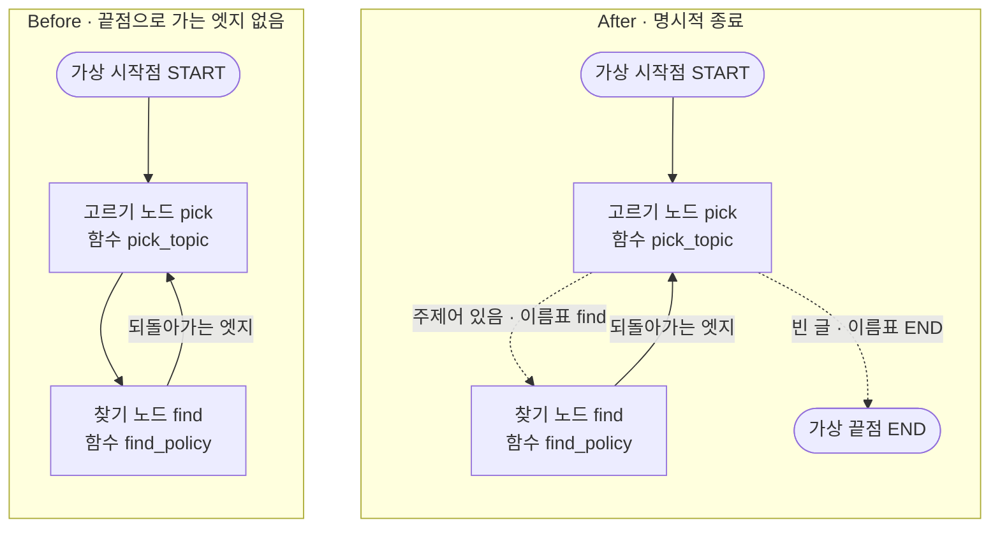
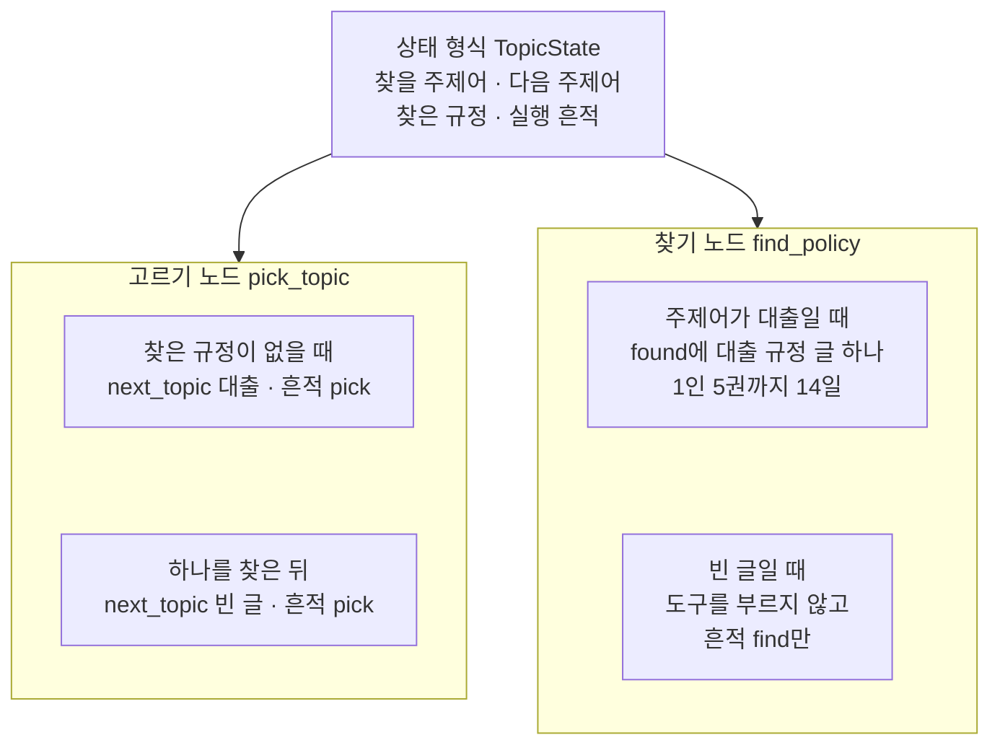
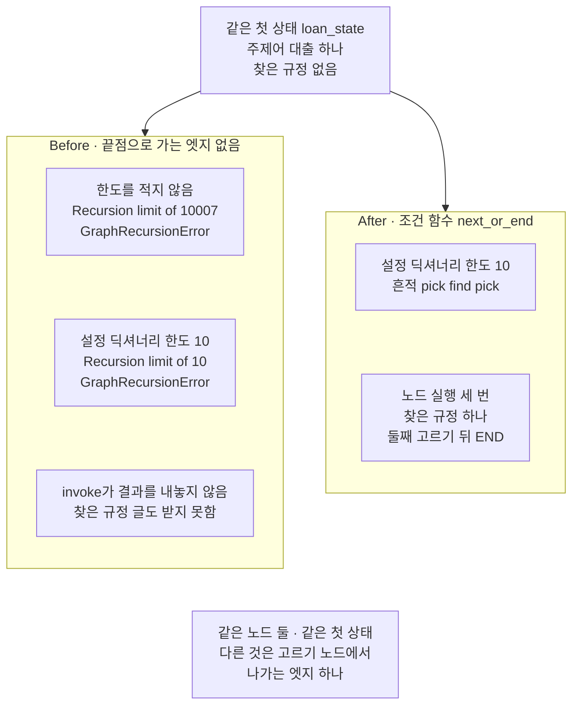
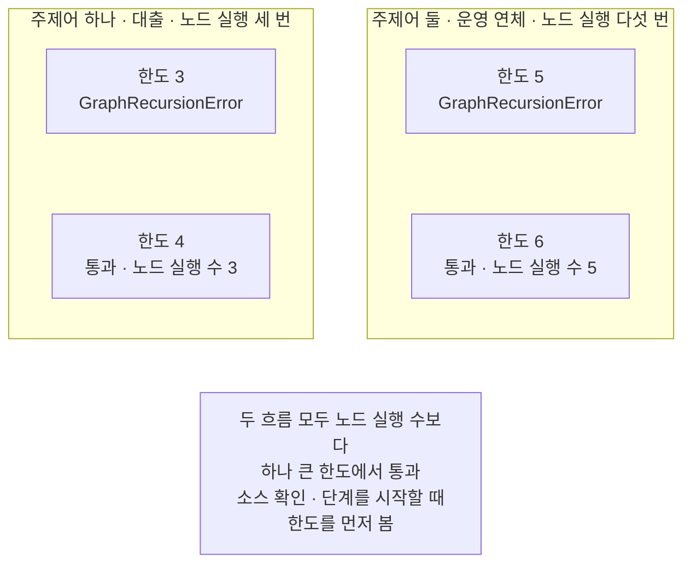
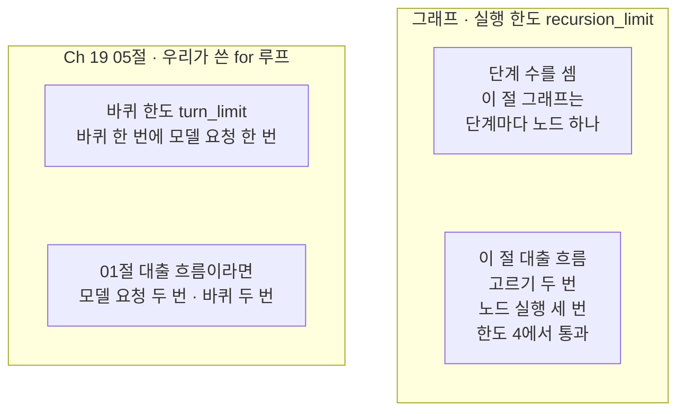

# 03-recursion-limit과-명시적-종료

## _src 본문 (HTML 원본)

```html
<!--meta: 강의 0.75h | 실습 1h | 코드 notebooks/03-recursion-limit과-명시적-종료.ipynb | 새 용어 4 -->
<style>html,body{overflow-x:hidden}.notebook,.nb-cell,.nb-main,.nb-input,.nb-result{min-width:0;max-width:100%}.nb-input pre,.nb-output{box-sizing:border-box;max-width:100%;overflow-x:auto}code.nb-source{display:block!important;width:100%!important;min-width:0!important;overflow-x:auto!important;padding:0!important}</style>
<h2 id="b1"><span class="no">1</span>학습 목표</h2><div class="goal"><ul>
<li>끝점으로 가는 엣지가 없는 그래프가 실행 한도(<code>recursion_limit</code>)에 닿아 멈추는 것을 확인할 수 있습니다.</li>
<li>조건 함수가 <code>END</code>를 내놓게 해, 흐름을 명시적으로 끝낼 수 있습니다.</li>
<li>실행 한도가 세는 단계와 Ch 19 바퀴 한도가 세는 모델 요청을 구별할 수 있습니다.</li>
</ul></div>
<h2 id="b2"><span class="no">2</span>이 내용을 배우는 이유</h2><p><a href="01-ToolNode와-tools-condition.html">01절</a> 그래프는 모델이 도구 호출 요청 없이 답해야 끝납니다. 도구 조건 함수는 요청이 있는지만 보므로, 모델이 요청을 끝없이 보내면 그래프도 계속 되풀이합니다. 그러면 모델 요청도 계속 나가고, 비용이 커질 수 있습니다. 01절과 <a href="02-도구-오류와-ToolMessage.html">02절</a>은 이 되풀이의 한도를 따로 정하지 않고 실행했습니다.</p><p>그래프를 멈추는 장치는 두 가지입니다. 하나는 흐름을 끝낼 때를 우리가 조건 함수에 적어 두는 것입니다. 다른 하나는 끝나지 않을 때 그래프를 세우는 한도입니다. 이 절은 두 장치를 모델 없이 봅니다. 모델 답에 따라 되풀이 횟수가 달라지면, 한도에 닿는 장면을 매번 같게 볼 수 없기 때문입니다.</p>
<h2 id="b3"><span class="no">3</span>앞에서 배운 내용</h2><p><a href="../../part4/ch13-langgraph-basics/03-조건부-엣지.html">Ch 13 03절</a>에서는 조건 함수가 내놓은 이름표를 이름표 표(<code>path_map</code>)로 노드에 이었습니다. 끝 쪽 이름표는 상수 <code>END</code>로 적었습니다. <a href="../../part4/ch13-langgraph-basics/02-State-갱신.html">02절</a>에서는 칸에 이어 붙이기 규칙을 적고, 노드가 자기 몫만 내게 했습니다. <a href="../../part4/ch13-langgraph-basics/07-RAG-통합과-시각화.html">07절</a>에서는 실행의 설정을 상태의 칸, 곧 설정 칸에 담았습니다. 이 절의 설정 딕셔너리는 그 칸과 달리 상태 밖에서 넘깁니다.</p><p><a href="../ch17-agent-overview/03-모델-도구-루프와-정지-조건.html">Ch 17 03절</a>에서는 정지 조건이 빠지면 모델이 끝을 고를 때까지 루프가 멈추지 않는다고 보았습니다. 그 절은 바퀴 한도를 코드가 세운 정지 조건 가운데 하나로 두었습니다. <a href="../ch19-model-tools/05-bind_tools와-병렬-호출.html">Ch 19 05절</a> 함수 <code>ask_until_answer</code>는 바퀴 한도 <code>turn_limit</code>까지 <code>for</code> 루프를 돌렸습니다. 그 함수는 바퀴마다 모델 요청을 한 번 보냈습니다.</p><p>01절에서는 모델 노드와 도구 실행 노드를 되돌아가는 엣지로 이었고, 도구 조건 함수가 <code>END</code>를 골랐습니다. 02절에서는 도구가 딕셔너리에 없는 주제어를 받으면 <code>ValueError</code>를 내는 것을 보았습니다. 이 절도 <a href="../../part1/ch02-python/05-파일과-예외.html">Ch 2 05절</a>의 <code>try/except 오류이름 as error</code>로, 한도를 넘은 오류를 그 셀에서만 받습니다.</p>
<h2 id="b4"><span class="no">4</span>핵심 개념</h2><h3>비유로 시작하기</h3><p>01절의 두 층 자료실을 다시 떠올립니다. 이번에는 승강 통로마다 딸깍 계수기가 붙어 있습니다. 상자가 한 층을 들를 때마다 계수기 칸이 하나씩 찹니다. 칸이 모두 차면 멈춤 장치가 상자를 그 자리에 세웁니다.</p><p>왼쪽 통로에는 창구 층에서 설 표시가 없습니다. 상자는 대출 카드를 싣고 창구 층을 들러도 서지 않고, 카드를 실은 채 오르내리기를 되풀이합니다. 결국 계수기 칸이 다 차서 창구 층 바로 아래 통로에서 멈추고, 카드는 끝내 창구에 내려지지 않습니다.</p><p>오른쪽 통로에는 창구 층에 받침이 있습니다. 찾을 쪽지가 남지 않으면 상자는 이 받침에 걸려 창구에 섭니다. 그래서 오른쪽 상자는 카드를 싣고 창구에 섰고, 계수기 칸은 다 차지 않았습니다.</p><p>계수기 칸 하나가 단계이고, 칸 수가 실행 한도입니다. 칸 수를 적어 두는 운행표가 설정 딕셔너리입니다. 창구 층의 받침이 명시적 종료입니다. 왼쪽 통로가 이 절의 Before, 오른쪽 통로가 After입니다.</p>
{{img:03-6-계수기가-다-찬-상자와-창구에-선-상자|흰 바탕 그림으로 두 층 자료실 벽을 잘라 보인 모습입니다. 위층 왼쪽에는 긴 나무 창구가, 아래층 왼쪽에는 파란 책이 꽂힌 책장이 있습니다. 벽 속에 옅은 갈색 승강 통로 둘이 떨어져 세로로 나 있고, 두 통로 사이에는 파란 기둥이 서 있습니다. 왼쪽 통로의 나무 상자는 위층 바닥 바로 아래에 멈춰 있고, 흰 카드 한 장이 반쯤 삐져나와 있습니다. 그 옆 판의 둥근 등 넷은 모두 빨갛게 켜져 있습니다. 오른쪽 통로의 같은 상자는 위층 바닥 위에서 작은 나무 받침에 얹혀 있고, 흰 카드 한 장이 반쯤 삐져나와 있습니다. 그 옆 판의 둥근 등 넷 가운데 둘만 노랗게 켜져 있는 그림|왼쪽 상자는 계수기 등이 다 켜져 창구 층 아래에서 멈췄고, 오른쪽 상자는 받침에 얹혀 창구 층에 섰습니다.}}
<p class="look"><b>그림 읽기</b> — 벽 속 승강 통로는 둘이고, 통로마다 나무 상자 하나와 둥근 등 넷이 달린 계수기 판 하나가 있습니다. 왼쪽 상자는 흰 카드를 실은 채 위층 바닥 바로 아래에 멈춰 있고, 계수기 등 넷이 모두 빨갛게 켜져 있습니다. 오른쪽 상자는 흰 카드를 싣고 위층 바닥 위 나무 받침에 얹혀 있고, 계수기 등은 넷 가운데 둘만 켜져 있습니다. 왼쪽은 실행 한도에 닿아 멈춘 Before, 오른쪽은 받침, 곧 명시적 종료로 창구 층에 선 After입니다. 두 통로 사이의 파란 기둥은 벽의 일부이고, 비유와는 관계가 없습니다.</p>
<table><thead><tr><th>말</th><th>뜻</th></tr></thead><tbody><tr><td>단계</td><td>그래프가 실행할 노드를 골라 한 번 실행하는 차례입니다. 함께 실행되는 노드는 한 단계에 들어갑니다. 상자가 한 층을 들러 계수기 칸 하나가 차는 것과 같습니다.</td></tr><tr><td>실행 한도(recursion_limit)</td><td>그래프가 한 번 실행에서 진행할 수 있는 단계 수의 한도입니다. 한도에 닿으면 그래프가 <code>GraphRecursionError</code>를 내고 멈춥니다. 계수기의 칸 수와 같습니다.</td></tr><tr><td>설정 딕셔너리</td><td>메서드 <code>invoke</code>의 둘째 인자로 넘기는, 실행하는 방법을 적은 딕셔너리입니다. 상태에는 들어가지 않습니다. 계수기 칸 수를 적어 둔 운행표와 같습니다.</td></tr><tr><td>명시적 종료</td><td>흐름을 끝낼 때를 조건 함수에 적어 두고, 그때 <code>END</code>로 보내는 것입니다. 창구 층에 받침을 달아 상자가 거기서 서게 하는 것과 같습니다.</td></tr></tbody></table>
<p>새 말을 이 절 코드에서 보면 이렇습니다. 설정 딕셔너리는 <code>limit_config = {"recursion_limit": 10}</code>이고, 실행 한도는 그 키의 값 10입니다. 이 절 그래프는 단계마다 노드 하나를 실행해, 실행 흔적 칸에 한 칸씩 남깁니다. 명시적 종료는 조건 함수 <code>next_or_end</code>가 빈 글에서 <code>END</code>를 내놓는 일입니다.</p>
{{mermaid:03-1-끝나는-엣지가-다른-두-그래프|왼쪽과 오른쪽에 칸 둘이 나란히 있는 그림입니다. 왼쪽 칸 Before 끝점으로 가는 엣지 없음에는 회색 가상 시작점 START에서 파란 상자 고르기 노드 pick 함수 pick_topic으로, 다시 파란 상자 찾기 노드 find 함수 find_policy로 실선이 가고, 찾기 노드에서 고르기 노드로 되돌아가는 엣지 실선이 돌아옵니다. 오른쪽 칸 After 명시적 종료에는 같은 시작점과 두 노드가 있고, 고르기 노드에서 점선 두 갈래가 나가 주제어 있음 이름표 find는 찾기 노드로, 빈 글 이름표 END는 회색 가상 끝점 END로 갑니다. 찾기 노드에서 고르기 노드로 되돌아가는 엣지 실선이 돌아오는 그림|두 그래프는 노드 둘과 되돌아가는 엣지가 같고, 고르기 노드에서 나가는 엣지만 다릅니다.}}
<p class="look"><b>도식 읽기</b> — 왼쪽 칸이 Before, 오른쪽 칸이 After이고, 칸 안은 위에서 아래로 읽습니다. 파란 상자는 우리가 적은 노드이고, 회색은 LangGraph의 가상 시작점과 가상 끝점입니다. 왼쪽 칸에는 끝점이 없어, 고르기 노드와 찾기 노드를 오가는 길만 있습니다. 오른쪽 칸은 고르기 노드에서 점선 두 갈래가 나가고, 빈 글이면 끝점으로 갑니다. 오른쪽 칸의 상자 넷과 화살표 넷은 노트북 5절 구조 문자열과 같습니다.</p>
<h3>바퀴 한도와 실행 한도</h3><p>Ch 19 05절의 바퀴 한도 <code>turn_limit</code>은 우리가 쓴 <code>for</code> 루프가 센 모델 요청 수의 한도였습니다. 실행 한도 <code>recursion_limit</code>은 그래프가 센 단계 수의 한도입니다. 이 절의 대출 흐름은 고르기 노드를 두 번, 노드를 모두 세 번 지났습니다. 고르기 노드를 01절 모델 노드 자리로 보면, 바퀴로는 2번이고 단계로는 3번입니다. 그래서 바퀴 한도 값을 실행 한도에 그대로 옮겨 적지 않습니다.</p>
{{mermaid:03-5-바퀴-한도와-실행-한도|왼쪽과 오른쪽에 칸 둘이 나란히 있는 그림입니다. 왼쪽 칸 Ch 19 05절 우리가 쓴 for 루프에는 파란 상자 바퀴 한도 turn_limit 바퀴 한 번에 모델 요청 한 번과, 회색 상자 01절 대출 흐름이라면 모델 요청 두 번 바퀴 두 번이 위아래로 있습니다. 오른쪽 칸 그래프 실행 한도 recursion_limit에는 회색 상자 단계 수를 셈 이 절 그래프는 단계마다 노드 하나와, 노란 상자 이 절 대출 흐름 고르기 두 번 노드 실행 세 번 한도 4에서 통과가 위아래로 있는 그림|바퀴 한도는 모델 요청 수를, 실행 한도는 단계 수를 세어, 대출 흐름에서 바퀴는 두 번이고 단계는 세 번입니다.}}
<p class="look"><b>도식 읽기</b> — 왼쪽 칸이 Ch 19 05절 함수 안의 <code>for</code> 루프, 오른쪽 칸이 이 절 그래프입니다. 파란 상자는 우리가 적은 코드이고, 회색 상자는 셈과 LangGraph가 정한 사실입니다. 왼쪽 아래 회색 상자는 01절 출력으로 센 값이고, 이 절에서 실행한 값이 아닙니다. 노란 상자는 노트북 6·7절 출력입니다.</p>
<h3>다른 상황에 적용</h3><p>01절 그래프에도 같은 설정 딕셔너리를 넘길 수 있습니다. <code>graph.invoke(loan_state, {"recursion_limit": 10})</code>처럼 둘째 인자만 더하면 됩니다. 모델이 도구 호출 요청을 끝없이 보내도, 그래프는 단계 10에서 멈춥니다. 셈으로는 모델 노드를 다섯 번까지 지나, 모델 요청이 5번까지 나갑니다. 이 조합은 이번에 실행하지 않았습니다.</p>
<h3>비교와 경계</h3><p>실행 한도는 끝나지 않는 되풀이를 끊어 줄 뿐, 흐름을 제대로 끝내 주지는 않습니다. 한도에 닿으면 메서드 <code>invoke</code>는 실행 결과를 내놓지 않아, 그때까지 찾은 값도 받지 못합니다. 그래서 흐름이 끝나야 할 때는 조건 함수에 적고, 한도는 그 조건이 빠졌을 때 그래프를 세우는 자리에 둡니다. 한도를 크게 올리기 전에, 끝점으로 가는 엣지가 빠지지 않았는지 먼저 봅니다.</p>
<h2 id="b5"><span class="no">5</span>실행 예제</h2><p>노트북은 먼저 01절과 같은 규정 딕셔너리와 도구를 만들고, 빈 글로 도구를 불러 봅니다. 그다음 칸 넷을 둔 상태 형식과 노드 둘을 만듭니다. 고르기 노드는 다음에 찾을 주제어를 적고, 찾기 노드는 그 주제어로 도구를 불러 규정 글을 찾습니다. 두 노드는 손으로 만든 상태를 넣어 그래프 없이 직접 불러 봅니다.</p><p>이 절은 모델을 부르지 않아 모델 요청이 0번이고, API 키 없이 실행합니다. 두 노드는 정해 둔 차례를 따르는 우리 노드라서, 같은 상태를 넣으면 매번 같은 값을 냅니다.</p>
{{notebook:03-recursion-limit과-명시적-종료|example}}
<p class="look"><b>확인할 점</b> — 노트북 2절 출력 <code>받은 오류: ValueError</code>로, 빈 글이면 도구가 오류를 내는 것을 봅니다. 노트북 3절 출력 <code>하나를 찾은 뒤: {'next_topic': '', 'trace': ['pick']}</code>로, 다 찾으면 고르기 노드가 빈 글을 적는 것을 봅니다. 같은 절 출력 <code>빈 글일 때: {'trace': ['find']}</code>로, 찾기 노드가 도구를 부르지 않는 것을 봅니다.</p>
{{mermaid:03-2-두-노드가-읽고-쓰는-칸|위에 초록 상자 상태 형식 TopicState 찾을 주제어 다음 주제어 찾은 규정 실행 흔적이 있고, 거기서 아래 칸 둘로 화살표가 갑니다. 왼쪽 칸 고르기 노드 pick_topic에는 노란 상자 찾은 규정이 없을 때 next_topic 대출 흔적 pick과, 노란 상자 하나를 찾은 뒤 next_topic 빈 글 흔적 pick이 위아래로 있습니다. 오른쪽 칸 찾기 노드 find_policy에는 노란 상자 주제어가 대출일 때 found에 대출 규정 글 하나 1인 5권까지 14일과, 노란 상자 빈 글일 때 도구를 부르지 않고 흔적 find만이 위아래로 있는 그림|고르기 노드는 다 찾으면 빈 글을 적고, 찾기 노드는 빈 글이면 도구를 부르지 않습니다.}}
<p class="look"><b>도식 읽기</b> — 맨 위 초록 상자는 두 노드가 함께 읽고 쓰는 상태의 칸 넷입니다. 아래 두 칸은 노트북 3절에서 노드를 그래프 없이 직접 부른 결과입니다. 칸 안의 두 노란 상자는 서로 다른 상태를 넣은 결과라 화살표로 잇지 않았습니다. 찾기 노드가 빈 글에서 도구를 부르지 않는 까닭은 노트북 2절의 빈 글 오류입니다.</p>
<h2 id="b6"><span class="no">6</span>실패 확인</h2><p>아래 Before 셀은 고르기 노드 다음을 늘 찾기 노드로 이은 그래프를 두 번 실행합니다. 한 번은 한도를 적지 않고(설치판 기본 한도), 한 번은 한도 10으로 실행합니다. 이어지는 After 셀은 고르기 노드 뒤에 조건 함수를 둔 그래프를 같은 한도로 실행합니다. 마지막 값 바꿔 보기는 한도와 주제어 수를 바꿔 경계를 찾습니다.</p>
{{notebook:03-recursion-limit과-명시적-종료|failure}}
{{mermaid:03-3-한도에-닿은-Before와-끝난-After|위에 초록 상자 같은 첫 상태 loan_state 주제어 대출 하나 찾은 규정 없음이 있고, 아래에 칸 둘이 나란히 있습니다. 왼쪽 칸 Before 끝점으로 가는 엣지 없음에는 빨간 상자 셋이 위아래로 있습니다. 한도를 적지 않음 Recursion limit of 10007 GraphRecursionError, 설정 딕셔너리 한도 10 Recursion limit of 10 GraphRecursionError, invoke가 결과를 내놓지 않음 찾은 규정 글도 받지 못함입니다. 오른쪽 칸 After 조건 함수 next_or_end에는 노란 상자 설정 딕셔너리 한도 10 흔적 pick find pick과, 노란 상자 노드 실행 세 번 찾은 규정 하나 둘째 고르기 뒤 END가 위아래로 있습니다. 맨 아래 회색 상자에 같은 노드 둘 같은 첫 상태 다른 것은 고르기 노드에서 나가는 엣지 하나라고 적힌 그림|끝점으로 가는 엣지가 없는 Before는 두 번 모두 한도에 닿아 멈췄고, After는 같은 한도 10 안에서 끝났습니다.}}
<p class="look"><b>도식 읽기</b> — 맨 위 초록 상자는 두 칸에 똑같이 넣은 첫 상태입니다. 왼쪽 칸이 Before, 오른쪽 칸이 After이고, 칸 안 상자는 위에서 아래로 읽습니다. 빨간 상자는 Before의 결함 결과이고, 노란 상자는 After 셀의 출력입니다. 칸 안 상자들은 한 셀의 출력을 나눠 적은 것이라 화살표로 잇지 않았습니다. 맨 아래 회색 상자는 두 칸의 코드를 견줘 얻은 사실입니다.</p>
<p>Before 그래프는 대출 규정을 찾은 뒤에도 고르기와 찾기를 되풀이했습니다. 한도를 적지 않은 실행은 <code>Recursion limit of 10007 reached</code>로 멈췄습니다. 한도 10을 적은 실행은 <code>Recursion limit of 10 reached</code>로 멈췄습니다. 두 실행 모두 메서드 <code>invoke</code>가 결과를 내놓지 않아, 찾은 규정 글도 받지 못했습니다.</p><p>After 그래프는 같은 첫 상태와 같은 한도 10으로 실행해, 실행 흔적 <code>['pick', 'find', 'pick']</code>을 남기고 끝났습니다. 둘째 고르기 노드가 빈 글을 적자, 조건 함수가 <code>END</code>를 내놓았습니다. 두 그래프에서 다른 곳은 고르기 노드에서 나가는 엣지 하나였습니다. 새 커널로 두 번 실행했을 때 모든 셀의 출력이 두 번 같았습니다.</p><p>값 바꿔 보기에서는 한도를 바꿨습니다. 노드를 3번 실행하는 대출 흐름은 한도 3에서 멈추고 한도 4에서 통과했습니다. 주제어를 운영과 연체 둘로 바꾼 흐름은 노드를 5번 실행했고, 한도 5에서 멈추고 6에서 통과했습니다. 두 흐름 모두 노드 실행 수보다 하나 큰 한도에서 통과했습니다.</p><p>설치한 langgraph 1.2.11 소스에서는 단계를 시작할 때마다 먼저 한도를 봅니다. 그다음에 실행할 노드가 남았는지 봅니다. 그래서 마지막 노드 뒤, 남은 노드가 없는지 확인하는 차례까지 한도 안에 들어야 합니다. 노트북 밖에서 Before 모양 그래프를 한도 1~5와 10으로 실행해 보니, 한도가 N이면 노드를 N번 실행한 뒤 멈췄습니다.</p>
{{mermaid:03-4-노드-실행-수와-한도의-경계|위쪽에 칸 둘이 나란히 있는 그림입니다. 왼쪽 칸 주제어 하나 대출 노드 실행 세 번에는 노란 상자 한도 3 GraphRecursionError와 노란 상자 한도 4 통과 노드 실행 수 3이 위아래로 있습니다. 오른쪽 칸 주제어 둘 운영 연체 노드 실행 다섯 번에는 노란 상자 한도 5 GraphRecursionError와 노란 상자 한도 6 통과 노드 실행 수 5가 위아래로 있습니다. 맨 아래 회색 상자에 두 흐름 모두 노드 실행 수보다 하나 큰 한도에서 통과, 소스 확인 단계를 시작할 때 한도를 먼저 봄이라고 적힌 그림|노드를 세 번 실행하는 흐름은 한도 4에서, 다섯 번 실행하는 흐름은 한도 6에서 통과했습니다.}}
<p class="look"><b>도식 읽기</b> — 위쪽 칸 둘은 값 바꿔 보기에서 실행한 두 흐름입니다. 칸마다 위 상자가 멈춘 한도, 아래 상자가 통과한 한도입니다. 노란 상자는 모두 노트북 6절 출력이고, 값 바꿔 보기에서 받은 오류도 노랑으로 두었습니다. 맨 아래 회색 상자는 두 칸의 출력과 설치판 소스로 확인한 규칙입니다.</p>
<p class="look"><b>확인할 점</b> — 노트북 4절 출력 <code>Recursion limit of 10007 reached</code>와 <code>Recursion limit of 10 reached</code>로 Before의 두 실행을 봅니다. 노트북 5절 출력 <code>실행 흔적 칸: ['pick', 'find', 'pick']</code>으로 After가 끝난 차례를 봅니다. 노트북 6절 출력 <code>한도 3 | 받은 오류: GraphRecursionError</code>와 <code>한도 4 | 통과 | 노드 실행 수: 3</code>으로 경계를 봅니다.</p>
<h2 id="b7"><span class="no">7</span>주의할 점과 실무 메모</h2><ul><li>이 절은 모델을 부르지 않아 모델 요청이 0번이고, API 키 없이 실행합니다. 모델이 낀 흐름은 모델 답에 따라 되풀이 횟수가 달라져, 한도에 닿는 장면을 매번 같게 볼 수 없기 때문입니다.</li><li>고르기 노드는 목록 차례대로 주제어를 고르는 우리 노드입니다. 모델을 흉내 내려는 노드가 아니라, 한도와 끝내는 조건만 보려고 정한 노드입니다.</li><li>주제어(대출, 운영과 연체)와 한도 10은 흐름을 보여 주려고 이 절에서 정한 예입니다. 한도 3·4·5·6은 노드 실행 수 둘레에서 고른 값입니다.</li><li>한도에 닿으면 메서드 <code>invoke</code>는 결과를 내놓지 않습니다. 실행 중 상태를 저장해 두는 체크포인터는 <a href="../../part6/ch23-persistence/01-체크포인터와-스레드.html">Ch 23 01절</a>에서 다룹니다. 한도에 닿은 실행의 상태를 체크포인터로 읽는 일은 이번에 하지 않았습니다.</li><li>이 설치판의 기본 한도는 10007입니다. 설치판 <code>langgraph/_internal/_config.py</code> 32행에서, 환경 변수 <code>LANGGRAPH_DEFAULT_RECURSION_LIMIT</code>로 바뀐다는 것도 확인했습니다. 공식 문서가 적은 기본 한도는 이와 달라, 참고 자료에 적었습니다.</li><li>한 단계에 노드 여럿이 함께 실행되는 그래프(<a href="../../part4/ch13-langgraph-basics/05-Send-동적-팬아웃.html">Ch 13 05절</a>)에서는 노드 실행 수와 단계 수가 다를 수 있습니다. 이 절 그래프는 단계마다 노드 하나라 두 수가 같았고, 여럿인 경우는 이번에 실행하지 않았습니다.</li><li>끝점으로 가는 엣지를 하나도 적지 않은 그래프도, 구조 문자열에는 끝점으로 가는 점선 하나가 그려집니다. 설치판 <code>langgraph/pregel/_draw.py</code> 247~256행에서 그림을 그리는 코드가 이 점선을 스스로 더합니다. 그래서 노트북 4절은 구조 문자열 대신 적어 둔 엣지 수로 Before 그래프를 확인했습니다. Before 그래프의 구조 문자열은 노트북 밖에서 확인했습니다.</li><li>실행 한도는 설정 딕셔너리의 맨 위 키로 넘깁니다. 공식 문서도 이 키를 <code>configurable</code> 안에 넣지 말라고 적습니다.</li><li>01·02절 모델 흐름에 이 절 규칙을 대는 것은 셈입니다. 01절 대출 흐름은 셈으로 한도 4부터 통과하지만, 이번에 실행하지 않았습니다.</li><li>셀의 <code>assert</code>는 모델 없이 우리 코드가 정하는 값, 곧 실행 흔적의 차례와 찾은 규정 수에만 걸었습니다.</li><li>걸린 시간은 재지 않았습니다. 준비물의 실행 시간은 노트북 셀 실행 기록에서 읽은 값입니다.</li><li>교재 출력은 Linux의 Python 3.12.13으로 만들었습니다. 다른 판과 Windows·macOS에서는 이번에 실행하지 않았습니다.</li></ul>
<h2 id="b8"><span class="no">8</span>정리와 다음 절</h2><ul><li>끝점으로 가는 엣지가 없는 그래프는 규정을 다 찾은 뒤에도 되풀이하다, 실행 한도에 닿아 <code>GraphRecursionError</code>로 멈췄습니다.</li><li>조건 함수가 빈 글에서 <code>END</code>를 내놓게 하자, 같은 한도 10 안에서 노드 3번으로 끝났습니다.</li><li>실행 한도는 노드 실행 단계를 세고, 두 흐름 모두 노드 실행 수보다 하나 큰 한도에서 통과했습니다.</li></ul><p><strong>다음 학습과 이어지는 지점</strong> — <a href="04-if-분기와-모델-선택-비교.html">04절</a>에서는 코드의 <code>if</code>로 도구를 고르는 흐름과, 모델이 도구를 고르는 흐름을 견줍니다.</p>
<h2 id="b9"><span class="no">9</span>복습 문제</h2><details class="quiz" open><summary>문제 4개 · 해설 포함</summary><p class="quiz-q">1. 끝점으로 가는 엣지가 없는 Before 그래프를 한도를 적지 않고 실행하면 어떻게 되었나요?</p><p class="quiz-a">기본 한도 10007에 닿아 <code>GraphRecursionError</code>로 멈췄습니다. 메서드 <code>invoke</code>가 결과를 내놓지 않아, 찾은 규정 글도 받지 못했습니다. 틀렸다면 노트북 4절을 다시 읽습니다.</p><p class="quiz-q">2. 실행 한도는 어디에 적나요?</p><p class="quiz-a">메서드 <code>invoke</code>의 둘째 인자인 설정 딕셔너리에, 키 <code>"recursion_limit"</code>로 적습니다. 상태의 칸도 아니고, <code>configurable</code> 안도 아닙니다. 틀렸다면 노트북 4절과 본문 4 「핵심 개념」의 표를 다시 읽습니다.</p><p class="quiz-q">3. 노드를 3번 실행하고 끝나는 흐름은 한도 3에서 통과했나요?</p><p class="quiz-a">아닙니다. 한도 3에서는 <code>GraphRecursionError</code>가 났고, 한도 4에서 통과했습니다. 그래프가 단계를 시작할 때마다 한도를 먼저 보기 때문입니다. 틀렸다면 노트북 6절을 다시 읽습니다.</p><p class="quiz-q">4. 바퀴 한도 <code>turn_limit</code>과 실행 한도는 각각 무엇을 세나요?</p><p class="quiz-a">바퀴 한도는 우리가 쓴 <code>for</code> 루프의 바퀴, 곧 모델 요청 수를 셉니다. 실행 한도는 그래프가 노드를 실행하는 단계 수를 셉니다. 이 절 대출 흐름은 바퀴로 2번, 단계로 3번이었습니다. 틀렸다면 노트북 7절을 다시 읽습니다.</p></details>
<h2 id="b10"><span class="no">10</span>참고 자료</h2><ul><li><div><a href="https://docs.langchain.com/oss/python/langgraph/graph-api">LangGraph Graph API</a></div>확인 2026-09-24 · 실행 한도를 한 번 실행에서 진행할 수 있는 단계 수의 한도로 설명합니다. 이 키를 <code>configurable</code> 안에 넣지 말라고도 적습니다. 문서는 1.0.6부터 기본 한도가 1000 단계라고 적지만, 설치판 1.2.11 소스와 노트북 출력은 10007입니다.</li><li><div><a href="https://docs.langchain.com/oss/python/langgraph/errors/GRAPH_RECURSION_LIMIT">GRAPH_RECURSION_LIMIT 오류 안내</a></div>확인 2026-09-24 · 끝나는 조건 없이 노드 사이를 도는 엣지를 흔한 까닭으로 듭니다. 기본 한도 값은 적지 않습니다.</li><li>langgraph 1.2.11 소스 <code>langgraph/pregel/_loop.py</code> 607행과 653행입니다. 단계를 시작할 때 한도를 먼저 보고, 그다음에 남은 노드가 없으면 끝냅니다.</li><li>같은 소스 <code>langgraph/_internal/_config.py</code> 32행 — 기본 한도 10007과 환경 변수 이름.</li><li>같은 소스 <code>langgraph/pregel/main.py</code> 3005행 — 오류 글 첫 줄을 만드는 자리.</li><li>같은 소스 <code>langgraph/pregel/_draw.py</code> 247~256행 — 끝점 엣지가 없을 때 구조 문자열에 점선을 더하는 자리.</li><li>Ch 13 02·03·07절 — 흔적 칸 규칙, 조건 함수와 이름표 표, 설정 칸.</li><li>Ch 17 03절·Ch 19 05절 — 정지 조건과 바퀴 한도, 함수 <code>ask_until_answer</code>.</li><li>01·02절 — 되돌아가는 엣지와 도구 조건 함수, 도구가 내는 <code>ValueError</code>.</li></ul>
```

## 노트북 셀 (순서대로)

### [0] markdown {'html': 'skip'}

# recursion_limit과 명시적 종료

**이 노트북에서 할 일**

1. 끝점으로 가는 엣지가 없는 그래프가 실행 한도에 닿아 멈추는 것을 봅니다.
2. 조건 함수가 `END`를 내놓게 해, 같은 한도 안에서 흐름을 끝냅니다.
3. 한도 값을 바꿔, 노드 실행 수와 한도의 경계를 출력으로 확인합니다.

**준비물** — 이 노트북은 모델을 부르지 않습니다.
모델 요청은 0번이고, API 키 없이 실행합니다.
그래서 `.env` 파일을 읽는 셀과 키를 확인하는 셀이 없습니다.
모델 답에 따라 되풀이 횟수가 달라지면, 한도에 닿는 장면을 매번 같게 볼 수 없기 때문입니다.
그래서 모델을 부르지 않고, 정해 둔 차례를 따르는 우리 노드 둘로 그래프를 만듭니다.

노트북 안 규정 딕셔너리를 읽기만 하고, 읽는 파일과 새로 쓰는 파일은 없습니다.
교재 출력을 만든 실행에서는 노트북 전체가 10초 안에 끝났습니다.

**기준 버전** — 첫 셀에서 패키지 셋을 설치합니다.
판은 langgraph 1.2.11, langchain 1.4.0, langchain-core 1.6.2입니다.
교재 출력은 Linux의 Python 3.12.13으로 만들었습니다.
다른 판과 Windows·macOS에서는 이번에 실행하지 않았습니다.

**강의와 실습 범위** — 강의 시간에는 3~5절을 읽습니다.
노드 둘을 만들고, 끝나는 엣지가 없는 그래프와 조건 함수로 끝내는 그래프를 견주는 자리입니다.
6·7절은 한도 값을 바꿔 경계를 찾고 바퀴 한도와 견주는 자리이고, 실습 시간에 실행합니다.

실습 폴더 `labs/part5/ch20-tool-node`에서 `uv sync --locked`를 실행합니다.
그다음 `notebooks/` 폴더의 이 노트북을 열고, 실습 폴더의 `.venv` 커널을 고릅니다.
첫 셀부터 순서대로 실행합니다.

### [1] markdown {'html': 'skip'}

## 오늘 볼 그림


왼쪽 칸이 Before, 오른쪽 칸이 After이고, 칸 안은 위에서 아래로 읽습니다.
파란 상자는 우리가 적은 노드이고, 회색은 LangGraph의 가상 시작점과 가상 끝점입니다.
왼쪽 칸에는 끝점이 없어, 고르기 노드와 찾기 노드를 오가는 길만 있습니다.
오른쪽 칸은 고르기 노드에서 점선 두 갈래가 나가고, 빈 글이면 끝점으로 갑니다.
오른쪽 칸의 상자 넷과 화살표 넷은 노트북 5절 구조 문자열과 같습니다.

### [2] markdown {}

## 1. 준비

01절과 02절 그래프는 되풀이하는 횟수의 한도를 따로 정하지 않고 실행했습니다.
이 절은 그 한도와, 흐름을 끝내는 조건을 봅니다.
제목의 `recursion_limit`은 실행 한도이고, 뜻은 4절에서 풉니다.

첫 셀은 패키지 세 개를 설치하고 설치된 판 번호를 출력합니다.
설치에는 몇십 초가 걸릴 수 있습니다.

### [3] code {'execution': {'iopub.execute_input': '2026-09-24T07:21:00.881091Z', 'iopub.status.busy': '2026-09-24T07:21:00.880765Z', 'iopub.status.idle': '2026-09-24T07:21:01.687925Z', 'shell.execute_reply': '2026-09-24T07:21:01.687250Z'}, 'lesson_role': 'setup'}

```python
# 이 절에서 쓰는 패키지를 설치하고 버전을 확인합니다
%pip install -q "langgraph==1.2.11" "langchain==1.4.0" "langchain-core==1.6.2"
from importlib.metadata import version

print("langgraph:", version("langgraph"))
print("langchain:", version("langchain"))
print("langchain-core:", version("langchain-core"))
```

출력:
```
Note: you may need to restart the kernel to use updated packages.
langgraph: 1.2.11
langchain: 1.4.0
langchain-core: 1.6.2

```

### [4] markdown {}

**결과 읽기** — 출력 줄 `langgraph: 1.2.11`·`langchain: 1.4.0`·`langchain-core: 1.6.2`가 보입니다.
세 판 모두 실습 폴더 잠금과 같은 판입니다.
이 노트북의 출력은 2026-09-24에 이 판으로 실행한 결과입니다.

다음 셀은 이 절에서 쓸 이름을 가져옵니다.
그래프와 도구 이름은 01절과 같고, 오류 이름 하나를 더 가져옵니다.
모델을 부르지 않으니 모델과 메시지 이름은 가져오지 않습니다.

### [5] code {'execution': {'iopub.execute_input': '2026-09-24T07:21:01.689177Z', 'iopub.status.busy': '2026-09-24T07:21:01.689085Z', 'iopub.status.idle': '2026-09-24T07:21:02.236262Z', 'shell.execute_reply': '2026-09-24T07:21:02.235366Z'}, 'lesson_role': 'setup'}

```python
# Ch 13 그래프 이름과 Ch 19 도구 이름에, 한도를 넘었을 때 나는 오류 이름 하나를 더해 가져옵니다
import operator
from typing import Annotated
from typing_extensions import TypedDict

from langchain.tools import tool
from langgraph.graph import END, START, StateGraph
# 실행 한도를 넘으면 그래프가 내는 오류의 이름입니다
from langgraph.errors import GraphRecursionError

print("이 절에서 새로 가져온 이름:", "GraphRecursionError")
```

출력:
```
이 절에서 새로 가져온 이름: GraphRecursionError

```

### [6] markdown {}

**결과 읽기** — 출력 줄 `이 절에서 새로 가져온 이름: GraphRecursionError`가 보입니다.
이 이름은 그래프가 실행 한도를 넘었을 때 내는 오류의 이름입니다.
4절에서 이 오류를 받아 출력합니다.

모델을 부르지 않는 절이라, Ch 13 01~06절처럼 API 키 셀도 없습니다.

## 2. 규정 자료와 도구

자료와 도구는 01절과 같은 코드입니다.
다음 셀은 01절처럼 주제어를 키, 규정 글을 값으로 둔 딕셔너리를 만듭니다.

### [7] code {'execution': {'iopub.execute_input': '2026-09-24T07:21:02.237409Z', 'iopub.status.busy': '2026-09-24T07:21:02.237317Z', 'iopub.status.idle': '2026-09-24T07:21:02.239593Z', 'shell.execute_reply': '2026-09-24T07:21:02.239125Z'}}

```python
# 교육센터 자료실 규정 셋을, 주제어를 키로 한 딕셔너리에 담습니다(도구가 읽기만 하는 자료)
POLICIES = {
    "대출": "일반 도서는 1인 5권까지 14일 동안 대출할 수 있습니다.",
    "운영": "평일은 09:00~20:00, 토요일은 10:00~17:00에 운영합니다.",
    "연체": "연체한 일수만큼 새 대출이 제한됩니다.",
}
topics = list(POLICIES.keys())
print("규정 주제어:", topics)
```

출력:
```
규정 주제어: ['대출', '운영', '연체']

```

### [8] markdown {}

**결과 읽기** — 출력 줄 `규정 주제어: ['대출', '운영', '연체']`로 키 셋을 확인합니다.
이 셀은 01절 셀과 글자까지 같습니다.

다음 셀은 01절과 같은 도구 `lookup_policy`를 만듭니다.
코드는 01절과 같고, 오류를 내는 줄 위 주석 한 줄만 이 절에 맞게 고쳤습니다.

### [9] code {'execution': {'iopub.execute_input': '2026-09-24T07:21:02.240570Z', 'iopub.status.busy': '2026-09-24T07:21:02.240479Z', 'iopub.status.idle': '2026-09-24T07:21:02.243540Z', 'shell.execute_reply': '2026-09-24T07:21:02.243135Z'}}

```python
# 주제어 하나로 규정 글 하나를 찾는 도구를 만듭니다(맨 @tool 줄 — Ch 19 01절)
@tool
def lookup_policy(topic: str):
    """교육센터 자료실 규정 하나를 주제어로 찾습니다. topic에는 대출, 운영, 연체 가운데 하나를 넣습니다."""
    # 딕셔너리에 없는 주제어면 오류를 냅니다(02절에서 본 ValueError입니다)
    if topic not in POLICIES:
        raise ValueError("지원하지 않는 주제: " + topic)
    return POLICIES[topic]
```

출력:
```

```

### [10] markdown {}

**결과 읽기** — 정의 셀이라 출력이 없습니다.
이 절에서는 노드 하나가 이 도구를 코드로 직접 부릅니다.
Ch 19 01절처럼 메서드 `.invoke`에 인자 딕셔너리를 넣는 모양입니다.

다음 셀은 빈 글을 주제어로 도구를 불러 봅니다.
실행 전에 예상해 봅니다.
빈 글도 글자라서 입력 검사는 지나고, 몸통에서 02절의 `ValueError`가 날 것입니다.
이 셀만 그 오류를 받아 출력하고, 셀은 끝까지 갑니다.

### [11] code {'execution': {'iopub.execute_input': '2026-09-24T07:21:02.244279Z', 'iopub.status.busy': '2026-09-24T07:21:02.244213Z', 'iopub.status.idle': '2026-09-24T07:21:02.248564Z', 'shell.execute_reply': '2026-09-24T07:21:02.248161Z'}}

```python
# 빈 글을 주제어로 도구를 불러 봅니다(이 셀만 오류를 받아 출력합니다)
try:
    lookup_policy.invoke({"topic": ""})
except ValueError as error:
    print("받은 오류:", type(error).__name__)
    print("오류 글:", error)
```

출력:
```
받은 오류: ValueError
오류 글: 지원하지 않는 주제: 

```

### [12] markdown {}

**결과 읽기** — 출력 줄 `받은 오류: ValueError`처럼 몸통에서 오류가 났습니다.
라벨 `오류 글:` 뒤 `지원하지 않는 주제:` 다음이 비어 있는 것은, 주제어가 빈 글이기 때문입니다.
그래서 3절의 찾기 노드는 주제어가 빈 글이면 도구를 부르지 않습니다.

## 3. 상태 형식과 노드 둘

이 절의 그래프는 01절 그래프와 같은 모양입니다.
노드 둘을 되돌아가는 엣지로 잇고, 한 노드 뒤에서 갈 곳을 고릅니다.
다만 모델 노드와 도구 실행 노드 대신, 우리가 적은 평범한 노드 둘을 씁니다.
한 노드는 다음에 찾을 주제어를 고르고, 다른 노드는 도구로 규정 글을 찾습니다.

다음 셀은 상태 형식입니다.
칸 `topics`는 찾을 주제어 목록, 칸 `next_topic`은 다음에 찾을 주제어입니다.
칸 `found`는 찾은 규정 글, 칸 `trace`는 실행 흔적입니다.
뒤의 두 칸에는 Ch 13 02절처럼 이어 붙이기 규칙 `operator.add`를 적습니다.
칸 구성이 01절 `AgentState`와 달라서, Ch 13 약속대로 새 이름 `TopicState`를 붙입니다.

### [13] code {'execution': {'iopub.execute_input': '2026-09-24T07:21:02.249377Z', 'iopub.status.busy': '2026-09-24T07:21:02.249301Z', 'iopub.status.idle': '2026-09-24T07:21:02.251385Z', 'shell.execute_reply': '2026-09-24T07:21:02.250894Z'}}

```python
# 찾을 주제어·다음 주제어·찾은 규정·실행 흔적 칸을 둔 상태 형식을 만듭니다(뒤의 두 칸은 Ch 13 02절 규칙)
class TopicState(TypedDict):
    topics: list[str]
    next_topic: str
    found: Annotated[list[str], operator.add]
    trace: Annotated[list[str], operator.add]
```

출력:
```

```

### [14] markdown {}

**결과 읽기** — 정의 셀이라 출력이 없습니다.
칸 `topics`와 `next_topic`은 규칙이 없어, 노드가 낸 값으로 덮어씁니다.
칸 `found`와 `trace`는 노드가 낸 목록을 뒤에 이어 붙입니다.

다음 셀은 다음에 찾을 주제어를 고르는 노드 함수입니다.
찾은 규정 수를 보고, 아직 찾지 않은 주제어가 남았으면 목록에서 그 차례의 주제어를 적습니다.
모두 찾았으면 빈 글을 적습니다.
이 노드는 정해 둔 차례를 따르는 우리 노드이고, 01절 모델 노드처럼 되돌아가는 엣지가 돌아오는 자리에 둡니다.

### [15] code {'execution': {'iopub.execute_input': '2026-09-24T07:21:02.252045Z', 'iopub.status.busy': '2026-09-24T07:21:02.251974Z', 'iopub.status.idle': '2026-09-24T07:21:02.253715Z', 'shell.execute_reply': '2026-09-24T07:21:02.253384Z'}}

```python
# 찾은 규정 수를 보고, 다음에 찾을 주제어 하나를 칸 next_topic에 적습니다
def pick_topic(state):
    index = len(state["found"])
    # 아직 찾지 않은 주제어가 남았으면 그 차례의 주제어를, 모두 찾았으면 빈 글을 적습니다
    if index < len(state["topics"]):
        return {"next_topic": state["topics"][index], "trace": ["pick"]}
    return {"next_topic": "", "trace": ["pick"]}
```

출력:
```

```

### [16] markdown {}

**결과 읽기** — 정의 셀이라 출력이 없습니다.
함수 `pick_topic`은 칸 `next_topic`과 실행 흔적 `"pick"`만 냅니다.
그래프에는 이름 `"pick"`으로 등록하고, 이 절에서는 고르기 노드라고 부릅니다.

다음 셀은 이 노드를 그래프 없이 직접 불러 봅니다.
Ch 13 03절에서 조건 함수를 직접 불렀던 것처럼, 손으로 만든 상태 둘을 넣습니다.
하나는 규정을 아직 찾지 않은 상태, 다른 하나는 대출 규정을 이미 찾은 상태입니다.

### [17] code {'execution': {'iopub.execute_input': '2026-09-24T07:21:02.254388Z', 'iopub.status.busy': '2026-09-24T07:21:02.254321Z', 'iopub.status.idle': '2026-09-24T07:21:02.256197Z', 'shell.execute_reply': '2026-09-24T07:21:02.255867Z'}}

```python
# 고르기 노드를 그래프 없이 직접 불러, 찾은 규정 수에 따라 무엇을 적는지 봅니다
loan_state = {"topics": ["대출"], "next_topic": "", "found": [], "trace": []}
done_state = {"topics": ["대출"], "next_topic": "대출", "found": [POLICIES["대출"]], "trace": ["pick", "find"]}
print("찾은 규정이 없을 때:", pick_topic(loan_state))
print("하나를 찾은 뒤:", pick_topic(done_state))
```

출력:
```
찾은 규정이 없을 때: {'next_topic': '대출', 'trace': ['pick']}
하나를 찾은 뒤: {'next_topic': '', 'trace': ['pick']}

```

### [18] markdown {}

**결과 읽기** — 출력 줄 `찾은 규정이 없을 때: {'next_topic': '대출', 'trace': ['pick']}`입니다.
출력 줄 `하나를 찾은 뒤: {'next_topic': '', 'trace': ['pick']}`로, 모두 찾으면 빈 글을 적습니다.
첫 상태 `loan_state`는 01절 7절 대출 질문처럼 주제어가 대출 하나인 상태입니다.
4절부터 그래프의 첫 상태로 이 값을 그대로 씁니다.

다음 셀은 칸 `next_topic`의 주제어로 규정 글을 찾는 노드 함수입니다.
주제어가 빈 글이면 2절처럼 오류가 나므로, 도구를 부르지 않고 실행 흔적만 남깁니다.
이 노드는 01절 도구 실행 노드 자리에 둡니다.

### [19] code {'execution': {'iopub.execute_input': '2026-09-24T07:21:02.256764Z', 'iopub.status.busy': '2026-09-24T07:21:02.256715Z', 'iopub.status.idle': '2026-09-24T07:21:02.258473Z', 'shell.execute_reply': '2026-09-24T07:21:02.258069Z'}}

```python
# 칸 next_topic의 주제어로 도구를 불러, 찾은 규정 글 하나를 냅니다
def find_policy(state):
    topic = state["next_topic"]
    # 빈 글이면 도구를 부르지 않습니다(2절처럼 ValueError가 나기 때문입니다)
    if topic == "":
        return {"trace": ["find"]}
    policy = lookup_policy.invoke({"topic": topic})
    return {"found": [policy], "trace": ["find"]}
```

출력:
```

```

### [20] markdown {}

**결과 읽기** — 정의 셀이라 출력이 없습니다.
함수 `find_policy`는 그래프에 이름 `"find"`로 등록하고, 이 절에서는 찾기 노드라고 부릅니다.
주제어가 있으면 칸 `found`에 규정 글 하나를, 없으면 실행 흔적만 냅니다.

다음 셀은 이 노드도 그래프 없이 직접 불러 봅니다.
주제어가 대출인 상태와 빈 글인 상태를 손으로 만들어 넣습니다.

### [21] code {'execution': {'iopub.execute_input': '2026-09-24T07:21:02.259089Z', 'iopub.status.busy': '2026-09-24T07:21:02.259035Z', 'iopub.status.idle': '2026-09-24T07:21:02.261233Z', 'shell.execute_reply': '2026-09-24T07:21:02.260864Z'}}

```python
# 찾기 노드를 그래프 없이 직접 불러, 주제어가 있을 때와 빈 글일 때를 봅니다
ask_state = {"topics": ["대출"], "next_topic": "대출", "found": [], "trace": ["pick"]}
empty_state = {"topics": ["대출"], "next_topic": "", "found": [POLICIES["대출"]], "trace": ["pick", "find", "pick"]}
print("주제어가 대출일 때:", find_policy(ask_state))
print("빈 글일 때:", find_policy(empty_state))
```

출력:
```
주제어가 대출일 때: {'found': ['일반 도서는 1인 5권까지 14일 동안 대출할 수 있습니다.'], 'trace': ['find']}
빈 글일 때: {'trace': ['find']}

```

### [22] markdown {}

**결과 읽기** — 주제어가 대출일 때 칸 `found`에 `일반 도서는 1인 5권까지 14일 동안 대출할 수 있습니다.`가 담겼습니다.
출력 줄 `빈 글일 때: {'trace': ['find']}`로, 빈 글이면 실행 흔적만 냅니다.
두 노드 모두 모델을 부르지 않아, 같은 상태를 넣으면 매번 같은 값을 냅니다.

### [23] markdown {'lesson_part': 'before'}

## 4. 끝나는 엣지 없이 실행하기 (Before)

### [24] markdown {'lesson_part': 'before'}

먼저 01절처럼 두 노드를 되돌아가는 엣지로 잇습니다.
이번에는 고르기 노드 다음을 늘 찾기 노드로 잇고, 끝점 `END`로 가는 엣지는 적지 않습니다.
고르기 노드는 주제어를 다 찾으면 빈 글을 적지만, 그래프는 그 칸을 보고 멈추지 않습니다.
그래프가 어디로 갈지는 노드 안의 코드가 아니라 엣지가 정하기 때문입니다.
다음 셀은 이 그래프를 만들고, 적어 둔 엣지 수를 봅니다.

### [25] code {'execution': {'iopub.execute_input': '2026-09-24T07:21:02.262158Z', 'iopub.status.busy': '2026-09-24T07:21:02.262045Z', 'iopub.status.idle': '2026-09-24T07:21:02.265239Z', 'shell.execute_reply': '2026-09-24T07:21:02.264865Z'}, 'lesson_part': 'before'}

```python
# Before: 고르기 노드 다음을 늘 찾기 노드로 잇고, 끝점 END로 가는 엣지는 적지 않습니다
before_builder = StateGraph(TopicState)
before_builder.add_node("pick", pick_topic)
before_builder.add_node("find", find_policy)
before_builder.add_edge(START, "pick")
before_builder.add_edge("pick", "find")
before_builder.add_edge("find", "pick")
before_graph = before_builder.compile()
print("고정 엣지로 적은 수:", len(before_builder.edges))
print("조건부 엣지를 적은 노드 수:", len(before_builder.branches))
```

출력:
```
고정 엣지로 적은 수: 3
조건부 엣지를 적은 노드 수: 0

```

### [26] markdown {'lesson_part': 'before'}

**결과 읽기** — 출력 줄 `고정 엣지로 적은 수: 3`은 시작 엣지·`pick → find`·`find → pick`입니다.
출력 줄 `조건부 엣지를 적은 노드 수: 0`으로, 갈 곳을 고르는 엣지는 없습니다.
속성 `branches`에는 조건부 엣지를 적은 노드가 들어가는데, 이 그래프는 비어 있습니다.
엣지 셋 가운데 끝점으로 가는 것은 없고, `find → pick`이 01절의 되돌아가는 엣지입니다.

다음 셀은 01·02절처럼 한도를 따로 적지 않고, 3절의 첫 상태로 이 그래프를 실행합니다.
실행 전에 예상해 봅니다.
대출 규정은 찾기 노드를 한 번 지나면 찾지만, 그래프는 끝나지 않을 것입니다.
이 셀만 올라온 오류를 받아 출력하고, 셀은 끝까지 갑니다.

### [27] code {'execution': {'iopub.execute_input': '2026-09-24T07:21:02.265813Z', 'iopub.status.busy': '2026-09-24T07:21:02.265763Z', 'iopub.status.idle': '2026-09-24T07:21:02.976610Z', 'shell.execute_reply': '2026-09-24T07:21:02.976112Z'}, 'lesson_part': 'before'}

```python
# Before 그래프를 대출 주제어 하나로, 한도를 적지 않고 실행합니다(이 셀만 올라온 오류를 받아 출력합니다)
try:
    before_graph.invoke(loan_state)
except GraphRecursionError as error:
    print("받은 오류:", type(error).__name__)
    print("오류 글:")
    print(error)
```

출력:
```
받은 오류: GraphRecursionError
오류 글:
Recursion limit of 10007 reached without hitting a stop condition. You can increase the limit by setting the `recursion_limit` config key.
For troubleshooting, visit: https://docs.langchain.com/oss/python/langgraph/errors/GRAPH_RECURSION_LIMIT

```

### [28] markdown {'lesson_part': 'before'}

**결과 읽기** — 출력 줄 `받은 오류: GraphRecursionError`처럼 그래프가 스스로 멈추지 않았습니다.
오류 글 첫 줄 `Recursion limit of 10007 reached without hitting a stop condition.`을 봅니다.
끝나는 조건에 닿지 못한 채 한도 10007에 닿았다는 뜻입니다.
한도를 적지 않으면 설치한 langgraph의 기본 한도가 쓰이고, 이 판에서는 그 값이 10007입니다.
오류 글 둘째 줄의 주소는 이 오류를 설명하는 공식 문서입니다.

메서드 `invoke`가 결과를 내놓지 않아, 찾은 대출 규정 글도 이 셀에서는 받지 못했습니다.
노트북 밖에서 노드가 실행될 때마다 따로 세어 보니, 두 노드를 합쳐 10007번 실행했습니다.
01절 그래프에서 모델이 요청을 끝없이 보냈다면, 셈으로는 모델 요청이 5천 번 넘게 나갑니다.
그 흐름은 이번에 실행하지 않았습니다.
이것이 Before의 결함입니다.

### [29] markdown {'lesson_part': 'before'}

그래서 한도를 우리가 적어 줍니다.
그래프를 실행할 때 메서드 `invoke`의 둘째 인자로 설정 딕셔너리를 넘깁니다.
설정 딕셔너리는 상태가 아니라, 실행하는 방법을 적은 딕셔너리입니다.
Ch 13 07절의 설정 칸은 상태 안의 칸이었지만, 설정 딕셔너리는 상태 밖에서 넘깁니다.
키 `"recursion_limit"`에 적은 수가 실행 한도입니다.

실행 한도는 그래프가 한 번 실행에서 진행할 수 있는 단계 수의 한도입니다.
단계는 그래프가 실행할 노드를 골라 한 번 실행하는 차례입니다.
이 절 그래프는 단계마다 노드 하나를 실행합니다.
자료실로 치면 상자가 한 층을 들를 때마다 한 칸씩 차는 계수기의 칸 수입니다.

다음 셀은 한도 10을 적은 설정 딕셔너리로 같은 Before 그래프를 다시 실행합니다.
한도 10은 흐름을 보여 주려고 이 절에서 정한 값입니다.
이 셀도 올라온 오류만 받아 출력합니다.

### [30] code {'execution': {'iopub.execute_input': '2026-09-24T07:21:02.977309Z', 'iopub.status.busy': '2026-09-24T07:21:02.977255Z', 'iopub.status.idle': '2026-09-24T07:21:02.980438Z', 'shell.execute_reply': '2026-09-24T07:21:02.980110Z'}, 'lesson_part': 'before'}

```python
# 설정 딕셔너리에 실행 한도 10을 적어, Before 그래프를 다시 실행합니다(이 셀도 오류를 받아 출력합니다)
limit_config = {"recursion_limit": 10}
print("설정 딕셔너리:", limit_config)
try:
    # 둘째 인자로 넘긴 설정 딕셔너리는 상태에 들어가지 않고, 그래프가 실행 단계를 셀 때 씁니다
    before_graph.invoke(loan_state, limit_config)
except GraphRecursionError as error:
    print("받은 오류:", type(error).__name__)
    print("오류 글:")
    print(error)
```

출력:
```
설정 딕셔너리: {'recursion_limit': 10}
받은 오류: GraphRecursionError
오류 글:
Recursion limit of 10 reached without hitting a stop condition. You can increase the limit by setting the `recursion_limit` config key.
For troubleshooting, visit: https://docs.langchain.com/oss/python/langgraph/errors/GRAPH_RECURSION_LIMIT

```

### [31] markdown {'lesson_part': 'before'}

**결과 읽기** — 출력 줄 `설정 딕셔너리: {'recursion_limit': 10}`입니다.
오류 글 첫 줄이 `Recursion limit of 10 reached without hitting a stop condition.`으로 바뀌었습니다.
한도를 적자 단계 10에서 멈췄지만, 결과를 받지 못한 것은 앞 셀과 같습니다.
실행 한도는 끝나지 않는 되풀이를 끊어 줄 뿐, 흐름을 제대로 끝내 주지는 않습니다.

노트북 밖에서 같은 그래프를 한도 1~5와 10으로 실행해 노드 실행 수를 세었습니다.
한도가 N이면 노드를 N번 실행한 뒤 멈췄습니다.

### [32] markdown {'lesson_part': 'after'}

## 5. 조건 함수로 흐름 끝내기 (After)

### [33] markdown {'lesson_part': 'after'}

이제 결함을 고칩니다.
고르기 노드 뒤에 조건 함수를 두어, 칸 `next_topic`이 빈 글이면 `END`를 내놓게 합니다.
흐름을 끝낼 때를 이렇게 조건 함수에 적어 두는 것을, 이 절에서는 명시적 종료라고 부릅니다.
자료실로 치면 창구 층에 받침을 달아, 찾을 쪽지가 없으면 상자가 거기서 서게 하는 일입니다.

01절 도구 조건 함수는 요청이 없는 응답에서 `END`를 냈습니다.
이 절의 조건 함수는 빈 글에서 `END`를 냅니다.
Ch 13 03절처럼 여러 줄 `if`로 적고, 조건 함수는 노드로 등록하지 않습니다.

### [34] code {'execution': {'iopub.execute_input': '2026-09-24T07:21:02.980971Z', 'iopub.status.busy': '2026-09-24T07:21:02.980926Z', 'iopub.status.idle': '2026-09-24T07:21:02.982559Z', 'shell.execute_reply': '2026-09-24T07:21:02.982196Z'}, 'lesson_part': 'after'}

```python
# 칸 next_topic을 보고, 찾을 주제어가 있으면 이름표 "find"를, 빈 글이면 END를 내놓습니다
def next_or_end(state):
    if state["next_topic"] == "":
        return END
    return "find"
```

출력:
```

```

### [35] markdown {'lesson_part': 'after'}

**결과 읽기** — 정의 셀이라 출력이 없습니다.
함수 `next_or_end`는 칸을 읽기만 하고, 상태를 바꾸지 않습니다.
끝 쪽 이름표는 글자 대신 상수 `END`로 적었습니다.

다음 셀은 이 조건 함수를 그래프 없이 직접 불러 봅니다.
3절에서 만든 상태 둘, 곧 주제어가 대출인 상태와 빈 글인 상태를 넣습니다.

### [36] code {'execution': {'iopub.execute_input': '2026-09-24T07:21:02.983111Z', 'iopub.status.busy': '2026-09-24T07:21:02.983060Z', 'iopub.status.idle': '2026-09-24T07:21:02.984698Z', 'shell.execute_reply': '2026-09-24T07:21:02.984374Z'}, 'lesson_part': 'after'}

```python
# 조건 함수를 그래프 없이 직접 불러, 3절의 두 상태에 어떤 이름표를 내놓는지 봅니다
ask_label = next_or_end(ask_state)
empty_label = next_or_end(empty_state)
print("주제어가 있을 때의 이름표:", ask_label)
print("빈 글일 때의 이름표:", empty_label)
print("END와 같은가:", empty_label == END)
```

출력:
```
주제어가 있을 때의 이름표: find
빈 글일 때의 이름표: __end__
END와 같은가: True

```

### [37] markdown {'lesson_part': 'after'}

**결과 읽기** — 출력 줄 `주제어가 있을 때의 이름표: find`와 `빈 글일 때의 이름표: __end__`입니다.
출력 줄 `END와 같은가: True`로, 글자 `__end__`는 상수 `END`의 값입니다.
01절에서 도구 조건 함수가 내놓은 이름표와 같은 모양입니다.

다음 셀은 이름표 둘을 실제로 갈 곳에 잇는 이름표 표입니다.

### [38] code {'execution': {'iopub.execute_input': '2026-09-24T07:21:02.985205Z', 'iopub.status.busy': '2026-09-24T07:21:02.985160Z', 'iopub.status.idle': '2026-09-24T07:21:02.986645Z', 'shell.execute_reply': '2026-09-24T07:21:02.986378Z'}, 'lesson_part': 'after'}

```python
# 조건 함수의 이름표 둘을 실제로 갈 곳에 잇는 이름표 표를 만듭니다(Ch 13 03절)
path_map = {"find": "find", END: END}
print("이름표와 갈 곳을 이은 표:")
for label in path_map:
    print(label, "->", path_map[label])
```

출력:
```
이름표와 갈 곳을 이은 표:
find -> find
__end__ -> __end__

```

### [39] markdown {'lesson_part': 'after'}

**결과 읽기** — 라벨 줄 아래 두 줄 `find -> find`와 `__end__ -> __end__`입니다.
01절 이름표 표와 모양이 같고, 이름표 하나만 `"find"`로 바뀌었습니다.

다음 셀은 After 그래프를 만듭니다.
Before 그래프와 다른 곳은 고르기 노드에서 나가는 엣지 한 줄뿐입니다.
고정 엣지 `pick → find` 대신, 조건 함수와 이름표 표로 조건부 엣지를 적습니다.

### [40] code {'execution': {'iopub.execute_input': '2026-09-24T07:21:02.987268Z', 'iopub.status.busy': '2026-09-24T07:21:02.987225Z', 'iopub.status.idle': '2026-09-24T07:21:02.989623Z', 'shell.execute_reply': '2026-09-24T07:21:02.989283Z'}, 'lesson_part': 'after'}

```python
# After: 고르기 노드에서 나가는 엣지만 조건부 엣지로 바꿔 그래프를 만듭니다
after_builder = StateGraph(TopicState)
after_builder.add_node("pick", pick_topic)
after_builder.add_node("find", find_policy)
after_builder.add_edge(START, "pick")
after_builder.add_conditional_edges("pick", next_or_end, path_map)
after_builder.add_edge("find", "pick")
after_graph = after_builder.compile()
print("고정 엣지로 적은 수:", len(after_builder.edges))
print("조건부 엣지를 적은 노드 수:", len(after_builder.branches))
```

출력:
```
고정 엣지로 적은 수: 2
조건부 엣지를 적은 노드 수: 1

```

### [41] markdown {'lesson_part': 'after'}

**결과 읽기** — 출력 줄 `고정 엣지로 적은 수: 2`와 `조건부 엣지를 적은 노드 수: 1`입니다.
고정 엣지는 시작 엣지와 되돌아가는 엣지 `find → pick`만 남았습니다.
고르기 노드에서 나가는 엣지가 조건부 엣지 하나로 바뀌었습니다.

다음 셀은 그래프가 스스로 그린 구조 문자열을 봅니다.

### [42] code {'execution': {'iopub.execute_input': '2026-09-24T07:21:02.990216Z', 'iopub.status.busy': '2026-09-24T07:21:02.990172Z', 'iopub.status.idle': '2026-09-24T07:21:03.007521Z', 'shell.execute_reply': '2026-09-24T07:21:03.007149Z'}, 'lesson_part': 'after'}

```python
# 컴파일한 After 그래프가 스스로 그린 구조 문자열을 받아 옵니다(Ch 13 01절)
after_structure = after_graph.get_graph().draw_mermaid()
print("그래프가 그린 구조:")
print(after_structure)
```

출력:
```
그래프가 그린 구조:
---
config:
  flowchart:
    curve: linear
---
graph TD;
	__start__([<p>__start__</p>]):::first
	pick(pick)
	find(find)
	__end__([<p>__end__</p>]):::last
	__start__ --> pick;
	find --> pick;
	pick -.-> __end__;
	pick -.-> find;
	classDef default fill:#f2f0ff,line-height:1.2
	classDef first fill-opacity:0
	classDef last fill:#bfb6fc


```

### [43] markdown {'lesson_part': 'after'}

**결과 읽기** — 라벨 줄 `그래프가 그린 구조:` 아래 화살표 줄 넷을 봅니다.
줄 `__start__ --> pick;`이 시작 엣지이고, 줄 `find --> pick;`이 되돌아가는 엣지입니다.
줄 `pick -.-> __end__;`와 `pick -.-> find;`가 조건부 엣지의 두 갈래입니다.
이제 그래프에는 끝점으로 가는 갈래가 있습니다.

다음 셀은 3절의 첫 상태와 4절의 설정 딕셔너리(한도 10)로 After 그래프를 실행합니다.
실행 전에 예상해 봅니다.
고르기·찾기·고르기 차례로 지나고, 둘째 고르기 뒤 조건 함수가 `END`를 내놓을 것입니다.

### [44] code {'execution': {'iopub.execute_input': '2026-09-24T07:21:03.008142Z', 'iopub.status.busy': '2026-09-24T07:21:03.008085Z', 'iopub.status.idle': '2026-09-24T07:21:03.010596Z', 'shell.execute_reply': '2026-09-24T07:21:03.010329Z'}, 'lesson_part': 'after'}

```python
# After 그래프를 3절의 첫 상태와 4절의 설정 딕셔너리(한도 10)로 실행합니다
after_result = after_graph.invoke(loan_state, limit_config)
print("실행 흔적 칸:", after_result["trace"])
print("찾은 규정 수:", len(after_result["found"]))
print("찾은 규정:", after_result["found"][0])
print("칸 next_topic이 빈 글인가:", after_result["next_topic"] == "")
```

출력:
```
실행 흔적 칸: ['pick', 'find', 'pick']
찾은 규정 수: 1
찾은 규정: 일반 도서는 1인 5권까지 14일 동안 대출할 수 있습니다.
칸 next_topic이 빈 글인가: True

```

### [45] markdown {'lesson_part': 'after'}

**결과 읽기** — 출력 줄 `실행 흔적 칸: ['pick', 'find', 'pick']`으로 노드를 세 번 지나고 끝났습니다.
출력 줄 `찾은 규정 수: 1`과 규정 글로, Before가 받지 못한 결과를 이번에는 받았습니다.
출력 줄 `칸 next_topic이 빈 글인가: True`는 둘째 고르기 노드가 빈 글을 적었다는 뜻입니다.
조건 함수가 그 빈 글을 보고 `END`를 내놓아, 한도 10에 닿기 전에 끝났습니다.

다음 셀은 노드 실행 수를 세고, 매번 같아야 하는 값을 `assert`로 확인합니다.

### [46] code {'execution': {'iopub.execute_input': '2026-09-24T07:21:03.011190Z', 'iopub.status.busy': '2026-09-24T07:21:03.011141Z', 'iopub.status.idle': '2026-09-24T07:21:03.012833Z', 'shell.execute_reply': '2026-09-24T07:21:03.012578Z'}, 'lesson_part': 'after'}

```python
# 노드 실행 수를 세고, 모델 없이 매번 같아야 하는 값을 확인합니다
after_runs = len(after_result["trace"])
print("노드 실행 수:", after_runs)
# 두 노드는 모델을 부르지 않으므로, 차례와 찾은 규정 수가 매번 같아야 합니다
assert after_result["trace"] == ["pick", "find", "pick"], "고르기·찾기·고르기 차례로 끝나야 합니다"
assert len(after_result["found"]) == 1, "대출 규정 글 하나를 찾아야 합니다"
```

출력:
```
노드 실행 수: 3

```

### [47] markdown {'lesson_part': 'after'}

**결과 읽기** — 출력 줄 `노드 실행 수: 3`입니다.
이 그래프는 단계마다 노드 하나를 실행하므로, 단계도 3번입니다.
두 `assert`는 모델이 아니라 우리 코드가 정하는 값에 걸었습니다.

## 6. 값 바꿔 보기 · 실행 한도

바꿀 값은 설정 딕셔너리의 한도입니다.
대출 흐름은 노드를 3번 실행하고 끝났습니다.
그렇다면 한도가 3이면 통과할까요?
한도를 3과 4로 바꿔 같은 흐름을 실행해 봅니다.

다음 셀은 한도 목록의 값마다 그래프를 실행해, 통과했는지 출력하는 함수입니다.
통과하면 노드 실행 수를, 한도에 닿으면 받은 오류 이름을 출력합니다.

### [48] code {'execution': {'iopub.execute_input': '2026-09-24T07:21:03.013361Z', 'iopub.status.busy': '2026-09-24T07:21:03.013311Z', 'iopub.status.idle': '2026-09-24T07:21:03.015121Z', 'shell.execute_reply': '2026-09-24T07:21:03.014782Z'}, 'lesson_part': 'after'}

```python
# 그래프 하나와 첫 상태 하나를 받아, 한도 목록의 값마다 실행해 통과했는지 출력합니다
def try_limits(graph, state, limits):
    for limit in limits:
        config = {"recursion_limit": limit}
        # 한도에 닿으면 그 한도에서 받은 오류 이름만 출력하고, 다음 한도로 넘어갑니다
        try:
            result = graph.invoke(state, config)
            print("한도", limit, "| 통과 | 노드 실행 수:", len(result["trace"]))
        except GraphRecursionError as error:
            print("한도", limit, "| 받은 오류:", type(error).__name__)
```

출력:
```

```

### [49] markdown {'lesson_part': 'after'}

**결과 읽기** — 정의 셀이라 출력이 없습니다.
함수 `try_limits`는 한도마다 설정 딕셔너리를 새로 만들어 넘깁니다.
받은 오류는 Ch 2 05절처럼 그 한도에서만 받아 출력하고, 다음 한도로 넘어갑니다.

다음 셀은 대출 흐름을 한도 3과 4로 실행합니다.
실행 전에 예상해 봅니다.
노드 실행 수가 3이니, 한도 3이면 딱 맞게 통과할 것처럼 보입니다.

### [50] code {'execution': {'iopub.execute_input': '2026-09-24T07:21:03.015640Z', 'iopub.status.busy': '2026-09-24T07:21:03.015594Z', 'iopub.status.idle': '2026-09-24T07:21:03.018518Z', 'shell.execute_reply': '2026-09-24T07:21:03.018119Z'}, 'lesson_part': 'after'}

```python
# 바꿀 값: 한도를 3과 4로 바꿔, 대출 흐름을 After 그래프로 실행합니다
limits = [3, 4]
try_limits(after_graph, loan_state, limits)
```

출력:
```
한도 3 | 받은 오류: GraphRecursionError
한도 4 | 통과 | 노드 실행 수: 3

```

### [51] markdown {'lesson_part': 'after'}

**결과 읽기** — 출력 줄 `한도 3 | 받은 오류: GraphRecursionError`로, 한도 3에서는 통과하지 못했습니다.
출력 줄 `한도 4 | 통과 | 노드 실행 수: 3`으로, 한도 4에서는 통과했습니다.
노드 실행 수와 같은 한도로는 모자라고, 하나 더 커야 했습니다.

설치한 langgraph 1.2.11 소스에서는 단계를 시작할 때마다 먼저 한도를 봅니다.
그다음에 실행할 노드가 남았는지 보고, 남은 노드가 없으면 끝냅니다.
그래서 마지막 노드 뒤, 남은 노드가 없는지 확인하는 차례까지 한도 안에 들어야 합니다.

다음 셀은 주제어를 01절 9절 질문처럼 운영과 연체 둘로 바꿔, 한도 10으로 실행합니다.
실행 전에 예상해 봅니다.
고르기와 찾기를 두 번 오간 뒤 고르기에서 끝나, 노드 실행이 5번일 것입니다.

### [52] code {'execution': {'iopub.execute_input': '2026-09-24T07:21:03.019098Z', 'iopub.status.busy': '2026-09-24T07:21:03.019056Z', 'iopub.status.idle': '2026-09-24T07:21:03.021542Z', 'shell.execute_reply': '2026-09-24T07:21:03.021213Z'}, 'lesson_part': 'after'}

```python
# 바꿀 값 둘째: 주제어를 운영과 연체 둘로 바꾼 첫 상태를, 한도 10으로 실행합니다
two_state = {"topics": ["운영", "연체"], "next_topic": "", "found": [], "trace": []}
two_result = after_graph.invoke(two_state, limit_config)
print("실행 흔적 칸:", two_result["trace"])
print("찾은 규정 수:", len(two_result["found"]))
```

출력:
```
실행 흔적 칸: ['pick', 'find', 'pick', 'find', 'pick']
찾은 규정 수: 2

```

### [53] markdown {'lesson_part': 'after'}

**결과 읽기** — 출력 줄 `실행 흔적 칸: ['pick', 'find', 'pick', 'find', 'pick']`으로 노드 실행은 5번입니다.
출력 줄 `찾은 규정 수: 2`로 운영과 연체 규정을 모두 찾았습니다.

다음 셀은 이 흐름을 한도 5와 6으로 실행합니다.
실행 전에 예상해 봅니다.
앞의 규칙대로라면 한도 5에서는 멈추고, 한도 6에서 통과할 것입니다.

### [54] code {'execution': {'iopub.execute_input': '2026-09-24T07:21:03.022103Z', 'iopub.status.busy': '2026-09-24T07:21:03.022055Z', 'iopub.status.idle': '2026-09-24T07:21:03.025368Z', 'shell.execute_reply': '2026-09-24T07:21:03.025056Z'}, 'lesson_part': 'after'}

```python
# 같은 두 주제어 흐름을 한도 5와 6으로 실행해, 통과하는 한도를 봅니다
limits = [5, 6]
try_limits(after_graph, two_state, limits)
```

출력:
```
한도 5 | 받은 오류: GraphRecursionError
한도 6 | 통과 | 노드 실행 수: 5

```

### [55] markdown {'lesson_part': 'after'}

**결과 읽기** — 출력 줄 `한도 5 | 받은 오류: GraphRecursionError`와 `한도 6 | 통과 | 노드 실행 수: 5`입니다.
노드를 3번 실행하는 흐름은 한도 4에서, 5번 실행하는 흐름은 한도 6에서 통과했습니다.
이 절 두 흐름에서는 노드 실행 수에 하나를 더한 한도부터 통과했습니다.

## 7. 바퀴 한도와 실행 한도

Ch 19 05절 함수 `ask_until_answer`에도 한도가 있었습니다.
바퀴 한도 `turn_limit`은 우리가 쓴 `for` 루프가 도는 바퀴 수의 한도였습니다.
그 함수는 바퀴마다 모델 요청을 한 번 보냈으니, 바퀴 한도는 모델 요청 수의 한도입니다.
실행 한도 `recursion_limit`은 그래프가 센 단계 수의 한도라, 세는 것이 다릅니다.

다음 셀은 이 절 두 흐름에서 고르기 노드를 지난 수와 노드 실행 수를 나란히 봅니다.
고르기 노드는 01절 모델 노드 자리라, 고르기 노드를 지난 수가 01절의 바퀴 수에 해당합니다.

### [56] code {'execution': {'iopub.execute_input': '2026-09-24T07:21:03.025987Z', 'iopub.status.busy': '2026-09-24T07:21:03.025935Z', 'iopub.status.idle': '2026-09-24T07:21:03.027607Z', 'shell.execute_reply': '2026-09-24T07:21:03.027272Z'}, 'lesson_part': 'after'}

```python
# 두 흐름에서 고르기 노드를 지난 수(01절 말로 바퀴 수)와 노드 실행 수를 나란히 봅니다
loan_trace = after_result["trace"]
two_trace = two_result["trace"]
print("대출 | 고르기 노드를 지난 수:", loan_trace.count("pick"), "| 노드 실행 수:", len(loan_trace))
print("운영·연체 | 고르기 노드를 지난 수:", two_trace.count("pick"), "| 노드 실행 수:", len(two_trace))
```

출력:
```
대출 | 고르기 노드를 지난 수: 2 | 노드 실행 수: 3
운영·연체 | 고르기 노드를 지난 수: 3 | 노드 실행 수: 5

```

### [57] markdown {'lesson_part': 'after'}

**결과 읽기** — 출력 줄 `대출 | 고르기 노드를 지난 수: 2 | 노드 실행 수: 3`입니다.
출력 줄 `운영·연체 | 고르기 노드를 지난 수: 3 | 노드 실행 수: 5`입니다.
바퀴로 세면 2번과 3번이지만, 실행 한도는 3번과 5번을 셉니다.

01절 대출 흐름도 모델 노드 두 번과 도구 실행 노드 한 번, 노드 실행 3번이었습니다.
셈으로는 01절 그래프도 한도 4부터 통과하지만, 모델이 낀 흐름에서는 이번에 실행하지 않았습니다.
그래서 바퀴 한도 값을 실행 한도에 그대로 옮겨 적지 않습니다.

## 정리

1. 끝점으로 가는 엣지가 없는 그래프는 규정을 다 찾은 뒤에도 되풀이하다, 실행 한도에서 멈췄습니다.
2. 조건 함수가 빈 글에서 `END`를 내놓게 하자, 같은 한도 10 안에서 노드 3번으로 끝났습니다.
3. 실행 한도는 노드 실행 단계를 세고, 두 흐름 모두 노드 실행 수보다 하나 큰 한도에서 통과했습니다.

04절에서는 코드의 `if`로 도구를 고르는 흐름과, 모델이 도구를 고르는 흐름을 견줍니다.

## 그림

### 03-1-끝나는-엣지가-다른-두-그래프.mmd



두 그래프는 노드 둘과 되돌아가는 엣지가 같고, 고르기 노드에서 나가는 엣지만 다릅니다.

### 03-2-두-노드가-읽고-쓰는-칸.mmd



고르기 노드는 다 찾으면 빈 글을 적고, 찾기 노드는 빈 글이면 도구를 부르지 않습니다.

### 03-3-한도에-닿은-Before와-끝난-After.mmd



끝점으로 가는 엣지가 없는 Before는 두 번 모두 한도에 닿아 멈췄고, After는 같은 한도 10 안에서 끝났습니다.

### 03-4-노드-실행-수와-한도의-경계.mmd



노드를 세 번 실행하는 흐름은 한도 4에서, 다섯 번 실행하는 흐름은 한도 6에서 통과했습니다.

### 03-5-바퀴-한도와-실행-한도.mmd



바퀴 한도는 모델 요청 수를, 실행 한도는 단계 수를 세어, 대출 흐름에서 바퀴는 두 번이고 단계는 세 번입니다.

### 03-6-계수기가-다-찬-상자와-창구에-선-상자.prompt.md

# 03-6-계수기가-다-찬-상자와-창구에-선-상자 (Higgsfield 삽화)

설명 대상 문장(본문 b4 비유 단락): 이번에는 승강 통로마다 딸깍 계수기가 붙어 있습니다. … 왼쪽 통로에는 창구 층에서 설 표시가 없습니다. 상자는 대출 카드를 싣고 창구 층을 들러도 서지 않고, 카드를 실은 채 오르내리기를 되풀이합니다. 결국 계수기 칸이 다 차서 … 멈추고, 카드는 끝내 창구에 내려지지 않습니다. 오른쪽 통로에는 창구 층에 받침이 있습니다. … 오른쪽 상자는 카드를 싣고 창구에 섰고, 계수기 칸은 다 차지 않았습니다.

구성 요소와 배치: 01-5·02-5와 같은 두 층 자료실 벽(크림색, 다른 구멍 없음). 위층 긴 나무 창구 하나(= 창구 층), 아래층 파란 책 책장 하나. 벽 속 같은 모양 승강 통로 둘, 통로마다 큰 나무 상자 하나(두 상자 모두 흰 카드가 반쯤 삐져나옴 = 찾은 규정 글). 통로마다 둥근 등 넷이 한 줄로 달린 작은 판 하나(= 계수기, 등 하나 = 단계, 등 넷 = 실행 한도). **왼쪽**: 상자가 두 층 사이에서 멈춤 + 등 넷 모두 빨강(= Before, 한도에 닿아 멈추고 카드가 창구에 닿지 못함). **오른쪽**: 상자가 창구 높이에서 작은 나무 받침 위에 섬 + 등 둘만 노랑, 둘은 꺼짐(= After, 명시적 종료로 한도 전에 섬). 글자·숫자 없이 등의 개수와 색으로 한도를 보임. 사람·손·화살표·화면·끈·톱니·집게·쟁반·서랍·바구니 없음.

시선 순서: 위층 창구 → 두 통로 → 왼쪽 상자의 멈춘 자리와 빨간 등 넷 → 오른쪽 상자의 받침과 켜진 등 둘.

검수 기준: 그림만 보고 「통로·상자·계수기 판은 둘씩이다」, 「왼쪽 상자는 창구 층에 닿지 못했고 등이 모두 켜졌다」, 「오른쪽 상자는 받침에 얹혀 창구 층에 섰고 등이 절반만 켜졌다」가 읽히는가. 카드가 상자 안(반쯤 삐져나온 모양)에 있는가. 글자·숫자·사람이 없는가.

비유 계열: 챕터 리드 결정 9 「자료실 승강 상자」(01절이 엶). 준비 노트 §8 A의 03 후보(딸깍 계수기 = 실행 한도, 창구의 끝 표시 = 명시적 종료)를 따랐고, 옛 비유 「비상 차단기」는 쓰지 않았습니다.

## 프롬프트 1차 (채택)

```text
Simple flat educational illustration, white background, limited soft palette, clean outlines, plain everyday objects, no text, no letters, no numbers, no logos. Cutaway front view of a two-floor library wall, plain cream with no other opening. Upper floor: one long wooden service counter with an empty top. Lower floor: one bookshelf with blue books. Two identical dumbwaiter shafts run straight down through the wall side by side. Each shaft holds one large wooden box, easy to see, with one white card sticking halfway out of it. Beside each shaft hangs one small panel with a row of exactly four round lamps. Left shaft: its box is stuck halfway between the two floors, and all four lamps of its panel are lit red. Right shaft: its box rests level with the counter on a small wooden stop block, and only two lamps of its panel are lit yellow, the other two unlit. No people, no hands, no arrows, no screens, no ropes, no gears, no clips, no trays, no drawers, no baskets.
```

## 상태

- 2026-09-24 · `nano_banana_pro`(`jobs_wait` 응답 모델 이름 `nano_banana_2` — 01-5·02-5와 같은 표시) · 16:9 · 2k · `use_unlim: false` · count 1. 생성 전 잔액 **2541.25**.
- **1차 job `440e9fbe-09ca-4a57-a755-43e07b9ccc61` 채택**(재생성 0). 거래 기록 **2026-09-24T07:22:04Z 「Nano Banana Pro −2」 한 줄 = 이 절 몫 2크레딧**(결과 파일 이름 `hf_20260924_072204_440e9fbe…`와 시각이 같음, 바로 앞 거래 06:50:29Z는 02절 몫).
- **그림에서 확인한 것(그림 읽기·alt·캡션에 반영)**: 두 층을 잘라 보인 크림색 벽. 위층 왼쪽 긴 나무 창구 **하나**(위가 비어 있음), 아래층 왼쪽 파란 책 책장 **하나**. 옅은 갈색 승강 통로 **둘**이 떨어져 세로로 나 있고, 두 통로 사이에 **파란 기둥(이중 기둥) 하나** — 요청하지 않은 벽 구조물이라 그림 읽기에서 「비유와 관계없음」으로 밝힘. **왼쪽 상자 하나는 위층 바닥판 바로 아래에 멈춤**(요청한 「두 층 한가운데」보다 위쪽 — 본문 비유를 「창구 층 바로 아래 통로에서 멈추고」로 맞춤), 흰 카드 한 장이 반쯤 삐져나옴, 옆 판의 둥근 등 **넷 모두 빨강**. **오른쪽 상자 하나는 위층 바닥판 위에서 T자 나무 받침에 얹혀 섬**, 흰 카드 한 장이 반쯤 삐져나옴, 옆 판의 둥근 등 **넷 가운데 둘 노랑·둘 꺼짐(짙은 남색)**. 두 계수기 판은 아래층 높이에 있음. 오른쪽 상자는 창구 옆이 아니라 창구와 같은 층 높이(창구는 왼쪽 통로 옆). 글자·숫자·사람·손·화살표·집게·끈·톱니·화면 없음.
- 저장: 기기 셸에서 결과 URL을 `curl`로 받아 `UV_CACHE_DIR=/tmp/uv-cache uv run --no-project --with pillow`로 RGB·폭 1100px(LANCZOS)로 줄여 `figures/03-6-계수기가-다-찬-상자와-창구에-선-상자.png`(1100 × 614, `ca8d19849f9aec0f2f1113a2ece973e3206c5a6855084be41c0a48cf1bd1ed50`)로 저장했습니다. 채택 원본 `184c8aa8facc0988504fd79e5e76b4803317730046d127aaf1cb24f4601d3c70`(2752 × 1536)은 기기 `/tmp/ch20-03/illu-1-orig.png`에만 있습니다.
- 결과 URL을 다시 받아(`illu-1-again.png`, 같은 해시) 같은 폭으로 줄인 그림과 저장 PNG를 픽셀 대조했습니다(`ImageChops.difference` bbox `None`, 최대 차이 0). 저장 PNG(`.cache/ch20-03-view/saved-03-6.png`)와 두 상자 확대본(`crop-left.png`·`crop-right.png`)을 직접 열어 그림 읽기를 썼습니다.

