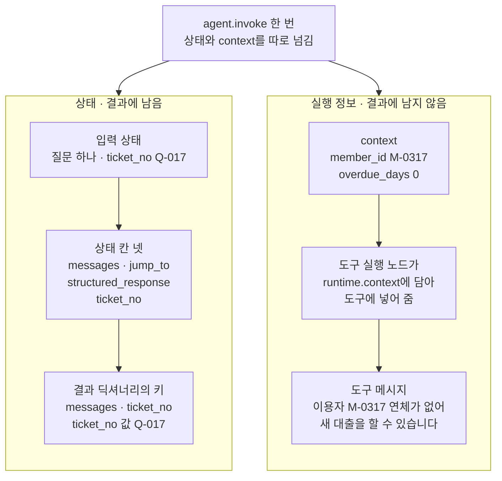
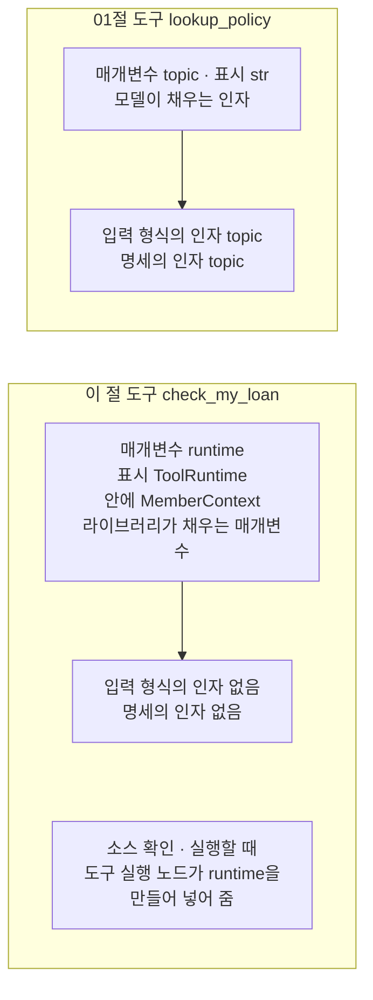
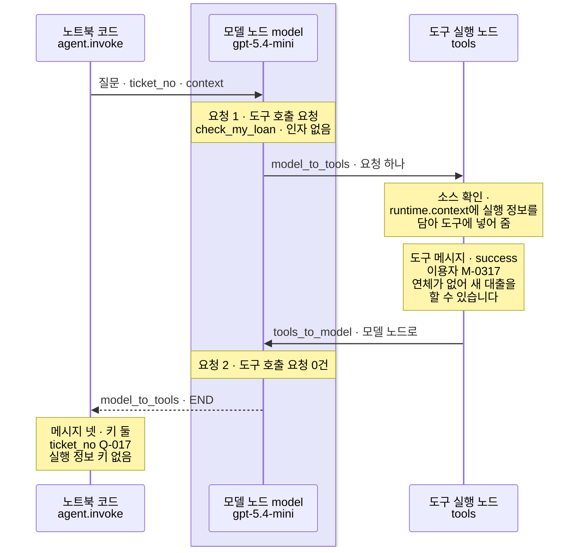
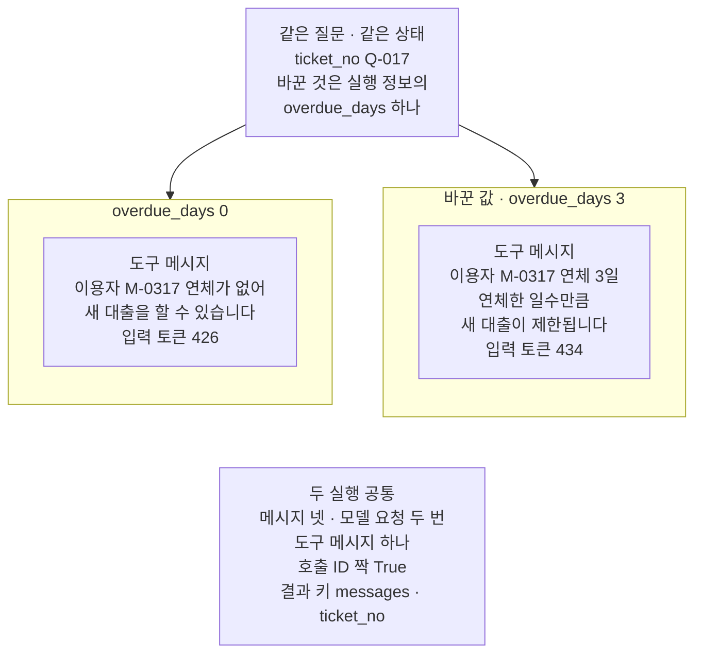

# 03-AgentState와-context-schema

## _src 본문 (HTML 원본)

```html
<!--meta: 강의 1h | 실습 1.5h | 코드 notebooks/03-AgentState와-context-schema.ipynb | 새 용어 3 -->
<style>html,body{overflow-x:hidden}.notebook,.nb-cell,.nb-main,.nb-input,.nb-result{min-width:0;max-width:100%}.nb-input pre,.nb-output{box-sizing:border-box;max-width:100%;overflow-x:auto}code.nb-source{display:block!important;width:100%!important;min-width:0!important;overflow-x:auto!important;padding:0!important}</style>
<h2 id="b1"><span class="no">1</span>학습 목표</h2><div class="goal"><ul>
<li>라이브러리 상태 형식 <code>AgentState</code>에 칸 하나를 더해, 입력에 넣은 값이 결과까지 남는 것을 출력으로 확인할 수 있습니다.</li>
<li>인자 <code>context</code>로 넘긴 실행 정보를 도구가 매개변수 <code>runtime</code>으로 읽게 만들 수 있습니다.</li>
<li>상태 칸과 실행 정보가 결과 딕셔너리와 도구 명세에 남는지를 출력으로 가를 수 있습니다.</li>
</ul></div>
<h2 id="b2"><span class="no">2</span>이 내용을 배우는 이유</h2><p><a href="01-create-agent와-ReAct-루프.html">01절</a>과 <a href="02-구조화-출력-두-전략.html">02절</a>에서 에이전트 그래프에 넘긴 값은 질문 메시지 하나였습니다. 실제 서비스에서는 질문 말고도 누가 묻는지, 어느 문의인지 같은 값이 함께 필요합니다. 이런 값을 질문 글에 섞으면, 모델이 글을 읽고 도구 인자로 옮겨 적어야 합니다.</p><p>모델이 옮겨 적는 값은 틀릴 수 있습니다. 이용자 번호처럼 코드가 이미 아는 값은 모델을 거치지 않고 도구에 바로 넣는 편이 낫습니다. 어느 문의의 답인지 같은 값은 실행이 끝난 뒤에도 결과에서 다시 읽고 싶습니다.</p><p>이 절은 그래프에 값을 넘기는 두 자리를 나눠 봅니다. 하나는 상태에 칸을 더하는 자리이고, 다른 하나는 상태 밖으로 넘기는 실행 정보입니다. 같은 질문을 보내 결과 딕셔너리와 도구 메시지에 무엇이 남는지 셉니다.</p>
<h2 id="b3"><span class="no">3</span>앞에서 배운 내용</h2><p><a href="../../part4/ch13-langgraph-basics/01-StateGraph와-노드-엣지.html">Ch 13 01절</a>에서는 칸만 적은 <code>TypedDict</code>로 상태 형식을 만들었습니다. <a href="../../part4/ch13-langgraph-basics/02-State-갱신.html">02절</a>에서는 규칙을 적지 않은 칸이 새 값으로 덮어써지는 것을 보았습니다. <a href="../../part4/ch13-langgraph-basics/04-add_messages-리듀서.html">04절</a>에서는 메시지 칸에 메시지 리듀서를 적었습니다.</p><p><a href="../../part2/ch06-langchain-start/03-구조화-출력과-검증.html">Ch 6 03절</a>에서는 클래스 이름 뒤 괄호에 <code>BaseModel</code>을 적어 그 틀의 기능을 물려받았습니다. <a href="../../part5/ch19-model-tools/01-tool과-Ch4-함수-재사용.html">Ch 19 01절</a>에서는 도구의 입력 형식(<code>args</code>)과 도구 명세(<code>convert_to_openai_tool</code>)를 보았습니다. <a href="../../part5/ch20-tool-node/02-도구-오류와-ToolMessage.html">Ch 20 02절</a>에서는 받을 오류 표시처럼 라이브러리가 읽는 표시를 보았습니다.</p><p><a href="../../part5/ch20-tool-node/01-ToolNode와-tools-condition.html">Ch 20 01절</a>은 우리가 만든 상태 형식에 <code>AgentState</code>라는 이름을 붙였습니다. 이 절의 <code>AgentState</code>는 이름만 같고, 라이브러리 LangChain이 주는 다른 상태 형식입니다. <a href="01-create-agent와-ReAct-루프.html">01절</a>에서는 설계 객체로 상태 칸 셋을 보았고, <a href="02-구조화-출력-두-전략.html">02절</a>에서는 조건 함수를 보는 함수 <code>print_branches</code>를 적었습니다. 이 절은 그 함수를 도구 파일 <code>runner_tools.py</code>로 옮겨 씁니다.</p>
<h2 id="b4"><span class="no">4</span>핵심 개념</h2><h3>비유로 시작하기</h3><p>01절에서는 에이전트 그래프를 버튼 하나로 도는 세탁기에 견주었습니다. 이번에는 빨래를 맡길 때 함께 건네는 두 가지를 떠올려 봅니다. 하나는 셔츠 깃에 달아 둔 이름표로, 빨래가 끝나 나온 셔츠에도 그대로 달려 있습니다. 다른 하나는 세탁기 윗면 틈에 꽂아 두는 카드로, 기계는 읽지만 셔츠와 함께 나오지 않습니다.</p><p>셔츠에 달린 이름표가 상태에 더한 칸 <code>ticket_no</code>입니다. 입력에 넣은 값이 결과 딕셔너리에 그대로 남습니다. 틈에 꽂은 카드는 실행 정보이고, 도구는 읽지만 결과 딕셔너리의 칸으로는 나오지 않습니다.</p>
{{img:03-5-옷에-남는-이름표와-기계에-남는-카드|회갈색 벽과 옅은 바닥이 보이는 방을 그린 그림입니다. 왼쪽에 흰 앞문형 세탁기 한 대가 크게 서 있고, 윗면 오른쪽에 둥근 버튼 하나, 앞면에 둥근 유리문 하나가 있습니다. 세탁기 윗면 왼쪽 틈에 주황 카드 한 장이 반쯤 꽂혀 있습니다. 세탁기 오른쪽 바닥에는 개어진 하늘색 셔츠 한 벌이 기계와 떨어져 놓여 있고, 셔츠 깃 안쪽에 작은 흰 이름표 하나가 달려 있는 그림|셔츠 깃의 이름표는 빨래가 끝난 뒤에도 셔츠에 남고, 세탁기 틈에 꽂은 카드는 기계에만 남습니다.}}
<p class="look"><b>그림 읽기</b> — 왼쪽에 흰 세탁기 한 대가 있고, 둥근 버튼 하나와 둥근 유리문 하나가 있습니다. 세탁기 윗면 왼쪽 틈에는 주황 카드 한 장이 반쯤 꽂혀 있습니다. 오른쪽 바닥에는 개어진 하늘색 셔츠 한 벌이 기계 밖에 놓여 있고, 깃 안쪽에 작은 흰 이름표 하나가 달려 있습니다. 셔츠와 함께 기계 밖으로 나온 이름표가 결과 딕셔너리에 남은 칸 <code>ticket_no</code>입니다. 기계에 꽂힌 채 셔츠와 떨어져 있는 카드는 실행 정보이고, 결과의 칸으로 나오지 않습니다.</p>
<table><thead><tr><th>말</th><th>뜻</th></tr></thead><tbody><tr><td>라이브러리 상태 형식(AgentState)</td><td>함수 <code>create_agent</code>가 만드는 에이전트 그래프의 상태 형식입니다. 칸 <code>messages</code>·<code>jump_to</code>·<code>structured_response</code>가 적혀 있고, 물려받아 칸을 더할 수 있습니다. 비유에서 세탁기에 넣었다가 꺼내는 셔츠와 같습니다.</td></tr><tr><td>실행 정보(context)</td><td>그래프를 실행할 때 인자 <code>context</code>로 상태 밖에 따로 넘기는 값입니다. 칸은 실행 정보 형식(<code>context_schema</code>)에 적고, 결과 딕셔너리에는 남지 않습니다. 비유에서 세탁기 틈에 꽂는 카드와 같습니다.</td></tr><tr><td>실행 객체 표시(ToolRuntime)</td><td>도구 매개변수 뒤에 적는 <code>: ToolRuntime[…]</code> 같은 표시입니다. 라이브러리가 실행 정보를 담은 객체를 이 매개변수에 넣어 주고, 도구 명세에는 실리지 않습니다. 비유에서 기계가 틈의 카드를 읽는 자리와 같습니다.</td></tr></tbody></table>
<p>새 말을 이 절 코드에서 보면 이렇습니다. 라이브러리 상태 형식은 노트북 4절 <code>class LibraryState(AgentState)</code>의 괄호 안 이름입니다. 실행 정보는 7절 <code>agent.invoke(first_state, context=first_context)</code>의 <code>context</code>입니다. 실행 객체 표시는 5절 도구의 <code>runtime: ToolRuntime[MemberContext]</code>입니다. 인자 이름은 context이지만, <a href="../../part2/ch08-context-engineering/01-컨텍스트와-토큰-예산.html">Ch 8 01절</a>의 컨텍스트(모델이 받은 글 전체)와는 다른 값입니다.</p>
{{mermaid:03-1-상태와-실행-정보가-가는-곳|위에서 아래로 읽는 그림으로 맨 위 파란 상자 agent.invoke 한 번 상태와 context를 따로 넘김에서 칸 둘로 화살표가 갑니다. 왼쪽 칸 상태 결과에 남음에는 초록 상자 입력 상태 질문 하나 ticket_no Q-017, 노란 상자 상태 칸 넷 messages jump_to structured_response ticket_no, 노란 상자 결과 딕셔너리의 키 messages ticket_no와 ticket_no 값 Q-017이 위에서 아래로 이어집니다. 오른쪽 칸 실행 정보 결과에 남지 않음에는 초록 상자 context member_id M-0317 overdue_days 0, 회색 상자 도구 실행 노드가 runtime.context에 담아 도구에 넣어 줌, 노란 상자 도구 메시지 이용자 M-0317 연체가 없어 새 대출을 할 수 있습니다가 위에서 아래로 이어지는 그림|입력 상태에 넣은 칸 ticket_no는 결과 딕셔너리에 남고, context로 넘긴 실행 정보는 도구 메시지 글에만 보입니다.}}
<p class="look"><b>도식 읽기</b> — 위에서 아래로 읽습니다. 맨 위 파란 상자는 우리가 적은 invoke 한 줄이고, 왼쪽 칸이 상태, 오른쪽 칸이 실행 정보입니다. 초록 상자는 우리가 넣은 값이고, 노란 상자는 노트북 6·7절에서 출력으로 확인한 값입니다. 오른쪽 칸 회색 상자는 라이브러리가 하는 일로, 설치판 소스로 본 동작입니다. 왼쪽 칸은 결과 딕셔너리의 키까지 이어지고, 오른쪽 칸은 도구 메시지에서 끝납니다.</p>
<h3>모델이 채우는 인자와 라이브러리가 채우는 매개변수</h3><p>01절 도구의 매개변수 <code>topic</code>은 모델이 도구 호출 요청의 인자로 채웁니다. 그래서 도구 명세에 실려 모델에게 보입니다. 이 절 도구의 매개변수 <code>runtime</code>은 라이브러리가 채우므로, 도구 명세에서 빠집니다. 모델은 이 도구를 인자 없이 부르고, 이용자 번호는 모델을 거치지 않습니다.</p>
{{mermaid:03-2-명세에-실리는-인자와-빠지는-매개변수|위아래 칸 둘이 있는 그림으로 위 칸 01절 도구 lookup_policy에는 파란 상자 매개변수 topic 표시 str 모델이 채우는 인자에서 노란 상자 입력 형식의 인자 topic 명세의 인자 topic으로 화살표가 갑니다. 아래 칸 이 절 도구 check_my_loan에는 파란 상자 매개변수 runtime 표시 ToolRuntime 안에 MemberContext 라이브러리가 채우는 매개변수에서 노란 상자 입력 형식의 인자 없음 명세의 인자 없음으로 화살표가 가고, 그 아래 회색 상자 소스 확인 실행할 때 도구 실행 노드가 runtime을 만들어 넣어 줌이 놓인 그림|모델이 채우는 인자 topic은 도구 명세에 실리고, 라이브러리가 채우는 매개변수 runtime은 명세에서 빠집니다.}}
<p class="look"><b>도식 읽기</b> — 위 칸이 01절 도구, 아래 칸이 이 절 도구입니다. 파란 상자는 우리가 적은 매개변수이고, 노란 상자는 노트북 5절에서 출력한 입력 형식과 명세의 인자입니다. 아래 칸 회색 상자는 설치판 소스로 본 동작이라 화살표로 잇지 않았습니다. 두 칸의 차이는 명세에 인자가 실리는가 하나입니다.</p>
<h3>다른 상황에 적용</h3><p>Ch 19의 주문 조회 도구라면, 고객 번호를 실행 정보로 넘길 수 있습니다. 모델은 주문 상태만 인자로 채우고, 고객 번호는 코드가 넣어 줍니다. 모델이 다른 고객 번호를 인자로 적는 일이 생기지 않습니다. 이 조합은 이번에 실행하지 않았습니다.</p>
<h3>비교와 경계</h3><p>설치판 소스(<code>factory.py</code> 1450~1454행)로 보면, 모델 요청에 싣는 메시지는 시스템 메시지와 메시지 칸뿐입니다. 더한 상태 칸과 실행 정보는 모델 요청에 실리지 않습니다. 다만 도구가 실행 정보로 만든 도구 메시지 글은 메시지 칸에 있어 다음 요청에 실립니다. 두 자리의 차이는 결과 딕셔너리에 남는가입니다.</p><p>도구가 매개변수 <code>runtime</code>으로 상태 칸을 읽는 방법도 있지만, 이번에 실행하지 않았습니다. 설치판 설명(<code>factory.py</code> 916~922행)은 상태를 넓힐 때 미들웨어 쪽을 먼저 권합니다. 미들웨어는 <a href="../ch22-middleware/01-미들웨어와-6개-훅.html">Ch 22</a>에서 배웁니다. 결과 상태를 저장해 다음 실행에 이어 쓰는 방법은 Ch 23에서 배웁니다.</p>
<h2 id="b5"><span class="no">5</span>실행 예제</h2><p>노트북은 먼저 01절과 같은 규정 딕셔너리와 도구를 만듭니다. 칸 하나를 더한 상태 형식과 실행 정보 형식, 실행 정보를 읽는 도구를 적고 도구 명세를 봅니다. 두 형식을 넘긴 에이전트 그래프의 상태 칸과 갈래를 본 뒤, 실행 정보를 넘겨 질문을 보냅니다. 값 바꿔 보기로 연체 일수 하나만 바꿔 다시 보냅니다.</p><p>모델은 01절과 같은 <code>gpt-5.4-mini</code>이고, temperature 0과 추론 끔(<code>reasoning_effort="none"</code>)으로 부릅니다. 교재 출력에서 모델 요청은 모두 4번입니다.</p>
{{notebook:03-AgentState와-context-schema}}
<p class="look"><b>확인할 점</b> — 노트북 6절에서 상태 칸이 넷으로 늘고 노드와 갈래는 01절과 같은지 봅니다. 노트북 7절에서 결과 키 <code>['messages', 'ticket_no']</code>와 빈 인자 <code>{}</code>를 봅니다. 도구 메시지에 이용자 번호가 들어 있고, 실행 정보의 키는 결과에 없는지 확인합니다. 답 글과 출력 토큰은 실행마다 달라질 수 있어 결론에 쓰지 않았습니다.</p>
{{mermaid:03-3-연체-0일-질문의-차례|세로선 셋이 있는 차례 그림으로 왼쪽부터 노트북 코드 agent.invoke, 연보라 띠 안의 모델 노드 model gpt-5.4-mini, 도구 실행 노드 tools입니다. 노트북 코드가 모델 노드에 질문 ticket_no context를 보내고, 노란 메모 요청 1 도구 호출 요청 check_my_loan 인자 없음이 붙습니다. 모델 노드에서 도구 실행 노드로 model_to_tools 요청 하나 화살표가 가고, 노란 메모 소스 확인 runtime.context에 실행 정보를 담아 도구에 넣어 줌과 노란 메모 도구 메시지 success 이용자 M-0317 연체가 없어 새 대출을 할 수 있습니다가 붙습니다. 도구 실행 노드에서 모델 노드로 tools_to_model 화살표가 돌아오고 노란 메모 요청 2 도구 호출 요청 0건이 붙습니다. 모델 노드에서 노트북 코드로 model_to_tools END 점선이 가고, 마지막 노란 메모에 메시지 넷 키 둘 ticket_no Q-017 실행 정보 키 없음이 적힌 그림|모델은 도구를 인자 없이 불렀고, 도구 실행 노드에서 도구가 실행 정보를 읽어 이용자 번호가 든 도구 메시지를 만들었습니다.}}
<p class="look"><b>도식 읽기</b> — 위에서 아래로 읽고, 세로선은 왼쪽부터 노트북 코드, 모델 노드, 도구 실행 노드입니다. 연보라 띠는 실제로 부른 모델 <code>gpt-5.4-mini</code>가 있는 자리입니다. 「소스 확인」이 붙은 메모만 설치판 소스로 본 동작이고, 나머지 노란 메모는 노트북 7절 출력입니다. 요청 1의 인자는 비어 있었지만, 도구 메시지에는 이용자 번호가 들어 있습니다.</p>
<h2 id="b6"><span class="no">6</span>실험 결과 해석</h2><p>실험에서 바꾼 것은 실행 정보의 <code>overdue_days</code> 하나입니다. 모델·도구·시스템 메시지 글·질문·칸 <code>ticket_no</code>의 값은 그대로였습니다.</p>
<table><thead><tr><th>실행</th><th>결과 딕셔너리의 키</th><th>칸 ticket_no</th><th>메시지 수</th><th>응답 수(모델 요청)</th><th>도구 메시지 수</th><th>도구 메시지 글</th><th>입력 토큰</th></tr></thead><tbody><tr><td>연체 0일(7절)</td><td><code>['messages', 'ticket_no']</code></td><td><code>Q-017</code></td><td>4</td><td>2</td><td>1</td><td>이용자 M-0317: 연체가 없어 새 대출을 할 수 있습니다.</td><td>426</td></tr><tr><td>연체 3일(8절, 바꾼 값)</td><td><code>['messages', 'ticket_no']</code></td><td><code>Q-017</code></td><td>4</td><td>2</td><td>1</td><td>이용자 M-0317: 연체 3일. 연체한 일수만큼 새 대출이 제한됩니다.</td><td>434</td></tr></tbody></table>
{{mermaid:03-4-연체-일수만-바꾼-두-실행|맨 위 초록 상자 같은 질문 같은 상태 ticket_no Q-017 바꾼 것은 실행 정보의 overdue_days 하나에서 칸 둘로 화살표가 갑니다. 왼쪽 칸 overdue_days 0의 노란 상자에는 도구 메시지 이용자 M-0317 연체가 없어 새 대출을 할 수 있습니다 입력 토큰 426, 오른쪽 칸 바꾼 값 overdue_days 3의 노란 상자에는 도구 메시지 이용자 M-0317 연체 3일 연체한 일수만큼 새 대출이 제한됩니다 입력 토큰 434가 적혀 있습니다. 맨 아래 회색 상자에는 두 실행 공통 메시지 넷 모델 요청 두 번 도구 메시지 하나 호출 ID 짝 True 결과 키 messages ticket_no가 적힌 그림|실행 정보의 연체 일수 하나만 바꾸자 도구 메시지 글이 바뀌었고, 메시지 수와 모델 요청 수는 두 실행이 같았습니다.}}
<p class="look"><b>도식 읽기</b> — 맨 위 초록 상자는 두 실행에 같았던 조건입니다. 아래 칸 둘은 왼쪽이 7절 실행, 오른쪽이 8절 값 바꿔 보기입니다. 노란 상자는 노트북 7~9절 출력입니다. 맨 아래 회색 상자는 두 칸 출력에서 모두 확인한 공통점입니다. 칸끼리는 화살표로 잇지 않았습니다.</p>
<p>두 실행 모두 결과 딕셔너리에는 칸 <code>ticket_no</code>가 입력 값 그대로 남았습니다. 실행 정보의 키는 결과 딕셔너리에 없었습니다. 실행 정보의 값은 도구가 만든 글 안에서만 보였습니다. 연체 일수를 바꾸자 도구 몸통의 갈래가 바뀌어, 도구 메시지 글이 달라졌습니다.</p><p>모델은 두 실행 모두 도구를 인자 없이 불렀고, 모델 요청은 2번씩이었습니다. 입력 토큰은 두 실행에서 8 달랐지만, 어느 몫이 몇 토큰인지는 나눠 세지 않았습니다. 라이브러리가 실행 객체를 만들어 넣는 자리와 명세에서 매개변수를 빼는 자리는 소스로 본 사실입니다.</p><p>새 커널로 두 번 실행했을 때 표의 값은 두 번 모두 같았습니다. 노트북 밖에서 두 설정을 다섯 번씩 보냈을 때도 같았습니다. 답 글과 출력 토큰은 이 표에 넣지 않았습니다.</p>
<h2 id="b7"><span class="no">7</span>주의할 점과 실무 메모</h2><ul><li>노트북을 실행하기 전에 노트북 밖에서 두 설정을 다섯 번씩 보냈습니다. 메시지 종류와 차례, 도구 요청 이름과 빈 인자, 도구 메시지 글, 입력 토큰이 다섯 번 모두 같았습니다. 같은 요청도 실행한 때에 따라 모델이 도구를 부르지 않을 수 있습니다. 그때는 도구 메시지가 없어, 실행 정보가 도구에 들어가는 장면이 보이지 않습니다.</li><li>질문, 문의 번호, 이용자 번호, 연체 일수, 도구 글은 흐름을 보여 주려고 정한 예입니다. 모두 노트북 밖 확인 전에 정했습니다.</li><li>셀의 <code>assert</code>는 칸 <code>ticket_no</code>의 값, 도구 메시지 속 이용자 번호, 호출 ID 짝에만 걸었습니다. 도구 메시지에 건 것은 도구가 실행됐을 때만 확인합니다. 모델이 쓴 답 글에는 걸지 않았습니다.</li><li>실행 정보가 도구에 들어가는 것은 도구 메시지 출력으로 보았습니다. 도구 실행 노드가 실행 객체를 만드는 자리와 명세에서 매개변수를 빼는 자리는 소스로만 확인했습니다. 모델 요청에 실행 정보가 실리지 않는 것도 소스로만 확인했습니다.</li><li>표시를 대괄호 없이 <code>ToolRuntime</code>만 적어도 값은 들어갑니다. 이 판에서는 그때 라이브러리 안에서 Pydantic 경고 두 건이 나왔습니다. 노트북 밖에서 모델을 부르지 않고 확인했고, 이번 노트북에서는 실행하지 않았습니다.</li><li>인자 <code>context</code>를 빼고 부르면 도구 안에서 실행 정보를 읽다 오류가 났습니다. 이것도 노트북 밖에서 모델을 부르지 않고 확인했고, 이번에 실행하지 않았습니다.</li><li>상태를 넓히는 다른 길인 미들웨어는 Ch 22에서, 결과 상태를 저장하는 방법은 Ch 23에서 배웁니다. 이 절의 칸 <code>ticket_no</code>는 실행 한 번 안에서만 보았습니다.</li><li>두 실행의 입력 토큰 차이가 어느 몫에서 왔는지는 나눠 세지 않았습니다. 걸린 시간도 재지 않았습니다.</li><li>함수 <code>print_branches</code>는 02절 노트북의 본문을 글자 그대로 도구 파일로 옮긴 것입니다. 함수 <code>estimate_cost</code>는 <a href="../../part2/ch06-langchain-start/06-토큰-비용-지연-비교.html">Ch 6 06절</a>에서 배웠습니다.</li><li>예상 비용은 2026-09-17 요금표로 어림하면 노트북 한 번에 0.01달러 아래이고, 청구 금액이 아닙니다.</li><li>교재 출력은 Linux의 Python 3.12.13으로 만들었습니다. 다른 판과 Windows·macOS에서는 이번에 실행하지 않았습니다.</li></ul>
<h2 id="b8"><span class="no">8</span>정리와 다음 절</h2><ul><li>라이브러리 상태 형식 <code>AgentState</code>를 물려받아 칸 <code>ticket_no</code>를 더하자, 입력에 넣은 값이 결과에 남았습니다.</li><li>인자 <code>context</code>로 넘긴 실행 정보는 도구 매개변수 <code>runtime</code>으로 들어갔고, 결과의 칸으로는 남지 않았습니다.</li><li>실행 정보의 연체 일수만 바꾸자 도구 메시지 글이 바뀌었고, 모델 요청은 두 실행 모두 2번이었습니다.</li></ul><p><strong>다음 학습과 이어지는 지점</strong> — <a href="04-0x에서-1x로-마이그레이션.html">04절</a>에서는 옛 판의 에이전트 함수에서 지금 판 <code>create_agent</code>로 옮길 때 무엇이 바뀌는지 봅니다.</p>
<h2 id="b9"><span class="no">9</span>복습 문제</h2><details class="quiz" open><summary>문제 4개 · 해설 포함</summary><p class="quiz-q">1. 칸 <code>ticket_no</code>를 더한 상태 형식을 넘기자, 설계 객체의 상태 칸은 어떻게 바뀌었나요?</p><p class="quiz-a">칸 셋 <code>messages</code>·<code>jump_to</code>·<code>structured_response</code> 뒤에 <code>ticket_no</code>가 더해져 넷이 되었습니다. 노드와 갈래는 01절과 같았습니다. 틀렸다면 노트북 6절을 다시 읽습니다.</p><p class="quiz-q">2. 모델은 도구 <code>check_my_loan</code>에 어떤 인자를 채웠고, 이용자 번호는 어떻게 도구에 들어갔나요?</p><p class="quiz-a">모델은 인자를 하나도 채우지 않았고, 출력은 <code>{}</code>였습니다. 이용자 번호는 인자 <code>context</code>로 넘긴 실행 정보에 있었고, 라이브러리가 매개변수 <code>runtime</code>에 넣어 주었습니다. 틀렸다면 노트북 5절과 7절을 다시 읽습니다.</p><p class="quiz-q">3. 실행 정보의 값은 결과의 어디에서 보였나요?</p><p class="quiz-a">결과 딕셔너리의 키에는 없었고, 도구가 만든 도구 메시지 글 안에서만 보였습니다. 칸 <code>ticket_no</code>가 결과 딕셔너리의 키로 남은 것과 다릅니다. 틀렸다면 노트북 7절을 다시 읽습니다.</p><p class="quiz-q">4. 연체 일수만 0에서 3으로 바꾸자 무엇이 달라지고 무엇이 같았나요?</p><p class="quiz-a">도구 메시지 글이 연체 규정 글을 붙인 글로 바뀌었습니다. 메시지 수 넷, 모델 요청 2번, 칸 <code>ticket_no</code>의 값은 같았습니다. 틀렸다면 노트북 8절을 다시 읽습니다.</p></details>
<h2 id="b10"><span class="no">10</span>참고 자료</h2><ul><li><div><a href="https://docs.langchain.com/oss/python/langchain/agents">LangChain Agents</a></div>확인 2026-09-25 · <code>AgentState</code>를 물려받아 <code>state_schema</code>로 넘기는 법과 <code>context</code>를 설명합니다.</li><li><div><a href="https://docs.langchain.com/oss/python/langchain/tools">LangChain Tools</a></div>확인 2026-09-25 · 매개변수 <code>runtime</code>이 모델에게 보이지 않는다고 적습니다.</li><li>langchain 1.4.0 소스 <code>langchain/agents/middleware/types.py</code> 349~355행 — <code>AgentState</code>의 칸 셋입니다.</li><li>같은 판 <code>langchain/agents/factory.py</code> 916~922행은 인자 <code>state_schema</code> 설명입니다.</li><li>같은 소스 1174~1192행은 상태 형식과 실행 정보 형식을 그래프에 넘기는 자리입니다.</li><li>같은 소스 1450~1454행은 모델 요청에 싣는 메시지입니다.</li><li>langgraph-prebuilt 1.1.0 소스 <code>langgraph/prebuilt/tool_node.py</code> 802~817행 — 실행 객체를 만드는 자리입니다.</li><li>같은 소스 1663~1720행은 <code>ToolRuntime</code> 설명입니다.</li><li>langchain-core 1.6.2 소스 <code>langchain_core/tools/base.py</code> 331~340행 — 명세에서 매개변수를 빼는 자리입니다.</li><li>Ch 13 01·04절에서 상태 형식을, Ch 19 01절에서 입력 형식과 도구 명세를 보았습니다.</li><li>01절에서 설계 객체와 함수 <code>agent_row</code>를, 02절에서 함수 <code>print_branches</code>를 보았습니다.</li></ul>
```

## 노트북 셀 (순서대로)

### [0] markdown {'html': 'skip'}

# AgentState와 context_schema

**이 노트북에서 할 일**

1. 라이브러리 상태 형식 `AgentState`에 칸 하나를 더해, 입력에 넣은 값이 결과까지 남는지 봅니다.
2. 실행할 때 상태 밖으로 넘긴 값(실행 정보)을 도구가 읽고, 결과에는 남지 않는지 봅니다.
3. 실행 정보의 값 하나만 바꿔, 도구 메시지가 어떻게 달라지는지 봅니다.

**준비물** — 프로젝트 폴더의 `.env` 파일에 `OPENAI_API_KEY`가 있어야 합니다.
모델은 `gpt-5.4-mini`이고, 교재 출력에서 모델 요청은 모두 4번입니다.
7절에서 2번, 8절에서 2번을 보냈습니다.
모델이 도구를 부르지 않으면 요청 수가 달라질 수 있습니다.
요금표로 어림한 예상 비용은 모두 합쳐 0.01달러 아래이고, 청구 금액이 아닙니다.

도구는 노트북 안 규정 딕셔너리와 실행 정보를 읽기만 하고, 읽는 파일과 새로 쓰는 파일은 없습니다.
앞에서 배운 함수 다섯은 도구 파일 `runner_tools.py`에서 가져옵니다.
교재 출력을 만든 실행에서는 노트북 전체가 10초 안에 끝났습니다.
모델 응답을 기다리는 시간은 네트워크와 실행 때에 따라 달라집니다.

**기준 버전** — 첫 셀에서 패키지 여섯을 설치합니다.
판은 langchain 1.4.0, langchain-core 1.6.2, langchain-openai 1.6.0입니다.
langgraph 1.2.11, numpy 2.5.3, python-dotenv 1.2.3도 함께 설치합니다.
교재 출력은 Linux의 Python 3.12.13으로 만들었습니다.
다른 판과 Windows·macOS에서는 이번에 실행하지 않았습니다.

**강의와 실습 범위** — 강의 시간에는 3~6절을 읽습니다.
상태 형식과 실행 정보 형식, 도구를 적고 에이전트 그래프의 모양을 보는 자리입니다.
7~9절은 실행 정보를 넘겨 질문을 보내고 값 하나를 바꿔 보는 자리이고, 실습 시간에 실행합니다.

실습 폴더 `labs/part6/ch21-create-agent`에서 `uv sync --locked`를 실행합니다.
그다음 `notebooks/` 폴더의 이 노트북을 열고, 실습 폴더의 `.venv` 커널을 고릅니다.
첫 셀부터 순서대로 실행합니다.

### [1] markdown {'html': 'skip'}

## 오늘 볼 그림


위에서 아래로 읽습니다.
맨 위 파란 상자는 우리가 적은 invoke 한 줄이고, 왼쪽 칸이 상태, 오른쪽 칸이 실행 정보입니다.
초록 상자는 우리가 넣은 값이고, 노란 상자는 노트북 6·7절에서 출력으로 확인한 값입니다.
오른쪽 칸 회색 상자는 라이브러리가 하는 일로, 설치판 소스로 본 동작입니다.
왼쪽 칸은 결과 딕셔너리의 키까지 이어지고, 오른쪽 칸은 도구 메시지에서 끝납니다.

### [2] markdown {}

## 1. 준비

01절에서는 함수 `create_agent`로 에이전트 그래프를 만들었습니다.
그때 그래프에 넘긴 값은 질문 메시지 하나뿐이었습니다.
이 절에서는 질문 말고 다른 값을 그래프에 넘기는 두 자리를 봅니다.
하나는 상태에 칸을 더해 넘기는 자리이고, 다른 하나는 상태 밖으로 따로 넘기는 자리입니다.

첫 셀은 패키지 여섯 개를 설치하고 설치된 판 번호를 출력합니다.
도구 파일이 NumPy를 쓰므로, 01절처럼 numpy도 함께 설치합니다.
설치에는 몇십 초가 걸릴 수 있습니다.

### [3] code {'execution': {'iopub.execute_input': '2026-09-25T06:41:59.643736Z', 'iopub.status.busy': '2026-09-25T06:41:59.643540Z', 'iopub.status.idle': '2026-09-25T06:42:00.279045Z', 'shell.execute_reply': '2026-09-25T06:42:00.278417Z'}, 'lesson_role': 'setup'}

```python
# 이 절에서 쓰는 패키지를 설치하고 버전을 확인합니다
%pip install -q "langchain==1.4.0" "langchain-core==1.6.2" "langchain-openai==1.6.0" "langgraph==1.2.11" "numpy==2.5.3" "python-dotenv==1.2.3"
from importlib.metadata import version

print("langchain:", version("langchain"))
print("langchain-core:", version("langchain-core"))
print("langchain-openai:", version("langchain-openai"))
print("langgraph:", version("langgraph"))
print("numpy:", version("numpy"))
print("python-dotenv:", version("python-dotenv"))
```

출력:
```
Note: you may need to restart the kernel to use updated packages.
langchain: 1.4.0
langchain-core: 1.6.2
langchain-openai: 1.6.0
langgraph: 1.2.11
numpy: 2.5.3
python-dotenv: 1.2.3

```

### [4] markdown {}

**결과 읽기** — 출력 줄 `langchain: 1.4.0`·`langchain-core: 1.6.2`·`langchain-openai: 1.6.0`이 보입니다.
출력 줄 `langgraph: 1.2.11`·`numpy: 2.5.3`·`python-dotenv: 1.2.3`도 잠금과 같은 판입니다.
이 노트북의 출력은 2026-09-25에 이 판으로 실행한 결과입니다.

다음 셀은 이 절에서 쓸 이름을 가져옵니다.
이름 `TypedDict`는 Ch 13 01절에서 상태 형식을 적을 때 썼습니다.
함수 `convert_to_openai_tool`은 Ch 19 01절에서 도구 명세를 볼 때 썼습니다.
새 이름은 라이브러리 상태 형식 `AgentState`와 도구 매개변수 표시 `ToolRuntime` 둘입니다.

### [5] code {'execution': {'iopub.execute_input': '2026-09-25T06:42:00.280200Z', 'iopub.status.busy': '2026-09-25T06:42:00.280093Z', 'iopub.status.idle': '2026-09-25T06:42:00.946371Z', 'shell.execute_reply': '2026-09-25T06:42:00.943526Z'}, 'lesson_role': 'setup'}

```python
# 상태 형식과 실행 정보 형식을 적을 이름, 에이전트와 도구를 만드는 이름을 가져옵니다
from typing_extensions import TypedDict

from langchain.agents import AgentState, create_agent, middleware
from langchain.chat_models import init_chat_model
from langchain.messages import HumanMessage
from langchain.tools import ToolRuntime, tool
from langchain_core.utils.function_calling import convert_to_openai_tool

# 앞에서 배운 함수는 도구 파일에서 가져옵니다
from runner_tools import agent_row, estimate_cost, print_branches, show_messages, sum_usage

print("이 절에서 새로 가져온 이름:", "AgentState", "ToolRuntime")
```

출력:
```
이 절에서 새로 가져온 이름: AgentState ToolRuntime

```

### [6] markdown {}

**결과 읽기** — 출력 줄 `이 절에서 새로 가져온 이름: AgentState ToolRuntime`이 보입니다.
함께 가져온 모듈 `middleware`는 4절에서 클래스 하나를 견줄 때만 씁니다.

앞에서 배운 함수는 `runner_tools.py`에 모아 두었습니다. 파일을 열면 코드를 볼 수 있습니다. 노트북과 같은 폴더(`notebooks/`)에 있는 파일입니다. 커널이 `notebooks/` 폴더에서 시작해야 이 파일을 가져올 수 있습니다.

함수 `show_messages`는 Ch 19 06절, `sum_usage`는 Ch 19 05절에서 배웠습니다.
함수 `estimate_cost`는 Ch 6 06절, `agent_row`는 01절 10절에서 배웠습니다.
함수 `print_branches`는 02절 6절에서 처음 적은 함수입니다.
이 절부터 다시 쓰므로, 본문을 글자 그대로 도구 파일에 옮겼습니다.

## 2. 키와 모델 준비

모델은 01절과 같은 `gpt-5.4-mini`이고, 과정의 같은 설정으로 부릅니다.
이렇게 만든 모델 객체를 이 절의 에이전트 그래프에 넘깁니다.

### [7] markdown {}

API 키가 있는지 확인합니다. `True` 값이 나오면 다음으로 넘어갑니다.

### [8] code {'execution': {'iopub.execute_input': '2026-09-25T06:42:00.947573Z', 'iopub.status.busy': '2026-09-25T06:42:00.947456Z', 'iopub.status.idle': '2026-09-25T06:42:00.952012Z', 'shell.execute_reply': '2026-09-25T06:42:00.951804Z'}, 'lesson_role': 'setup'}

```python
# .env 파일에서 OpenAI API 키를 읽습니다(키 값은 출력하지 않습니다)
import os
from dotenv import find_dotenv, load_dotenv

env_path = find_dotenv(usecwd=True)
load_dotenv(env_path)
has_key = os.getenv("OPENAI_API_KEY") is not None
print("OPENAI_API_KEY 설정 여부:", has_key)
assert has_key, "프로젝트 폴더의 .env 파일에 OPENAI_API_KEY를 적어 주세요."
```

출력:
```
OPENAI_API_KEY 설정 여부: True

```

### [9] markdown {}

실습에 쓸 모델을 준비합니다.
temperature 값을 0으로 두어도, 모델이 쓰는 답 글이 매번 같다고 보장하지는 않습니다.

### [10] code {'execution': {'iopub.execute_input': '2026-09-25T06:42:00.952596Z', 'iopub.status.busy': '2026-09-25T06:42:00.952550Z', 'iopub.status.idle': '2026-09-25T06:42:01.852959Z', 'shell.execute_reply': '2026-09-25T06:42:01.852561Z'}}

```python
# 실습에 쓸 모델을 준비합니다
model = init_chat_model(
    "openai:gpt-5.4-mini",
    temperature=0,
    reasoning_effort="none",
)
print("모델 이름:", model.model_name)
print("temperature:", model.temperature)
```

출력:
```
모델 이름: gpt-5.4-mini
temperature: 0.0

```

### [11] markdown {}

**결과 읽기** — 모델 이름 `gpt-5.4-mini`, temperature `0.0`이 보이면 준비가 끝났습니다.
이 노트북의 출력은 2026-09-25에 이 모델로 실행한 결과입니다.

### [12] markdown {}

## 3. 규정 자료와 01절 도구

이 절도 01절의 자료실 규정 셋을 씁니다.
5절에서 만드는 도구가 이 딕셔너리의 연체 규정 글을 읽기 때문입니다.
다음 셀은 01절 3절 셀과 글자까지 같은 코드입니다.

### [13] code {'execution': {'iopub.execute_input': '2026-09-25T06:42:01.853735Z', 'iopub.status.busy': '2026-09-25T06:42:01.853668Z', 'iopub.status.idle': '2026-09-25T06:42:01.855693Z', 'shell.execute_reply': '2026-09-25T06:42:01.855387Z'}}

```python
# 교육센터 자료실 규정 셋을, 주제어를 키로 한 딕셔너리에 담습니다(도구가 읽기만 하는 자료)
POLICIES = {
    "대출": "일반 도서는 1인 5권까지 14일 동안 대출할 수 있습니다.",
    "운영": "평일은 09:00~20:00, 토요일은 10:00~17:00에 운영합니다.",
    "연체": "연체한 일수만큼 새 대출이 제한됩니다.",
}
topics = list(POLICIES.keys())
print("규정 주제어:", topics)
```

출력:
```
규정 주제어: ['대출', '운영', '연체']

```

### [14] markdown {}

**결과 읽기** — 출력 줄 `규정 주제어: ['대출', '운영', '연체']`로 키 셋을 확인합니다.
5절 도구는 이 가운데 키 `연체`의 글을 읽습니다.

다음 셀도 01절 3절의 도구 셀과 글자까지 같은 코드입니다.
이 절의 에이전트 그래프에는 넣지 않고, 5절에서 도구 명세를 견줄 때만 씁니다.

### [15] code {'execution': {'iopub.execute_input': '2026-09-25T06:42:01.856248Z', 'iopub.status.busy': '2026-09-25T06:42:01.856198Z', 'iopub.status.idle': '2026-09-25T06:42:01.858765Z', 'shell.execute_reply': '2026-09-25T06:42:01.858525Z'}}

```python
# 주제어 하나로 규정 글 하나를 찾는 도구를 만듭니다(맨 @tool 줄 — Ch 19 01절)
@tool
def lookup_policy(topic: str):
    """교육센터 자료실 규정 하나를 주제어로 찾습니다. topic에는 대출, 운영, 연체 가운데 하나를 넣습니다."""
    # 딕셔너리에 없는 주제어면 오류를 냅니다(이 오류를 그래프 안에서 다루는 법은 Ch 20 02절에서 보았습니다)
    if topic not in POLICIES:
        raise ValueError("지원하지 않는 주제: " + topic)
    return POLICIES[topic]
```

출력:
```

```

### [16] markdown {}

**결과 읽기** — 정의 셀이라 출력이 없습니다.
매개변수 `topic`은 01절에서 모델이 도구 호출 요청의 인자로 채운 값이었습니다.

## 4. 상태 칸 하나 더하기

01절 5절에서 에이전트 그래프의 상태 칸은 `messages`·`jump_to`·`structured_response` 셋이었습니다.
이 칸 셋을 적은 상태 형식이 라이브러리 LangChain의 `AgentState`입니다.
Ch 13 04절 상태 형식처럼, 메시지 칸에 메시지 리듀서를 적은 `TypedDict`입니다.

Ch 20 01절에서는 우리가 만든 상태 형식에 `AgentState`라는 이름을 붙였습니다.
이 절에서 가져온 `AgentState`는 이름만 같고, 라이브러리가 주는 다른 상태 형식입니다.
다음 셀은 이 클래스가 Ch 22에서 가져오는 자리의 클래스와 같은지 봅니다.

### [17] code {'execution': {'iopub.execute_input': '2026-09-25T06:42:01.859403Z', 'iopub.status.busy': '2026-09-25T06:42:01.859338Z', 'iopub.status.idle': '2026-09-25T06:42:01.860936Z', 'shell.execute_reply': '2026-09-25T06:42:01.860612Z'}}

```python
# 이 절의 AgentState가 Ch 22가 가져오는 자리(langchain.agents.middleware)의 AgentState와 같은 클래스인지 봅니다
same_class = AgentState is middleware.AgentState
print("두 자리의 AgentState가 같은 클래스인가:", same_class)
```

출력:
```
두 자리의 AgentState가 같은 클래스인가: True

```

### [18] markdown {}

**결과 읽기** — 출력 줄 `두 자리의 AgentState가 같은 클래스인가: True`입니다.
모듈 `langchain.agents`와 `langchain.agents.middleware`는 같은 클래스를 내놓습니다.
Ch 22에서 미들웨어 함수의 표시로 쓰는 `AgentState`도 이 클래스입니다.

상태 형식을 넓힌다는 것은 라이브러리 상태 형식의 칸을 그대로 두고 칸을 더하는 일입니다.
자료실 창구에서 문의마다 번호를 적어 두면, 답을 받은 뒤에도 어느 문의의 답인지 찾을 수 있습니다.
다음 셀은 `AgentState`를 물려받아 문의 번호 칸 `ticket_no`를 더한 상태 형식을 적습니다.

클래스 이름 뒤 괄호에 `AgentState`를 적으면, 그 틀의 칸 셋을 물려받은 상태 형식이 됩니다.
Ch 6 03절에서 괄호에 `BaseModel`을 적은 것과 같은 모양입니다.
칸만 적고 메서드는 넣지 않습니다.

### [19] code {'execution': {'iopub.execute_input': '2026-09-25T06:42:01.861492Z', 'iopub.status.busy': '2026-09-25T06:42:01.861447Z', 'iopub.status.idle': '2026-09-25T06:42:01.862912Z', 'shell.execute_reply': '2026-09-25T06:42:01.862573Z'}, 'upgrade_allow': ['class_def']}

```python
# 라이브러리 상태 형식 AgentState에 칸 하나를 더한 상태 형식을 적습니다(칸만 적고 메서드는 없음)
class LibraryState(AgentState):
    # 문의 번호 칸: 입력에 넣고 결과에서 다시 읽을 값입니다(규칙을 적지 않아 덮어쓰는 칸)
    ticket_no: str
```

출력:
```

```

### [20] markdown {}

**결과 읽기** — 정의 셀이라 출력이 없습니다.
칸 `ticket_no`에는 규칙을 적지 않았으므로, Ch 13 02절처럼 새 값이 오면 덮어쓰는 칸입니다.
이 상태 형식은 6절에서 인자 `state_schema`로 넘깁니다.

## 5. 실행 정보와 실행 정보를 읽는 도구

실행 정보(context)는 그래프를 실행할 때 상태 밖으로 따로 넘기는 값입니다.
출입 카드로 이미 확인한 이용자 번호처럼, 질문에 적지 않아도 도구가 알아야 하는 값이 여기에 들어갑니다.
이 노트북에서는 이용자 번호와 연체 일수를 실행 정보로 넘깁니다.

인자 이름은 context이지만, Ch 8 01절의 컨텍스트(모델이 받은 글 전체)와는 다른 값입니다.
설치판 소스(`factory.py` 1450~1454행)로 보면, 모델 요청에 싣는 메시지는 시스템 메시지와 메시지 칸뿐입니다.
실행 정보는 모델 요청에 실리지 않습니다.

다음 셀은 실행 정보의 칸을 적는 실행 정보 형식을 적습니다.
Ch 13 01절 상태 형식과 같은 `TypedDict` 모양이라 새 문법은 없습니다.

### [21] code {'execution': {'iopub.execute_input': '2026-09-25T06:42:01.863529Z', 'iopub.status.busy': '2026-09-25T06:42:01.863474Z', 'iopub.status.idle': '2026-09-25T06:42:01.864942Z', 'shell.execute_reply': '2026-09-25T06:42:01.864739Z'}}

```python
# 실행할 때 상태 밖으로 넘길 값(실행 정보)의 칸을 적습니다(Ch 13 상태 형식과 같은 모양)
class MemberContext(TypedDict):
    # 이용자 번호와, 지금까지 연체한 일수입니다
    member_id: str
    overdue_days: int
```

출력:
```

```

### [22] markdown {}

**결과 읽기** — 정의 셀이라 출력이 없습니다.
칸은 `member_id`와 `overdue_days` 둘입니다.
이 형식은 6절에서 인자 `context_schema`로 넘기고, 실행할 때는 이 칸을 키로 한 딕셔너리를 넘깁니다.

다음 셀은 실행 정보를 읽는 도구를 만듭니다.
도구 매개변수에 표시 `ToolRuntime`을 붙이면, 라이브러리가 실행 정보를 담은 객체를 넣어 줍니다.
이 매개변수는 모델이 채우는 인자가 아니고, 이 절에서는 이 표시를 실행 객체 표시라고 부릅니다.
Ch 20 02절의 받을 오류 표시처럼, 라이브러리가 표시를 읽고 하는 일을 정하는 자리입니다.

대괄호 안의 `MemberContext`는 Ch 13 04절 `list[AnyMessage]`처럼 안에 든 값의 형식을 적은 것입니다.
도구 안에서 `runtime.context`는 실행할 때 넘긴 딕셔너리이고, 키로 값을 꺼냅니다.

### [23] code {'execution': {'iopub.execute_input': '2026-09-25T06:42:01.865479Z', 'iopub.status.busy': '2026-09-25T06:42:01.865434Z', 'iopub.status.idle': '2026-09-25T06:42:01.872097Z', 'shell.execute_reply': '2026-09-25T06:42:01.871818Z'}}

```python
# 실행 정보에서 이용자 번호와 연체 일수를 읽어, 새 대출을 할 수 있는지 알려 주는 도구를 만듭니다
@tool
def check_my_loan(runtime: ToolRuntime[MemberContext]):
    """자료실 이용자 본인이 지금 새 책을 빌릴 수 있는지 확인합니다."""
    # 실행 정보는 딕셔너리로 넘어오므로 키로 꺼냅니다
    member = runtime.context["member_id"]
    days = runtime.context["overdue_days"]
    if days == 0:
        return "이용자 " + member + ": 연체가 없어 새 대출을 할 수 있습니다."
    # 연체가 있으면 3절 규정 딕셔너리의 연체 규정 글을 붙입니다
    return "이용자 " + member + ": 연체 " + str(days) + "일. " + POLICIES["연체"]
```

출력:
```

```

### [24] markdown {}

**결과 읽기** — 정의 셀이라 출력이 없습니다.
도구 이름은 `check_my_loan`이고, 연체 일수가 0이면 새 대출을 할 수 있다는 글을 내놓습니다.
연체 일수가 0이 아니면 3절 딕셔너리의 연체 규정 글을 붙여 내놓습니다.

표시를 대괄호 없이 `ToolRuntime`만 적어도 값은 똑같이 들어갑니다.
이 판에서는 그때 라이브러리 안에서 Pydantic 경고 두 건이 함께 나와, 대괄호로 형식을 적었습니다.
이 비교는 노트북 밖에서 모델을 부르지 않고 확인했고, 이번 노트북에서는 실행하지 않았습니다.

다음 셀은 Ch 19 01절처럼 두 도구의 입력 형식과 도구 명세를 봅니다.
도구 명세는 모델 요청에 실려, 모델이 도구와 인자를 고를 때 보는 글입니다.

### [25] code {'execution': {'iopub.execute_input': '2026-09-25T06:42:01.872626Z', 'iopub.status.busy': '2026-09-25T06:42:01.872573Z', 'iopub.status.idle': '2026-09-25T06:42:01.874827Z', 'shell.execute_reply': '2026-09-25T06:42:01.874594Z'}}

```python
# 두 도구에서 모델이 채울 인자(입력 형식)와, 모델 요청에 실릴 도구 명세의 인자를 나란히 봅니다(Ch 19 01절)
for one_tool in [lookup_policy, check_my_loan]:
    arg_names = list(one_tool.args.keys())
    tool_spec = convert_to_openai_tool(one_tool)
    spec_args = tool_spec["function"]["parameters"]["properties"]
    spec_names = list(spec_args.keys())
    print(one_tool.name, "| 입력 형식의 인자:", arg_names, "| 명세의 인자:", spec_names)
```

출력:
```
lookup_policy | 입력 형식의 인자: ['topic'] | 명세의 인자: ['topic']
check_my_loan | 입력 형식의 인자: [] | 명세의 인자: []

```

### [26] markdown {}

**결과 읽기** — 출력 줄 `lookup_policy | 입력 형식의 인자: ['topic'] | 명세의 인자: ['topic']`입니다.
출력 줄 `check_my_loan | 입력 형식의 인자: [] | 명세의 인자: []`로, 매개변수 `runtime`은 둘 다에 없습니다.
그래서 모델은 이 도구를 인자 없이 부르게 되고, 값은 라이브러리가 넣어 줍니다.

설치판 소스(`langchain_core/tools/base.py` 331~340행)로 보면, 명세를 만들 때 이런 매개변수를 뺍니다.
도구를 실행할 때 실행 객체를 만들어 넣는 곳은 도구 실행 노드입니다(`tool_node.py` 802~817행).

## 6. 두 형식을 붙인 에이전트 그래프

시스템 메시지 글은 01절 4절 글과 앞 문장이 같고, 뒤 문장만 이 절 도구에 맞게 고쳤습니다.
이 절의 에이전트 그래프에는 도구를 하나만 넣습니다.
모델이 도구를 부르는지를 한 가지로 보기 위해서입니다.

다음 셀은 두 형식을 인자 `state_schema`와 `context_schema`로 넘겨 에이전트 그래프를 만듭니다.

### [27] code {'execution': {'iopub.execute_input': '2026-09-25T06:42:01.875352Z', 'iopub.status.busy': '2026-09-25T06:42:01.875292Z', 'iopub.status.idle': '2026-09-25T06:42:01.880912Z', 'shell.execute_reply': '2026-09-25T06:42:01.880585Z'}}

```python
# 도구·상태 형식·실행 정보 형식을 넘겨 에이전트 그래프를 만듭니다(요청은 아직 보내지 않음)
system_text = "교육센터 자료실 안내 도우미입니다. 이용자가 지금 새 책을 빌릴 수 있는지 물으면 check_my_loan 도구로 확인한 결과에 근거해 답하세요."
agent = create_agent(
    model,
    tools=[check_my_loan],
    system_prompt=system_text,
    state_schema=LibraryState,
    context_schema=MemberContext,
)
print("만든 것의 종류:", type(agent).__name__)
```

출력:
```
만든 것의 종류: CompiledStateGraph

```

### [28] markdown {}

**결과 읽기** — 출력 줄 `만든 것의 종류: CompiledStateGraph`로, 01절과 같은 종류의 그래프입니다.
이 줄에서도 모델 요청은 나가지 않습니다.

다음 셀은 두 인자를 빼고 만든 그래프를 하나 더 만들어, 상태 칸을 견줍니다.

### [29] code {'execution': {'iopub.execute_input': '2026-09-25T06:42:01.881404Z', 'iopub.status.busy': '2026-09-25T06:42:01.881360Z', 'iopub.status.idle': '2026-09-25T06:42:01.884625Z', 'shell.execute_reply': '2026-09-25T06:42:01.884364Z'}}

```python
# 두 형식을 넘기지 않은 그래프를 하나 더 만들어 상태 칸을 견줍니다(요청은 보내지 않음)
plain_agent = create_agent(model, tools=[check_my_loan], system_prompt=system_text)
print("넘기지 않은 그래프의 상태 칸:", list(plain_agent.builder.channels))
print("넘긴 그래프의 상태 칸:", list(agent.builder.channels))
```

출력:
```
넘기지 않은 그래프의 상태 칸: ['messages', 'jump_to', 'structured_response']
넘긴 그래프의 상태 칸: ['messages', 'jump_to', 'structured_response', 'ticket_no']

```

### [30] markdown {}

**결과 읽기** — 출력 줄 `넘기지 않은 그래프의 상태 칸: ['messages', 'jump_to', 'structured_response']`는 01절 5절과 같습니다.
출력 줄 `넘긴 그래프의 상태 칸: ['messages', 'jump_to', 'structured_response', 'ticket_no']`에 칸이 하나 더해졌습니다.
실행 정보의 칸 `member_id`·`overdue_days`는 상태 칸이 아니어서 이 목록에 없습니다.
설치판 소스(`factory.py` 1174~1192행)로 보면, 상태 형식은 그래프의 칸이 되고 실행 정보 형식은 따로 적힙니다.

다음 셀은 02절 함수 `print_branches`로 노드와 조건 함수를 봅니다.

### [31] code {'execution': {'iopub.execute_input': '2026-09-25T06:42:01.885166Z', 'iopub.status.busy': '2026-09-25T06:42:01.885118Z', 'iopub.status.idle': '2026-09-25T06:42:01.886752Z', 'shell.execute_reply': '2026-09-25T06:42:01.886555Z'}}

```python
# 노드와 조건 함수를 봅니다(02절 6절 함수 print_branches — 도구 파일로 옮김)
print("등록된 노드:", list(agent.builder.nodes))
print_branches(agent)
```

출력:
```
등록된 노드: ['model', 'tools']
tools | 조건 함수: tools_to_model | 갈 수 있는 곳: ['model']
model | 조건 함수: model_to_tools | 갈 수 있는 곳: ['tools', '__end__']

```

### [32] markdown {}

**결과 읽기** — 출력 줄 `등록된 노드: ['model', 'tools']`는 01절과 같습니다.
출력 줄 `tools | 조건 함수: tools_to_model | 갈 수 있는 곳: ['model']`도 01절과 같습니다.
출력 줄 `model | 조건 함수: model_to_tools | 갈 수 있는 곳: ['tools', '__end__']`도 01절과 같습니다.
상태 칸을 더하고 실행 정보 형식을 넘겨도, 노드와 갈래는 바뀌지 않았습니다.

## 7. 실행 정보를 넘겨 질문 보내기

메서드 `invoke`의 첫 인자는 입력 상태이고, 인자 `context`에 실행 정보를 넘깁니다.
입력 상태에는 질문 메시지와 함께 칸 `ticket_no`의 값을 넣습니다.
실행 전에 예상해 봅니다.
모델이 `check_my_loan`을 인자 없이 부르고, 도구 메시지에 이용자 번호가 들어갈 것입니다.
그러면 모델 요청은 2번이고, 메시지 칸에는 메시지 넷이 남을 것입니다.

### [33] code {'execution': {'iopub.execute_input': '2026-09-25T06:42:01.887266Z', 'iopub.status.busy': '2026-09-25T06:42:01.887223Z', 'iopub.status.idle': '2026-09-25T06:42:03.737082Z', 'shell.execute_reply': '2026-09-25T06:42:03.736154Z'}}

```python
# 질문과 문의 번호는 입력 상태로, 이용자 정보는 실행 정보로 나눠 넘깁니다(모델 노드를 지날 때마다 모델 요청 1번)
loan_question = "제가 지금 새 책을 빌릴 수 있나요?"
first_state = {"messages": [HumanMessage(content=loan_question)], "ticket_no": "Q-017"}
first_context = {"member_id": "M-0317", "overdue_days": 0}
first_result = agent.invoke(first_state, context=first_context)
first_keys = list(first_result.keys())
print("결과 딕셔너리의 키:", first_keys)
print("칸 ticket_no의 값:", first_result["ticket_no"])
# 입력에 넣은 상태 칸 값은 그래프가 옮기는 값이라, 실행마다 같아야 합니다
assert first_result["ticket_no"] == first_state["ticket_no"], "칸 ticket_no에는 입력에 넣은 값이 남아야 합니다"
```

출력:
```
결과 딕셔너리의 키: ['messages', 'ticket_no']
칸 ticket_no의 값: Q-017

```

### [34] markdown {}

**결과 읽기** — 출력 줄 `결과 딕셔너리의 키: ['messages', 'ticket_no']`입니다.
01절 결과의 키는 `messages` 하나였고, 이번에는 더한 칸 `ticket_no`가 함께 나왔습니다.
출력 줄 `칸 ticket_no의 값: Q-017`은 입력에 넣은 값 그대로입니다.
셀 끝 `assert`는 모델이 쓴 글이 아니라, 그래프가 옮긴 이 칸 값에만 걸었습니다.

다음 셀은 메시지 칸을 차례로 출력합니다.

### [35] code {'execution': {'iopub.execute_input': '2026-09-25T06:42:03.739589Z', 'iopub.status.busy': '2026-09-25T06:42:03.739407Z', 'iopub.status.idle': '2026-09-25T06:42:03.742507Z', 'shell.execute_reply': '2026-09-25T06:42:03.741973Z'}}

```python
# 메시지 칸을 차례로 출력합니다(Ch 19 06절 함수 show_messages)
print("메시지 칸:")
show_messages(first_result["messages"])
```

출력:
```
메시지 칸:
HumanMessage
AIMessage | 도구 호출 요청: ['check_my_loan']
ToolMessage | 결과 상태: success | 내용: 이용자 M-0317: 연체가 없어 새 대출을 할 수 있습니다.
AIMessage | 도구 호출 요청: []

```

### [36] markdown {}

**결과 읽기** — 라벨 줄 `메시지 칸:` 아래 네 줄입니다.
둘째 줄 `AIMessage | 도구 호출 요청: ['check_my_loan']`에서 모델이 이 절 도구를 불렀습니다.
셋째 줄 도구 메시지의 내용은 `이용자 M-0317: 연체가 없어 새 대출을 할 수 있습니다.`입니다.
이 글은 도구 몸통이 실행 정보의 두 값으로 만든 글입니다.
넷째 줄 `AIMessage | 도구 호출 요청: []`에서 요청이 없어 흐름이 끝났습니다.

다음 셀은 첫 응답에서 모델이 도구 호출 요청에 채운 인자를 봅니다.

### [37] code {'execution': {'iopub.execute_input': '2026-09-25T06:42:03.743857Z', 'iopub.status.busy': '2026-09-25T06:42:03.743757Z', 'iopub.status.idle': '2026-09-25T06:42:03.746639Z', 'shell.execute_reply': '2026-09-25T06:42:03.746033Z'}}

```python
# 둘째 메시지(첫 응답)에 담긴 도구 호출 요청의 이름과, 모델이 채운 인자를 봅니다
first_response = first_result["messages"][1]
for call in first_response.tool_calls:
    print("도구 이름:", call["name"], "| 인자:", call["args"])
```

출력:
```
도구 이름: check_my_loan | 인자: {}

```

### [38] markdown {}

**결과 읽기** — 출력 줄 `도구 이름: check_my_loan | 인자: {}`로, 모델은 인자를 하나도 채우지 않았습니다.
이용자 번호는 질문 글에도 인자에도 없었는데, 도구 메시지에는 들어 있었습니다.
라이브러리가 실행 정보를 매개변수 `runtime`에 넣어 주었기 때문입니다.

다음 셀은 실행 정보가 결과 딕셔너리에 남았는지 봅니다.

### [39] code {'execution': {'iopub.execute_input': '2026-09-25T06:42:03.747778Z', 'iopub.status.busy': '2026-09-25T06:42:03.747678Z', 'iopub.status.idle': '2026-09-25T06:42:03.750905Z', 'shell.execute_reply': '2026-09-25T06:42:03.750431Z'}}

```python
# 실행 정보의 키가 결과 딕셔너리에 있는지, 도구 메시지에 이용자 번호가 들어 있는지 봅니다
context_keys = list(first_context.keys())
for key in context_keys:
    print(key, "| 결과 딕셔너리에 있는가:", key in first_result)
for message in first_result["messages"]:
    if type(message).__name__ == "ToolMessage":
        print("도구 메시지에 이용자 번호가 있는가:", first_context["member_id"] in message.content)
        # 도구 몸통이 실행 정보로 만든 글이라, 도구가 실행됐다면 이용자 번호가 들어 있어야 합니다
        assert first_context["member_id"] in message.content, "도구 메시지에 실행 정보의 이용자 번호가 있어야 합니다"
```

출력:
```
member_id | 결과 딕셔너리에 있는가: False
overdue_days | 결과 딕셔너리에 있는가: False
도구 메시지에 이용자 번호가 있는가: True

```

### [40] markdown {}

**결과 읽기** — 출력 줄 `member_id | 결과 딕셔너리에 있는가: False`와 `overdue_days | 결과 딕셔너리에 있는가: False`입니다.
출력 줄 `도구 메시지에 이용자 번호가 있는가: True`입니다.
실행 정보는 도구가 읽었지만, 결과 딕셔너리의 칸으로는 남지 않았습니다.
값이 결과에 보이는 곳은 도구가 만든 글 안뿐이고, 그 글은 메시지 칸에 있습니다.
셀 끝 `assert`는 도구 메시지가 있을 때만, 도구 몸통이 만든 글에 걸었습니다.

다음 셀은 메시지 칸의 마지막 응답을 봅니다.

### [41] code {'execution': {'iopub.execute_input': '2026-09-25T06:42:03.752239Z', 'iopub.status.busy': '2026-09-25T06:42:03.752119Z', 'iopub.status.idle': '2026-09-25T06:42:03.755176Z', 'shell.execute_reply': '2026-09-25T06:42:03.754540Z'}}

```python
# 메시지 칸의 마지막 응답을 봅니다(도구 호출 요청 수와 답 글)
last_message = first_result["messages"][-1]
print("마지막 응답의 도구 호출 요청 수:", len(last_message.tool_calls))
print("답 글:")
print(last_message.content)
```

출력:
```
마지막 응답의 도구 호출 요청 수: 0
답 글:
네, 가능합니다.  
현재 연체가 없어 **새 책을 대출할 수 있습니다**.

```

### [42] markdown {}

**결과 읽기** — 출력 줄 `마지막 응답의 도구 호출 요청 수: 0`입니다.
라벨 줄 `답 글:` 아래가 모델이 도구 메시지를 보고 쓴 답입니다.
소스로 보면 도구 메시지는 메시지 칸에 있어, 둘째 모델 요청에 실렸습니다.

답 글은 모델이 쓴 글이라 실행마다 글자가 달라질 수 있습니다.
이번 실행에서는 도구 메시지대로 새 책을 빌릴 수 있다는 뜻의 글이었습니다.

## 8. 값 바꿔 보기 · 연체 일수 바꾸기

바꿀 값은 실행 정보의 `overdue_days` 하나입니다.
0을 3으로 바꾸고, 질문과 칸 `ticket_no`의 값, 에이전트 그래프는 그대로 둡니다.
실행 전에 예상해 봅니다.
도구 메시지가 연체 규정 글을 붙인 글로 바뀌고, 메시지 수와 모델 요청 수는 7절과 같을 것입니다.

### [43] code {'execution': {'iopub.execute_input': '2026-09-25T06:42:03.756390Z', 'iopub.status.busy': '2026-09-25T06:42:03.756279Z', 'iopub.status.idle': '2026-09-25T06:42:05.323231Z', 'shell.execute_reply': '2026-09-25T06:42:05.322451Z'}}

```python
# 바꿀 값: 실행 정보의 연체 일수 하나만 3으로 바꿔 같은 질문을 보냅니다(입력 상태의 값도 그대로)
second_state = {"messages": [HumanMessage(content=loan_question)], "ticket_no": "Q-017"}
second_context = {"member_id": "M-0317", "overdue_days": 3}
second_result = agent.invoke(second_state, context=second_context)
print("칸 ticket_no의 값:", second_result["ticket_no"])
print("메시지 칸:")
show_messages(second_result["messages"])
```

출력:
```
칸 ticket_no의 값: Q-017
메시지 칸:
HumanMessage
AIMessage | 도구 호출 요청: ['check_my_loan']
ToolMessage | 결과 상태: success | 내용: 이용자 M-0317: 연체 3일. 연체한 일수만큼 새 대출이 제한됩니다.
AIMessage | 도구 호출 요청: []

```

### [44] markdown {}

**결과 읽기** — 출력 줄 `칸 ticket_no의 값: Q-017`은 7절과 같습니다.
라벨 줄 `메시지 칸:` 아래 네 줄의 모양도 7절과 같습니다.
셋째 줄 도구 메시지의 내용은 `이용자 M-0317: 연체 3일. 연체한 일수만큼 새 대출이 제한됩니다.`입니다.
도구 몸통의 `if` 갈래가 실행 정보의 연체 일수로 정해졌습니다.

다음 셀은 바꾼 실행의 마지막 응답을 봅니다.

### [45] code {'execution': {'iopub.execute_input': '2026-09-25T06:42:05.325273Z', 'iopub.status.busy': '2026-09-25T06:42:05.325103Z', 'iopub.status.idle': '2026-09-25T06:42:05.328938Z', 'shell.execute_reply': '2026-09-25T06:42:05.328446Z'}}

```python
# 바꾼 실행의 마지막 응답을 봅니다(도구 호출 요청 수와 답 글)
second_last = second_result["messages"][-1]
print("마지막 응답의 도구 호출 요청 수:", len(second_last.tool_calls))
print("답 글:")
print(second_last.content)
```

출력:
```
마지막 응답의 도구 호출 요청 수: 0
답 글:
지금은 새 책을 빌릴 수 없습니다.  
확인 결과, **연체 3일**이라서 **연체한 일수만큼 새 대출이 제한**됩니다.

즉, **3일 후**에 새 책 대출이 가능합니다.

```

### [46] markdown {}

**결과 읽기** — 출력 줄 `마지막 응답의 도구 호출 요청 수: 0`입니다.
라벨 줄 `답 글:` 아래가 모델이 바뀐 도구 메시지를 보고 쓴 답입니다.

답 글은 실행마다 글자가 달라질 수 있습니다.
이번 실행에서는 지금은 빌릴 수 없다는 뜻의 글이었습니다. 끝 문장의 「3일 후」는 모델이 규정 글에서 끌어낸 말이고, 도구 메시지에는 없는 말입니다.

다음 셀은 01절 10절 함수 `agent_row`로 두 실행을 한 줄씩 적습니다.
함수의 첫 칸 이름은 `질문`이지만, 여기서는 실행 이름을 넣습니다.

### [47] code {'execution': {'iopub.execute_input': '2026-09-25T06:42:05.329980Z', 'iopub.status.busy': '2026-09-25T06:42:05.329851Z', 'iopub.status.idle': '2026-09-25T06:42:05.333144Z', 'shell.execute_reply': '2026-09-25T06:42:05.332527Z'}}

```python
# 두 실행의 기록을 한 줄씩 적어 출력합니다(01절 10절 함수 agent_row — 도구 파일)
run_rows = []
run_rows.append(agent_row("연체 0일", first_result))
run_rows.append(agent_row("연체 3일", second_result))
print("실행 | 모델 요청 수 | 도구 메시지 수 | 호출 ID 짝")
for row in run_rows:
    print(row["질문"], "|", row["모델 요청 수"], "|", row["도구 메시지 수"], "|", row["호출 ID 짝"])
    # 도구 메시지마다 요청 id를 옮겨 적는 것은 코드가 하는 일이라, 짝은 매번 맞아야 합니다
    assert row["호출 ID 짝"], "도구 메시지마다 같은 차례의 요청 id가 옮겨져야 합니다"
```

출력:
```
실행 | 모델 요청 수 | 도구 메시지 수 | 호출 ID 짝
연체 0일 | 2 | 1 | True
연체 3일 | 2 | 1 | True

```

### [48] markdown {}

**결과 읽기** — 라벨 줄 아래 두 줄이 `연체 0일 | 2 | 1 | True`와 `연체 3일 | 2 | 1 | True`입니다.
모델 요청 수와 도구 메시지 수는 두 실행이 같았습니다.
달라진 것은 도구 메시지의 글 하나였습니다.
호출 ID 짝은 두 실행 모두 맞았고, 셀의 `assert`로 확인했습니다.

## 9. 사용량과 예상 비용

다음 셀은 Ch 19 05절 함수 `sum_usage`로 두 결과의 요청 수와 토큰을 더합니다.

### [49] code {'execution': {'iopub.execute_input': '2026-09-25T06:42:05.334801Z', 'iopub.status.busy': '2026-09-25T06:42:05.334685Z', 'iopub.status.idle': '2026-09-25T06:42:05.337460Z', 'shell.execute_reply': '2026-09-25T06:42:05.336991Z'}}

```python
# 두 결과의 요청 수와 입력·출력 토큰을 더합니다(Ch 19 05절 함수 sum_usage)
first_usage = sum_usage(first_result["messages"])
second_usage = sum_usage(second_result["messages"])
print("연체 0일 사용량:", first_usage)
print("연체 3일 사용량:", second_usage)
```

출력:
```
연체 0일 사용량: {'requests': 2, 'input_tokens': 426, 'output_tokens': 39}
연체 3일 사용량: {'requests': 2, 'input_tokens': 434, 'output_tokens': 76}

```

### [50] markdown {}

**결과 읽기** — 두 사용량 모두 `'requests': 2`로, 모델 요청은 2번씩이었습니다.
입력 토큰은 연체 0일 `'input_tokens': 426`, 연체 3일 `'input_tokens': 434`입니다.
둘째 요청에 실린 도구 메시지 글이 달라 생긴 차이로 보이지만, 몫을 나눠 세지는 않았습니다.

출력 토큰은 모델이 쓴 글에 따라 실행마다 달라질 수 있습니다.
이번 실행에서는 연체 0일 `'output_tokens': 39`, 연체 3일 `'output_tokens': 76`이었습니다.

다음 셀은 Ch 6 06절 함수 `estimate_cost`로 두 사용량의 예상 비용을 셉니다.
요금은 2026-09-17 요금표의 100만 토큰당 달러입니다.

### [51] code {'execution': {'iopub.execute_input': '2026-09-25T06:42:05.338342Z', 'iopub.status.busy': '2026-09-25T06:42:05.338255Z', 'iopub.status.idle': '2026-09-25T06:42:05.340670Z', 'shell.execute_reply': '2026-09-25T06:42:05.340364Z'}}

```python
# 2026-09-17 요금표(100만 토큰당 달러)로 두 결과의 예상 비용을 셉니다(Ch 6 06절 함수 estimate_cost)
input_rate = 0.75
cached_input_rate = 0.075
output_rate = 4.50
first_cost = round(estimate_cost(first_usage, input_rate, cached_input_rate, output_rate), 6)
second_cost = round(estimate_cost(second_usage, input_rate, cached_input_rate, output_rate), 6)
print("연체 0일 예상 비용(달러):", first_cost)
print("연체 3일 예상 비용(달러):", second_cost)
```

출력:
```
연체 0일 예상 비용(달러): 0.000495
연체 3일 예상 비용(달러): 0.000668

```

### [52] markdown {}

**결과 읽기** — 라벨 `연체 0일 예상 비용(달러):`와 `연체 3일 예상 비용(달러):` 뒤 값이 예상 비용입니다.
요금표로 어림한 값이고, 청구 금액이 아닙니다.
사용량에 캐시 입력 칸이 없어, 입력 토큰은 모두 입력 요금으로 셌습니다.

출력 토큰이 실행마다 달라질 수 있어, 이 값도 달라질 수 있습니다.
이번 실행에서는 연체 0일 `0.000495`달러, 연체 3일 `0.000668`달러였습니다.

## 정리

1. 라이브러리 상태 형식 `AgentState`를 물려받아 칸 `ticket_no`를 더하자, 입력에 넣은 값이 결과에 남았습니다.
2. 인자 `context`로 넘긴 실행 정보는 도구 매개변수 `runtime`으로 들어갔고, 결과의 칸으로는 남지 않았습니다.
3. 실행 정보의 연체 일수만 바꾸자 도구 메시지 글이 바뀌었고, 모델 요청은 두 실행 모두 2번이었습니다.

04절에서는 옛 판의 에이전트 함수에서 지금 판 `create_agent`로 옮길 때 무엇이 바뀌는지 봅니다.

## 그림

### 03-1-상태와-실행-정보가-가는-곳.mmd



입력 상태에 넣은 칸 ticket_no는 결과 딕셔너리에 남고, context로 넘긴 실행 정보는 도구 메시지 글에만 보입니다.

### 03-2-명세에-실리는-인자와-빠지는-매개변수.mmd



모델이 채우는 인자 topic은 도구 명세에 실리고, 라이브러리가 채우는 매개변수 runtime은 명세에서 빠집니다.

### 03-3-연체-0일-질문의-차례.mmd



모델은 도구를 인자 없이 불렀고, 도구 실행 노드에서 도구가 실행 정보를 읽어 이용자 번호가 든 도구 메시지를 만들었습니다.

### 03-4-연체-일수만-바꾼-두-실행.mmd



실행 정보의 연체 일수 하나만 바꾸자 도구 메시지 글이 바뀌었고, 메시지 수와 모델 요청 수는 두 실행이 같았습니다.

### 03-5-옷에-남는-이름표와-기계에-남는-카드.prompt.md

# 03-5-옷에-남는-이름표와-기계에-남는-카드 (Higgsfield 삽화)

설명 대상 문장(본문 b4 비유 단락): 하나는 셔츠 깃에 달아 둔 이름표로, 빨래가 끝나 나온 셔츠에도 그대로 달려 있습니다. 다른 하나는 세탁기 윗면 틈에 꽂아 두는 카드로, 기계는 읽지만 셔츠와 함께 나오지 않습니다. … 셔츠에 달린 이름표가 상태에 더한 칸 `ticket_no`입니다. … 틈에 꽂은 카드는 실행 정보이고, 도구는 읽지만 결과 딕셔너리의 칸으로는 나오지 않습니다.

구성 요소와 배치: **흰 앞문형 세탁기 한 대**(01-5·02-5와 같은 세탁기 — 윗면 오른쪽 둥근 버튼 하나·앞면 둥근 유리문 하나, = 에이전트 그래프) · 세탁기 **윗면 틈에 반쯤 꽂힌 주황 카드 한 장**(글자 없음, = 실행 정보 — 기계에만 남음) · 세탁기 오른쪽 **바닥에 놓인 개어진 하늘색 셔츠 한 벌**(= 결과로 나온 상태) · 셔츠 **깃에 달린 작은 흰 천 이름표 하나**(글자 없음, = 더한 상태 칸 — 끝난 뒤에도 셔츠에 남음). 사람·손·화살표·화면·눈금 다이얼·바구니·선반·서랍 없음. 인계 소품(대야·빨래판·헹굼 통 01, 나무 판·몸체 틈 02)과 앞 챕터 소품(쟁반·서랍·바구니·저울·울타리·발자국·공구판·승강 상자·식당 전표·집게) 되풀이 금지. 카드는 Ch 20의 빈 회색 카드와 가르려고 주황.

시선 순서: 세탁기 한 대 → 윗면 틈에 꽂힌 주황 카드(기계에 붙어 있음) → 바닥의 셔츠와 깃의 이름표(기계 밖으로 나옴).

검수 기준: 그림만 보고 「카드는 기계에 꽂혀 있고 셔츠와 떨어져 있다」, 「이름표는 셔츠에 붙어 셔츠와 함께 기계 밖에 있다」, 「세탁기·카드·셔츠·이름표가 하나씩」이 읽히는가. 글자·숫자·사람이 없는가.

비유 계열: 챕터 리드 결정 11 **「세탁기(코스 버튼과 동그란 창)」**(01절이 엶) — 03은 옷에 남는 이름표 ↔ 기계에 남는 카드(인계 「03 후보」).

## 프롬프트 (1차, 채택)

```text
Simple flat educational illustration, white background, limited soft palette, clean outlines, plain everyday objects, no text, no letters, no numbers, no logos. A plain wall with no opening and a plain floor. On the left stands exactly one large white front-loading washing machine with exactly one round button on the top right and exactly one round glass door on the front. Exactly one small plain orange card is clearly sticking halfway out of a thin slot on the top panel of the machine. On the floor to the right of the machine, clearly outside it, lies exactly one neatly folded light blue shirt with exactly one small plain white fabric tag sewn on its collar. No people, no hands, no arrows, no screens, no dials, no baskets, no shelves, no drawers.
```

## 상태

- 2026-09-25 · `nano_banana_pro`(`jobs_wait` 응답 모델 이름 `nano_banana_2` — 01-5·02-5와 같은 표시) · 16:9 · 2k · `use_unlim: false` · count 1. 생성 전 잔액 **2459.75**(바로 앞 거래 02:54:19Z 「Nano Banana Pro −2」는 02절 몫).
- **1차 job `b8f3d50e-d979-4b15-8260-542d11bc7072` 채택**(재생성 없음). 거래 기록 **2026-09-25T03:28:19Z 「Nano Banana Pro −2」** 한 줄이 이 절 몫입니다(결과 파일 이름 `hf_20260925_032819_b8f3d50e…`와 시각이 같음). 결과 원본 `169bba7ef1821fab323e7e83697fda8e5fffec84ae6526fd5d7913fb14e0fd69`(2752 × 1536).
- **그림에서 확인한 것(그림 읽기·alt·캡션에 반영)**: 회갈색 벽과 옅은 베이지 바닥(프롬프트 첫 문장의 흰 바탕과 달리 벽이 회갈색 — 관계와 무관한 배경 색이라 채택). 왼쪽에 흰 앞문형 세탁기 **한 대**, 윗면 오른쪽 **둥근 버튼 하나**, 앞면 **둥근 유리문 하나**. 윗면 **왼쪽** 가로 틈에 **주황 카드 한 장**이 반쯤 꽂힘(프롬프트는 자리를 적지 않음 — 그림 읽기에 「윗면 왼쪽 틈」으로 적음). 오른쪽 바닥에 **개어진 하늘색 셔츠 한 벌**이 기계와 떨어져 놓이고, 깃 **안쪽**에 **작은 흰 이름표 하나**(프롬프트 「깃에 꿰맨」과 같은 뜻, 그림 읽기에 「깃 안쪽」으로 적음). 글자·숫자·사람·손·화살표·화면·다이얼·바구니·선반·서랍 없음.
- 저장: 기기 셸에서 결과 URL을 `curl`로 받아(`/tmp/ch21-03/illu-1-orig.png`) `UV_CACHE_DIR=/tmp/uv-cache uv run --no-project --with pillow`로 RGB·폭 1100px(LANCZOS)로 줄여 `figures/03-5-옷에-남는-이름표와-기계에-남는-카드.png`(1100 × 614, `71e877814389a6596034aa37456b557337e28a9e610a35a54d350ef8d559e19f`)로 저장했습니다.
- 받은 원본을 같은 폭으로 다시 줄인 그림과 저장 PNG를 픽셀 대조했습니다(`ImageChops.difference` bbox `None`, 최대 차이 0). 같은 크기 사본(`.cache/ch21-03-view/illu-1-1100.png`)을 직접 열어 개수를 세고 그림 읽기를 썼습니다.

