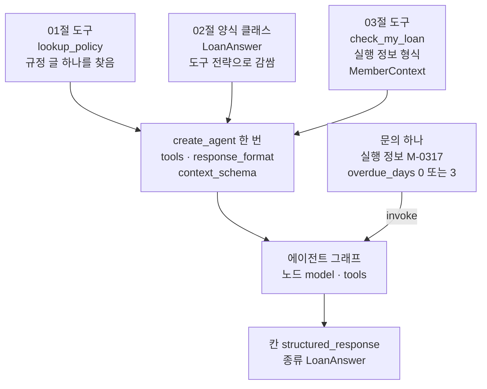
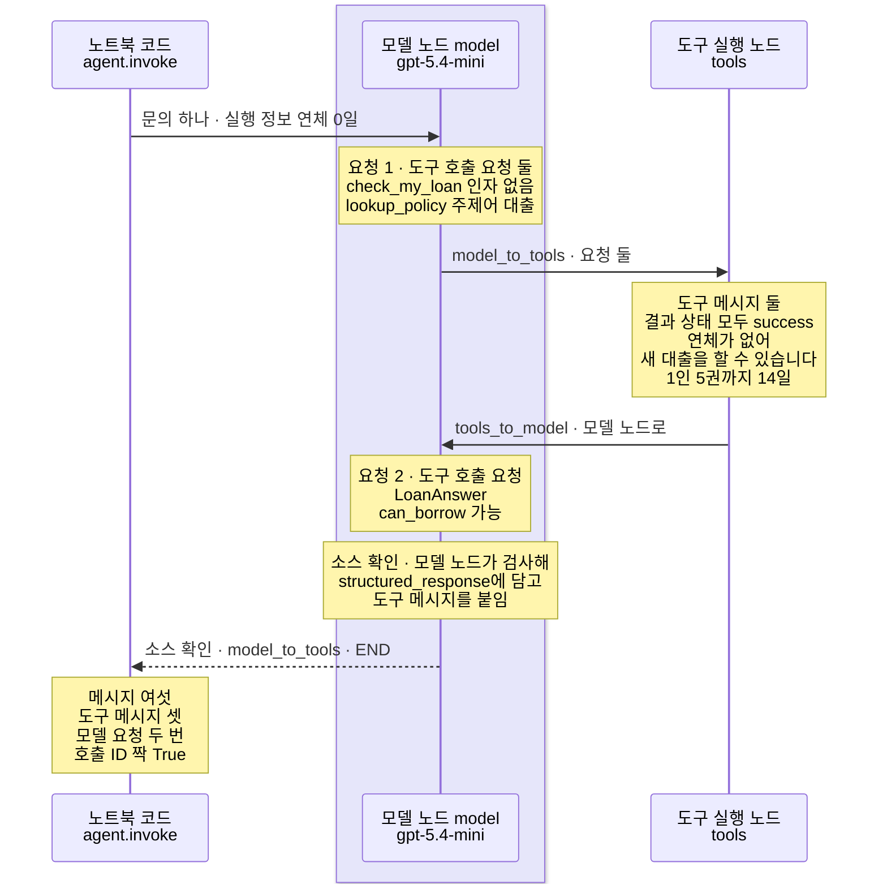
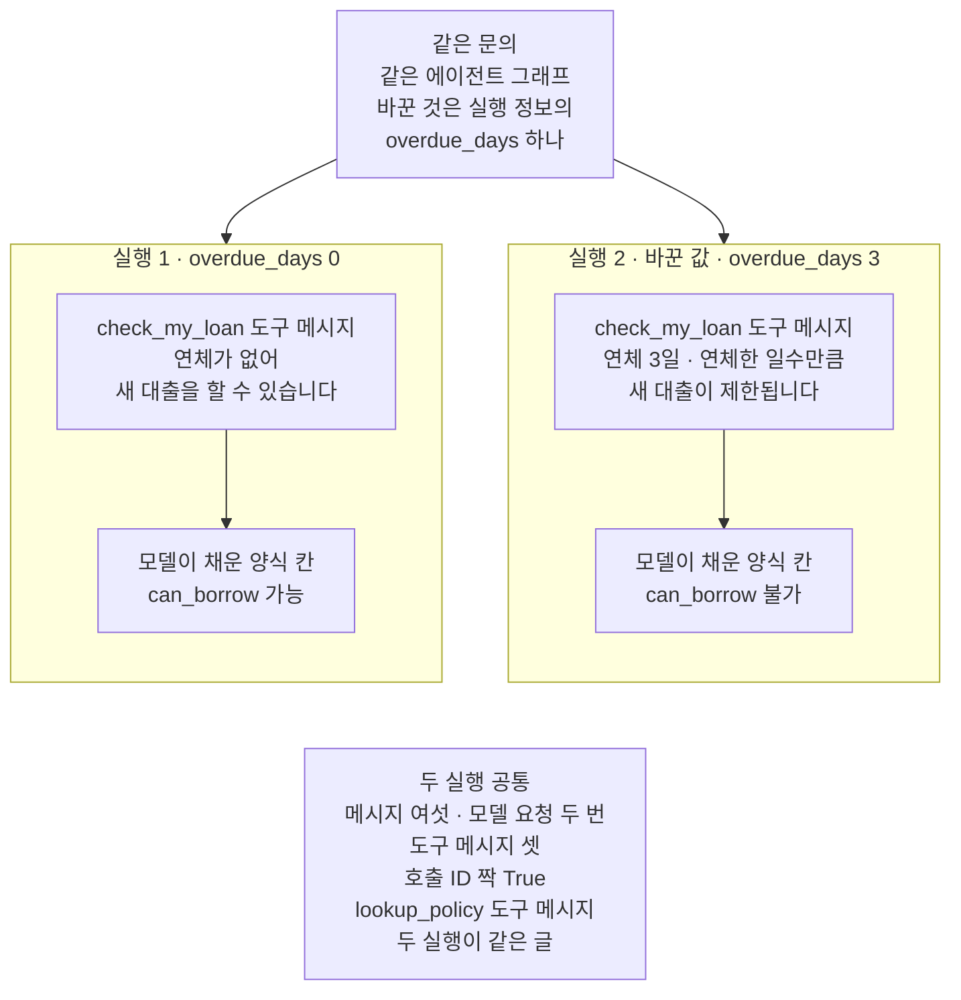

# 07-create-agent-실습

## _src 본문 (HTML 원본)

```html
<!--meta: 실습 30분 | 코드 notebooks/07-create-agent-실습.ipynb | 새 용어 0 -->
<style>html,body{overflow-x:hidden}.notebook,.nb-cell,.nb-main,.nb-input,.nb-result{min-width:0;max-width:100%}.nb-input pre,.nb-output{box-sizing:border-box;max-width:100%;overflow-x:auto}code.nb-source{display:block!important;width:100%!important;min-width:0!important;overflow-x:auto!important;padding:0!important}</style>
<h2 id="b1"><span class="no">1</span>학습 목표</h2><div class="goal"><ul>
<li>01절 에이전트 그래프에 02절 도구 전략과 03절 실행 정보를 붙여, 자료실 문의 하나를 처리할 수 있습니다.</li>
<li>도구 메시지와 칸 <code>structured_response</code>로, 붙인 부품이 흐름 안에서 쓰였는지 셀 수 있습니다.</li>
<li>실행 정보의 값 하나만 바꿔 다시 실행하고, 도구 메시지와 양식 칸이 어떻게 달라지는지 견줄 수 있습니다.</li>
</ul></div>
<h2 id="b2"><span class="no">2</span>이 내용을 배우는 이유</h2><p>이 챕터에서는 함수 <code>create_agent</code>의 인자를 절마다 따로 익혔습니다. <a href="01-create-agent와-ReAct-루프.html">01절</a>은 모델·도구 목록·시스템 메시지 글로 에이전트 그래프를 만들었습니다. <a href="02-구조화-출력-두-전략.html">02절</a>은 인자 <code>response_format</code>으로 답을 양식에 담았습니다. <a href="03-AgentState와-context-schema.html">03절</a>은 인자 <code>context_schema</code>와 실행 정보로 도구에 이용자 값을 넣어 주었습니다. 실제 창구에서는 이 인자들을 한 번의 호출에 함께 넘깁니다.</p>
<p>이번 실습은 세 절의 부품을 에이전트 그래프 하나에 붙여, 자료실 문의 하나를 처리합니다. 실행 정보의 연체 일수 하나만 바꿔 한 번 더 실행하고, 두 실행을 견줍니다. 03절 8절도 같은 값을 바꿨고, 그때는 도구 메시지 글이 바뀌는 것까지 보았습니다. 새로 볼 것은 바뀐 도구 메시지가 양식의 칸 값까지 이어지는지입니다.</p>
<p>이번 절은 이 챕터의 실습입니다. 01~06절에서 쓴 이름과 Ch 2에서 배운 문법만 쓰고 따로 내는 과제는 없습니다. 강사와 함께 노트북 셀을 차례로 실행합니다.</p>
<p><strong>이 절의 질문</strong> — 세 절의 부품을 에이전트 그래프 하나에 붙이면, 문의 하나는 어떤 차례로 처리될까요? 실행 정보의 값 하나를 바꾸면 결과의 어디까지 달라질까요?</p>
<h2 id="b3"><span class="no">3</span>앞에서 배운 내용</h2><p>이번 실습은 아래 절에서 배운 이름을 그대로 씁니다. 함수는 도구 파일 <code>runner_tools.py</code>에서 가져오고, 도구와 양식 클래스는 노트북에 적습니다.</p>
<table><thead><tr><th>절</th><th>배운 것</th><th>실습에서 쓰는 곳</th></tr></thead><tbody><tr><td><a href="01-create-agent와-ReAct-루프.html">01절</a></td><td>함수 <code>create_agent</code>와 에이전트 그래프(모델 노드·도구 실행 노드), 규정 딕셔너리와 도구 <code>lookup_policy</code>, 시스템 메시지 글, 함수 <code>agent_row</code></td><td>조립의 바탕, 대출 규정을 찾는 도구, 시스템 메시지 글의 앞 두 문장, 두 실행의 기록 한 줄</td></tr><tr><td><a href="02-구조화-출력-두-전략.html">02절</a></td><td>양식 클래스(<code>BaseModel</code>·<code>Field</code>·<code>Literal</code>)와 도구 전략(<code>ToolStrategy</code>), 양식 도구, 칸 <code>structured_response</code>, 함수 <code>print_branches</code></td><td>양식 클래스 <code>LoanAnswer</code>와 인자 <code>response_format</code>, 결과의 양식 값, 조립한 그래프의 갈 곳 보기</td></tr><tr><td><a href="03-AgentState와-context-schema.html">03절</a></td><td>실행 정보(<code>context</code>)와 실행 정보 형식(<code>context_schema</code>), 실행 객체 표시(<code>ToolRuntime</code>), 도구 <code>check_my_loan</code></td><td>이용자 번호와 연체 일수, 지금 새 책을 빌릴 수 있는지 보는 도구, 실행 2에서 바꾸는 값</td></tr><tr><td><a href="../../part5/ch19-model-tools/06-오류와-읽기-쓰기-분리.html">Ch 19 06절</a>·<a href="../../part5/ch19-model-tools/05-bind_tools와-병렬-호출.html">05절</a>·<a href="../../part2/ch06-langchain-start/06-토큰-비용-지연-비교.html">Ch 6 06절</a></td><td>함수 <code>show_messages</code>·<code>sum_usage</code>·<code>estimate_cost</code></td><td>메시지 칸 출력, 요청 수와 토큰, 예상 비용</td></tr></tbody></table>
<p>세 절을 고른 까닭은, 셋 모두 함수 <code>create_agent</code>와 메서드 <code>invoke</code>의 인자로 붙기 때문입니다. 도구 둘은 인자 <code>tools</code>에, 양식은 인자 <code>response_format</code>에, 실행 정보 형식은 인자 <code>context_schema</code>에 들어갑니다. 실행 정보의 값은 메서드 <code>invoke</code>의 인자 <code>context</code>로 넘깁니다. 문의 글은 두 도구가 모두 있어야 답할 수 있게 정해, 세 부품이 한 흐름 안에서 모두 쓰이게 했습니다.</p>
<p>02절의 제공자 전략과 양식 클래스를 그대로 넘기는 설정은 뺐습니다. 두 전략을 견주면 02절 실험을 되풀이하게 되기 때문입니다. 03절의 상태 칸 더하기는 부품이 넷이 되고, 이번 문의를 처리하는 데 쓰이지 않아 뺐습니다. <a href="04-0x에서-1x로-마이그레이션.html">04절</a> 옛 함수는 붙일 부품이 아니고, <a href="05-retriever를-도구로-전환.html">05절</a> 검색 도구는 임베딩 요청이 더해져 요청 수가 3~5번을 넘기 쉽습니다. <a href="06-같은-평가셋으로-RAG-비교.html">06절</a> 평가도 요청 수가 늘어 뺐고, 06절이 쓴 비교 기록 파일은 이 절이 읽지도 쓰지도 않습니다.</p>
<h2 id="b4"><span class="no">4</span>핵심 개념</h2><h3>비유로 시작하기</h3><p>01절부터 이어 온 세탁기 한 대에, 앞 절에서 본 것들을 모아 붙여 봅니다. 기계 옆 고리에는 이용자의 열쇠가 걸려 있고, 기계는 빨래를 할 때 이 열쇠를 읽습니다. 기계 옆 선반에는 정해 둔 모양으로 갠 빨래가 나와 놓입니다. 버튼 하나를 누르면, 유리문 안에서 빨래가 돕니다.</p>
{{img:07-4-열쇠와-선반을-붙인-세탁기|옅은 베이지색 벽 앞에 흰 앞문형 세탁기 한 대가 크게 서 있는 그림입니다. 세탁기 앞면 위쪽 오른편에 둥근 버튼 하나가, 앞면 가운데에 둥근 유리문 하나가 있고 유리문 안에서 파란 빨래가 돌고 있습니다. 세탁기 왼쪽 옆면에 옅은 갈색 고리 하나가 붙어 있고, 은색 둥근 고리에 꿴 금색 열쇠 하나가 그 고리에 걸려 있습니다. 세탁기 오른쪽 옆면에는 흰 선반 하나가 붙어 있고, 선반 위에 갠 청바지 한 벌이 놓여 있는 그림|세탁기 한 대에 옆 고리의 열쇠와 옆 선반을 붙였고, 선반에는 갠 빨래가 놓였습니다.}}
<p class="look"><b>그림 읽기</b> — 흰 앞문형 세탁기 한 대가 가운데에 크게 서 있고, 둥근 버튼 하나와 둥근 유리문 하나가 있습니다. 유리문 안에서는 파란 빨래가 돌고 있습니다. 세탁기 왼쪽 옆면에는 고리 하나가 붙어 있고, 그 고리에 금색 열쇠 하나가 걸려 있습니다. 세탁기 오른쪽 옆면에는 흰 선반 하나가 붙어 있고, 선반 위에 갠 청바지 한 벌이 놓여 있습니다.</p>
<p>세탁기 한 대가 01절 에이전트 그래프이고, 유리문 안에서 도는 빨래가 모델과 도구를 오가는 반복입니다. 고리에 걸린 열쇠는 03절 실행 정보입니다. 03절 그림의 윗면 틈에 꽂은 카드처럼, 기계가 읽지만 빨래와 함께 나오지 않습니다.</p><p>선반의 갠 빨래는 02절 양식에 맞춰 담긴 값 <code>structured_response</code>입니다. 02절 그림에서 개는 판을 거쳐 나온 셔츠처럼, 정해 둔 모양으로 갠 빨래입니다. 실행 2는 고리의 열쇠만 바꿔 같은 빨래를 다시 넣는 일입니다.</p>
<h3>실습 조립의 구성</h3>
{{mermaid:07-1-세-절-부품을-붙인-에이전트-그래프|위에서 아래로 읽는 그림으로 맨 위에 파란 상자 셋이 나란히 있습니다. 왼쪽은 01절 도구 lookup_policy 규정 글 하나를 찾음, 가운데는 02절 양식 클래스 LoanAnswer 도구 전략으로 감쌈, 오른쪽은 03절 도구 check_my_loan 실행 정보 형식 MemberContext입니다. 세 상자에서 화살표가 회색 상자 create_agent 한 번 tools response_format context_schema로 모이고, 그 상자에서 회색 상자 에이전트 그래프 노드 model tools로 화살표가 갑니다. 오른쪽 초록 상자 문의 하나 실행 정보 M-0317 overdue_days 0 또는 3에서 invoke 화살표가 에이전트 그래프로 가고, 에이전트 그래프에서 맨 아래 노란 상자 칸 structured_response 종류 LoanAnswer로 화살표가 가는 그림|01절 도구, 02절 양식 클래스, 03절 도구와 실행 정보 형식을 create_agent 한 번에 넘겨 에이전트 그래프 하나를 만들었습니다.}}
<p class="look"><b>도식 읽기</b> — 위에서 아래로 읽습니다. 맨 위 파란 상자 셋은 01~03절에서 우리가 적은 부품이고, 모두 회색 상자 <code>create_agent</code> 한 번에 들어갑니다. 회색은 라이브러리가 준 함수와, 그 함수가 만든 에이전트 그래프입니다. 초록 상자는 메서드 <code>invoke</code>로 넘기는 문의와 실행 정보이고, 실행 2에서는 연체 일수만 바꿉니다. 맨 아래 노란 상자는 노트북 6·7절에서 출력으로 확인한 양식 값의 칸입니다.</p>
<table><thead><tr><th>이름</th><th>하는 일</th><th>가져온 곳</th></tr></thead><tbody><tr><td><code>POLICIES</code>·<code>lookup_policy</code></td><td>주제어로 규정 글 하나를 찾는 자료와 도구</td><td>01절 3절 셀 그대로</td></tr><tr><td><code>MemberContext</code>·<code>check_my_loan</code></td><td>실행 정보 형식, 실행 정보로 새 대출을 할 수 있는지 알려 주는 도구</td><td>03절 5절 셀 그대로</td></tr><tr><td><code>LoanAnswer</code>·<code>answer_format</code></td><td>새 대출 가능 여부와 답을 담는 양식 클래스, 그것을 감싼 도구 전략</td><td>02절 4·5절 모양(칸만 바꿈)</td></tr><tr><td><code>agent_row()</code>·<code>print_branches()</code></td><td>실행 결과를 기록 한 줄로 만들기, 조건 함수와 갈 곳 출력</td><td>도구 파일(01절·02절)</td></tr><tr><td><code>show_messages()</code>·<code>sum_usage()</code>·<code>estimate_cost()</code></td><td>메시지 칸 출력, 요청 수와 토큰 더하기, 예상 비용</td><td>도구 파일(Ch 19 06·05절, Ch 6 06절)</td></tr></tbody></table>
<h3>두 번의 실행</h3><p>실행 1은 연체 0일, 실행 2는 연체 3일인 실행 정보로 같은 문의를 보냅니다. 두 값은 03절 7·8절 값 그대로이고, 실행 전에 정했습니다. 문의 글·에이전트 그래프·모델 설정은 두 실행이 같습니다.</p><p>01절에서 정한 대로, 모델 요청 수는 응답(<code>AIMessage</code>) 수로 셉니다. 도구 메시지 수에는 양식 도구 요청에 붙는 도구 메시지도 들어갑니다. 02절에서 소스로 본 것처럼, 이 도구 메시지는 도구 실행 노드가 아니라 모델 노드가 붙입니다.</p>
<h3>비교와 경계</h3><p>도구 전략을 쓰면 라이브러리는 요청마다 모델에게 도구를 하나 이상 고르게 합니다. 설치판 소스(<code>factory.py</code> 1423행)로 본 동작입니다. 이번 실행에서 모델은 첫 응답에서 두 도구를, 둘째 응답에서 양식 도구를 골랐습니다. 양식 도구를 다른 도구와 한 응답에 함께 고르면, 양식 값은 도구 결과를 보기 전에 채워집니다. 소스(1953~1968행, 2028~2030행)로 보면 그때는 도구를 실행한 뒤 흐름이 바로 끝납니다.</p><p>그 경우는 노트북 밖 열 번과 새 커널 두 번의 실행에서 나오지 않았고, 이번에 실행하지 않았습니다. 모델이 두 도구를 한 응답에 함께 부른 것은 01절 8절에서 본 여럿 담기입니다. 두 도구를 따로 불렀다면, 셈으로는 실행마다 모델 요청이 3번이 됩니다. 실행 정보는 모델 요청에 실리지 않고, 도구가 실행 정보로 만든 글만 다음 요청에 실립니다. 03절에서 소스로 본 사실입니다.</p>
<h2 id="b5"><span class="no">5</span>실행 예제</h2><p>노트북은 먼저 오늘 처리할 문의와 이용자 번호를 정합니다. 01·03절 셀로 규정 딕셔너리·두 도구·실행 정보 형식을 준비하고, 02절 모양으로 양식 클래스를 적습니다. 그다음 함수 <code>create_agent</code> 한 번으로 조립하고, 그래프의 갈 곳을 봅니다. 실행 1은 연체 0일, 실행 2는 연체 3일로 문의를 보내고, 마지막에 두 실행을 견줍니다.</p><p>실제 OpenAI 모델을 부릅니다. 교재 출력은 2026-09-25에 실행한 결과입니다. 모델은 <code>gpt-5.4-mini</code>이고 temperature 0과 추론 끔(<code>reasoning_effort="none"</code>)으로 부릅니다. 교재 출력에서 모델 요청은 실행마다 2번, 모두 4번이었습니다.</p><p>요금표로 어림한 예상 비용은 0.01달러 아래이고, 청구 금액과는 다를 수 있습니다. 새로 쓰는 파일은 없습니다.</p>
{{notebook:07-create-agent-실습}}
<p class="look"><b>확인할 점</b> — 노트북 6절 출력 <code>메시지 칸의 메시지 수: 6</code>과 첫 응답의 <code>응답 | 도구 호출 요청 수: 2</code>로 실행 1의 흐름을 봅니다. 노트북 7절에서 도구 <code>check_my_loan</code>의 글과 칸 <code>can_borrow</code>의 값이 바뀌었는지 봅니다. 노트북 8절 출력 <code>실행 1 · 연체 0일 | 2 | 3 | True</code>로 두 실행의 기록을 맞춰 봅니다. 답 칸 글과 출력 토큰은 여러분의 실행에서 교재 출력과 다를 수 있습니다.</p>
<h3>실행 1의 실제 순서</h3>
{{mermaid:07-2-실행-1의-실제-차례|세로선 셋이 있는 차례 그림으로 왼쪽부터 노트북 코드 agent.invoke, 연보라 띠 안의 모델 노드 model gpt-5.4-mini, 도구 실행 노드 tools입니다. 노트북 코드가 모델 노드에 문의 하나와 실행 정보 연체 0일을 보내고, 노란 메모 요청 1 도구 호출 요청 둘 check_my_loan 인자 없음 lookup_policy 주제어 대출이 붙습니다. 모델 노드에서 도구 실행 노드로 model_to_tools 요청 둘 화살표가 가고, 노란 메모 도구 메시지 둘 결과 상태 모두 success 연체가 없어 새 대출을 할 수 있습니다 1인 5권까지 14일이 붙습니다. 도구 실행 노드에서 모델 노드로 tools_to_model 화살표가 돌아오고, 노란 메모 요청 2 도구 호출 요청 LoanAnswer can_borrow 가능과 노란 메모 소스 확인 모델 노드가 검사해 structured_response에 담고 도구 메시지를 붙임이 이어집니다. 모델 노드에서 노트북 코드로 소스 확인 model_to_tools END 점선이 가고, 마지막 노란 메모에 메시지 여섯 도구 메시지 셋 모델 요청 두 번 호출 ID 짝 True가 적힌 그림|실행 1에서 모델은 첫 응답에 두 도구를 함께 부르고, 도구 메시지 둘을 받은 뒤 둘째 응답에서 양식 도구를 불렀습니다.}}
<p class="look"><b>도식 읽기</b> — 위에서 아래로 읽고, 세로선은 왼쪽부터 노트북 코드, 모델 노드, 도구 실행 노드입니다. 연보라 띠는 실제로 부른 모델 <code>gpt-5.4-mini</code>가 있는 자리입니다. 「소스 확인」이 붙은 메모와 화살표만 설치판 소스로 본 동작이고, 나머지 노란 메모는 노트북 6·8절 출력입니다. 요청 1에 두 도구가 함께 담겼고, 도구 메시지 둘을 받은 뒤 요청 2에서 양식 도구를 불렀습니다.</p>
<h2 id="b6"><span class="no">6</span>실험 결과 해석</h2><p>두 실행은 실행 정보의 <code>overdue_days</code> 하나만 달랐습니다. 결과는 아래 표와 같았습니다.</p>
<table><thead><tr><th>실행</th><th>실행 정보</th><th>메시지 수</th><th>모델 요청 수</th><th>도구 메시지 수</th><th><code>check_my_loan</code> 도구 메시지</th><th><code>lookup_policy</code> 도구 메시지</th><th>칸 <code>can_borrow</code></th><th>입력 토큰 합</th></tr></thead><tbody><tr><td>실행 1</td><td><code>overdue_days</code> 0</td><td>6</td><td>2</td><td>3</td><td>이용자 M-0317: 연체가 없어 새 대출을 할 수 있습니다.</td><td>일반 도서는 1인 5권까지 14일 동안 대출할 수 있습니다.</td><td><code>가능</code></td><td>776</td></tr><tr><td>실행 2(바꾼 값)</td><td><code>overdue_days</code> 3</td><td>6</td><td>2</td><td>3</td><td>이용자 M-0317: 연체 3일. 연체한 일수만큼 새 대출이 제한됩니다.</td><td>실행 1과 같은 글</td><td><code>불가</code></td><td>784</td></tr></tbody></table>
{{mermaid:07-3-연체-일수만-바꾼-두-실행|맨 위 초록 상자 같은 문의 같은 에이전트 그래프 바꾼 것은 실행 정보의 overdue_days 하나에서 아래 칸 둘로 화살표가 갑니다. 왼쪽 칸 실행 1 overdue_days 0에는 노란 상자 check_my_loan 도구 메시지 연체가 없어 새 대출을 할 수 있습니다에서 노란 상자 모델이 채운 양식 칸 can_borrow 가능으로 화살표가 갑니다. 오른쪽 칸 실행 2 바꾼 값 overdue_days 3에는 노란 상자 check_my_loan 도구 메시지 연체 3일 연체한 일수만큼 새 대출이 제한됩니다에서 노란 상자 모델이 채운 양식 칸 can_borrow 불가로 화살표가 갑니다. 맨 아래 회색 상자에 두 실행 공통 메시지 여섯 모델 요청 두 번 도구 메시지 셋 호출 ID 짝 True lookup_policy 도구 메시지 두 실행이 같은 글이 적힌 그림|연체 일수만 바꾸자 check_my_loan의 도구 메시지와 양식 칸 can_borrow가 함께 바뀌었고, 메시지 수와 모델 요청 수는 같았습니다.}}
<p class="look"><b>도식 읽기</b> — 맨 위 초록 상자는 두 칸에 똑같이 둔 조건과 바꾼 값 하나입니다. 왼쪽 칸이 실행 1, 오른쪽 칸이 실행 2이고, 두 칸끼리는 화살표로 잇지 않았습니다. 칸 안 화살표는 도구 메시지를 받은 뒤 모델이 양식 칸을 채운 차례입니다. 노란 상자는 노트북 6·7절 출력이고, 맨 아래 회색 상자는 두 실행 출력에서 모두 확인한 공통점입니다.</p>
<p>두 실행 모두 모델은 첫 응답에서 두 도구를 함께 불렀고, 둘째 응답에서 양식 도구를 불렀습니다. 메시지 여섯, 모델 요청 2번, 도구 메시지 셋, 호출 ID 짝은 두 실행이 같았습니다. 달라진 것은 바꾼 실행 정보를 읽는 도구 <code>check_my_loan</code>의 글이었습니다. 규정을 찾는 도구 <code>lookup_policy</code>의 글은 같았습니다.</p>
<p>모델이 채운 칸 <code>can_borrow</code>는 실행 1이 <code>가능</code>, 실행 2가 <code>불가</code>였습니다. 도구 몸통과 같은 규칙으로 코드가 정한 값과 두 실행 모두 같았습니다. 모델이 채운 칸이라 늘 그렇다고 보장할 수는 없습니다. 노트북 밖에서 두 실행을 다섯 번씩 보냈을 때와 새 커널로 두 번 실행했을 때는 모두 같았습니다.</p>
<p>입력 토큰은 두 실행에서 8 달랐지만, 어느 몫이 몇 토큰인지는 나눠 세지 않았습니다. 답 칸 글과 출력 토큰은 실행마다 달라져 이 표에 넣지 않았습니다. 양식 도구의 도구 메시지를 모델 노드가 붙이는 자리는 소스로 본 사실입니다. 두 도구 요청을 요청마다 도구 실행 노드로 보내는 자리도 소스로만 보았습니다.</p>
<h2 id="b7"><span class="no">7</span>주의할 점과 실무 메모</h2><ul><li>문의 글은 두 도구가 모두 있어야 답할 수 있게 이 절에서 실행 전에 정했습니다. 이용자 번호와 두 연체 일수는 03절 7·8절 값 그대로입니다. 실제 이용자가 보낸 글이 아닙니다.</li><li>노트북을 실행하기 전에 문의와 판단 규칙을 적어 두고, 노트북 밖에서 두 실행을 다섯 번씩 보냈습니다. 열 번 모두 두 도구를 한 응답에 함께 불렀고, 양식 도구는 둘째 응답에서 따로 불렀습니다. 첫 후보가 규칙을 채워, 미리 적어 둔 둘째 후보(시스템 메시지 글에 한 문장을 더한 판)는 쓰지 않았습니다.</li><li>같은 요청도 실행한 때에 따라 모델이 도구를 부르는 방식이 달라질 수 있습니다. 두 도구를 따로 부르면 요청이 늘고, 양식 도구를 먼저 부르면 도구 결과를 보기 전에 양식 값이 채워집니다.</li><li>칸 <code>can_borrow</code>는 모델이 채운 값이라, 코드로 견준 셀에는 <code>assert</code>를 걸지 않았습니다. 이 노트북의 <code>assert</code>는 키 확인, 양식 값의 종류, 호출 ID 짝에만 걸었습니다.</li><li>양식 클래스 <code>LoanAnswer</code>는 02절 <code>PolicyAnswer</code>와 같은 모양으로 이 절에서 새로 적었습니다. 칸 이름과 칸 설명 글은 흐름을 보여 주려고 정한 예입니다.</li><li>시스템 메시지 글은 01절 글 뒤에 03절 글의 둘째 문장을 이은 것이고, 결과를 보고 바꾸지 않았습니다.</li><li>02절에서 소스로 본 것처럼, 양식 검사에 실패하면 모델에게 다시 요청할 수 있습니다. 이번 실행에서는 일어나지 않았고, 그 장면은 이번에 실행하지 않았습니다.</li><li>도구 <code>lookup_policy</code>에 없는 주제어가 들어오는 장면과, 실행 정보 없이 부르는 장면도 이번에 실행하지 않았습니다.</li><li>에이전트 실행의 정해진 자리에 기능을 끼워 넣는 미들웨어는 Ch 22에서, 결과 상태를 저장하는 방법은 Ch 23에서 배웁니다.</li><li>이 절은 파일을 쓰지 않고, 06절이 쓴 비교 기록 파일도 읽지 않습니다. 걸린 시간은 재지 않았습니다.</li><li>예상 비용은 2026-09-17 요금표로 어림한 값이고 청구 금액이 아닙니다.</li><li>교재 출력은 Linux의 Python 3.12.13으로 만들었습니다. 다른 판과 Windows·macOS에서는 이번에 실행하지 않았습니다.</li></ul>
<h2 id="b8"><span class="no">8</span>정리와 다음 절</h2><ul><li>세 절의 부품을 붙인 에이전트 그래프에서, 문의 하나가 두 도구와 양식 도구를 거쳐 처리되었습니다.</li><li>두 실행 모두 모델은 두 도구를 한 응답에 함께 불렀고, 모델 요청 2번·도구 메시지 셋으로 끝났습니다.</li><li>실행 정보의 연체 일수만 바꾸자 <code>check_my_loan</code>의 도구 메시지와 모델이 채운 칸 <code>can_borrow</code>가 함께 바뀌었습니다.</li></ul><p><strong>다음 학습과 이어지는 지점</strong> — 이 절로 Ch 21이 끝납니다. <a href="../ch22-middleware/01-미들웨어와-6개-훅.html">Ch 22 01절</a>은 에이전트 실행의 정해진 자리에 기능을 끼워 넣는 미들웨어의 훅 여섯 개를 다룹니다.</p>
<h2 id="b9"><span class="no">9</span>복습 문제</h2><details class="quiz" open><summary>문제 4개 · 해설 포함</summary><p class="quiz-q">1. [하] 두 실행에서 바꾼 값은 무엇이고, 같게 둔 것은 무엇입니까?</p><p class="quiz-a">실행 정보의 <code>overdue_days</code> 하나를 0에서 3으로 바꿨습니다. 문의 글·이용자 번호·에이전트 그래프·모델 설정은 같게 두었습니다.</p><p class="quiz-q">2. [중] 모델 요청은 2번인데 도구 메시지가 셋인 까닭은 무엇입니까?</p><p class="quiz-a">첫 응답에 두 도구 요청이 함께 담겨 도구 메시지 둘이 생겼습니다. 둘째 응답의 양식 도구 요청에도 도구 메시지 하나가 붙었습니다. 틀렸다면 노트북 6절과 02절 7절을 다시 읽습니다.</p><p class="quiz-q">3. [중] 연체 일수만 바꿨을 때 칸 <code>can_borrow</code>는 어떻게 바뀌었고, 그 값은 누가 채웠으며 무엇과 견줘 확인했나요?</p><p class="quiz-a">실행 1은 <code>가능</code>, 실행 2는 <code>불가</code>였습니다. 이 칸은 모델이 바뀐 도구 메시지 글을 받은 뒤 채운 값입니다. 노트북 8절에서 도구 몸통과 같은 규칙으로 코드가 정한 값과 견줬고, 두 실행 모두 같았습니다. 모델이 채운 값이라 <code>assert</code>는 걸지 않았습니다. 틀렸다면 노트북 7·8절을 다시 읽습니다.</p><p class="quiz-q">4. [상] 동료가 「도구 전략을 쓰면 양식 값은 늘 도구 결과를 본 뒤에 채워진다」고 말합니다. 이 절 결과로 무엇이라고 답하나요?</p><p class="quiz-a">이번 두 실행과 노트북 밖 열 번에서는 그랬지만, 늘 그렇다고 말할 수는 없다고 답합니다. 모델이 양식 도구를 다른 도구와 한 응답에 함께 고르면, 소스로 보면 양식 값이 도구 결과보다 먼저 채워집니다. 그 장면은 이번에 실행하지 않았습니다. 틀렸다면 본문 4의 비교와 경계를 다시 읽습니다.</p></details>
<h2 id="b10"><span class="no">10</span>참고 자료</h2><ul><li>01절 — 함수 <code>create_agent</code>와 에이전트 그래프, 도구 <code>lookup_policy</code>, 함수 <code>agent_row</code>.</li><li>02절 — 양식 클래스와 도구 전략, 칸 <code>structured_response</code>, 함수 <code>print_branches</code>.</li><li>03절 — 실행 정보와 실행 정보 형식, 실행 객체 표시, 도구 <code>check_my_loan</code>.</li><li><a href="../../part5/ch19-model-tools/02-Pydantic-인자와-반환-스키마.html">Ch 19 02절</a>에서 <code>Literal</code>을, 05·06절에서 함수 <code>sum_usage</code>·<code>show_messages</code>를 배웠습니다.</li><li>Ch 6 06절 — 요금표와 예상 비용.</li><li>langchain 1.4.0 소스 <code>langchain/agents/factory.py</code> 1423행 — 도구 전략이면 요청마다 도구를 고르게 하는 자리입니다.</li><li>같은 소스 1222~1296행은 양식 도구 요청을 검사해 양식 값과 도구 메시지를 만드는 자리입니다.</li><li>같은 소스 1953~1968행은 남은 도구 요청을 도구 실행 노드로 보내고, 양식 값이 생기면 끝내는 자리입니다.</li><li>같은 소스 2028~2030행은 양식 도구의 도구 메시지가 있으면 도구 실행 뒤 끝내는 자리입니다.</li><li>기준 버전은 노트북 1절 첫 셀에서 설치한 패키지 일곱의 판입니다.</li></ul>
```

## 노트북 셀 (순서대로)

### [0] markdown {'html': 'skip'}

# create_agent 실습: 대출 문의 에이전트에 양식과 실행 정보 붙이기

**이 노트북에서 할 일**

1. 01절 에이전트 그래프에 02절 도구 전략과 03절 실행 정보를 붙여, 자료실 문의 하나를 처리합니다.
2. 두 도구의 도구 메시지와 칸 `structured_response`로, 붙인 부품이 흐름 안에서 쓰였는지 셉니다.
3. 실행 정보의 연체 일수 하나만 바꿔 다시 실행하고, 두 실행을 견줍니다.

**준비물** — 프로젝트 맨 위 폴더의 `.env`에 적어 둔 `OPENAI_API_KEY`를 씁니다.
모델은 `gpt-5.4-mini`이고, 교재 출력에서 모델 요청은 모두 4번입니다.
6절 실행 1에서 2번, 7절 실행 2에서 2번을 보냈습니다.
모델이 두 도구를 따로 부르면 실행마다 3번이 되어, 모두 6번까지 늘 수 있습니다.
요금표로 어림한 예상 비용은 0.01달러 아래이고, 청구 금액이 아닙니다.

도구는 노트북 안 규정 딕셔너리와 실행 정보를 읽기만 하고, 읽는 파일과 새로 쓰는 파일은 없습니다.
06절이 쓴 비교 기록 파일(`data/rag-comparison.json`)도 이 절은 읽지 않습니다.
앞에서 배운 함수 다섯은 도구 파일 `runner_tools.py`에서 가져옵니다.
걸린 시간은 재지 않습니다. 교재 출력을 만든 실행에서는 노트북 전체가 10초 안에 끝났습니다.

**기준 버전** — 첫 셀에서 패키지 일곱을 설치합니다.
판은 langchain 1.4.0, langchain-core 1.6.2, langchain-openai 1.6.0입니다.
langgraph 1.2.11과 numpy 2.5.3도 함께 설치합니다.
pydantic 2.13.5와 python-dotenv 1.2.3도 함께 설치합니다.

교재 출력은 Linux의 Python 3.12.13으로 만들었습니다.
다른 판과 Windows·macOS에서는 이번에 실행하지 않았습니다.

**실습 범위** — 이 절은 챕터 끝 실습 절이고 30분 안에 끝나는 분량입니다.
강사와 함께 첫 셀부터 차례로 실행하고, 따로 내는 과제는 없습니다.
01~06절에서 쓴 이름과 Ch 2에서 배운 문법만 씁니다.

실습 폴더 `labs/part6/ch21-create-agent`에서 `uv sync --locked`를 실행합니다.
그다음 `notebooks/` 폴더의 이 노트북을 열고, 실습 폴더의 `.venv` 커널을 고릅니다.
첫 셀부터 순서대로 실행합니다.

### [1] markdown {'html': 'skip'}

## 오늘 볼 그림


위에서 아래로 읽습니다.
맨 위 파란 상자 셋은 01~03절에서 우리가 적은 부품이고, 모두 회색 상자 `create_agent` 한 번에 들어갑니다.
회색은 라이브러리가 준 함수와, 그 함수가 만든 에이전트 그래프입니다.
초록 상자는 메서드 `invoke`로 넘기는 문의와 실행 정보이고, 실행 2에서는 연체 일수만 바꿉니다.
맨 아래 노란 상자는 노트북 6·7절에서 출력으로 확인한 양식 값의 칸입니다.

### [2] markdown {}

## 1. 준비

이번 절은 이 챕터의 실습입니다.
01절 에이전트 그래프에 02절 도구 전략과 03절 실행 정보를 붙여, 자료실 문의 하나를 처리합니다.
첫 셀은 패키지 일곱 개를 설치하고 설치된 판 번호를 출력합니다.
도구 파일이 NumPy를 쓰므로, 01~06절처럼 numpy도 함께 설치합니다.
설치에는 몇십 초가 걸릴 수 있습니다.

### [3] code {'execution': {'iopub.execute_input': '2026-09-25T05:48:21.605645Z', 'iopub.status.busy': '2026-09-25T05:48:21.605515Z', 'iopub.status.idle': '2026-09-25T05:48:22.304115Z', 'shell.execute_reply': '2026-09-25T05:48:22.303531Z'}, 'lesson_role': 'setup'}

```python
# 이 절에서 쓰는 패키지를 설치하고 버전을 확인합니다
%pip install -q "langchain==1.4.0" "langchain-core==1.6.2" "langchain-openai==1.6.0" "langgraph==1.2.11" "numpy==2.5.3" "pydantic==2.13.5" "python-dotenv==1.2.3"
from importlib.metadata import version

print("langchain:", version("langchain"))
print("langchain-core:", version("langchain-core"))
print("langchain-openai:", version("langchain-openai"))
print("langgraph:", version("langgraph"))
print("numpy:", version("numpy"))
print("pydantic:", version("pydantic"))
print("python-dotenv:", version("python-dotenv"))
```

출력:
```
Note: you may need to restart the kernel to use updated packages.
langchain: 1.4.0
langchain-core: 1.6.2
langchain-openai: 1.6.0
langgraph: 1.2.11
numpy: 2.5.3
pydantic: 2.13.5
python-dotenv: 1.2.3

```

### [4] markdown {}

**결과 읽기** — 출력 줄 `langchain: 1.4.0`·`langchain-core: 1.6.2`·`langchain-openai: 1.6.0`이 보입니다.
출력 줄 `langgraph: 1.2.11`·`numpy: 2.5.3`·`pydantic: 2.13.5`·`python-dotenv: 1.2.3`도 잠금과 같은 판입니다.
이 노트북의 출력은 2026-09-25에 이 판으로 실행한 결과입니다.

다음 셀은 이 절에서 쓸 이름을 가져옵니다.
양식 클래스를 적는 이름과 도구 전략은 02절, 실행 정보 형식과 실행 객체 표시는 03절에서 가져온 이름입니다.
이 절에서 새로 가져오는 이름은 없습니다.

### [5] code {'execution': {'iopub.execute_input': '2026-09-25T05:48:22.305161Z', 'iopub.status.busy': '2026-09-25T05:48:22.305076Z', 'iopub.status.idle': '2026-09-25T05:48:22.915269Z', 'shell.execute_reply': '2026-09-25T05:48:22.915042Z'}, 'lesson_role': 'setup'}

```python
# 01~03절에서 쓴 이름을 가져옵니다(이 절에서 새로 가져오는 이름은 없음)
from typing import Literal
from typing_extensions import TypedDict

from pydantic import BaseModel, Field
from langchain.agents import create_agent
from langchain.agents.structured_output import ToolStrategy
from langchain.chat_models import init_chat_model
from langchain.messages import HumanMessage
from langchain.tools import ToolRuntime, tool

# 앞에서 배운 함수는 도구 파일에서 가져옵니다
from runner_tools import agent_row, estimate_cost, print_branches, show_messages, sum_usage

print("01~03절에서 가져와 붙일 이름:", "create_agent", "ToolStrategy", "ToolRuntime")
```

출력:
```
01~03절에서 가져와 붙일 이름: create_agent ToolStrategy ToolRuntime

```

### [6] markdown {}

**결과 읽기** — 출력 줄 `01~03절에서 가져와 붙일 이름: create_agent ToolStrategy ToolRuntime`이 보입니다.

앞에서 배운 함수는 `runner_tools.py`에 모아 두었습니다. 파일을 열면 코드를 볼 수 있습니다. 노트북과 같은 폴더(`notebooks/`)에 있는 파일입니다. 커널이 `notebooks/` 폴더에서 시작해야 이 파일을 가져올 수 있습니다.

함수 `show_messages`는 Ch 19 06절, `sum_usage`는 Ch 19 05절, `estimate_cost`는 Ch 6 06절에서 배웠습니다.
함수 `agent_row`는 01절 10절, `print_branches`는 02절 6절에서 처음 적은 함수입니다.
이 절에서 도구 파일에 더한 함수는 없습니다.

## 2. 키와 모델 준비

모델은 01~06절과 같은 `gpt-5.4-mini`이고, 과정의 같은 설정으로 부릅니다.
이렇게 만든 모델 객체를 5절에서 조립하는 에이전트 그래프에 넘깁니다.

### [7] markdown {}

API 키가 있는지 확인합니다. `True` 값이 나오면 다음으로 넘어갑니다.

### [8] code {'execution': {'iopub.execute_input': '2026-09-25T05:48:22.916975Z', 'iopub.status.busy': '2026-09-25T05:48:22.916864Z', 'iopub.status.idle': '2026-09-25T05:48:22.921853Z', 'shell.execute_reply': '2026-09-25T05:48:22.921676Z'}, 'lesson_role': 'setup'}

```python
# .env 파일에서 OpenAI API 키를 읽습니다(키 값은 출력하지 않습니다)
import os
from dotenv import find_dotenv, load_dotenv

env_path = find_dotenv(usecwd=True)
load_dotenv(env_path)
has_key = os.getenv("OPENAI_API_KEY") is not None
print("OPENAI_API_KEY 설정 여부:", has_key)
assert has_key, "프로젝트 폴더의 .env 파일에 OPENAI_API_KEY를 적어 주세요."
```

출력:
```
OPENAI_API_KEY 설정 여부: True

```

### [9] markdown {}

실습에 쓸 모델을 준비합니다.
temperature 값을 0으로 두어도, 모델이 도구를 부르는 방식과 답 글이 매번 같다고 보장하지는 않습니다.

### [10] code {'execution': {'iopub.execute_input': '2026-09-25T05:48:22.922283Z', 'iopub.status.busy': '2026-09-25T05:48:22.922190Z', 'iopub.status.idle': '2026-09-25T05:48:23.898522Z', 'shell.execute_reply': '2026-09-25T05:48:23.898090Z'}}

```python
# 실습에 쓸 모델을 준비합니다
model = init_chat_model(
    "openai:gpt-5.4-mini",
    temperature=0,
    reasoning_effort="none",
)
print("모델 이름:", model.model_name)
print("temperature:", model.temperature)
```

출력:
```
모델 이름: gpt-5.4-mini
temperature: 0.0

```

### [11] markdown {}

**결과 읽기** — 모델 이름 `gpt-5.4-mini`, temperature `0.0`이 보이면 준비가 끝났습니다.
이 노트북의 출력은 2026-09-25에 이 모델로 실행한 결과입니다.

### [12] markdown {}

## 3. 오늘 처리할 문의

이번 실습은 자료실 창구에 들어온 문의 하나를 처리합니다.
이용자는 지금 새 책을 빌릴 수 있는지와, 일반 도서 대출 규정을 함께 묻습니다.
앞의 물음은 03절 도구가, 뒤의 물음은 01절 도구가 답할 수 있는 물음입니다.
문의 글은 이 절에서 새로 정했고, 이용자 번호는 03절 7절 값 그대로입니다.

다음 셀은 두 값을 정하고 출처와 함께 출력합니다.
두 값 모두 실행 전에 정했습니다.

### [13] code {'execution': {'iopub.execute_input': '2026-09-25T05:48:23.899193Z', 'iopub.status.busy': '2026-09-25T05:48:23.899135Z', 'iopub.status.idle': '2026-09-25T05:48:23.901026Z', 'shell.execute_reply': '2026-09-25T05:48:23.900693Z'}}

```python
# 오늘 처리할 자료실 문의 하나와, 이 문의를 보낸 이용자 번호를 정합니다(실행 전에 정한 값)
inquiry = "제가 지금 새 책을 빌릴 수 있는지 확인해 주세요. 일반 도서 대출 규정도 함께 알려 주세요."
member_id = "M-0317"
print("문의:", inquiry)
print("문의 출처: 이 절에서 실행 전에 정한 글(두 도구가 모두 있어야 답할 수 있게)")
print("이용자 번호:", member_id)
print("이용자 번호 출처: 03절 7절 실행 정보 값 그대로")
```

출력:
```
문의: 제가 지금 새 책을 빌릴 수 있는지 확인해 주세요. 일반 도서 대출 규정도 함께 알려 주세요.
문의 출처: 이 절에서 실행 전에 정한 글(두 도구가 모두 있어야 답할 수 있게)
이용자 번호: M-0317
이용자 번호 출처: 03절 7절 실행 정보 값 그대로

```

### [14] markdown {}

**결과 읽기** — 출력 줄 `이용자 번호: M-0317`과 두 출처 줄로 오늘 쓸 값을 확인합니다.
문의 글은 실행 1과 실행 2에 똑같이 넣습니다.
두 실행에서 바꾸는 것은 실행 정보의 연체 일수 하나입니다.

## 4. 재료 · 두 도구와 양식 클래스

다음 셀은 01절 3절 셀과 글자까지 같은 코드로, 규정 딕셔너리를 만듭니다.

### [15] code {'execution': {'iopub.execute_input': '2026-09-25T05:48:23.901597Z', 'iopub.status.busy': '2026-09-25T05:48:23.901554Z', 'iopub.status.idle': '2026-09-25T05:48:23.903233Z', 'shell.execute_reply': '2026-09-25T05:48:23.902923Z'}}

```python
# 교육센터 자료실 규정 셋을, 주제어를 키로 한 딕셔너리에 담습니다(도구가 읽기만 하는 자료)
POLICIES = {
    "대출": "일반 도서는 1인 5권까지 14일 동안 대출할 수 있습니다.",
    "운영": "평일은 09:00~20:00, 토요일은 10:00~17:00에 운영합니다.",
    "연체": "연체한 일수만큼 새 대출이 제한됩니다.",
}
topics = list(POLICIES.keys())
print("규정 주제어:", topics)
```

출력:
```
규정 주제어: ['대출', '운영', '연체']

```

### [16] markdown {}

**결과 읽기** — 출력 줄 `규정 주제어: ['대출', '운영', '연체']`로 키 셋을 확인합니다.
오늘 문의의 뒤 물음은 키 `대출`의 글로 답할 수 있습니다.

다음 셀도 01절 3절 도구 셀과 글자까지 같은 코드입니다.

### [17] code {'execution': {'iopub.execute_input': '2026-09-25T05:48:23.903782Z', 'iopub.status.busy': '2026-09-25T05:48:23.903732Z', 'iopub.status.idle': '2026-09-25T05:48:23.906249Z', 'shell.execute_reply': '2026-09-25T05:48:23.905910Z'}}

```python
# 주제어 하나로 규정 글 하나를 찾는 도구를 만듭니다(맨 @tool 줄 — Ch 19 01절)
@tool
def lookup_policy(topic: str):
    """교육센터 자료실 규정 하나를 주제어로 찾습니다. topic에는 대출, 운영, 연체 가운데 하나를 넣습니다."""
    # 딕셔너리에 없는 주제어면 오류를 냅니다(이 오류를 그래프 안에서 다루는 법은 Ch 20 02절에서 보았습니다)
    if topic not in POLICIES:
        raise ValueError("지원하지 않는 주제: " + topic)
    return POLICIES[topic]
```

출력:
```

```

### [18] markdown {}

**결과 읽기** — 정의 셀이라 출력이 없습니다.
매개변수 `topic`은 모델이 도구 호출 요청의 인자로 채우는 값입니다.

다음 셀은 03절 5절과 글자까지 같은 실행 정보 형식입니다.
실행할 때 인자 `context`로 넘길 딕셔너리의 칸을 적습니다.

### [19] code {'execution': {'iopub.execute_input': '2026-09-25T05:48:23.906839Z', 'iopub.status.busy': '2026-09-25T05:48:23.906789Z', 'iopub.status.idle': '2026-09-25T05:48:23.908502Z', 'shell.execute_reply': '2026-09-25T05:48:23.908159Z'}}

```python
# 실행할 때 상태 밖으로 넘길 값(실행 정보)의 칸을 적습니다(Ch 13 상태 형식과 같은 모양)
class MemberContext(TypedDict):
    # 이용자 번호와, 지금까지 연체한 일수입니다
    member_id: str
    overdue_days: int
```

출력:
```

```

### [20] markdown {}

**결과 읽기** — 정의 셀이라 출력이 없습니다.
칸은 이용자 번호 `member_id`와 연체 일수 `overdue_days` 둘입니다.
실행 2에서는 이 가운데 연체 일수 하나만 바꿉니다.

다음 셀도 03절 5절과 글자까지 같은 도구 셀입니다.
매개변수 `runtime`에 붙은 실행 객체 표시를 보고, 라이브러리가 실행 정보를 넣어 줍니다.

### [21] code {'execution': {'iopub.execute_input': '2026-09-25T05:48:23.909042Z', 'iopub.status.busy': '2026-09-25T05:48:23.908989Z', 'iopub.status.idle': '2026-09-25T05:48:23.915425Z', 'shell.execute_reply': '2026-09-25T05:48:23.915073Z'}}

```python
# 실행 정보에서 이용자 번호와 연체 일수를 읽어, 새 대출을 할 수 있는지 알려 주는 도구를 만듭니다
@tool
def check_my_loan(runtime: ToolRuntime[MemberContext]):
    """자료실 이용자 본인이 지금 새 책을 빌릴 수 있는지 확인합니다."""
    # 실행 정보는 딕셔너리로 넘어오므로 키로 꺼냅니다
    member = runtime.context["member_id"]
    days = runtime.context["overdue_days"]
    if days == 0:
        return "이용자 " + member + ": 연체가 없어 새 대출을 할 수 있습니다."
    # 연체가 있으면 3절 규정 딕셔너리의 연체 규정 글을 붙입니다
    return "이용자 " + member + ": 연체 " + str(days) + "일. " + POLICIES["연체"]
```

출력:
```

```

### [22] markdown {}

**결과 읽기** — 정의 셀이라 출력이 없습니다.
연체 일수가 0이면 새 대출을 할 수 있다는 글을 내놓습니다.
0이 아니면 연체 규정 글을 붙인 글을 내놓습니다.
매개변수 `runtime`이 도구 명세에 실리지 않는 것은 03절 5절에서 보았습니다.

다음 셀은 문의의 처리 결과를 담을 양식 클래스를 적습니다.
02절 4절 양식 클래스 `PolicyAnswer`와 같은 모양이고, 칸만 이 문의에 맞게 바꿨습니다.
02절 판은 주제어 칸과 답 칸이라, 새 대출을 할 수 있는지를 담을 칸이 없기 때문입니다.
칸 `can_borrow`에는 Ch 19 02절처럼 `Literal`로 두 값만 적을 수 있게 했습니다.

### [23] code {'execution': {'iopub.execute_input': '2026-09-25T05:48:23.915994Z', 'iopub.status.busy': '2026-09-25T05:48:23.915952Z', 'iopub.status.idle': '2026-09-25T05:48:23.918062Z', 'shell.execute_reply': '2026-09-25T05:48:23.917705Z'}}

```python
# 문의 하나의 처리 결과를 담을 양식 클래스를 적습니다(칸 둘: 새 대출 가능 여부와 한두 문장 답)
class LoanAnswer(BaseModel):
    # 새 대출 가능 여부 칸에는 괄호 안 두 값 가운데 하나만 적을 수 있습니다(Ch 19 02절 Literal)
    can_borrow: Literal["가능", "불가"] = Field(description="check_my_loan 도구 결과로 본, 지금 새 책을 빌릴 수 있는지")
    answer: str = Field(description="두 도구 결과에 근거한 한두 문장 답")
```

출력:
```

```

### [24] markdown {}

**결과 읽기** — 정의 셀이라 출력이 없습니다.
이 양식 클래스는 5절에서 도구 전략 `ToolStrategy`로 감싸 에이전트 그래프에 넘깁니다.

다음 셀은 02절 4절처럼 양식 클래스를 JSON 모양 설명으로 바꿔 봅니다.

### [25] code {'execution': {'iopub.execute_input': '2026-09-25T05:48:23.918618Z', 'iopub.status.busy': '2026-09-25T05:48:23.918572Z', 'iopub.status.idle': '2026-09-25T05:48:23.920557Z', 'shell.execute_reply': '2026-09-25T05:48:23.920239Z'}}

```python
# 양식 클래스를 JSON 모양 설명으로 바꿔, 꼭 채울 칸과 새 대출 가능 여부 칸의 값을 봅니다(02절 4절)
answer_form = LoanAnswer.model_json_schema()
print("꼭 채울 칸:", answer_form["required"])
borrow_form = answer_form["properties"]["can_borrow"]
borrow_values = borrow_form["enum"]
print("새 대출 가능 여부 칸의 고를 수 있는 값:", borrow_values)
```

출력:
```
꼭 채울 칸: ['can_borrow', 'answer']
새 대출 가능 여부 칸의 고를 수 있는 값: ['가능', '불가']

```

### [26] markdown {}

**결과 읽기** — 출력 줄 `꼭 채울 칸: ['can_borrow', 'answer']`로 칸 둘을 확인합니다.
출력 줄 `새 대출 가능 여부 칸의 고를 수 있는 값: ['가능', '불가']`는 `Literal`에 적은 두 값입니다.
이 목록 `borrow_values`는 6·7절에서 양식 칸 값을 확인할 때 씁니다.

## 5. 조립 · create_agent 한 번에 세 절의 부품 넣기

조립은 함수 `create_agent`를 한 번 부르는 일입니다.
01절에서 넘긴 모델·도구 목록·시스템 메시지 글에, 인자 둘을 더합니다.
인자 `response_format`에는 02절 도구 전략을, 인자 `context_schema`에는 03절 실행 정보 형식을 넘깁니다.
시스템 메시지 글은 01절 글 뒤에 03절 글의 둘째 문장을 이었습니다.
셀의 줄 끝 주석에 부품마다 어느 절에서 왔는지 적었습니다.

### [27] code {'execution': {'iopub.execute_input': '2026-09-25T05:48:23.921060Z', 'iopub.status.busy': '2026-09-25T05:48:23.921014Z', 'iopub.status.idle': '2026-09-25T05:48:23.926098Z', 'shell.execute_reply': '2026-09-25T05:48:23.925811Z'}}

```python
# 01절 에이전트 그래프에 02절 도구 전략과 03절 도구·실행 정보 형식을 붙여 조립합니다(요청은 아직 보내지 않음)
system_text = "교육센터 자료실 안내 도우미입니다. 자료실 규정을 묻는 질문에는 lookup_policy 도구로 찾은 규정 글에 근거해 답하세요. 이용자가 지금 새 책을 빌릴 수 있는지 물으면 check_my_loan 도구로 확인한 결과에 근거해 답하세요."
answer_format = ToolStrategy(LoanAnswer)
agent = create_agent(
    model,
    tools=[lookup_policy, check_my_loan],  # 01절 도구와 03절 도구
    system_prompt=system_text,  # 01절 글 뒤에 03절 글의 둘째 문장
    response_format=answer_format,  # 02절 도구 전략
    context_schema=MemberContext,  # 03절 실행 정보 형식
)
print("만든 것의 종류:", type(agent).__name__)
```

출력:
```
만든 것의 종류: CompiledStateGraph

```

### [28] markdown {}

**결과 읽기** — 출력 줄 `만든 것의 종류: CompiledStateGraph`로, 01~03절과 같은 종류의 그래프입니다.
이 줄에서도 모델 요청은 나가지 않습니다.

다음 셀은 조립한 그래프의 노드와 조건 함수, 상태 칸을 봅니다.

### [29] code {'execution': {'iopub.execute_input': '2026-09-25T05:48:23.926663Z', 'iopub.status.busy': '2026-09-25T05:48:23.926615Z', 'iopub.status.idle': '2026-09-25T05:48:23.928316Z', 'shell.execute_reply': '2026-09-25T05:48:23.928018Z'}}

```python
# 조립한 그래프의 노드·조건 함수·상태 칸을 봅니다(02절 함수 print_branches — 도구 파일)
print("등록된 노드:", list(agent.builder.nodes))
print_branches(agent)
print("상태 칸:", list(agent.builder.channels))
```

출력:
```
등록된 노드: ['model', 'tools']
tools | 조건 함수: tools_to_model | 갈 수 있는 곳: ['model', '__end__']
model | 조건 함수: model_to_tools | 갈 수 있는 곳: ['tools', '__end__', 'model']
상태 칸: ['messages', 'jump_to', 'structured_response']

```

### [30] markdown {}

**결과 읽기** — 출력 줄 `등록된 노드: ['model', 'tools']`는 01절과 같습니다.
출력 줄 `tools | 조건 함수: tools_to_model | 갈 수 있는 곳: ['model', '__end__']`는 02절 도구 전략 그래프와 같습니다.
출력 줄 `model | 조건 함수: model_to_tools | 갈 수 있는 곳: ['tools', '__end__', 'model']`도 02절과 같습니다.
출력 줄 `상태 칸: ['messages', 'jump_to', 'structured_response']`에는 실행 정보의 칸이 없습니다.
03절에서 본 것처럼, 실행 정보 형식은 상태 칸이 되지 않습니다.

## 6. 실행 1 · 연체 0일

실행 1은 연체 0일인 실행 정보로 문의를 보냅니다.
실행 전에 예상해 봅니다.
모델이 두 도구를 부르고, 도구 결과를 받은 뒤 양식 도구를 부를 것입니다.
두 도구를 한 응답에 함께 부르면 모델 요청은 2번이고, 따로 부르면 3번일 것입니다.

### [31] code {'execution': {'iopub.execute_input': '2026-09-25T05:48:23.928846Z', 'iopub.status.busy': '2026-09-25T05:48:23.928801Z', 'iopub.status.idle': '2026-09-25T05:48:25.714262Z', 'shell.execute_reply': '2026-09-25T05:48:25.713532Z'}}

```python
# 실행 1: 연체 0일인 실행 정보로 문의를 보냅니다(모델 노드를 지날 때마다 모델 요청 1번)
one_context = {"member_id": member_id, "overdue_days": 0}
print("실행 1의 실행 정보:", one_context, "| 출처: 03절 7절 값 그대로")
one_state = {"messages": [HumanMessage(content=inquiry)]}
one_result = agent.invoke(one_state, context=one_context)
one_keys = list(one_result.keys())
print("결과 딕셔너리의 키:", one_keys)
print("메시지 칸의 메시지 수:", len(one_result["messages"]))
```

출력:
```
실행 1의 실행 정보: {'member_id': 'M-0317', 'overdue_days': 0} | 출처: 03절 7절 값 그대로
결과 딕셔너리의 키: ['messages', 'structured_response']
메시지 칸의 메시지 수: 6

```

### [32] markdown {}

**결과 읽기** — 출력 줄 `결과 딕셔너리의 키: ['messages', 'structured_response']`에 양식 값의 칸이 있습니다.
출력 줄 `메시지 칸의 메시지 수: 6`은 01절 대출 질문의 넷보다 둘 많습니다.
넘긴 실행 정보는 결과 딕셔너리의 키에 없습니다.

다음 셀은 메시지 칸을 차례로 출력합니다.

### [33] code {'execution': {'iopub.execute_input': '2026-09-25T05:48:25.715907Z', 'iopub.status.busy': '2026-09-25T05:48:25.715765Z', 'iopub.status.idle': '2026-09-25T05:48:25.718951Z', 'shell.execute_reply': '2026-09-25T05:48:25.718292Z'}}

```python
# 메시지 칸을 차례로 출력합니다(Ch 19 06절 함수 show_messages)
print("메시지 칸:")
show_messages(one_result["messages"])
```

출력:
```
메시지 칸:
HumanMessage
AIMessage | 도구 호출 요청: ['check_my_loan', 'lookup_policy']
ToolMessage | 결과 상태: success | 내용: 이용자 M-0317: 연체가 없어 새 대출을 할 수 있습니다.
ToolMessage | 결과 상태: success | 내용: 일반 도서는 1인 5권까지 14일 동안 대출할 수 있습니다.
AIMessage | 도구 호출 요청: ['LoanAnswer']
ToolMessage | 결과 상태: success | 내용: Returning structured response: can_borrow='가능' answer='현재 연체가 없어 새 책을 빌릴 수 있습니다. 일반 도서는 1인 5권까지 14일 동안 대출할 수 있습니다.'

```

### [34] markdown {}

**결과 읽기** — 라벨 줄 `메시지 칸:` 아래 여섯 줄입니다.
둘째 줄 `AIMessage | 도구 호출 요청: ['check_my_loan', 'lookup_policy']`에서 모델이 두 도구를 한 응답에 불렀습니다.
셋째 줄 도구 메시지의 내용은 `이용자 M-0317: 연체가 없어 새 대출을 할 수 있습니다.`입니다.
넷째 줄 도구 메시지의 내용은 01절 도구가 찾은 대출 규정 글입니다.
다섯째 줄 응답은 양식 도구를 불렀고, 여섯째 줄이 그 요청에 붙은 도구 메시지입니다.

다음 셀은 응답마다 도구 호출 요청의 이름과 인자를 봅니다.
01절 8절에서 규정 두 가지를 묻는 질문을 볼 때 쓴 셀과 같은 모양입니다.

### [35] code {'execution': {'iopub.execute_input': '2026-09-25T05:48:25.720154Z', 'iopub.status.busy': '2026-09-25T05:48:25.720045Z', 'iopub.status.idle': '2026-09-25T05:48:25.723177Z', 'shell.execute_reply': '2026-09-25T05:48:25.722550Z'}}

```python
# 응답마다 도구 호출 요청의 이름과 인자를 차례로 봅니다(01절 8절 셀과 같은 모양)
for message in one_result["messages"]:
    if type(message).__name__ == "AIMessage":
        print("응답 | 도구 호출 요청 수:", len(message.tool_calls))
        for call in message.tool_calls:
            print("  도구 이름:", call["name"], "| 인자:", call["args"])
```

출력:
```
응답 | 도구 호출 요청 수: 2
  도구 이름: check_my_loan | 인자: {}
  도구 이름: lookup_policy | 인자: {'topic': '대출'}
응답 | 도구 호출 요청 수: 1
  도구 이름: LoanAnswer | 인자: {'can_borrow': '가능', 'answer': '현재 연체가 없어 새 책을 빌릴 수 있습니다. 일반 도서는 1인 5권까지 14일 동안 대출할 수 있습니다.'}

```

### [36] markdown {}

**결과 읽기** — 첫 응답은 `응답 | 도구 호출 요청 수: 2`이고, 도구 `check_my_loan`의 인자는 `{}`입니다.
같은 응답의 도구 `lookup_policy` 인자는 `{'topic': '대출'}`입니다.
둘째 응답은 `응답 | 도구 호출 요청 수: 1`이고, 도구 이름 `LoanAnswer`의 인자에 양식 값이 담겼습니다.
이 인자는 도구 메시지 둘을 받은 뒤의 요청에서 나왔습니다.

양식 도구 인자의 답 칸 글은 모델이 쓴 글이라 실행마다 달라질 수 있습니다.

다음 셀은 칸 `structured_response`에 담긴 양식 값을 봅니다.

### [37] code {'execution': {'iopub.execute_input': '2026-09-25T05:48:25.724394Z', 'iopub.status.busy': '2026-09-25T05:48:25.724283Z', 'iopub.status.idle': '2026-09-25T05:48:25.728211Z', 'shell.execute_reply': '2026-09-25T05:48:25.727326Z'}}

```python
# 칸 structured_response에 담긴 양식 값의 종류와 새 대출 가능 여부 칸을 봅니다
one_answer = one_result["structured_response"]
print("structured_response의 종류:", type(one_answer).__name__)
print("새 대출 가능 여부 칸:", one_answer.can_borrow)
print("정해 둔 두 값 안인가:", one_answer.can_borrow in borrow_values)
print("답 칸:")
print(one_answer.answer)
# 라이브러리가 양식 클래스로 검사해 만든 값이라, 종류는 실행마다 같아야 합니다
assert type(one_answer).__name__ == "LoanAnswer", "칸 structured_response에는 양식 클래스 객체가 담겨야 합니다"
```

출력:
```
structured_response의 종류: LoanAnswer
새 대출 가능 여부 칸: 가능
정해 둔 두 값 안인가: True
답 칸:
현재 연체가 없어 새 책을 빌릴 수 있습니다. 일반 도서는 1인 5권까지 14일 동안 대출할 수 있습니다.

```

### [38] markdown {}

**결과 읽기** — 출력 줄 `structured_response의 종류: LoanAnswer`로 양식 클래스 객체가 담긴 것을 봅니다.
출력 줄 `새 대출 가능 여부 칸: 가능`은 모델이 채운 칸이고, 도구 `check_my_loan`의 글과 같은 뜻입니다.
출력 줄 `정해 둔 두 값 안인가: True`입니다.
셀 끝 `assert`는 모델이 쓴 글이 아니라, 라이브러리가 만든 값의 종류에만 걸었습니다.

라벨 줄 `답 칸:` 아래는 모델이 쓴 한두 문장이라 실행마다 글자가 달라질 수 있습니다.
이번 실행에서는 연체가 없어 새 책을 빌릴 수 있다는 문장과 대출 규정 문장이었습니다.
같은 노트북을 한 번 더 실행했을 때는 글자까지 같았지만, 노트북 밖 다섯 번에서는 앞머리가 조금씩 달랐습니다.

## 7. 실행 2 · 연체 일수만 바꾸기

바꿀 값은 실행 정보의 `overdue_days` 하나입니다.
0을 3으로 바꾸고, 문의 글·이용자 번호·에이전트 그래프는 그대로 둡니다.
03절 8절도 이 값을 바꿨고, 그때는 도구 메시지 글이 바뀌는 것까지 보았습니다.
이번에는 바뀐 도구 메시지가 양식 칸까지 이어지는지를 새로 봅니다.

실행 전에 예상해 봅니다.
도구 `check_my_loan`의 글에 연체 규정이 붙고, 칸 `can_borrow`는 불가가 될 것입니다.
메시지 수와 모델 요청 수는 실행 1과 같을 것입니다.

### [39] code {'execution': {'iopub.execute_input': '2026-09-25T05:48:25.729591Z', 'iopub.status.busy': '2026-09-25T05:48:25.729501Z', 'iopub.status.idle': '2026-09-25T05:48:27.461293Z', 'shell.execute_reply': '2026-09-25T05:48:27.460095Z'}}

```python
# 실행 2 · 바꿀 값: 실행 정보의 연체 일수 하나만 3으로 바꿔 같은 문의를 보냅니다
two_context = {"member_id": member_id, "overdue_days": 3}
print("실행 2의 실행 정보:", two_context, "| 출처: 03절 8절 값 그대로")
two_state = {"messages": [HumanMessage(content=inquiry)]}
two_result = agent.invoke(two_state, context=two_context)
print("메시지 칸:")
show_messages(two_result["messages"])
```

출력:
```
실행 2의 실행 정보: {'member_id': 'M-0317', 'overdue_days': 3} | 출처: 03절 8절 값 그대로
메시지 칸:
HumanMessage
AIMessage | 도구 호출 요청: ['check_my_loan', 'lookup_policy']
ToolMessage | 결과 상태: success | 내용: 이용자 M-0317: 연체 3일. 연체한 일수만큼 새 대출이 제한됩니다.
ToolMessage | 결과 상태: success | 내용: 일반 도서는 1인 5권까지 14일 동안 대출할 수 있습니다.
AIMessage | 도구 호출 요청: ['LoanAnswer']
ToolMessage | 결과 상태: success | 내용: Returning structured response: can_borrow='불가' answer='현재 이용자 M-0317은 연체 3일 상태라 새 대출이 3일간 제한됩니다. 일반 도서는 1인 5권까지 14일 동안 대출할 수 있습니다.'

```

### [40] markdown {}

**결과 읽기** — 출력 줄 `실행 2의 실행 정보: {'member_id': 'M-0317', 'overdue_days': 3} | 출처: 03절 8절 값 그대로`로 바꾼 값을 봅니다.
라벨 줄 `메시지 칸:` 아래 여섯 줄의 모양은 6절 실행 1과 같습니다.
셋째 줄 도구 메시지의 내용은 `이용자 M-0317: 연체 3일. 연체한 일수만큼 새 대출이 제한됩니다.`입니다.
넷째 줄 도구 메시지는 실행 1과 같은 대출 규정 글입니다.

다음 셀은 실행 2의 양식 값을 봅니다.

### [41] code {'execution': {'iopub.execute_input': '2026-09-25T05:48:27.463559Z', 'iopub.status.busy': '2026-09-25T05:48:27.463368Z', 'iopub.status.idle': '2026-09-25T05:48:27.467187Z', 'shell.execute_reply': '2026-09-25T05:48:27.466472Z'}}

```python
# 실행 2의 양식 값의 종류와 새 대출 가능 여부 칸을 봅니다
two_answer = two_result["structured_response"]
print("structured_response의 종류:", type(two_answer).__name__)
print("새 대출 가능 여부 칸:", two_answer.can_borrow)
print("정해 둔 두 값 안인가:", two_answer.can_borrow in borrow_values)
print("답 칸:")
print(two_answer.answer)
# 실행 1과 같은 양식 클래스로 검사해 만든 값이라, 종류는 실행마다 같아야 합니다
assert type(two_answer).__name__ == "LoanAnswer", "칸 structured_response에는 양식 클래스 객체가 담겨야 합니다"
```

출력:
```
structured_response의 종류: LoanAnswer
새 대출 가능 여부 칸: 불가
정해 둔 두 값 안인가: True
답 칸:
현재 이용자 M-0317은 연체 3일 상태라 새 대출이 3일간 제한됩니다. 일반 도서는 1인 5권까지 14일 동안 대출할 수 있습니다.

```

### [42] markdown {}

**결과 읽기** — 출력 줄 `structured_response의 종류: LoanAnswer`는 실행 1과 같습니다.
출력 줄 `새 대출 가능 여부 칸: 불가`로, 모델이 채운 칸이 실행 1의 `가능`에서 바뀌었습니다.
출력 줄 `정해 둔 두 값 안인가: True`입니다.

라벨 줄 `답 칸:` 아래 글은 실행마다 글자가 달라질 수 있습니다.
이번 실행에서는 지금은 새 대출이 제한된다는 문장과 대출 규정 문장이었습니다.
답 칸의 「3일간」은 모델이 연체 규정 글에서 끌어낸 말이고, 도구 메시지에는 없는 말입니다.

## 8. 두 실행 견주기

다음 셀은 01절 10절 함수 `agent_row`로 두 실행을 한 줄씩 적습니다.
함수의 첫 칸 이름은 `질문`이지만, 여기서는 실행 이름을 넣습니다.

### [43] code {'execution': {'iopub.execute_input': '2026-09-25T05:48:27.468686Z', 'iopub.status.busy': '2026-09-25T05:48:27.468566Z', 'iopub.status.idle': '2026-09-25T05:48:27.472020Z', 'shell.execute_reply': '2026-09-25T05:48:27.471387Z'}}

```python
# 두 실행의 기록을 한 줄씩 적어 출력합니다(01절 10절 함수 agent_row — 도구 파일)
run_rows = []
run_rows.append(agent_row("실행 1 · 연체 0일", one_result))
run_rows.append(agent_row("실행 2 · 연체 3일", two_result))
print("실행 | 모델 요청 수 | 도구 메시지 수 | 호출 ID 짝")
for row in run_rows:
    print(row["질문"], "|", row["모델 요청 수"], "|", row["도구 메시지 수"], "|", row["호출 ID 짝"])
    # 도구 메시지마다 요청 id를 옮겨 적는 것은 코드가 하는 일이라, 짝은 매번 맞아야 합니다
    assert row["호출 ID 짝"], "도구 메시지마다 같은 차례의 요청 id가 옮겨져야 합니다"
```

출력:
```
실행 | 모델 요청 수 | 도구 메시지 수 | 호출 ID 짝
실행 1 · 연체 0일 | 2 | 3 | True
실행 2 · 연체 3일 | 2 | 3 | True

```

### [44] markdown {}

**결과 읽기** — 라벨 줄 아래 두 줄이 `실행 1 · 연체 0일 | 2 | 3 | True`와 `실행 2 · 연체 3일 | 2 | 3 | True`입니다.
모델 요청 수 2는 모델이 두 도구를 한 응답에 함께 부른 결과입니다.
도구 메시지 수 3은 두 도구의 도구 메시지 둘에 양식 도구의 도구 메시지 하나를 더한 수입니다.
호출 ID 짝은 두 실행 모두 맞았고, 셀의 `assert`로 확인했습니다.

다음 셀은 두 도구의 도구 메시지 글이 두 실행에서 같은지 봅니다.
양식 도구의 도구 메시지에는 모델이 쓴 답 칸 글이 들어 있어 견주지 않습니다.

### [45] code {'execution': {'iopub.execute_input': '2026-09-25T05:48:27.473271Z', 'iopub.status.busy': '2026-09-25T05:48:27.473160Z', 'iopub.status.idle': '2026-09-25T05:48:27.476263Z', 'shell.execute_reply': '2026-09-25T05:48:27.475711Z'}}

```python
# 두 도구의 도구 메시지 글이 두 실행에서 같은지 봅니다(양식 도구 메시지는 모델이 쓴 답 칸 글이 들어 있어 뺍니다)
one_texts = {}
for message in one_result["messages"]:
    if type(message).__name__ == "ToolMessage":
        one_texts[message.name] = message.content
for message in two_result["messages"]:
    if type(message).__name__ == "ToolMessage" and message.name in ["check_my_loan", "lookup_policy"]:
        print(message.name, "| 두 실행의 글이 같은가:", message.content == one_texts[message.name])
```

출력:
```
check_my_loan | 두 실행의 글이 같은가: False
lookup_policy | 두 실행의 글이 같은가: True

```

### [46] markdown {}

**결과 읽기** — 출력 줄 `check_my_loan | 두 실행의 글이 같은가: False`입니다.
출력 줄 `lookup_policy | 두 실행의 글이 같은가: True`입니다.
바꾼 실행 정보를 읽는 도구의 글만 달라졌고, 규정을 찾는 도구의 글은 같았습니다.

다음 셀은 도구 몸통과 같은 규칙으로 코드가 정한 값과, 모델이 채운 양식 칸을 견줍니다.
규칙은 4절 도구 `check_my_loan`처럼 연체 일수가 0이면 가능, 아니면 불가입니다.

### [47] code {'execution': {'iopub.execute_input': '2026-09-25T05:48:27.477629Z', 'iopub.status.busy': '2026-09-25T05:48:27.477519Z', 'iopub.status.idle': '2026-09-25T05:48:27.480785Z', 'shell.execute_reply': '2026-09-25T05:48:27.480117Z'}}

```python
# 도구 몸통과 같은 규칙(연체 일수가 0이면 가능)으로 코드가 정한 값과, 모델이 채운 양식 칸을 견줍니다
run_contexts = [one_context, two_context]
run_answers = [one_answer, two_answer]
for index in range(len(run_contexts)):
    days = run_contexts[index]["overdue_days"]
    rule_value = "불가"
    if days == 0:
        rule_value = "가능"
    form_value = run_answers[index].can_borrow
    print("연체 일수:", days, "| 규칙으로 정한 값:", rule_value, "| 양식 칸:", form_value, "| 같은가:", form_value == rule_value)
```

출력:
```
연체 일수: 0 | 규칙으로 정한 값: 가능 | 양식 칸: 가능 | 같은가: True
연체 일수: 3 | 규칙으로 정한 값: 불가 | 양식 칸: 불가 | 같은가: True

```

### [48] markdown {}

**결과 읽기** — 출력 줄 `연체 일수: 0 | 규칙으로 정한 값: 가능 | 양식 칸: 가능 | 같은가: True`입니다.
출력 줄 `연체 일수: 3 | 규칙으로 정한 값: 불가 | 양식 칸: 불가 | 같은가: True`입니다.
두 실행 모두, 모델이 채운 칸이 실행 정보로 정해지는 값과 같았습니다.
모델이 채운 값을 코드로 견준 셀이라 `assert`는 걸지 않았습니다.

노트북 밖에서 두 실행을 다섯 번씩 보냈을 때도, 열 번 모두 양식 칸이 이 규칙 값과 같았습니다.
같은 노트북을 한 번 더 실행했을 때도 같았습니다.

다음 셀은 Ch 19 05절 함수 `sum_usage`로 두 결과의 요청 수와 토큰을 더합니다.

### [49] code {'execution': {'iopub.execute_input': '2026-09-25T05:48:27.481819Z', 'iopub.status.busy': '2026-09-25T05:48:27.481731Z', 'iopub.status.idle': '2026-09-25T05:48:27.484326Z', 'shell.execute_reply': '2026-09-25T05:48:27.483764Z'}}

```python
# 두 결과의 요청 수와 입력·출력 토큰을 더합니다(Ch 19 05절 함수 sum_usage)
one_usage = sum_usage(one_result["messages"])
two_usage = sum_usage(two_result["messages"])
print("실행 1 사용량:", one_usage)
print("실행 2 사용량:", two_usage)
total_requests = one_usage["requests"] + two_usage["requests"]
print("이 노트북의 모델 요청 수 합:", total_requests)
```

출력:
```
실행 1 사용량: {'requests': 2, 'input_tokens': 776, 'output_tokens': 104}
실행 2 사용량: {'requests': 2, 'input_tokens': 784, 'output_tokens': 117}
이 노트북의 모델 요청 수 합: 4

```

### [50] markdown {}

**결과 읽기** — 두 사용량 모두 `'requests': 2`로, 모델 요청은 2번씩이었습니다.
입력 토큰은 실행 1 `'input_tokens': 776`, 실행 2 `'input_tokens': 784`입니다.
둘째 요청에 실린 도구 메시지 글이 달라 생긴 차이로 보이지만, 몫을 나눠 세지는 않았습니다.
출력 줄 `이 노트북의 모델 요청 수 합: 4`는 실습 절 요청 3~5번 안입니다.

출력 토큰은 모델이 쓴 글에 따라 실행마다 달라질 수 있습니다.
이번 실행에서는 실행 1 `'output_tokens': 104`, 실행 2 `'output_tokens': 117`이었습니다.

다음 셀은 Ch 6 06절 함수 `estimate_cost`로 두 사용량의 예상 비용을 셉니다.
요금은 2026-09-17 요금표의 100만 토큰당 달러입니다.

### [51] code {'execution': {'iopub.execute_input': '2026-09-25T05:48:27.485437Z', 'iopub.status.busy': '2026-09-25T05:48:27.485332Z', 'iopub.status.idle': '2026-09-25T05:48:27.488224Z', 'shell.execute_reply': '2026-09-25T05:48:27.487668Z'}}

```python
# 2026-09-17 요금표(100만 토큰당 달러)로 두 결과의 예상 비용을 셉니다(Ch 6 06절 함수 estimate_cost)
input_rate = 0.75
cached_input_rate = 0.075
output_rate = 4.50
one_cost = round(estimate_cost(one_usage, input_rate, cached_input_rate, output_rate), 6)
two_cost = round(estimate_cost(two_usage, input_rate, cached_input_rate, output_rate), 6)
print("실행 1 예상 비용(달러):", one_cost)
print("실행 2 예상 비용(달러):", two_cost)
```

출력:
```
실행 1 예상 비용(달러): 0.00105
실행 2 예상 비용(달러): 0.001115

```

### [52] markdown {}

**결과 읽기** — 라벨 `실행 1 예상 비용(달러):`와 `실행 2 예상 비용(달러):` 뒤 값이 예상 비용입니다.
요금표로 어림한 값이고, 청구 금액이 아닙니다.
사용량에 캐시 입력 칸이 없어, 입력 토큰은 모두 입력 요금으로 셌습니다.

출력 토큰이 실행마다 달라질 수 있어, 이 값도 달라질 수 있습니다.
이번 실행에서는 실행 1 `0.00105`달러, 실행 2 `0.001115`달러였습니다.

## 정리

1. 세 절의 부품을 붙인 에이전트 그래프에서, 문의 하나가 두 도구와 양식 도구를 거쳐 처리되었습니다.
2. 두 실행 모두 모델은 두 도구를 한 응답에 함께 불렀고, 모델 요청 2번·도구 메시지 셋으로 끝났습니다.
3. 실행 정보의 연체 일수만 바꾸자 `check_my_loan`의 도구 메시지와 모델이 채운 칸 `can_borrow`가 함께 바뀌었습니다.

이 절로 Ch 21이 끝납니다.
Ch 22 01절은 에이전트 실행의 정해진 자리에 기능을 끼워 넣는 미들웨어의 훅 여섯 개를 다룹니다.

## 그림

### 07-1-세-절-부품을-붙인-에이전트-그래프.mmd



01절 도구, 02절 양식 클래스, 03절 도구와 실행 정보 형식을 create_agent 한 번에 넘겨 에이전트 그래프 하나를 만들었습니다.

### 07-2-실행-1의-실제-차례.mmd



실행 1에서 모델은 첫 응답에 두 도구를 함께 부르고, 도구 메시지 둘을 받은 뒤 둘째 응답에서 양식 도구를 불렀습니다.

### 07-3-연체-일수만-바꾼-두-실행.mmd



연체 일수만 바꾸자 check_my_loan의 도구 메시지와 양식 칸 can_borrow가 함께 바뀌었고, 메시지 수와 모델 요청 수는 같았습니다.

### 07-4-열쇠와-선반을-붙인-세탁기.prompt.md

# 07-4 열쇠와 선반을 붙인 세탁기

- 상태: **채택(1차)** — 2026-09-25 · `nano_banana_pro`(응답 모델 표시 `nano_banana_2`, 01~06과 같음) · 16:9 · 2k · `use_unlim: false` · job `e07bcac2-0ee6-46cd-b848-fa69f49d02e0` · **2크레딧**(거래 2026-09-25T05:51:28Z 「Nano Banana Pro −2」, 생성 전 잔액 2451.75 — 바로 앞 거래 05:16:45Z는 06절 몫) · 재생성 0.
- 원본 `cb3b9d2f07329d9f672bc8e6ad88501491abdd705eb428678fd5fc7717b87da7`(2752 × 1536, 기기 `/tmp/ch21-07/illu-1-orig.png`) → 저장 `07-4-열쇠와-선반을-붙인-세탁기.png` `cea2b935908f306517d25680aaf9e2c678e22396abd61f8d46d57088d719e0c2`(1100 × 614, LANCZOS) · 원본을 같은 폭으로 줄여 픽셀 대조: bbox `None`, 최대 차이 0.
- 설명 대상 문장(b4 「비유로 시작하기」): 01절부터 이어 온 세탁기 한 대(에이전트 그래프)에, 앞 절에서 본 것들을 모아 붙임 — 옆 고리의 열쇠(03절 실행 정보, 기계가 읽지만 빨래와 함께 나오지 않음) · 옆 선반의 갠 빨래(02절 양식에 맞춰 담긴 값) · 유리문 안에서 도는 빨래(모델과 도구를 오가는 반복).
- 구성과 배치: 가운데 흰 앞문형 세탁기 한 대(둥근 버튼 하나·둥근 유리문 하나) · 왼쪽 옆면에 고리 하나와 열쇠 하나 · 오른쪽 옆면에 흰 선반 하나와 갠 청바지 한 벌. 시선 순서: 세탁기 → 왼쪽 열쇠 → 오른쪽 선반.
- 01~06 소품(대야·빨래판·헹굼 통·나무 판·몸체 틈·하늘색 셔츠·주황 카드·이름표·연녹색 옛 세탁기·관·회색 상자·연노랑 수건·세제 통·계량컵·분홍 스웨터·돋보기)과 앞 챕터 소품(바구니·서랍·쟁반·집게·저울·울타리·발자국·공구판·승강 상자·식당 전표·Ch 14 나무판·구멍·마개·Ch 15 사과·모래시계)은 넣지 않음.

## 프롬프트

```text
Simple flat educational illustration, white background, limited soft palette, clean outlines, plain everyday objects, no text, no letters, no numbers, no logos. One large white front-loading washing machine stands in the center of the picture against a plain light wall with no opening. The machine has exactly one round button on its top front and exactly one round glass door with clothes tumbling inside. Exactly one small white metal shelf is firmly attached to the right side of the machine, and on that shelf lies exactly one neatly folded pair of blue jeans. On the left side of the machine, exactly one small metal hook is attached, and exactly one brass key on a plain round ring hangs from that hook. The shelf, the hook and the key are large and easy to see. No people, no hands, no arrows, no screens, no dials, no labels, no baskets, no boards, no cards, no tags, no towels, no shirts, no sweaters, no bottles, no other objects.
```

## 검수 메모 (저장한 PNG를 열어 보고 적음 — 기기 `.cache/ch21-07-view/07-4-view.png`·확대 두 장)

- 센 것: 세탁기 **하나**(흰 앞문형) · 둥근 버튼 **하나**(앞면 위쪽 오른편) · 둥근 유리문 **하나**(안에 파란 빨래가 도는 모양) · 고리 **하나**(옅은 갈색, 세탁기 왼쪽 옆면에 붙음) · 열쇠 **하나**(금색, 은색 둥근 고리에 꿰어 고리에 걸림) · 선반 **하나**(흰 금속, 받침이 세탁기 오른쪽 옆면에 나사로 붙음) · 갠 청바지 **한 벌**(뒷주머니가 보임). 글자·숫자·사람·손·화살표·화면·눈금 없음.
- 관계와 무관한 차이(채택에 영향 없음): 벽이 옅은 베이지색 네모 면으로 나옴(프롬프트는 흰 바탕 + plain light wall) · 고리가 금속이 아니라 옅은 갈색 · 세탁기 앞면 위쪽 띠가 두 칸으로 나뉜 선(세제 칸처럼 보이지만 소품이 아니라 기계 모양 — 본문·그림 읽기에서 부르지 않음).
- 판정: 「그림만 보고 관계가 읽히는가」 — 세탁기 한 대에 양옆 부품(열쇠 고리·선반)이 붙어 있고 선반에 갠 빨래가 놓여, 「한 대에 모아 붙임(조립)」이 읽힘 → 채택.

