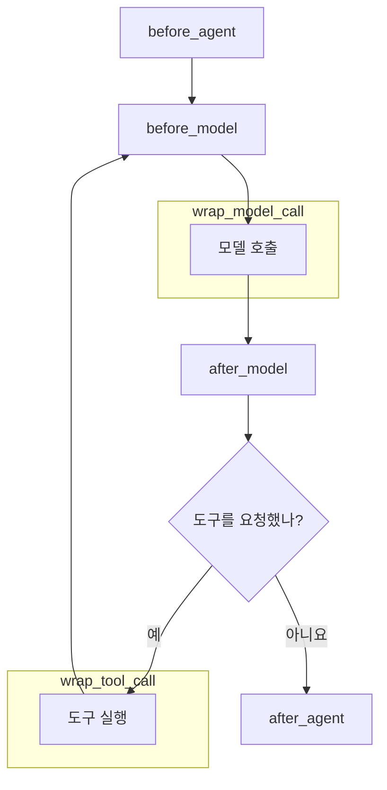
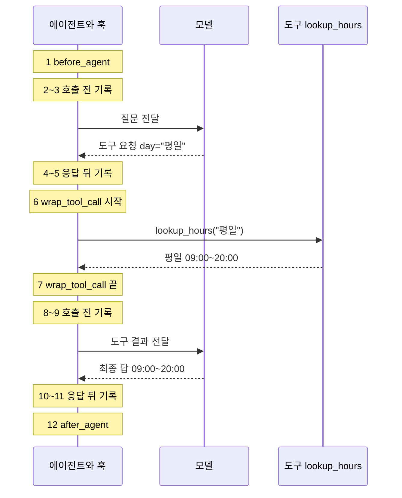
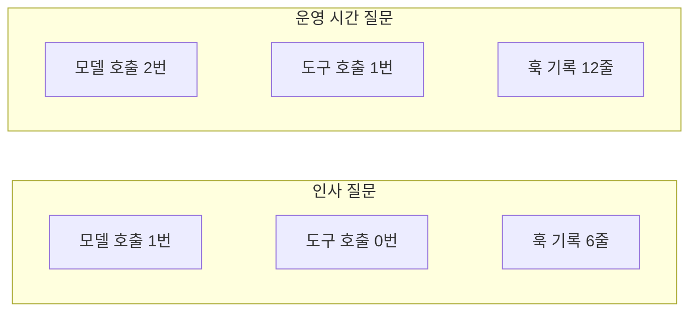
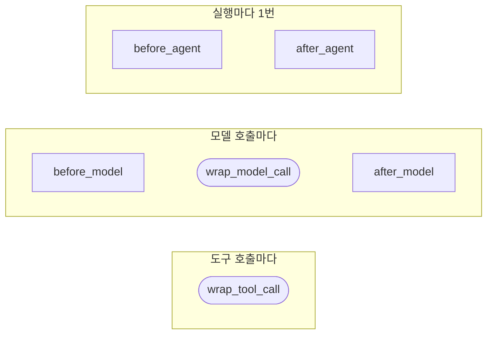

# 01-미들웨어와-6개-훅

## _src 본문 (HTML 원본)

```html
<!--meta: 강의 1h · 실습 2h | 코드 Jupyter Notebook | 새 용어 4개 -->
<h2 id="b1"><span class="no">1</span>학습 목표</h2><div class="goal"><ul><li>훅 여섯 개가 에이전트 실행 중 언제 실행되는지 말할 수 있습니다.</li><li>데코레이터로 훅 함수를 만들어 에이전트에 등록할 수 있습니다.</li><li>훅 기록을 읽고 모델 호출 횟수와 도구 호출 횟수를 셀 수 있습니다.</li></ul></div>
<h2 id="b2"><span class="no">2</span>이 내용을 배우는 이유</h2>
<p>Ch21에서는 <code>create_agent()</code> 함수로 에이전트를 만들었습니다. 실제 서비스에서는 여기에 기능이 더 붙습니다.</p>
<p>개인정보 가리기, 호출 횟수 제한, 실행 기록 남기기가 대표적입니다. 이런 기능을 도구 함수마다 넣으면 같은 코드를 여러 번 써야 합니다.</p>
<p>미들웨어를 쓰면 이런 기능을 에이전트 실행의 정해진 자리에 한 번만 끼워 넣을 수 있습니다. 이번 절에서는 끼워 넣을 수 있는 자리가 어디인지 직접 확인합니다.</p>
<p><strong>이 절의 질문</strong> — 미들웨어의 여섯 훅은 에이전트 실행의 어느 지점에서 어떤 순서로 호출될까요?</p>
<h2 id="b3"><span class="no">3</span>앞에서 배운 내용</h2>
<p>Ch21 01절에서 에이전트가 반복하는 흐름을 봤습니다. 모델을 부르고, 모델이 요청하면 도구를 실행하고, 다시 모델을 부릅니다.</p>
<p>Ch19에서는 함수 위에 <code>@tool</code> 줄을 붙여 도구로 만들었습니다. Ch2 09절에서는 함수 위에 붙이는 데코레이터 문법을 배웠습니다.</p>
<p>Ch16에서는 모델을 부르기 전후에 검사 함수를 직접 호출했습니다. 이번 절부터는 그 검사를 훅에 맡깁니다.</p>
<h2 id="b4"><span class="no">4</span>핵심 개념</h2>
<h3>비유로 시작하기</h3>
<p>공항을 떠올려 봅니다. 공항에 들어갈 때와 나올 때 한 번씩 검사를 받습니다.</p>
<p>비행기를 탈 때마다 탑승구에서 표를 확인합니다. 짐을 부칠 때마다 짐 검사도 합니다.</p>
<p>검사하는 사람은 승객이 부르지 않아도 정해진 자리에서 일합니다. 훅도 같습니다. 우리가 부르지 않아도 에이전트가 정해진 순간에 실행합니다.</p>
<p>입구와 출구 검사는 before_agent와 after_agent 훅에 해당합니다. 탑승구의 표 확인은 모델 호출 훅, 짐 검사는 wrap_tool_call 훅에 해당합니다.</p>
{{img:01-5-공항-검사-지점|공항 입구 검사대, 탑승구, 짐 검사대, 두 번째 탑승구, 출구 검사대를 여행객이 점선을 따라 차례로 지나는 삽화|여행객이 지나는 자리마다 검사하는 사람이 기다립니다. 에이전트 실행에서 훅이 기다리는 자리와 같습니다.}}
<p><strong>그림 읽기</strong> — 왼쪽 입구에서 오른쪽 출구까지 점선을 따라갑니다. 두 탑승구 사이의 짐 검사대가 도구 호출 자리입니다. 탑승구 두 곳은 모델 호출 두 번에 해당합니다.</p>
<h3>미들웨어와 훅의 뜻</h3>
<p>미들웨어(middleware)는 에이전트 실행 중간에 끼워 넣는 기능입니다. 예를 들어 「모델에 보내기 전에 전화번호를 가린다」가 미들웨어 하나입니다.</p>
<p>훅(hook)은 그 기능을 끼워 넣는 자리이자, 그 자리에서 실행되는 함수입니다. LangChain 1.4는 훅 여섯 개를 제공합니다.</p>
<h3>여섯 훅의 자리</h3>
{{mermaid:01-1-훅-위치|여섯 훅이 에이전트 실행 중 놓이는 위치를 나타낸 흐름도|여섯 훅의 자리. 모델이 도구를 요청하면 도구 실행을 거쳐 before_model로 돌아갑니다.}}
<p><strong>도식 읽기</strong> — 위에서 아래로 읽습니다. 파란 상자는 우리가 만드는 훅, 보라 상자는 모델, 초록 상자는 도구입니다.</p>
<p>테두리만 있는 큰 칸 두 개도 훅입니다. 안쪽 호출을 앞뒤로 감싸기 때문에 칸으로 그렸습니다.</p>
<p>마름모에서 모델이 도구를 요청했으면 「예」 화살표를 따라 도구를 실행합니다. 그다음 다시 before_model로 올라갑니다. 요청하지 않았으면 after_agent로 끝납니다.</p>
<table><tr><th>훅 이름</th><th>실행되는 순간</th><th>한 번 실행하는 동안 몇 번</th></tr>
<tr><td><code>before_agent</code></td><td>에이전트 실행이 시작될 때</td><td>1번</td></tr>
<tr><td><code>before_model</code></td><td>모델을 부르기 직전</td><td>모델 호출 횟수만큼</td></tr>
<tr><td><code>wrap_model_call</code></td><td>모델 호출을 앞뒤로 감쌈</td><td>모델 호출 횟수만큼</td></tr>
<tr><td><code>after_model</code></td><td>모델 응답을 받은 직후</td><td>모델 호출 횟수만큼</td></tr>
<tr><td><code>wrap_tool_call</code></td><td>도구 실행을 앞뒤로 감쌈</td><td>도구 호출 횟수만큼</td></tr>
<tr><td><code>after_agent</code></td><td>에이전트 실행이 끝날 때</td><td>1번</td></tr></table>
<h3>훅의 두 가지 모양</h3>
<p>노드형 훅은 정해진 순간에 한 번 실행되고 끝납니다. before_agent, before_model, after_model, after_agent 훅이 여기에 속합니다.</p>
<p>감싸기형 훅은 호출 하나를 앞뒤로 감쌉니다. 이름이 wrap으로 시작하는 두 훅입니다.</p>
<p>감싸기형 훅은 <code>handler</code>라는 함수를 받습니다. <code>handler(request)</code> 줄을 실행해야 실제 모델이나 도구가 실행됩니다.</p>
<p>그래서 이 줄보다 앞에 쓴 코드는 호출 전에, 뒤에 쓴 코드는 호출 후에 실행됩니다. 이 줄을 쓰지 않으면 모델이나 도구가 아예 실행되지 않습니다. 이 성질은 05절에서 확인합니다.</p>
{{mermaid:01-4-훅-세-범위|여섯 훅을 실행마다 1번, 모델 호출마다, 도구 호출마다 세 칸으로 나눈 그림|여섯 훅을 실행 횟수가 정해지는 기준으로 나눴습니다. 양 끝이 둥근 상자가 감싸기형 훅입니다.}}
<h3>데코레이터로 훅 만들기</h3>
<p>훅은 보통의 파이썬 함수로 만듭니다. 함수 위에 <code>@before_agent</code>처럼 훅 이름을 붙이면 그 순간에 실행할 훅으로 등록됩니다.</p>
<p>노드형 훅 함수는 <code>state</code>와 <code>runtime</code> 두 값을 받습니다. state 값은 지금까지의 대화 기록이고, runtime 값은 실행 환경 정보입니다.</p>
<p>이번 절의 훅은 두 값을 쓰지 않습니다. 실행될 때 자기 이름을 목록에 적기만 합니다. 목록을 보면 실행 순서를 알 수 있습니다.</p>
<h2 id="b5"><span class="no">5</span>실행 예제</h2>
<p>노트북은 모델과 도구를 준비한 뒤 훅 여섯 개를 하나씩 만듭니다. 그다음 두 질문으로 에이전트를 실행합니다.</p>
<p>첫 질문은 자료실 평일 운영 시간입니다. 답하려면 도구가 필요합니다. 두 번째 질문은 도구를 쓰지 말라고 적은 인사 질문입니다.</p>
<p>실제 OpenAI 모델을 temperature 0으로 부릅니다. 모델 호출은 모두 3번이고 예상 비용은 0.01달러 미만입니다. 답 문장은 실행할 때마다 조금씩 달라질 수 있습니다.</p>
{{notebook:01-미들웨어와-6개-훅}}
<p class="look"><b>확인할 점</b> — 운영 시간 질문의 훅 기록이 12줄인지 봅니다. 1번이 before_agent, 12번이 after_agent여야 합니다.</p>
<h3>실제 실행 순서 그림</h3>
<p>노트북의 훅 기록과 메시지 목록을 한 그림으로 합쳤습니다. 노란 메모의 번호가 노트북에 출력된 훅 기록 번호입니다. 메모는 그 기록이 남은 시점에 놓았습니다.</p>
{{mermaid:01-2-실제-실행-순서|운영 시간 질문에서 에이전트, 모델, 도구가 주고받은 메시지와 훅 기록 1번부터 12번까지를 나타낸 순서도|운영 시간 질문을 실행했을 때 남은 훅 기록 12줄과 주고받은 메시지입니다.}}
<p>모델은 첫 응답에서 답 대신 도구를 요청했습니다. 그래서 도구 실행을 사이에 두고 모델 훅 묶음이 2~5번, 8~11번으로 두 번 나옵니다.</p>
<h2 id="b6"><span class="no">6</span>실험 결과 해석</h2>
<p>같은 에이전트에 질문만 바꿔 두 번 실행했습니다. 등록한 훅은 두 번 모두 여섯 개였습니다.</p>
{{mermaid:01-3-질문별-횟수|운영 시간 질문과 인사 질문의 모델 호출, 도구 호출, 훅 기록 줄 수를 비교한 그림|질문만 바꿨을 때의 호출 횟수와 훅 기록 줄 수입니다.}}
<p>운영 시간 질문은 모델을 2번, 도구를 1번 불렀습니다. 훅 기록은 12줄이었습니다.</p>
<p>인사 질문은 모델을 1번 불렀고 도구는 부르지 않았습니다. 훅 기록은 6줄이었고 wrap_tool_call 훅은 한 번도 실행되지 않았습니다.</p>
<p>두 실행 모두 before_agent로 시작해 after_agent로 끝났습니다. 모델 훅 세 개의 실행 횟수는 모델 호출 횟수와 같았습니다.</p>
<p>결론은 이렇습니다. 훅이 몇 번 실행되는지는 등록한 개수로 정해지지 않습니다. 에이전트가 모델과 도구를 실제로 몇 번 불렀는지로 정해집니다.</p>
<p>이 결과는 이번 두 질문에서 관찰한 것입니다. 모델이 도구 요청을 두 응답에 나눠 보내면 모델 훅 묶음은 세 번 나올 것입니다. 이 경우는 이번 실습에서 실행하지 않았습니다.</p>
<h2 id="b7"><span class="no">7</span>주의할 점과 실무 메모</h2>
<ul><li>훅 이름 여섯 개는 LangChain 1.4.0 기준입니다. 다른 버전을 쓰면 공식 문서에서 이름을 다시 확인합니다.</li><li>감싸기형 훅에서 <code>handler(request)</code> 줄을 빼면 모델이나 도구가 실행되지 않습니다. 이 성질은 05절에서 호출을 막는 데 씁니다.</li><li>이번 훅은 목록에 이름만 적고 대화 기록은 바꾸지 않았습니다. 대화 기록을 바꾸는 훅은 다음 절부터 다룹니다.</li><li>temperature 값을 0으로 두어도 모델이 도구를 부를지 말지가 늘 같다고 보장하지 않습니다. 기록 줄 수가 다르게 나오면 메시지 목록부터 확인합니다.</li></ul>
<h2 id="b8"><span class="no">8</span>정리와 다음 절</h2>
<ul><li>시작과 끝의 두 훅(before_agent, after_agent)은 에이전트를 한 번 실행할 때 한 번씩 실행됩니다.</li><li>모델 훅 세 개는 모델을 부를 때마다, wrap_tool_call 훅은 도구를 부를 때마다 실행됩니다.</li><li>감싸기형 훅은 <code>handler(request)</code> 줄을 기준으로 호출 전과 호출 후가 나뉩니다.</li></ul>
<p><strong>다음 학습과 이어지는 지점</strong> — 02절에서는 before_model 자리에 개인정보를 가리는 미들웨어를 넣습니다. Ch16에서 직접 호출하던 마스킹 함수와 비교합니다.</p>
<h2 id="b9"><span class="no">9</span>복습 문제</h2><details class="quiz"><summary>문제와 해설</summary>
<p class="quiz-q">1. 에이전트를 한 번 실행하는 동안 딱 한 번씩 실행되는 훅 두 개는 무엇인가요?</p><p class="quiz-a"><b>해설</b> — before_agent와 after_agent입니다. 노트북의 두 실행 모두 기록 첫 줄과 마지막 줄에 있었습니다.</p>
<p class="quiz-q">2. 운영 시간 질문에서 before_model 훅이 두 번 실행된 이유는 무엇인가요?</p><p class="quiz-a"><b>해설</b> — 모델을 두 번 불렀기 때문입니다. 첫 호출은 도구를 요청했고, 도구 결과를 받은 뒤 두 번째 호출이 최종 답을 만들었습니다.</p>
<p class="quiz-q">3. 감싸기형 훅에서 모델 호출 전과 후를 나누는 줄은 무엇인가요?</p><p class="quiz-a"><b>해설</b> — <code>handler(request)</code> 줄입니다. 이 줄에서 실제 모델이나 도구가 실행됩니다.</p>
<p class="quiz-q">4. 인사 질문에서 wrap_tool_call 훅이 기록에 없었던 이유는 무엇인가요?</p><p class="quiz-a"><b>해설</b> — 모델이 도구를 요청하지 않았기 때문입니다. 도구를 부르지 않으면 도구를 감싸는 훅도 실행되지 않습니다.</p>
</details>
<h2 id="b10"><span class="no">10</span>참고 자료</h2><ul><li><a href="https://docs.langchain.com/oss/python/langchain/middleware/custom">LangChain Custom middleware</a> · 확인 2026-09-14 · LangChain 1.4.0</li><li><a href="https://docs.langchain.com/oss/python/langchain/middleware/built-in">LangChain Prebuilt middleware</a> · 확인 2026-09-14 · LangChain 1.4.0</li><li><a href="https://reference.langchain.com/python/langchain/agents/middleware">LangChain middleware API reference</a> · 확인 2026-09-14 · LangChain 1.4.0</li></ul>
```

## 노트북 셀 (순서대로)

### [0] markdown {'html': 'skip'}

# 미들웨어와 6개 훅

**이 노트북에서 할 일**

1. 훅 여섯 개를 함수로 하나씩 만들고, 실행될 때마다 이름을 목록에 적습니다.
2. 도구가 필요한 질문으로 에이전트를 실행해 훅이 실행된 순서를 읽습니다.
3. 도구를 쓰지 말라고 적은 인사 질문으로 실행하고 훅 실행 횟수를 비교합니다.

**준비물** — `.env` 파일의 `OPENAI_API_KEY`, 데이터 파일은 없습니다. 모델 호출은 3번이고 실행 시간은 1분 이내입니다. 예상 비용은 0.01달러 미만입니다.

### [1] markdown {'html': 'skip'}

## 오늘 볼 그림


위에서 아래로 읽습니다. 파란 상자가 이번에 만들 훅입니다. 보라 상자는 모델, 초록 상자는 도구입니다.
모델이 도구를 요청하면 도구 상자를 거쳐 다시 모델 호출로 돌아갑니다.

### [2] markdown {}

## 1. 준비

첫 셀은 패키지를 설치하고 설치된 버전을 출력합니다. 설치에는 몇십 초가 걸릴 수 있습니다.

### [3] code {'execution': {'iopub.execute_input': '2026-09-15T10:30:57.082350Z', 'iopub.status.busy': '2026-09-15T10:30:57.082200Z', 'iopub.status.idle': '2026-09-15T10:30:57.514560Z', 'shell.execute_reply': '2026-09-15T10:30:57.513946Z'}, 'lesson_role': 'setup'}

```python
# 이 절에서 쓰는 패키지를 설치하고 버전을 확인합니다
%pip install -q "langchain==1.4.0" "langchain-openai==1.6.0" "langgraph==1.2.11" "python-dotenv==1.2.3"
from importlib.metadata import version

print("langchain:", version("langchain"))
print("langchain-openai:", version("langchain-openai"))
print("langgraph:", version("langgraph"))
```

출력:
```
Note: you may need to restart the kernel to use updated packages.
langchain: 1.4.0
langchain-openai: 1.6.0
langgraph: 1.2.11

```

### [4] markdown {}

이번 절에서 쓰는 이름을 한 번에 불러옵니다. 훅을 만드는 데코레이터 여섯 개가 여기에 들어 있습니다.
함께 불러오는 `Callable`, `AgentState`, `Runtime`은 타입 힌트에 쓰는 이름입니다.
타입 힌트는 함수가 받는 값의 종류를 적어 두는 표시입니다. 이 절의 훅 함수에 붙인 타입 힌트는 실행 결과를 바꾸지 않습니다.

### [5] code {'execution': {'iopub.execute_input': '2026-09-15T10:30:57.515895Z', 'iopub.status.busy': '2026-09-15T10:30:57.515791Z', 'iopub.status.idle': '2026-09-15T10:30:57.740547Z', 'shell.execute_reply': '2026-09-15T10:30:57.740123Z'}, 'lesson_role': 'setup'}

```python
# 에이전트·훅·모델·도구를 만드는 도구를 불러옵니다
from collections.abc import Callable

from langchain.agents import create_agent
from langchain.agents.middleware import AgentState, Runtime
from langchain.agents.middleware import ModelRequest, ModelResponse, ToolCallRequest
from langchain.agents.middleware import after_agent, after_model, before_agent, before_model
from langchain.agents.middleware import wrap_model_call, wrap_tool_call
from langchain.chat_models import init_chat_model
from langchain.tools import tool
from langchain_core.messages import ToolMessage
```

출력:
```

```

### [6] markdown {}

API 키가 있는지 확인합니다. `True` 값이 나오면 다음으로 넘어갑니다.

### [7] code {'execution': {'iopub.execute_input': '2026-09-15T10:30:57.741309Z', 'iopub.status.busy': '2026-09-15T10:30:57.741254Z', 'iopub.status.idle': '2026-09-15T10:30:57.744713Z', 'shell.execute_reply': '2026-09-15T10:30:57.744370Z'}, 'lesson_role': 'setup'}

```python
# .env 파일에서 OpenAI API 키를 읽습니다(키 값은 출력하지 않습니다)
import os
from dotenv import find_dotenv, load_dotenv

env_path = find_dotenv(usecwd=True)
load_dotenv(env_path)
has_key = os.getenv("OPENAI_API_KEY") is not None
print("OPENAI_API_KEY 설정 여부:", has_key)
assert has_key, "프로젝트 폴더의 .env 파일에 OPENAI_API_KEY를 적어 주세요."
```

출력:
```
OPENAI_API_KEY 설정 여부: True

```

### [8] markdown {}

## 2. 모델과 도구 만들기

`init_chat_model()` 함수는 모델 이름을 받아 모델 객체를 만듭니다.
temperature 값은 답을 고를 때의 무작위 정도입니다. 0으로 두면 매번 비슷한 답을 고릅니다.
추론 설정(`reasoning_effort="none"`)은 모델이 긴 추론 없이 바로 답하게 합니다.

### [9] code {'execution': {'iopub.execute_input': '2026-09-15T10:30:57.745374Z', 'iopub.status.busy': '2026-09-15T10:30:57.745324Z', 'iopub.status.idle': '2026-09-15T10:30:58.096992Z', 'shell.execute_reply': '2026-09-15T10:30:58.096588Z'}}

```python
# 실습에 쓸 모델을 준비합니다
model = init_chat_model(
    "openai:gpt-5.4-mini",
    temperature=0,
    reasoning_effort="none",
)
print("모델 이름:", model.model_name)
print("temperature:", model.temperature)
```

출력:
```
모델 이름: gpt-5.4-mini
temperature: 0.0

```

### [10] markdown {}

**결과 읽기** — 모델 이름에 `gpt-5.4-mini`, temperature에 `0.0`이 보이면 준비가 끝났습니다.
temperature 값을 0으로 두어도 답 문장이 매번 똑같다고 보장하지는 않습니다.
이 노트북의 출력은 2026-09-15에 이 모델로 실행한 결과입니다.

### [11] markdown {}

에이전트가 쓸 도구를 하나 만듭니다. 도구는 모델이 필요할 때 부르는 보통의 파이썬 함수입니다.
함수 위의 `@tool` 줄은 아래 함수를 에이전트용 도구로 등록합니다.
큰따옴표 세 개로 쓴 설명문은 모델이 도구를 고를 때 읽는 안내입니다.

### [12] code {'execution': {'iopub.execute_input': '2026-09-15T10:30:58.097677Z', 'iopub.status.busy': '2026-09-15T10:30:58.097622Z', 'iopub.status.idle': '2026-09-15T10:30:58.100534Z', 'shell.execute_reply': '2026-09-15T10:30:58.100174Z'}}

```python
# 자료실 운영 시간을 알려 주는 도구를 만듭니다
@tool
def lookup_hours(day: str) -> str:
    """자료실 운영 시간을 조회합니다. day에는 "평일" 또는 "토요일"을 넣습니다."""
    if day == "평일":
        return "평일 09:00~20:00"
    return "토요일 10:00~17:00"


print("도구 이름:", lookup_hours.name)
```

출력:
```
도구 이름: lookup_hours

```

### [13] markdown {}

**결과 읽기** — 도구 이름이 `lookup_hours`로 나옵니다. 모델도 이 이름으로 도구를 부릅니다.

### [14] markdown {}

## 3. 훅 여섯 개 만들기

훅은 에이전트가 정해진 순간에 알아서 실행하는 함수입니다. 우리가 직접 부르지 않습니다.
각 훅은 실행될 때 자기 이름을 `trace` 목록에 적습니다. 먼저 빈 목록을 만듭니다.

### [15] code {'execution': {'iopub.execute_input': '2026-09-15T10:30:58.101171Z', 'iopub.status.busy': '2026-09-15T10:30:58.101117Z', 'iopub.status.idle': '2026-09-15T10:30:58.102596Z', 'shell.execute_reply': '2026-09-15T10:30:58.102253Z'}}

```python
# 훅이 실행된 순서를 적을 빈 목록을 만듭니다
trace = []
print("기록 개수:", len(trace))
```

출력:
```
기록 개수: 0

```

### [16] markdown {}

**결과 읽기** — 아직 아무 훅도 실행되지 않았으므로 기록 개수는 `0`입니다.

첫 번째 훅은 에이전트 실행이 시작될 때 한 번 실행됩니다.
`@before_agent` 줄은 아래 함수를 "시작할 때 실행할 훅"으로 등록합니다.
state 값은 지금까지의 대화 기록이고, runtime 값은 실행 환경 정보입니다. 이번에는 둘 다 쓰지 않습니다.

### [17] code {'execution': {'iopub.execute_input': '2026-09-15T10:30:58.103196Z', 'iopub.status.busy': '2026-09-15T10:30:58.103144Z', 'iopub.status.idle': '2026-09-15T10:30:58.104528Z', 'shell.execute_reply': '2026-09-15T10:30:58.104224Z'}}

```python
# 에이전트 실행이 시작될 때 한 번 실행되는 훅
@before_agent
def record_before_agent(state: AgentState, runtime: Runtime) -> None:
    trace.append("before_agent")
```

출력:
```

```

### [18] markdown {}

출력은 없습니다. 함수를 만들기만 했고 아직 실행하지 않았기 때문입니다.

두 번째 훅은 모델을 부르기 직전마다 실행됩니다. 모델을 두 번 부르면 두 번 실행됩니다.

### [19] code {'execution': {'iopub.execute_input': '2026-09-15T10:30:58.105138Z', 'iopub.status.busy': '2026-09-15T10:30:58.105093Z', 'iopub.status.idle': '2026-09-15T10:30:58.106617Z', 'shell.execute_reply': '2026-09-15T10:30:58.106228Z'}}

```python
# 모델을 부르기 직전마다 실행되는 훅
@before_model
def record_before_model(state: AgentState, runtime: Runtime) -> None:
    trace.append("before_model")
```

출력:
```

```

### [20] markdown {}

세 번째 훅은 모델 호출을 앞뒤로 감쌉니다. 이런 훅을 감싸기형 훅이라고 부릅니다.
`handler` 함수는 실제로 모델을 부릅니다. `handler(request)` 줄에서 모델이 실행됩니다.
그래서 이 줄 앞에 적은 기록은 모델 호출 전에, 뒤에 적은 기록은 호출 후에 남습니다.

### [21] code {'execution': {'iopub.execute_input': '2026-09-15T10:30:58.107172Z', 'iopub.status.busy': '2026-09-15T10:30:58.107130Z', 'iopub.status.idle': '2026-09-15T10:30:58.108648Z', 'shell.execute_reply': '2026-09-15T10:30:58.108293Z'}}

```python
# 모델 호출을 앞뒤로 감싸는 훅
@wrap_model_call
def record_wrap_model(request: ModelRequest, handler: Callable) -> ModelResponse:
    trace.append("wrap_model_call 시작")
    response = handler(request)  # 여기서 실제 모델이 실행됩니다
    trace.append("wrap_model_call 끝")
    return response
```

출력:
```

```

### [22] markdown {}

네 번째 훅은 모델 응답을 받은 직후마다 실행됩니다.

### [23] code {'execution': {'iopub.execute_input': '2026-09-15T10:30:58.109251Z', 'iopub.status.busy': '2026-09-15T10:30:58.109192Z', 'iopub.status.idle': '2026-09-15T10:30:58.110792Z', 'shell.execute_reply': '2026-09-15T10:30:58.110455Z'}}

```python
# 모델 응답을 받은 직후마다 실행되는 훅
@after_model
def record_after_model(state: AgentState, runtime: Runtime) -> None:
    trace.append("after_model")
```

출력:
```

```

### [24] markdown {}

다섯 번째 훅은 도구 호출을 앞뒤로 감쌉니다. 모양은 세 번째 훅과 같습니다.
여기서 `handler(request)`는 모델이 아니라 도구를 실행합니다.

### [25] code {'execution': {'iopub.execute_input': '2026-09-15T10:30:58.111358Z', 'iopub.status.busy': '2026-09-15T10:30:58.111309Z', 'iopub.status.idle': '2026-09-15T10:30:58.112959Z', 'shell.execute_reply': '2026-09-15T10:30:58.112635Z'}}

```python
# 도구 호출을 앞뒤로 감싸는 훅
@wrap_tool_call
def record_wrap_tool(request: ToolCallRequest, handler: Callable) -> ToolMessage:
    trace.append("wrap_tool_call 시작")
    result = handler(request)  # 여기서 실제 도구가 실행됩니다
    trace.append("wrap_tool_call 끝")
    return result
```

출력:
```

```

### [26] markdown {}

마지막 훅은 에이전트 실행이 끝날 때 한 번 실행됩니다.

### [27] code {'execution': {'iopub.execute_input': '2026-09-15T10:30:58.113528Z', 'iopub.status.busy': '2026-09-15T10:30:58.113486Z', 'iopub.status.idle': '2026-09-15T10:30:58.115225Z', 'shell.execute_reply': '2026-09-15T10:30:58.114878Z'}}

```python
# 에이전트 실행이 끝날 때 한 번 실행되는 훅
@after_agent
def record_after_agent(state: AgentState, runtime: Runtime) -> None:
    trace.append("after_agent")
```

출력:
```

```

### [28] markdown {}

## 4. 에이전트에 훅 등록하고 실행하기

`create_agent()` 함수의 `middleware` 인자에 훅 목록을 넘깁니다. 목록 순서는 07절에서 따로 다룹니다.

### [29] code {'execution': {'iopub.execute_input': '2026-09-15T10:30:58.115871Z', 'iopub.status.busy': '2026-09-15T10:30:58.115828Z', 'iopub.status.idle': '2026-09-15T10:30:58.120579Z', 'shell.execute_reply': '2026-09-15T10:30:58.120214Z'}}

```python
# 도구 1개와 훅 6개를 등록해 에이전트를 만듭니다
hooks = [
    record_before_agent,
    record_before_model,
    record_wrap_model,
    record_after_model,
    record_wrap_tool,
    record_after_agent,
]
agent = create_agent(model, tools=[lookup_hours], middleware=hooks)
print("등록한 훅 수:", len(hooks))
```

출력:
```
등록한 훅 수: 6

```

### [30] markdown {}

**결과 읽기** — 등록한 훅 수가 `6`입니다.

이제 운영 시간을 묻습니다. 답하려면 도구가 필요한 질문입니다.

### [31] code {'execution': {'iopub.execute_input': '2026-09-15T10:30:58.121245Z', 'iopub.status.busy': '2026-09-15T10:30:58.121200Z', 'iopub.status.idle': '2026-09-15T10:31:00.927800Z', 'shell.execute_reply': '2026-09-15T10:31:00.926996Z'}}

```python
# 도구가 필요한 질문으로 에이전트를 한 번 실행합니다
question = {"messages": [{"role": "user", "content": "자료실 평일 운영 시간을 알려 주세요."}]}
result = agent.invoke(question)
last_message = result["messages"][-1]
print("최종 답:", last_message.text)
```

출력:
```
최종 답: 자료실 평일 운영 시간은 **09:00~20:00**입니다.

```

### [32] markdown {}

**결과 읽기** — 최종 답에 `09:00~20:00`이 들어 있으면 모델이 도구 결과를 읽고 답한 것입니다.
답 문장은 실행할 때마다 조금씩 달라질 수 있습니다.

훅이 남긴 기록을 번호와 함께 출력합니다.
반복문에 쓴 `enumerate(trace, start=1)` 함수는 목록의 값마다 1부터 시작하는 번호를 붙여 줍니다.

### [33] code {'execution': {'iopub.execute_input': '2026-09-15T10:31:00.929740Z', 'iopub.status.busy': '2026-09-15T10:31:00.929570Z', 'iopub.status.idle': '2026-09-15T10:31:00.932776Z', 'shell.execute_reply': '2026-09-15T10:31:00.932172Z'}}

```python
# 훅이 실행된 순서를 번호와 함께 출력합니다
for number, name in enumerate(trace, start=1):
    print(number, name)
```

출력:
```
1 before_agent
2 before_model
3 wrap_model_call 시작
4 wrap_model_call 끝
5 after_model
6 wrap_tool_call 시작
7 wrap_tool_call 끝
8 before_model
9 wrap_model_call 시작
10 wrap_model_call 끝
11 after_model
12 after_agent

```

### [34] markdown {}

**결과 읽기** — 1번은 `before_agent`, 마지막은 `after_agent`입니다.
그 사이에서 `before_model`부터 `after_model`까지 모델 호출 한 묶음이 두 번 나옵니다.
두 묶음 사이에 `wrap_tool_call 시작`과 `wrap_tool_call 끝`이 끼어 있습니다.

대화 기록에 어떤 메시지가 쌓였는지도 봅니다. 메시지 종류 중 human은 사용자, ai는 모델, tool은 도구가 만든 메시지입니다.

### [35] code {'execution': {'iopub.execute_input': '2026-09-15T10:31:00.934214Z', 'iopub.status.busy': '2026-09-15T10:31:00.934107Z', 'iopub.status.idle': '2026-09-15T10:31:00.936856Z', 'shell.execute_reply': '2026-09-15T10:31:00.936268Z'}}

```python
# 대화 기록에 쌓인 메시지를 종류별로 출력합니다
for message in result["messages"]:
    print(message.type, "|", message.text)
```

출력:
```
human | 자료실 평일 운영 시간을 알려 주세요.
ai | 
tool | 평일 09:00~20:00
ai | 자료실 평일 운영 시간은 **09:00~20:00**입니다.

```

### [36] markdown {}

**결과 읽기** — 두 번째 줄의 ai 메시지는 글자가 비어 있습니다. 이 메시지는 답 대신 도구를 요청했습니다.
그다음 tool 메시지에 `평일 09:00~20:00`이 있고, 마지막 ai 메시지가 최종 답입니다.
ai 메시지 하나가 모델 호출 한 번입니다. 이제 ai 메시지 수와 훅 기록 수를 따로 세어 비교합니다.

### [37] code {'execution': {'iopub.execute_input': '2026-09-15T10:31:00.938071Z', 'iopub.status.busy': '2026-09-15T10:31:00.937933Z', 'iopub.status.idle': '2026-09-15T10:31:00.941407Z', 'shell.execute_reply': '2026-09-15T10:31:00.940676Z'}}

```python
# ai 메시지 수(모델 호출 횟수)와 훅 기록 수를 따로 셉니다
ai_messages = 0
for message in result["messages"]:
    if message.type == "ai":
        ai_messages = ai_messages + 1
model_calls = trace.count("before_model")
tool_calls = trace.count("wrap_tool_call 시작")
print("ai 메시지 수(모델 호출 횟수):", ai_messages)
print("before_model 기록 수:", model_calls)
print("도구 호출 횟수:", tool_calls)
```

출력:
```
ai 메시지 수(모델 호출 횟수): 2
before_model 기록 수: 2
도구 호출 횟수: 1

```

### [38] markdown {}

**결과 읽기** — ai 메시지 수 `2`, before_model 기록 수 `2`, 도구 호출 횟수 `1`입니다.
모델을 2번 불렀고, before_model 훅도 호출마다 한 번씩 실행됐습니다.

모델 답 문장과 상관없이 늘 성립해야 하는 관계를 `assert` 줄로 확인합니다. 관계가 틀리면 오류가 납니다.

### [39] code {'execution': {'iopub.execute_input': '2026-09-15T10:31:00.942535Z', 'iopub.status.busy': '2026-09-15T10:31:00.942433Z', 'iopub.status.idle': '2026-09-15T10:31:00.945368Z', 'shell.execute_reply': '2026-09-15T10:31:00.944865Z'}}

```python
# 매번 같아야 하는 관계 다섯 가지를 확인합니다
assert trace[0] == "before_agent"
assert trace[-1] == "after_agent"
assert model_calls == ai_messages
assert trace.count("wrap_model_call 시작") == ai_messages
assert trace.count("after_model") == ai_messages
print("다섯 관계가 모두 맞습니다")
```

출력:
```
다섯 관계가 모두 맞습니다

```

### [40] markdown {}

**결과 읽기** — `다섯 관계가 모두 맞습니다`가 출력됐습니다. 모델 훅 세 개 모두 모델 호출 횟수만큼 실행됐습니다.

## 5. 질문 하나 바꿔 보기

도구를 쓰지 말라고 적은 인사 질문으로 바꿉니다. 실행 전에 예상해 봅니다.
모델이 도구를 부르지 않으면 모델 호출은 한 번이고, 도구 훅은 실행되지 않을 것입니다.

### [41] code {'execution': {'iopub.execute_input': '2026-09-15T10:31:00.946437Z', 'iopub.status.busy': '2026-09-15T10:31:00.946355Z', 'iopub.status.idle': '2026-09-15T10:31:01.635463Z', 'shell.execute_reply': '2026-09-15T10:31:01.634501Z'}}

```python
# 기록을 비우고, 도구를 쓰지 말라고 적은 질문으로 다시 실행합니다
trace.clear()
greeting = {"messages": [{"role": "user", "content": "도구를 쓰지 말고 한 문장으로 인사해 주세요."}]}
greeting_result = agent.invoke(greeting)
print("최종 답:", greeting_result["messages"][-1].text)
for number, name in enumerate(trace, start=1):
    print(number, name)
```

출력:
```
최종 답: 안녕하세요, 무엇을 도와드릴까요?
1 before_agent
2 before_model
3 wrap_model_call 시작
4 wrap_model_call 끝
5 after_model
6 after_agent

```

### [42] markdown {}

**결과 읽기** — 기록이 `before_agent`로 시작해 `after_agent`로 끝나는 것은 앞과 같습니다.
이번에는 `wrap_tool_call 시작`이 없고 모델 호출 묶음이 한 번뿐입니다. 인사 문장은 실행할 때마다 달라질 수 있습니다.

### [43] code {'execution': {'iopub.execute_input': '2026-09-15T10:31:01.636794Z', 'iopub.status.busy': '2026-09-15T10:31:01.636693Z', 'iopub.status.idle': '2026-09-15T10:31:01.639581Z', 'shell.execute_reply': '2026-09-15T10:31:01.639060Z'}}

```python
# 두 질문의 호출 횟수를 비교합니다
print("인사 질문 모델 호출 횟수:", trace.count("before_model"))
print("인사 질문 도구 호출 횟수:", trace.count("wrap_tool_call 시작"))
print("운영 시간 질문 모델 호출 횟수:", model_calls)
print("운영 시간 질문 도구 호출 횟수:", tool_calls)
```

출력:
```
인사 질문 모델 호출 횟수: 1
인사 질문 도구 호출 횟수: 0
운영 시간 질문 모델 호출 횟수: 2
운영 시간 질문 도구 호출 횟수: 1

```

### [44] markdown {}

**결과 읽기** — 인사 질문은 모델 `1`번, 도구 `0`번입니다. 운영 시간 질문은 모델 2번, 도구 1번이었습니다.
훅이 실행되는 횟수는 등록한 개수가 아니라, 에이전트가 실제로 모델과 도구를 몇 번 불렀는지에 따라 정해집니다.

## 정리

- `before_agent`와 `after_agent`는 에이전트를 한 번 실행할 때 한 번씩 실행됩니다.
- 모델 훅 세 개는 모델을 부를 때마다, `wrap_tool_call`은 도구를 부를 때마다 실행됩니다.
- 감싸기형 훅은 `handler(request)` 줄을 기준으로 호출 전과 호출 후가 나뉩니다.

다음 절에서는 이 훅 자리에 개인정보를 가리는 기능을 넣습니다.

## 그림

### 01-1-훅-위치.mmd



- 설명 대상 문장: 훅은 에이전트가 정해진 순간에 알아서 실행하는 함수입니다.
- 캡션: 여섯 훅의 자리. 모델이 도구를 요청하면 도구 실행을 거쳐 before_model로 돌아갑니다.
- 읽는 법: 위에서 아래로 읽습니다. 파란 상자는 우리가 만드는 훅, 보라는 모델, 초록은 도구입니다. 테두리만 있는 큰 칸(wrap_model_call, wrap_tool_call)은 안쪽 호출을 앞뒤로 감싸는 훅입니다. 운영 시간 질문에서는 "예" 화살표를 한 번 지난 뒤 "아니요"로 끝났습니다.
- alt: before_agent, before_model, wrap_model_call로 감싼 모델 호출, after_model, 도구 요청 여부 분기, wrap_tool_call로 감싼 도구 실행, after_agent 순서의 흐름도

### 01-2-실제-실행-순서.mmd



- 설명 대상 문장: 그 사이에서 before_model부터 after_model까지 모델 호출 한 묶음이 두 번 나옵니다.
- 캡션: 운영 시간 질문을 실행했을 때 실제로 남은 훅 기록 12줄을 주고받은 메시지와 함께 그렸습니다.
- 읽는 법: 위에서 아래로 시간이 흐릅니다. 노란 메모의 번호는 노트북에 출력된 훅 기록 번호입니다. 모델이 첫 응답에서 도구를 요청했기 때문에 모델 훅 묶음이 2~5번과 8~11번 두 번 나옵니다. 묶음의 앞 두 줄은 모델 호출 전에 남습니다. 뒤 두 줄은 응답 뒤에 남습니다.
- alt: 에이전트와 훅, 모델, 도구 세 참여자 사이에서 질문 전달, 도구 요청, 도구 실행, 최종 답이 오가며 훅 기록 1번부터 12번까지 표시된 순서도

### 01-3-질문별-횟수.mmd



- 설명 대상 문장: 훅이 실행되는 횟수는 등록한 개수가 아니라, 에이전트가 실제로 모델과 도구를 몇 번 불렀는지에 따라 정해집니다.
- 캡션: 같은 에이전트에 질문만 바꿨을 때의 호출 횟수와 훅 기록 줄 수입니다.
- 읽는 법: 두 칸을 같은 줄끼리 비교합니다. 모델 호출이 2번에서 1번으로, 도구 호출이 1번에서 0번으로 줄자 훅 기록도 12줄에서 6줄로 줄었습니다.
- alt: 운영 시간 질문은 모델 호출 2번·도구 호출 1번·훅 기록 12줄, 인사 질문은 모델 호출 1번·도구 호출 0번·훅 기록 6줄임을 나란히 보여 주는 비교 그림

### 01-4-훅-세-범위.mmd



- 설명 대상 문장: 모델 훅 세 개는 모델을 부를 때마다, wrap_tool_call은 도구를 부를 때마다 실행됩니다.
- 캡션: 여섯 훅을 실행 횟수가 정해지는 기준으로 세 칸에 나눴습니다.
- 읽는 법: 칸 이름이 "몇 번 실행되는가"의 기준입니다. 양 끝이 둥근 상자는 감싸기형 훅이고 네모 상자는 노드형 훅입니다. 운영 시간 질문에서는 두 번째 칸의 훅은 2번씩, 세 번째 칸의 훅은 1번 실행됐습니다.
- alt: 실행마다 1번(before_agent, after_agent), 모델 호출마다(before_model, wrap_model_call, after_model), 도구 호출마다(wrap_tool_call) 세 칸으로 나눈 분류 그림

### 01-5-공항-검사-지점.prompt.md

# 삽화 — 01-5 공항 검사 지점

- 상태: 2026-09-15 생성·검수 통과. 모델 nano_banana_pro(서버 표기 nano_banana_2), 16:9, 2k(2752×1536), 2크레딧. job d5dcbb91-093f-40ef-8315-ee2ac34aa498. 교재 파일은 폭 1100px로 줄여 저장.
- 설명 대상 문장: 검사하는 사람은 승객이 부르지 않아도 정해진 자리에서 일합니다. 훅도 같습니다.
- 넣을 자리: 01절 핵심 개념 「비유로 시작하기」 단락 바로 아래
- 구성 요소와 배치(왼쪽 → 오른쪽, 검사 지점 5곳): ① 공항 입구 검사대 ② 첫 번째 탑승구 ③ 짐 검사 벨트 ④ 두 번째 탑승구 ⑤ 공항 출구 검사대. 여행객 한 명이 ①→⑤ 순서로 걷는 점선 경로.
- 시선 순서: 입구 검사대 → 첫 번째 탑승구 → 짐 검사 → 두 번째 탑승구 → 출구 검사대
- 대응: 입구·출구 = before_agent·after_agent, 탑승구 두 곳 = 모델 호출 두 번의 모델 훅, 짐 검사 = wrap_tool_call
- 모델: nano_banana_pro, 16:9, 1k (생성 시점 카탈로그로 다시 확인)

## 프롬프트

Simple flat educational illustration, white background, limited soft palette, clean outlines, plain everyday objects, no text, no letters, no numbers, no logos.
A small airport shown as a left-to-right cross-section. From left to right: (1) an entrance security desk with one staff member, (2) a first boarding gate with a staff member checking a ticket, (3) a baggage inspection conveyor belt with one staff member, (4) a second boarding gate with a staff member, (5) an exit desk with one staff member. One traveler with a small suitcase follows a dashed path that passes each checkpoint in order from left to right. Staff members stand still at their fixed positions. Even spacing between checkpoints, all elements the same size, no signs, no screens with writing.

