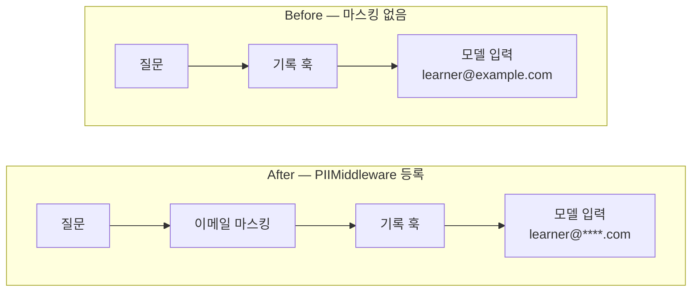
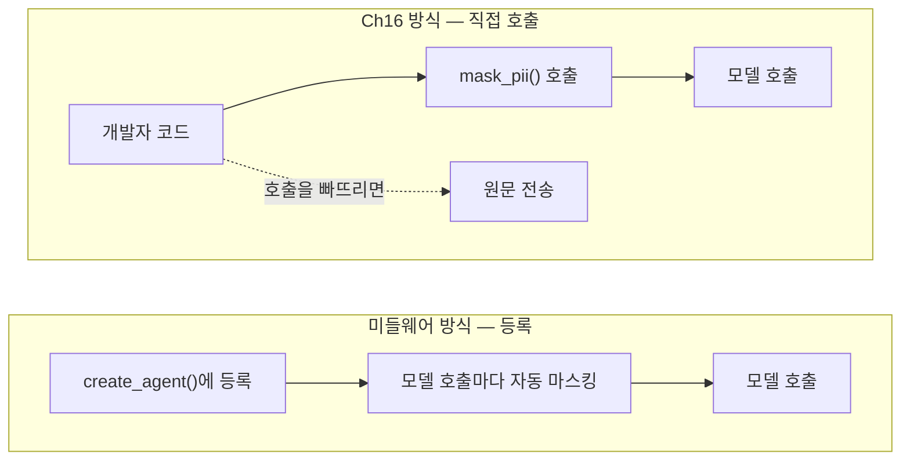
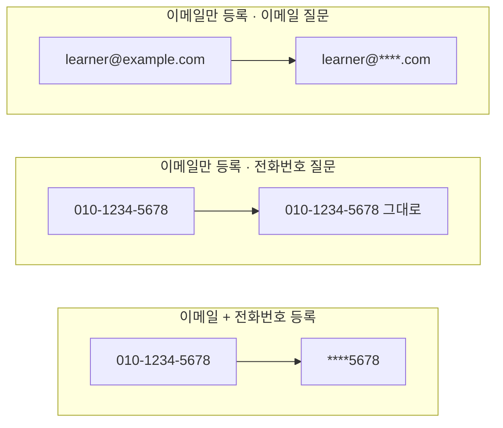

# 02-PII-마스킹-이식

## _src 본문 (HTML 원본)

```html
<!--meta: 강의 1h · 실습 2h | 코드 Jupyter Notebook | 새 용어 3개 -->
<h2 id="b1"><span class="no">1</span>학습 목표</h2><div class="goal"><ul><li>개인정보가 모델에 그대로 전송되는지 기록 훅으로 확인할 수 있습니다.</li><li>마스킹 미들웨어(PIIMiddleware)를 등록해 모델에 보내기 전에 이메일을 가릴 수 있습니다.</li><li>내장 종류에 없는 개인정보를 정규식 탐지 규칙으로 추가할 수 있습니다.</li></ul></div>
<h2 id="b2"><span class="no">2</span>이 내용을 배우는 이유</h2>
<p>사용자는 질문에 자기 이메일이나 전화번호를 적곤 합니다. 이 글이 그대로 외부 모델 서비스로 나가면 개인정보가 전송됩니다.</p>
<p>Ch16에서는 모델을 부르기 전에 마스킹 함수를 직접 호출했습니다. 호출하는 자리가 늘어나면 한 곳쯤 빠뜨리기 쉽습니다.</p>
<p>이번 절에서는 같은 일을 미들웨어에 맡깁니다. 한 번 등록하면 모델을 부를 때마다 자동으로 적용됩니다.</p>
<p><strong>이 절의 질문</strong> — Ch16의 PII 마스킹을 미들웨어로 옮기면 적용 지점과 코드가 어떻게 달라질까요?</p>
<h2 id="b3"><span class="no">3</span>앞에서 배운 내용</h2>
<p>Ch16 02절에서 정규식으로 이메일·전화번호·주민등록번호·카드 번호를 찾아 표식으로 바꿨습니다.</p>
<p>01절에서는 감싸기형 훅을 만들었습니다. <code>handler(request)</code> 줄 앞에서 모델에 들어갈 메시지를 볼 수 있습니다. 이번 절은 이 성질로 「모델이 받은 글」을 기록합니다.</p>
<h2 id="b4"><span class="no">4</span>핵심 개념</h2>
<h3>비유로 시작하기</h3>
<p>우체국 발송 창구를 떠올려 봅니다. 직원은 봉투가 우체통에 들어가기 전에 전화번호 칸에 가림 스티커를 붙입니다.</p>
<p>보내는 사람이 스티커를 챙기지 않아도 됩니다. 창구를 지나는 모든 봉투에 같은 일이 일어나기 때문입니다. 마스킹 미들웨어가 이 창구 직원입니다.</p>
{{img:02-4-우편-가림막|사람이 건넨 봉투에 창구 직원이 회색 스티커를 붙이고, 그 봉투가 우체통에 들어가는 세 장면 삽화|창구 직원은 모든 봉투가 우체통에 들어가기 전에 가림 스티커를 붙입니다.}}
<p><strong>그림 읽기</strong> — 왼쪽 봉투에서 오른쪽 우체통으로 따라갑니다. 가운데 직원이 마스킹 미들웨어에 해당합니다.</p>
<h3>개인정보와 마스킹의 뜻</h3>
<p>개인정보(PII, Personally Identifiable Information)는 사람을 알아볼 수 있는 정보입니다. 이메일, 전화번호, 주민등록번호가 예입니다.</p>
<p>마스킹(masking)은 이런 값의 일부나 전부를 다른 글자로 가리는 처리입니다. 예를 들어 <code>learner@example.com</code>을 <code>learner@****.com</code>으로 바꿉니다.</p>
<h3>마스킹이 일어나는 자리</h3>
{{mermaid:02-1-마스킹-위치|Before에서는 이메일 원문이, After에서는 가려진 이메일이 모델에 가는 비교 흐름도|같은 질문을 보냈을 때 모델이 받은 글입니다. After에서는 모델 호출 전에 이메일이 가려집니다.}}
<p><strong>도식 읽기</strong> — 두 줄을 왼쪽에서 오른쪽으로 읽습니다. 오른쪽 끝 상자가 모델이 실제로 받은 글입니다. 파란 상자는 질문과 거쳐 가는 단계입니다.</p>
<p>위 줄에는 마스킹 단계가 없어서 빨간 상자에 이메일 원문이 보입니다. 아래 줄은 기록 훅보다 먼저 이메일 마스킹을 거칩니다. 그래서 보라 상자에는 가려진 글이 있습니다.</p>
<h3>직접 호출과 등록의 차이</h3>
<p>Ch16 방식은 모델을 부르는 코드마다 <code>mask_pii()</code> 함수를 넣어야 합니다. 새 기능을 추가하면서 한 줄을 빠뜨리면 원문이 나갑니다.</p>
<p>미들웨어 방식은 <code>create_agent()</code> 함수에 한 번 등록합니다. 그 뒤로는 에이전트가 모델을 부를 때마다 마스킹이 먼저 실행됩니다. 입력을 가리는 단계는 01절에서 본 before_model 자리에서 실행됩니다.</p>
{{mermaid:02-2-호출-방식-비교|Ch16 직접 호출 방식과 미들웨어 등록 방식을 비교한 흐름도|마스킹을 적용하는 두 방식입니다. 위 칸의 점선은 호출을 빠뜨린 경로입니다.}}
<h3>PIIMiddleware의 인자</h3>
<table><tr><th>인자</th><th>이번 실습 값</th><th>뜻</th></tr>
<tr><td>첫 인자(종류)</td><td><code>"email"</code></td><td>가릴 개인정보 종류. 공식 문서 기준으로 이메일, 카드 번호, IP 주소 등이 내장돼 있습니다.</td></tr>
<tr><td><code>strategy</code></td><td><code>"mask"</code></td><td>가리는 방식. mask는 일부만 별표로 바꿉니다.</td></tr>
<tr><td><code>apply_to_input</code></td><td><code>True</code></td><td>모델에 보내는 입력에 적용합니다.</td></tr>
<tr><td><code>apply_to_output</code></td><td><code>True</code></td><td>모델이 만든 답에도 적용합니다. 이번 실습에서는 답 쪽을 확인하지 않았습니다.</td></tr>
<tr><td><code>detector</code></td><td>전화번호 정규식</td><td>내장 종류가 아닐 때 찾을 모양을 직접 넘깁니다.</td></tr></table>
<h2 id="b5"><span class="no">5</span>실행 예제</h2>
<p>노트북은 먼저 Ch16 02절의 가리기 함수를 딕셔너리와 <code>re.compile</code>로 정리한 판을 실행합니다. 함수 <code>re.compile</code>은 정규식 글을 미리 규칙 객체 하나로 만들어 둡니다. 이메일 정규식은 Ch16 02절과 다른 모양이고, 나머지 셋은 같습니다. 네 가지 개인정보가 모두 표식으로 바뀌는지 확인합니다.</p>
<p>그다음 모델이 받은 글을 기록하는 훅을 만듭니다. 비교는 Before와 After 모두 이 기록으로 합니다. 모델 답 문장은 실행마다 달라지므로 비교 기준으로 쓰지 않습니다.</p>
{{notebook:02-PII-마스킹-이식|example}}
<p class="look"><b>확인할 점</b> — 마스킹 결과 네 값이 모두 표식으로 바뀌었는지 봅니다. 이 함수는 호출했을 때만 적용됩니다.</p>
<h2 id="b6"><span class="no">6</span>일부러 실패해 보기</h2>
<p>Before에서는 기록 훅만 등록한 에이전트에 이메일이 든 질문을 보냅니다. After에서는 같은 질문을, 마스킹 미들웨어를 추가한 에이전트에 보냅니다.</p>
<p>바꾼 조건은 <code>PIIMiddleware</code> 등록 하나입니다. 질문, 모델, 기록 훅은 같습니다.</p>
{{notebook:02-PII-마스킹-이식|failure}}
<p>Before에서 모델이 받은 글에는 이메일 원문이 있었습니다. After에서는 <code>learner@****.com</code>으로 가려졌고, 대화 기록에 저장된 질문도 가려진 글이었습니다.</p>
<p>원인은 모델 호출 전에 개인정보를 가리는 단계가 없었다는 것입니다. 미들웨어를 등록하자 그 단계가 모델 호출마다 자동으로 들어갔습니다.</p>
{{mermaid:02-3-등록-종류별-결과|등록한 종류에 따라 이메일과 전화번호가 가려지거나 그대로 전송된 결과를 세 줄로 비교한 그림|등록한 개인정보 종류에 따라 모델이 받은 글이 달라졌습니다.}}
<p>값 바꿔 보기에서는 전화번호 질문을 보냈습니다. 이메일만 등록한 에이전트는 전화번호를 가리지 않았습니다. Ch16에서 쓴 전화번호 정규식을 <code>detector</code> 인자로 넘기자 <code>****5678</code>로 가려졌습니다.</p>
<p>모델 호출은 모두 4번이고 예상 비용은 0.01달러 미만입니다.</p>
<h2 id="b7"><span class="no">7</span>주의할 점과 실무 메모</h2>
<ul><li>내장 미들웨어는 등록한 종류만 찾습니다. 서비스에서 받는 개인정보 종류를 먼저 정리하고 빠진 종류는 <code>detector</code>로 추가합니다.</li><li>정규식은 모양이 조금 다른 값(예: 공백이 든 전화번호)을 놓칠 수 있습니다. 실제 입력 예시로 탐지 결과를 확인합니다.</li><li>이번 실습의 마스킹은 모델 입력과 대화 기록에 적용됐습니다. 로그 파일처럼 미들웨어 밖에서 원문을 저장하는 곳은 따로 확인해야 합니다.</li><li>Ch16 함수의 표식(<code>&lt;EMAIL_MASKED&gt;</code>)과 미들웨어의 별표 결과는 모양이 다릅니다. 표식 모양에 의존하는 코드가 있으면 함께 고칩니다.</li></ul>
<h2 id="b8"><span class="no">8</span>정리와 다음 절</h2>
<ul><li>마스킹 함수는 부를 때만, 마스킹 미들웨어는 모델을 부를 때마다 적용됩니다.</li><li>모델이 받은 글을 기록해 Before와 After를 비교했습니다.</li><li>내장 종류에 없는 개인정보는 정규식을 <code>detector</code> 인자로 넘겨 추가합니다.</li></ul>
<p><strong>다음 학습과 이어지는 지점</strong> — 03절에서는 긴 대화를 모델에 보내기 전에 요약하는 미들웨어를 다룹니다. 이번 절의 기록 훅으로 입력 메시지 수를 비교합니다.</p>
<h2 id="b9"><span class="no">9</span>복습 문제</h2><details class="quiz"><summary>문제와 해설</summary>
<p class="quiz-q">1. Before에서 모델이 받은 글에 이메일 원문이 있었던 이유는 무엇인가요?</p><p class="quiz-a"><b>해설</b> — 모델 호출 전에 개인정보를 가리는 단계가 없었기 때문입니다. 에이전트에는 기록 훅만 등록돼 있었습니다.</p>
<p class="quiz-q">2. After에서 바꾼 조건은 무엇이었나요?</p><p class="quiz-a"><b>해설</b> — <code>PIIMiddleware("email", ...)</code>를 등록한 것 하나입니다. 질문과 모델은 같았습니다.</p>
<p class="quiz-q">3. 이메일만 등록한 에이전트에 전화번호를 보내면 어떻게 됐나요?</p><p class="quiz-a"><b>해설</b> — 전화번호가 가려지지 않고 그대로 모델에 갔습니다. 등록한 종류만 가려지기 때문입니다.</p>
<p class="quiz-q">4. 전화번호도 가리려면 무엇을 추가했나요?</p><p class="quiz-a"><b>해설</b> — Ch16의 전화번호 정규식을 <code>detector</code> 인자로 넘긴 PIIMiddleware를 하나 더 등록했습니다.</p>
</details>
<h2 id="b10"><span class="no">10</span>참고 자료</h2><ul><li><a href="https://docs.langchain.com/oss/python/langchain/middleware/custom">LangChain Custom middleware</a> · 확인 2026-09-14 · LangChain 1.4.0</li><li><a href="https://docs.langchain.com/oss/python/langchain/middleware/built-in">LangChain Prebuilt middleware</a> · 확인 2026-09-14 · LangChain 1.4.0</li><li><a href="https://reference.langchain.com/python/langchain/agents/middleware">LangChain middleware API reference</a> · 확인 2026-09-14 · LangChain 1.4.0</li></ul>
```

## 노트북 셀 (순서대로)

### [0] markdown {'html': 'skip'}

# PII 마스킹 이식

**이 노트북에서 할 일**

1. Ch16 02절의 가리기 함수를 딕셔너리와 `re.compile`로 정리한 판을 실행해 봅니다.
2. 마스킹 없이 이메일이 든 질문을 보내고, 모델이 받은 글을 확인합니다(Before).
3. 이메일 마스킹 미들웨어를 등록하고 같은 질문을 보냅니다(After).

**준비물** — `.env` 파일의 `OPENAI_API_KEY`. 데이터 파일은 없습니다. 모델 호출은 4번이고 실행 시간은 1분 이내입니다. 예상 비용은 0.01달러 미만입니다.

### [1] markdown {'html': 'skip'}

## 오늘 볼 그림


위가 Before, 아래가 After입니다. After에서는 모델에 보내기 전에 마스킹 훅이 이메일을 가립니다.
파란 상자는 질문과 거쳐 가는 단계, 빨간 상자는 원문이 간 모델 입력, 보라 상자는 가려진 모델 입력입니다.

### [2] markdown {}

## 1. 준비

첫 셀은 패키지를 설치하고 설치된 버전을 출력합니다. 설치에는 몇십 초가 걸릴 수 있습니다.

### [3] code {'execution': {'iopub.execute_input': '2026-09-15T10:32:32.548376Z', 'iopub.status.busy': '2026-09-15T10:32:32.548208Z', 'iopub.status.idle': '2026-09-15T10:32:32.927650Z', 'shell.execute_reply': '2026-09-15T10:32:32.927124Z'}, 'lesson_role': 'setup'}

```python
# 이 절에서 쓰는 패키지를 설치하고 버전을 확인합니다
%pip install -q "langchain==1.4.0" "langchain-openai==1.6.0" "langgraph==1.2.11" "python-dotenv==1.2.3"
from importlib.metadata import version

print("langchain:", version("langchain"))
print("langchain-openai:", version("langchain-openai"))
print("langgraph:", version("langgraph"))
```

출력:
```
Note: you may need to restart the kernel to use updated packages.
langchain: 1.4.0
langchain-openai: 1.6.0
langgraph: 1.2.11

```

### [4] markdown {}

이번 절에서 쓰는 이름을 불러옵니다. 개인정보를 가리는 미들웨어는 `PIIMiddleware`입니다.

### [5] code {'execution': {'iopub.execute_input': '2026-09-15T10:32:32.928705Z', 'iopub.status.busy': '2026-09-15T10:32:32.928609Z', 'iopub.status.idle': '2026-09-15T10:32:33.160504Z', 'shell.execute_reply': '2026-09-15T10:32:33.160019Z'}, 'lesson_role': 'setup'}

```python
# 에이전트·미들웨어·모델을 만드는 도구를 불러옵니다
import re
from collections.abc import Callable

from langchain.agents import create_agent
from langchain.agents.middleware import ModelRequest, ModelResponse, PIIMiddleware
from langchain.agents.middleware import wrap_model_call
from langchain.chat_models import init_chat_model
```

출력:
```

```

### [6] markdown {}

API 키가 있는지 확인합니다. `True` 값이 나오면 다음으로 넘어갑니다.

### [7] code {'execution': {'iopub.execute_input': '2026-09-15T10:32:33.161316Z', 'iopub.status.busy': '2026-09-15T10:32:33.161255Z', 'iopub.status.idle': '2026-09-15T10:32:33.164691Z', 'shell.execute_reply': '2026-09-15T10:32:33.164446Z'}, 'lesson_role': 'setup'}

```python
# .env 파일에서 OpenAI API 키를 읽습니다(키 값은 출력하지 않습니다)
import os
from dotenv import find_dotenv, load_dotenv

env_path = find_dotenv(usecwd=True)
load_dotenv(env_path)
has_key = os.getenv("OPENAI_API_KEY") is not None
print("OPENAI_API_KEY 설정 여부:", has_key)
assert has_key, "프로젝트 폴더의 .env 파일에 OPENAI_API_KEY를 적어 주세요."
```

출력:
```
OPENAI_API_KEY 설정 여부: True

```

### [8] markdown {}

실습에 쓸 모델을 준비합니다. 01절과 같은 설정입니다.
temperature 값을 0으로 두어 매번 비슷한 답을 고르게 합니다.

### [9] code {'execution': {'iopub.execute_input': '2026-09-15T10:32:33.165423Z', 'iopub.status.busy': '2026-09-15T10:32:33.165371Z', 'iopub.status.idle': '2026-09-15T10:32:33.497130Z', 'shell.execute_reply': '2026-09-15T10:32:33.496713Z'}}

```python
# 실습에 쓸 모델을 준비합니다
model = init_chat_model(
    "openai:gpt-5.4-mini",
    temperature=0,
    reasoning_effort="none",
)
print("모델 이름:", model.model_name)
print("temperature:", model.temperature)
```

출력:
```
모델 이름: gpt-5.4-mini
temperature: 0.0

```

### [10] markdown {}

**결과 읽기** — 모델 이름 `gpt-5.4-mini`, temperature `0.0`이 보이면 준비가 끝났습니다.
이 노트북의 출력은 2026-09-15에 이 모델로 실행한 결과입니다.

### [11] markdown {}

## 2. Ch16 마스킹 함수를 정리한 판

개인정보(PII)는 이메일이나 전화번호처럼 사람을 알아볼 수 있는 정보입니다.
Ch16 02절에서는 정규식으로 개인정보를 찾아 표식으로 바꿨습니다. 정규식은 글자의 모양을 적는 규칙입니다.
이 절은 그 가리기 함수를 딕셔너리와 `re.compile`로 정리한 판을 씁니다.

함수 `re.compile(정규식)`은 정규식 글을 미리 규칙 객체 하나로 만들어 둡니다. 그 객체의 `sub`가 맞는 부분을 바꿉니다.
전화번호·주민등록번호·카드 번호 정규식은 Ch16 02절과 같고, 이메일 정규식은 Ch16 02절과 다른 모양입니다.
먼저 찾을 모양 네 가지를 딕셔너리에 담습니다.

### [12] code {'execution': {'iopub.execute_input': '2026-09-15T10:32:33.497821Z', 'iopub.status.busy': '2026-09-15T10:32:33.497764Z', 'iopub.status.idle': '2026-09-15T10:32:33.499628Z', 'shell.execute_reply': '2026-09-15T10:32:33.499278Z'}}

```python
# 찾을 개인정보 모양을 이름별 정규식으로 적습니다
PII_PATTERNS = {
    "email": re.compile(r"[\w.+-]+@[\w-]+\.[\w.]+"),
    "phone": re.compile(r"01[016789]-?\d{3,4}-?\d{4}"),
    "rrn": re.compile(r"\d{6}-?[1-4]\d{6}"),
    "card": re.compile(r"\d{4}-\d{4}-\d{4}-\d{4}"),
}
print("찾을 개인정보 종류:", list(PII_PATTERNS))
```

출력:
```
찾을 개인정보 종류: ['email', 'phone', 'rrn', 'card']

```

### [13] markdown {}

**결과 읽기** — 네 가지 이름 `email`, `phone`, `rrn`, `card`가 나옵니다. 이름 중 rrn은 주민등록번호, card는 카드 번호입니다.

글 하나를 받아 네 가지 모양을 차례로 표식으로 바꾸는 함수를 만듭니다.
Ch16 02절 함수와 달리 종류별 개수는 내놓지 않고 가린 글만 내놓습니다.

### [14] code {'execution': {'iopub.execute_input': '2026-09-15T10:32:33.500198Z', 'iopub.status.busy': '2026-09-15T10:32:33.500144Z', 'iopub.status.idle': '2026-09-15T10:32:33.501690Z', 'shell.execute_reply': '2026-09-15T10:32:33.501347Z'}}

```python
# 정규식에 맞는 부분을 <EMAIL_MASKED> 같은 표식으로 바꾸는 함수
def mask_pii(text: str) -> str:
    masked = text
    for name, pattern in PII_PATTERNS.items():
        label = "<" + name.upper() + "_MASKED>"
        masked = pattern.sub(label, masked)
    return masked
```

출력:
```

```

### [15] markdown {}

출력은 없습니다. 함수를 만들기만 했습니다. 예시 글로 실행해 봅니다.

### [16] code {'execution': {'iopub.execute_input': '2026-09-15T10:32:33.502304Z', 'iopub.status.busy': '2026-09-15T10:32:33.502256Z', 'iopub.status.idle': '2026-09-15T10:32:33.503947Z', 'shell.execute_reply': '2026-09-15T10:32:33.503607Z'}}

```python
# 개인정보 네 가지가 든 예시 글에 함수를 적용합니다
sample = "learner@example.com 010-1234-5678 900101-1234567 1234-5678-9012-3456"
print("원문:", sample)
print("마스킹 결과:", mask_pii(sample))
```

출력:
```
원문: learner@example.com 010-1234-5678 900101-1234567 1234-5678-9012-3456
마스킹 결과: <EMAIL_MASKED> <PHONE_MASKED> <RRN_MASKED> <CARD_MASKED>

```

### [17] markdown {}

**결과 읽기** — 네 값이 모두 `<EMAIL_MASKED>` 같은 표식으로 바뀌었습니다.
Ch16에서는 모델을 부르기 전에 가리기 함수를 우리가 직접 호출해야 했습니다. 호출을 빠뜨리면 원문이 그대로 모델에 갑니다.

## 3. 모델이 받은 글을 기록하는 훅

이번 비교의 기준은 「모델이 실제로 무엇을 받았나」입니다. 01절의 감싸기형 훅으로 모델 입력을 기록합니다.
`request.messages`에는 이번 모델 호출에 들어가는 메시지 목록이 있습니다.

### [18] code {'execution': {'iopub.execute_input': '2026-09-15T10:32:33.504459Z', 'iopub.status.busy': '2026-09-15T10:32:33.504415Z', 'iopub.status.idle': '2026-09-15T10:32:33.506241Z', 'shell.execute_reply': '2026-09-15T10:32:33.505880Z'}}

```python
# 모델이 실제로 받은 메시지를 기록하는 훅을 만듭니다
seen_by_model = []


@wrap_model_call
def record_model_input(request: ModelRequest, handler: Callable) -> ModelResponse:
    for message in request.messages:
        seen_by_model.append(message.text)
    return handler(request)
```

출력:
```

```

### [19] markdown {}

출력은 없습니다. 이 훅은 모델을 부르기 직전에 메시지 글을 `seen_by_model` 목록에 적습니다.

### [20] markdown {'lesson_part': 'before'}

## 4. Before — 마스킹 없이 보내기

이메일이 든 질문을 보냅니다. 에이전트에는 기록 훅만 등록합니다.

### [21] code {'execution': {'iopub.execute_input': '2026-09-15T10:32:33.506797Z', 'iopub.status.busy': '2026-09-15T10:32:33.506751Z', 'iopub.status.idle': '2026-09-15T10:32:35.318583Z', 'shell.execute_reply': '2026-09-15T10:32:35.317870Z'}, 'lesson_part': 'before'}

```python
# Before: 마스킹 없이 이메일이 든 질문을 보냅니다
question = {"messages": [{"role": "user", "content": "제 이메일 learner@example.com 으로 대출 연장 안내를 보내 주세요."}]}
plain_agent = create_agent(model, tools=[], middleware=[record_model_input])
plain_result = plain_agent.invoke(question)
print("모델이 받은 글:", seen_by_model[0])
```

출력:
```
모델이 받은 글: 제 이메일 learner@example.com 으로 대출 연장 안내를 보내 주세요.

```

### [22] markdown {'lesson_part': 'before'}

**결과 읽기** — 모델이 받은 글에 이메일 `learner@example.com`이 그대로 들어 있습니다.

### [23] code {'execution': {'iopub.execute_input': '2026-09-15T10:32:35.319460Z', 'iopub.status.busy': '2026-09-15T10:32:35.319385Z', 'iopub.status.idle': '2026-09-15T10:32:35.321663Z', 'shell.execute_reply': '2026-09-15T10:32:35.321296Z'}, 'lesson_part': 'before'}

```python
# 모델 입력에 이메일 원문이 있었는지 참/거짓으로 확인합니다
email_sent = "learner@example.com" in seen_by_model[0]
print("모델 입력에 이메일 원문이 있나:", email_sent)
assert email_sent
```

출력:
```
모델 입력에 이메일 원문이 있나: True

```

### [24] markdown {'lesson_part': 'before'}

**결과 읽기** — `True`입니다. 개인정보가 외부 모델 서비스로 그대로 전송됐습니다.

### [25] markdown {'lesson_part': 'after'}

## 5. After — 마스킹 미들웨어 등록하기

`PIIMiddleware()` 클래스로 미들웨어를 만듭니다. 첫 인자 `"email"`은 가릴 종류입니다.
인자 `strategy="mask"`는 값의 일부를 별표로 가리는 방식입니다. 인자 `apply_to_input=True`는 모델에 보내는 입력에 적용하라는 뜻입니다.

인자 `apply_to_output=True`는 모델이 만든 답에도 적용하라는 뜻입니다. 답 쪽 마스킹은 이번에 확인하지 않습니다.

### [26] code {'execution': {'iopub.execute_input': '2026-09-15T10:32:35.322608Z', 'iopub.status.busy': '2026-09-15T10:32:35.322540Z', 'iopub.status.idle': '2026-09-15T10:32:35.324727Z', 'shell.execute_reply': '2026-09-15T10:32:35.324362Z'}, 'lesson_part': 'after'}

```python
# After: 이메일 마스킹 미들웨어를 만듭니다
email_mask = PIIMiddleware("email", strategy="mask", apply_to_input=True, apply_to_output=True)
print("미들웨어 이름:", email_mask.name)
```

출력:
```
미들웨어 이름: PIIMiddleware[email]

```

### [27] markdown {'lesson_part': 'after'}

**결과 읽기** — 미들웨어 이름에 `email`이 들어 있습니다.

기록을 비우고 같은 질문을 보냅니다. 마스킹 미들웨어의 입력 처리는 01절에서 본 before_model 자리에서 실행됩니다.
그래서 모델 호출을 감싸는 기록 훅보다 먼저 글을 바꿉니다.

### [28] code {'execution': {'iopub.execute_input': '2026-09-15T10:32:35.325593Z', 'iopub.status.busy': '2026-09-15T10:32:35.325538Z', 'iopub.status.idle': '2026-09-15T10:32:36.767579Z', 'shell.execute_reply': '2026-09-15T10:32:36.766201Z'}, 'lesson_part': 'after'}

```python
# 같은 질문을 마스킹 미들웨어가 있는 에이전트로 보냅니다
seen_by_model.clear()
masked_agent = create_agent(model, tools=[], middleware=[email_mask, record_model_input])
masked_result = masked_agent.invoke(question)
print("모델이 받은 글:", seen_by_model[0])
```

출력:
```
모델이 받은 글: 제 이메일 learner@****.com 으로 대출 연장 안내를 보내 주세요.

```

### [29] markdown {'lesson_part': 'after'}

**결과 읽기** — 이메일 자리가 `learner@****.com`처럼 별표로 바뀌었습니다. 모델은 가려진 글만 받았습니다.

### [30] code {'execution': {'iopub.execute_input': '2026-09-15T10:32:36.769615Z', 'iopub.status.busy': '2026-09-15T10:32:36.769455Z', 'iopub.status.idle': '2026-09-15T10:32:36.772871Z', 'shell.execute_reply': '2026-09-15T10:32:36.772268Z'}, 'lesson_part': 'after'}

```python
# 모델 입력과 저장된 대화 기록에 이메일 원문이 남았는지 확인합니다
email_sent = "learner@example.com" in seen_by_model[0]
stored_text = masked_result["messages"][0].text
print("모델 입력에 이메일 원문이 있나:", email_sent)
print("대화 기록에 저장된 질문:", stored_text)
assert not email_sent
```

출력:
```
모델 입력에 이메일 원문이 있나: False
대화 기록에 저장된 질문: 제 이메일 learner@****.com 으로 대출 연장 안내를 보내 주세요.

```

### [31] markdown {'lesson_part': 'after'}

**결과 읽기** — 모델 입력 확인 결과가 `False`입니다. 대화 기록에 저장된 질문도 가려진 글로 바뀌었습니다.
이번에는 Ch16 방식과 달리 마스킹 함수를 직접 부르지 않았습니다. 그런데도 모델 호출 전에 적용됐습니다.

## 6. 값 하나 바꿔 보기 — 전화번호

공식 문서 기준으로 내장 종류는 email, credit_card, ip, mac_address, url입니다. 전화번호는 내장 종류에 없습니다.
이메일 마스킹만 등록한 상태에서 전화번호를 보내 봅니다.
실행 전에 예상해 봅니다. 전화번호는 등록하지 않은 종류이므로 그대로 모델에 갈 것입니다.

### [32] code {'execution': {'iopub.execute_input': '2026-09-15T10:32:36.774362Z', 'iopub.status.busy': '2026-09-15T10:32:36.774255Z', 'iopub.status.idle': '2026-09-15T10:32:38.290866Z', 'shell.execute_reply': '2026-09-15T10:32:38.289570Z'}, 'lesson_part': 'after'}

```python
# 전화번호가 든 질문을 이메일 마스킹 에이전트로 보냅니다
seen_by_model.clear()
phone_question = {"messages": [{"role": "user", "content": "연락처 010-1234-5678 로 문자 안내를 받을 수 있나요?"}]}
masked_agent.invoke(phone_question)
print("모델이 받은 글:", seen_by_model[0])
```

출력:
```
모델이 받은 글: 연락처 010-1234-5678 로 문자 안내를 받을 수 있나요?

```

### [33] markdown {'lesson_part': 'after'}

**결과 읽기** — 전화번호 `010-1234-5678`이 그대로 보입니다. 등록한 종류만 가려집니다.

Ch16에서 쓴 전화번호 정규식을 `detector` 인자로 넘기면 전화번호용 미들웨어를 하나 더 만들 수 있습니다.
정규식 객체의 `.pattern` 속성에는 규칙이 글자로 들어 있습니다. 이 글자를 `detector` 인자에 넘깁니다.

### [34] code {'execution': {'iopub.execute_input': '2026-09-15T10:32:38.293027Z', 'iopub.status.busy': '2026-09-15T10:32:38.292858Z', 'iopub.status.idle': '2026-09-15T10:32:38.296207Z', 'shell.execute_reply': '2026-09-15T10:32:38.295601Z'}, 'lesson_part': 'after'}

```python
# Ch16의 전화번호 정규식으로 마스킹 미들웨어를 하나 더 만듭니다
phone_rule = PII_PATTERNS["phone"].pattern
phone_mask = PIIMiddleware(
    "phone",
    detector=phone_rule,
    strategy="mask",
    apply_to_input=True,
)
print("정규식 규칙:", phone_rule)
print("미들웨어 이름:", phone_mask.name)
```

출력:
```
정규식 규칙: 01[016789]-?\d{3,4}-?\d{4}
미들웨어 이름: PIIMiddleware[phone]

```

### [35] markdown {'lesson_part': 'after'}

**결과 읽기** — 미들웨어 이름에 `phone`이 들어 있습니다.

이메일과 전화번호 마스킹 미들웨어를 함께 등록하고 같은 질문을 보냅니다.

### [36] code {'execution': {'iopub.execute_input': '2026-09-15T10:32:38.297426Z', 'iopub.status.busy': '2026-09-15T10:32:38.297310Z', 'iopub.status.idle': '2026-09-15T10:32:39.849701Z', 'shell.execute_reply': '2026-09-15T10:32:39.848234Z'}, 'lesson_part': 'after'}

```python
# 이메일·전화번호 마스킹을 함께 등록한 에이전트로 같은 질문을 보냅니다
seen_by_model.clear()
both_agent = create_agent(model, tools=[], middleware=[email_mask, phone_mask, record_model_input])
both_agent.invoke(phone_question)
print("모델이 받은 글:", seen_by_model[0])
assert "010-1234-5678" not in seen_by_model[0]
```

출력:
```
모델이 받은 글: 연락처 ****5678 로 문자 안내를 받을 수 있나요?

```

### [37] markdown {'lesson_part': 'after'}

**결과 읽기** — 이번에는 전화번호가 `****5678`로 가려졌습니다. 마지막 `assert` 줄이 오류 없이 지나갔습니다.

## 정리

- Ch16의 마스킹 함수는 우리가 부를 때만 적용됩니다. 미들웨어는 모델을 부를 때마다 자동으로 적용됩니다.
- 내장 미들웨어는 등록한 종류만 가립니다. 전화번호처럼 없는 종류는 `detector`에 정규식을 넘겨 추가합니다.
- 비교할 때는 답 문장이 아니라 「모델이 받은 글」을 기록해서 확인했습니다.

## 그림

### 02-1-마스킹-위치.mmd



- 설명 대상 문장: 미들웨어를 쓰면 이런 기능을 에이전트 실행의 정해진 자리에 한 번만 끼워 넣을 수 있습니다.
- 캡션: 같은 질문을 보냈을 때 모델이 받은 글. After에서는 모델 호출 전에 이메일이 가려집니다.
- 읽는 법: 두 줄을 왼쪽에서 오른쪽으로 읽습니다. 파란 상자는 질문과 거쳐 가는 단계입니다. 빨간 상자는 개인정보가 그대로 나간 경우, 보라 상자는 가려진 글이 모델에 간 경우입니다.
- alt: Before 줄은 질문 원문이 기록 훅을 거쳐 이메일 원문 그대로 모델에 가고, After 줄은 이메일 마스킹을 거쳐 learner@****.com으로 가려진 글이 모델에 가는 비교 흐름도

### 02-2-호출-방식-비교.mmd



- 설명 대상 문장: Ch16의 마스킹 함수는 우리가 부를 때만 적용됩니다. 미들웨어는 모델을 부를 때마다 자동으로 적용됩니다.
- 캡션: 마스킹을 적용하는 두 방식. 등록한 에이전트에서는 모델을 부를 때마다 마스킹이 실행됩니다.
- 읽는 법: 위 칸의 점선은 개발자가 mask_pii() 호출을 빠뜨린 경로입니다. 아래 칸에는 그런 갈래가 없습니다.
- alt: Ch16 방식은 개발자 코드가 mask_pii를 호출한 뒤 모델을 부르고 호출을 빠뜨리면 원문이 전송되며, 미들웨어 방식은 등록 후 모델 호출마다 자동으로 마스킹하는 비교 흐름도

### 02-3-등록-종류별-결과.mmd



- 설명 대상 문장: 내장 미들웨어는 등록한 종류만 가립니다.
- 캡션: 등록한 개인정보 종류에 따라 모델이 받은 글이 달라졌습니다.
- 읽는 법: 각 줄의 왼쪽이 질문 속 원래 값, 오른쪽이 모델이 받은 값입니다. 가운데 줄만 빨간색으로, 등록하지 않은 전화번호가 그대로 나갔습니다.
- alt: 이메일만 등록하면 이메일은 가려지지만 전화번호는 그대로 전송되고, 전화번호 탐지 규칙을 함께 등록하면 전화번호가 ****5678로 가려지는 세 줄 비교 그림

### 02-4-우편-가림막.prompt.md

# 삽화 — 02-4 발송 전 가림 스티커

- 상태: 2026-09-15 생성·검수 통과. 모델 nano_banana_pro(서버 표기 nano_banana_2), 16:9, 2k(2752×1536), 2크레딧. job 73ff0a43-e344-4e6c-87bc-5609cbb6644b. 교재 파일은 폭 1100px로 줄여 저장.
- 설명 대상 문장: 미들웨어를 쓰면 이런 기능을 에이전트 실행의 정해진 자리에 한 번만 끼워 넣을 수 있습니다.
- 넣을 자리: 02절 핵심 개념 「비유로 시작하기」 아래
- 구성 요소와 배치(왼쪽 → 오른쪽): ① 봉투를 내미는 사람 ② 발송 창구 직원이 봉투 뒷면의 전화번호 칸에 불투명 스티커를 붙이는 장면 ③ 스티커가 붙은 봉투가 우체통으로 들어가는 장면
- 시선 순서: 봉투 → 스티커 붙이기 → 우체통
- 대응: 봉투 = 질문, 창구 직원 = PIIMiddleware, 우체통 = 모델
- 모델: nano_banana_pro, 16:9, 1k (생성 시점 카탈로그로 다시 확인)

## 프롬프트

Simple flat educational illustration, white background, limited soft palette, clean outlines, plain everyday objects, no text, no letters, no numbers, no logos.
Left to right: (1) a person handing an envelope across a counter, (2) a post office clerk placing a solid gray sticker over one small section on the back of the envelope, (3) the same envelope with the gray sticker sliding into a red mailbox slot. Dashed arrow connects the three steps. All writing areas on the envelope are blank shapes only.

