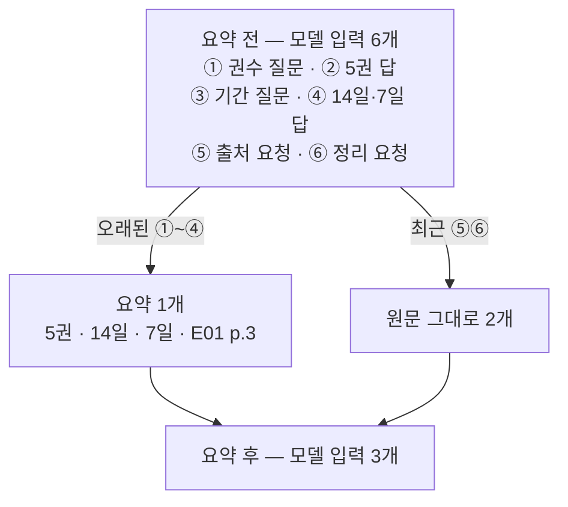
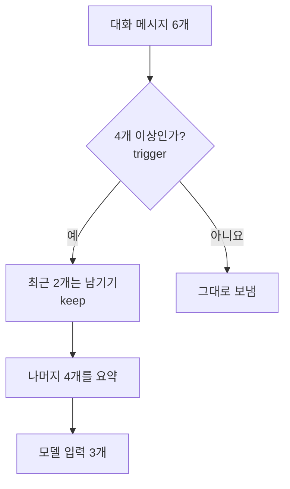
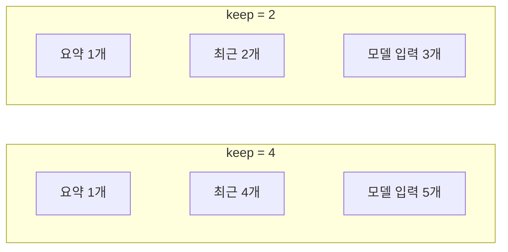

# 03-요약-압축과-Compress

## _src 본문 (HTML 원본)

```html
<!--meta: 강의 1h · 실습 2h | 코드 Jupyter Notebook | 새 용어 3개 -->
<h2 id="b1"><span class="no">1</span>학습 목표</h2><div class="goal"><ul><li>요약 미들웨어가 언제 요약을 시작하고 몇 개를 남기는지 설명할 수 있습니다.</li><li>기록 훅으로 요약 전후 모델 입력 메시지 수를 비교할 수 있습니다.</li><li>요약문에 중요한 조건이 남았는지 직접 확인할 수 있습니다.</li></ul></div>
<h2 id="b2"><span class="no">2</span>이 내용을 배우는 이유</h2>
<p>대화가 길어지면 에이전트는 지난 메시지를 모두 모델에 보냅니다. 메시지가 늘수록 입력 토큰과 비용도 늘어납니다.</p>
<p>Ch16에서는 오래된 대화를 직접 잘라 내거나 요약했습니다. 이번 절에서는 이 일을 미들웨어에 맡기고, 그 결과 무엇이 남는지 확인합니다.</p>
<p><strong>이 절의 질문</strong> — 자동 요약 압축은 언제 실행되며 최근 메시지와 중요 조건을 어떻게 보존해야 할까요?</p>
<h2 id="b3"><span class="no">3</span>앞에서 배운 내용</h2>
<p>Ch8 03절에서 컨텍스트를 줄이는 전략인 Compress를 배웠습니다. 긴 내용을 짧게 줄여 필요한 정보만 남기는 방법입니다.</p>
<p>Ch16 03절에서는 대화 기록을 자르고 요약하는 함수를 직접 만들었습니다. 02절에서는 모델이 받은 메시지를 기록하는 훅을 만들었습니다.</p>
<h2 id="b4"><span class="no">4</span>핵심 개념</h2>
<h3>비유로 시작하기</h3>
<p>책상에 메모가 여섯 장 쌓였다고 해 봅니다. 오래된 메모 네 장은 요약 카드 한 장으로 옮겨 적습니다.</p>
<p>가장 최근 메모 두 장은 방금 쓴 내용이라 그대로 둡니다. 책상은 넓어지지만, 카드에 옮겨 적지 않은 내용은 사라집니다.</p>
{{img:03-4-메모-정리|메모 여섯 장이 쌓인 책상과, 요약 카드 한 장과 메모 두 장만 놓인 책상을 화살표로 이은 삽화|오래된 메모는 요약 카드 한 장으로 정리하고, 가장 최근 메모 두 장은 그대로 둡니다.}}
<p><strong>그림 읽기</strong> — 왼쪽 책상의 메모 여섯 장이 오른쪽 책상에서 카드 한 장과 메모 두 장이 됩니다.</p>
<h3>요약 압축의 뜻</h3>
<p>요약 압축은 오래된 메시지 여러 개를 요약 메시지 하나로 바꾸는 처리입니다. 모델에 보내는 메시지 수가 줄어듭니다. 대화가 길면 입력 글자 수와 토큰도 줄어듭니다.</p>
<p>다만 이번처럼 짧은 대화에서는 요약문이 원문보다 길 수 있습니다. 노트북에서 글자 수를 비교해 확인합니다.</p>
<p>요약문은 모델이 만듭니다. 그래서 실행할 때마다 문장이 달라질 수 있고, 중요한 조건이 빠질 수도 있습니다.</p>
{{mermaid:03-1-요약-전후|대화 메시지 6개가 요약 1개와 최근 메시지 2개로 줄어드는 전후 비교 그림|메시지 6개 중 오래된 4개가 요약 1개로 바뀌고 최근 2개는 그대로 남았습니다.}}
<p><strong>도식 읽기</strong> — 맨 위 상자가 원래 메시지 6개, 맨 아래 상자가 요약 뒤 모델이 받은 메시지 3개입니다. 오래된 ①~④가 요약 1개가 되고 최근 ⑤⑥은 그대로 남습니다.</p>
<p>보라 상자가 모델이 만든 요약입니다. 이번 실행의 요약에는 5권, 14일, 7일, 출처 E01 p.3가 모두 남았습니다.</p>
<h3>trigger와 keep</h3>
<p>요약 미들웨어에는 두 기준이 있습니다. 시작 기준(trigger)은 요약을 시작할 조건입니다. 유지 개수(keep)는 요약하지 않고 남길 최근 메시지 수입니다.</p>
<p>이번 실습은 <code>trigger=("messages", 4)</code>, <code>keep=("messages", 2)</code>로 둡니다. 메시지가 4개 이상이면 최근 2개만 남기고 나머지를 요약합니다.</p>
{{mermaid:03-2-trigger-keep|메시지 6개가 시작 기준 4개 이상이라 최근 2개를 남기고 나머지 4개를 요약하는 흐름도|trigger와 keep 값에 따라 요약 미들웨어가 하는 일입니다.}}
<p>기준은 메시지 수 대신 토큰 수로도 줄 수 있습니다. 예를 들어 <code>("tokens", 3000)</code>으로 두면 입력이 약 3,000토큰 이상일 때 요약합니다. 이 방식은 이번 실습에서 실행하지 않았습니다.</p>
<h2 id="b5"><span class="no">5</span>실행 예제</h2>
<p>노트북은 도서관 대출 조건을 묻는 메시지 6개를 만듭니다. 권수, 기간, 연장 조건, 출처가 들어 있습니다.</p>
<p>02절과 같은 기록 훅으로 모델이 받은 메시지를 셉니다. 요약문을 만들 때도 실제 모델을 부르므로 모델 호출은 모두 5번입니다.</p>
{{notebook:03-요약-압축과-Compress|example}}
<p class="look"><b>확인할 점</b> — 대화 메시지 수가 6개인지, 중요한 조건 네 가지가 어느 메시지에 있는지 봅니다.</p>
<h2 id="b6"><span class="no">6</span>일부러 실패해 보기</h2>
<p>Before 실행은 요약 없이 대화 전체를 보냅니다. After 실행은 같은 대화를 요약 미들웨어가 있는 에이전트에 보냅니다.</p>
<p>바꾼 조건은 <code>SummarizationMiddleware</code> 등록 하나입니다. 대화, 모델, 기록 훅은 같습니다.</p>
{{notebook:03-요약-압축과-Compress|failure}}
<p>Before에서 모델은 메시지 6개를 받았습니다. 대화가 길어질수록 이 수는 계속 늘어납니다. 이것이 이번 절에서 해결할 문제입니다.</p>
<p>After에서 모델이 받은 메시지는 3개였습니다. 1번은 <code>Here is a summary</code>로 시작하는 요약문이었고, 2번과 3번은 원래 대화의 마지막 두 메시지였습니다.</p>
<p>메시지 수는 줄었지만 모델 입력 글자 수는 130자에서 381자로 늘었습니다. 대화가 짧아서 요약문이 원문보다 길었습니다.</p>
<p>이번 실행에서는 조건 네 가지가 모두 요약문에 남았습니다. 한 번의 실행 결과이므로 다른 대화나 다른 실행에서도 늘 남는다고 말할 수는 없습니다.</p>
{{mermaid:03-3-keep-비교|keep이 2일 때 모델 입력 3개, 4일 때 5개임을 비교한 그림|같은 대화에서 keep 값만 바꿨을 때 모델이 받은 메시지 수입니다.}}
<p>값 바꿔 보기에서 keep을 4로 늘리자 모델 입력은 5개였습니다. 남길 메시지가 많으면 입력은 덜 줄지만 원문이 더 많이 남습니다.</p>
<h2 id="b7"><span class="no">7</span>주의할 점과 실무 메모</h2>
<ul><li>요약문은 모델이 만들기 때문에 조건이 빠질 수 있습니다. 승인 여부나 금액처럼 틀리면 안 되는 값은 요약에 맡기지 말고 따로 저장합니다.</li><li>요약문 앞의 <code>Here is a summary</code> 문구는 미들웨어 코드가 붙입니다. 그 뒤의 소제목과 내용은 기본 요약 지시문에 따라 모델이 씁니다. 지시문은 <code>summary_prompt</code> 인자로 바꿀 수 있습니다.</li><li>요약할 때도 모델을 한 번 더 부릅니다. 짧은 대화에서 기준을 너무 낮게 잡으면 오히려 호출 수가 늘어납니다.</li><li>저장된 대화 기록도 요약된 형태로 바뀝니다. 이번 실행에서는 요약 1개, 최근 메시지 2개, 새 답 1개로 모두 4개였습니다. 원문 전체가 필요하면 별도 저장소에 보관합니다.</li></ul>
<h2 id="b8"><span class="no">8</span>정리와 다음 절</h2>
<ul><li>요약 미들웨어는 메시지 수가 기준 이상이면 오래된 메시지를 요약 하나로 바꿉니다.</li><li>이번 실행에서 모델 입력은 6개에서 3개로 줄었고, 조건 네 가지는 요약에 남았습니다.</li><li>keep 값을 늘리면 원문이 더 남는 대신 입력은 덜 줄어듭니다.</li></ul>
<p><strong>다음 학습과 이어지는 지점</strong> — 04절은 재시도·폴백·호출 한도 미들웨어를 다룹니다. 모델 호출이 실패하거나 너무 많아질 때 씁니다.</p>
<h2 id="b9"><span class="no">9</span>복습 문제</h2><details class="quiz"><summary>문제와 해설</summary>
<p class="quiz-q">1. trigger=("messages", 4)는 무엇을 뜻하나요?</p><p class="quiz-a"><b>해설</b> — 메시지가 4개 이상이면 요약을 시작하라는 뜻입니다. 코드는 메시지 수가 4보다 작을 때만 요약을 건너뜁니다.</p>
<p class="quiz-q">2. 메시지 6개, keep=2일 때 모델이 받은 메시지는 몇 개였나요?</p><p class="quiz-a"><b>해설</b> — 3개입니다. 요약 1개와 최근 메시지 2개입니다.</p>
<p class="quiz-q">3. 요약문에 조건이 모두 남았는지 확인할 때 assert 대신 출력만 한 이유는 무엇인가요?</p><p class="quiz-a"><b>해설</b> — 요약문은 모델이 만들어 실행마다 달라질 수 있습니다. assert 문은 메시지 수처럼 늘 같아야 하는 값에만 씁니다.</p>
<p class="quiz-q">4. 금액처럼 틀리면 안 되는 조건은 어떻게 보존하는 것이 안전한가요?</p><p class="quiz-a"><b>해설</b> — 요약에 맡기지 않고 별도 저장소에 따로 저장합니다.</p>
</details>
<h2 id="b10"><span class="no">10</span>참고 자료</h2><ul><li><a href="https://docs.langchain.com/oss/python/langchain/middleware/custom">LangChain Custom middleware</a> · 확인 2026-09-14 · LangChain 1.4.0</li><li><a href="https://docs.langchain.com/oss/python/langchain/middleware/built-in">LangChain Prebuilt middleware</a> · 확인 2026-09-14 · LangChain 1.4.0</li><li><a href="https://reference.langchain.com/python/langchain/agents/middleware">LangChain middleware API reference</a> · 확인 2026-09-14 · LangChain 1.4.0</li></ul>
```

## 노트북 셀 (순서대로)

### [0] markdown {'html': 'skip'}

# 요약 압축과 Compress

**이 노트북에서 할 일**

1. 메시지 6개를 그대로 모델에 보내고 모델이 받은 메시지 수를 셉니다(Before).
2. 요약 미들웨어를 등록해 오래된 메시지를 요약 한 개로 바꿉니다(After).
3. 요약문에 중요한 조건이 남았는지 확인하고, 남길 메시지 수를 바꿔 봅니다.

**준비물** — `.env` 파일의 `OPENAI_API_KEY`. 데이터 파일은 없습니다. 모델 호출은 5번이고 실행 시간은 1분 이내입니다. 예상 비용은 0.01달러 미만입니다.

### [1] markdown {'html': 'skip'}

## 오늘 볼 그림


위가 요약 전, 아래가 요약 후입니다. 오래된 메시지 네 개가 요약 한 개가 되고 최근 두 개는 그대로 남습니다.

### [2] markdown {}

## 1. 준비

첫 셀은 패키지를 설치하고 설치된 버전을 출력합니다. 설치에는 몇십 초가 걸릴 수 있습니다.

### [3] code {'execution': {'iopub.execute_input': '2026-09-15T10:57:44.346679Z', 'iopub.status.busy': '2026-09-15T10:57:44.346522Z', 'iopub.status.idle': '2026-09-15T10:57:44.791717Z', 'shell.execute_reply': '2026-09-15T10:57:44.790909Z'}, 'lesson_role': 'setup'}

```python
# 이 절에서 쓰는 패키지를 설치하고 버전을 확인합니다
%pip install -q "langchain==1.4.0" "langchain-openai==1.6.0" "langgraph==1.2.11" "python-dotenv==1.2.3"
from importlib.metadata import version

print("langchain:", version("langchain"))
print("langchain-openai:", version("langchain-openai"))
print("langgraph:", version("langgraph"))
```

출력:
```
Note: you may need to restart the kernel to use updated packages.
langchain: 1.4.0
langchain-openai: 1.6.0
langgraph: 1.2.11

```

### [4] markdown {}

이번 절에서 쓰는 이름을 불러옵니다. 오래된 대화를 요약하는 미들웨어는 `SummarizationMiddleware`입니다.

### [5] code {'execution': {'iopub.execute_input': '2026-09-15T10:57:44.792946Z', 'iopub.status.busy': '2026-09-15T10:57:44.792850Z', 'iopub.status.idle': '2026-09-15T10:57:45.038728Z', 'shell.execute_reply': '2026-09-15T10:57:45.038263Z'}, 'lesson_role': 'setup'}

```python
# 에이전트·미들웨어·메시지·모델을 만드는 도구를 불러옵니다
from collections.abc import Callable

from langchain.agents import create_agent
from langchain.agents.middleware import ModelRequest, ModelResponse, SummarizationMiddleware
from langchain.agents.middleware import wrap_model_call
from langchain.chat_models import init_chat_model
from langchain_core.messages import AIMessage, HumanMessage
```

출력:
```

```

### [6] markdown {}

API 키가 있는지 확인합니다. `True` 값이 나오면 다음으로 넘어갑니다.

### [7] code {'execution': {'iopub.execute_input': '2026-09-15T10:57:45.039573Z', 'iopub.status.busy': '2026-09-15T10:57:45.039514Z', 'iopub.status.idle': '2026-09-15T10:57:45.043318Z', 'shell.execute_reply': '2026-09-15T10:57:45.042982Z'}, 'lesson_role': 'setup'}

```python
# .env 파일에서 OpenAI API 키를 읽습니다(키 값은 출력하지 않습니다)
import os
from dotenv import find_dotenv, load_dotenv

env_path = find_dotenv(usecwd=True)
load_dotenv(env_path)
has_key = os.getenv("OPENAI_API_KEY") is not None
print("OPENAI_API_KEY 설정 여부:", has_key)
assert has_key, "프로젝트 폴더의 .env 파일에 OPENAI_API_KEY를 적어 주세요."
```

출력:
```
OPENAI_API_KEY 설정 여부: True

```

### [8] markdown {}

실습에 쓸 모델을 준비합니다. 01절과 같은 설정입니다.
temperature 값을 0으로 두어 매번 비슷한 답을 고르게 합니다.

### [9] code {'execution': {'iopub.execute_input': '2026-09-15T10:57:45.043934Z', 'iopub.status.busy': '2026-09-15T10:57:45.043883Z', 'iopub.status.idle': '2026-09-15T10:57:45.413328Z', 'shell.execute_reply': '2026-09-15T10:57:45.412885Z'}}

```python
# 실습에 쓸 모델을 준비합니다
model = init_chat_model(
    "openai:gpt-5.4-mini",
    temperature=0,
    reasoning_effort="none",
)
print("모델 이름:", model.model_name)
print("temperature:", model.temperature)
```

출력:
```
모델 이름: gpt-5.4-mini
temperature: 0.0

```

### [10] markdown {}

**결과 읽기** — 모델 이름 `gpt-5.4-mini`, temperature `0.0`이 보이면 준비가 끝났습니다.
이 노트북의 출력은 2026-09-15에 이 모델로 실행한 결과입니다.

### [11] markdown {}

## 2. 긴 대화 준비

대화가 길어지면 모델에 보내는 글이 늘어납니다. 요약 압축은 오래된 메시지를 짧은 요약 하나로 바꿔 입력을 줄이는 방법입니다.
Ch8에서 배운 Compress 전략을 미들웨어로 적용하는 것입니다. 먼저 도서관 대출 조건을 묻는 메시지 6개를 만듭니다.

메시지를 만드는 클래스 중 `HumanMessage`는 사용자 메시지, `AIMessage`는 모델 메시지입니다.
마지막 두 개는 사용자가 연달아 보낸 요청입니다. 에이전트는 마지막 사용자 요청에 답합니다.

### [12] code {'execution': {'iopub.execute_input': '2026-09-15T10:57:45.414009Z', 'iopub.status.busy': '2026-09-15T10:57:45.413941Z', 'iopub.status.idle': '2026-09-15T10:57:45.415864Z', 'shell.execute_reply': '2026-09-15T10:57:45.415527Z'}}

```python
# 사용자와 모델이 주고받은 메시지 6개를 만듭니다
history = [
    HumanMessage("대출은 몇 권까지 되나요?"),
    AIMessage("한 번에 5권까지 빌릴 수 있습니다. [E01 p.3]"),
    HumanMessage("대출 기간은요?"),
    AIMessage("14일이며, 예약자가 없으면 7일 연장할 수 있습니다. [E01 p.3]"),
    HumanMessage("출처도 같이 기억해 주세요."),
    HumanMessage("지금까지 말한 대출 조건을 정리해 주세요."),
]
print("대화 메시지 수:", len(history))
```

출력:
```
대화 메시지 수: 6

```

### [13] markdown {}

**결과 읽기** — 대화 메시지 수는 `6`입니다. 권수 5권, 기간 14일, 연장 7일, 출처 E01 p.3가 중요한 조건입니다.

02절과 같은 기록 훅을 만듭니다. 모델이 받은 메시지를 목록에 적습니다.

### [14] code {'execution': {'iopub.execute_input': '2026-09-15T10:57:45.416430Z', 'iopub.status.busy': '2026-09-15T10:57:45.416384Z', 'iopub.status.idle': '2026-09-15T10:57:45.418265Z', 'shell.execute_reply': '2026-09-15T10:57:45.417882Z'}}

```python
# 모델이 실제로 받은 메시지를 기록하는 훅을 만듭니다
seen_by_model = []


@wrap_model_call
def record_model_input(request: ModelRequest, handler: Callable) -> ModelResponse:
    for message in request.messages:
        seen_by_model.append(message.text)
    return handler(request)
```

출력:
```

```

### [15] markdown {}

출력은 없습니다.

### [16] markdown {'lesson_part': 'before'}

## 3. Before — 대화 전체 보내기

요약 없이 메시지 6개를 모두 보냅니다.

### [17] code {'execution': {'iopub.execute_input': '2026-09-15T10:57:45.418784Z', 'iopub.status.busy': '2026-09-15T10:57:45.418734Z', 'iopub.status.idle': '2026-09-15T10:57:47.093799Z', 'shell.execute_reply': '2026-09-15T10:57:47.093244Z'}, 'lesson_part': 'before'}

```python
# Before: 요약 없이 대화 전체를 보냅니다
plain_agent = create_agent(model, tools=[], middleware=[record_model_input])
plain_agent.invoke({"messages": history})
print("모델이 받은 메시지 수:", len(seen_by_model))
```

출력:
```
모델이 받은 메시지 수: 6

```

### [18] markdown {'lesson_part': 'before'}

**결과 읽기** — 모델이 받은 메시지 수는 `6`입니다. 메시지가 100개로 늘면 100개를 모두 보내게 됩니다.

### [19] markdown {'lesson_part': 'after'}

## 4. After — 요약 미들웨어 등록하기

`SummarizationMiddleware()` 클래스에 인자 세 개를 넘깁니다. 인자 `model`은 요약문을 만들 모델입니다.
인자 `trigger=("messages", 4)`는 메시지가 4개 이상이면 요약을 시작하라는 뜻입니다.
인자 `keep=("messages", 2)`는 가장 최근 메시지 2개는 요약하지 말고 그대로 두라는 뜻입니다.

### [20] code {'execution': {'iopub.execute_input': '2026-09-15T10:57:47.095255Z', 'iopub.status.busy': '2026-09-15T10:57:47.095145Z', 'iopub.status.idle': '2026-09-15T10:57:47.100673Z', 'shell.execute_reply': '2026-09-15T10:57:47.100240Z'}, 'lesson_part': 'after'}

```python
# After: 메시지가 4개 이상이면 최근 2개만 남기고 요약하는 미들웨어를 만듭니다
summarizer = SummarizationMiddleware(model=model, trigger=("messages", 4), keep=("messages", 2))
print("미들웨어 이름:", summarizer.name)
```

출력:
```
미들웨어 이름: SummarizationMiddleware

```

### [21] markdown {'lesson_part': 'after'}

**결과 읽기** — 미들웨어 이름 `SummarizationMiddleware`가 출력됩니다.

기록을 비우고 같은 대화를 보냅니다. 요약 미들웨어도 before_model 자리에서 실행됩니다.
그래서 모델 호출을 감싸는 기록 훅은 요약이 끝난 메시지를 봅니다.

### [22] code {'execution': {'iopub.execute_input': '2026-09-15T10:57:47.101798Z', 'iopub.status.busy': '2026-09-15T10:57:47.101720Z', 'iopub.status.idle': '2026-09-15T10:57:50.549890Z', 'shell.execute_reply': '2026-09-15T10:57:50.548545Z'}, 'lesson_part': 'after'}

```python
# 같은 대화를 요약 미들웨어가 있는 에이전트로 보냅니다
seen_by_model.clear()
summary_agent = create_agent(model, tools=[], middleware=[summarizer, record_model_input])
summary_result = summary_agent.invoke({"messages": history})
print("모델이 받은 메시지 수:", len(seen_by_model))
```

출력:
```
모델이 받은 메시지 수: 3

```

### [23] markdown {'lesson_part': 'after'}

**결과 읽기** — 모델이 받은 메시지 수가 `3`으로 줄었습니다. 요약 1개와 최근 메시지 2개입니다.

모델이 받은 메시지를 하나씩 출력해 봅니다.

### [24] code {'execution': {'iopub.execute_input': '2026-09-15T10:57:50.551873Z', 'iopub.status.busy': '2026-09-15T10:57:50.551721Z', 'iopub.status.idle': '2026-09-15T10:57:50.554836Z', 'shell.execute_reply': '2026-09-15T10:57:50.554218Z'}, 'lesson_part': 'after'}

```python
# 모델이 받은 메시지를 번호와 함께 출력합니다
for number, text in enumerate(seen_by_model, start=1):
    print(number, "|", text)
```

출력:
```
1 | Here is a summary of the conversation to date:

## SESSION INTENT

사용자는 도서 대출 규정을 문의하고 있으며, 현재까지는 대출 가능 권수와 대출 기간/연장 가능 여부를 확인하는 것이 목적이다.

## SUMMARY

- 대출 가능 권수: 한 번에 5권까지 가능함. [E01 p.3]
- 대출 기간: 14일임. [E01 p.3]
- 연장: 예약자가 없으면 7일 연장 가능함. [E01 p.3]

## ARTIFACTS

None

## NEXT STEPS

- 사용자가 추가로 도서관 이용 규정(반납, 연체, 예약 등)을 묻는 경우 해당 정보를 이어서 제공한다.
2 | 출처도 같이 기억해 주세요.
3 | 지금까지 말한 대출 조건을 정리해 주세요.

```

### [25] markdown {'lesson_part': 'after'}

**결과 읽기** — 1번은 `Here is a summary`로 시작하는 요약문입니다. 이 앞부분은 미들웨어 코드가 붙이는 고정 문구입니다.
그 뒤의 소제목과 내용은 요약 지시문에 따라 모델이 썼습니다. 그래서 실행마다 달라질 수 있습니다.
2번과 3번은 원래 대화의 마지막 두 메시지와 같습니다.

### [26] code {'execution': {'iopub.execute_input': '2026-09-15T10:57:50.556272Z', 'iopub.status.busy': '2026-09-15T10:57:50.556161Z', 'iopub.status.idle': '2026-09-15T10:57:50.559175Z', 'shell.execute_reply': '2026-09-15T10:57:50.558582Z'}, 'lesson_part': 'after'}

```python
# 요약문에 중요한 조건 네 가지가 남았는지 하나씩 확인합니다
summary_text = seen_by_model[0]
for condition in ["5권", "14일", "7일", "E01 p.3"]:
    print(condition, "남음:", condition in summary_text)
assert len(seen_by_model) == 3
assert summary_text.startswith("Here is a summary")
```

출력:
```
5권 남음: True
14일 남음: True
7일 남음: True
E01 p.3 남음: True

```

### [27] markdown {'lesson_part': 'after'}

**결과 읽기** — 이번 실행에서는 네 조건 모두 `True`입니다. 결과에 False가 있으면 그 조건은 요약하면서 사라진 것입니다.
`assert` 두 줄은 모델 문장과 상관없이 늘 같아야 하는 값(메시지 수와 고정 문구)만 확인합니다.

요약으로 메시지 수는 줄었습니다. 글자 수도 줄었는지, 저장된 대화 기록은 어떻게 됐는지 확인합니다.

### [28] code {'execution': {'iopub.execute_input': '2026-09-15T10:57:50.560292Z', 'iopub.status.busy': '2026-09-15T10:57:50.560187Z', 'iopub.status.idle': '2026-09-15T10:57:50.563796Z', 'shell.execute_reply': '2026-09-15T10:57:50.563142Z'}, 'lesson_part': 'after'}

```python
# 요약 전후의 모델 입력 글자 수와 저장된 대화 기록 수를 비교합니다
before_chars = 0
for message in history:
    before_chars = before_chars + len(message.text)
after_chars = 0
for text in seen_by_model:
    after_chars = after_chars + len(text)
print("요약 전 모델 입력 글자 수:", before_chars)
print("요약 후 모델 입력 글자 수:", after_chars)
print("저장된 대화 기록 수:", len(summary_result["messages"]))
for message in summary_result["messages"]:
    print("-", message.type, "|", message.text[:20])
```

출력:
```
요약 전 모델 입력 글자 수: 130
요약 후 모델 입력 글자 수: 381
저장된 대화 기록 수: 4
- human | Here is a summary of
- human | 출처도 같이 기억해 주세요.
- human | 지금까지 말한 대출 조건을 정리해 주
- ai | 물론입니다. 지금까지 확인된 **도서

```

### [29] markdown {'lesson_part': 'after'}

**결과 읽기** — 요약 전 글자 수는 `130`, 요약 후 글자 수는 `381`입니다. 짧은 대화라 요약문이 원문보다 길었습니다.
저장된 대화 기록 수는 `4`입니다. 첫 메시지는 `Here is a summary`로 시작하는 요약문입니다.
다음 두 개는 최근 메시지이고, 마지막 ai 메시지가 모델의 새 답입니다.

## 5. 값 하나 바꿔 보기 — 남길 메시지 수

`keep` 값을 2에서 4로 바꿉니다. 실행 전에 예상해 봅니다. 요약 1개와 최근 4개, 모두 5개가 될 것입니다.

### [30] code {'execution': {'iopub.execute_input': '2026-09-15T10:57:50.564922Z', 'iopub.status.busy': '2026-09-15T10:57:50.564806Z', 'iopub.status.idle': '2026-09-15T10:57:53.190683Z', 'shell.execute_reply': '2026-09-15T10:57:53.189200Z'}, 'lesson_part': 'after'}

```python
# 최근 메시지를 4개 남기도록 바꿔 같은 대화를 보냅니다
keep_four = SummarizationMiddleware(model=model, trigger=("messages", 4), keep=("messages", 4))
seen_by_model.clear()
keep_four_agent = create_agent(model, tools=[], middleware=[keep_four, record_model_input])
keep_four_agent.invoke({"messages": history})
print("모델이 받은 메시지 수:", len(seen_by_model))
for number, text in enumerate(seen_by_model, start=1):
    print(number, "|", text[:30])
```

출력:
```
모델이 받은 메시지 수: 5
1 | Here is a summary of the conve
2 | 대출 기간은요?
3 | 14일이며, 예약자가 없으면 7일 연장할 수 있습니다.
4 | 출처도 같이 기억해 주세요.
5 | 지금까지 말한 대출 조건을 정리해 주세요.

```

### [31] markdown {'lesson_part': 'after'}

**결과 읽기** — 모델이 받은 메시지 수가 `5`입니다. 1번은 요약문이고, 2~5번은 원래 대화의 마지막 네 메시지입니다.
남길 메시지가 많을수록 입력은 덜 줄지만 원문이 더 많이 보존됩니다.

## 정리

- 요약 미들웨어는 메시지 수가 기준 이상이면 오래된 메시지를 요약 하나로 바꿉니다.
- 최근 메시지는 `keep` 값만큼 원문 그대로 남습니다.
- 요약문은 모델이 만들므로 권수·기간·출처 같은 조건이 빠질 수 있습니다. 중요한 조건은 요약에 맡기지 말고 따로 저장합니다.

## 그림

### 03-1-요약-전후.mmd



- 설명 대상 문장: 요약 압축은 오래된 메시지를 짧은 요약 하나로 바꿔 입력을 줄이는 방법입니다.
- 캡션: 메시지 6개 중 오래된 4개가 요약 1개로 바뀌고, 최근 2개는 그대로 남았습니다.
- 읽는 법: 맨 위 상자가 원래 메시지 6개입니다. 오래된 ①~④는 보라 요약 1개가 되고 최근 ⑤⑥은 그대로 남아, 맨 아래 모델 입력 3개가 됩니다. 이번 실행의 요약에는 네 조건이 모두 남았습니다.
- alt: 대화 메시지 6개가 오래된 4개를 요약한 요약 1개와 최근 메시지 2개, 모두 3개로 줄어드는 전후 비교 그림

### 03-2-trigger-keep.mmd



- 설명 대상 문장: trigger는 요약을 시작할 기준, keep은 요약하지 않고 남길 최근 메시지 수입니다.
- 캡션: trigger=("messages", 4), keep=("messages", 2)일 때 요약 미들웨어가 하는 일입니다.
- 읽는 법: 맨 위 메시지 6개에서 출발합니다. 4개 이상이므로 "예"로 가서, 최근 2개를 떼어 두고 나머지 4개를 요약합니다. 요약 1개와 최근 2개를 합쳐 3개가 모델에 갑니다.
- alt: 메시지 6개가 trigger 기준 4개 이상이면 최근 2개를 남기고 나머지 4개를 요약해 모델 입력 3개를 만드는 흐름도

### 03-3-keep-비교.mmd



- 설명 대상 문장: 남길 메시지가 많을수록 입력은 덜 줄지만 원문이 더 많이 보존됩니다.
- 캡션: 같은 대화에서 keep 값만 바꿨을 때 모델이 받은 메시지 수입니다.
- 읽는 법: 두 줄은 가운데 칸(최근 2개/4개)과 오른쪽 칸(모델 입력 3개/5개)이 다릅니다. 최근 메시지를 2개 남기면 3개, 4개 남기면 5개가 모델에 갔습니다.
- alt: keep이 2이면 요약 1개와 최근 2개로 모델 입력 3개, keep이 4이면 요약 1개와 최근 4개로 모델 입력 5개임을 비교한 그림

### 03-4-메모-정리.prompt.md

# 삽화 — 03-4 쌓인 메모를 요약 카드로

- 상태: 2026-09-15 생성·검수 통과. 모델 nano_banana_pro(서버 표기 nano_banana_2), 16:9, 2k(2752×1536), 2크레딧. job 8f1a1a9b-41f2-41d9-b3fb-6109f0794a78. 교재 파일은 폭 1100px로 줄여 저장.
- 설명 대상 문장: 요약 압축은 오래된 메시지를 짧은 요약 하나로 바꿔 입력을 줄이는 방법입니다.
- 넣을 자리: 03절 핵심 개념 「비유로 시작하기」 아래
- 구성 요소와 배치(왼쪽 → 오른쪽): ① 책상 위에 쌓인 메모 여섯 장 ② 가운데 화살표 ③ 오른쪽 책상에 요약 카드 한 장과 가장 최근 메모 두 장만 놓인 모습
- 시선 순서: 메모 더미 → 화살표 → 카드 한 장과 메모 두 장
- 대응: 메모 = 대화 메시지, 요약 카드 = 요약 메시지, 최근 메모 두 장 = keep
- 모델: nano_banana_pro, 16:9, 1k (생성 시점 카탈로그로 다시 확인)

## 프롬프트

Simple flat educational illustration, white background, limited soft palette, clean outlines, plain everyday objects, no text, no letters, no numbers, no logos.
Two identical desks side by side. Left desk: a messy stack of six small paper notes. A large arrow points from the left desk to the right desk. Right desk: one larger yellow summary card placed on the left, and two small paper notes neatly placed next to it. All paper surfaces are blank with simple lines only.

