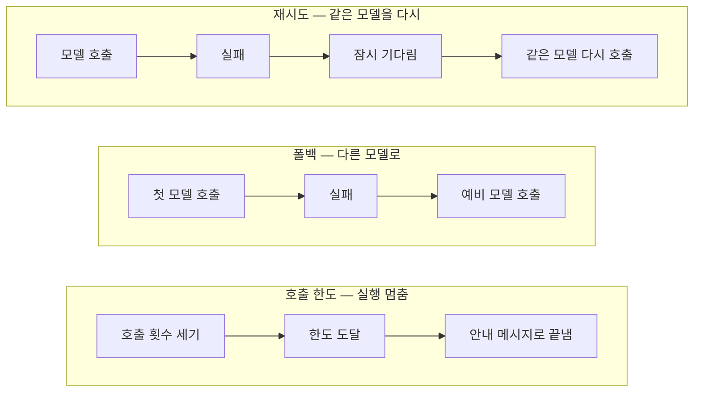
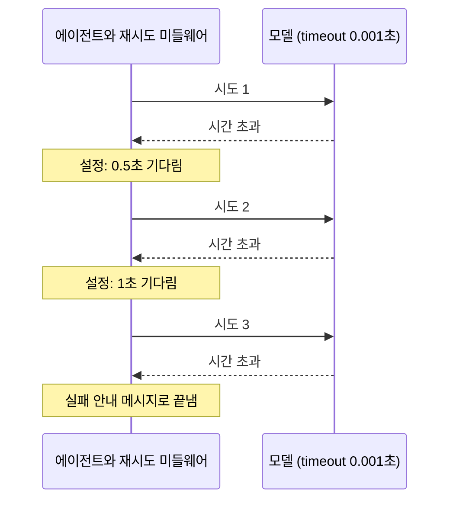
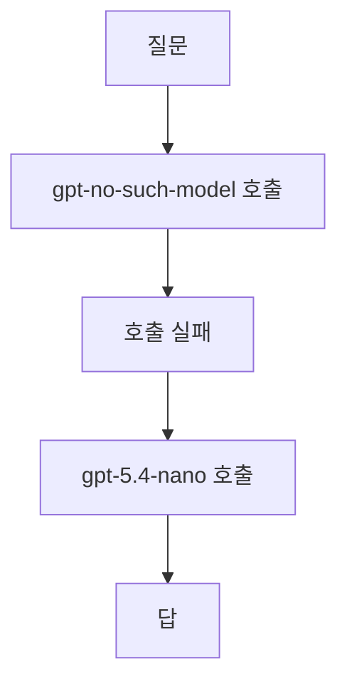
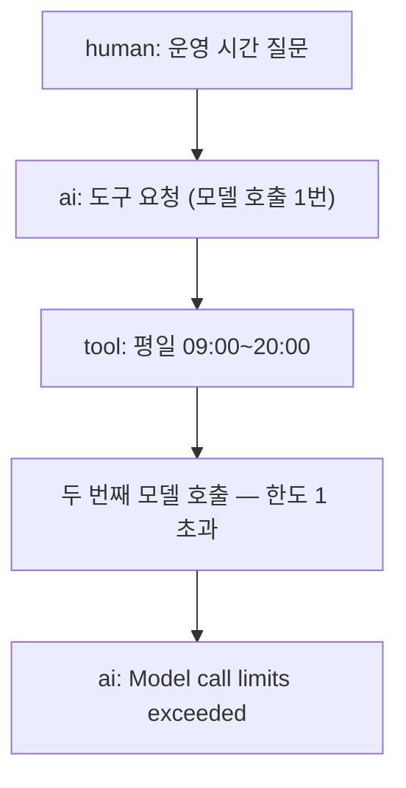

# 04-호출-한도와-재시도-폴백

## _src 본문 (HTML 원본)

```html
<!--meta: 강의 1h · 실습 2h | 코드 Jupyter Notebook | 새 용어 3개 -->
<h2 id="b1"><span class="no">1</span>학습 목표</h2><div class="goal"><ul><li>재시도, 폴백, 호출 한도가 각각 어떤 문제에 쓰이는지 구분할 수 있습니다.</li><li>실제 실패 조건을 만들고 기록 훅으로 시도 횟수와 시도한 모델을 확인할 수 있습니다.</li><li>호출 한도에 걸린 실행의 대화 기록을 읽고 어디서 멈췄는지 설명할 수 있습니다.</li></ul></div>
<h2 id="b2"><span class="no">2</span>이 내용을 배우는 이유</h2>
<p>모델 서비스는 가끔 응답이 늦거나 오류를 냅니다. 에이전트가 도구를 계속 부르며 반복을 멈추지 않을 때도 있습니다.</p>
<p>이런 상황을 코드 곳곳에서 따로 처리하면 규칙이 흩어집니다. 미들웨어로 등록하면 모델을 부르는 모든 자리에 같은 규칙이 적용됩니다.</p>
<p><strong>이 절의 질문</strong> — 호출 한도, 재시도, 폴백은 서로 다른 실패 조건을 어떻게 나누어 처리할까요?</p>
<h2 id="b3"><span class="no">3</span>앞에서 배운 내용</h2>
<p>Ch6 05절에서 시간 제한(timeout)과 재시도, 예비 모델을 LangChain 모델 설정으로 다뤘습니다. Ch16 04절과 05절에서는 호출 한도와 재시도를 함수로 직접 만들었습니다.</p>
<p>01절에서는 감싸기형 훅이 모델 호출을 앞뒤로 감싼다는 것을 확인했습니다. 이번 절의 기록 훅도 같은 모양입니다.</p>
<h2 id="b4"><span class="no">4</span>핵심 개념</h2>
<h3>비유로 시작하기</h3>
<p>친구에게 전화를 걸었는데 연결되지 않는다고 해 봅니다. 잠시 뒤 같은 번호로 다시 걸 수 있습니다. 다른 친구에게 걸 수도 있습니다.</p>
<p>통화는 한 번만 하기로 미리 정해 둘 수도 있습니다. 통화가 잘 돼도 두 번째는 걸지 않습니다. 세 가지 대처는 해결하는 문제가 서로 다릅니다.</p>
{{img:04-5-전화-연결|같은 전화기로 다시 거는 사람, 두 번째 전화기로 바꿔 거는 사람, 통화를 한 번 마치고 전화기를 내려놓은 뒤 멈춤 표지 옆에 있는 사람을 세 칸으로 그린 삽화|전화를 걸 때 정해 둘 수 있는 세 가지 대처입니다.}}
<p><strong>그림 읽기</strong> — 왼쪽은 같은 전화로 다시 걸기(재시도)입니다. 가운데는 다른 전화로 바꾸기(폴백)입니다. 오른쪽은 통화를 한 번만 하고 멈추기(호출 한도)입니다.</p>
<h3>세 가지 미들웨어</h3>
<p>재시도(retry)는 실패한 호출을 같은 모델에 다시 보냅니다. 네트워크가 잠깐 느렸던 것처럼 원인이 곧 사라지는 실패에 맞습니다.</p>
<p>폴백(fallback)은 첫 모델이 실패하면 예비 모델로 바꿔 부릅니다. 한 모델 서비스에 장애가 난 경우에 맞습니다.</p>
<p>호출 한도(call limit)는 한 번 실행하는 동안 모델을 부를 수 있는 횟수의 상한입니다. 반복이 끝나지 않거나 비용이 계속 늘어나는 경우에 씁니다.</p>
{{mermaid:04-1-세-정책|재시도, 폴백, 호출 한도가 실패나 한도 도달 뒤에 하는 일을 비교한 세 줄 흐름도|실패와 과도한 호출을 다루는 세 가지 미들웨어입니다.}}
<p><strong>도식 읽기</strong> — 세 줄을 각각 왼쪽에서 오른쪽으로 읽습니다. 빨간 상자 다음에 무엇을 하는지가 세 정책의 차이입니다.</p>
<table><tr><th>미들웨어</th><th>이번 실습 설정</th><th>설정의 뜻</th></tr>
<tr><td><code>ModelRetryMiddleware</code></td><td><code>max_retries=2</code>, <code>initial_delay=0.5</code></td><td>처음 실패 뒤 두 번 더 시도합니다. 첫 재시도 전 0.5초, 두 번째 재시도 전 1초를 기다리도록 설정했습니다. <code>jitter=False</code>는 대기 시간에 무작위 값을 더하지 않게 합니다.</td></tr>
<tr><td><code>ModelFallbackMiddleware</code></td><td>예비 모델 <code>gpt-5.4-nano</code></td><td>첫 모델이 실패하면 이 모델로 바꿔 부릅니다.</td></tr>
<tr><td><code>ModelCallLimitMiddleware</code></td><td><code>run_limit=1</code>, <code>exit_behavior="end"</code></td><td>한 실행에서 모델을 1번만 부르고, 넘으면 안내 메시지로 끝냅니다.</td></tr></table>
<h3>실패를 실제로 만드는 방법</h3>
<p>이번 절은 가짜 모델을 쓰지 않습니다. 실제로 일어나는 조건으로 실패를 만듭니다.</p>
<p>재시도 실험은 시간 제한을 0.001초로 줍니다. 이 시간 안에는 응답이 올 수 없으므로 매번 시간 초과가 납니다.</p>
<p>폴백 실험은 존재하지 않는 모델 이름을 씁니다. 모델 서비스가 오류로 응답하므로 첫 호출이 실패합니다.</p>
<p>호출 한도 실험은 도구가 필요한 질문을 씁니다. 도구를 쓰려면 모델을 최소 2번 불러야 하므로 한도 1에 걸립니다.</p>
<h2 id="b5"><span class="no">5</span>실행 예제</h2>
<p>노트북은 모델을 부를 때마다 모델 이름을 적는 기록 훅을 먼저 만듭니다. 세 실험 모두 이 기록으로 결과를 확인합니다.</p>
<p>미들웨어를 기록 훅보다 앞에 등록합니다. 그래야 재시도나 폴백이 모델을 다시 부를 때마다 기록 훅도 실행됩니다. 먼저 등록한 미들웨어가 안쪽의 기록 훅과 모델을 감싸기 때문입니다.</p>
<p>모델 호출 요청은 모두 6번이고 그중 정상 응답은 2번입니다. 예상 비용은 0.01달러 미만입니다.</p>
{{notebook:04-호출-한도와-재시도-폴백}}
<p class="look"><b>확인할 점</b> — 재시도의 시도 횟수 3, 폴백의 시도한 모델 두 개, 호출 한도의 모델 호출 횟수 1을 차례로 확인합니다.</p>
<h3>재시도 실험의 실제 순서</h3>
{{mermaid:04-2-재시도-실제-순서|시간 제한 0.001초 모델을 세 번 호출하고 세 번 모두 시간 초과가 난 순서도|재시도 미들웨어가 실제로 시도한 순서입니다.}}
<p>설정대로라면 첫 실패 뒤 0.5초, 두 번째 실패 뒤 1초를 기다린 뒤 다시 시도합니다. 대기 시간은 재지 않았습니다. 세 번 모두 시간 초과였기 때문에 마지막 메시지는 답이 아니라 실패 안내였습니다.</p>
<h2 id="b6"><span class="no">6</span>실험 결과 해석</h2>
<p>재시도 실험의 시도 횟수는 3이었습니다. 원인인 짧은 시간 제한이 그대로였으므로 세 번 모두 실패했습니다. 재시도는 원인이 사라지지 않으면 결과를 바꾸지 못합니다.</p>
<p>이번 실험은 매번 실패하도록 만든 조건입니다. 잠깐 느렸다가 회복되는 실제 장애에서 재시도가 성공하는 경우는 이번에 관찰하지 않았습니다.</p>
{{mermaid:04-3-폴백-순서|존재하지 않는 모델 호출이 실패한 뒤 예비 모델 gpt-5.4-nano로 넘어가 답을 받은 흐름도|폴백 미들웨어가 실제로 시도한 모델 순서입니다.}}
<p>폴백 실험에서는 <code>gpt-no-such-model</code> 호출이 실패한 뒤 <code>gpt-5.4-nano</code>가 답했습니다. 답한 메시지의 모델 이름도 nano 모델이었습니다.</p>
{{mermaid:04-4-호출-한도-메시지|질문, 도구 요청, 도구 결과 뒤에 두 번째 모델 호출이 한도에 걸려 안내 메시지로 끝난 흐름도|run_limit=1일 때 대화 기록에 실제로 남은 메시지입니다.}}
<p>호출 한도 실험에서 모델은 첫 호출에서 도구를 요청했고 도구도 실행됐습니다. 도구 결과를 읽을 두 번째 모델 호출은 한도에 걸려 실행되지 않았습니다.</p>
<p>그래서 대화는 최종 답 없이 <code>Model call limits exceeded</code> 안내로 끝났습니다. 한도는 비용이 늘어나는 것을 막지만, 너무 낮게 잡으면 필요한 답도 막습니다.</p>
<h2 id="b7"><span class="no">7</span>주의할 점과 실무 메모</h2>
<ul><li>재시도는 일시적인 오류에만 씁니다. 잘못된 모델 이름이나 권한 오류처럼 다시 해도 같은 오류는 재시도해도 시간만 늘어납니다.</li><li>모델 객체의 <code>max_retries</code> 설정과 재시도 미들웨어를 함께 쓰면 시도 횟수가 곱해질 수 있습니다. 이번 실습은 모델 쪽을 0으로 두었습니다.</li><li>폴백 모델은 품질과 비용이 첫 모델과 다를 수 있습니다. 어떤 모델이 답했는지 응답의 모델 이름을 기록합니다.</li><li>호출 한도는 도구를 쓰는 에이전트라면 2 이상이어야 최종 답을 받을 수 있습니다.</li><li>재시도 미들웨어의 기본 동작은 마지막 실패를 오류로 올리지 않고 안내 메시지로 끝내는 것입니다. 오류로 받으려면 <code>on_failure</code> 설정을 확인합니다.</li></ul>
<h2 id="b8"><span class="no">8</span>정리와 다음 절</h2>
<ul><li>재시도는 같은 모델을 다시 부르고, 원인이 그대로면 결과를 바꾸지 못했습니다.</li><li>폴백은 첫 모델이 실패하자 예비 모델로 바꿔 답을 받았습니다.</li><li>호출 한도는 도구 결과를 읽을 두 번째 모델 호출을 막고 실행을 끝냈습니다.</li></ul>
<p><strong>다음 학습과 이어지는 지점</strong> — 05절에서는 호출 횟수 대신 토큰 사용량으로 모델 호출을 막는 미들웨어를 직접 만듭니다.</p>
<h2 id="b9"><span class="no">9</span>복습 문제</h2><details class="quiz"><summary>문제와 해설</summary>
<p class="quiz-q">1. 재시도 실험에서 시도 횟수가 3이었는데도 답을 받지 못한 이유는 무엇인가요?</p><p class="quiz-a"><b>해설</b> — 시간 제한 0.001초라는 실패 원인이 세 번 모두 그대로였기 때문입니다.</p>
<p class="quiz-q">2. 모델 서비스 한 곳에 장애가 났을 때 알맞은 미들웨어는 무엇인가요?</p><p class="quiz-a"><b>해설</b> — 폴백 미들웨어입니다. 다른 모델로 바꿔 부를 수 있습니다.</p>
<p class="quiz-q">3. 호출 한도 실험에서 도구는 실행됐나요?</p><p class="quiz-a"><b>해설</b> — 실행됐습니다. 대화 기록에 tool 메시지 <code>평일 09:00~20:00</code>이 있었습니다. 막힌 것은 그다음 모델 호출입니다.</p>
<p class="quiz-q">4. 기록 훅을 재시도 미들웨어보다 뒤에 등록한 이유는 무엇인가요?</p><p class="quiz-a"><b>해설</b> — 먼저 등록한 미들웨어가 바깥에서 감싸기 때문입니다. 재시도가 모델을 다시 부를 때마다 안쪽의 기록 훅도 실행됩니다. 순서 규칙은 07절에서 확인합니다.</p>
</details>
<h2 id="b10"><span class="no">10</span>참고 자료</h2><ul><li><a href="https://docs.langchain.com/oss/python/langchain/middleware/custom">LangChain Custom middleware</a> · 확인 2026-09-14 · LangChain 1.4.0</li><li><a href="https://docs.langchain.com/oss/python/langchain/middleware/built-in">LangChain Prebuilt middleware</a> · 확인 2026-09-14 · LangChain 1.4.0</li><li><a href="https://reference.langchain.com/python/langchain/agents/middleware">LangChain middleware API reference</a> · 확인 2026-09-14 · LangChain 1.4.0</li></ul>
```

## 노트북 셀 (순서대로)

### [0] markdown {'html': 'skip'}

# 호출 한도와 재시도·폴백

**이 노트북에서 할 일**

1. 시간 제한을 아주 짧게 준 모델로 재시도 미들웨어가 몇 번 다시 부르는지 셉니다.
2. 존재하지 않는 모델 이름으로 폴백 미들웨어가 예비 모델로 넘어가는지 확인합니다.
3. 호출 한도를 1번으로 두고 도구가 필요한 질문을 보내 실행이 멈추는지 확인합니다.

**준비물** — `.env` 파일의 `OPENAI_API_KEY`. 데이터 파일은 없습니다. 모델 호출 요청은 6번이고 그중 정상 응답은 2번입니다. 실행 시간은 1분 이내이고, 예상 비용은 0.01달러 미만입니다.

### [1] markdown {'html': 'skip'}

## 오늘 볼 그림


위에서부터 재시도, 폴백, 호출 한도입니다. 재시도는 같은 모델을 다시 부르고, 폴백은 다른 모델로 바꾸고, 호출 한도는 실행을 멈춥니다.

### [2] markdown {}

## 1. 준비

첫 셀은 패키지를 설치하고 설치된 버전을 출력합니다. 설치에는 몇십 초가 걸릴 수 있습니다.

### [3] code {'execution': {'iopub.execute_input': '2026-09-15T10:36:41.756230Z', 'iopub.status.busy': '2026-09-15T10:36:41.756070Z', 'iopub.status.idle': '2026-09-15T10:36:42.150729Z', 'shell.execute_reply': '2026-09-15T10:36:42.150091Z'}, 'lesson_role': 'setup'}

```python
# 이 절에서 쓰는 패키지를 설치하고 버전을 확인합니다
%pip install -q "langchain==1.4.0" "langchain-openai==1.6.0" "langgraph==1.2.11" "python-dotenv==1.2.3"
from importlib.metadata import version

print("langchain:", version("langchain"))
print("langchain-openai:", version("langchain-openai"))
print("langgraph:", version("langgraph"))
```

출력:
```
Note: you may need to restart the kernel to use updated packages.
langchain: 1.4.0
langchain-openai: 1.6.0
langgraph: 1.2.11

```

### [4] markdown {}

이번 절에서 쓰는 이름을 불러옵니다. 재시도·폴백·호출 한도 미들웨어 세 개가 들어 있습니다.

### [5] code {'execution': {'iopub.execute_input': '2026-09-15T10:36:42.151951Z', 'iopub.status.busy': '2026-09-15T10:36:42.151850Z', 'iopub.status.idle': '2026-09-15T10:36:42.371596Z', 'shell.execute_reply': '2026-09-15T10:36:42.371135Z'}, 'lesson_role': 'setup'}

```python
# 에이전트·미들웨어·도구·모델을 만드는 도구를 불러옵니다
from collections.abc import Callable

from langchain.agents import create_agent
from langchain.agents.middleware import ModelCallLimitMiddleware, ModelFallbackMiddleware, ModelRetryMiddleware
from langchain.agents.middleware import ModelRequest, ModelResponse, wrap_model_call
from langchain.chat_models import init_chat_model
from langchain.tools import tool
```

출력:
```

```

### [6] markdown {}

API 키가 있는지 확인합니다. `True` 값이 나오면 다음으로 넘어갑니다.

### [7] code {'execution': {'iopub.execute_input': '2026-09-15T10:36:42.372359Z', 'iopub.status.busy': '2026-09-15T10:36:42.372305Z', 'iopub.status.idle': '2026-09-15T10:36:42.375840Z', 'shell.execute_reply': '2026-09-15T10:36:42.375475Z'}, 'lesson_role': 'setup'}

```python
# .env 파일에서 OpenAI API 키를 읽습니다(키 값은 출력하지 않습니다)
import os
from dotenv import find_dotenv, load_dotenv

env_path = find_dotenv(usecwd=True)
load_dotenv(env_path)
has_key = os.getenv("OPENAI_API_KEY") is not None
print("OPENAI_API_KEY 설정 여부:", has_key)
assert has_key, "프로젝트 폴더의 .env 파일에 OPENAI_API_KEY를 적어 주세요."
```

출력:
```
OPENAI_API_KEY 설정 여부: True

```

### [8] markdown {}

실습에 쓸 모델을 준비합니다. 01절과 같은 설정입니다.
temperature 값을 0으로 두어 매번 비슷한 답을 고르게 합니다.

### [9] code {'execution': {'iopub.execute_input': '2026-09-15T10:36:42.376406Z', 'iopub.status.busy': '2026-09-15T10:36:42.376359Z', 'iopub.status.idle': '2026-09-15T10:36:42.740174Z', 'shell.execute_reply': '2026-09-15T10:36:42.739749Z'}}

```python
# 실습에 쓸 모델을 준비합니다
model = init_chat_model(
    "openai:gpt-5.4-mini",
    temperature=0,
    reasoning_effort="none",
)
print("모델 이름:", model.model_name)
print("temperature:", model.temperature)
```

출력:
```
모델 이름: gpt-5.4-mini
temperature: 0.0

```

### [10] markdown {}

**결과 읽기** — 모델 이름 `gpt-5.4-mini`, temperature `0.0`이 보이면 준비가 끝났습니다.
이 노트북의 출력은 2026-09-15에 이 모델로 실행한 결과입니다.

### [11] markdown {}

## 2. 시도 기록 훅 만들기

이번 절에서는 모델 호출이 실패하는 상황을 실제로 만듭니다. 시도가 몇 번 있었는지 세려면 기록 훅이 필요합니다.
이 훅은 모델을 부를 때마다 모델 이름을 `attempts` 목록에 적습니다.

### [12] code {'execution': {'iopub.execute_input': '2026-09-15T10:36:42.740914Z', 'iopub.status.busy': '2026-09-15T10:36:42.740845Z', 'iopub.status.idle': '2026-09-15T10:36:42.742568Z', 'shell.execute_reply': '2026-09-15T10:36:42.742296Z'}}

```python
# 모델을 부를 때마다 모델 이름을 적는 훅을 만듭니다
attempts = []


@wrap_model_call
def record_attempt(request: ModelRequest, handler: Callable) -> ModelResponse:
    attempts.append(request.model.model_name)
    return handler(request)
```

출력:
```

```

### [13] markdown {}

출력은 없습니다.

## 3. 재시도 — 같은 모델을 다시 부르기

재시도(retry)는 실패한 호출을 같은 모델에 다시 보내는 방법입니다. 네트워크가 잠깐 느릴 때 쓸모가 있습니다.

실패를 일부러 만들기 위해 시간 제한(`timeout`)을 0.001초로 줍니다. 이 시간 안에는 응답이 올 수 없습니다.
인자 `max_retries=0`은 모델 객체가 스스로 다시 시도하지 않게 합니다. 재시도는 미들웨어에만 맡깁니다.

### [14] code {'execution': {'iopub.execute_input': '2026-09-15T10:36:42.743190Z', 'iopub.status.busy': '2026-09-15T10:36:42.743133Z', 'iopub.status.idle': '2026-09-15T10:36:42.745711Z', 'shell.execute_reply': '2026-09-15T10:36:42.745325Z'}}

```python
# 0.001초 안에 응답해야 하는 모델을 만듭니다(반드시 시간 초과가 납니다)
slow_model = init_chat_model(
    "openai:gpt-5.4-mini",
    temperature=0,
    reasoning_effort="none",
    timeout=0.001,
    max_retries=0,
)
print("시간 제한(초):", slow_model.request_timeout)
```

출력:
```
시간 제한(초): 0.001

```

### [15] markdown {}

**결과 읽기** — 시간 제한이 `0.001`초로 설정됐습니다.

`ModelRetryMiddleware()` 클래스의 `max_retries=2`는 처음 시도가 실패하면 두 번 더 시도하라는 뜻입니다.
인자 `initial_delay=0.5`는 첫 재시도 전에 0.5초 기다린다는 뜻입니다.
기다리는 시간은 재시도할 때마다 두 배가 되므로 두 번째 재시도 전에는 1초입니다. 대기 시간은 이번에 재지 않습니다.
인자 `jitter=False`는 기다리는 시간에 무작위 값을 더하지 않게 합니다.

먼저 등록한 미들웨어가 바깥에서 감쌉니다. 그래서 재시도는 안쪽의 기록 훅과 모델을 함께 다시 부릅니다.
재시도 미들웨어를 기록 훅보다 앞에 두어야 다시 시도할 때마다 기록 훅도 실행됩니다.

### [16] code {'execution': {'iopub.execute_input': '2026-09-15T10:36:42.746376Z', 'iopub.status.busy': '2026-09-15T10:36:42.746307Z', 'iopub.status.idle': '2026-09-15T10:36:44.294584Z', 'shell.execute_reply': '2026-09-15T10:36:44.293667Z'}}

```python
# 재시도 미들웨어를 등록하고 질문을 보냅니다
retry = ModelRetryMiddleware(max_retries=2, initial_delay=0.5, jitter=False)
retry_agent = create_agent(slow_model, tools=[], middleware=[retry, record_attempt])
question = {"messages": [{"role": "user", "content": "자료실 운영 시간을 알려 주세요."}]}
retry_result = retry_agent.invoke(question)
last_message = retry_result["messages"][-1]
print("시도 횟수:", len(attempts))
print("마지막 메시지:", last_message.text)
```

출력:
```
시도 횟수: 3
마지막 메시지: Model call failed after 3 attempts with OpenAITimeoutError: Request timed out.

```

### [17] markdown {}

**결과 읽기** — 시도 횟수는 `3`입니다. 처음 1번과 재시도 2번입니다.
세 번 모두 시간 초과였기 때문에 마지막 메시지는 답이 아니라 실패 안내입니다.
재시도는 원인이 사라지지 않으면 결과를 바꾸지 못합니다. 이번 조건은 매번 시간 초과가 나도록 만들었습니다.

### [18] code {'execution': {'iopub.execute_input': '2026-09-15T10:36:44.296818Z', 'iopub.status.busy': '2026-09-15T10:36:44.296620Z', 'iopub.status.idle': '2026-09-15T10:36:44.299916Z', 'shell.execute_reply': '2026-09-15T10:36:44.299192Z'}}

```python
# 재시도 횟수를 확인하고, 다음 실험을 위해 기록을 비웁니다
retry_attempts = len(attempts)
assert retry_attempts == 3
attempts.clear()
print("비운 뒤 기록 개수:", len(attempts))
```

출력:
```
비운 뒤 기록 개수: 0

```

### [19] markdown {}

**결과 읽기** — 비운 뒤 기록 개수는 `0`입니다.

## 4. 폴백 — 다른 모델로 넘어가기

폴백(fallback)은 첫 모델이 실패하면 예비 모델로 바꿔 부르는 방법입니다. 모델 서비스 한 곳에 장애가 났을 때 씁니다.
실패를 만들기 위해 존재하지 않는 모델 이름을 씁니다. 예비 모델은 더 작은 `gpt-5.4-nano`입니다.

### [20] code {'execution': {'iopub.execute_input': '2026-09-15T10:36:44.301273Z', 'iopub.status.busy': '2026-09-15T10:36:44.301162Z', 'iopub.status.idle': '2026-09-15T10:36:44.305278Z', 'shell.execute_reply': '2026-09-15T10:36:44.304787Z'}}

```python
# 존재하지 않는 이름의 모델과, 대신 쓸 예비 모델을 만듭니다
broken_model = init_chat_model("openai:gpt-no-such-model", temperature=0, max_retries=0)
backup_model = init_chat_model("openai:gpt-5.4-nano", temperature=0, reasoning_effort="none")
print("첫 모델:", broken_model.model_name)
print("예비 모델:", backup_model.model_name)
```

출력:
```
첫 모델: gpt-no-such-model
예비 모델: gpt-5.4-nano

```

### [21] markdown {}

**결과 읽기** — 첫 모델 이름은 `gpt-no-such-model`, 예비 모델 이름은 `gpt-5.4-nano`입니다.

`ModelFallbackMiddleware()` 클래스에 예비 모델을 넘깁니다. 이번에도 기록 훅을 뒤에 둡니다.
마지막 메시지의 `response_metadata` 속성에는 답한 모델 이름 같은 응답 정보가 들어 있습니다.

### [22] code {'execution': {'iopub.execute_input': '2026-09-15T10:36:44.306543Z', 'iopub.status.busy': '2026-09-15T10:36:44.306446Z', 'iopub.status.idle': '2026-09-15T10:36:45.481045Z', 'shell.execute_reply': '2026-09-15T10:36:45.480203Z'}}

```python
# 폴백 미들웨어를 등록하고 질문을 보냅니다
fallback = ModelFallbackMiddleware(backup_model)
fallback_agent = create_agent(broken_model, tools=[], middleware=[fallback, record_attempt])
greeting = {"messages": [{"role": "user", "content": "한 문장으로 인사해 주세요."}]}
fallback_result = fallback_agent.invoke(greeting)
last_message = fallback_result["messages"][-1]
print("시도한 모델 순서:", attempts)
print("답한 모델:", last_message.response_metadata["model_name"])
```

출력:
```
시도한 모델 순서: ['gpt-no-such-model', 'gpt-5.4-nano']
답한 모델: gpt-5.4-nano-2026-03-17

```

### [23] markdown {}

**결과 읽기** — 시도한 모델 순서가 `gpt-no-such-model` 다음 `gpt-5.4-nano`입니다.
답한 모델도 nano 모델입니다. 첫 모델이 실패하자 미들웨어가 요청의 모델만 바꿔 다시 불렀습니다.

### [24] code {'execution': {'iopub.execute_input': '2026-09-15T10:36:45.482657Z', 'iopub.status.busy': '2026-09-15T10:36:45.482512Z', 'iopub.status.idle': '2026-09-15T10:36:45.485853Z', 'shell.execute_reply': '2026-09-15T10:36:45.485249Z'}}

```python
# 폴백 순서를 확인하고, 다음 실험을 위해 기록을 비웁니다
# list()로 복사본을 만들어 두면 원본을 비워도 순서가 남습니다
fallback_order = list(attempts)
assert fallback_order == ["gpt-no-such-model", "gpt-5.4-nano"]
attempts.clear()
print("비운 뒤 기록 개수:", len(attempts))
```

출력:
```
비운 뒤 기록 개수: 0

```

### [25] markdown {}

**결과 읽기** — 비운 뒤 기록 개수는 `0`입니다.

## 5. 호출 한도 — 실행 멈추기

호출 한도(call limit)는 한 번 실행하는 동안 모델을 부를 수 있는 횟수의 상한입니다.
모델이 도구를 끝없이 부르는 반복을 막을 때 씁니다. 01절의 운영 시간 도구를 다시 만듭니다.

### [26] code {'execution': {'iopub.execute_input': '2026-09-15T10:36:45.487196Z', 'iopub.status.busy': '2026-09-15T10:36:45.487094Z', 'iopub.status.idle': '2026-09-15T10:36:45.491878Z', 'shell.execute_reply': '2026-09-15T10:36:45.491222Z'}}

```python
# 자료실 운영 시간을 알려 주는 도구를 만듭니다
@tool
def lookup_hours(day: str) -> str:
    """자료실 운영 시간을 조회합니다. day에는 "평일" 또는 "토요일"을 넣습니다."""
    if day == "평일":
        return "평일 09:00~20:00"
    return "토요일 10:00~17:00"


print("도구 이름:", lookup_hours.name)
```

출력:
```
도구 이름: lookup_hours

```

### [27] markdown {}

**결과 읽기** — 도구 이름 `lookup_hours`가 출력됩니다.

인자 `run_limit=1`은 한 번 실행하는 동안 모델을 1번만 부르라는 뜻입니다.
도구가 필요한 질문은 모델을 최소 2번 불러야 합니다. 도구 요청에 1번, 최종 답에 1번입니다. 그래서 두 번째 호출에서 멈출 것입니다.
인자 `exit_behavior="end"`는 한도에 걸리면 오류를 내지 않고 안내 메시지로 끝내라는 뜻입니다.

### [28] code {'execution': {'iopub.execute_input': '2026-09-15T10:36:45.492992Z', 'iopub.status.busy': '2026-09-15T10:36:45.492866Z', 'iopub.status.idle': '2026-09-15T10:36:46.976045Z', 'shell.execute_reply': '2026-09-15T10:36:46.975218Z'}}

```python
# 모델 호출을 1번으로 제한하고 도구가 필요한 질문을 보냅니다
limit = ModelCallLimitMiddleware(run_limit=1, exit_behavior="end")
limit_agent = create_agent(model, tools=[lookup_hours], middleware=[limit, record_attempt])
tool_question = "반드시 lookup_hours 도구로 확인한 뒤 자료실 평일 운영 시간을 알려 주세요."
limit_result = limit_agent.invoke({"messages": [{"role": "user", "content": tool_question}]})
print("모델 호출 횟수:", len(attempts))
for message in limit_result["messages"]:
    print(message.type, "|", message.text)
```

출력:
```
모델 호출 횟수: 1
human | 반드시 lookup_hours 도구로 확인한 뒤 자료실 평일 운영 시간을 알려 주세요.
ai | 
tool | 평일 09:00~20:00
ai | Model call limits exceeded: run limit (1/1)

```

### [29] markdown {}

**결과 읽기** — 모델 호출 횟수는 `1`입니다. 마지막 메시지는 `Model call limits exceeded`로 시작하는 안내입니다.
첫 호출에서 모델이 도구를 요청했고 도구도 실행됐습니다. 그러나 도구 결과를 읽을 두 번째 모델 호출은 한도에 걸려 실행되지 않았습니다.

### [30] code {'execution': {'iopub.execute_input': '2026-09-15T10:36:46.977478Z', 'iopub.status.busy': '2026-09-15T10:36:46.977354Z', 'iopub.status.idle': '2026-09-15T10:36:46.980356Z', 'shell.execute_reply': '2026-09-15T10:36:46.979820Z'}}

```python
# 세 실험의 결과를 한 번에 출력합니다
limit_calls = len(attempts)
print("재시도 — 시도 횟수:", retry_attempts)
print("폴백 — 시도한 모델:", fallback_order)
print("호출 한도 — 모델 호출 횟수:", limit_calls)
assert limit_calls == 1
```

출력:
```
재시도 — 시도 횟수: 3
폴백 — 시도한 모델: ['gpt-no-such-model', 'gpt-5.4-nano']
호출 한도 — 모델 호출 횟수: 1

```

### [31] markdown {}

**결과 읽기** — 재시도는 `3`번 시도, 폴백은 두 모델을 차례로 시도, 호출 한도는 `1`번 호출에서 멈췄습니다.

## 정리

- 재시도는 같은 모델을 다시 부릅니다. 실패 원인이 그대로면 횟수만 늘어납니다.
- 폴백은 다른 모델로 바꿔 부릅니다. 한 모델 서비스의 장애에 대비합니다.
- 호출 한도는 정해진 횟수를 넘으면 실행을 멈춥니다. 끝없는 반복과 비용 증가를 막습니다.

## 그림

### 04-1-세-정책.mmd



- 설명 대상 문장: 재시도는 같은 모델을 다시 부르고, 폴백은 다른 모델로 바꾸고, 호출 한도는 실행을 멈춥니다.
- 캡션: 실패와 과도한 호출을 다루는 세 가지 미들웨어입니다.
- 읽는 법: 세 줄을 각각 왼쪽에서 오른쪽으로 읽습니다. 빨간 상자 뒤에 무엇을 하는지가 세 정책의 차이입니다.
- alt: 재시도는 실패 후 기다렸다가 같은 모델을 다시 호출하고, 폴백은 실패 후 예비 모델을 호출하고, 호출 한도는 횟수가 한도에 닿으면 안내 메시지로 끝내는 세 줄 흐름도

### 04-2-재시도-실제-순서.mmd



- 설명 대상 문장: 재시도는 원인이 사라지지 않으면 결과를 바꾸지 못합니다.
- 캡션: 0.001초 시간 제한 모델에 재시도 미들웨어(max_retries=2)를 붙였을 때 실제 시도 순서입니다.
- 읽는 법: 위에서 아래로 시간이 흐릅니다. 시도 1이 실패한 뒤 두 번 더 시도했고 세 번 모두 시간 초과였습니다. 노트북 출력의 시도 횟수 3과 같습니다. 메모의 대기 시간은 설정값이고 실제로 재지는 않았습니다.
- alt: 에이전트가 시간 제한 0.001초 모델을 세 번 호출하고 세 번 모두 시간 초과가 나서 실패 안내 메시지로 끝나는 순서도

### 04-3-폴백-순서.mmd



- 설명 대상 문장: 첫 모델이 실패하자 미들웨어가 요청의 모델만 바꿔 다시 불렀습니다.
- 캡션: 폴백 미들웨어가 실제로 시도한 모델 순서입니다.
- 읽는 법: 위에서 아래로 읽습니다. 첫 모델 호출이 실패하자 예비 모델 gpt-5.4-nano로 넘어가 답을 받았습니다.
- alt: 질문이 존재하지 않는 모델 호출에서 실패한 뒤 예비 모델 gpt-5.4-nano 호출로 넘어가 답을 받는 흐름도

### 04-4-호출-한도-메시지.mmd



- 설명 대상 문장: 도구 결과를 읽을 두 번째 모델 호출은 한도에 걸려 실행되지 않았습니다.
- 캡션: run_limit=1일 때 대화 기록에 실제로 남은 메시지 네 개입니다.
- 읽는 법: 위에서 아래로 읽습니다. 모델 호출 1번에서 도구를 요청했고 도구도 실행됐습니다. 그다음 모델 호출이 한도를 넘어 안내 메시지로 끝났습니다.
- alt: 사람의 질문, 모델의 도구 요청, 도구 결과 평일 09:00~20:00 다음에 두 번째 모델 호출이 한도에 걸려 Model call limits exceeded 메시지로 끝나는 흐름도

### 04-5-전화-연결.prompt.md

# 삽화 — 04-5 전화가 안 될 때의 세 가지 대처

- 상태: 2026-09-15 생성·검수 통과. 모델 nano_banana_pro(서버 표기 nano_banana_2), 16:9, 2k(2752×1536), 2크레딧. job f0de84a2-6fad-4f12-bb07-889c203e53e2. 교재 파일은 폭 1100px로 줄여 저장.
- 설명 대상 문장: 재시도는 같은 모델을 다시 부르고, 폴백은 다른 모델로 바꾸고, 호출 한도는 실행을 멈춥니다.
- 넣을 자리: 04절 핵심 개념 「비유로 시작하기」 아래
- 구성 요소와 배치(세 칸, 왼쪽 → 오른쪽): ① 같은 사람이 같은 전화기로 다시 거는 장면(원형 화살표) ② 첫 전화기 옆에 두 번째 전화기로 바꿔 거는 장면 ③ 통화를 한 번 마치고 전화기를 내려놓은 사람과 멈춤 표지판 모양(글자 없음)
- 시선 순서: 왼쪽 칸 → 가운데 칸 → 오른쪽 칸
- 대응: ① 재시도 ② 폴백 ③ 호출 한도
- 모델: nano_banana_pro, 16:9, 1k (생성 시점 카탈로그로 다시 확인)

## 프롬프트

Simple flat educational illustration, white background, limited soft palette, clean outlines, plain everyday objects, no text, no letters, no numbers, no logos.
Three equal panels side by side. Left panel: a person holding one desk phone with a circular arrow around the phone, redialing the same phone. Middle panel: the same person putting down a first phone and picking up a second, different-colored phone, with an arrow from the first phone to the second. Right panel: the same person has finished one call and placed the phone down, with a single check mark above the phone and a plain octagon stop shape without any writing next to it. Consistent character in all panels.

