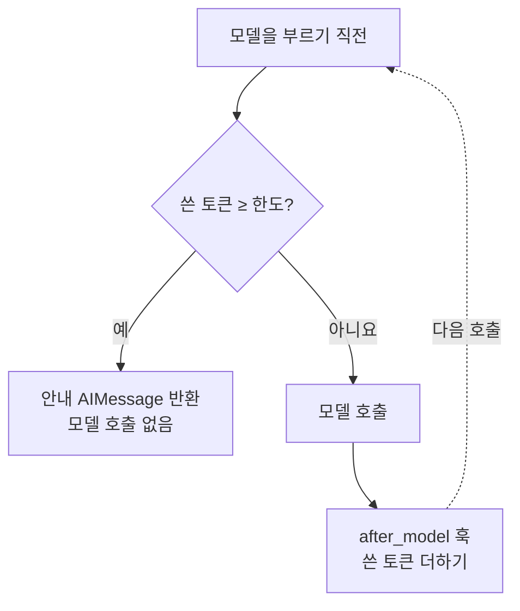
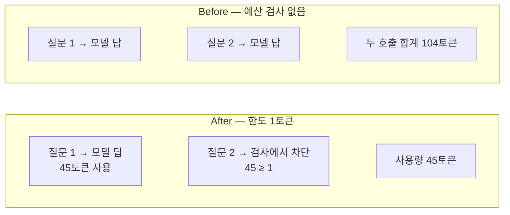
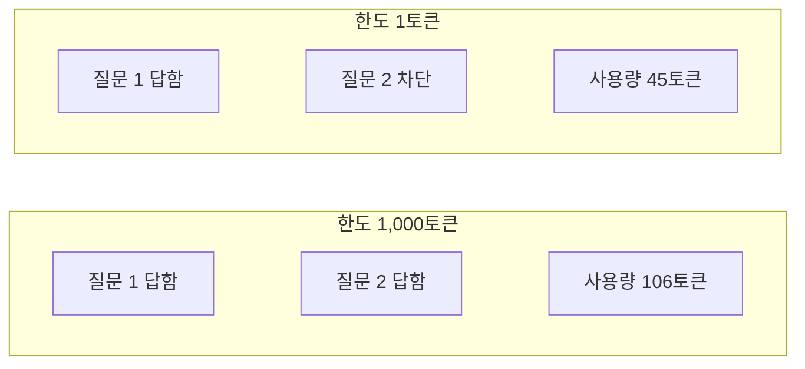

# 05-커스텀-예산-미들웨어

## _src 본문 (HTML 원본)

```html
<!--meta: 강의 1h · 실습 2h | 코드 Jupyter Notebook | 새 용어 2개 -->
<h2 id="b1"><span class="no">1</span>학습 목표</h2><div class="goal"><ul><li>모델 응답에 붙은 토큰 사용량을 읽을 수 있습니다.</li><li>훅 두 개로 토큰 예산을 기록하고 검사하는 미들웨어를 만들 수 있습니다.</li><li>감싸기형 훅이 모델을 부르지 않고 응답을 반환하는 방법을 설명할 수 있습니다.</li></ul></div>
<h2 id="b2"><span class="no">2</span>이 내용을 배우는 이유</h2>
<p>04절의 호출 한도는 모델 호출 횟수를 셌습니다. 그런데 비용은 호출 횟수보다 토큰 수에 따라 달라집니다. 긴 질문 한 번이 짧은 질문 열 번보다 비쌀 수 있습니다.</p>
<p>내장 미들웨어에 원하는 기준이 없으면 직접 만들어야 합니다. 이번 절에서는 01절의 훅으로 토큰 예산 미들웨어를 만듭니다.</p>
<p><strong>이 절의 질문</strong> — 모델 호출 수뿐 아니라 사용량 상한을 호출 직전에 어떻게 검사할까요?</p>
<h2 id="b3"><span class="no">3</span>앞에서 배운 내용</h2>
<p>Ch6 06절에서 모델 응답의 <code>usage_metadata</code>로 토큰 수를 확인했습니다. Ch16 04절에서는 비용 상한을 넘으면 호출을 멈추는 함수를 만들었습니다.</p>
<p>01절에서 <code>after_model</code> 훅은 모델 응답을 받은 직후에, <code>wrap_model_call</code> 훅은 모델 호출을 감싸며 실행된다는 것을 확인했습니다.</p>
<h2 id="b4"><span class="no">4</span>핵심 개념</h2>
<h3>비유로 시작하기</h3>
<p>지하철 개찰구는 문을 열기 전에 교통카드 잔액을 확인합니다. 잔액이 모자라면 문을 열지 않습니다.</p>
<p>승객이 승강장에 들어간 뒤에 잔액을 확인하면 늦습니다. 예산 검사도 모델을 부르기 전에 해야 합니다.</p>
{{img:05-4-교통카드-개찰구|교통카드를 댄 두 개찰구 중 위쪽은 초록 불과 함께 열리고 아래쪽은 빨간 불과 함께 닫힌 삽화|개찰구는 문을 열기 전에 카드 잔액부터 확인합니다.}}
<p><strong>그림 읽기</strong> — 위 개찰구는 잔액이 있어 문이 열렸고, 아래 개찰구는 잔액이 없어 문이 닫혔습니다. 닫힌 문이 모델 호출 차단에 해당합니다.</p>
<h3>토큰과 예산</h3>
<p>토큰(token)은 모델이 글을 나누어 읽는 단위입니다. 모델 서비스 비용은 보통 입력 토큰과 출력 토큰 수로 계산합니다.</p>
<p>이번 절의 예산은 「이 에이전트가 쓸 수 있는 토큰 수의 한도」입니다. 딕셔너리 하나에 한도(<code>limit_tokens</code>)와 지금까지 쓴 양(<code>used_tokens</code>)을 담습니다.</p>
<h3>훅 두 개의 역할</h3>
<p>사용량 기록 훅은 <code>after_model</code> 자리에서 실행됩니다. 방금 받은 응답의 토큰 수를 쓴 양에 더합니다.</p>
<p>예산 검사 훅은 <code>wrap_model_call</code> 자리에서 실행됩니다. 쓴 양이 한도에 닿았으면 <code>handler(request)</code>를 부르지 않고 안내 메시지를 반환합니다.</p>
{{mermaid:05-1-예산-검사|모델을 부르기 전에 쓴 토큰과 한도를 비교해 차단하거나 호출한 뒤 사용량을 더하는 흐름도|예산 미들웨어의 두 훅이 하는 일입니다. 검사는 호출 전에, 사용량 더하기는 호출 후에 합니다.}}
<p><strong>도식 읽기</strong> — 위에서 출발해 마름모에서 갈라집니다. 「예」로 가면 빨간 상자에서 끝나고 모델은 호출되지 않습니다.</p>
<p>「아니요」로 가면 모델을 부르고, 노란 상자에서 쓴 토큰을 더합니다. 점선 화살표처럼 다음 호출에서는 늘어난 사용량으로 다시 검사합니다.</p>
<h3>모델을 부르지 않고 응답하기</h3>
<p>감싸기형 훅은 <code>handler(request)</code> 대신 <code>AIMessage</code> 객체를 반환할 수 있습니다. 에이전트는 이 메시지를 모델 응답처럼 대화 기록에 넣고 끝냅니다.</p>
<p>실제 모델 응답에는 토큰 사용량이 붙습니다. 직접 만든 안내 메시지에는 사용량이 없습니다. 그래서 사용량 기록 훅은 사용량이 없는 메시지를 건너뜁니다.</p>
<h2 id="b5"><span class="no">5</span>실행 예제</h2>
<p>노트북은 먼저 모델을 한 번 불러 입력·출력·합계 토큰을 출력합니다. 숫자는 답 길이에 따라 실행마다 조금 달라집니다.</p>
{{notebook:05-커스텀-예산-미들웨어|example}}
<p class="look"><b>확인할 점</b> — 합계 토큰이 입력 토큰과 출력 토큰을 더한 값인지 봅니다.</p>
<h2 id="b6"><span class="no">6</span>일부러 실패해 보기</h2>
<p>Before에서는 예산 검사가 없는 에이전트에 질문 두 개를 보냅니다. After에서는 같은 질문을 예산 미들웨어가 있는 에이전트에 보냅니다.</p>
<p>After 실행의 한도는 1토큰입니다. 차단을 바로 보기 위한 실습용 값입니다. 첫 호출은 사용량 0에서 시작하므로 허용되고, 그 뒤 호출은 막혀야 합니다.</p>
{{notebook:05-커스텀-예산-미들웨어|failure}}
<p>Before에서는 두 질문 모두 모델이 답했고, 두 호출에 104토큰을 썼습니다. 사용량이 늘어도 막는 장치가 없었습니다.</p>
<p>After에서는 첫 질문이 45토큰을 쓴 뒤 둘째 질문이 검사에서 막혔습니다. 둘째 답에 토큰 사용량이 없다는 확인 결과가 모델이 호출되지 않았다는 근거입니다.</p>
{{mermaid:05-2-전후-호출|Before는 두 질문 모두 모델이 답해 104토큰을 썼고 After는 45토큰 사용 뒤 둘째 질문이 차단된 비교 그림|같은 질문 두 개를 보냈을 때 Before와 After의 실제 결과입니다.}}
<p>값 바꿔 보기에서 한도를 1,000토큰으로 늘리자 두 질문 모두 모델이 답했습니다. 사용량은 106토큰이었습니다. 앞의 Before 합계 104토큰과 다릅니다. 질문이 같으므로 답의 토큰 수가 달랐던 것으로 보입니다.</p>
{{mermaid:05-3-한도-비교|한도 1토큰과 1,000토큰에서 둘째 질문의 차단 여부와 사용량을 비교한 그림|한도를 1,000으로 바꾸고 사용량을 0부터 다시 센 결과입니다.}}
<h2 id="b7"><span class="no">7</span>주의할 점과 실무 메모</h2>
<ul><li>이 검사는 호출 전에 「지금까지 쓴 양」만 봅니다. 이번 호출이 쓸 토큰은 호출이 끝나야 알 수 있으므로, 마지막 호출에서 한도를 조금 넘을 수 있습니다.</li><li>예산은 노트북 안의 딕셔너리에만 있습니다. 커널을 다시 시작하면 사라집니다. 사용자별 하루 한도처럼 오래 유지할 값은 데이터베이스에 저장합니다.</li><li>토큰을 금액으로 바꾸려면 사용하는 모델의 토큰당 가격을 곱합니다. 가격은 바뀔 수 있으므로 모델 서비스의 가격표에서 확인합니다.</li><li>여러 요청이 동시에 같은 예산을 쓰면 검사와 더하기 사이에 순서가 섞일 수 있습니다. 이 문제는 이번 실습 범위 밖입니다.</li></ul>
<h2 id="b8"><span class="no">8</span>정리와 다음 절</h2>
<ul><li>사용량 기록 훅은 응답을 받은 뒤 토큰을 더하고, 예산 검사 훅은 호출 전에 한도를 확인했습니다.</li><li>검사 훅이 <code>handler(request)</code>를 부르지 않자 모델이 호출되지 않았습니다.</li><li>한도 1토큰에서는 둘째 질문이 막혔고, 1,000토큰에서는 두 질문 모두 답했습니다.</li></ul>
<p><strong>다음 학습과 이어지는 지점</strong> — 06절에서는 같은 훅으로 실행 기록을 남기는 감사 미들웨어를 만듭니다. 기록에 개인정보가 남지 않게 하는 방법도 다룹니다.</p>
<h2 id="b9"><span class="no">9</span>복습 문제</h2><details class="quiz"><summary>문제와 해설</summary>
<p class="quiz-q">1. 사용량을 더하는 훅을 <code>after_model</code> 자리에 둔 이유는 무엇인가요?</p><p class="quiz-a"><b>해설</b> — 토큰 사용량은 모델 응답을 받은 뒤에야 알 수 있기 때문입니다.</p>
<p class="quiz-q">2. After에서 둘째 질문이 막힌 이유는 무엇인가요?</p><p class="quiz-a"><b>해설</b> — 첫 질문이 45토큰을 써서 사용량이 한도 1 이상이 됐기 때문입니다.</p>
<p class="quiz-q">3. 둘째 답에 토큰 사용량이 없다는 것은 무엇을 뜻하나요?</p><p class="quiz-a"><b>해설</b> — 실제 모델이 만든 응답이 아니라 검사 훅이 반환한 안내 메시지라는 뜻입니다.</p>
<p class="quiz-q">4. 사용량 기록 훅이 사용량 없는 메시지를 건너뛰지 않으면 어떤 문제가 생기나요?</p><p class="quiz-a"><b>해설</b> — 안내 메시지는 사용량 값이 <code>None</code>입니다. 그래서 <code>["total_tokens"]</code>를 읽는 줄에서 오류가 날 것입니다. 이번 노트북에서는 이 경우를 실행하지 않았습니다.</p>
</details>
<h2 id="b10"><span class="no">10</span>참고 자료</h2><ul><li><a href="https://docs.langchain.com/oss/python/langchain/middleware/custom">LangChain Custom middleware</a> · 확인 2026-09-14 · LangChain 1.4.0</li><li><a href="https://docs.langchain.com/oss/python/langchain/middleware/built-in">LangChain Prebuilt middleware</a> · 확인 2026-09-14 · LangChain 1.4.0</li><li><a href="https://reference.langchain.com/python/langchain/agents/middleware">LangChain middleware API reference</a> · 확인 2026-09-14 · LangChain 1.4.0</li></ul>
```

## 노트북 셀 (순서대로)

### [0] markdown {'html': 'skip'}

# 커스텀 예산 미들웨어

**이 노트북에서 할 일**

1. 모델 응답에 붙은 토큰 사용량을 읽습니다.
2. 예산 검사 없이 질문 두 개를 보내 둘 다 모델이 답하는 것을 확인합니다(Before).
3. 토큰 예산 미들웨어를 직접 만들어, 예산을 다 쓰면 모델을 부르지 않게 합니다(After).

**준비물** — `.env` 파일의 `OPENAI_API_KEY`. 데이터 파일은 없습니다. 모델 호출은 6번이고 실행 시간은 1분 이내입니다. 예상 비용은 0.01달러 미만입니다.

### [1] markdown {'html': 'skip'}

## 오늘 볼 그림


모델을 부르기 전에 쓴 토큰과 한도를 비교합니다. 한도에 닿았으면 모델을 부르지 않고 안내 메시지를 반환합니다.

### [2] markdown {}

## 1. 준비

첫 셀은 패키지를 설치하고 설치된 버전을 출력합니다. 설치에는 몇십 초가 걸릴 수 있습니다.

### [3] code {'execution': {'iopub.execute_input': '2026-09-15T10:37:33.558905Z', 'iopub.status.busy': '2026-09-15T10:37:33.558736Z', 'iopub.status.idle': '2026-09-15T10:37:33.967417Z', 'shell.execute_reply': '2026-09-15T10:37:33.966826Z'}, 'lesson_role': 'setup'}

```python
# 이 절에서 쓰는 패키지를 설치하고 버전을 확인합니다
%pip install -q "langchain==1.4.0" "langchain-openai==1.6.0" "langgraph==1.2.11" "python-dotenv==1.2.3"
from importlib.metadata import version

print("langchain:", version("langchain"))
print("langchain-openai:", version("langchain-openai"))
print("langgraph:", version("langgraph"))
```

출력:
```
Note: you may need to restart the kernel to use updated packages.
langchain: 1.4.0
langchain-openai: 1.6.0
langgraph: 1.2.11

```

### [4] markdown {}

이번 절에서 쓰는 이름을 불러옵니다. 훅 두 개(`after_model`, `wrap_model_call`)로 예산 미들웨어를 만듭니다.

### [5] code {'execution': {'iopub.execute_input': '2026-09-15T10:37:33.968648Z', 'iopub.status.busy': '2026-09-15T10:37:33.968555Z', 'iopub.status.idle': '2026-09-15T10:37:34.205504Z', 'shell.execute_reply': '2026-09-15T10:37:34.205039Z'}, 'lesson_role': 'setup'}

```python
# 에이전트·훅·메시지·모델을 만드는 도구를 불러옵니다
from collections.abc import Callable

from langchain.agents import create_agent
from langchain.agents.middleware import AgentState, ModelRequest, ModelResponse, Runtime
from langchain.agents.middleware import after_model, wrap_model_call
from langchain.chat_models import init_chat_model
from langchain_core.messages import AIMessage
```

출력:
```

```

### [6] markdown {}

API 키가 있는지 확인합니다. `True` 값이 나오면 다음으로 넘어갑니다.

### [7] code {'execution': {'iopub.execute_input': '2026-09-15T10:37:34.206260Z', 'iopub.status.busy': '2026-09-15T10:37:34.206197Z', 'iopub.status.idle': '2026-09-15T10:37:34.210321Z', 'shell.execute_reply': '2026-09-15T10:37:34.209950Z'}, 'lesson_role': 'setup'}

```python
# .env 파일에서 OpenAI API 키를 읽습니다(키 값은 출력하지 않습니다)
import os
from dotenv import find_dotenv, load_dotenv

env_path = find_dotenv(usecwd=True)
load_dotenv(env_path)
has_key = os.getenv("OPENAI_API_KEY") is not None
print("OPENAI_API_KEY 설정 여부:", has_key)
assert has_key, "프로젝트 폴더의 .env 파일에 OPENAI_API_KEY를 적어 주세요."
```

출력:
```
OPENAI_API_KEY 설정 여부: True

```

### [8] markdown {}

실습에 쓸 모델을 준비합니다. 01절과 같은 설정입니다.
temperature 값을 0으로 두어 매번 비슷한 답을 고르게 합니다.

### [9] code {'execution': {'iopub.execute_input': '2026-09-15T10:37:34.210909Z', 'iopub.status.busy': '2026-09-15T10:37:34.210853Z', 'iopub.status.idle': '2026-09-15T10:37:34.566018Z', 'shell.execute_reply': '2026-09-15T10:37:34.565628Z'}}

```python
# 실습에 쓸 모델을 준비합니다
model = init_chat_model(
    "openai:gpt-5.4-mini",
    temperature=0,
    reasoning_effort="none",
)
print("모델 이름:", model.model_name)
print("temperature:", model.temperature)
```

출력:
```
모델 이름: gpt-5.4-mini
temperature: 0.0

```

### [10] markdown {}

**결과 읽기** — 모델 이름 `gpt-5.4-mini`, temperature `0.0`이 보이면 준비가 끝났습니다.
이 노트북의 출력은 2026-09-15에 이 모델로 실행한 결과입니다.

### [11] markdown {}

## 2. 토큰 사용량 읽기

토큰(token)은 모델이 글을 나누어 읽는 단위입니다. 모델 서비스 비용은 보통 토큰 수로 계산합니다.
모델 응답의 `usage_metadata` 속성에 이번 호출에서 쓴 토큰 수가 들어 있습니다.

### [12] code {'execution': {'iopub.execute_input': '2026-09-15T10:37:34.566709Z', 'iopub.status.busy': '2026-09-15T10:37:34.566651Z', 'iopub.status.idle': '2026-09-15T10:37:35.545027Z', 'shell.execute_reply': '2026-09-15T10:37:35.544252Z'}}

```python
# 모델을 한 번 불러 사용한 토큰 수를 출력합니다
reply = model.invoke("파이썬을 한 문장으로 소개해 주세요.")
usage = reply.usage_metadata
print("입력 토큰(input_tokens):", usage["input_tokens"])
print("출력 토큰(output_tokens):", usage["output_tokens"])
print("합계(total_tokens):", usage["total_tokens"])
```

출력:
```
입력 토큰(input_tokens): 19
출력 토큰(output_tokens): 26
합계(total_tokens): 45

```

### [13] markdown {}

**결과 읽기** — 합계 `total_tokens`는 입력과 출력 토큰을 더한 값입니다. 숫자는 답 길이에 따라 실행마다 조금 달라집니다.

### [14] markdown {'lesson_part': 'before'}

## 3. Before — 예산 검사 없이 두 번 부르기

예산 검사가 없는 에이전트에 질문 두 개를 차례로 보냅니다.

### [15] code {'execution': {'iopub.execute_input': '2026-09-15T10:37:35.546713Z', 'iopub.status.busy': '2026-09-15T10:37:35.546571Z', 'iopub.status.idle': '2026-09-15T10:37:36.997400Z', 'shell.execute_reply': '2026-09-15T10:37:36.996398Z'}, 'lesson_part': 'before'}

```python
# Before: 예산 검사 없이 질문 두 개를 차례로 보냅니다
plain_agent = create_agent(model, tools=[])
first = plain_agent.invoke({"messages": [{"role": "user", "content": "파이썬을 한 문장으로 소개해 주세요."}]})
second = plain_agent.invoke({"messages": [{"role": "user", "content": "LangChain을 한 문장으로 소개해 주세요."}]})
print("첫 답:", first["messages"][-1].text)
print("둘째 답:", second["messages"][-1].text)
```

출력:
```
첫 답: 파이썬은 배우기 쉽고 다양한 분야에 활용되는 대표적인 프로그래밍 언어입니다.
둘째 답: LangChain은 **대규모 언어 모델(LLM)을 활용한 애플리케이션을 쉽게 만들고 연결할 수 있게 해주는 개발 프레임워크**입니다.

```

### [16] markdown {'lesson_part': 'before'}

**결과 읽기** — 두 질문 모두 모델이 답했습니다. 출력의 `첫 답:` 줄과 `둘째 답:` 줄에 모두 모델의 문장이 있습니다.
답 문장은 실행할 때마다 달라질 수 있습니다.

### [17] code {'execution': {'iopub.execute_input': '2026-09-15T10:37:36.999719Z', 'iopub.status.busy': '2026-09-15T10:37:36.999549Z', 'iopub.status.idle': '2026-09-15T10:37:37.003171Z', 'shell.execute_reply': '2026-09-15T10:37:37.002485Z'}, 'lesson_part': 'before'}

```python
# 두 호출에서 쓴 토큰을 더합니다
first_tokens = first["messages"][-1].usage_metadata["total_tokens"]
second_tokens = second["messages"][-1].usage_metadata["total_tokens"]
print("두 호출 토큰 합계:", first_tokens + second_tokens)
print("둘째 답을 만든 메시지 종류:", second["messages"][-1].type)
```

출력:
```
두 호출 토큰 합계: 104
둘째 답을 만든 메시지 종류: ai

```

### [18] markdown {'lesson_part': 'before'}

**결과 읽기** — 둘째 답을 만든 메시지 종류가 `ai`입니다. 사용량이 아무리 늘어도 막는 장치가 없습니다.

### [19] markdown {'lesson_part': 'after'}

## 4. After — 토큰 예산 미들웨어 만들기

예산 정보를 딕셔너리 하나에 담습니다. 키 `limit_tokens`는 한도, 키 `used_tokens`는 지금까지 쓴 양입니다.
실습에서는 차단을 바로 보기 위해 한도를 1토큰으로 둡니다. 첫 호출은 사용량 0에서 시작하므로 허용됩니다.

### [20] code {'execution': {'iopub.execute_input': '2026-09-15T10:37:37.004502Z', 'iopub.status.busy': '2026-09-15T10:37:37.004380Z', 'iopub.status.idle': '2026-09-15T10:37:37.006902Z', 'shell.execute_reply': '2026-09-15T10:37:37.006311Z'}, 'lesson_part': 'after'}

```python
# 토큰 예산을 담을 딕셔너리를 만듭니다
budget = {"limit_tokens": 1, "used_tokens": 0}
print("예산:", budget)
```

출력:
```
예산: {'limit_tokens': 1, 'used_tokens': 0}

```

### [21] markdown {'lesson_part': 'after'}

**결과 읽기** — 한도 `1`, 사용량 `0`으로 시작합니다.

첫 번째 훅은 모델 응답을 받은 직후 실행됩니다. 방금 받은 메시지의 토큰 수를 사용량에 더합니다.
`state["messages"][-1]` 값은 대화 기록의 마지막 메시지, 즉 방금 받은 응답입니다.
모델을 부르지 않고 만든 응답에는 사용량(`usage_metadata`)이 없습니다. 이때는 더하지 않고 끝냅니다.

### [22] code {'execution': {'iopub.execute_input': '2026-09-15T10:37:37.008235Z', 'iopub.status.busy': '2026-09-15T10:37:37.008115Z', 'iopub.status.idle': '2026-09-15T10:37:37.010768Z', 'shell.execute_reply': '2026-09-15T10:37:37.010193Z'}, 'lesson_part': 'after'}

```python
# 모델 응답을 받은 직후 사용한 토큰 수를 예산에 더하는 훅
@after_model
def record_usage(state: AgentState, runtime: Runtime) -> None:
    last_message = state["messages"][-1]
    if last_message.usage_metadata is None:
        return None
    used = last_message.usage_metadata["total_tokens"]
    budget["used_tokens"] = budget["used_tokens"] + used
```

출력:
```

```

### [23] markdown {'lesson_part': 'after'}

출력은 없습니다.

두 번째 훅은 모델을 부르기 전에 실행되는 감싸기형 훅입니다. 사용량이 한도에 닿았으면 `handler(request)`를 부르지 않습니다.
대신 안내 문장을 담은 `AIMessage`를 반환합니다. 모델이 답한 것처럼 대화가 끝나지만, 실제 모델은 호출되지 않습니다.
반환 타입에 적은 `ModelResponse | AIMessage`는 모델 응답이거나 직접 만든 AIMessage라는 뜻입니다.

### [24] code {'execution': {'iopub.execute_input': '2026-09-15T10:37:37.012081Z', 'iopub.status.busy': '2026-09-15T10:37:37.011954Z', 'iopub.status.idle': '2026-09-15T10:37:37.014912Z', 'shell.execute_reply': '2026-09-15T10:37:37.014245Z'}, 'lesson_part': 'after'}

```python
# 모델을 부르기 전에 예산이 남았는지 검사하는 훅
@wrap_model_call
def check_budget(request: ModelRequest, handler: Callable) -> ModelResponse | AIMessage:
    if budget["used_tokens"] >= budget["limit_tokens"]:
        return AIMessage("토큰 예산을 모두 써서 모델을 부르지 않았습니다.")
    return handler(request)
```

출력:
```

```

### [25] markdown {'lesson_part': 'after'}

출력은 없습니다. 두 훅을 등록하고 Before와 같은 질문 두 개를 보냅니다.

### [26] code {'execution': {'iopub.execute_input': '2026-09-15T10:37:37.016122Z', 'iopub.status.busy': '2026-09-15T10:37:37.016013Z', 'iopub.status.idle': '2026-09-15T10:37:37.688727Z', 'shell.execute_reply': '2026-09-15T10:37:37.687772Z'}, 'lesson_part': 'after'}

```python
# After: 예산 미들웨어를 등록하고 같은 질문 두 개를 보냅니다
budget_agent = create_agent(model, tools=[], middleware=[check_budget, record_usage])
first = budget_agent.invoke({"messages": [{"role": "user", "content": "파이썬을 한 문장으로 소개해 주세요."}]})
second = budget_agent.invoke({"messages": [{"role": "user", "content": "LangChain을 한 문장으로 소개해 주세요."}]})
print("첫 답:", first["messages"][-1].text)
print("둘째 답:", second["messages"][-1].text)
```

출력:
```
첫 답: 파이썬은 배우기 쉽고 다양한 분야에 활용되는 범용 프로그래밍 언어입니다.
둘째 답: 토큰 예산을 모두 써서 모델을 부르지 않았습니다.

```

### [27] markdown {'lesson_part': 'after'}

**결과 읽기** — 첫 답은 모델이 만들었고, 문장은 실행마다 달라질 수 있습니다. 둘째 답은 `토큰 예산을 모두 써서 모델을 부르지 않았습니다.`입니다.

### [28] code {'execution': {'iopub.execute_input': '2026-09-15T10:37:37.690653Z', 'iopub.status.busy': '2026-09-15T10:37:37.690494Z', 'iopub.status.idle': '2026-09-15T10:37:37.693877Z', 'shell.execute_reply': '2026-09-15T10:37:37.693177Z'}, 'lesson_part': 'after'}

```python
# 두 번째 질문에서 모델이 호출되지 않았는지 확인합니다
second_message = second["messages"][-1]
print("사용한 토큰:", budget["used_tokens"])
print("둘째 답에 토큰 사용량이 있나:", second_message.usage_metadata is not None)
assert second_message.text == "토큰 예산을 모두 써서 모델을 부르지 않았습니다."
```

출력:
```
사용한 토큰: 45
둘째 답에 토큰 사용량이 있나: False

```

### [29] markdown {'lesson_part': 'after'}

**결과 읽기** — 둘째 답에 토큰 사용량이 있는지 확인한 결과가 `False`입니다. 실제 모델 응답에는 사용량이 붙으므로, 모델이 호출되지 않았다는 뜻입니다.
사용한 토큰은 첫 호출에서 쓴 양만 들어 있습니다.

## 5. 값 하나 바꿔 보기 — 한도 늘리기

한도를 1,000토큰으로 늘리고 사용량을 0으로 바꿉니다. 실행 전에 예상해 봅니다. 두 질문 모두 답할 것입니다.

### [30] code {'execution': {'iopub.execute_input': '2026-09-15T10:37:37.695135Z', 'iopub.status.busy': '2026-09-15T10:37:37.694993Z', 'iopub.status.idle': '2026-09-15T10:37:39.504136Z', 'shell.execute_reply': '2026-09-15T10:37:39.503109Z'}, 'lesson_part': 'after'}

```python
# 한도를 1,000토큰으로 늘리고 같은 질문 두 개를 다시 보냅니다
budget["limit_tokens"] = 1000
budget["used_tokens"] = 0
first = budget_agent.invoke({"messages": [{"role": "user", "content": "파이썬을 한 문장으로 소개해 주세요."}]})
second = budget_agent.invoke({"messages": [{"role": "user", "content": "LangChain을 한 문장으로 소개해 주세요."}]})
print("둘째 답을 만든 메시지에 사용량이 있나:", second["messages"][-1].usage_metadata is not None)
print("사용한 토큰:", budget["used_tokens"])
```

출력:
```
둘째 답을 만든 메시지에 사용량이 있나: True
사용한 토큰: 106

```

### [31] markdown {'lesson_part': 'after'}

**결과 읽기** — 이번에는 `True`입니다. 한도가 넉넉하므로 두 번째 호출도 실제 모델이 답했습니다.

## 정리

- `after_model` 훅으로 호출마다 쓴 토큰을 더하고, `wrap_model_call` 훅으로 호출 전에 한도를 검사했습니다.
- 감싸기형 훅이 `handler(request)`를 부르지 않으면 모델이 호출되지 않습니다.
- 이 예산은 노트북 안의 딕셔너리에만 저장됩니다. 사용자별 하루 한도처럼 오래 유지할 값은 데이터베이스에 저장해야 합니다.

## 그림

### 05-1-예산-검사.mmd



- 설명 대상 문장: 사용량이 한도에 닿았으면 handler(request)를 부르지 않습니다.
- 캡션: 예산 미들웨어의 두 훅이 하는 일입니다. 검사는 호출 전에, 사용량 더하기는 호출 후에 합니다.
- 읽는 법: 위에서 출발해 마름모에서 갈라집니다. "예"로 가면 모델을 부르지 않고 끝나고, "아니요"로 가면 모델을 부른 뒤 노란 상자에서 사용량을 더합니다. 점선 화살표는 다음 호출에서 늘어난 사용량으로 다시 검사한다는 뜻입니다.
- alt: 모델을 부르기 직전 쓴 토큰이 한도 이상이면 모델 호출 없이 안내 메시지를 반환하고, 아니면 모델을 호출한 뒤 after_model 훅에서 토큰을 더한 뒤 다음 호출의 검사로 돌아가는 흐름도

### 05-2-전후-호출.mmd



- 설명 대상 문장: 둘째 답은 토큰 예산을 모두 써서 모델을 부르지 않았다는 안내입니다.
- 캡션: 같은 질문 두 개를 보냈을 때 Before와 After의 실제 결과입니다.
- 읽는 법: 두 줄의 가운데 칸을 비교합니다. Before에서는 질문 2도 모델이 답했고, After에서는 질문 1이 쓴 45토큰이 한도 1 이상이라 질문 2가 차단됐습니다.
- alt: Before는 두 질문 모두 모델이 답해 합계 104토큰을 썼고, After는 질문 1에 45토큰을 쓴 뒤 질문 2가 한도 검사에서 차단된 비교 그림

### 05-3-한도-비교.mmd



- 설명 대상 문장: 한도가 넉넉하므로 두 번째 호출도 실제 모델이 답했습니다.
- 캡션: 한도를 1,000으로 바꾸고 사용량을 0부터 다시 센 결과입니다.
- 읽는 법: 가운데 칸이 달라졌습니다. 한도를 1,000토큰으로 늘리자 질문 2도 답했고 사용량은 106토큰이 됐습니다.
- alt: 한도 1토큰에서는 질문 2가 차단되고 사용량 45토큰, 한도 1,000토큰에서는 두 질문 모두 답하고 사용량 106토큰임을 비교한 그림

### 05-4-교통카드-개찰구.prompt.md

# 삽화 — 05-4 잔액을 먼저 확인하는 개찰구

- 상태: 2026-09-15 생성·검수 통과. 모델 nano_banana_pro(서버 표기 nano_banana_2), 16:9, 2k(2752×1536), 2크레딧. job 3554995e-f5ac-429f-bc68-a245cc01d314. 교재 파일은 폭 1100px로 줄여 저장. 첫 생성(job e5ce0021-8c4f-4373-b543-b990b35cf02f)은 탈락: 두 줄 모두 위쪽 화면에 초록·빨강 화면이 함께 있어 열림/닫힘 구분을 흐림. 아래 프롬프트로 다시 생성.
- 설명 대상 문장: 모델을 부르기 전에 쓴 토큰과 한도를 비교합니다.
- 넣을 자리: 05절 핵심 개념 「비유로 시작하기」 아래
- 구성 요소와 배치(위 → 아래): ① 교통카드를 대는 사람 ② 개찰구 두 대: 위쪽 개찰구는 문이 열리고 초록 불, 아래쪽 개찰구는 문이 닫히고 빨간 불 ③ 열린 개찰구 뒤의 승강장
- 시선 순서: 카드 → 두 개찰구의 불빛 차이 → 승강장
- 대응: 카드 잔액 확인 = 예산 검사 훅, 열린 문 = 모델 호출, 닫힌 문 = 호출 차단
- 모델: nano_banana_pro, 16:9, 1k (생성 시점 카탈로그로 다시 확인)

## 프롬프트

Simple flat educational illustration, white background, limited soft palette, clean outlines, plain everyday objects, no text, no letters, no numbers, no logos.
A subway fare gate scene in two rows stacked vertically. Each row shows one person and one ticket gate. There are no monitors, no screens and no displays anywhere. Top row: the person taps a card on the gate reader, the gate flaps are wide open, and one small round green light glows on the gate post; an empty platform floor is visible behind. Bottom row: the same kind of person taps a card, the gate flaps are closed, and one small round red light glows on the gate post. Everything else in the two rows is identical.

