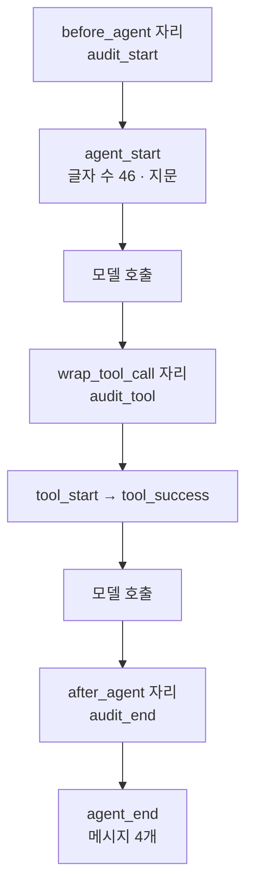
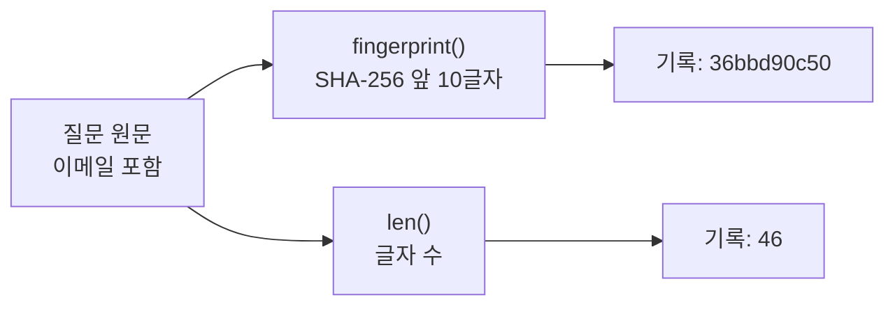
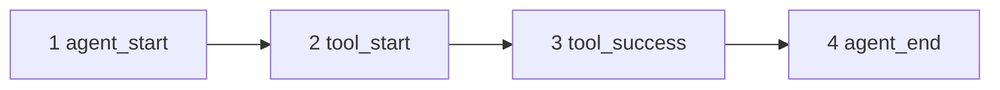

# 06-커스텀-감사-미들웨어

## _src 본문 (HTML 원본)

```html
<!--meta: 강의 1h · 실습 2h | 코드 Jupyter Notebook | 새 용어 2개 -->
<h2 id="b1"><span class="no">1</span>학습 목표</h2><div class="goal"><ul><li>감사 기록에 무엇을 남기고 무엇을 남기지 않을지 정할 수 있습니다.</li><li>훅 세 개로 에이전트 시작·도구 호출·종료 사건을 기록할 수 있습니다.</li><li>기록에 개인정보 원문이 남지 않았는지 코드로 확인할 수 있습니다.</li></ul></div>
<h2 id="b2"><span class="no">2</span>이 내용을 배우는 이유</h2>
<p>서비스를 운영하다 보면 「그 요청에서 어떤 도구가 실행됐나」를 나중에 확인해야 할 때가 있습니다. 오류를 추적하거나 사용 내역을 점검할 때입니다.</p>
<p>그렇다고 질문 원문을 모두 기록하면 기록 파일에 개인정보가 쌓입니다. 이번 절에서는 필요한 사건만, 원문 없이 기록하는 미들웨어를 만듭니다.</p>
<p><strong>이 절의 질문</strong> — 에이전트 전체와 도구 호출을 개인정보 없이 어떤 사건으로 기록할까요?</p>
<h2 id="b3"><span class="no">3</span>앞에서 배운 내용</h2>
<p>Ch16 05절에서 재시도와 함께 감사 로그를 직접 남겼습니다. 02절에서는 개인정보를 모델에 보내기 전에 가렸습니다.</p>
<p>01절의 훅 중 <code>before_agent</code>, <code>wrap_tool_call</code>, <code>after_agent</code>를 이번 절에서 씁니다. 예외 처리 문법인 <code>try</code>와 <code>except</code>는 Ch2 05절에서 배웠습니다.</p>
<h2 id="b4"><span class="no">4</span>핵심 개념</h2>
<h3>비유로 시작하기</h3>
<p>건물 경비실의 방문자 명부를 떠올려 봅니다. 명부에 신분증 번호를 그대로 적으면 명부 자체가 개인정보 묶음이 됩니다.</p>
<p>그래서 신분증은 확인만 하고, 명부에는 번호표만 붙입니다. 같은 사람이 다시 오면 같은 번호표가 붙으므로 방문 횟수는 알 수 있습니다.</p>
{{img:06-4-방문자-명부|방문자가 신분증을 보여 주고, 경비원이 신분증을 다시 건네며 명부에 번호표 스티커만 붙이는 삽화|명부에는 신분증 내용 대신 번호표만 남습니다. 감사 기록의 지문이 이 번호표입니다.}}
<p><strong>그림 읽기</strong> — 왼쪽 방문자에서 오른쪽 명부로 따라갑니다. 신분증은 다시 건네고 명부에는 스티커만 붙습니다.</p>
<h3>감사 기록의 뜻</h3>
<p>감사 기록(audit log)은 나중에 실행을 다시 살펴보기 위한 사건 목록입니다. 사건 하나에는 사건 이름과 꼭 필요한 값 몇 개만 적습니다.</p>
<p>이번 실습에서 만든 사건 이름은 다섯 가지입니다. 다섯 가지는 agent_start, tool_start, tool_success, tool_error, agent_end입니다.</p>
{{mermaid:06-1-감사-기록|감사 훅 세 개가 실행 중 사건을 기록한 자리와 기록된 값을 나타낸 흐름도|감사 훅 세 개가 사건을 기록한 자리와 실제로 남은 값입니다.}}
<p><strong>도식 읽기</strong> — 위에서 아래로 실행 순서입니다. 파란 상자가 훅, 노란 상자가 그 훅이 남긴 사건입니다. 보라 상자는 모델 호출 2번입니다.</p>
<p>시작 사건에는 글자 수 46과 지문만 있습니다. 종료 사건에는 메시지 수 4만 있습니다. 질문 원문은 어느 노란 상자에도 없습니다.</p>
<h3>지문의 뜻</h3>
<p>지문(해시, hash)은 글을 정해진 규칙으로 섞어 만든 짧은 문자열입니다. 같은 글은 항상 같은 지문이 됩니다. 노트북에서 같은 글을 다시 넣어 지문이 같은지 확인합니다.</p>
<p>지문만 보고 원문을 알아내기는 어렵습니다. 그래서 원문 대신 지문을 남기면 「같은 질문이 반복됐나」는 알 수 있고 내용은 드러나지 않습니다.</p>
{{mermaid:06-2-원문과-지문|이메일이 든 질문 원문이 지문과 글자 수로만 기록되는 흐름도|질문 원문은 지문과 글자 수로만 기록됐습니다.}}
<p>이번 실습의 지문 함수는 원문 앞에 <code>lesson-salt:</code>를 붙인 뒤 SHA-256 방식으로 섞고, 앞 10글자만 씁니다.</p>
<h2 id="b5"><span class="no">5</span>실행 예제</h2>
<p>노트북은 지문 함수와 사건 목록을 만든 뒤 훅 세 개를 하나씩 만듭니다. 도구 훅은 오류가 나면 오류 사건을 남기고 오류를 그대로 다시 올려 보냅니다.</p>
<p>이메일이 든 질문으로 에이전트를 실행하고, 기록 전체를 글로 바꿔 이메일 원문이 있는지 검사합니다. 모델 호출은 2번입니다.</p>
{{notebook:06-커스텀-감사-미들웨어}}
<p class="look"><b>확인할 점</b> — 사건 네 개의 순서와, 기록에 이메일 원문이 있는지 확인한 결과 False를 봅니다.</p>
<h2 id="b6"><span class="no">6</span>실험 결과 해석</h2>
<p>운영 시간 질문을 실행하자 사건 네 개가 순서대로 남았습니다. 모델이 도구를 한 번 불렀기 때문에 도구 사건이 한 쌍 기록됐습니다.</p>
{{mermaid:06-3-사건-순서|agent_start, tool_start, tool_success, agent_end 네 사건이 순서대로 이어진 그림|운영 시간 질문에서 실제로 남은 사건 네 개입니다.}}
<p>기록 전체를 JSON 글로 바꿔 검사했을 때 이메일 원문은 없었습니다. 시작 사건에 남은 것은 글자 수 46과 지문 <code>36bbd90c50</code>이었습니다.</p>
<p>값 바꿔 보기에서는 글자 수가 8로 같은 두 글의 지문을 비교했습니다. 지문은 서로 달랐고, 같은 글을 다시 넣었을 때는 지문이 같았습니다. 글자 수만 기록했다면 두 질문을 구분할 수 없었을 것입니다.</p>
<p>이번 실행에서는 도구 오류가 일어나지 않아 오류 사건은 관찰하지 못했습니다. 오류 사건을 확인하려면 도구 안에서 실제로 예외가 나는 조건을 만들어야 합니다.</p>
<h2 id="b7"><span class="no">7</span>주의할 점과 실무 메모</h2>
<ul><li>지문은 원문을 완전히 숨기지 못합니다. 전화번호처럼 경우의 수가 적은 값은 가능한 값을 모두 섞어 보면 원문을 찾을 수 있습니다. 운영 환경에서는 비밀 값을 섞는 방식을 씁니다.</li><li>이번 실습의 <code>lesson-salt:</code>는 코드에 그대로 적혀 있습니다. 실제 서비스에서는 이 값을 <code>.env</code> 같은 비밀 설정에 둡니다.</li><li>사건 목록은 노트북 메모리에만 있습니다. 운영 환경에서는 접근 권한이 관리되는 로그 저장소에 기록합니다.</li><li>도구 결과 원문도 개인정보를 담을 수 있으므로 이번 기록에서 뺐습니다. 나중에 확인할 질문을 먼저 적고, 그 답에 필요한 값만 기록합니다.</li></ul>
<h2 id="b8"><span class="no">8</span>정리와 다음 절</h2>
<ul><li>감사 훅 세 개가 실행 시작, 도구 호출, 실행 종료에서 사건을 하나씩 남겼습니다.</li><li>질문 원문 대신 글자 수와 지문을 기록했고, 기록에 이메일 원문이 없음을 확인했습니다.</li><li>도구 오류는 기록한 뒤 <code>raise</code>로 다시 올려 보내도록 만들었습니다. 오류가 난 실행은 이번에 관찰하지 않았습니다.</li></ul>
<p><strong>다음 학습과 이어지는 지점</strong> — 07절에서는 여러 미들웨어를 함께 등록할 때 훅이 어떤 순서로 실행되는지 확인합니다. 같은 종류의 훅을 여러 개 등록하면 등록 순서가 실행 순서를 정합니다.</p>
<h2 id="b9"><span class="no">9</span>복습 문제</h2><details class="quiz"><summary>문제와 해설</summary>
<p class="quiz-q">1. 시작 사건에 질문 원문 대신 무엇을 남겼나요?</p><p class="quiz-a"><b>해설</b> — 글자 수와 지문입니다. 이번 실행에서는 46과 36bbd90c50이었습니다.</p>
<p class="quiz-q">2. 글자 수만 기록하면 어떤 문제가 있나요?</p><p class="quiz-a"><b>해설</b> — 글자 수가 같은 서로 다른 질문을 구분할 수 없습니다. 값 바꿔 보기의 두 글이 그 예입니다.</p>
<p class="quiz-q">3. 도구 훅에서 오류를 기록한 뒤 raise를 쓰는 이유는 무엇인가요?</p><p class="quiz-a"><b>해설</b> — 기록 때문에 원래 오류가 사라지지 않게 하려는 것입니다. 오류를 삼켰을 때의 동작은 이번에 실행하지 않았습니다.</p>
<p class="quiz-q">4. 이번 실행에서 tool_error 사건이 없었던 이유는 무엇인가요?</p><p class="quiz-a"><b>해설</b> — 도구가 오류 없이 결과를 반환했기 때문입니다. 오류 사건은 이번 실습에서 관찰하지 않았습니다.</p>
</details>
<h2 id="b10"><span class="no">10</span>참고 자료</h2><ul><li><a href="https://docs.langchain.com/oss/python/langchain/middleware/custom">LangChain Custom middleware</a> · 확인 2026-09-14 · LangChain 1.4.0</li><li><a href="https://docs.langchain.com/oss/python/langchain/middleware/built-in">LangChain Prebuilt middleware</a> · 확인 2026-09-14 · LangChain 1.4.0</li><li><a href="https://reference.langchain.com/python/langchain/agents/middleware">LangChain middleware API reference</a> · 확인 2026-09-14 · LangChain 1.4.0</li></ul>
```

## 노트북 셀 (순서대로)

### [0] markdown {'html': 'skip'}

# 커스텀 감사 미들웨어

**이 노트북에서 할 일**

1. 개인정보 원문 대신 지문(해시)을 남기는 함수를 만듭니다.
2. 에이전트 시작·도구 호출·종료를 기록하는 감사 훅 세 개를 만듭니다.
3. 이메일이 든 질문으로 실행하고, 기록에 원문이 남지 않았는지 확인합니다.

**준비물** — `.env` 파일의 `OPENAI_API_KEY`. 데이터 파일은 없습니다. 모델 호출은 2번이고 실행 시간은 1분 이내입니다. 예상 비용은 0.01달러 미만입니다.

### [1] markdown {'html': 'skip'}

## 오늘 볼 그림


에이전트 시작, 도구 호출 앞뒤, 에이전트 종료에서 사건 하나씩이 기록됩니다. 기록에는 질문 원문이 들어가지 않습니다.

### [2] markdown {}

## 1. 준비

첫 셀은 패키지를 설치하고 설치된 버전을 출력합니다. 설치에는 몇십 초가 걸릴 수 있습니다.

### [3] code {'execution': {'iopub.execute_input': '2026-09-15T10:39:02.324250Z', 'iopub.status.busy': '2026-09-15T10:39:02.324081Z', 'iopub.status.idle': '2026-09-15T10:39:02.721774Z', 'shell.execute_reply': '2026-09-15T10:39:02.721212Z'}, 'lesson_role': 'setup'}

```python
# 이 절에서 쓰는 패키지를 설치하고 버전을 확인합니다
%pip install -q "langchain==1.4.0" "langchain-openai==1.6.0" "langgraph==1.2.11" "python-dotenv==1.2.3"
from importlib.metadata import version

print("langchain:", version("langchain"))
print("langchain-openai:", version("langchain-openai"))
print("langgraph:", version("langgraph"))
```

출력:
```
Note: you may need to restart the kernel to use updated packages.
langchain: 1.4.0
langchain-openai: 1.6.0
langgraph: 1.2.11

```

### [4] markdown {}

이번 절에서 쓰는 이름을 불러옵니다. 지문은 파이썬 기본 모듈 `hashlib`으로 만듭니다.

### [5] code {'execution': {'iopub.execute_input': '2026-09-15T10:39:02.723191Z', 'iopub.status.busy': '2026-09-15T10:39:02.723081Z', 'iopub.status.idle': '2026-09-15T10:39:02.936687Z', 'shell.execute_reply': '2026-09-15T10:39:02.936180Z'}, 'lesson_role': 'setup'}

```python
# 지문·기록·에이전트·훅·도구·모델을 만드는 도구를 불러옵니다
import hashlib
import json
from collections.abc import Callable

from langchain.agents import create_agent
from langchain.agents.middleware import AgentState, Runtime, ToolCallRequest
from langchain.agents.middleware import after_agent, before_agent, wrap_tool_call
from langchain.chat_models import init_chat_model
from langchain.tools import tool
from langchain_core.messages import ToolMessage
```

출력:
```

```

### [6] markdown {}

API 키가 있는지 확인합니다. `True` 값이 나오면 다음으로 넘어갑니다.

### [7] code {'execution': {'iopub.execute_input': '2026-09-15T10:39:02.937454Z', 'iopub.status.busy': '2026-09-15T10:39:02.937400Z', 'iopub.status.idle': '2026-09-15T10:39:02.940625Z', 'shell.execute_reply': '2026-09-15T10:39:02.940287Z'}, 'lesson_role': 'setup'}

```python
# .env 파일에서 OpenAI API 키를 읽습니다(키 값은 출력하지 않습니다)
import os
from dotenv import find_dotenv, load_dotenv

env_path = find_dotenv(usecwd=True)
load_dotenv(env_path)
has_key = os.getenv("OPENAI_API_KEY") is not None
print("OPENAI_API_KEY 설정 여부:", has_key)
assert has_key, "프로젝트 폴더의 .env 파일에 OPENAI_API_KEY를 적어 주세요."
```

출력:
```
OPENAI_API_KEY 설정 여부: True

```

### [8] markdown {}

실습에 쓸 모델을 준비합니다. 01절과 같은 설정입니다.
temperature 값을 0으로 두어 매번 비슷한 답을 고르게 합니다.

### [9] code {'execution': {'iopub.execute_input': '2026-09-15T10:39:02.941304Z', 'iopub.status.busy': '2026-09-15T10:39:02.941247Z', 'iopub.status.idle': '2026-09-15T10:39:03.286666Z', 'shell.execute_reply': '2026-09-15T10:39:03.286271Z'}}

```python
# 실습에 쓸 모델을 준비합니다
model = init_chat_model(
    "openai:gpt-5.4-mini",
    temperature=0,
    reasoning_effort="none",
)
print("모델 이름:", model.model_name)
print("temperature:", model.temperature)
```

출력:
```
모델 이름: gpt-5.4-mini
temperature: 0.0

```

### [10] markdown {}

**결과 읽기** — 모델 이름 `gpt-5.4-mini`, temperature `0.0`이 보이면 준비가 끝났습니다.
이 노트북의 출력은 2026-09-15에 이 모델로 실행한 결과입니다.

### [11] markdown {}

## 2. 원문 대신 지문 남기기

감사 기록(audit log)은 나중에 「언제 어떤 실행이 있었고 어떤 도구가 쓰였나」를 확인하기 위한 사건 목록입니다.
질문 원문을 그대로 기록하면 기록 파일에 개인정보가 쌓입니다. 그래서 원문 대신 지문을 남깁니다.
지문(해시)은 글을 정해진 규칙으로 섞어 만든 짧은 문자열입니다. 같은 글은 같은 지문이 되지만, 지문만 보고 원문을 알아내기는 어렵습니다.

### [12] code {'execution': {'iopub.execute_input': '2026-09-15T10:39:03.287385Z', 'iopub.status.busy': '2026-09-15T10:39:03.287325Z', 'iopub.status.idle': '2026-09-15T10:39:03.289385Z', 'shell.execute_reply': '2026-09-15T10:39:03.289021Z'}}

```python
# 글을 받아 10글자짜리 지문을 만드는 함수
def fingerprint(text: str) -> str:
    data = ("lesson-salt:" + text).encode("utf-8")
    digest = hashlib.sha256(data).hexdigest()
    return digest[:10]


print("지문 예시:", fingerprint("learner@example.com"))
```

출력:
```
지문 예시: 367129c879

```

### [13] markdown {}

**결과 읽기** — 지문 예시로 `367129c879`처럼 영문과 숫자 10글자가 나옵니다. 이 안에 `learner@example.com`이라는 글자는 없습니다.
글 앞에 `lesson-salt:`를 붙이는 이유는, 흔한 글의 지문을 미리 만들어 둔 표로 원문을 짐작하기 어렵게 하기 위해서입니다.

## 3. 감사 훅 세 개 만들기

사건을 담을 빈 목록을 만듭니다.

### [14] code {'execution': {'iopub.execute_input': '2026-09-15T10:39:03.289931Z', 'iopub.status.busy': '2026-09-15T10:39:03.289882Z', 'iopub.status.idle': '2026-09-15T10:39:03.291594Z', 'shell.execute_reply': '2026-09-15T10:39:03.291244Z'}}

```python
# 감사 사건을 담을 빈 목록을 만듭니다
events = []
print("사건 수:", len(events))
```

출력:
```
사건 수: 0

```

### [15] markdown {}

**결과 읽기** — 사건 수는 `0`입니다.

첫 번째 훅은 에이전트가 시작할 때 질문의 글자 수와 지문을 기록합니다. 원문은 기록하지 않습니다.

### [16] code {'execution': {'iopub.execute_input': '2026-09-15T10:39:03.292181Z', 'iopub.status.busy': '2026-09-15T10:39:03.292133Z', 'iopub.status.idle': '2026-09-15T10:39:03.293982Z', 'shell.execute_reply': '2026-09-15T10:39:03.293665Z'}}

```python
# 에이전트 시작 사건을 기록하는 훅
@before_agent
def audit_start(state: AgentState, runtime: Runtime) -> None:
    first_text = state["messages"][0].text
    event = {"event": "agent_start", "input_chars": len(first_text), "fingerprint": fingerprint(first_text)}
    events.append(event)
```

출력:
```

```

### [17] markdown {}

출력은 없습니다.

두 번째 훅은 도구 호출을 감쌉니다. 호출 전에 시작 사건을, 성공하면 성공 사건을, 오류가 나면 오류 사건을 남깁니다.
예외 처리 문법인 `try`와 `except`는 Ch2 05절에서 배웠습니다.

오류 사건의 `type(error).__name__` 값은 오류 종류 이름(예: `ValueError`)을 글로 꺼낸 것입니다.
이 훅은 오류를 기록한 뒤 단독 `raise` 줄로 방금 잡은 오류를 그대로 다시 올려 보냅니다.

### [18] code {'execution': {'iopub.execute_input': '2026-09-15T10:39:03.294540Z', 'iopub.status.busy': '2026-09-15T10:39:03.294493Z', 'iopub.status.idle': '2026-09-15T10:39:03.296478Z', 'shell.execute_reply': '2026-09-15T10:39:03.296151Z'}}

```python
# 도구 호출의 시작·성공·오류를 기록하는 훅
@wrap_tool_call
def audit_tool(request: ToolCallRequest, handler: Callable) -> ToolMessage:
    tool_name = request.tool_call["name"]
    events.append({"event": "tool_start", "tool": tool_name})
    try:
        result = handler(request)
    except Exception as error:
        events.append({"event": "tool_error", "tool": tool_name, "error": type(error).__name__})
        raise
    events.append({"event": "tool_success", "tool": tool_name})
    return result
```

출력:
```

```

### [19] markdown {}

출력은 없습니다.

세 번째 훅은 에이전트가 끝날 때 대화 기록의 메시지 수를 남깁니다.

### [20] code {'execution': {'iopub.execute_input': '2026-09-15T10:39:03.297006Z', 'iopub.status.busy': '2026-09-15T10:39:03.296952Z', 'iopub.status.idle': '2026-09-15T10:39:03.298634Z', 'shell.execute_reply': '2026-09-15T10:39:03.298238Z'}}

```python
# 에이전트 종료 사건을 기록하는 훅
@after_agent
def audit_end(state: AgentState, runtime: Runtime) -> None:
    events.append({"event": "agent_end", "messages": len(state["messages"])})
```

출력:
```

```

### [21] markdown {}

출력은 없습니다.

## 4. 이메일이 든 질문으로 실행하기

01절의 운영 시간 도구를 다시 만듭니다.

### [22] code {'execution': {'iopub.execute_input': '2026-09-15T10:39:03.299193Z', 'iopub.status.busy': '2026-09-15T10:39:03.299144Z', 'iopub.status.idle': '2026-09-15T10:39:03.301533Z', 'shell.execute_reply': '2026-09-15T10:39:03.301176Z'}}

```python
# 자료실 운영 시간을 알려 주는 도구를 만듭니다
@tool
def lookup_hours(day: str) -> str:
    """자료실 운영 시간을 조회합니다. day에는 "평일" 또는 "토요일"을 넣습니다."""
    if day == "평일":
        return "평일 09:00~20:00"
    return "토요일 10:00~17:00"


print("도구 이름:", lookup_hours.name)
```

출력:
```
도구 이름: lookup_hours

```

### [23] markdown {}

**결과 읽기** — 도구 이름 `lookup_hours`가 출력됩니다.

감사 훅 세 개를 등록하고, 이메일이 든 질문을 보냅니다.

### [24] code {'execution': {'iopub.execute_input': '2026-09-15T10:39:03.302099Z', 'iopub.status.busy': '2026-09-15T10:39:03.302035Z', 'iopub.status.idle': '2026-09-15T10:39:05.074034Z', 'shell.execute_reply': '2026-09-15T10:39:05.072830Z'}}

```python
# 감사 훅을 등록하고 이메일이 든 질문으로 실행합니다
events.clear()
audit_agent = create_agent(model, tools=[lookup_hours], middleware=[audit_start, audit_tool, audit_end])
question = "learner@example.com 입니다. 자료실 평일 운영 시간을 알려 주세요."
audit_result = audit_agent.invoke({"messages": [{"role": "user", "content": question}]})
print("최종 답:", audit_result["messages"][-1].text)
for event in events:
    print(event)
```

출력:
```
최종 답: 자료실 평일 운영 시간은 **09:00~20:00**입니다.
{'event': 'agent_start', 'input_chars': 46, 'fingerprint': '36bbd90c50'}
{'event': 'tool_start', 'tool': 'lookup_hours'}
{'event': 'tool_success', 'tool': 'lookup_hours'}
{'event': 'agent_end', 'messages': 4}

```

### [25] markdown {}

**결과 읽기** — 사건이 `agent_start`, `tool_start`, `tool_success`, `agent_end` 순서로 기록됐습니다.
시작 사건에는 글자 수와 지문만 있고, 종료 사건에는 메시지 수만 있습니다. 최종 답 문장은 실행마다 달라질 수 있습니다.

### [26] code {'execution': {'iopub.execute_input': '2026-09-15T10:39:05.076056Z', 'iopub.status.busy': '2026-09-15T10:39:05.075894Z', 'iopub.status.idle': '2026-09-15T10:39:05.079452Z', 'shell.execute_reply': '2026-09-15T10:39:05.078926Z'}}

```python
# 기록 전체를 글로 바꿔 이메일 원문이 들어 있는지 확인합니다
saved_text = json.dumps(events, ensure_ascii=False)
has_email = "learner@example.com" in saved_text
print("기록에 이메일 원문이 있나:", has_email)
print("첫 사건:", events[0]["event"], "/ 마지막 사건:", events[-1]["event"])
assert not has_email
assert events[0]["event"] == "agent_start"
assert events[-1]["event"] == "agent_end"
```

출력:
```
기록에 이메일 원문이 있나: False
첫 사건: agent_start / 마지막 사건: agent_end

```

### [27] markdown {}

**결과 읽기** — 기록에 이메일 원문이 있는지 확인한 결과는 `False`입니다. 첫 사건은 `agent_start`, 마지막 사건은 `agent_end`입니다.

## 5. 값 하나 바꿔 보기 — 글자 수가 같은 두 글

글자 수만 기록하면 서로 다른 질문을 구분할 수 없습니다. 글자 수가 같은 두 글의 지문을 비교합니다.

### [28] code {'execution': {'iopub.execute_input': '2026-09-15T10:39:05.080707Z', 'iopub.status.busy': '2026-09-15T10:39:05.080574Z', 'iopub.status.idle': '2026-09-15T10:39:05.083761Z', 'shell.execute_reply': '2026-09-15T10:39:05.083233Z'}}

```python
# 글자 수가 같은 두 글의 지문을 비교합니다
text_a = "대출 연장 문의"
text_b = "반납 기한 문의"
print("글자 수:", len(text_a), len(text_b))
print("지문:", fingerprint(text_a), fingerprint(text_b))
print("지문이 서로 다른가:", fingerprint(text_a) != fingerprint(text_b))
print("같은 글의 지문이 같은가:", fingerprint(text_a) == fingerprint("대출 연장 문의"))
```

출력:
```
글자 수: 8 8
지문: 86841b132e 38802a48c3
지문이 서로 다른가: True
같은 글의 지문이 같은가: True

```

### [29] markdown {}

**결과 읽기** — 두 글의 글자 수는 같지만 지문이 서로 다르다는 결과가 `True`입니다.
같은 글을 다시 넣으면 지문도 같았습니다. 그래서 지문을 남기면 원문 없이도 「같은 질문이 반복됐는지」는 알 수 있습니다.

## 정리

- 감사 훅은 실행의 시작·도구 호출·종료에서 사건을 하나씩 기록했습니다.
- 개인정보가 들어갈 수 있는 원문 대신 글자 수와 지문을 남겼습니다.
- 도구 오류는 기록한 뒤 `raise`로 다시 올려 보내도록 만들었습니다. 오류가 난 실행은 이번에 관찰하지 않았습니다.

## 그림

### 06-1-감사-기록.mmd



- 설명 대상 문장: 감사 기록은 나중에 「언제 어떤 실행이 있었고 어떤 도구가 쓰였나」를 확인하기 위한 사건 목록입니다.
- 캡션: 감사 훅 세 개가 실행 중 사건을 기록한 자리와 실제로 남은 값입니다.
- 읽는 법: 위에서 아래로 실행 순서입니다. 파란 상자가 훅, 노란 상자가 그 훅이 남긴 사건입니다. 보라 상자는 모델 호출 2번입니다. 질문 원문은 어느 노란 상자에도 없습니다.
- alt: audit_start가 agent_start 사건(글자 수 46과 지문)을, audit_tool이 tool_start와 tool_success 사건을, audit_end가 agent_end 사건(메시지 4개)을 기록하는 흐름도

### 06-2-원문과-지문.mmd



- 설명 대상 문장: 질문 원문을 그대로 기록하면 기록 파일에 개인정보가 쌓입니다. 그래서 원문 대신 지문을 남깁니다.
- 캡션: 질문 원문은 지문과 글자 수로만 기록됐습니다.
- 읽는 법: 왼쪽 빨간 상자가 개인정보가 든 원문입니다. 두 갈래로 나뉘어 오른쪽 노란 상자에는 지문 36bbd90c50과 글자 수 46만 남습니다.
- alt: 이메일이 든 질문 원문이 fingerprint 함수를 거쳐 지문 36bbd90c50으로, len 함수를 거쳐 글자 수 46으로 바뀌어 기록되는 흐름도

### 06-3-사건-순서.mmd



- 설명 대상 문장: 사건이 agent_start, tool_start, tool_success, agent_end 순서로 기록됐습니다.
- 캡션: 운영 시간 질문을 실행했을 때 실제로 남은 사건 네 개입니다.
- 읽는 법: 번호 순서대로 읽습니다. 가운데 두 상자가 도구 호출 앞뒤의 사건입니다. 도구 오류가 나면 tool_success 대신 tool_error를 남기도록 만들었습니다(이번 실행에서는 관찰하지 않음).
- alt: agent_start, tool_start, tool_success, agent_end 네 사건이 순서대로 이어진 그림

### 06-4-방문자-명부.prompt.md

# 삽화 — 06-4 이름 대신 번호표를 적는 방문자 명부

- 상태: 2026-09-15 생성·검수 통과. 모델 nano_banana_pro(서버 표기 nano_banana_2), 16:9, 2k(2752×1536), 2크레딧. job a0d8b15a-d44b-4fee-a45d-d915a439cdea. 교재 파일은 폭 1100px로 줄여 저장.
- 설명 대상 문장: 질문 원문을 그대로 기록하면 기록 파일에 개인정보가 쌓입니다. 그래서 원문 대신 지문을 남깁니다.
- 넣을 자리: 06절 핵심 개념 「비유로 시작하기」 아래
- 구성 요소와 배치(왼쪽 → 오른쪽): ① 신분증을 보여 주는 방문자 ② 경비원이 신분증은 다시 건네고 명부에는 작은 번호표 스티커만 붙이는 장면 ③ 번호표 스티커만 줄지어 붙은 명부 페이지
- 시선 순서: 방문자 → 경비원의 손 → 명부
- 대응: 신분증 = 질문 원문, 번호표 = 지문, 명부 = 감사 기록
- 모델: nano_banana_pro, 16:9, 1k (생성 시점 카탈로그로 다시 확인)

## 프롬프트

Simple flat educational illustration, white background, limited soft palette, clean outlines, plain everyday objects, no text, no letters, no numbers, no logos.
Left to right: (1) a visitor holding out an ID card at a front desk, (2) a security guard handing the ID card back with one hand while placing a small colored sticker into an open logbook with the other hand, (3) a close view of the logbook page showing only a neat column of small colored stickers, no writing. Arrows connect the steps.

