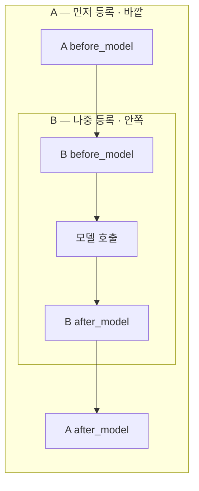
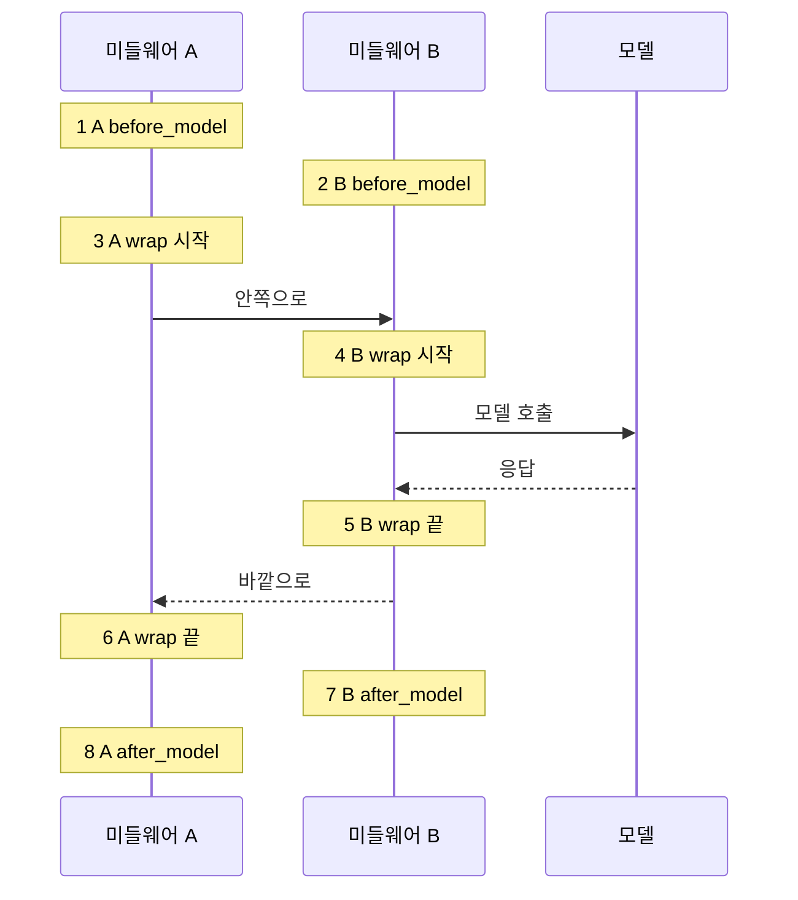
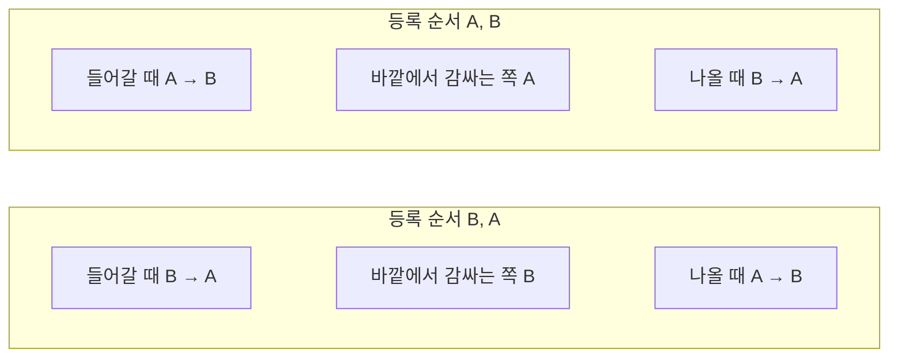

# 07-순서와-합성

## _src 본문 (HTML 원본)

```html
<!--meta: 강의 1h · 실습 2h | 코드 Jupyter Notebook | 새 용어 1개 -->
<h2 id="b1"><span class="no">1</span>학습 목표</h2><div class="goal"><ul><li>여러 미들웨어를 등록했을 때 들어가는 훅과 나오는 훅의 실행 순서를 말할 수 있습니다.</li><li>감싸기형 훅이 어떤 순서로 겹치는지 실행 기록으로 확인할 수 있습니다.</li><li>등록 순서가 결과에 영향을 주는 경우를 예로 들 수 있습니다.</li></ul></div>
<h2 id="b2"><span class="no">2</span>이 내용을 배우는 이유</h2>
<p>04절에서는 재시도 미들웨어를 기록 훅보다 앞에 등록했습니다. 둘 다 모델 호출을 감싸는 훅이라 등록 순서가 감싸는 순서를 정합니다. 그래서 재시도할 때마다 기록 훅도 실행돼 시도 3번이 모두 기록됐습니다.</p>
<p>미들웨어가 여러 개가 되면 이런 순서 문제가 늘어납니다. 이번 절에서는 순서 규칙을 실행 기록으로 직접 확인합니다.</p>
<p><strong>이 절의 질문</strong> — 여러 미들웨어의 before·after·wrap 훅은 어떤 순서로 합성될까요?</p>
<h2 id="b3"><span class="no">3</span>앞에서 배운 내용</h2>
<p>01절에서 훅 여섯 개의 자리를 확인했습니다. 02절과 03절에서는 before_model 자리의 미들웨어와 감싸기형 기록 훅을 함께 썼습니다. 04절에서는 재시도 미들웨어를 기록 훅보다 앞에 두었습니다.</p>
<h2 id="b4"><span class="no">4</span>핵심 개념</h2>
<h3>비유로 시작하기</h3>
<p>편지를 봉투 두 겹에 넣는다고 해 봅니다. 바깥 봉투가 A, 안쪽 봉투가 B입니다.</p>
<p>편지를 꺼낼 때는 A를 먼저 열고 B를 엽니다. 다시 넣을 때는 B를 먼저 닫고 A를 닫습니다. 미들웨어도 이렇게 겹칩니다.</p>
{{img:07-4-두-겹-봉투|파란 바깥 봉투에서 초록 안쪽 봉투를, 초록 봉투에서 편지를 차례로 꺼낸 모습의 삽화|편지를 꺼낼 때는 바깥 봉투부터 열고, 넣을 때는 안쪽 봉투부터 닫습니다.}}
<p><strong>그림 읽기</strong> — 왼쪽 파란 봉투가 먼저 등록한 A, 가운데 초록 봉투가 B, 오른쪽 편지가 모델 호출입니다.</p>
<h3>합성의 뜻</h3>
<p>합성(composition)은 여러 미들웨어를 한 에이전트에 함께 등록해 차례로 적용하는 것입니다. 같은 종류의 훅끼리는 목록에 넣은 순서가 적용 순서를 정합니다.</p>
<table><tr><th>훅 종류</th><th>A, B 순서로 등록했을 때 실행 순서</th></tr>
<tr><td>들어가는 훅(<code>before_model</code>)</td><td>A 다음 B — 등록 순서대로</td></tr>
<tr><td>감싸기형 훅(<code>wrap_model_call</code>)</td><td>A가 B를 감싸고, B가 호출을 감쌈</td></tr>
<tr><td>나오는 훅(<code>after_model</code>)</td><td>B 다음 A — 등록 순서의 반대</td></tr>
<tr><td>종류가 다른 훅끼리</td><td>등록 순서와 상관없이 before → wrap → after 순서(출력 2번과 3번)</td></tr></table>
<p>표는 이번 노트북에서 실행한 모델 훅 세 종류만 적었습니다. 나머지 세 훅(before_agent, after_agent, wrap_tool_call)은 이번에 실행하지 않았습니다.</p>
{{mermaid:07-1-합성-순서|바깥 칸 A 안에 칸 B가 있고 그 안에 모델 호출이 있으며 들어갈 때 A에서 B, 나올 때 B에서 A로 이어지는 그림|A를 먼저, B를 나중에 등록했을 때 훅 순서를 겹친 칸으로 나타냈습니다. 감싸기형 훅도 같은 모양으로 겹칩니다.}}
<p><strong>도식 읽기</strong> — 바깥 칸이 먼저 등록한 A, 안쪽 칸이 B입니다. 화살표를 따라가면 들어갈 때 A 다음 B, 나올 때 B 다음 A입니다.</p>
<h2 id="b5"><span class="no">5</span>실행 예제</h2>
<p>노트북은 이름표 A와 B마다 훅을 세 종류씩, 모두 여섯 개 만듭니다. 훅은 실행될 때 이름표와 종류를 목록에 적습니다.</p>
<p>데코레이터로 만든 훅은 하나가 미들웨어 하나입니다. 이 절에서는 이름표가 같은 세 개를 묶어 「미들웨어 A」, 「미들웨어 B」라고 부릅니다.</p>
<p>도구 없이 질문 하나를 보내므로 모델은 한 번 호출됩니다. 기록은 8줄이어야 합니다. 두 실행을 합쳐 모델 호출은 2번이고 예상 비용은 0.01달러 미만입니다.</p>
{{notebook:07-순서와-합성}}
<p class="look"><b>확인할 점</b> — A, B 순서 실행의 1번과 8번이 모두 A인지, B, A 순서 실행에서는 모두 B로 바뀌었는지 봅니다.</p>
<h3>실제 기록 순서 그림</h3>
{{mermaid:07-2-실제-순서|미들웨어 A, B, 모델 사이에서 기록 1번부터 8번까지의 순서를 나타낸 순서도|A 다음 B 순서로 등록했을 때 실제로 기록된 8줄입니다.}}
<p>3~6번에서 A의 감싸기 훅이 시작된 뒤 B의 감싸기 훅이 시작됐습니다. 모델 응답 뒤에는 B가 먼저 끝나고 A가 끝났습니다. 미들웨어 A가 B를 감싼 모양입니다.</p>
<h2 id="b6"><span class="no">6</span>실험 결과 해석</h2>
<p>A, B 순서로 등록하자 기록은 정해 둔 규칙과 같았습니다. 들어가는 훅은 A 다음 B, 나오는 훅은 B 다음 A였습니다.</p>
{{mermaid:07-3-등록-순서-비교|등록 순서 A, B와 B, A에서 들어갈 때, 바깥쪽, 나올 때의 순서를 비교한 그림|등록 순서만 바꿨을 때 실행 순서가 어떻게 달라졌는지 비교했습니다.}}
<p>등록 순서를 B, A로 바꾸자 1번은 B before_model, 8번은 B after_model이 됐습니다. 바깥에서 감싸는 쪽도 B로 바뀌었습니다.</p>
<p>이 순서는 모델 답 문장과 상관없이 정해집니다. 그래서 노트북은 기록 전체를 <code>assert</code>로 비교할 수 있었습니다.</p>
<p>이번 실습은 모델 호출 한 번만 관찰했습니다. 도구 호출이 있는 실행에서 <code>wrap_tool_call</code> 훅이 같은 규칙을 따르는지는 이번에 실행하지 않았습니다.</p>
<h2 id="b7"><span class="no">7</span>주의할 점과 실무 메모</h2>
<ul><li>02·03절의 마스킹 입력 처리와 요약 미들웨어는 before_model 자리에서 실행됩니다. 이번 절 규칙대로라면 감싸기형 기록 훅보다 먼저 실행됩니다. 두 미들웨어를 기록 훅 뒤에 등록한 실행은 이번에 하지 않았습니다.</li><li>04절처럼 기록 훅을 재시도보다 뒤에 두면 재시도할 때마다 기록됐습니다. 이번 절 규칙대로라면 기록 훅을 앞에 둘 때 재시도 전체를 바깥에서 감쌉니다. 이 경우의 기록 횟수는 이번에 확인하지 않았습니다.</li><li>훅 함수 이름은 서로 다르게 짓습니다. 이름이 겹칠 때의 동작은 이번에 실행하지 않았습니다.</li></ul>
<h2 id="b8"><span class="no">8</span>정리와 다음 절</h2>
<ul><li>들어가는 훅은 등록 순서대로, 나오는 훅은 반대 순서로 실행됐습니다.</li><li>감싸기형 훅은 먼저 등록한 것이 바깥에서 감쌌습니다.</li><li>등록 순서를 뒤집자 세 가지 순서가 모두 뒤집혔습니다.</li></ul>
<p><strong>다음 학습과 이어지는 지점</strong> — 08절에서는 감싸기형 훅으로 모델 요청의 메시지를 골라 보내는 컨텍스트 분리를 만듭니다. 이 훅도 기록 훅보다 앞에 등록합니다.</p>
<h2 id="b9"><span class="no">9</span>복습 문제</h2><details class="quiz"><summary>문제와 해설</summary>
<p class="quiz-q">1. A, B 순서로 등록했을 때 after_model 훅은 어떤 순서로 실행됐나요?</p><p class="quiz-a"><b>해설</b> — B 다음 A입니다. 나오는 훅은 등록 순서의 반대로 실행됩니다.</p>
<p class="quiz-q">2. 감싸기형 훅에서 바깥쪽에 있는 미들웨어는 무엇인가요?</p><p class="quiz-a"><b>해설</b> — 먼저 등록한 미들웨어입니다. A, B 순서라면 A가 바깥입니다.</p>
<p class="quiz-q">3. A, B 순서로 등록했을 때 B의 before_model 훅이 A의 감싸기 훅보다 먼저 실행된 이유는 무엇인가요?</p><p class="quiz-a"><b>해설</b> — 종류가 다른 훅은 등록 순서와 상관없이 before → wrap → after 순서로 실행되기 때문입니다. 출력 2번이 B before_model, 3번이 A wrap 시작이었습니다.</p>
<p class="quiz-q">4. 이번 노트북에서 실행 순서를 assert로 확인할 수 있었던 이유는 무엇인가요?</p><p class="quiz-a"><b>해설</b> — 순서는 모델 답 문장과 상관없이 훅 종류와 등록 순서로 정해지기 때문입니다.</p>
</details>
<h2 id="b10"><span class="no">10</span>참고 자료</h2><ul><li><a href="https://docs.langchain.com/oss/python/langchain/middleware/custom">LangChain Custom middleware</a> · 확인 2026-09-14 · LangChain 1.4.0</li><li><a href="https://docs.langchain.com/oss/python/langchain/middleware/built-in">LangChain Prebuilt middleware</a> · 확인 2026-09-14 · LangChain 1.4.0</li><li><a href="https://reference.langchain.com/python/langchain/agents/middleware">LangChain middleware API reference</a> · 확인 2026-09-14 · LangChain 1.4.0</li></ul>
```

## 노트북 셀 (순서대로)

### [0] markdown {'html': 'skip'}

# 순서와 합성

**이 노트북에서 할 일**

1. 이름표 A와 B마다 훅을 세 종류씩, 모두 여섯 개 만듭니다.
2. A 다음 B 순서로 등록하고, 훅이 실행된 순서를 읽습니다.
3. 등록 순서를 B 다음 A로 바꿔 실행 순서가 어떻게 바뀌는지 비교합니다.

**준비물** — `.env` 파일의 `OPENAI_API_KEY`. 데이터 파일은 없습니다. 모델 호출은 2번이고 실행 시간은 1분 이내입니다. 예상 비용은 0.01달러 미만입니다.

### [1] markdown {'html': 'skip'}

## 오늘 볼 그림


바깥 칸이 먼저 등록한 A, 안쪽 칸이 B입니다. 들어갈 때는 A 다음 B, 나올 때는 B 다음 A 순서입니다.

### [2] markdown {}

## 1. 준비

첫 셀은 패키지를 설치하고 설치된 버전을 출력합니다. 설치에는 몇십 초가 걸릴 수 있습니다.

### [3] code {'execution': {'iopub.execute_input': '2026-09-15T10:40:39.530501Z', 'iopub.status.busy': '2026-09-15T10:40:39.530201Z', 'iopub.status.idle': '2026-09-15T10:40:40.006998Z', 'shell.execute_reply': '2026-09-15T10:40:40.006329Z'}, 'lesson_role': 'setup'}

```python
# 이 절에서 쓰는 패키지를 설치하고 버전을 확인합니다
%pip install -q "langchain==1.4.0" "langchain-openai==1.6.0" "langgraph==1.2.11" "python-dotenv==1.2.3"
from importlib.metadata import version

print("langchain:", version("langchain"))
print("langchain-openai:", version("langchain-openai"))
print("langgraph:", version("langgraph"))
```

출력:
```
Note: you may need to restart the kernel to use updated packages.
langchain: 1.4.0
langchain-openai: 1.6.0
langgraph: 1.2.11

```

### [4] markdown {}

이번 절에서 쓰는 이름을 불러옵니다. 01절과 같은 훅 데코레이터를 씁니다.

### [5] code {'execution': {'iopub.execute_input': '2026-09-15T10:40:40.008388Z', 'iopub.status.busy': '2026-09-15T10:40:40.008277Z', 'iopub.status.idle': '2026-09-15T10:40:40.233617Z', 'shell.execute_reply': '2026-09-15T10:40:40.233303Z'}, 'lesson_role': 'setup'}

```python
# 에이전트·훅·모델을 만드는 도구를 불러옵니다
from collections.abc import Callable

from langchain.agents import create_agent
from langchain.agents.middleware import AgentState, ModelRequest, ModelResponse, Runtime
from langchain.agents.middleware import after_model, before_model, wrap_model_call
from langchain.chat_models import init_chat_model
```

출력:
```

```

### [6] markdown {}

API 키가 있는지 확인합니다. `True` 값이 나오면 다음으로 넘어갑니다.

### [7] code {'execution': {'iopub.execute_input': '2026-09-15T10:40:40.234563Z', 'iopub.status.busy': '2026-09-15T10:40:40.234505Z', 'iopub.status.idle': '2026-09-15T10:40:40.238475Z', 'shell.execute_reply': '2026-09-15T10:40:40.238103Z'}, 'lesson_role': 'setup'}

```python
# .env 파일에서 OpenAI API 키를 읽습니다(키 값은 출력하지 않습니다)
import os
from dotenv import find_dotenv, load_dotenv

env_path = find_dotenv(usecwd=True)
load_dotenv(env_path)
has_key = os.getenv("OPENAI_API_KEY") is not None
print("OPENAI_API_KEY 설정 여부:", has_key)
assert has_key, "프로젝트 폴더의 .env 파일에 OPENAI_API_KEY를 적어 주세요."
```

출력:
```
OPENAI_API_KEY 설정 여부: True

```

### [8] markdown {}

실습에 쓸 모델을 준비합니다. 01절과 같은 설정입니다.
temperature 값을 0으로 두어 매번 비슷한 답을 고르게 합니다.

### [9] code {'execution': {'iopub.execute_input': '2026-09-15T10:40:40.239116Z', 'iopub.status.busy': '2026-09-15T10:40:40.239058Z', 'iopub.status.idle': '2026-09-15T10:40:40.593654Z', 'shell.execute_reply': '2026-09-15T10:40:40.593237Z'}}

```python
# 실습에 쓸 모델을 준비합니다
model = init_chat_model(
    "openai:gpt-5.4-mini",
    temperature=0,
    reasoning_effort="none",
)
print("모델 이름:", model.model_name)
print("temperature:", model.temperature)
```

출력:
```
모델 이름: gpt-5.4-mini
temperature: 0.0

```

### [10] markdown {}

**결과 읽기** — 모델 이름 `gpt-5.4-mini`, temperature `0.0`이 보이면 준비가 끝났습니다.
이 노트북의 출력은 2026-09-15에 이 모델로 실행한 결과입니다.

### [11] markdown {}

## 2. 이름표 붙은 훅 만들기

04절에서는 재시도 미들웨어를 기록 훅보다 앞에 두어 시도 3번을 모두 기록했습니다.
이번에는 훅을 여러 개 등록했을 때의 순서 규칙을 확인합니다. 실행 순서를 적을 빈 목록부터 만듭니다.

### [12] code {'execution': {'iopub.execute_input': '2026-09-15T10:40:40.594414Z', 'iopub.status.busy': '2026-09-15T10:40:40.594360Z', 'iopub.status.idle': '2026-09-15T10:40:40.596249Z', 'shell.execute_reply': '2026-09-15T10:40:40.595923Z'}}

```python
# 훅이 실행된 순서를 적을 빈 목록을 만듭니다
order = []
print("기록 개수:", len(order))
```

출력:
```
기록 개수: 0

```

### [13] markdown {}

**결과 읽기** — 기록 개수는 `0`입니다.

이름표 A가 붙은 훅 세 개를 만듭니다. 먼저 모델을 부르기 직전에 실행되는 훅입니다.
데코레이터로 만든 훅은 하나가 미들웨어 하나입니다. 이 노트북에서는 이름표가 같은 세 개를 묶어 「미들웨어 A」라고 부릅니다.

### [14] code {'execution': {'iopub.execute_input': '2026-09-15T10:40:40.596796Z', 'iopub.status.busy': '2026-09-15T10:40:40.596745Z', 'iopub.status.idle': '2026-09-15T10:40:40.598582Z', 'shell.execute_reply': '2026-09-15T10:40:40.598201Z'}}

```python
# A: 모델을 부르기 직전에 실행되는 훅
@before_model
def a_before(state: AgentState, runtime: Runtime) -> None:
    order.append("A before_model")
```

출력:
```

```

### [15] markdown {}

이름표 A의 두 번째 훅은 모델 호출을 감쌉니다.

### [16] code {'execution': {'iopub.execute_input': '2026-09-15T10:40:40.599141Z', 'iopub.status.busy': '2026-09-15T10:40:40.599093Z', 'iopub.status.idle': '2026-09-15T10:40:40.600629Z', 'shell.execute_reply': '2026-09-15T10:40:40.600283Z'}}

```python
# A: 모델 호출을 앞뒤로 감싸는 훅
@wrap_model_call
def a_wrap(request: ModelRequest, handler: Callable) -> ModelResponse:
    order.append("A wrap 시작")
    response = handler(request)
    order.append("A wrap 끝")
    return response
```

출력:
```

```

### [17] markdown {}

이름표 A의 세 번째 훅은 모델 응답을 받은 직후 실행됩니다.

### [18] code {'execution': {'iopub.execute_input': '2026-09-15T10:40:40.601152Z', 'iopub.status.busy': '2026-09-15T10:40:40.601108Z', 'iopub.status.idle': '2026-09-15T10:40:40.602465Z', 'shell.execute_reply': '2026-09-15T10:40:40.602148Z'}}

```python
# A: 모델 응답을 받은 직후 실행되는 훅
@after_model
def a_after(state: AgentState, runtime: Runtime) -> None:
    order.append("A after_model")
```

출력:
```

```

### [19] markdown {}

이름표 B가 붙은 훅 세 개도 같은 모양으로 만듭니다.

### [20] code {'execution': {'iopub.execute_input': '2026-09-15T10:40:40.603031Z', 'iopub.status.busy': '2026-09-15T10:40:40.602976Z', 'iopub.status.idle': '2026-09-15T10:40:40.604552Z', 'shell.execute_reply': '2026-09-15T10:40:40.604237Z'}}

```python
# B: 모델을 부르기 직전에 실행되는 훅
@before_model
def b_before(state: AgentState, runtime: Runtime) -> None:
    order.append("B before_model")
```

출력:
```

```

### [21] markdown {}

이름표 B의 감싸기형 훅입니다.

### [22] code {'execution': {'iopub.execute_input': '2026-09-15T10:40:40.605055Z', 'iopub.status.busy': '2026-09-15T10:40:40.605002Z', 'iopub.status.idle': '2026-09-15T10:40:40.606530Z', 'shell.execute_reply': '2026-09-15T10:40:40.606229Z'}}

```python
# B: 모델 호출을 앞뒤로 감싸는 훅
@wrap_model_call
def b_wrap(request: ModelRequest, handler: Callable) -> ModelResponse:
    order.append("B wrap 시작")
    response = handler(request)
    order.append("B wrap 끝")
    return response
```

출력:
```

```

### [23] markdown {}

이름표 B의 마지막 훅입니다.

### [24] code {'execution': {'iopub.execute_input': '2026-09-15T10:40:40.607122Z', 'iopub.status.busy': '2026-09-15T10:40:40.607079Z', 'iopub.status.idle': '2026-09-15T10:40:40.608543Z', 'shell.execute_reply': '2026-09-15T10:40:40.608238Z'}}

```python
# B: 모델 응답을 받은 직후 실행되는 훅
@after_model
def b_after(state: AgentState, runtime: Runtime) -> None:
    order.append("B after_model")
```

출력:
```

```

### [25] markdown {}

출력은 없습니다.

## 3. A 다음 B 순서로 등록하기

이름표 A의 훅 세 개를 먼저, 이름표 B의 훅 세 개를 나중에 목록에 넣습니다. 도구 없이 질문 하나를 보내므로 모델은 1번 호출됩니다.
반복문에 쓴 `enumerate(order, start=1)` 함수는 기록마다 1부터 시작하는 번호를 붙여 줍니다.

### [26] code {'execution': {'iopub.execute_input': '2026-09-15T10:40:40.609037Z', 'iopub.status.busy': '2026-09-15T10:40:40.608985Z', 'iopub.status.idle': '2026-09-15T10:40:41.511783Z', 'shell.execute_reply': '2026-09-15T10:40:41.510927Z'}}

```python
# A 다음 B 순서로 등록하고 질문 하나를 보냅니다
a_then_b = [a_before, a_wrap, a_after, b_before, b_wrap, b_after]
agent = create_agent(model, tools=[], middleware=a_then_b)
agent.invoke({"messages": [{"role": "user", "content": "한 문장으로 인사해 주세요."}]})
for number, name in enumerate(order, start=1):
    print(number, name)
```

출력:
```
1 A before_model
2 B before_model
3 A wrap 시작
4 B wrap 시작
5 B wrap 끝
6 A wrap 끝
7 B after_model
8 A after_model

```

### [27] markdown {}

**결과 읽기** — 1~2번은 `A before_model` 다음 `B before_model`입니다. 들어가는 훅은 등록 순서대로 실행됩니다.

3~6번은 `A wrap 시작`, `B wrap 시작`, `B wrap 끝`, `A wrap 끝`입니다. 미들웨어 A가 B를 감싸고, B가 모델을 감쌉니다.

7~8번은 `B after_model` 다음 `A after_model`입니다. 나오는 훅은 등록 순서의 반대로 실행됩니다.

목록에서는 A의 감싸기 훅이 B의 before_model 훅보다 앞에 있습니다. 그래도 2번이 B before_model, 3번이 A wrap 시작입니다.
종류가 다른 훅은 등록 순서와 상관없이 before → wrap → after 순서로 실행됐습니다.

### [28] code {'execution': {'iopub.execute_input': '2026-09-15T10:40:41.513464Z', 'iopub.status.busy': '2026-09-15T10:40:41.513332Z', 'iopub.status.idle': '2026-09-15T10:40:41.516173Z', 'shell.execute_reply': '2026-09-15T10:40:41.515696Z'}}

```python
# 실행 순서가 규칙대로인지 확인하고 기록을 비웁니다
expected = [
    "A before_model", "B before_model",
    "A wrap 시작", "B wrap 시작", "B wrap 끝", "A wrap 끝",
    "B after_model", "A after_model",
]
print("규칙과 같은가:", order == expected)
assert order == expected
order.clear()
```

출력:
```
규칙과 같은가: True

```

### [29] markdown {}

**결과 읽기** — 규칙과 같은지 확인한 결과가 `True`입니다.

## 4. 값 하나 바꿔 보기 — B 다음 A

등록 순서를 B 먼저로 바꿉니다. 실행 전에 예상해 봅니다. 들어가는 before_model 훅은 B가 먼저, 나오는 after_model 훅은 A가 먼저일 것입니다.

### [30] code {'execution': {'iopub.execute_input': '2026-09-15T10:40:41.517377Z', 'iopub.status.busy': '2026-09-15T10:40:41.517286Z', 'iopub.status.idle': '2026-09-15T10:40:42.182147Z', 'shell.execute_reply': '2026-09-15T10:40:42.180656Z'}}

```python
# B 다음 A 순서로 등록하고 같은 질문을 보냅니다
b_then_a = [b_before, b_wrap, b_after, a_before, a_wrap, a_after]
agent = create_agent(model, tools=[], middleware=b_then_a)
agent.invoke({"messages": [{"role": "user", "content": "한 문장으로 인사해 주세요."}]})
for number, name in enumerate(order, start=1):
    print(number, name)
```

출력:
```
1 B before_model
2 A before_model
3 B wrap 시작
4 A wrap 시작
5 A wrap 끝
6 B wrap 끝
7 A after_model
8 B after_model

```

### [31] markdown {}

**결과 읽기** — 이번에는 1번이 `B before_model`이고 마지막 8번이 `B after_model`입니다. 바깥에서 감싸는 쪽도 B로 바뀌었습니다.

## 정리

- 들어가는 훅(before_model)은 등록 순서대로, 나오는 훅(after_model)은 반대 순서로 실행됩니다.
- 감싸기형 훅은 먼저 등록한 것이 바깥에서 감쌉니다.
- 종류가 다른 훅은 등록 순서와 상관없이 before → wrap → after 순서로 실행됐습니다.

## 그림

### 07-1-합성-순서.mmd



- 설명 대상 문장: 감싸기형 훅은 먼저 등록한 것이 바깥에서 감쌉니다.
- 캡션: A를 먼저, B를 나중에 등록했을 때 들어가는 훅과 나오는 훅의 순서를 겹친 칸으로 나타냈습니다. 감싸기형 훅도 같은 모양으로 겹칩니다.
- 읽는 법: 바깥 칸이 A, 안쪽 칸이 B입니다. 화살표를 따라가면 들어갈 때는 A 다음 B, 나올 때는 B 다음 A입니다.
- alt: 바깥 칸 A 안에 칸 B가 있고 그 안에 모델 호출이 있으며, A before_model, B before_model, 모델 호출, B after_model, A after_model 순서로 화살표가 이어진 그림

### 07-2-실제-순서.mmd



- 설명 대상 문장: 들어가는 훅은 등록 순서대로, 나오는 훅은 등록 순서의 반대로 실행됩니다.
- 캡션: A 다음 B 순서로 등록했을 때 실제로 기록된 8줄입니다.
- 읽는 법: 노란 메모의 번호가 노트북 출력의 번호입니다. 3~6번에서 A가 B를 감싸고, B가 모델 호출을 감싸는 모양이 보입니다.
- alt: 미들웨어 A, B, 모델 사이에서 1번 A before_model부터 8번 A after_model까지 기록 순서를 나타낸 순서도

### 07-3-등록-순서-비교.mmd



- 설명 대상 문장: 등록 순서를 B 먼저로 바꾸자 1번이 B before_model, 8번이 B after_model이 됐습니다.
- 캡션: 등록 순서만 바꿨을 때 실행 순서가 어떻게 달라졌는지 비교했습니다.
- 읽는 법: 두 줄의 같은 칸끼리 비교합니다. 등록 순서가 뒤집히자 세 칸의 A와 B가 모두 자리를 바꿨습니다.
- alt: 등록 순서 A, B에서는 들어갈 때 A에서 B, 바깥 A, 나올 때 B에서 A이고, 등록 순서 B, A에서는 모두 반대인 비교 그림

### 07-4-두-겹-봉투.prompt.md

# 삽화 — 07-4 두 겹 봉투

- 상태: 2026-09-15 생성·검수 통과. 모델 nano_banana_pro(서버 표기 nano_banana_2), 16:9, 2k(2752×1536), 2크레딧. job 327605f7-9267-4bd1-8b7d-d5fceb7612b0. 교재 파일은 폭 1100px로 줄여 저장. 첫 생성(job 3cd54ccb-2bb3-4bfb-b74c-576eca9f1c8e)은 탈락: 파란 봉투 안에 초록 봉투가 아니라 흰 종이가 보여 「A가 B를 감싼다」가 읽히지 않음. 아래 프롬프트로 다시 생성.
- 설명 대상 문장: 감싸기형 훅은 먼저 등록한 것이 바깥에서 감쌉니다.
- 넣을 자리: 07절 핵심 개념 「비유로 시작하기」 아래
- 구성 요소와 배치(왼쪽 → 오른쪽): ① 파란 바깥 봉투 ② 그 안에서 반쯤 꺼낸 초록 안쪽 봉투 ③ 초록 봉투 안의 편지 한 장
- 시선 순서: 바깥 파란 봉투 → 안쪽 초록 봉투 → 편지
- 대응: 파란 봉투 = 먼저 등록한 A, 초록 봉투 = 나중에 등록한 B, 편지 = 모델 호출
- 모델: nano_banana_pro, 16:9, 1k (생성 시점 카탈로그로 다시 확인)

## 프롬프트

Simple flat educational illustration, white background, limited soft palette, clean outlines, plain everyday objects, no text, no letters, no numbers, no logos.
Three items from left to right showing nesting. (1) A large open blue envelope with a smaller green envelope clearly sticking halfway out of it. (2) The same smaller green envelope, open, with a blank white folded letter clearly sticking halfway out of it. (3) The blank white folded letter alone. Dashed arrows go from item 1 to item 2 and from item 2 to item 3. The green envelope has the same color and size in items 1 and 2. All paper is blank.

