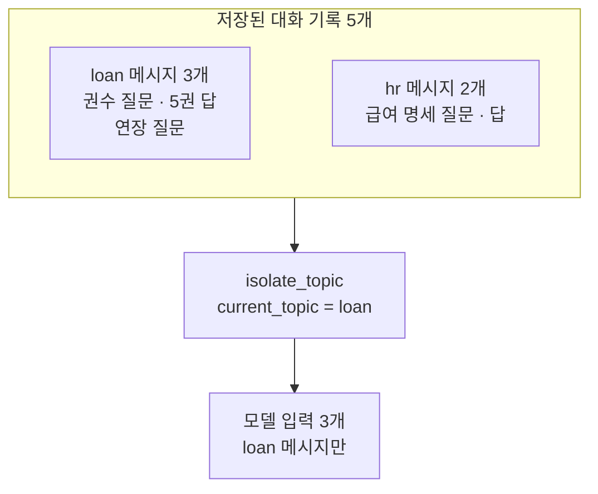
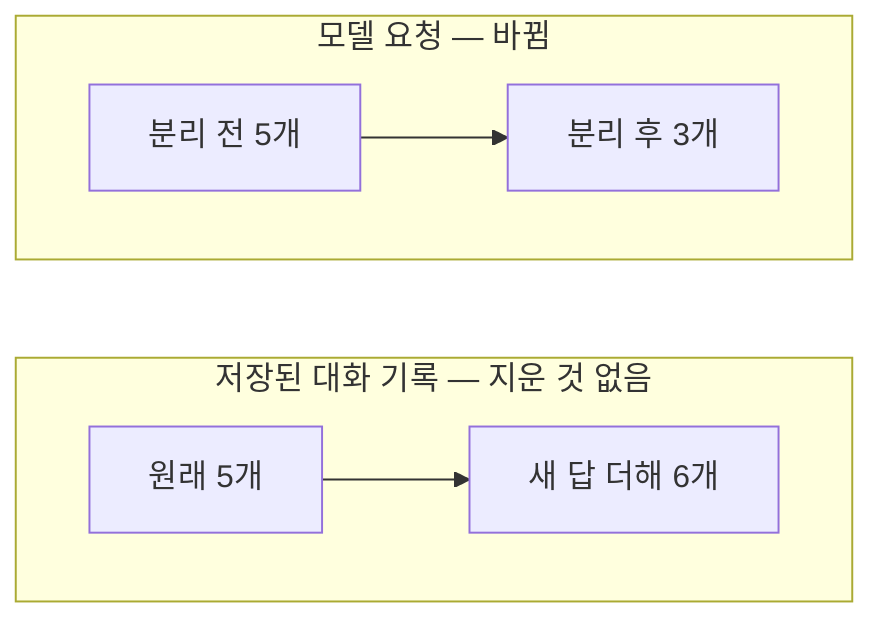
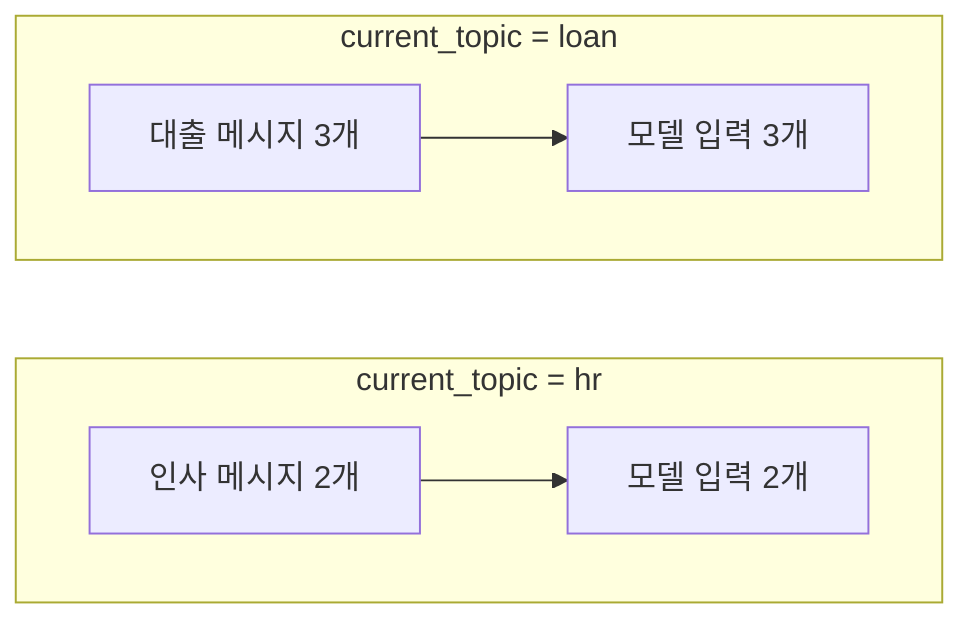

# 08-컨텍스트-분리와-Isolate

## _src 본문 (HTML 원본)

```html
<!--meta: 강의 1h · 실습 2h | 코드 Jupyter Notebook | 새 용어 1개 -->
<h2 id="b1"><span class="no">1</span>학습 목표</h2><div class="goal"><ul><li>업무가 섞인 대화에서 모델에 필요 없는 메시지가 전송되는지 확인할 수 있습니다.</li><li>감싸기형 훅으로 현재 업무의 메시지만 골라 모델에 보낼 수 있습니다.</li><li>모델 요청과 저장된 대화 기록이 서로 다르게 바뀐다는 것을 설명할 수 있습니다.</li></ul></div>
<h2 id="b2"><span class="no">2</span>이 내용을 배우는 이유</h2>
<p>한 대화에서 사용자가 여러 업무를 오가며 질문할 수 있습니다. 대출을 묻다가 직원 급여를 묻고, 다시 대출로 돌아오는 식입니다.</p>
<p>이때 대화 전체를 모델에 보내면 지금 질문과 상관없는 내용까지 모델이 읽습니다. 입력이 늘고, 다른 업무 내용이 답에 섞일 수도 있습니다.</p>
<p><strong>이 절의 질문</strong> — 같은 대화에 섞인 여러 업무 메시지에서 현재 업무에 필요한 내용만 모델 요청으로 분리하려면 어떻게 할까요?</p>
<h2 id="b3"><span class="no">3</span>앞에서 배운 내용</h2>
<p>Ch8 03절에서 컨텍스트 전략인 Isolate를 배웠습니다. 서로 다른 일의 정보를 분리해 필요한 쪽에만 주는 방법입니다.</p>
<p>07절에서는 먼저 등록한 감싸기형 훅이 바깥에서 감싼다는 것을 확인했습니다. 이번 절의 분리 훅도 기록 훅보다 앞에 등록합니다.</p>
<h2 id="b4"><span class="no">4</span>핵심 개념</h2>
<h3>비유로 시작하기</h3>
<p>서류함에 대출 서류와 인사 서류가 섞여 꽂혀 있다고 해 봅니다. 대출 상담 창구에는 대출 서류만 꺼내 건넵니다.</p>
<p>인사 서류는 서류함에 그대로 남습니다. 버리지 않고 건네지 않을 뿐입니다.</p>
{{img:08-4-서류함|파란 탭과 회색 탭 서류가 섞인 서류함에서 파란 탭 서류만 꺼내 창구 직원에게 건네는 삽화|창구로 건네는 것은 파란 탭 서류뿐입니다. 회색 탭 서류는 서류함에 남습니다.}}
<p><strong>그림 읽기</strong> — 서류함에서 파란 탭 서류만 꺼내 창구 직원에게 건넵니다. 회색 탭 서류는 서류함에 남습니다.</p>
<h3>컨텍스트 분리의 뜻</h3>
<p>컨텍스트 분리(Isolate)는 대화 기록에서 지금 업무에 필요한 메시지만 골라 모델에 보내는 방법입니다.</p>
<p>코드로 고르려면 메시지마다 업무 이름표가 있어야 합니다. 메시지의 <code>additional_kwargs</code> 속성은 추가 정보를 담아 두는 딕셔너리입니다. 이번 실습은 여기에 <code>topic</code> 값을 넣습니다. 이름표 중 loan은 대출, hr은 인사 업무입니다.</p>
{{mermaid:08-1-분리-전후|대출 메시지 3개와 인사 메시지 2개가 섞인 저장 기록에서 분리 훅이 대출 메시지 3개만 모델에 보내는 흐름도|분리 훅이 저장된 기록 5개 중 대출 메시지 3개만 모델에 보냈습니다.}}
<p><strong>도식 읽기</strong> — 위 칸이 저장된 대화 기록입니다. 파란 상자가 대출 메시지 3개, 회색 상자가 인사 메시지 2개입니다.</p>
<p>노란 분리 훅은 현재 업무가 loan이므로 파란 상자의 메시지만 고릅니다. 맨 아래 보라 상자인 모델 입력에는 대출 메시지 3개만 있습니다.</p>
<h3>요청만 바꾸기</h3>
<p>분리 훅은 <code>request.override(messages=selected)</code>로 새 요청을 만듭니다. 이 메서드는 원래 요청에서 메시지 목록만 바꾼 복사본을 반환합니다.</p>
<p>모델은 새 요청을 받습니다. 분리 훅은 요청 복사본만 바꾸고 대화 기록에는 쓰지 않습니다. 그래서 기록은 줄지 않습니다.</p>
<h2 id="b5"><span class="no">5</span>실행 예제</h2>
<p>노트북은 대출 메시지 3개와 인사 메시지 2개가 섞인 대화를 만듭니다. 마지막 질문은 대출 연장입니다.</p>
<p>02절과 같은 기록 훅으로 모델이 받은 메시지를 확인합니다. 모델 호출은 3번이고 예상 비용은 0.01달러 미만입니다.</p>
{{notebook:08-컨텍스트-분리와-Isolate|example}}
<p class="look"><b>확인할 점</b> — 대화 메시지가 5개이고, 메시지마다 topic 이름표가 붙어 있는지 봅니다.</p>
<h2 id="b6"><span class="no">6</span>일부러 실패해 보기</h2>
<p>Before 실행은 대화 전체를 보냅니다. After 실행은 같은 대화를 분리 훅이 있는 에이전트에 보냅니다.</p>
<p>바꾼 조건은 <code>isolate_topic</code> 훅 등록 하나입니다. 대화, 모델, 기록 훅은 같습니다.</p>
{{notebook:08-컨텍스트-분리와-Isolate|failure}}
<p>Before에서 모델은 메시지 5개를 받았고, 그중에 직원 급여 질문이 있었습니다. 대출 연장 질문에 필요 없는 인사 업무 내용이 모델에 전송됐습니다.</p>
<p>After에서 모델이 받은 메시지는 대출 업무 3개였습니다. 급여 질문은 없었습니다. 저장된 대화 기록은 원래 5개에 새 답이 더해져 6개였습니다.</p>
{{mermaid:08-2-요청과-기록|모델 요청은 5개에서 3개로 줄었고 저장된 대화 기록은 5개에 새 답이 더해져 6개가 된 비교 그림|분리 훅이 바꾼 것은 모델 요청뿐입니다.}}
<p>값 바꿔 보기에서 현재 업무를 hr로 바꾸자 모델 입력은 인사 메시지 2개가 됐습니다. 같은 대화 기록에서 업무 이름만으로 골라지는 메시지가 달라졌습니다.</p>
{{mermaid:08-3-업무별-입력|업무 이름이 loan이면 모델 입력 3개, hr이면 2개임을 비교한 그림|업무 이름만 바꿨을 때 모델이 받은 메시지 수입니다.}}
<h2 id="b7"><span class="no">7</span>주의할 점과 실무 메모</h2>
<ul><li>이름표가 없는 메시지는 고르지 않습니다. 새 메시지에 이름표를 붙이는 규칙이 빠지면 필요한 메시지도 모델에 가지 않습니다. 이번 실행에서 모델이 만든 새 답에도 topic 이름표가 없었습니다. 이 기록으로 다음 질문을 이어 가면 그 답은 골라지지 않을 것입니다.</li><li>분리는 보안 장치가 아닙니다. 급여 같은 내부 정보는 모델 입력에서 빠졌어도 저장된 기록에는 남아 있습니다. 접근 권한은 따로 관리합니다.</li><li>업무 이름을 hr로 바꾼 실행은 마지막 메시지가 모델 답인 채로 모델에 갔습니다. 대화 흐름이 어색해질 수 있으므로 분리 뒤 마지막 메시지가 무엇인지 확인합니다.</li><li>대출 연장과 연체료처럼 이어진 질문에서는 답에 필요한 다른 업무 메시지까지 빠질 수 있습니다.</li></ul>
<h2 id="b8"><span class="no">8</span>정리와 다음 절</h2>
<ul><li>분리 훅은 현재 업무 이름표가 붙은 메시지만 골라 모델에 보냈습니다.</li><li>모델 요청은 5개에서 3개로 줄었습니다. 저장된 대화 기록에서 지운 메시지는 없었습니다(5개에 새 답이 더해져 6개).</li><li>업무 이름을 바꾸자 같은 대화에서 다른 메시지가 골라졌습니다.</li></ul>
<p><strong>다음 학습과 이어지는 지점</strong> — 09절은 이 챕터의 실습입니다. 배운 미들웨어 세 가지를 도서관 상담 에이전트 하나에 모아 함께 실행합니다.</p>
<h2 id="b9"><span class="no">9</span>복습 문제</h2><details class="quiz"><summary>문제와 해설</summary>
<p class="quiz-q">1. Before에서 문제가 된 메시지는 무엇이었나요?</p><p class="quiz-a"><b>해설</b> — 직원 급여 명세를 묻는 인사 업무 질문과 그 답입니다. 대출 연장 질문에는 필요 없는 내용이었습니다.</p>
<p class="quiz-q">2. 분리 훅은 어떤 기준으로 메시지를 골랐나요?</p><p class="quiz-a"><b>해설</b> — 메시지의 <code>additional_kwargs</code>에 든 topic 값이 current_topic과 같은지로 골랐습니다.</p>
<p class="quiz-q">3. After 실행 뒤 저장된 대화 기록이 6개였던 이유는 무엇인가요?</p><p class="quiz-a"><b>해설</b> — 분리는 모델 요청만 바꾸고 저장된 기록에서는 메시지를 지우지 않았기 때문입니다. 원래 5개에 새 답 1개가 더해졌습니다.</p>
<p class="quiz-q">4. 분리를 보안 장치로 보면 안 되는 이유는 무엇인가요?</p><p class="quiz-a"><b>해설</b> — 모델 입력에서 빠졌어도 내부 정보가 저장된 기록에는 남아 있기 때문입니다.</p>
</details>
<h2 id="b10"><span class="no">10</span>참고 자료</h2><ul><li><a href="https://docs.langchain.com/oss/python/langchain/middleware/custom">LangChain Custom middleware</a> · 확인 2026-09-14 · LangChain 1.4.0</li><li><a href="https://docs.langchain.com/oss/python/langchain/middleware/built-in">LangChain Prebuilt middleware</a> · 확인 2026-09-14 · LangChain 1.4.0</li><li><a href="https://reference.langchain.com/python/langchain/agents/middleware">LangChain middleware API reference</a> · 확인 2026-09-14 · LangChain 1.4.0</li></ul>
```

## 노트북 셀 (순서대로)

### [0] markdown {'html': 'skip'}

# 컨텍스트 분리와 Isolate

**이 노트북에서 할 일**

1. 대출과 인사 두 업무가 섞인 대화 기록을 만듭니다.
2. 대화 전체를 모델에 보내고, 모델이 받은 메시지를 확인합니다(Before).
3. 현재 업무의 메시지만 골라 보내는 훅을 만들어 같은 대화를 보냅니다(After).

**준비물** — `.env` 파일의 `OPENAI_API_KEY`. 데이터 파일은 없습니다. 모델 호출은 3번이고 실행 시간은 1분 이내입니다. 예상 비용은 0.01달러 미만입니다.

### [1] markdown {'html': 'skip'}

## 오늘 볼 그림


위는 저장된 대화 기록 다섯 개, 아래는 모델이 받은 메시지입니다. 분리 훅이 대출 메시지만 골라 보냅니다.

### [2] markdown {}

## 1. 준비

첫 셀은 패키지를 설치하고 설치된 버전을 출력합니다. 설치에는 몇십 초가 걸릴 수 있습니다.

### [3] code {'execution': {'iopub.execute_input': '2026-09-15T10:42:07.471837Z', 'iopub.status.busy': '2026-09-15T10:42:07.471637Z', 'iopub.status.idle': '2026-09-15T10:42:07.869583Z', 'shell.execute_reply': '2026-09-15T10:42:07.868994Z'}, 'lesson_role': 'setup'}

```python
# 이 절에서 쓰는 패키지를 설치하고 버전을 확인합니다
%pip install -q "langchain==1.4.0" "langchain-openai==1.6.0" "langgraph==1.2.11" "python-dotenv==1.2.3"
from importlib.metadata import version

print("langchain:", version("langchain"))
print("langchain-openai:", version("langchain-openai"))
print("langgraph:", version("langgraph"))
```

출력:
```
Note: you may need to restart the kernel to use updated packages.
langchain: 1.4.0
langchain-openai: 1.6.0
langgraph: 1.2.11

```

### [4] markdown {}

이번 절에서 쓰는 이름을 불러옵니다.

### [5] code {'execution': {'iopub.execute_input': '2026-09-15T10:42:07.870806Z', 'iopub.status.busy': '2026-09-15T10:42:07.870704Z', 'iopub.status.idle': '2026-09-15T10:42:08.082790Z', 'shell.execute_reply': '2026-09-15T10:42:08.082380Z'}, 'lesson_role': 'setup'}

```python
# 에이전트·훅·메시지·모델을 만드는 도구를 불러옵니다
from collections.abc import Callable

from langchain.agents import create_agent
from langchain.agents.middleware import ModelRequest, ModelResponse, wrap_model_call
from langchain.chat_models import init_chat_model
from langchain_core.messages import AIMessage, HumanMessage
```

출력:
```

```

### [6] markdown {}

API 키가 있는지 확인합니다. `True` 값이 나오면 다음으로 넘어갑니다.

### [7] code {'execution': {'iopub.execute_input': '2026-09-15T10:42:08.083684Z', 'iopub.status.busy': '2026-09-15T10:42:08.083624Z', 'iopub.status.idle': '2026-09-15T10:42:08.087343Z', 'shell.execute_reply': '2026-09-15T10:42:08.086948Z'}, 'lesson_role': 'setup'}

```python
# .env 파일에서 OpenAI API 키를 읽습니다(키 값은 출력하지 않습니다)
import os
from dotenv import find_dotenv, load_dotenv

env_path = find_dotenv(usecwd=True)
load_dotenv(env_path)
has_key = os.getenv("OPENAI_API_KEY") is not None
print("OPENAI_API_KEY 설정 여부:", has_key)
assert has_key, "프로젝트 폴더의 .env 파일에 OPENAI_API_KEY를 적어 주세요."
```

출력:
```
OPENAI_API_KEY 설정 여부: True

```

### [8] markdown {}

실습에 쓸 모델을 준비합니다. 01절과 같은 설정입니다.
temperature 값을 0으로 두어 매번 비슷한 답을 고르게 합니다.

### [9] code {'execution': {'iopub.execute_input': '2026-09-15T10:42:08.087946Z', 'iopub.status.busy': '2026-09-15T10:42:08.087896Z', 'iopub.status.idle': '2026-09-15T10:42:08.431631Z', 'shell.execute_reply': '2026-09-15T10:42:08.431245Z'}}

```python
# 실습에 쓸 모델을 준비합니다
model = init_chat_model(
    "openai:gpt-5.4-mini",
    temperature=0,
    reasoning_effort="none",
)
print("모델 이름:", model.model_name)
print("temperature:", model.temperature)
```

출력:
```
모델 이름: gpt-5.4-mini
temperature: 0.0

```

### [10] markdown {}

**결과 읽기** — 모델 이름 `gpt-5.4-mini`, temperature `0.0`이 보이면 준비가 끝났습니다.
이 노트북의 출력은 2026-09-15에 이 모델로 실행한 결과입니다.

### [11] markdown {}

## 2. 업무가 섞인 대화 만들기

컨텍스트 분리(Isolate)는 대화 기록에서 지금 업무에 필요한 메시지만 골라 모델에 보내는 방법입니다. Ch8에서 배운 전략입니다.
메시지의 `additional_kwargs` 속성은 메시지에 추가 정보를 담아 두는 딕셔너리입니다.
여기에 업무 이름표 `topic`을 붙입니다. 이름표 중 loan은 대출, hr은 인사 업무입니다.

### [12] code {'execution': {'iopub.execute_input': '2026-09-15T10:42:08.432377Z', 'iopub.status.busy': '2026-09-15T10:42:08.432315Z', 'iopub.status.idle': '2026-09-15T10:42:08.434531Z', 'shell.execute_reply': '2026-09-15T10:42:08.434174Z'}}

```python
# 대출(loan)과 인사(hr) 업무가 섞인 대화 5개를 만듭니다
mixed = [
    HumanMessage("대출은 몇 권까지 되나요?", additional_kwargs={"topic": "loan"}),
    AIMessage("한 번에 5권까지 빌릴 수 있습니다.", additional_kwargs={"topic": "loan"}),
    HumanMessage("직원 급여 명세는 어디서 보나요?", additional_kwargs={"topic": "hr"}),
    AIMessage("급여 명세는 인사팀 내부 문서에 있습니다.", additional_kwargs={"topic": "hr"}),
    HumanMessage("대출 기간을 연장할 수 있나요?", additional_kwargs={"topic": "loan"}),
]
print("대화 메시지 수:", len(mixed))
```

출력:
```
대화 메시지 수: 5

```

### [13] markdown {}

**결과 읽기** — 대화 메시지 수는 `5`입니다. 마지막 질문은 대출 업무입니다.

02절과 같은 기록 훅을 만듭니다.

### [14] code {'execution': {'iopub.execute_input': '2026-09-15T10:42:08.435117Z', 'iopub.status.busy': '2026-09-15T10:42:08.435053Z', 'iopub.status.idle': '2026-09-15T10:42:08.436730Z', 'shell.execute_reply': '2026-09-15T10:42:08.436405Z'}}

```python
# 모델이 실제로 받은 메시지를 기록하는 훅을 만듭니다
seen_by_model = []


@wrap_model_call
def record_model_input(request: ModelRequest, handler: Callable) -> ModelResponse:
    for message in request.messages:
        seen_by_model.append(message.text)
    return handler(request)
```

출력:
```

```

### [15] markdown {}

출력은 없습니다.

### [16] markdown {'lesson_part': 'before'}

## 3. Before — 대화 전체 보내기

### [17] code {'execution': {'iopub.execute_input': '2026-09-15T10:42:08.437256Z', 'iopub.status.busy': '2026-09-15T10:42:08.437211Z', 'iopub.status.idle': '2026-09-15T10:42:09.679813Z', 'shell.execute_reply': '2026-09-15T10:42:09.679042Z'}, 'lesson_part': 'before'}

```python
# Before: 대화 전체를 그대로 보냅니다
plain_agent = create_agent(model, tools=[], middleware=[record_model_input])
plain_agent.invoke({"messages": mixed})
for text in seen_by_model:
    print("-", text)
```

출력:
```
- 대출은 몇 권까지 되나요?
- 한 번에 5권까지 빌릴 수 있습니다.
- 직원 급여 명세는 어디서 보나요?
- 급여 명세는 인사팀 내부 문서에 있습니다.
- 대출 기간을 연장할 수 있나요?

```

### [18] markdown {'lesson_part': 'before'}

**결과 읽기** — 모델이 받은 글 다섯 개 중에 `직원 급여 명세는 어디서 보나요?`가 있습니다. 대출 질문에 필요 없는 인사 업무 내용입니다.

### [19] code {'execution': {'iopub.execute_input': '2026-09-15T10:42:09.681391Z', 'iopub.status.busy': '2026-09-15T10:42:09.681257Z', 'iopub.status.idle': '2026-09-15T10:42:09.684362Z', 'shell.execute_reply': '2026-09-15T10:42:09.683871Z'}, 'lesson_part': 'before'}

```python
# 모델 입력에 인사 업무 내용이 섞였는지 확인합니다
has_salary = False
for text in seen_by_model:
    if "급여" in text:
        has_salary = True
print("모델 입력 메시지 수:", len(seen_by_model))
print("급여 내용이 섞였나:", has_salary)
assert has_salary
```

출력:
```
모델 입력 메시지 수: 5
급여 내용이 섞였나: True

```

### [20] markdown {'lesson_part': 'before'}

**결과 읽기** — 모델 입력 메시지 수는 `5`, 급여 내용이 섞였는지 확인한 결과는 `True`입니다.

### [21] markdown {'lesson_part': 'after'}

## 4. After — 현재 업무의 메시지만 보내기

지금 처리할 업무 이름을 변수에 담습니다.

### [22] code {'execution': {'iopub.execute_input': '2026-09-15T10:42:09.685604Z', 'iopub.status.busy': '2026-09-15T10:42:09.685507Z', 'iopub.status.idle': '2026-09-15T10:42:09.687794Z', 'shell.execute_reply': '2026-09-15T10:42:09.687221Z'}, 'lesson_part': 'after'}

```python
# 지금 처리할 업무 이름을 정합니다
current_topic = "loan"
print("현재 업무:", current_topic)
```

출력:
```
현재 업무: loan

```

### [23] markdown {'lesson_part': 'after'}

**결과 읽기** — 현재 업무는 `loan`입니다.

분리 훅은 모델을 부르기 전에 메시지를 하나씩 보고, 이름표가 현재 업무와 같은 것만 새 목록에 담습니다.
메서드 `request.override(messages=selected)`는 요청의 메시지만 바꾼 새 요청을 만듭니다. 대화 기록에는 쓰지 않으므로 저장된 기록은 줄지 않습니다.

### [24] code {'execution': {'iopub.execute_input': '2026-09-15T10:42:09.688928Z', 'iopub.status.busy': '2026-09-15T10:42:09.688821Z', 'iopub.status.idle': '2026-09-15T10:42:09.691757Z', 'shell.execute_reply': '2026-09-15T10:42:09.691245Z'}, 'lesson_part': 'after'}

```python
# 현재 업무 이름표가 붙은 메시지만 골라 모델에 보내는 훅
@wrap_model_call
def isolate_topic(request: ModelRequest, handler: Callable) -> ModelResponse:
    selected = []
    for message in request.messages:
        if message.additional_kwargs.get("topic") == current_topic:
            selected.append(message)
    new_request = request.override(messages=selected)
    return handler(new_request)
```

출력:
```

```

### [25] markdown {'lesson_part': 'after'}

출력은 없습니다. 분리 훅을 기록 훅보다 앞에 두어야, 기록 훅이 고른 뒤의 메시지를 봅니다.

### [26] code {'execution': {'iopub.execute_input': '2026-09-15T10:42:09.692838Z', 'iopub.status.busy': '2026-09-15T10:42:09.692743Z', 'iopub.status.idle': '2026-09-15T10:42:10.657113Z', 'shell.execute_reply': '2026-09-15T10:42:10.656405Z'}, 'lesson_part': 'after'}

```python
# After: 분리 훅을 등록하고 같은 대화를 보냅니다
seen_by_model.clear()
isolated_agent = create_agent(model, tools=[], middleware=[isolate_topic, record_model_input])
isolated_result = isolated_agent.invoke({"messages": mixed})
for text in seen_by_model:
    print("-", text)
```

출력:
```
- 대출은 몇 권까지 되나요?
- 한 번에 5권까지 빌릴 수 있습니다.
- 대출 기간을 연장할 수 있나요?

```

### [27] markdown {'lesson_part': 'after'}

**결과 읽기** — 모델이 받은 글이 대출 업무 세 개로 줄었습니다. 마지막 글은 `대출 기간을 연장할 수 있나요?`이고 급여 질문은 보이지 않습니다.

### [28] code {'execution': {'iopub.execute_input': '2026-09-15T10:42:10.658622Z', 'iopub.status.busy': '2026-09-15T10:42:10.658481Z', 'iopub.status.idle': '2026-09-15T10:42:10.662583Z', 'shell.execute_reply': '2026-09-15T10:42:10.661686Z'}, 'lesson_part': 'after'}

```python
# 모델이 받은 메시지 수와 저장된 대화 기록을 비교합니다
stored = isolated_result["messages"]
print("모델 입력 메시지 수:", len(seen_by_model))
print("저장된 대화 기록 수:", len(stored))
print("기록의 세 번째 메시지:", stored[2].text)
print("새 답의 topic 이름표:", stored[-1].additional_kwargs.get("topic"))
assert len(seen_by_model) == 3
```

출력:
```
모델 입력 메시지 수: 3
저장된 대화 기록 수: 6
기록의 세 번째 메시지: 직원 급여 명세는 어디서 보나요?
새 답의 topic 이름표: None

```

### [29] markdown {'lesson_part': 'after'}

**결과 읽기** — 모델 입력 메시지 수는 `3`입니다. 저장된 대화 기록 수는 `6`입니다. 원래 5개에 새 답 1개가 더해졌습니다.
기록의 세 번째 메시지로 급여 질문이 그대로 남아 있습니다. 새 답의 이름표는 `None`, 즉 없습니다.

분리는 모델에 보내는 요청만 줄였고, 저장된 기록에서는 아무것도 지우지 않았습니다.

## 5. 값 하나 바꿔 보기 — 업무 이름 바꾸기

`current_topic` 값을 hr로 바꿉니다. 실행 전에 예상해 봅니다. 인사 업무 메시지 2개만 모델에 갈 것입니다.

### [30] code {'execution': {'iopub.execute_input': '2026-09-15T10:42:10.664404Z', 'iopub.status.busy': '2026-09-15T10:42:10.664140Z', 'iopub.status.idle': '2026-09-15T10:42:12.245612Z', 'shell.execute_reply': '2026-09-15T10:42:12.244720Z'}, 'lesson_part': 'after'}

```python
# 현재 업무를 인사(hr)로 바꿔 같은 대화를 보냅니다
current_topic = "hr"
seen_by_model.clear()
isolated_agent.invoke({"messages": mixed})
print("모델 입력 메시지 수:", len(seen_by_model))
for text in seen_by_model:
    print("-", text)
```

출력:
```
모델 입력 메시지 수: 2
- 직원 급여 명세는 어디서 보나요?
- 급여 명세는 인사팀 내부 문서에 있습니다.

```

### [31] markdown {'lesson_part': 'after'}

**결과 읽기** — 모델 입력 메시지 수가 `2`입니다. 이번에는 대출 메시지가 빠지고 인사 업무 메시지만 남았습니다.

## 정리

- 분리 훅은 모델 요청에 들어갈 메시지만 골랐습니다. 저장된 대화 기록에서 지운 메시지는 없었습니다(5개에 새 답이 더해져 6개).
- 이름표(`topic`)를 붙여 두어야 코드로 업무를 구분할 수 있습니다.
- 모델 입력에서 빠졌다고 해서 접근이 막힌 것은 아닙니다. 급여 같은 내부 정보의 접근 권한은 별도로 관리해야 합니다.

## 그림

### 08-1-분리-전후.mmd



- 설명 대상 문장: 컨텍스트 분리는 대화 기록에서 지금 업무에 필요한 메시지만 골라 모델에 보내는 방법입니다.
- 캡션: 분리 훅이 저장된 기록 5개 중 대출(loan) 메시지 3개만 모델에 보냈습니다.
- 읽는 법: 위 칸이 저장된 기록입니다. 파란 상자가 대출(loan) 메시지 3개, 회색 상자가 인사(hr) 메시지 2개입니다. 노란 분리 훅을 지나면 대출 메시지 3개만 보라 상자인 모델 입력으로 갑니다.
- alt: 대출 메시지 3개와 인사 메시지 2개가 섞인 저장 기록이 isolate_topic 훅을 거쳐 대출 메시지 3개만 모델 입력으로 가는 흐름도

### 08-2-요청과-기록.mmd



- 설명 대상 문장: 분리는 모델에 보내는 요청만 줄였고, 저장된 기록에서는 아무것도 지우지 않았습니다.
- 캡션: request.override()가 바꾼 것은 모델 요청뿐입니다.
- 읽는 법: 위 줄은 모델 요청의 메시지 수, 아래 줄은 저장된 대화 기록의 메시지 수입니다. 위 줄만 줄었고 아래 줄은 새 답 하나가 더해졌습니다.
- alt: 모델 요청은 분리 전 5개에서 분리 후 3개로 줄었고, 저장된 대화 기록은 원래 5개에 새 답이 더해져 6개가 된 비교 그림

### 08-3-업무별-입력.mmd



- 설명 대상 문장: 이번에는 대출 메시지가 빠지고 인사 업무 메시지만 남았습니다.
- 캡션: 업무 이름만 바꿨을 때 모델이 받은 메시지 수입니다.
- 읽는 법: 두 줄의 왼쪽 칸이 골라진 메시지, 오른쪽 칸이 모델 입력입니다. 같은 대화 기록에서 업무 이름에 따라 3개 또는 2개가 골라졌습니다.
- alt: 업무 이름이 loan이면 대출 메시지 3개가 모델 입력이 되고, hr이면 인사 메시지 2개가 모델 입력이 되는 비교 그림

### 08-4-서류함.prompt.md

# 삽화 — 08-4 서류함에서 한 업무 서류만 꺼내기

- 상태: 2026-09-15 생성·검수 통과. 모델 nano_banana_pro(서버 표기 nano_banana_2), 16:9, 2k(2752×1536), 2크레딧. job 188dc3a0-fd76-4a62-b140-49c814f428aa. 교재 파일은 폭 1100px로 줄여 저장.
- 설명 대상 문장: 컨텍스트 분리는 대화 기록에서 지금 업무에 필요한 메시지만 골라 모델에 보내는 방법입니다.
- 넣을 자리: 08절 핵심 개념 「비유로 시작하기」 아래
- 구성 요소와 배치(왼쪽 → 오른쪽): ① 파란 탭 서류 세 개와 회색 탭 서류 두 개가 섞여 꽂힌 서류함 ② 파란 탭 서류 세 개만 꺼내 드는 손 ③ 파란 서류 세 개를 받는 상담 창구 직원. 회색 탭 서류는 서류함에 그대로 남아 있음
- 시선 순서: 서류함 → 꺼낸 파란 서류 → 창구 직원, 그리고 서류함에 남은 회색 서류
- 대응: 서류함 = 저장된 대화 기록, 파란 탭 = loan 메시지, 창구 직원 = 모델
- 모델: nano_banana_pro, 16:9, 1k (생성 시점 카탈로그로 다시 확인)

## 프롬프트

Simple flat educational illustration, white background, limited soft palette, clean outlines, plain everyday objects, no text, no letters, no numbers, no logos.
Left to right: (1) an open filing drawer holding five folders, three with blue tabs and two with gray tabs, (2) a hand lifting out only the three blue-tab folders, (3) a service desk clerk receiving the three blue-tab folders. The two gray-tab folders remain inside the drawer. All folders are blank.

