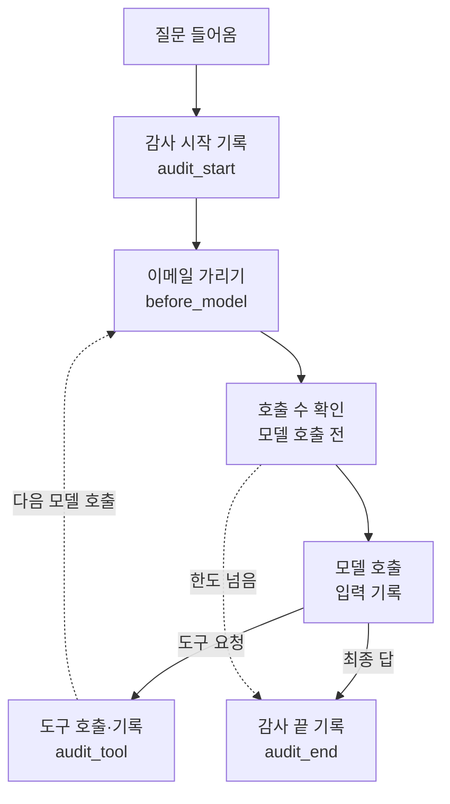
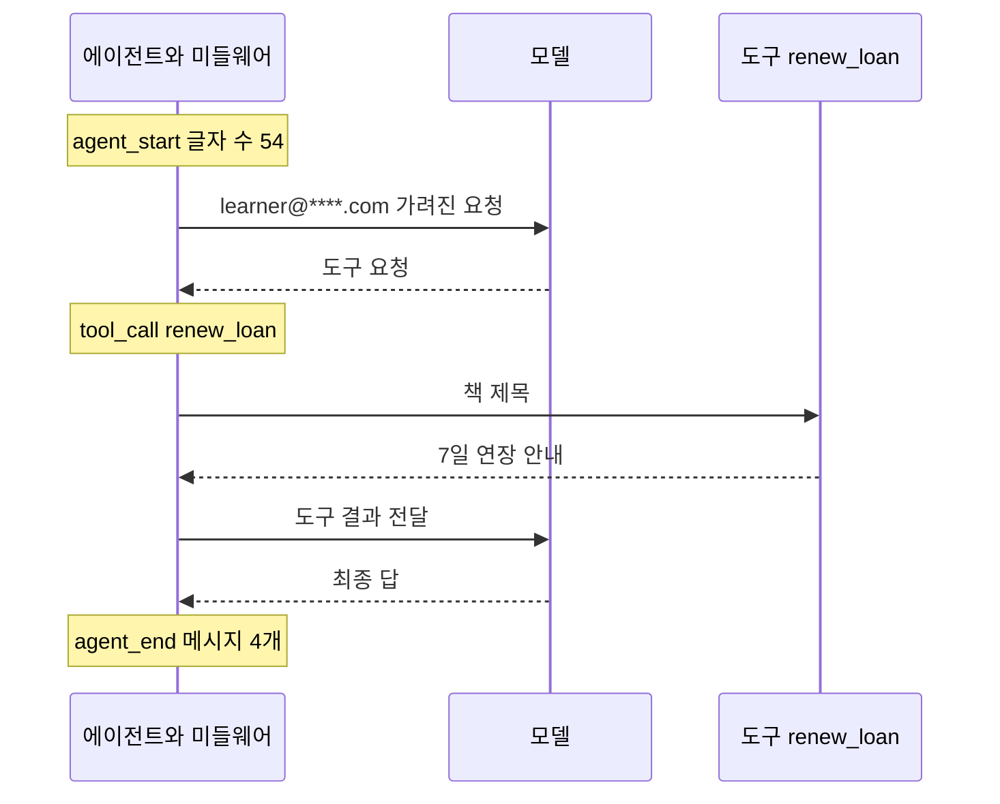
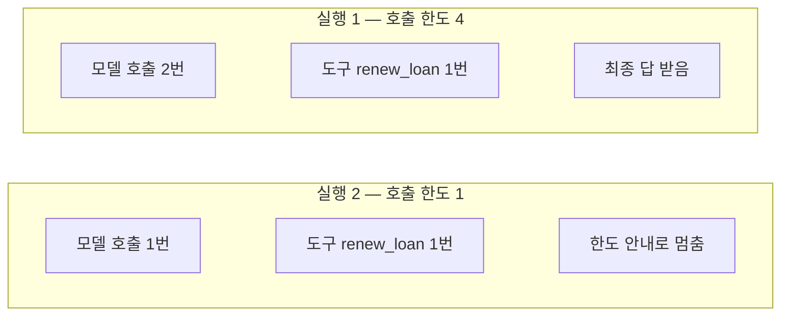

# 09-Middleware-실습

## _src 본문 (HTML 원본)

```html
<!--meta: 실습 30분 | 코드 Jupyter Notebook | 새 용어 0개 -->
<h2 id="b1"><span class="no">1</span>학습 목표</h2><div class="goal"><ul><li>이 챕터에서 배운 미들웨어 세 가지를 한 에이전트에 함께 등록하는 과정을 따라갈 수 있습니다.</li><li>실행 기록에서 이메일이 가려졌는지, 감사 사건이 남았는지 확인할 수 있습니다.</li><li>호출 한도 값 하나를 바꿨을 때 실행 결과가 어떻게 달라지는지 설명할 수 있습니다.</li></ul></div>
<h2 id="b2"><span class="no">2</span>이 내용을 배우는 이유</h2>
<p>01~08절에서는 미들웨어를 하나씩 따로 배웠습니다. 실제 서비스의 에이전트에는 여러 미들웨어가 함께 붙습니다.</p>
<p>이번 절은 이 챕터의 실습입니다. 앞에서 배운 것을 한 에이전트에 모아 강사와 함께 실행해 봅니다. 새 문법이나 새 개념은 없습니다.</p>
<p>실습 주제는 도서관 상담 에이전트입니다. 이용자가 이메일을 적어 대출 연장을 요청하는 상황을 씁니다.</p>
<p><strong>이 절의 질문</strong> — 배운 미들웨어를 한 에이전트에 함께 붙이면 각자 제 역할을 할까요?</p>
<h2 id="b3"><span class="no">3</span>앞에서 배운 내용</h2>
<p>이번 실습은 아래 네 절에서 배운 것을 그대로 가져옵니다.</p>
<table><tr><th>절</th><th>배운 것</th><th>실습에서 쓰는 곳</th></tr>
<tr><td>01·02절</td><td>감싸기형 훅으로 모델 입력 기록 남기기</td><td>모델이 받은 첫 메시지 기록</td></tr>
<tr><td>02절</td><td><code>PIIMiddleware</code>로 이메일 가리기</td><td>이용자가 적은 이메일 가리기</td></tr>
<tr><td>04절</td><td><code>ModelCallLimitMiddleware</code>로 호출 횟수 제한</td><td>한도 4와 한도 1 비교</td></tr>
<tr><td>06절</td><td>원문 없이 감사 사건 남기기</td><td>시작·도구·끝 사건 기록</td></tr></table>
<p>07절에서는 before_model 자리의 훅이 감싸기형 훅보다 먼저 실행된다는 것을 확인했습니다. 실습에서도 이 순서를 씁니다.</p>
<h2 id="b4"><span class="no">4</span>핵심 개념</h2>
<h3>비유로 시작하기</h3>
<p>도서관 안내 데스크에 도우미 세 명이 있다고 해 봅니다. 한 명은 신청서의 개인정보 칸을 가립니다.</p>
<p>또 한 명은 요청 횟수를 셉니다. 마지막 한 명은 무슨 일이 있었는지 공책에 적습니다. 세 사람은 서로의 일을 대신하지 않습니다.</p>
<p>미들웨어 세 개도 같습니다. 한 에이전트에 함께 붙어 있어도 각자 맡은 자리에서 제 일만 합니다.</p>
{{img:09-4-안내-데스크|방문자의 신청서가 공책에 점을 붙이는 도우미, 회색 스티커를 붙이는 도우미, 계수기를 누르는 도우미를 거쳐 사서에게 가는 삽화|신청서는 기록 공책, 가림 스티커, 계수기를 차례로 거쳐 사서에게 갑니다.}}
<p><strong>그림 읽기</strong> — 왼쪽 방문자에서 오른쪽 사서로 점선을 따라갑니다. 가운데 세 도우미가 감사 기록, 이메일 가리기, 호출 한도입니다.</p>
<h3>실습 에이전트의 구성</h3>
{{mermaid:09-1-조립도|질문이 감사 시작 기록, 이메일 가리기, 호출 수 확인을 거쳐 모델로 가고, 도구 요청이면 도구 기록 뒤 다시 모델 앞으로, 최종 답이면 감사 끝 기록으로 가는 흐름도|실습 에이전트에 붙인 미들웨어가 실행되는 자리입니다.}}
<p><strong>도식 읽기</strong> — 위에서 아래로 읽습니다. 노란 상자는 감사 기록과 호출 수 확인, 파란 상자는 질문과 이메일 가리기입니다. 보라 상자는 모델, 초록 상자는 도구입니다.</p>
<p>모델이 도구를 요청하면 도구를 실행하고 기록합니다. 그다음 점선을 따라 다시 모델 앞으로 돌아갑니다. 최종 답이 나오면 감사 끝 사건을 남깁니다. 호출 수가 한도를 넘으면 모델을 부르지 않고 감사 끝 기록으로 갑니다.</p>
<table><tr><th>등록 순서</th><th>이름</th><th>실행되는 자리</th><th>이번 설정</th></tr>
<tr><td>1</td><td><code>email_mask</code></td><td>모델 호출 전(before_model)</td><td>이메일을 별표로 가림</td></tr>
<tr><td>2</td><td><code>limit_four</code>, <code>limit_one</code></td><td>모델 호출 전에 횟수 확인</td><td>실행 1은 4번, 실행 2는 1번</td></tr>
<tr><td>3~5</td><td><code>audit_start</code>, <code>audit_tool</code>, <code>audit_end</code></td><td>시작·도구 호출·끝</td><td>원문 대신 글자 수·도구 이름·메시지 수</td></tr>
<tr><td>6</td><td><code>record_model_call</code></td><td>모델 호출을 감쌈</td><td>모델이 받은 첫 메시지를 목록에 적음</td></tr></table>
<h3>두 번의 실행</h3>
<p>실행 1은 호출 한도를 4로 두고 대출 연장을 요청합니다. 도구를 한 번 쓰면 모델은 두 번 호출되므로 한도 안에 들어갑니다.</p>
<p>실행 2는 호출 한도만 1로 바꾸고 같은 요청을 보냅니다. 나머지 미들웨어와 도구, 질문은 모두 같습니다.</p>
<h2 id="b5"><span class="no">5</span>실행 예제</h2>
<p>노트북은 도구 두 개와 기록 훅 네 개를 먼저 만듭니다. 그다음 미들웨어 여섯 개를 한 목록에 담아 에이전트를 만듭니다.</p>
<p>실제 OpenAI 모델을 temperature 0으로 부릅니다. 모델 호출은 모두 3번이고 예상 비용은 0.01달러 미만입니다.</p>
{{notebook:09-Middleware-실습}}
<p class="look"><b>확인할 점</b> — 실행 1의 모델 입력에서 이메일이 가려졌는지, 감사 사건이 세 개 남았는지 봅니다.</p>
<h3>실행 1의 실제 순서</h3>
{{mermaid:09-2-실행1-순서|에이전트가 가려진 요청을 모델에 보내고 renew_loan 도구를 실행한 뒤 최종 답을 받는 사이에 감사 사건 세 개가 남은 순서도|실행 1(호출 한도 4)에서 실제로 오간 메시지와 감사 사건입니다.}}
<p>노란 메모가 감사 사건입니다. 모델은 두 번 호출됐고, 첫 호출에서 두 도구 중 <code>renew_loan</code> 도구를 요청했습니다.</p>
<h2 id="b6"><span class="no">6</span>실험 결과 해석</h2>
<p>실행 1에서 모델이 받은 글에는 이메일이 <code>learner@****.com</code>으로 가려져 있었습니다. 원문이 있는지 확인한 결과는 False였습니다.</p>
<p>감사 기록에는 agent_start, tool_call, agent_end 사건이 순서대로 남았습니다. 기록 전체에도 이메일 원문은 없었습니다.</p>
<p>모델 호출은 2번이었고 한도 4 안이었습니다. 그래서 호출 한도 미들웨어는 실행을 멈추지 않았고, 이용자는 연장 안내를 받았습니다.</p>
{{mermaid:09-3-한도-비교|호출 한도 4에서는 모델 호출 2번과 최종 답, 호출 한도 1에서는 모델 호출 1번과 한도 안내로 멈춤을 비교한 그림|같은 요청에서 호출 한도만 바꿨을 때의 결과입니다.}}
<p>실행 2에서는 한도만 1로 바꿨습니다. 대화 기록의 tool 메시지를 보면 도구는 실행됐습니다. 그러나 도구 결과를 읽을 두 번째 모델 호출은 한도에 걸렸습니다.</p>
<p>최종 메시지는 <code>Model call limits exceeded</code> 안내였습니다. 그래도 감사 기록의 시작과 끝 사건은 남았습니다.</p>
<p>결론은 이렇습니다. 실행 1에서 세 미들웨어는 서로 방해하지 않고 각자 맡은 일을 했습니다. 실행 2에서는 한도가 실행을 멈춘 뒤에도 감사 끝 사건이 남았습니다. 이 결과는 질문 하나로 관찰한 것입니다.</p>
<h2 id="b7"><span class="no">7</span>주의할 점과 실무 메모</h2>
<ul><li>이번 실습은 입력 쪽(<code>apply_to_input</code>)만 설정했습니다. 모델이 만든 답에 이메일이 들어가는 경우는 확인하지 않았습니다.</li><li>호출 한도는 도구를 쓰는 요청에 필요한 호출 수보다 넉넉하게 잡습니다. 실행 2처럼 너무 낮으면 도구를 실행하고도 답을 주지 못합니다.</li><li>감사 기록은 노트북 목록에만 있습니다. 실제 서비스에서는 접근 권한이 관리되는 저장소에 남깁니다(06절).</li><li>실습에서는 미들웨어 여섯 개를 한 목록에 담았습니다. 실습 코드처럼 목록에 배운 절과 역할을 주석으로 적어 두면 읽기 쉽습니다.</li></ul>
<h2 id="b8"><span class="no">8</span>정리와 다음 절</h2>
<ul><li>이메일 가리기, 호출 한도, 감사 기록 미들웨어를 한 에이전트에 함께 등록했습니다.</li><li>실행 1에서 모델 입력과 감사 기록 모두 이메일 원문이 없었고, 호출 2번은 한도 4 안이었습니다.</li><li>실행 2에서 한도만 1로 바꾸자 도구 실행 뒤 두 번째 모델 호출에서 멈췄습니다. 감사 끝 사건은 남았습니다.</li></ul>
<p><strong>다음 학습과 이어지는 지점</strong> — Ch23에서는 대화 기록을 프로그램 밖에 저장하고 다시 이어 가는 방법을 다룹니다. 이번 실습에서 종류별로 출력한 대화 기록이 그 대상입니다.</p>
<h2 id="b9"><span class="no">9</span>복습 문제</h2><details class="quiz"><summary>문제와 해설</summary>
<p class="quiz-q">1. 실행 1에서 모델이 받은 글의 이메일이 가려진 이유는 무엇인가요?</p><p class="quiz-a"><b>해설</b> — 모델 호출 전(before_model)에 <code>email_mask</code> 미들웨어가 이메일을 별표로 바꿨기 때문입니다.</p>
<p class="quiz-q">2. 실행 1에서 호출 한도 미들웨어가 실행을 멈추지 않은 이유는 무엇인가요?</p><p class="quiz-a"><b>해설</b> — 모델 호출이 2번으로, 한도 4를 넘지 않았기 때문입니다.</p>
<p class="quiz-q">3. 실행 2에서 도구는 실행됐는데 최종 답이 없었던 이유는 무엇인가요?</p><p class="quiz-a"><b>해설</b> — 한도가 1이라 도구 결과를 읽을 두 번째 모델 호출이 막혔기 때문입니다.</p>
<p class="quiz-q">4. 감사 기록에 이메일 원문이 없었던 이유는 무엇인가요?</p><p class="quiz-a"><b>해설</b> — 감사 훅이 질문 원문 대신 글자 수, 도구 이름, 메시지 수만 적었기 때문입니다.</p>
</details>
<h2 id="b10"><span class="no">10</span>참고 자료</h2><ul><li><a href="https://docs.langchain.com/oss/python/langchain/middleware/custom">LangChain Custom middleware</a> · 확인 2026-09-14 · LangChain 1.4.0</li><li><a href="https://docs.langchain.com/oss/python/langchain/middleware/built-in">LangChain Prebuilt middleware</a> · 확인 2026-09-14 · LangChain 1.4.0</li><li><a href="https://reference.langchain.com/python/langchain/agents/middleware">LangChain middleware API reference</a> · 확인 2026-09-14 · LangChain 1.4.0</li></ul>
```

## 노트북 셀 (순서대로)

### [0] markdown {'html': 'skip'}

# Middleware 실습: 도서관 상담 에이전트

**이 노트북에서 할 일**

1. 도서관 상담 에이전트가 쓸 도구 두 개와 기록 훅 네 개를 만듭니다.
2. 개인정보 가리기·호출 한도·감사 기록 미들웨어를 한 에이전트에 함께 등록해 대출 연장을 요청합니다(실행 1).
3. 호출 한도만 1로 낮춰 같은 요청을 보내고 결과를 비교합니다(실행 2).

**준비물** — `.env` 파일의 `OPENAI_API_KEY`. 데이터 파일은 없습니다. 모델 호출은 3번이고 실행 시간은 1분 이내입니다. 예상 비용은 0.01달러 미만입니다.

### [1] markdown {'html': 'skip'}

## 오늘 볼 그림


위에서 아래로 읽습니다. 질문이 들어오면 감사 시작, 이메일 가리기, 호출 수 확인을 거쳐 모델이 호출됩니다.
모델이 도구를 요청하면 도구 호출도 기록한 뒤 다시 모델 앞으로 돌아갑니다. 한도를 넘으면 감사 끝으로 갑니다.

### [2] markdown {}

## 1. 준비

첫 셀은 패키지를 설치하고 설치된 버전을 출력합니다. 설치에는 몇십 초가 걸릴 수 있습니다.

### [3] code {'execution': {'iopub.execute_input': '2026-09-16T00:40:12.972950Z', 'iopub.status.busy': '2026-09-16T00:40:12.972879Z', 'iopub.status.idle': '2026-09-16T00:40:13.801851Z', 'shell.execute_reply': '2026-09-16T00:40:13.801173Z'}, 'lesson_role': 'setup'}

```python
# 이 절에서 쓰는 패키지를 설치하고 버전을 확인합니다
%pip install -q "langchain==1.4.0" "langchain-openai==1.6.0" "langgraph==1.2.11" "python-dotenv==1.2.3"
from importlib.metadata import version

print("langchain:", version("langchain"))
print("langchain-openai:", version("langchain-openai"))
print("langgraph:", version("langgraph"))
```

출력:
```
Note: you may need to restart the kernel to use updated packages.
langchain: 1.4.0
langchain-openai: 1.6.0
langgraph: 1.2.11

```

### [4] markdown {}

이번 실습에서 쓰는 이름을 불러옵니다. 모두 01~08절에서 한 번씩 써 본 이름입니다.
새로 배우는 문법은 없습니다.

### [5] code {'execution': {'iopub.execute_input': '2026-09-16T00:40:13.802883Z', 'iopub.status.busy': '2026-09-16T00:40:13.802796Z', 'iopub.status.idle': '2026-09-16T00:40:14.099925Z', 'shell.execute_reply': '2026-09-16T00:40:14.099503Z'}, 'lesson_role': 'setup'}

```python
# 에이전트·미들웨어·훅·도구·모델을 만드는 도구를 불러옵니다
import json
from collections.abc import Callable

from langchain.agents import create_agent
from langchain.agents.middleware import AgentState, ModelRequest, ModelResponse, Runtime, ToolCallRequest
from langchain.agents.middleware import ModelCallLimitMiddleware, PIIMiddleware
from langchain.agents.middleware import after_agent, before_agent, wrap_model_call, wrap_tool_call
from langchain.chat_models import init_chat_model
from langchain.tools import tool
from langchain_core.messages import ToolMessage
```

출력:
```

```

### [6] markdown {}

API 키가 있는지 확인합니다. `True` 값이 나오면 다음으로 넘어갑니다.

### [7] code {'execution': {'iopub.execute_input': '2026-09-16T00:40:14.101189Z', 'iopub.status.busy': '2026-09-16T00:40:14.101110Z', 'iopub.status.idle': '2026-09-16T00:40:14.105410Z', 'shell.execute_reply': '2026-09-16T00:40:14.104977Z'}, 'lesson_role': 'setup'}

```python
# .env 파일에서 OpenAI API 키를 읽습니다(키 값은 출력하지 않습니다)
import os
from dotenv import find_dotenv, load_dotenv

env_path = find_dotenv(usecwd=True)
load_dotenv(env_path)
has_key = os.getenv("OPENAI_API_KEY") is not None
print("OPENAI_API_KEY 설정 여부:", has_key)
assert has_key, "프로젝트 폴더의 .env 파일에 OPENAI_API_KEY를 적어 주세요."
```

출력:
```
OPENAI_API_KEY 설정 여부: True

```

### [8] markdown {}

실습에 쓸 모델을 준비합니다. 01절과 같은 설정입니다.
temperature 값을 0으로 두어 매번 비슷한 답을 고르게 합니다.

### [9] code {'execution': {'iopub.execute_input': '2026-09-16T00:40:14.106181Z', 'iopub.status.busy': '2026-09-16T00:40:14.106122Z', 'iopub.status.idle': '2026-09-16T00:40:14.597733Z', 'shell.execute_reply': '2026-09-16T00:40:14.597099Z'}}

```python
# 실습에 쓸 모델을 준비합니다
model = init_chat_model(
    "openai:gpt-5.4-mini",
    temperature=0,
    reasoning_effort="none",
)
print("모델 이름:", model.model_name)
print("temperature:", model.temperature)
```

출력:
```
모델 이름: gpt-5.4-mini
temperature: 0.0

```

### [10] markdown {}

**결과 읽기** — 모델 이름 `gpt-5.4-mini`, temperature `0.0`이 보이면 준비가 끝났습니다.
이 노트북의 출력은 2026-09-15에 이 모델로 실행한 결과입니다.

### [11] markdown {}

## 2. 실습 주제 — 도서관 상담 에이전트

도서관 이용자의 질문에 답하는 상담 에이전트를 만듭니다. 여기에 이 챕터에서 배운 미들웨어 세 가지를 붙입니다.
02절의 이메일 가리기, 04절의 호출 한도, 06절의 감사 기록입니다.

먼저 에이전트가 쓸 도구를 만듭니다. 첫 번째 도구는 01절에서 쓴 운영 시간 도구입니다.

### [12] code {'execution': {'iopub.execute_input': '2026-09-16T00:40:14.598778Z', 'iopub.status.busy': '2026-09-16T00:40:14.598699Z', 'iopub.status.idle': '2026-09-16T00:40:14.602187Z', 'shell.execute_reply': '2026-09-16T00:40:14.601765Z'}}

```python
# 자료실 운영 시간을 알려 주는 도구를 만듭니다
@tool
def lookup_hours(day: str) -> str:
    """자료실 운영 시간을 조회합니다. day에는 "평일" 또는 "토요일"을 넣습니다."""
    if day == "평일":
        return "평일 09:00~20:00"
    return "토요일 10:00~17:00"


print("도구 이름:", lookup_hours.name)
```

출력:
```
도구 이름: lookup_hours

```

### [13] markdown {}

**결과 읽기** — 도구 이름 `lookup_hours`가 출력됩니다.

두 번째 도구는 대출 기간을 연장합니다. 실습용이므로 실제 도서관 시스템에 연결하지 않고 안내 문장만 만듭니다.

### [14] code {'execution': {'iopub.execute_input': '2026-09-16T00:40:14.603061Z', 'iopub.status.busy': '2026-09-16T00:40:14.602987Z', 'iopub.status.idle': '2026-09-16T00:40:14.605990Z', 'shell.execute_reply': '2026-09-16T00:40:14.605577Z'}}

```python
# 책 제목을 받아 대출 연장 안내를 돌려주는 도구를 만듭니다
@tool
def renew_loan(book_title: str) -> str:
    """빌린 책의 대출 기간을 7일 연장합니다. book_title에는 책 제목을 넣습니다."""
    return book_title + " 대출을 7일 연장했습니다."


print("도구 이름:", renew_loan.name)
```

출력:
```
도구 이름: renew_loan

```

### [15] markdown {}

**결과 읽기** — 도구 이름 `renew_loan`이 출력됩니다. 모델은 질문을 보고 두 도구 중 필요한 것을 고릅니다.

## 3. 기록 훅 만들기

실행 결과를 확인하려면 기록이 필요합니다. 감사 사건을 담을 목록과, 모델이 받은 첫 메시지를 담을 목록을 만듭니다.

### [16] code {'execution': {'iopub.execute_input': '2026-09-16T00:40:14.606889Z', 'iopub.status.busy': '2026-09-16T00:40:14.606812Z', 'iopub.status.idle': '2026-09-16T00:40:14.609069Z', 'shell.execute_reply': '2026-09-16T00:40:14.608636Z'}}

```python
# 감사 사건과 모델 입력을 담을 빈 목록을 만듭니다
events = []
model_inputs = []
print("감사 사건 수:", len(events))
print("모델 입력 기록 수:", len(model_inputs))
```

출력:
```
감사 사건 수: 0
모델 입력 기록 수: 0

```

### [17] markdown {}

**결과 읽기** — 두 목록 모두 `0`개로 시작합니다.

06절처럼 에이전트가 시작할 때 사건을 남기는 훅을 만듭니다. 질문 원문 대신 글자 수만 적습니다.

### [18] code {'execution': {'iopub.execute_input': '2026-09-16T00:40:14.609896Z', 'iopub.status.busy': '2026-09-16T00:40:14.609822Z', 'iopub.status.idle': '2026-09-16T00:40:14.611778Z', 'shell.execute_reply': '2026-09-16T00:40:14.611413Z'}}

```python
# 에이전트가 시작할 때 질문의 글자 수를 기록하는 훅
@before_agent
def audit_start(state: AgentState, runtime: Runtime) -> None:
    first_text = state["messages"][0].text
    events.append({"event": "agent_start", "input_chars": len(first_text)})
```

출력:
```

```

### [19] markdown {}

출력은 없습니다. 두 번째 감사 훅은 도구 호출을 감싸고 도구 이름을 기록합니다.

### [20] code {'execution': {'iopub.execute_input': '2026-09-16T00:40:14.612579Z', 'iopub.status.busy': '2026-09-16T00:40:14.612505Z', 'iopub.status.idle': '2026-09-16T00:40:14.614681Z', 'shell.execute_reply': '2026-09-16T00:40:14.614149Z'}}

```python
# 도구를 부를 때마다 도구 이름을 기록하는 훅
@wrap_tool_call
def audit_tool(request: ToolCallRequest, handler: Callable) -> ToolMessage:
    events.append({"event": "tool_call", "tool": request.tool_call["name"]})
    return handler(request)
```

출력:
```

```

### [21] markdown {}

출력은 없습니다. 세 번째 감사 훅은 에이전트가 끝날 때 대화 기록의 메시지 수를 남깁니다.

### [22] code {'execution': {'iopub.execute_input': '2026-09-16T00:40:14.615616Z', 'iopub.status.busy': '2026-09-16T00:40:14.615544Z', 'iopub.status.idle': '2026-09-16T00:40:14.617734Z', 'shell.execute_reply': '2026-09-16T00:40:14.617085Z'}}

```python
# 에이전트가 끝날 때 메시지 수를 기록하는 훅
@after_agent
def audit_end(state: AgentState, runtime: Runtime) -> None:
    events.append({"event": "agent_end", "messages": len(state["messages"])})
```

출력:
```

```

### [23] markdown {}

출력은 없습니다. 마지막 훅은 모델을 부를 때마다 모델이 받은 첫 메시지를 적습니다.
이 목록의 길이가 모델 호출 횟수이고, 첫 항목에서 이메일이 가려졌는지 볼 수 있습니다.

### [24] code {'execution': {'iopub.execute_input': '2026-09-16T00:40:14.618535Z', 'iopub.status.busy': '2026-09-16T00:40:14.618454Z', 'iopub.status.idle': '2026-09-16T00:40:14.620316Z', 'shell.execute_reply': '2026-09-16T00:40:14.619943Z'}}

```python
# 모델을 부를 때마다 모델이 받은 첫 메시지를 적는 훅
@wrap_model_call
def record_model_call(request: ModelRequest, handler: Callable) -> ModelResponse:
    model_inputs.append(request.messages[0].text)
    return handler(request)
```

출력:
```

```

### [25] markdown {}

출력은 없습니다.

## 4. 미들웨어 모으기

02절에서 쓴 이메일 마스킹 미들웨어를 만듭니다. 모델에 보내는 입력에만 적용합니다.

### [26] code {'execution': {'iopub.execute_input': '2026-09-16T00:40:14.621308Z', 'iopub.status.busy': '2026-09-16T00:40:14.621239Z', 'iopub.status.idle': '2026-09-16T00:40:14.623425Z', 'shell.execute_reply': '2026-09-16T00:40:14.623028Z'}}

```python
# 이메일을 별표로 가리는 미들웨어를 만듭니다
email_mask = PIIMiddleware("email", strategy="mask", apply_to_input=True)
print("미들웨어 이름:", email_mask.name)
```

출력:
```
미들웨어 이름: PIIMiddleware[email]

```

### [27] markdown {}

**결과 읽기** — 미들웨어 이름에 `email`이 들어 있습니다.

04절의 호출 한도 미들웨어를 만듭니다. 대출 연장은 도구를 쓰므로 모델을 최소 두 번 부릅니다(04절).
그래서 한도를 넉넉하게 4로 둡니다.
그다음 미들웨어 여섯 개를 한 목록에 담아 에이전트를 만듭니다. 목록의 주석은 각 미들웨어를 배운 절입니다.

### [28] code {'execution': {'iopub.execute_input': '2026-09-16T00:40:14.624139Z', 'iopub.status.busy': '2026-09-16T00:40:14.624069Z', 'iopub.status.idle': '2026-09-16T00:40:14.634009Z', 'shell.execute_reply': '2026-09-16T00:40:14.633449Z'}}

```python
# 호출 한도 4의 미들웨어를 만들고, 미들웨어 여섯 개로 에이전트를 만듭니다
limit_four = ModelCallLimitMiddleware(run_limit=4, exit_behavior="end")
tools = [lookup_hours, renew_loan]
middleware = [
    email_mask,  # 02절 이메일 가리기
    limit_four,  # 04절 호출 한도
    audit_start,  # 06절 감사 기록
    audit_tool,
    audit_end,
    record_model_call,  # 01·02절 모델 입력 기록
]
agent = create_agent(model, tools=tools, middleware=middleware)
print("등록한 도구 수:", len(tools))
print("등록한 미들웨어 수:", len(middleware))
```

출력:
```
등록한 도구 수: 2
등록한 미들웨어 수: 6

```

### [29] markdown {}

**결과 읽기** — 도구 `2`개와 미들웨어 `6`개를 등록했습니다.
02절에서 본 것처럼 이메일 가리기는 before_model 자리에서 실행됩니다.
그래서 07절 규칙대로 감싸기형 기록 훅은 가려진 글을 받습니다.

## 5. 실행 1 — 이메일이 든 대출 연장 요청

이용자가 이메일과 함께 대출 연장을 요청합니다. 실행 전에 예상해 봅니다.
모델은 `renew_loan` 도구를 고르고, 모델이 받은 글에서는 이메일이 가려져 있을 것입니다.

### [30] code {'execution': {'iopub.execute_input': '2026-09-16T00:40:14.634958Z', 'iopub.status.busy': '2026-09-16T00:40:14.634876Z', 'iopub.status.idle': '2026-09-16T00:40:18.569413Z', 'shell.execute_reply': '2026-09-16T00:40:18.568711Z'}}

```python
# 이메일이 든 대출 연장 요청을 보냅니다
request_text = "제 이메일은 learner@example.com 입니다. 『파이썬 첫걸음』 대출을 연장해 주세요."
result = agent.invoke({"messages": [{"role": "user", "content": request_text}]})
last_message = result["messages"][-1]
print("최종 답:", last_message.text)
```

출력:
```
최종 답: 『파이썬 첫걸음』 대출을 7일 연장했습니다.

```

### [31] markdown {}

**결과 읽기** — 최종 답에 `7일 연장`이 들어 있습니다. 모델이 도구 결과를 읽고 답했습니다.
답 문장은 실행할 때마다 달라질 수 있습니다.

대화 기록을 종류별로 출력해 어떤 도구가 쓰였는지 봅니다.

### [32] code {'execution': {'iopub.execute_input': '2026-09-16T00:40:18.571309Z', 'iopub.status.busy': '2026-09-16T00:40:18.571133Z', 'iopub.status.idle': '2026-09-16T00:40:18.574685Z', 'shell.execute_reply': '2026-09-16T00:40:18.573974Z'}}

```python
# 대화 기록에 쌓인 메시지를 종류별로 출력합니다
for message in result["messages"]:
    print(message.type, "|", message.text)
```

출력:
```
human | 제 이메일은 learner@****.com 입니다. 『파이썬 첫걸음』 대출을 연장해 주세요.
ai | 
tool | 파이썬 첫걸음 대출을 7일 연장했습니다.
ai | 『파이썬 첫걸음』 대출을 7일 연장했습니다.

```

### [33] markdown {}

**결과 읽기** — 두 번째 줄의 ai 메시지는 글자가 비어 있습니다. 이 메시지가 도구를 요청했습니다.
도구 결과인 tool 메시지에 `대출을 7일 연장했습니다`가 있습니다. 첫 human 메시지의 이메일도 가려진 채 저장됐습니다.

이제 기록 훅이 남긴 모델 입력을 확인합니다.

### [34] code {'execution': {'iopub.execute_input': '2026-09-16T00:40:18.575639Z', 'iopub.status.busy': '2026-09-16T00:40:18.575564Z', 'iopub.status.idle': '2026-09-16T00:40:18.578072Z', 'shell.execute_reply': '2026-09-16T00:40:18.577677Z'}}

```python
# 모델 호출 횟수와 모델이 받은 첫 메시지를 확인합니다
print("모델 호출 횟수:", len(model_inputs))
print("모델이 받은 글:", model_inputs[0])
email_sent = "learner@example.com" in model_inputs[0]
print("모델 입력에 이메일 원문이 있나:", email_sent)
assert not email_sent
```

출력:
```
모델 호출 횟수: 2
모델이 받은 글: 제 이메일은 learner@****.com 입니다. 『파이썬 첫걸음』 대출을 연장해 주세요.
모델 입력에 이메일 원문이 있나: False

```

### [35] markdown {}

**결과 읽기** — 모델 호출 횟수는 `2`입니다. 모델이 받은 글에는 `learner@****.com`이 보이고, 원문 확인 결과는 `False`입니다.
호출 2번은 한도 4 안이므로 호출 한도 미들웨어는 실행을 멈추지 않았습니다.

마지막으로 감사 기록을 확인합니다.

### [36] code {'execution': {'iopub.execute_input': '2026-09-16T00:40:18.578945Z', 'iopub.status.busy': '2026-09-16T00:40:18.578871Z', 'iopub.status.idle': '2026-09-16T00:40:18.580922Z', 'shell.execute_reply': '2026-09-16T00:40:18.580578Z'}}

```python
# 감사 사건을 출력하고, 기록에 이메일 원문이 없는지 확인합니다
for event in events:
    print(event)
saved_text = json.dumps(events, ensure_ascii=False)
print("감사 기록에 이메일 원문이 있나:", "learner@example.com" in saved_text)
assert events[0]["event"] == "agent_start"
assert events[-1]["event"] == "agent_end"
```

출력:
```
{'event': 'agent_start', 'input_chars': 54}
{'event': 'tool_call', 'tool': 'renew_loan'}
{'event': 'agent_end', 'messages': 4}
감사 기록에 이메일 원문이 있나: False

```

### [37] markdown {}

**결과 읽기** — 사건이 `agent_start`, `tool_call`, `agent_end` 순서로 남았습니다. 도구 사건의 이름은 `renew_loan`입니다.
모델이 두 도구 중 대출 연장 도구를 골랐다는 뜻입니다. 운영 시간 도구는 이번 질문에 쓰이지 않았습니다.

감사 기록에 이메일 원문이 있는지 확인한 결과도 `False`입니다. 세 미들웨어가 한 에이전트에서 각자 제 역할을 했습니다.

## 6. 실행 2 — 호출 한도를 1로 낮추기

같은 요청을 호출 한도 1로 보냅니다. 나머지 미들웨어와 도구는 그대로입니다. 실행 전에 예상해 봅니다.
첫 호출에서 도구는 실행되지만, 도구 결과를 읽을 두 번째 모델 호출은 한도에 걸릴 것입니다.

### [38] code {'execution': {'iopub.execute_input': '2026-09-16T00:40:18.581968Z', 'iopub.status.busy': '2026-09-16T00:40:18.581873Z', 'iopub.status.idle': '2026-09-16T00:40:20.038933Z', 'shell.execute_reply': '2026-09-16T00:40:20.038362Z'}}

```python
# 기록을 비우고, 호출 한도만 1로 바꾼 에이전트로 같은 요청을 보냅니다
events.clear()
model_inputs.clear()
limit_one = ModelCallLimitMiddleware(run_limit=1, exit_behavior="end")
middleware_one = [email_mask, limit_one, audit_start, audit_tool, audit_end, record_model_call]
agent_one = create_agent(model, tools=tools, middleware=middleware_one)
result_one = agent_one.invoke({"messages": [{"role": "user", "content": request_text}]})
print("최종 메시지:", result_one["messages"][-1].text)
```

출력:
```
최종 메시지: Model call limits exceeded: run limit (1/1)

```

### [39] markdown {}

**결과 읽기** — 최종 메시지가 `Model call limits exceeded`로 시작하는 안내입니다. 04절에서 본 것과 같은 멈춤입니다.

### [40] code {'execution': {'iopub.execute_input': '2026-09-16T00:40:20.039953Z', 'iopub.status.busy': '2026-09-16T00:40:20.039879Z', 'iopub.status.idle': '2026-09-16T00:40:20.042971Z', 'shell.execute_reply': '2026-09-16T00:40:20.042477Z'}}

```python
# 실행 2의 대화 기록, 모델 호출 횟수, 감사 사건을 확인합니다
for message in result_one["messages"]:
    print(message.type, "|", message.text)
print("모델 호출 횟수:", len(model_inputs))
for event in events:
    print(event)
assert len(model_inputs) == 1
```

출력:
```
human | 제 이메일은 learner@****.com 입니다. 『파이썬 첫걸음』 대출을 연장해 주세요.
ai | 
tool | 파이썬 첫걸음 대출을 7일 연장했습니다.
ai | Model call limits exceeded: run limit (1/1)
모델 호출 횟수: 1
{'event': 'agent_start', 'input_chars': 54}
{'event': 'tool_call', 'tool': 'renew_loan'}
{'event': 'agent_end', 'messages': 4}

```

### [41] markdown {}

**결과 읽기** — tool 메시지에 `대출을 7일 연장했습니다`가 있어 도구가 실행됐음을 알 수 있습니다.
모델 호출 횟수는 `1`입니다. 두 번째 호출은 기록 훅에 닿기 전에 멈췄습니다.
최종 답은 없었지만 감사 기록의 시작과 끝 사건은 그대로 남았습니다.

## 정리

- 이메일 가리기, 호출 한도, 감사 기록 미들웨어를 한 목록에 담아 한 에이전트에 함께 등록했습니다.
- 실행 1에서 모델 입력과 감사 기록 모두 이메일 원문이 없었고, 호출 2번은 한도 4 안이었습니다.
- 실행 2에서 한도 값 하나만 1로 바꾸자 도구 실행 뒤 두 번째 모델 호출에서 멈췄습니다. 감사 끝 사건은 남았습니다.

## 그림

### 09-1-조립도.mmd



- 설명 대상 문장: 이 챕터에서 배운 미들웨어 세 가지를 도서관 상담 에이전트 하나에 함께 붙입니다.
- 캡션: 실습 에이전트에 붙인 미들웨어가 실행되는 자리입니다.
- 읽는 법: 위에서 아래로 읽습니다. 노란 상자는 감사 기록과 호출 수 확인, 파란 상자는 질문과 이메일 가리기입니다. 보라 상자는 모델, 초록 상자는 도구입니다. 도구 결과를 들고 점선을 따라 다시 모델 앞으로 돌아갑니다. 한도를 넘으면 모델을 부르지 않고 감사 끝 기록으로 갑니다.
- alt: 질문이 감사 시작 기록, 이메일 가리기, 호출 수 확인을 거쳐 모델로 가고, 도구 요청이면 도구 기록 뒤 다시 모델 앞으로, 최종 답이면 감사 끝 기록으로 가는 흐름도

### 09-2-실행1-순서.mmd



- 설명 대상 문장: 실행 1에서 세 미들웨어가 각자 제 역할을 했습니다.
- 캡션: 실행 1(호출 한도 4)에서 실제로 오간 메시지와 감사 사건입니다.
- 읽는 법: 위에서 아래로 시간이 흐릅니다. 노란 메모가 감사 사건입니다. 모델은 두 번 호출됐고, 첫 호출에서 가려진 이메일을 받았습니다.
- alt: 에이전트가 가려진 요청을 모델에 보내고 renew_loan 도구를 실행한 뒤 최종 답을 받는 사이에 감사 사건 세 개가 남은 순서도

### 09-3-한도-비교.mmd



- 설명 대상 문장: 한도 값 하나만 1로 바꾸자 도구 실행 뒤 두 번째 모델 호출에서 멈췄습니다.
- 캡션: 같은 요청에서 호출 한도만 바꿨을 때의 결과입니다.
- 읽는 법: 두 줄은 가운데 칸(도구 1번)이 같고, 왼쪽 칸(모델 호출 2번/1번)과 오른쪽 칸(최종 답/한도 안내)이 다릅니다.
- alt: 호출 한도 4에서는 모델 호출 2번과 최종 답, 호출 한도 1에서는 모델 호출 1번과 한도 안내로 멈춤을 비교한 그림

### 09-4-안내-데스크.prompt.md

# 삽화 — 09-4 안내 데스크의 세 도우미

- 상태: 2026-09-16 생성·검수 통과. 모델 nano_banana_pro(서버 표기 nano_banana_2), 16:9, 2k(2752×1536), 2크레딧. job d242bcab-c627-43cd-abfa-1eb84266fc86. 교재 파일은 폭 1100px로 줄여 저장.
- 설명 대상 문장: 도서관 안내 데스크에 도우미 세 명이 각자 맡은 일을 합니다. 미들웨어 세 개도 한 에이전트에서 각자 제 역할을 합니다.
- 넣을 자리: 09절 핵심 개념 「비유로 시작하기」 아래
- 구성 요소와 배치(왼쪽 → 오른쪽): ① 신청서를 든 방문자 ② 공책에 색 점 스티커를 붙이는 도우미 ③ 신청서의 한 칸에 회색 스티커를 붙이는 도우미 ④ 손에 든 계수기를 한 번 누르는 도우미 ⑤ 신청서를 받는 사서. 신청서가 ①→⑤로 점선 화살표를 따라 이동.
- 시선 순서: 방문자 → 기록 공책 → 가림 스티커 → 계수기 → 사서
- 대응: 가림 스티커 = 이메일 가리기, 계수기 = 호출 한도, 기록 공책 = 감사 기록, 사서 = 모델
- 모델: nano_banana_pro, 16:9, 2k (생성 시점 카탈로그로 다시 확인)

## 프롬프트

Simple flat educational illustration, white background, limited soft palette, clean outlines, plain everyday objects, no text, no letters, no numbers, no logos.
A library help desk shown from left to right: (1) a visitor holding a blank paper form, (2) a helper placing a small colored dot sticker into an open blank logbook, (3) a helper placing a solid gray sticker over one small box on the form, (4) a helper pressing a small handheld tally counter with no digits shown, (5) a librarian behind the desk receiving the form. A dashed arrow shows the form moving from the visitor past each helper to the librarian. All helpers stand at fixed positions, even spacing, no signs, no screens.

