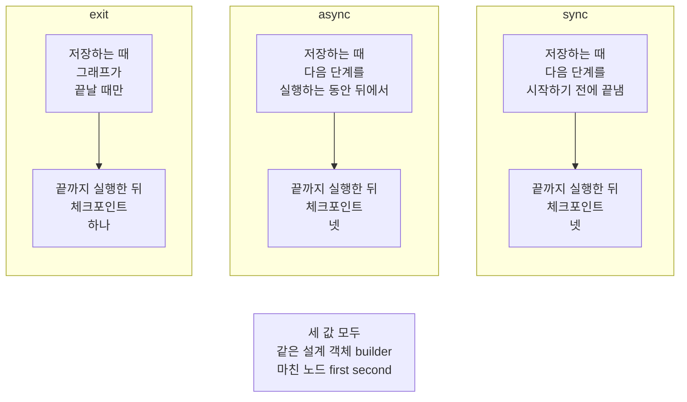
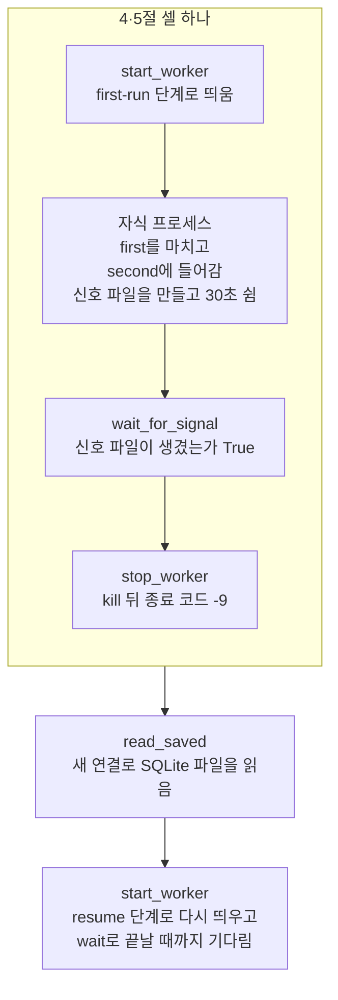
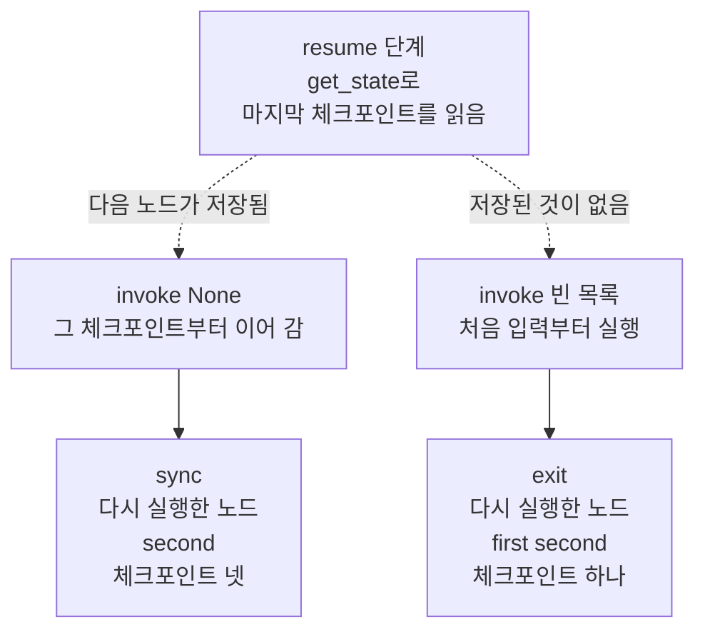
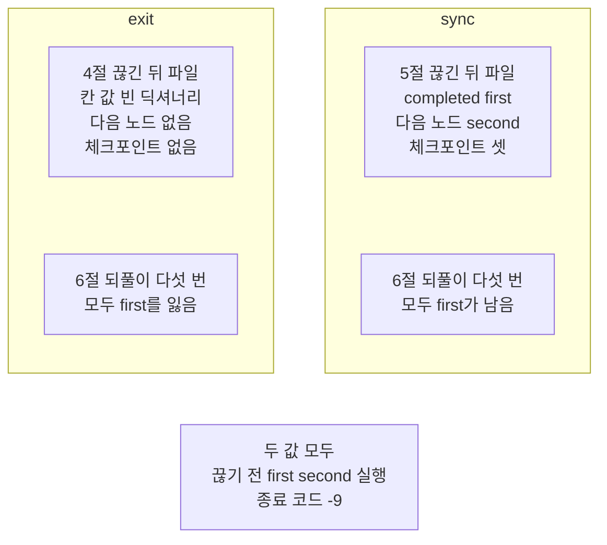

# 04-내구-실행-모드-비교

## _src 본문 (HTML 원본)

```html
<!--meta: 강의 1h | 실습 2h | 코드 notebooks/04-내구-실행-모드-비교.ipynb | 새 용어 4 -->
<style>html,body{overflow-x:hidden}.notebook,.nb-cell,.nb-main,.nb-input,.nb-result{min-width:0;max-width:100%}.nb-input pre,.nb-output{box-sizing:border-box;max-width:100%;overflow-x:auto}code.nb-source{display:block!important;width:100%!important;min-width:0!important;overflow-x:auto!important;padding:0!important}</style>
<h2 id="b1"><span class="no">1</span>학습 목표</h2><div class="goal"><ul>
<li>저장 시점 셋이 체크포인트를 언제 저장하는지, 끝까지 실행한 체크포인트 수로 견줄 수 있습니다.</li>
<li>자식 프로세스를 띄워 강제로 끝낸 뒤, SQLite 파일에 남은 체크포인트를 새 연결로 읽을 수 있습니다.</li>
<li>새 프로세스에서 다시 실행한 노드를 기록 파일로 확인해, <code>exit</code>와 <code>sync</code>의 차이를 설명할 수 있습니다.</li>
</ul></div>
<h2 id="b2"><span class="no">2</span>이 내용을 배우는 이유</h2><p>그래프가 여러 단계를 도는 동안 프로그램이 갑자기 끝날 수 있습니다. 서버가 꺼지거나, 운영체제가 프로세스(실행 중인 프로그램)를 끝내는 경우입니다. 다시 시작한 프로그램이 이미 마친 노드를 또 실행할지는, 끝나기 전에 무엇이 저장되었는지에 달려 있습니다.</p><p>이 절의 제목이 가리키는 것은 LangGraph 인자 <code>durability</code>의 값 셋입니다. 이 절은 이 값을 저장 시점이라고 부르고, 값마다 강제로 끝낸 뒤 남는 것을 출력으로 봅니다. <a href="01-체크포인터와-스레드.html">01절</a>에서 이어 실행(Durable Execution)이라고 부른 일을, 실제로 끊긴 프로그램에서 해 보는 절입니다.</p>
<h2 id="b3"><span class="no">3</span>앞에서 배운 내용</h2><p><a href="../../part1/ch02-python/08-pytest.html">Ch 2 08절</a>에서는 <code>subprocess.run</code>에 <code>sys.executable</code>로 시작하는 목록을 넘겨 새 Python을 실행하고, 종료 코드를 읽었습니다. <a href="../../part4/ch15-evaluation-advanced/05-로컬-트레이싱과-지연.html">Ch 15 05절</a>에서는 <code>time.perf_counter()</code>로 걸린 초를 셌고, <a href="../../part4/ch16-guardrails/05-재시도-폴백과-감사-로그.html">Ch 16 05절</a>에서는 <code>time.sleep</code>으로 정한 초만큼 쉬었습니다. <a href="../../part5/ch17-agent-overview/05-제품-트레이스와-자율성-진단.html">Ch 17 05절</a>에서는 후보 자리 셋을 차례로 보며 자료 폴더를 찾았습니다. <a href="../../part4/ch13-langgraph-basics/02-State-갱신.html">Ch 13 02절</a>의 이어 붙이기 규칙은 이 절의 상태 칸에 그대로 씁니다.</p><p><a href="01-체크포인터와-스레드.html">01절</a>에서는 노드 하나인 그래프가 실행 한 번에 체크포인트 셋을 남기는 것을 셌습니다. <a href="03-스레드-재개와-대화-이어가기.html">03절</a>에서는 SQLite 파일에 체크포인트를 쓰고, 연결을 닫은 뒤 새 연결과 새 그래프로 대화를 이어 갔습니다. 그때는 한 커널 안에서 객체만 새로 만들었고, 새로 시작한 프로그램에서 이어 가 보지는 않았습니다. 이 절은 그 장면을 자식 프로세스로 만듭니다.</p>
<h2 id="b4"><span class="no">4</span>핵심 개념</h2><h3>비유로 시작하기</h3><p>01절에서는 한 수를 둘 때마다 즉석사진을 찍어, 판의 모습을 남겼습니다. 이번에는 사진을 찍는 때가 다른 세 사람을 떠올립니다. 첫 사람은 사진이 다 나온 것을 본 뒤 다음 수를 둡니다. 둘째 사람은 사진이 나오는 동안 다음 수를 둡니다. 셋째 사람은 판을 다 둔 뒤에만 한 장 찍습니다.</p><p>둘째 수를 두는 중에 판이 엎어졌다고 합시다. 첫 사람 앞에는 첫 수까지 찍은 사진이 남아, 그 사진대로 말을 놓고 둘째 수부터 다시 둡니다. 셋째 사람 앞에는 사진이 없어, 첫 수부터 다시 둡니다. 둘째 사람의 마지막 사진은 판이 엎어질 때 아직 나오는 중이었을 수 있습니다. 첫 사람이 <code>sync</code>, 둘째 사람이 <code>async</code>, 셋째 사람이 <code>exit</code>입니다.</p>
{{img:04-5-엎어진-두-판과-남은-사진|흰 바탕에 나무 탁자 둘이 왼쪽과 오른쪽에 나란히 놓인 그림입니다. 두 탁자 위의 체스판은 모두 비스듬히 쓰러져 있고, 말들이 옆으로 누운 채 흩어져 있습니다. 왼쪽 탁자의 판 앞에는 작은 체스판이 찍힌 즉석사진 세 장이 한 줄로 놓여 있습니다. 오른쪽 탁자에는 사진이 한 장도 없습니다. 두 탁자 모두 판 옆에 즉석카메라가 하나씩 있는 그림|두 판 모두 도중에 엎어졌지만, 한 수마다 사진을 찍어 둔 왼쪽 판 앞에만 사진 세 장이 남았습니다.}}
<p class="look"><b>그림 읽기</b> — 왼쪽과 오른쪽 나무 탁자 위에서 체스판이 모두 쓰러지고, 말들이 옆으로 누운 채 흩어져 있습니다. 왼쪽 판 앞에만 즉석사진 세 장이 한 줄로 놓였고, 탁자마다 즉석카메라가 하나씩 있습니다. 쓰러진 판은 둘째 노드에서의 강제 종료이고, 카메라는 각 프로그램의 체크포인터입니다. 왼쪽 사진 세 장은 <code>sync</code>의 파일에 남은 체크포인트 셋이고, 사진이 없는 오른쪽은 <code>exit</code>입니다. 둘째 사람(<code>async</code>)은 결과가 끊는 때에 따라 달라 그리지 않았고, 말의 개수와 자리는 무엇과도 짝짓지 않습니다.</p>
<table><thead><tr><th>말</th><th>뜻</th></tr></thead><tbody><tr><td>저장 시점(durability)</td><td>그래프가 체크포인트 저장을 언제 끝내는지 정하는 값입니다. 사진이 다 나온 뒤 다음 수를 두느냐, 판을 다 둔 뒤에만 찍느냐와 같습니다. 이 절에서는 <code>invoke</code>의 인자 <code>durability</code>로 넘겼고, 값은 <code>exit</code>·<code>async</code>·<code>sync</code> 셋입니다.</td></tr><tr><td>자식 프로세스</td><td>실행 중인 프로그램(프로세스)이 띄운 또 하나의 프로그램입니다. 옆 탁자에 판을 하나 더 차려 두게 하고, 자기 자리에서 그 판을 지켜보는 것과 같습니다. 이 절에서는 노트북 커널이 <code>subprocess.Popen</code>으로 스크립트 <code>durability_worker.py</code>를 띄웠습니다.</td></tr><tr><td>강제 종료</td><td>프로그램이 스스로 끝나기를 기다리지 않고, 운영체제가 그 자리에서 끝내는 일입니다. 두던 판이 갑자기 엎어지는 것과 같습니다. 이 절에서는 메서드 <code>kill()</code>로 끝냈고, 종료 코드는 <code>-9</code>였습니다.</td></tr><tr><td>신호 파일</td><td>자식 프로세스가 어디까지 왔는지 알리려고 만드는 파일입니다. 옆 탁자 사람이 둘째 수를 두기 시작하면 손을 들어 알리는 것과 같습니다. 이 절에서는 둘째 노드가 이 파일을 만들면, 노트북이 그 노드에 들어왔다고 봅니다.</td></tr></tbody></table>
<p>새 말을 이 절 코드에서 보면 이렇습니다. 저장 시점은 노트북 2절 <code>step_graph.invoke({"completed": []}, run_config, durability=mode)</code>의 마지막 인자입니다. 자식 프로세스는 3절 함수 <code>start_worker</code> 안의 <code>subprocess.Popen(command)</code>입니다. 강제 종료는 함수 <code>stop_worker</code> 안의 <code>process.kill()</code>이고, 신호 파일은 함수 <code>wait_for_signal</code>이 기다리는 파일입니다.</p>
{{mermaid:04-1-저장-시점-셋과-체크포인트-수|칸 셋이 나란히 놓이고 아래에 회색 상자 하나가 있는 그림입니다. 칸 exit에는 회색 상자 저장하는 때 그래프가 끝날 때만 아래로 노란 상자 끝까지 실행한 뒤 체크포인트 하나가 있습니다. 칸 async에는 회색 상자 저장하는 때 다음 단계를 실행하는 동안 뒤에서 아래로 노란 상자 끝까지 실행한 뒤 체크포인트 넷이 있습니다. 칸 sync에는 회색 상자 저장하는 때 다음 단계를 시작하기 전에 끝냄 아래로 노란 상자 끝까지 실행한 뒤 체크포인트 넷이 있습니다. 아래 회색 상자에는 세 값 모두 같은 설계 객체 builder 마친 노드 first second가 적힌 그림|끝까지 실행하면 exit는 끝날 때 체크포인트 하나만, async와 sync는 넷을 남겼습니다.}}
<p class="look"><b>도식 읽기</b> — 칸 셋이 저장 시점 셋이고, 칸 안은 위에서 아래로 읽습니다. 회색 상자는 설치판 소스가 적은 저장하는 때이고, 노란 상자는 노트북 2절 출력입니다. 끝까지 간 실행에서는 async와 sync의 체크포인트 수가 같고, exit만 하나입니다. 맨 아래 회색 상자는 세 칸 모두에 해당하는 사실이고, 2절 출력의 세 줄에서 확인했습니다.</p>
<h3>저장 시점마다 저장하는 때</h3><p>노드 둘인 그래프는 끝까지 가면 체크포인트가 넷입니다. 입력을 받은 때, 입력을 칸에 넣은 뒤, 노드를 하나씩 마친 뒤입니다. 설치판 소스 <code>langgraph/pregel/main.py</code> 2987~2988행에서 값 <code>sync</code>는 단계마다 저장이 끝나기를 기다린 뒤 다음 단계로 갑니다. 같은 판의 <code>langgraph/pregel/_loop.py</code> 1199~1202행에서 값 <code>async</code>는 저장을 뒤에서 도는 실행 흐름에 맡기고 바로 다음 단계로 갑니다. 같은 파일 1132~1135행에서 값 <code>exit</code>는 그래프를 나가는 때에만 체크포인트를 만듭니다.</p><p>값 <code>async</code>도 실행이 끝날 때는 맡긴 저장을 모두 기다립니다. 그래서 끝까지 가면 <code>async</code>와 <code>sync</code>가 같은 넷을 남기고, 차이는 끝나기 전에 끊길 때만 생깁니다. 인자를 주지 않을 때의 값은 <code>async</code>라고 설치판 소스 <code>langgraph/pregel/main.py</code> 2602~2603행이 적습니다.</p>
<h3>다른 상황에 적용</h3><p>둘째 노드가 오래 걸리는 처리를 한다고 합시다. 끊긴 뒤 첫째 노드를 다시 실행해도 되는지가, 저장 시점을 고르는 물음이 됩니다. 공식 문서는 <code>exit</code>가 오래 도는 그래프에 가장 좋은 성능을 주지만, 도중에 프로세스가 끝나면 되살릴 수 없다고 적습니다. 값 <code>sync</code>는 모든 체크포인트를 쓴 뒤 다음으로 가는 대신, 성능에 부담이 있다고 적습니다. 걸린 시간은 이번에 재지 않았습니다.</p>
<h3>비교와 경계</h3><p>03절은 한 커널 안에서 연결과 그래프를 새로 만들어 이어 갔고, 이 절은 프로그램 자체를 새로 띄워 이어 갔습니다. 두 경우 모두 이어 가는 데 필요한 것은 파일과 스레드 이름이었습니다. <a href="05-pending-writes와-장애-복구.html">05절</a>은 강제 종료가 아니라 노드 안 오류로 멈춘 단계를 다룹니다. 설치판 소스에서 <code>exit</code>는 오류로 멈출 때도 나가면서 저장하므로, 이 절은 강제 종료로 차이를 보았습니다.</p><p>기록 파일에는 <code>sync</code>에서도 <code>second</code>가 두 번 적혔습니다. 노드가 파일에 쓰는 일은 체크포인트와 따로라, 끊긴 노드를 다시 실행하면 그 쓰기도 다시 일어납니다. 같은 쓰기를 한 번만 반영하는 방법은 <a href="06-노드-재시작과-멱등성.html">06절</a>에서 봅니다.</p>
<h2 id="b5"><span class="no">5</span>실행 예제</h2><p>노트북은 먼저 노드 둘인 그래프를 저장 시점 셋으로 끝까지 실행해, 체크포인트 수를 셉니다. 다음으로 스크립트를 자식 프로세스로 띄우는 함수와, 신호를 기다리고 강제로 끝내고 파일을 읽는 함수를 만듭니다. 4·5절은 <code>exit</code>와 <code>sync</code>로 한 번씩, 띄우기부터 끊기까지 한 셀에서 끊고 새 자식 프로세스로 다시 실행합니다. 6절은 같은 장면을 저장 시점마다 다섯 번씩 되풀이합니다.</p><p>이 절은 모델을 부르지 않아 모델 요청은 0번이고, API 키 셀도 없습니다. 자식 프로세스는 모두 19번 띄우고, 그중 17번을 강제로 끝냅니다. SQLite 파일·신호 파일·기록 파일은 노트북이 만든 빈 임시 폴더에 생깁니다.</p>
{{notebook:04-내구-실행-모드-비교}}
<p class="look"><b>확인할 점</b> — 노트북 4절에서 <code>exit</code>로 끊은 뒤 <code>체크포인트 수: 0</code>이고, 다시 실행한 노드가 <code>['first', 'second', 'first', 'second']</code>인지 봅니다. 5절에서 <code>sync</code>로 끊은 뒤 <code>다음 노드: ('second',)</code>이고, 다시 실행한 노드가 <code>['first', 'second', 'second']</code>인지 확인합니다. 6절 되풀이에서는 줄 <code>exit | 0 | 5</code>와 <code>sync | 5 | 5</code>를 봅니다.</p>
{{mermaid:04-2-둘째-노드에서-끊고-다시-실행하는-차례|위에서 아래로 상자 여섯이 한 줄로 이어진 흐름도이고, 위 네 상자는 회색 테두리 칸 4·5절 셀 하나 안에서 이어집니다. 첫 파란 상자는 start_worker first-run 단계로 띄움입니다. 둘째 파란 상자는 자식 프로세스 first를 마치고 second에 들어감 신호 파일을 만들고 30초 쉼입니다. 셋째 노란 상자는 wait_for_signal 신호 파일이 생겼는가 True, 넷째 노란 상자는 stop_worker kill 뒤 종료 코드 -9입니다. 다섯째 파란 상자는 read_saved 새 연결로 SQLite 파일을 읽음, 여섯째 파란 상자는 start_worker resume 단계로 다시 띄우고 wait로 끝날 때까지 기다림인 그림|노트북은 한 셀에서 자식 프로세스를 띄워 신호 파일을 기다린 뒤 강제로 끝내고, 파일을 읽은 다음 새 자식 프로세스로 다시 실행했습니다.}}
<p class="look"><b>도식 읽기</b> — 위에서 아래로 한 줄로 읽습니다. 파란 상자는 우리가 적은 함수와 스크립트가 하는 일이고, 노란 상자는 노트북 4·5절 출력입니다. 회색 테두리 칸 안의 네 상자는 4·5절에서 한 셀로 실행하고, 신호 파일이 생기면 바로 끊습니다. 그래서 끊는 자리는 늘 둘째 노드가 쉬는 동안입니다. 맨 아래 상자의 새 자식 프로세스는 끊긴 프로세스가 쓰던 파일을 그대로 엽니다.</p>
{{mermaid:04-3-다시-실행-단계가-고르는-두-갈래|위에서 아래로 읽는 흐름도입니다. 맨 위 파란 상자 resume 단계 get_state로 마지막 체크포인트를 읽음에서 점선 두 갈래가 나갑니다. 다음 노드가 저장됨 갈래는 파란 상자 invoke None 그 체크포인트부터 이어 감을 거쳐 노란 상자 sync 다시 실행한 노드 second 체크포인트 넷으로 갑니다. 저장된 것이 없음 갈래는 파란 상자 invoke 빈 목록 처음 입력부터 실행을 거쳐 노란 상자 exit 다시 실행한 노드 first second 체크포인트 하나로 가는 그림|다시 실행 단계는 다음 노드가 저장되어 있으면 그 체크포인트부터, 없으면 처음 입력부터 실행했습니다.}}
<p class="look"><b>도식 읽기</b> — 위에서 아래로 읽고, 점선 두 갈래는 스크립트의 다시 실행 단계가 고르는 길입니다. 파란 상자는 스크립트 코드이고, 노란 상자는 노트북 4·5절에서 다시 실행한 뒤의 출력입니다. 값 sync는 점선 「다음 노드가 저장됨」 갈래로 갔습니다. 값 exit는 저장된 것이 없어 「저장된 것이 없음」 갈래로 갔습니다. 두 갈래 모두 끝난 뒤 마친 노드는 first와 second로 같았습니다.</p>
<h2 id="b6"><span class="no">6</span>실험 결과 해석</h2><p>저장 시점 <code>exit</code>와 <code>sync</code>로 같은 장면을 만든 결과를 한 표로 옮겼습니다. 표의 값은 노트북 2·4·5·6절 출력입니다. 기본값 <code>async</code>는 끊긴 뒤의 결과가 실행마다 같다고 할 수 없어 표에서 뺐습니다.</p>
<table><thead><tr><th>저장 시점</th><th>끝까지 실행한 체크포인트 수</th><th>끊긴 뒤 칸 값</th><th>끊긴 뒤 다음 노드</th><th>끊긴 뒤 체크포인트 수</th><th>다시 실행한 뒤 기록 파일</th><th>되풀이 다섯 번 중 first가 남은 횟수</th></tr></thead><tbody><tr><td><code>exit</code></td><td>1</td><td><code>{}</code></td><td><code>()</code></td><td>0</td><td><code>['first', 'second', 'first', 'second']</code></td><td>0</td></tr><tr><td><code>sync</code></td><td>4</td><td><code>{'completed': ['first']}</code></td><td><code>('second',)</code></td><td>3</td><td><code>['first', 'second', 'second']</code></td><td>5</td></tr></tbody></table>
{{mermaid:04-4-끊긴-뒤-남은-것-exit와-sync|칸 둘이 나란히 놓이고 아래에 회색 상자 하나가 있는 그림입니다. 칸 exit에는 노란 상자 4절 끊긴 뒤 파일 칸 값 빈 딕셔너리 다음 노드 없음 체크포인트 없음과, 노란 상자 6절 되풀이 다섯 번 모두 first를 잃음이 있습니다. 칸 sync에는 노란 상자 5절 끊긴 뒤 파일 completed first 다음 노드 second 체크포인트 셋과, 노란 상자 6절 되풀이 다섯 번 모두 first가 남음이 있습니다. 아래 회색 상자에는 두 값 모두 끊기 전 first second 실행 종료 코드 -9가 적힌 그림|같은 자리에서 끊어도 exit에는 체크포인트가 없었고, sync에는 셋이 남아 둘째 노드만 다시 실행했습니다.}}
<p class="look"><b>도식 읽기</b> — 칸 둘이 저장 시점 둘이고, 칸 안의 두 상자는 화살표 없이 따로 본 값입니다. 노란 상자는 모두 출력으로 확인한 값으로, 위는 4·5절, 아래는 6절 되풀이 셀의 값입니다. 끊긴 자리와 종료 코드는 두 칸이 같고, 파일에 남은 것만 달랐습니다. 맨 아래 회색 상자는 두 칸에 모두 해당하는 사실이고, 4·5절 출력에서 각각 확인했습니다.</p>
<p>강제로 끝낸 자리는 두 값 모두 둘째 노드 안이었고, 종료 코드도 <code>-9</code>로 같았습니다. 달랐던 것은 그 순간 파일에 무엇이 있었느냐입니다. 값 <code>sync</code>는 둘째 노드를 시작하기 전에 첫째 노드까지의 체크포인트 셋을 다 써 두었습니다. 값 <code>exit</code>는 그래프가 끝날 때 쓰려던 체크포인트를 쓰지 못했습니다.</p><p>그래서 새 프로세스의 다시 실행 단계가 고른 갈래도 달랐습니다. 값 <code>sync</code>는 다음 노드 <code>second</code>부터 이어 갔고, 저장된 것이 없던 <code>exit</code>는 처음 입력으로 다시 시작했습니다. 다시 실행한 뒤 마친 노드는 둘 다 같았고, 달라진 것은 다시 실행한 노드의 수입니다.</p><p>되풀이 다섯 번에서도 두 값의 결과는 한 번도 바뀌지 않았습니다. 노트북 밖 준비 확인에서도 두 값을 스무 번씩 끊어, 모두 같은 결과를 얻었습니다. 모델을 부르지 않고 신호가 온 그 셀에서 바로 끊으므로, 이 두 값의 출력은 새 커널로 다시 실행해도 같아야 합니다. 새 커널로 두 번 실행했을 때, 이 두 값에 해당하는 출력은 모두 같았습니다. 두 실행에서 달랐던 것은 6절 되풀이 셀의 <code>async</code> 줄 하나뿐입니다.</p>
<h2 id="b7"><span class="no">7</span>주의할 점과 실무 메모</h2><ul><li>기본값 <code>async</code>는 저장을 뒤에서 하므로, 끊는 때에 따라 첫째 노드의 결과가 남기도 하고 잃기도 합니다. 이번 실행에서는 6절 되풀이 다섯 번 모두 남았고, 새 커널로 한 번 더 실행했을 때는 다섯 번 가운데 4번 남았습니다. 준비 확인에서는 60번 가운데 4번 잃었고, 40번을 더 끊었을 때는 모두 남았습니다. 공식 문서도 이 값은 프로세스가 도중에 끝나면 체크포인트를 쓰지 못할 작은 위험이 있다고 적습니다.</li><li>신호 파일은 둘째 노드에 들어왔다는 표시이고, 둘째 노드가 끝났다는 뜻이 아닙니다. 노트북이 끊은 때는 둘째 노드가 30초를 쉬는 동안입니다. 띄우기와 끊기를 한 셀에 두어, 두 셀 사이에 30초가 지나 자식 프로세스가 스스로 끝나는 일이 없게 했습니다.</li><li>끊는 셀은 실행할 때마다 함수 <code>new_prefix</code>로 새 앞머리 글을 골라, 새 파일을 씁니다. 그래서 셀을 다시 실행해도 앞 실행의 신호 파일 때문에 바로 끊기지 않습니다. 2절 셀은 다시 실행하면 같은 스레드에 이어 붙어 수가 달라집니다. 노트북 전체를 처음 값으로 보려면 1절 임시 폴더 셀부터 다시 실행합니다.</li><li>설치판 소스 <code>langgraph/pregel/_loop.py</code> 1324~1333행에서 <code>exit</code>는 노드 안 오류로 멈출 때도 나가면서 체크포인트를 씁니다. 오류로 멈추는 장면은 이 절에서 실행하지 않았고, 05절에서 봅니다.</li><li>다시 실행 단계의 <code>invoke(None, config)</code>는 새 입력 없이 마지막 체크포인트부터 이어 갑니다. 이 모양은 스크립트 안에서만 썼고, 노트북 셀에서 부르지는 않았습니다.</li><li>노트북 밖 확인에서는 강제로 끝낸 직후 SQLite 옆 파일(<code>-wal</code>·<code>-shm</code>)이 남아 있었습니다. 노트북 마지막 셀에서는 연결을 모두 닫은 뒤라 옆 파일이 없었습니다.</li><li>셀을 도중에 멈추면 자식 프로세스가 남아, 둘째 노드에서 30초를 쉰 뒤 스스로 끝납니다. 이 장면은 실행하지 않았습니다. 함수 <code>kill_at_second</code>는 기다린 결과와 상관없이 먼저 끊도록 적었습니다.</li><li>Python 설명서는 Windows에서 <code>kill()</code>이 <code>terminate()</code>와 같다고 적습니다. 설치판 Python 소스에서 Windows의 <code>terminate()</code>는 종료 코드 1로 끝내므로, Windows에서는 1이 찍힐 것입니다. 종료 코드 <code>-9</code>는 Linux에서 본 값이고, Windows·macOS에서는 실행하지 않았습니다.</li><li>걸린 시간은 재지 않았습니다. 교재 출력은 Linux의 Python 3.12.13과 SQLite 3.53.1로 만들었습니다.</li></ul>
<h2 id="b8"><span class="no">8</span>정리와 다음 절</h2><ul><li>끝까지 실행하면 <code>exit</code>는 체크포인트 하나, <code>async</code>와 <code>sync</code>는 넷을 남겼습니다.</li><li>둘째 노드에서 강제로 끝내자, <code>exit</code>는 체크포인트를 하나도 남기지 않았고 <code>sync</code>는 셋을 남겼습니다.</li><li>새 프로세스로 다시 실행하면 <code>exit</code>는 첫째 노드부터, <code>sync</code>는 둘째 노드부터 실행했습니다.</li></ul><p><strong>다음 학습과 이어지는 지점</strong> — <a href="05-pending-writes와-장애-복구.html">05절</a>에서는 같은 단계의 두 노드 가운데 하나만 실패할 때를 봅니다.</p>
<h2 id="b9"><span class="no">9</span>복습 문제</h2><details class="quiz" open><summary>문제 4개 · 해설 포함</summary><p class="quiz-q">1. 둘째 노드에서 강제로 끝낸 뒤, 저장 시점 <code>exit</code>의 파일에 체크포인트가 하나도 없었던 까닭은 무엇인가요?</p><p class="quiz-a">값 <code>exit</code>는 그래프가 끝날 때만 저장하는데, 그래프가 끝나기 전에 끊겼기 때문입니다. 틀렸다면 노트북 4절을 다시 읽습니다.</p><p class="quiz-q">2. 저장 시점 <code>sync</code>로 끊은 뒤, 새 프로세스가 <code>second</code>만 다시 실행한 까닭은 무엇인가요?</p><p class="quiz-a">첫째 노드까지의 체크포인트 셋이 파일에 남아 있었고, 다음 노드가 <code>second</code>였기 때문입니다. 스크립트의 다시 실행 단계는 그 체크포인트부터 이어 갔습니다. 틀렸다면 노트북 5절을 다시 읽습니다.</p><p class="quiz-q">3. 끝까지 실행했을 때 <code>async</code>와 <code>sync</code>의 체크포인트 수가 같았는데도, 결론에서 <code>async</code>를 뺀 까닭은 무엇인가요?</p><p class="quiz-a">끝까지 가면 맡긴 저장을 모두 기다려 넷이 됩니다. 그러나 도중에 끊기면, 뒤에서 하던 저장이 끝났는지가 끊는 때에 따라 달라질 수 있습니다. 틀렸다면 노트북 2절과 6절, 이 페이지의 주의할 점을 다시 읽습니다.</p><p class="quiz-q">4. 신호 파일이 생겼다는 것은 무엇을 뜻하나요?</p><p class="quiz-a">자식 프로세스가 둘째 노드에 들어왔다는 뜻입니다. 둘째 노드가 끝났다는 뜻은 아닙니다. 틀렸다면 노트북 3절과 4절을 다시 읽습니다.</p></details>
<h2 id="b10"><span class="no">10</span>참고 자료</h2><ul><li><div><a href="https://docs.langchain.com/oss/python/langgraph/checkpointers">LangGraph Checkpointers</a></div>확인 2026-09-25 · 「Durability modes」에서 세 값을 저장이 적은 것부터 적습니다. 값 <code>async</code>의 작은 위험과 <code>sync</code>의 성능 부담도 적습니다.</li><li><div><a href="https://docs.python.org/3.12/library/subprocess.html">Python 3.12 subprocess</a></div>확인 2026-09-25 · <code>Popen</code>·<code>kill()</code>·<code>wait()</code>과 음수 종료 코드의 뜻을 적습니다.</li><li>langgraph 1.2.11 소스 <code>langgraph/types.py</code> 89~95행 — 저장 시점 세 값의 설명입니다.</li><li>같은 판 <code>langgraph/pregel/main.py</code> 2602~2603행은 기본값 <code>async</code>이고, 2987~2988행은 <code>sync</code>가 저장을 기다리는 자리입니다.</li><li>같은 판 <code>langgraph/pregel/_loop.py</code> 1132~1135행은 체크포인트를 만드는 때이고, 1199~1202행은 저장을 뒤에 맡기는 자리입니다.</li><li>같은 파일 1324~1333행은 <code>exit</code>가 그래프를 나갈 때 저장하는 자리입니다.</li><li>같은 판 <code>langgraph/pregel/_executor.py</code> 105~107행 — 실행이 끝날 때 맡긴 일을 모두 기다리는 자리입니다.</li><li>Ch 2 08절에서 <code>subprocess.run</code>을, 01·03절에서 체크포인트 목록과 SQLite 체크포인터를 보았습니다.</li></ul>
```

## 노트북 셀 (순서대로)

### [0] markdown {'html': 'skip'}

# 내구 실행 모드 비교

**이 노트북에서 할 일**

1. 노드 둘인 그래프를 저장 시점 셋으로 끝까지 실행해, 남은 체크포인트 수를 견줍니다.
2. 같은 그래프를 자식 프로세스로 띄우고 둘째 노드에서 강제로 끝낸 뒤, 파일에 남은 것을 읽습니다.
3. 새 프로세스로 같은 스레드를 다시 실행해, 어느 노드부터 다시 실행되는지 기록 파일로 봅니다.

**준비물** — 이 노트북은 모델을 부르지 않습니다.
모델 요청은 0번이고, API 키 없이 실행합니다.
01절처럼 매번 같은 값을 내는 우리 노드로, 저장된 값이 맞는지 출력으로 가릅니다.

실습 폴더 맨 위의 스크립트 `durability_worker.py`를 자식 프로세스로 실행합니다.
자식 프로세스는 모두 19번 띄우고, 그중 17번을 강제로 끝냅니다.
6절의 되풀이 장면은 저장 시점마다 다섯 번입니다.

노트북은 빈 임시 폴더를 만들어 그 폴더에서 실행합니다.
SQLite 파일·신호 파일·기록 파일은 모두 이 임시 폴더에 생기고, 실습 폴더에는 파일을 남기지 않습니다.
읽어 오는 자료 파일은 없습니다.
교재 출력을 만든 실행에서는 노트북 전체가 30초 안에 끝났습니다.
설치 셀에 걸리는 시간은 네트워크에 따라 달라집니다.

**기준 버전** — 첫 셀에서 패키지 둘을 설치합니다.
그래프는 langgraph 1.2.11입니다.
SQLite 체크포인터는 langgraph-checkpoint-sqlite 3.0.3에 들어 있습니다.

교재 출력은 Linux의 Python 3.12.13과, 그 Python에 들어 있는 SQLite 3.53.1로 만들었습니다.
프로세스를 강제로 끝내는 방식과 종료 코드는 운영체제마다 다릅니다.
Windows·macOS에서는 실행하지 않았습니다.

**강의와 실습 범위** — 강의 시간에는 2~5절을 읽습니다.
저장 시점 셋을 견주고, `exit`와 `sync`로 실행하다 끊는 자리입니다.
6절은 같은 장면을 저장 시점마다 다섯 번씩 되풀이하는 자리이고, 실습 시간에 실행합니다.
4~6절의 끊는 셀은 실행할 때마다 새 파일을 써서, 다시 실행해도 같은 결과가 나옵니다.
노트북 전체를 처음 값으로 다시 보려면 1절 임시 폴더 셀부터 다시 실행합니다.

실습 폴더 `labs/part6/ch23-persistence`에서 `uv sync --locked`를 실행합니다.
그다음 `notebooks/` 폴더의 이 노트북을 열고, 실습 폴더의 `.venv` 커널을 고릅니다.
첫 셀부터 순서대로 실행합니다.

### [1] markdown {'html': 'skip'}

## 오늘 볼 그림


위에서 아래로 한 줄로 읽습니다.
파란 상자는 우리가 적은 함수와 스크립트가 하는 일이고, 노란 상자는 노트북 4·5절 출력입니다.
회색 테두리 칸 안의 네 상자는 4·5절에서 한 셀로 실행하고, 신호 파일이 생기면 바로 끊습니다.
그래서 끊는 자리는 늘 둘째 노드가 쉬는 동안입니다.
맨 아래 상자의 새 자식 프로세스는 끊긴 프로세스가 쓰던 파일을 그대로 엽니다.

### [2] markdown {}

## 1. 준비

01절에서 체크포인터를 붙이면 단계를 하나 마칠 때마다 상태가 저장된다고 배웠습니다.
03절에서는 체크포인트를 SQLite 파일에 쓰고, 연결을 새로 열어 대화를 이어 갔습니다.
이 절은 그 저장을 언제 끝내는지 고르는 인자 `durability`를 봅니다.
그리고 프로그램을 도중에 강제로 끝낸 뒤, 파일에 무엇이 남는지 확인합니다.

첫 셀은 패키지 둘을 설치하고 설치된 판 번호를 출력합니다.
설치에는 몇십 초가 걸릴 수 있습니다.

### [3] code {'execution': {'iopub.execute_input': '2026-09-25T12:35:50.591203Z', 'iopub.status.busy': '2026-09-25T12:35:50.591019Z', 'iopub.status.idle': '2026-09-25T12:35:51.030123Z', 'shell.execute_reply': '2026-09-25T12:35:51.029579Z'}, 'lesson_role': 'setup'}

```python
# 이 절에서 쓰는 패키지를 설치하고 버전을 확인합니다
%pip install -q "langgraph==1.2.11" "langgraph-checkpoint-sqlite==3.0.3"
from importlib.metadata import version

print("langgraph:", version("langgraph"))
print("langgraph-checkpoint-sqlite:", version("langgraph-checkpoint-sqlite"))
```

출력:
```
Note: you may need to restart the kernel to use updated packages.
langgraph: 1.2.11
langgraph-checkpoint-sqlite: 3.0.3

```

### [4] markdown {}

**결과 읽기** — 출력 줄 `langgraph: 1.2.11`과 `langgraph-checkpoint-sqlite: 3.0.3`이 보입니다.
두 판 모두 실습 폴더 잠금과 같은 판입니다.
이 노트북의 출력은 2026-09-25에 이 판으로 실행한 결과입니다.

다음 셀은 이 절에서 쓸 이름을 가져옵니다.
상태 형식과 그래프 이름은 Ch 13 01·02절, `sqlite3`와 `SqliteSaver`는 03절과 같습니다.
모듈 `subprocess`와 `sys`는 Ch 2 08절에서 pytest를 새 Python으로 실행할 때 썼습니다.
모듈 `time`은 Ch 15 05절과 Ch 16 05절에서, 모듈 `os`는 01절 임시 폴더 셀에서 썼습니다.

### [5] code {'execution': {'iopub.execute_input': '2026-09-25T12:35:51.031196Z', 'iopub.status.busy': '2026-09-25T12:35:51.031113Z', 'iopub.status.idle': '2026-09-25T12:35:51.543944Z', 'shell.execute_reply': '2026-09-25T12:35:51.543554Z'}, 'lesson_role': 'setup'}

```python
# 그래프 이름(Ch 13 01·02절)과 SQLite 체크포인터(03절)에, 자식 프로세스를 다룰 모듈을 더해 가져옵니다
import operator
import os
import sqlite3
import subprocess
import sys
import time
from typing import Annotated
from typing_extensions import TypedDict
from langgraph.graph import StateGraph, START, END
from langgraph.checkpoint.sqlite import SqliteSaver

print("이 챕터에서 처음 가져온 모듈:", "subprocess, sys, time")
print("SQLite 판:", sqlite3.sqlite_version)
```

출력:
```
이 챕터에서 처음 가져온 모듈: subprocess, sys, time
SQLite 판: 3.53.1

```

### [6] markdown {}

**결과 읽기** — 출력 줄 `SQLite 판: 3.53.1`은 03절과 같은 판입니다.
세 모듈은 과정에서 쓴 적이 있지만, 이 챕터에서는 처음 가져옵니다.

다음 셀은 실습 폴더 맨 위의 스크립트 `durability_worker.py` 자리를 찾습니다.
Ch 17 05절에서 자료 폴더를 찾은 셀과 같은 모양으로, 후보 자리 셋을 차례로 봅니다.
함수 `os.path.abspath`는 지금 작업 폴더 기준의 자리를, 컴퓨터 맨 위부터 적은 자리 글로 바꿉니다.
다음 셀에서 임시 폴더로 옮긴 뒤에도 이 파일을 찾으려고 씁니다.

### [7] code {'execution': {'iopub.execute_input': '2026-09-25T12:35:51.544652Z', 'iopub.status.busy': '2026-09-25T12:35:51.544595Z', 'iopub.status.idle': '2026-09-25T12:35:51.546985Z', 'shell.execute_reply': '2026-09-25T12:35:51.546571Z'}, 'lesson_role': 'setup'}

```python
# 실습 폴더 맨 위의 스크립트 durability_worker.py 자리를 찾습니다(임시 폴더로 옮기기 전에 합니다)
candidates = [".", "../../..", "../../../.."]
root_path = None
for candidate in candidates:
    if os.path.exists(candidate + "/labs/part6/ch23-persistence/durability_worker.py"):
        root_path = candidate
        break
print("찾은 프로젝트 맨 위:", root_path)
assert root_path is not None, "notebooks 폴더나 실습 폴더 맨 위에서 노트북을 열어 주세요."
# abspath()는 지금 작업 폴더 기준의 자리를, 컴퓨터 맨 위부터 적은 자리 글로 바꿉니다(자리 글은 출력하지 않음)
worker_path = os.path.abspath(root_path + "/labs/part6/ch23-persistence/durability_worker.py")
print("worker 파일이 있는가:", os.path.exists(worker_path))
```

출력:
```
찾은 프로젝트 맨 위: .
worker 파일이 있는가: True

```

### [8] markdown {}

**결과 읽기** — 출력 줄 `찾은 프로젝트 맨 위: .`은 교재 출력을 프로젝트 맨 위에서 실행했다는 뜻입니다.
노트북을 `notebooks/` 폴더에서 열면 이 줄에 `../../../..`가 찍힙니다.
출력 줄 `worker 파일이 있는가: True`로, 스크립트 자리를 변수 `worker_path`에 담았습니다.
자리 글은 컴퓨터마다 달라 출력하지 않았습니다.

다음 셀은 01절처럼 빈 임시 폴더를 만들고, 그 폴더로 작업 위치를 옮깁니다.
이 절의 SQLite 파일·신호 파일·기록 파일은 모두 이 임시 폴더에 생깁니다.
자식 프로세스도 이 폴더를 작업 폴더로 물려받아, 같은 폴더에 파일을 씁니다.

### [9] code {'execution': {'iopub.execute_input': '2026-09-25T12:35:51.547649Z', 'iopub.status.busy': '2026-09-25T12:35:51.547595Z', 'iopub.status.idle': '2026-09-25T12:35:51.549785Z', 'shell.execute_reply': '2026-09-25T12:35:51.549411Z'}, 'lesson_role': 'setup'}

```python
# 파일이 생기는지 볼 빈 임시 폴더를 만들고, 그 폴더로 작업 위치를 옮깁니다(Ch 4 03절과 같은 모양)
import os
import tempfile

# mkdtemp()는 운영체제 임시 폴더 안에 새 폴더를 만들고, 그 폴더의 위치를 글로 내놓습니다
practice_folder = tempfile.mkdtemp(prefix="ch23-04-")
# chdir()는 터미널의 cd처럼 현재 작업 폴더를 옮깁니다
os.chdir(practice_folder)
print("임시 폴더 이름에 ch23-04-이 들어 있는가:", "ch23-04-" in practice_folder)
print("현재 작업 폴더의 파일:", os.listdir())
```

출력:
```
임시 폴더 이름에 ch23-04-이 들어 있는가: True
현재 작업 폴더의 파일: []

```

### [10] markdown {}

**결과 읽기** — 출력 줄 `임시 폴더 이름에 ch23-04-이 들어 있는가: True`로, 이 절의 폴더를 만들었습니다.
출력 줄 `현재 작업 폴더의 파일: []`로, 빈 폴더에서 시작합니다.

## 2. 저장 시점 셋

01절의 그래프는 노드가 하나였습니다.
이 절의 그래프는 노드 `first`와 `second`를 차례로 잇습니다.
둘째 노드에서 끊었을 때 첫째 노드의 결과가 남는지 보려면, 노드가 둘 있어야 합니다.
다음 셀은 상태 형식이고, 칸 `completed` 하나에 Ch 13 02절의 이어 붙이기 규칙을 적습니다.

### [11] code {'execution': {'iopub.execute_input': '2026-09-25T12:35:51.550342Z', 'iopub.status.busy': '2026-09-25T12:35:51.550289Z', 'iopub.status.idle': '2026-09-25T12:35:51.551975Z', 'shell.execute_reply': '2026-09-25T12:35:51.551616Z'}}

```python
# 노드가 마친 이름을 이어 붙이는 칸 하나를 둔 상태 형식을 만듭니다(Ch 13 02절 이어 붙이기 규칙)
class StepState(TypedDict):
    completed: Annotated[list[str], operator.add]
```

출력:
```

```

### [12] markdown {}

**결과 읽기** — 정의 셀이라 출력이 없습니다.
노드가 마친 이름을 목록에 담아 내면, 규칙대로 칸의 목록 뒤에 붙습니다.

다음 셀은 첫째 노드입니다.
마친 이름 `first` 하나를 목록에 담아 냅니다.

### [13] code {'execution': {'iopub.execute_input': '2026-09-25T12:35:51.552524Z', 'iopub.status.busy': '2026-09-25T12:35:51.552474Z', 'iopub.status.idle': '2026-09-25T12:35:51.553818Z', 'shell.execute_reply': '2026-09-25T12:35:51.553503Z'}}

```python
# 첫째 노드: 마친 이름 first 하나를 목록에 담아 냅니다
def first(state):
    return {"completed": ["first"]}
```

출력:
```

```

### [14] markdown {}

**결과 읽기** — 정의 셀이라 출력이 없습니다.

다음 셀은 둘째 노드이고, 마친 이름 `second`를 냅니다.
두 노드 모두 받은 상태와 상관없이 늘 같은 값을 냅니다.

### [15] code {'execution': {'iopub.execute_input': '2026-09-25T12:35:51.554280Z', 'iopub.status.busy': '2026-09-25T12:35:51.554238Z', 'iopub.status.idle': '2026-09-25T12:35:51.555911Z', 'shell.execute_reply': '2026-09-25T12:35:51.555617Z'}}

```python
# 둘째 노드: 마친 이름 second 하나를 목록에 담아 냅니다
def second(state):
    return {"completed": ["second"]}
```

출력:
```

```

### [16] markdown {}

**결과 읽기** — 정의 셀이라 출력이 없습니다.

다음 셀은 두 노드를 차례로 잇는 설계 객체를 만듭니다.
엣지는 가상 시작점에서 첫째 노드로, 첫째 노드에서 둘째 노드로, 둘째 노드에서 가상 끝점으로 셋입니다.

### [17] code {'execution': {'iopub.execute_input': '2026-09-25T12:35:51.556506Z', 'iopub.status.busy': '2026-09-25T12:35:51.556466Z', 'iopub.status.idle': '2026-09-25T12:35:51.558599Z', 'shell.execute_reply': '2026-09-25T12:35:51.558251Z'}}

```python
# 노드 둘을 START → first → second → END로 잇는 설계 객체를 만듭니다
builder = StateGraph(StepState)
builder.add_node("first", first)
builder.add_node("second", second)
builder.add_edge(START, "first")
builder.add_edge("first", "second")
builder.add_edge("second", END)
print("등록한 노드:", list(builder.nodes))
```

출력:
```
등록한 노드: ['first', 'second']

```

### [18] markdown {}

**결과 읽기** — 출력 줄 `등록한 노드: ['first', 'second']`입니다.
설계 객체 `builder`는 이 절 끝까지 그대로 씁니다.

다음 셀은 03절처럼 SQLite 파일에 연결을 열고, 체크포인터를 붙여 컴파일합니다.
파일 이름은 `steps.sqlite`입니다.

### [19] code {'execution': {'iopub.execute_input': '2026-09-25T12:35:51.559190Z', 'iopub.status.busy': '2026-09-25T12:35:51.559150Z', 'iopub.status.idle': '2026-09-25T12:35:51.561446Z', 'shell.execute_reply': '2026-09-25T12:35:51.561053Z'}}

```python
# 파일 steps.sqlite에 연결을 열고, SQLite 체크포인터를 붙여 설계 객체를 컴파일합니다(03절 모양)
step_conn = sqlite3.connect("steps.sqlite", check_same_thread=False)
step_saver = SqliteSaver(step_conn)
step_graph = builder.compile(checkpointer=step_saver)
print("붙은 체크포인터의 종류:", type(step_graph.checkpointer).__name__)
```

출력:
```
붙은 체크포인터의 종류: SqliteSaver

```

### [20] markdown {}

**결과 읽기** — 출력 줄 `붙은 체크포인터의 종류: SqliteSaver`입니다.

이제 저장 시점을 봅니다.
저장 시점(durability)은 그래프가 체크포인트 저장을 언제 끝내는지 정하는 값입니다.
메서드 `invoke`에 인자 `durability`로 넘기고, 값은 `"exit"`·`"async"`·`"sync"` 셋 가운데 하나입니다.
설치판 소스는 `sync`를 다음 단계를 시작하기 전에 저장을 끝내는 값이라고 적습니다.
값 `async`는 다음 단계를 실행하는 동안 뒤에서 저장하고, 값 `exit`는 그래프가 끝날 때만 저장합니다.

01절의 비유로는 한 수를 둘 때마다 즉석사진을 찍는 일입니다.
값 `sync`는 사진이 다 나온 것을 보고 다음 수를 두고, 값 `async`는 사진이 나오는 동안 다음 수를 둡니다.
값 `exit`는 판을 다 둔 뒤에만 한 장 찍습니다.
인자를 주지 않으면 값은 `async`라고 설치판 소스가 적고, 01~03절의 실행도 이 값이었습니다.

다음 셀은 저장 시점만 바꿔 세 번 끝까지 실행합니다.
스레드 이름은 저장 시점 이름을 그대로 쓰고, 실행 뒤에는 01절처럼 체크포인트 목록을 받아 수를 셉니다.
실행 전에 예상해 봅니다.
저장 시점과 상관없이 두 노드는 모두 실행될 것입니다.

### [21] code {'execution': {'iopub.execute_input': '2026-09-25T12:35:51.562032Z', 'iopub.status.busy': '2026-09-25T12:35:51.561984Z', 'iopub.status.idle': '2026-09-25T12:35:51.589100Z', 'shell.execute_reply': '2026-09-25T12:35:51.588815Z'}}

```python
# 저장 시점만 바꿔 세 번 끝까지 실행하고, 스레드마다 남은 체크포인트 수를 셉니다(스레드 이름 = 저장 시점 이름)
print("저장 시점 | 마친 노드 | 체크포인트 수")
for mode in ["exit", "async", "sync"]:
    run_config = {"configurable": {"thread_id": mode}}
    result = step_graph.invoke({"completed": []}, run_config, durability=mode)
    history = list(step_graph.get_state_history(run_config))
    print(mode, "|", result["completed"], "|", len(history))
```

출력:
```
저장 시점 | 마친 노드 | 체크포인트 수
exit | ['first', 'second'] | 1
async | ['first', 'second'] | 4
sync | ['first', 'second'] | 4

```

### [22] markdown {}

**결과 읽기** — 라벨 줄 아래 세 줄입니다.
세 줄 모두 마친 노드가 `['first', 'second']`로, 두 노드가 끝까지 실행되었습니다.
줄 `exit | ['first', 'second'] | 1`은 체크포인트가 하나뿐입니다.
줄 `async | ['first', 'second'] | 4`와 `sync | ['first', 'second'] | 4`는 넷입니다.

노드 둘인 그래프의 체크포인트는 입력을 받은 때·입력을 칸에 넣은 뒤·노드마다 마친 뒤로 넷입니다.
값 `exit`는 그 가운데 그래프가 끝날 때의 하나만 저장했습니다.
끝까지 간 실행에서는 `async`와 `sync`의 수가 같고, 두 값의 차이는 끝나기 전에 끊길 때 드러납니다.
3절부터 그 장면을 만듭니다.

## 3. 자식 프로세스와 강제 종료

끝나기 전에 끊는 장면을 만들려면, 그래프를 노트북 커널이 아닌 다른 프로그램에서 실행해야 합니다.
커널을 끊으면 노트북도 함께 멈추기 때문입니다.
프로세스는 실행 중인 프로그램이고, 자식 프로세스는 프로세스가 띄운 또 하나의 프로그램입니다.
옆 탁자에 판을 하나 더 차려 두게 하고, 자기 자리에서 그 판을 지켜보는 것과 같습니다.
이 절에서는 노트북 커널이 스크립트 `durability_worker.py`를 새 Python으로 띄웁니다.

스크립트는 실습 폴더 맨 위에 있고, 파일을 열면 코드를 볼 수 있습니다.
상태 형식과 노드 이름, 엣지는 2절 그래프와 같습니다.
다른 점은 두 노드가 기록 파일에 자기 이름을 한 줄씩 적는다는 것입니다.
둘째 노드는 신호 파일도 만든 뒤, 첫 실행 단계에서 30초를 쉽니다.

신호 파일은 자식 프로세스가 어디까지 왔는지 알리려고 만드는 파일입니다.
옆 탁자 사람이 둘째 수를 두기 시작하면 손을 들어 알리는 것과 같습니다.
노트북은 이 파일이 생기면, 자식 프로세스가 둘째 노드에 들어왔다고 봅니다.

스크립트는 명령줄에서 글 다섯을 받습니다.
SQLite 파일 이름, 신호 파일 이름, 기록 파일 이름, 저장 시점, 단계(`first-run` 또는 `resume`)입니다.
다음 셀은 이 글을 넘겨 스크립트를 자식 프로세스로 띄우는 함수입니다.
Ch 2 08절의 `subprocess.run`은 새 Python이 끝날 때까지 기다렸습니다.
이 셀의 `subprocess.Popen`은 기다리지 않고 띄운 뒤, 바로 프로세스 객체를 내놓습니다.

### [23] code {'execution': {'iopub.execute_input': '2026-09-25T12:35:51.589612Z', 'iopub.status.busy': '2026-09-25T12:35:51.589563Z', 'iopub.status.idle': '2026-09-25T12:35:51.591328Z', 'shell.execute_reply': '2026-09-25T12:35:51.591020Z'}}

```python
# 스크립트를 자식 프로세스로 띄우고, 끝나기를 기다리지 않고 그 프로세스 객체를 내놓습니다
def start_worker(worker_path, files, mode, phase):
    # 명령 목록: 지금 커널의 Python · 스크립트 자리 · 스크립트가 받을 글 다섯
    command = [sys.executable, worker_path, files["sqlite"], files["signal"], files["record"], mode, phase]
    process = subprocess.Popen(command)
    return process
```

출력:
```

```

### [24] markdown {}

**결과 읽기** — 정의 셀이라 출력이 없습니다.
인자 `files`는 파일 이름 셋을 담은 딕셔너리이고, 4절에서 만듭니다.
명령 목록의 차례는 스크립트가 받는 글 다섯의 차례와 같습니다.
띄운 뒤 바로 돌아오므로, 자식이 30초 쉬는 동안에도 노트북은 다음 셀을 실행할 수 있습니다.

다음 셀은 신호 파일이 생길 때까지 기다리는 함수입니다.
함수 `time.perf_counter()`는 Ch 15 05절에서 걸린 초를 셀 때 썼고, 여기서는 기다림을 멈출 기한을 정합니다.
확인 사이에는 Ch 16 05절의 `time.sleep`으로 0.05초씩 쉽니다.
파일이 생기면 `True`를, 기한이 지나도 없으면 `False`를 냅니다.

### [25] code {'execution': {'iopub.execute_input': '2026-09-25T12:35:51.591804Z', 'iopub.status.busy': '2026-09-25T12:35:51.591756Z', 'iopub.status.idle': '2026-09-25T12:35:51.593584Z', 'shell.execute_reply': '2026-09-25T12:35:51.593282Z'}}

```python
# 신호 파일이 생길 때까지 짧게 쉬며 보고, 기한 안에 생겼는지를 True·False로 내놓습니다
def wait_for_signal(signal_name, limit_seconds):
    check_interval = 0.05
    deadline = time.perf_counter() + limit_seconds
    while time.perf_counter() < deadline:
        if os.path.exists(signal_name):
            return True
        time.sleep(check_interval)
    return False
```

출력:
```

```

### [26] markdown {}

**결과 읽기** — 정의 셀이라 출력이 없습니다.
함수 `os.path.exists`는 그 이름의 파일이 작업 폴더에 있는지 봅니다.

다음 셀은 자식 프로세스를 강제로 끝내는 함수입니다.
강제 종료는 프로그램이 스스로 끝나기를 기다리지 않고, 운영체제가 그 자리에서 끝내는 일입니다.
두던 판이 갑자기 엎어지는 것과 같습니다.
이 함수에서는 메서드 `kill()`이 강제로 끝냅니다.
메서드 `wait(timeout=5)`는 프로세스가 끝나기를 5초까지 기다리고, Ch 2 08절에서 본 종료 코드를 내놓습니다.

### [27] code {'execution': {'iopub.execute_input': '2026-09-25T12:35:51.594057Z', 'iopub.status.busy': '2026-09-25T12:35:51.594013Z', 'iopub.status.idle': '2026-09-25T12:35:51.595698Z', 'shell.execute_reply': '2026-09-25T12:35:51.595406Z'}}

```python
# 자식 프로세스를 강제로 끝내고, 끝날 때까지 기다려 종료 코드를 내놓습니다
def stop_worker(process):
    process.kill()
    # 5초 안에 끝나지 않으면 오류가 납니다
    return_code = process.wait(timeout=5)
    return return_code
```

출력:
```

```

### [28] markdown {}

**결과 읽기** — 정의 셀이라 출력이 없습니다.
Python 설명서는 Linux 같은 운영체제에서 `kill()`이 신호 9를 보낸다고 적습니다.
신호로 끝난 프로세스의 종료 코드는 그 번호에 음수 부호를 붙인 값이라고도 적습니다.

다음 셀은 끊긴 뒤 SQLite 파일을 읽는 함수입니다.
03절처럼 새 연결을 열어 체크포인터와 그래프를 새로 만들고, 스레드의 마지막 체크포인트와 목록을 읽습니다.
스크립트의 그래프와 노드 이름·칸이 같아서, 2절 설계 객체로도 다음 노드를 읽을 수 있습니다.
설계 객체는 인자로 받고, 읽은 뒤에는 연결을 닫습니다.

### [29] code {'execution': {'iopub.execute_input': '2026-09-25T12:35:51.596111Z', 'iopub.status.busy': '2026-09-25T12:35:51.596069Z', 'iopub.status.idle': '2026-09-25T12:35:51.597886Z', 'shell.execute_reply': '2026-09-25T12:35:51.597603Z'}}

```python
# 새 연결로 SQLite 파일을 열어 한 스레드의 칸 값·다음 노드·체크포인트 수를 읽고, 연결을 닫습니다
def read_saved(graph_builder, sqlite_name, thread_name):
    connection = sqlite3.connect(sqlite_name, check_same_thread=False)
    saver = SqliteSaver(connection)
    reader = graph_builder.compile(checkpointer=saver)
    config = {"configurable": {"thread_id": thread_name}}
    saved = reader.get_state(config)
    history = list(reader.get_state_history(config))
    connection.close()
    return {"칸 값": saved.values, "다음 노드": saved.next, "체크포인트 수": len(history)}
```

출력:
```

```

### [30] markdown {}

**결과 읽기** — 정의 셀이라 출력이 없습니다.
함수는 칸 값·다음 노드·체크포인트 수를 한국어 키 딕셔너리 하나에 담아 냅니다.

다음 셀은 기록 파일을 읽어 노드 이름 목록으로 내놓는 함수입니다.
Ch 2 05절처럼 `with open`으로 읽고, 메서드 `split()`으로 줄바꿈마다 나눕니다.

### [31] code {'execution': {'iopub.execute_input': '2026-09-25T12:35:51.598403Z', 'iopub.status.busy': '2026-09-25T12:35:51.598356Z', 'iopub.status.idle': '2026-09-25T12:35:51.599912Z', 'shell.execute_reply': '2026-09-25T12:35:51.599601Z'}}

```python
# 기록 파일을 읽어, 줄마다 적힌 노드 이름을 목록으로 내놓습니다
def read_record(record_name):
    with open(record_name, encoding="utf-8") as record_file:
        text = record_file.read()
    return text.split()
```

출력:
```

```

### [32] markdown {}

**결과 읽기** — 정의 셀이라 출력이 없습니다.
기록 파일은 스크립트의 노드가 이어 쓰는 파일이라, 두 프로세스가 쓴 이름이 한 파일에 쌓입니다.

다음 셀은 파일 이름의 앞머리 글을 고르는 함수입니다.
이름 뒤에 번호를 붙이고, 작업 폴더에 그 앞머리의 SQLite 파일이 이미 있으면 번호를 하나씩 올립니다.
끊는 셀을 다시 실행해도 앞 실행이 남긴 신호 파일을 보지 않게, 셀마다 이 함수로 새 앞머리를 고릅니다.
반복문 `while`은 함수 `wait_for_signal`에서 쓴 모양과 같습니다.

### [33] code {'execution': {'iopub.execute_input': '2026-09-25T12:35:51.600378Z', 'iopub.status.busy': '2026-09-25T12:35:51.600334Z', 'iopub.status.idle': '2026-09-25T12:35:51.601933Z', 'shell.execute_reply': '2026-09-25T12:35:51.601569Z'}}

```python
# 작업 폴더에서 아직 쓰지 않은 앞머리 글(이름 뒤에 번호)을 골라 내놓습니다
def new_prefix(name):
    number = 1
    # 같은 앞머리의 SQLite 파일이 이미 있으면, 번호를 하나 올려 다시 봅니다
    while os.path.exists(name + "-" + str(number) + ".sqlite"):
        number = number + 1
    return name + "-" + str(number)
```

출력:
```

```

### [34] markdown {}

**결과 읽기** — 정의 셀이라 출력이 없습니다.
빈 작업 폴더에서 처음 부르면 이름 뒤에 번호 1을 붙여 내놓습니다.
같은 이름으로 다시 부르면, 앞에서 쓴 번호 다음 번호를 내놓습니다.

## 4. exit로 실행하다 끊기

먼저 저장 시점 `exit`로 스크립트를 띄우고, 둘째 노드에 들어오면 강제로 끝냅니다.
파일 이름 셋은 함수 `new_prefix`가 고른 앞머리 글 뒤에 끝말을 붙여 정합니다.
신호 파일을 기다리는 기한은 20초이고, 둘째 노드가 30초를 쉬므로 그 안에 신호가 올 것입니다.

띄우기·기다리기·끊기는 한 셀에서 합니다.
셀을 나누면 두 셀 사이에 30초가 지나, 자식 프로세스가 끊기기 전에 스스로 끝날 수 있기 때문입니다.
셀 끝의 `assert` 두 줄은 신호가 왔는지와, 종료 코드가 0이 아닌지를 확인합니다.
실행 전에 예상해 봅니다.
기록 파일에는 두 노드 이름이 적혀 있을 것입니다.

### [35] code {'execution': {'iopub.execute_input': '2026-09-25T12:35:51.602503Z', 'iopub.status.busy': '2026-09-25T12:35:51.602460Z', 'iopub.status.idle': '2026-09-25T12:35:52.111873Z', 'shell.execute_reply': '2026-09-25T12:35:52.111359Z'}}

```python
# 저장 시점 exit로 스크립트를 띄우고, 둘째 노드에 들어왔다는 신호가 오면 같은 셀에서 바로 강제로 끝냅니다
# 셀을 다시 실행해도 앞 실행의 파일과 섞이지 않게, 실행할 때마다 새 앞머리 글을 고릅니다
exit_prefix = new_prefix("exit")
exit_files = {"sqlite": exit_prefix + ".sqlite", "signal": exit_prefix + ".signal", "record": exit_prefix + ".record"}
exit_process = start_worker(worker_path, exit_files, "exit", "first-run")
signal_limit = 20
exit_arrived = wait_for_signal(exit_files["signal"], signal_limit)
exit_code = stop_worker(exit_process)
print("신호 파일이 생겼는가:", exit_arrived)
print("종료 코드:", exit_code)
print("끊기 전에 실행된 노드:", read_record(exit_files["record"]))
# 신호가 온 뒤 끊었는지, 스스로 끝나지 않고 강제로 끝났는지(종료 코드가 0이 아님) 확인합니다
assert exit_arrived, "기한 안에 신호 파일이 생기지 않았습니다"
assert exit_code != 0, "자식 프로세스가 강제로 끝나기 전에 스스로 끝났습니다"
```

출력:
```
신호 파일이 생겼는가: True
종료 코드: -9
끊기 전에 실행된 노드: ['first', 'second']

```

### [36] markdown {}

**결과 읽기** — 출력 줄 `신호 파일이 생겼는가: True`로, 자식 프로세스가 둘째 노드에 들어온 뒤 끊었습니다.
출력 줄 `종료 코드: -9`는 신호 9로 끝났다는 뜻이고, 스스로 끝난 프로그램의 종료 코드 0과 다릅니다.
출력 줄 `끊기 전에 실행된 노드: ['first', 'second']`로, 두 노드 모두 실행되었습니다.
그러나 그래프는 끝나지 못했습니다.

설치판 Python 소스에서 Windows의 `kill()`은 종료 코드 1로 프로세스를 끝냅니다.
그래서 Windows에서는 이 줄에 1이 찍힐 것이고, 이 경우는 실행하지 않았습니다.
셀 끝의 `assert`는 0이 아닌지만 보므로, 두 경우 모두 지나갑니다.

다음 셀은 끊긴 뒤 SQLite 파일을 새 연결로 읽습니다.
실행 전에 예상해 봅니다.
값 `exit`는 그래프가 끝날 때만 저장하므로, 남은 체크포인트가 없을 것입니다.

### [37] code {'execution': {'iopub.execute_input': '2026-09-25T12:35:52.112755Z', 'iopub.status.busy': '2026-09-25T12:35:52.112683Z', 'iopub.status.idle': '2026-09-25T12:35:52.117755Z', 'shell.execute_reply': '2026-09-25T12:35:52.117380Z'}}

```python
# 끊긴 뒤 SQLite 파일을 새 연결로 읽어, 스레드 exit에 남은 것을 봅니다
exit_saved = read_saved(builder, exit_files["sqlite"], "exit")
print("남은 칸 값:", exit_saved["칸 값"])
print("다음 노드:", exit_saved["다음 노드"])
print("체크포인트 수:", exit_saved["체크포인트 수"])
```

출력:
```
남은 칸 값: {}
다음 노드: ()
체크포인트 수: 0

```

### [38] markdown {}

**결과 읽기** — 출력 줄 `남은 칸 값: {}`와 `체크포인트 수: 0`입니다.
첫째 노드를 마쳤는데도, 파일에는 체크포인트가 하나도 없습니다.
그래프가 끝날 때 저장하려 했지만, 끝나기 전에 끊겼기 때문입니다.
출력 줄 `다음 노드: ()`도 01절에서 한 번도 실행하지 않은 스레드를 읽었을 때와 같습니다.

이제 새 자식 프로세스로 같은 스레드를 다시 실행합니다.
스크립트의 다시 실행 단계는 먼저 마지막 체크포인트를 읽습니다.
다음에 실행할 노드가 저장되어 있으면, 입력 자리에 `None`을 넣어 그 체크포인트부터 이어 갑니다.
저장된 것이 없으면 처음 입력으로 다시 시작합니다.
이 단계에서는 둘째 노드가 쉬지 않으므로, 메서드 `wait`로 끝날 때까지 기다립니다.

### [39] code {'execution': {'iopub.execute_input': '2026-09-25T12:35:52.118371Z', 'iopub.status.busy': '2026-09-25T12:35:52.118316Z', 'iopub.status.idle': '2026-09-25T12:35:52.692585Z', 'shell.execute_reply': '2026-09-25T12:35:52.692102Z'}}

```python
# 새 자식 프로세스로 같은 파일·같은 스레드를 다시 실행하고, 끝날 때까지 기다립니다
exit_again = start_worker(worker_path, exit_files, "exit", "resume")
resume_limit = 30
exit_again_code = exit_again.wait(timeout=resume_limit)
print("다시 실행한 프로세스의 종료 코드:", exit_again_code)
```

출력:
```
다시 실행한 프로세스의 종료 코드: 0

```

### [40] markdown {}

**결과 읽기** — 출력 줄 `다시 실행한 프로세스의 종료 코드: 0`으로, 이번 프로세스는 스스로 끝났습니다.

다음 셀은 다시 실행한 뒤의 체크포인트와 기록 파일을 봅니다.
실행 전에 예상해 봅니다.
저장된 것이 없었으니, 첫째 노드부터 다시 실행했을 것입니다.

### [41] code {'execution': {'iopub.execute_input': '2026-09-25T12:35:52.693302Z', 'iopub.status.busy': '2026-09-25T12:35:52.693239Z', 'iopub.status.idle': '2026-09-25T12:35:52.695991Z', 'shell.execute_reply': '2026-09-25T12:35:52.695656Z'}}

```python
# 다시 실행한 뒤 남은 체크포인트와, 기록 파일에 쌓인 노드 이름을 봅니다
exit_after = read_saved(builder, exit_files["sqlite"], "exit")
print("남은 칸 값:", exit_after["칸 값"])
print("체크포인트 수:", exit_after["체크포인트 수"])
print("두 프로세스에서 실행된 노드:", read_record(exit_files["record"]))
```

출력:
```
남은 칸 값: {'completed': ['first', 'second']}
체크포인트 수: 1
두 프로세스에서 실행된 노드: ['first', 'second', 'first', 'second']

```

### [42] markdown {}

**결과 읽기** — 출력 줄 `두 프로세스에서 실행된 노드: ['first', 'second', 'first', 'second']`입니다.
다시 실행한 프로세스는 첫째 노드부터 모두 다시 실행했습니다.
출력 줄 `체크포인트 수: 1`은 2절의 `exit` 줄처럼, 그래프가 끝날 때 저장한 하나입니다.

## 5. sync로 실행하다 끊기

같은 장면을 저장 시점 `sync`로 만듭니다.
바꾼 것은 저장 시점과 앞머리 글뿐이고, 끊는 자리도 둘째 노드로 같습니다.
다음 셀은 4절처럼 한 셀에서 스크립트를 띄우고, 신호가 오면 바로 끊습니다.

### [43] code {'execution': {'iopub.execute_input': '2026-09-25T12:35:52.696628Z', 'iopub.status.busy': '2026-09-25T12:35:52.696576Z', 'iopub.status.idle': '2026-09-25T12:35:53.214722Z', 'shell.execute_reply': '2026-09-25T12:35:53.214365Z'}}

```python
# 저장 시점 sync로 스크립트를 띄우고, 둘째 노드에 들어왔다는 신호가 오면 같은 셀에서 바로 강제로 끝냅니다
# 셀을 다시 실행해도 앞 실행의 파일과 섞이지 않게, 실행할 때마다 새 앞머리 글을 고릅니다
sync_prefix = new_prefix("sync")
sync_files = {"sqlite": sync_prefix + ".sqlite", "signal": sync_prefix + ".signal", "record": sync_prefix + ".record"}
sync_process = start_worker(worker_path, sync_files, "sync", "first-run")
signal_limit = 20
sync_arrived = wait_for_signal(sync_files["signal"], signal_limit)
sync_code = stop_worker(sync_process)
print("신호 파일이 생겼는가:", sync_arrived)
print("종료 코드:", sync_code)
print("끊기 전에 실행된 노드:", read_record(sync_files["record"]))
# 신호가 온 뒤 끊었는지, 스스로 끝나지 않고 강제로 끝났는지(종료 코드가 0이 아님) 확인합니다
assert sync_arrived, "기한 안에 신호 파일이 생기지 않았습니다"
assert sync_code != 0, "자식 프로세스가 강제로 끝나기 전에 스스로 끝났습니다"
```

출력:
```
신호 파일이 생겼는가: True
종료 코드: -9
끊기 전에 실행된 노드: ['first', 'second']

```

### [44] markdown {}

**결과 읽기** — 출력 줄 `신호 파일이 생겼는가: True`·`종료 코드: -9`·`끊기 전에 실행된 노드: ['first', 'second']`는 4절과 같습니다.
여기까지는 저장 시점이 달라도 자식 프로세스가 한 일이 같습니다.

다음 셀은 끊긴 뒤 SQLite 파일을 새 연결로 읽습니다.
실행 전에 예상해 봅니다.
값 `sync`는 다음 단계를 시작하기 전에 저장을 끝내므로, 첫째 노드까지의 체크포인트가 있을 것입니다.

### [45] code {'execution': {'iopub.execute_input': '2026-09-25T12:35:53.215472Z', 'iopub.status.busy': '2026-09-25T12:35:53.215400Z', 'iopub.status.idle': '2026-09-25T12:35:53.220464Z', 'shell.execute_reply': '2026-09-25T12:35:53.220027Z'}}

```python
# 끊긴 뒤 SQLite 파일을 새 연결로 읽어, 스레드 sync에 남은 것을 봅니다
sync_saved = read_saved(builder, sync_files["sqlite"], "sync")
print("남은 칸 값:", sync_saved["칸 값"])
print("다음 노드:", sync_saved["다음 노드"])
print("체크포인트 수:", sync_saved["체크포인트 수"])
```

출력:
```
남은 칸 값: {'completed': ['first']}
다음 노드: ('second',)
체크포인트 수: 3

```

### [46] markdown {}

**결과 읽기** — 출력 줄 `남은 칸 값: {'completed': ['first']}`로, 첫째 노드의 결과가 파일에 남았습니다.
출력 줄 `다음 노드: ('second',)`는 이 체크포인트에서 이어 가면 둘째 노드부터라는 뜻입니다.
출력 줄 `체크포인트 수: 3`은 2절의 넷에서 둘째 노드를 마친 뒤의 하나만 빠진 수입니다.

다음 셀은 4절처럼 새 자식 프로세스로 같은 스레드를 다시 실행합니다.
이번에는 다음 노드가 저장되어 있어, 스크립트가 `None`을 넣어 이어 갈 것입니다.

### [47] code {'execution': {'iopub.execute_input': '2026-09-25T12:35:53.221139Z', 'iopub.status.busy': '2026-09-25T12:35:53.221073Z', 'iopub.status.idle': '2026-09-25T12:35:53.805956Z', 'shell.execute_reply': '2026-09-25T12:35:53.805548Z'}}

```python
# 새 자식 프로세스로 같은 파일·같은 스레드를 다시 실행하고, 끝날 때까지 기다립니다
sync_again = start_worker(worker_path, sync_files, "sync", "resume")
resume_limit = 30
sync_again_code = sync_again.wait(timeout=resume_limit)
print("다시 실행한 프로세스의 종료 코드:", sync_again_code)
```

출력:
```
다시 실행한 프로세스의 종료 코드: 0

```

### [48] markdown {}

**결과 읽기** — 출력 줄 `다시 실행한 프로세스의 종료 코드: 0`입니다.

다음 셀은 다시 실행한 뒤의 체크포인트와 기록 파일을 봅니다.
실행 전에 예상해 봅니다.
첫째 노드는 다시 실행하지 않고, 둘째 노드만 실행했을 것입니다.

### [49] code {'execution': {'iopub.execute_input': '2026-09-25T12:35:53.806707Z', 'iopub.status.busy': '2026-09-25T12:35:53.806641Z', 'iopub.status.idle': '2026-09-25T12:35:53.809913Z', 'shell.execute_reply': '2026-09-25T12:35:53.809550Z'}}

```python
# 다시 실행한 뒤 남은 체크포인트와, 기록 파일에 쌓인 노드 이름을 봅니다
sync_after = read_saved(builder, sync_files["sqlite"], "sync")
print("남은 칸 값:", sync_after["칸 값"])
print("체크포인트 수:", sync_after["체크포인트 수"])
print("두 프로세스에서 실행된 노드:", read_record(sync_files["record"]))
```

출력:
```
남은 칸 값: {'completed': ['first', 'second']}
체크포인트 수: 4
두 프로세스에서 실행된 노드: ['first', 'second', 'second']

```

### [50] markdown {}

**결과 읽기** — 출력 줄 `두 프로세스에서 실행된 노드: ['first', 'second', 'second']`입니다.
다시 실행한 프로세스는 `second`만 실행했고, 첫째 노드는 다시 실행하지 않았습니다.
출력 줄 `체크포인트 수: 4`는 2절에서 끝까지 실행한 `sync` 줄과 같습니다.

03절에서는 한 커널 안에서 객체만 새로 만들어 스레드를 재개했습니다.
이번에는 프로그램 자체를 새로 띄워, 끊긴 자리부터 이어 갔습니다.

## 6. 같은 장면 되풀이하기

4·5절은 저장 시점마다 한 번씩만 끊었습니다.
끊는 때가 조금씩 달라도 같은 결과가 나오는지, 같은 장면을 다섯 번씩 되풀이합니다.
먼저 띄우기·기다리기·끊기·읽기를 한 번에 하는 함수를 만듭니다.
파일 이름은 앞머리 글을 받아 만들고, 되풀이 셀은 회차마다 함수 `new_prefix`로 새 앞머리를 고릅니다.

### [51] code {'execution': {'iopub.execute_input': '2026-09-25T12:35:53.810672Z', 'iopub.status.busy': '2026-09-25T12:35:53.810613Z', 'iopub.status.idle': '2026-09-25T12:35:53.812666Z', 'shell.execute_reply': '2026-09-25T12:35:53.812350Z'}}

```python
# 스크립트를 띄워 둘째 노드에서 강제로 끝내고, 끊긴 뒤 파일에 남은 것을 읽어 내놓습니다
def kill_at_second(worker_path, graph_builder, name_prefix, mode):
    files = {"sqlite": name_prefix + ".sqlite", "signal": name_prefix + ".signal",
             "record": name_prefix + ".record"}
    process = start_worker(worker_path, files, mode, "first-run")
    signal_limit = 20
    arrived = wait_for_signal(files["signal"], signal_limit)
    # 신호를 기다린 결과와 상관없이 먼저 끊어, 자식 프로세스가 남지 않게 합니다
    stop_worker(process)
    assert arrived, "기한 안에 신호 파일이 생기지 않았습니다"
    return read_saved(graph_builder, files["sqlite"], mode)
```

출력:
```

```

### [52] markdown {}

**결과 읽기** — 정의 셀이라 출력이 없습니다.
함수는 3절의 함수 넷을 차례로 부릅니다.
신호를 기다린 결과와 상관없이 먼저 끊어, 자식 프로세스가 남지 않게 했습니다.

다음 셀은 저장 시점 셋을 다섯 번씩 되풀이하고, 끊긴 뒤 `first`가 남았던 횟수를 셉니다.
되풀이 수 5는 결과를 보기 전에 정했습니다.
실행 전에 예상해 봅니다.
4·5절처럼 `exit`는 0번, `sync`는 5번일 것입니다.
기본값 `async`도 함께 실행하지만, 이 줄의 수는 결론에 쓰지 않습니다.

### [53] code {'execution': {'iopub.execute_input': '2026-09-25T12:35:53.813259Z', 'iopub.status.busy': '2026-09-25T12:35:53.813202Z', 'iopub.status.idle': '2026-09-25T12:36:01.656551Z', 'shell.execute_reply': '2026-09-25T12:36:01.656206Z'}}

```python
# 저장 시점마다 다섯 번씩 둘째 노드에서 끊고, 끊긴 뒤 first가 남아 있던 횟수를 셉니다
repeat_count = 5
print("저장 시점 | first가 남은 횟수 | 되풀이 수")
for mode in ["exit", "sync", "async"]:
    kept_count = 0
    for i in range(repeat_count):
        # 회차마다 새 앞머리 글을 골라, 셀을 다시 실행해도 앞 실행의 파일과 섞이지 않게 합니다
        name_prefix = new_prefix(mode)
        saved = kill_at_second(worker_path, builder, name_prefix, mode)
        if saved["칸 값"] == {"completed": ["first"]}:
            kept_count = kept_count + 1
    print(mode, "|", kept_count, "|", repeat_count)
```

출력:
```
저장 시점 | first가 남은 횟수 | 되풀이 수
exit | 0 | 5
sync | 5 | 5
async | 5 | 5

```

### [54] markdown {}

**결과 읽기** — 라벨 줄 아래 첫 두 줄은 `exit | 0 | 5`와 `sync | 5 | 5`입니다.
다섯 번 모두, 저장 시점 `exit`는 첫째 노드의 결과를 잃었고 `sync`는 남겼습니다.
노트북 밖 준비 확인에서도 두 값을 스무 번씩 끊어, 한 번도 다른 결과가 나오지 않았습니다.

셋째 줄은 기본값 `async`이고, 이번 실행에서는 다섯 번 모두 `first`가 남았습니다.
새 커널로 한 번 더 실행했을 때는 다섯 번 가운데 4번 남았습니다.
이 값은 저장을 뒤에서 하므로, 끊는 때에 따라 저장이 끝나기 전에 끊길 수 있습니다.
준비 확인에서는 60번 가운데 4번 `first`를 잃었고, 40번을 더 끊었을 때는 모두 남았습니다.
그래서 이 줄의 수는 결론에 쓰지 않습니다.

다음 셀은 2절의 연결도 닫고, 작업 폴더에 남은 파일을 봅니다.

### [55] code {'execution': {'iopub.execute_input': '2026-09-25T12:36:01.657264Z', 'iopub.status.busy': '2026-09-25T12:36:01.657207Z', 'iopub.status.idle': '2026-09-25T12:36:01.660583Z', 'shell.execute_reply': '2026-09-25T12:36:01.660251Z'}}

```python
# 2절의 연결도 닫고, 작업 폴더에 남은 파일 수와 4절 파일을 봅니다
step_conn.close()
file_names = sorted(os.listdir())
print("작업 폴더의 파일 수:", len(file_names))
print("4절 SQLite 파일 이름:", exit_files["sqlite"])
print("그 파일이 있는가:", exit_files["sqlite"] in file_names)
wal_name = exit_files["sqlite"] + "-wal"
print("그 파일의 옆 파일 -wal이 있는가:", wal_name in file_names)
```

출력:
```
작업 폴더의 파일 수: 52
4절 SQLite 파일 이름: exit-1.sqlite
그 파일이 있는가: True
그 파일의 옆 파일 -wal이 있는가: False

```

### [56] markdown {}

**결과 읽기** — 출력 줄 `작업 폴더의 파일 수: 52`입니다.
2절 파일 하나, 4·5절 파일 여섯, 6절 열다섯 번의 파일 셋씩입니다.
출력 줄 `4절 SQLite 파일 이름: exit-1.sqlite`로, 4절에서 고른 앞머리가 `exit-1`이었습니다.
출력 줄 `그 파일의 옆 파일 -wal이 있는가: False`로, 연결을 모두 닫은 뒤라 옆 파일은 남지 않았습니다.
파일은 모두 임시 폴더에 있어, 실습 폴더에는 남지 않습니다.

## 정리

1. 끝까지 실행하면 `exit`는 체크포인트 하나, `async`와 `sync`는 넷을 남겼습니다.
2. 둘째 노드에서 강제로 끝내자, `exit`는 체크포인트를 하나도 남기지 않았고 `sync`는 셋을 남겼습니다.
3. 새 프로세스로 다시 실행하면 `exit`는 첫째 노드부터, `sync`는 둘째 노드부터 실행했습니다.

05절에서는 같은 단계의 두 노드 가운데 하나만 실패했을 때, 성공한 노드의 쓰기가 남는지 봅니다.

## 그림

### 04-1-저장-시점-셋과-체크포인트-수.mmd



끝까지 실행하면 exit는 끝날 때 체크포인트 하나만, async와 sync는 넷을 남겼습니다.

### 04-2-둘째-노드에서-끊고-다시-실행하는-차례.mmd



노트북은 한 셀에서 자식 프로세스를 띄워 신호 파일을 기다린 뒤 강제로 끝내고, 파일을 읽은 다음 새 자식 프로세스로 다시 실행했습니다.

### 04-3-다시-실행-단계가-고르는-두-갈래.mmd



다시 실행 단계는 다음 노드가 저장되어 있으면 그 체크포인트부터, 없으면 처음 입력부터 실행했습니다.

### 04-4-끊긴-뒤-남은-것-exit와-sync.mmd



같은 자리에서 끊어도 exit에는 체크포인트가 없었고, sync에는 셋이 남아 둘째 노드만 다시 실행했습니다.

### 04-5-엎어진-두-판과-남은-사진.prompt.md

# 04-5-엎어진-두-판과-남은-사진 (Higgsfield 삽화)

설명 대상 문장(본문 b4 비유 단락): 사진을 찍는 때가 다른 세 사람 — 첫 사람은 사진이 다 나온 것을 본 뒤 다음 수를 둡니다(`sync`) … 셋째 사람은 판을 다 둔 뒤에만 한 장 찍습니다(`exit`). 둘째 수를 두는 중에 판이 엎어졌다고 합시다. 첫 사람 앞에는 첫 수까지 찍은 사진이 남아 … 셋째 사람 앞에는 사진이 없어, 첫 수부터 다시 둡니다.

구성 요소와 배치: 나무 탁자 둘(왼쪽·오른쪽, 조금 위에서 봄) · 두 탁자 모두 **쓰러진 체스판**과 옆으로 누운 말(= 둘째 노드에서의 강제 종료) · 왼쪽 판 앞 **즉석사진 세 장 한 줄**(= `sync`로 끊긴 뒤 파일에 남은 체크포인트 셋, 노트북 5절 `체크포인트 수: 3`) · 오른쪽 탁자 **사진 없음**(= `exit`로 끊긴 뒤 `체크포인트 수: 0`) · 탁자마다 **즉석카메라 하나**(= 프로그램마다의 체크포인터). 둘째 사람(`async`)은 결과가 끊는 때에 따라 달라(노트북 6절 둘째 단락·04-probe.md) 그리지 않음 — 인계 「그림 라벨·캡션에 async 결과 값 금지」. 사람·손·화살표·화면·시계·글자·숫자·앞 챕터 소품(쟁반·서랍·바구니·저울·울타리·발자국·공구판·승강 상자·식당 전표·집게·세탁기·선반·도장·카드·봉투)·사진첩(02·03 소품) 없음. 물건 수는 작게(사진 셋 한 줄 — 01 1차 「여섯 장 한 줄」 실패를 피함).

시선 순서: 쓰러진 두 판 → 왼쪽 판 앞 사진 세 장 → 사진 없는 오른쪽 탁자 → 탁자마다 카메라.

검수 기준: 그림만 보고 「두 판 모두 엎어졌는데 한쪽에만 찍어 둔 사진이 남았다」가 읽히는가. 사진 세 장(왼쪽)·사진 없음(오른쪽)·카메라 둘을 셀 수 있는가. 글자·숫자·사람·손이 없는가.

비유 계열: 챕터 리드 결정 11 **「체스판과 즉석사진」**(01절이 엶). 인계 §03 → §04 11항의 04 후보(sync = 사진이 다 나온 뒤 다음 수 / async = 나오는 중 / exit = 판이 끝날 때만 한 장 + 엎어진 판) 가운데 결정적인 두 값만 그림.

## 프롬프트 (1차, 채택)

```text
Simple flat educational illustration, white background, limited soft palette, clean outlines, plain everyday objects, no text, no letters, no numbers, no logos. Two wooden tables side by side, seen from slightly above. On each table a chessboard has been knocked over: the board lies tilted and the chess pieces lie scattered on their sides. On the left table, in front of the fallen board, exactly three instant photos with thick white frames lie in one neat row, each photo showing a tiny chessboard. On the right table there are no photos at all. Each table has one small instant camera beside the board. No people, no hands, no arrows, no screens, no clocks, no trays, no drawers, no baskets, no shelves, no envelopes, no clips, no photo albums.
```

## 상태

- 2026-09-25 · `nano_banana_pro`(`jobs_wait` 응답 모델 이름 `nano_banana_2` — 01-5·02-5·03-5와 같은 표시) · 16:9 · 2k · `use_unlim: false` · count 1. 생성 전 잔액 **2439.75**(바로 앞 거래 09:11:18Z는 03절 몫).
- **1차 job `ec7db33b-866a-4529-b5d8-e5487a00baad` 채택** — 거래 **2026-09-25T09:48:29Z 「Nano Banana Pro −2」**(결과 파일 이름 `hf_20260925_094829_ec7db33b…`와 시각이 같음). 이 절 몫은 거래 한 줄, **2크레딧**. 재생성 0회. 결과 원본 `8f129a0c594341d83778884301b8ee8c52707ff14111e9146d2ed60edf61698b`(2752 × 1536).
- **그림에서 확인한 것(그림 읽기·alt에 반영)**: 흰 바탕 위 나무 탁자 둘(왼쪽·오른쪽, 조금 위에서 봄). 두 탁자 모두 체스판이 비스듬히 탁자 가장자리에 걸쳐 쓰러져 있고, 말들이 판 위와 탁자 위에 옆으로 누운 채 흩어짐. **왼쪽 탁자 판 앞에 흰 테두리 즉석사진 세 장이 한 줄**(사진마다 작은 체스판). **오른쪽 탁자에는 사진 없음.** 탁자마다 판 오른쪽에 **즉석카메라 하나**(둘 다 같은 모양). 글자·숫자·사람·손·화살표·화면·시계·사진첩·쟁반·서랍·바구니·선반·봉투·집게 없음. 두 판의 말 배치는 거의 같음(짝짓지 않음).
- 저장: 기기 셸에서 결과 URL을 `curl`로 받아(`/tmp/ch23-04/illu-1-orig.png`) `UV_CACHE_DIR=/tmp/uv-cache uv run --no-project --with pillow`로 RGB·폭 1100px(LANCZOS)로 줄여 `figures/04-5-엎어진-두-판과-남은-사진.png`(1100 × 614, `29a2486886b02dc2fabb681ebbf4ff9bc3071f5da66a39e635d8e9a90e117610`)로 저장했습니다.
- 결과 URL을 한 번 더 받아(`illu-1-again.png`, 원본과 해시 같음) 같은 폭으로 줄인 그림과 저장 PNG를 픽셀 대조했습니다(`ImageChops.difference` bbox `None`, 최대 차이 0). 저장 PNG와 해시가 같은 사본(`.cache/ch23-04-view/illu-1-1100.png`)을 직접 열어 개수를 세고 그림 읽기를 썼습니다.

