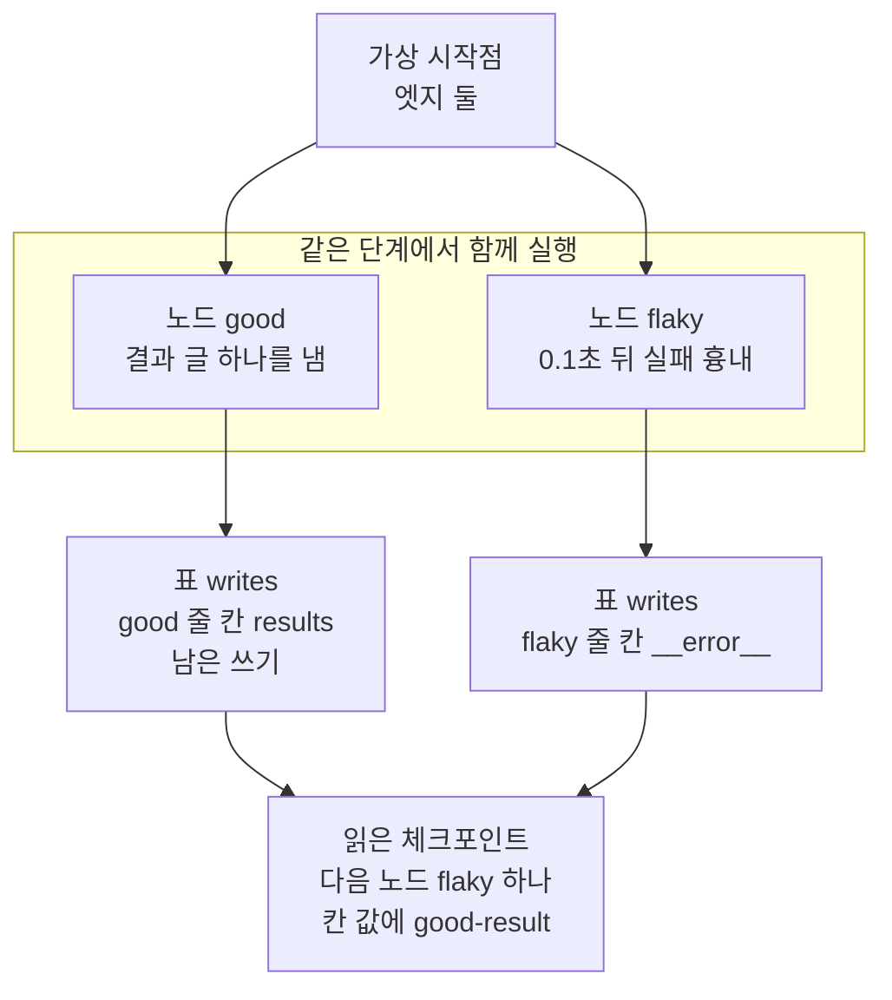
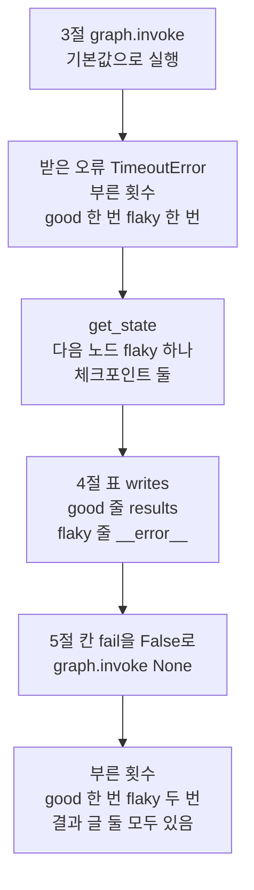
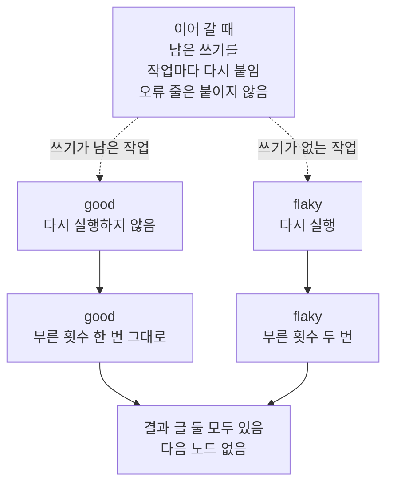
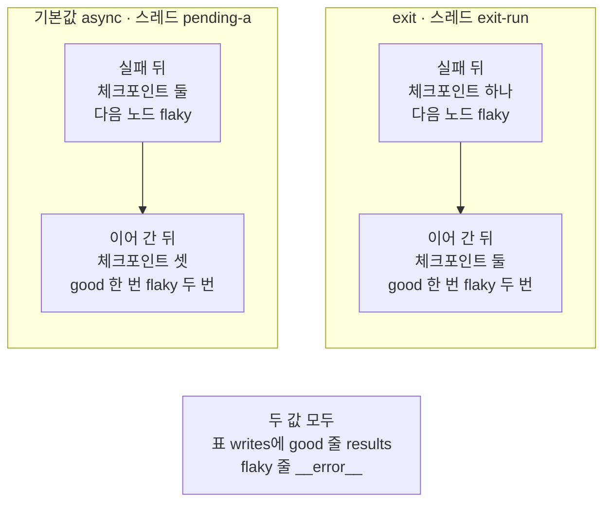

# 05-pending-writes와-장애-복구

## _src 본문 (HTML 원본)

```html
<!--meta: 강의 1h | 실습 1.5h | 코드 notebooks/05-pending-writes와-장애-복구.ipynb | 새 용어 3 -->
<style>html,body{overflow-x:hidden}.notebook,.nb-cell,.nb-main,.nb-input,.nb-result{min-width:0;max-width:100%}.nb-input pre,.nb-output{box-sizing:border-box;max-width:100%;overflow-x:auto}code.nb-source{display:block!important;width:100%!important;min-width:0!important;overflow-x:auto!important;padding:0!important}</style>
<h2 id="b1"><span class="no">1</span>학습 목표</h2><div class="goal"><ul>
<li>같은 단계의 두 노드 가운데 하나만 실패했을 때, 읽은 체크포인트의 다음 노드와 작업을 읽을 수 있습니다.</li>
<li>SQLite 파일의 표 <code>writes</code>에서 성공한 노드의 남은 쓰기와 실패한 노드의 오류 줄을 구별할 수 있습니다.</li>
<li>원인을 없앤 뒤 <code>invoke(None, config)</code>로 이어 가, 성공한 노드가 다시 불리지 않는 것을 부른 횟수로 확인할 수 있습니다.</li>
</ul></div>
<h2 id="b2"><span class="no">2</span>이 내용을 배우는 이유</h2><p>그래프가 한 단계에서 노드 여럿을 함께 실행하다 보면, 그중 하나만 실패할 수 있습니다. 성공한 노드가 오래 걸리는 일이었다면, 실패한 노드 때문에 그 일까지 다시 하고 싶지는 않습니다. 이어 갈 때 무엇을 다시 실행하는지는, 실패한 순간 체크포인트에 무엇이 남았는지에 달려 있습니다.</p><p>제목의 영어 말은 LangGraph 문서가 이렇게 남는 갱신을 부르는 이름이고, 이 절에서는 남은 쓰기라고 부릅니다. 제목의 장애 복구는 멈춘 실행의 원인을 없앤 뒤, 저장된 자리부터 이어 가 끝내는 일입니다. <a href="01-체크포인터와-스레드.html">01절</a>에서 이어 실행이라고 부른 일을, 노드 안의 오류로 멈춘 실행에서 해 봅니다.</p>
<h2 id="b3"><span class="no">3</span>앞에서 배운 내용</h2><p><a href="../../part4/ch13-langgraph-basics/02-State-갱신.html">Ch 13 02절</a>에서는 칸에 이어 붙이기 규칙 <code>operator.add</code>를 적었습니다. <a href="../../part4/ch13-langgraph-basics/05-Send-동적-팬아웃.html">Ch 13 05절</a>에서는 팬아웃한 갈래들이 같은 단계에서 같은 칸에 갱신을 냈고, 규칙이 없는 칸에서는 <code>InvalidUpdateError</code>가 났습니다. <a href="../../part5/ch20-tool-node/03-recursion-limit과-명시적-종료.html">Ch 20 03절</a>에서는 함께 실행되는 노드가 한 단계에 들어간다고 배웠습니다. <a href="../../part4/ch16-guardrails/05-재시도-폴백과-감사-로그.html">Ch 16 05절</a>에서는 <code>TimeoutError</code>를 내는 실패 흉내를 만들고 <code>try/except</code>로 받았습니다. <a href="../../part1/ch04-data-tools/03-SQL로-조회-함수-만들기.html">Ch 4 03절</a>에서는 자리표시자 <code>?</code>를 넣은 <code>SELECT</code> 문장으로 표를 조회했습니다.</p><p><a href="01-체크포인터와-스레드.html">01절</a>에서는 <code>get_state</code>로 마지막 체크포인트의 칸 값과 다음 노드를 읽었습니다. <a href="03-스레드-재개와-대화-이어가기.html">03절</a>에서는 SQLite 체크포인터가 파일에 표 <code>checkpoints</code>와 <code>writes</code>를 만드는 것을 보았습니다. <a href="04-내구-실행-모드-비교.html">04절</a>에서는 자식 프로세스를 강제로 끝낸 뒤, 스크립트가 입력 자리에 <code>None</code>을 넣어 저장된 자리부터 이어 갔습니다. 그때 <code>None</code>은 스크립트 안에서만 넣었고, 이 절에서 노트북 셀로 처음 부릅니다.</p>
<h2 id="b4"><span class="no">4</span>핵심 개념</h2><h3>비유로 시작하기</h3><p>01절에서는 한 수를 둘 때마다 즉석사진을 찍어 판의 모습을 남겼습니다. 이번에는 한 탁자에 판 둘을 나란히 두고, 같은 차례에 두 판에 한 수씩 둡니다. 수를 마친 판은 사진으로 찍어 그 판 앞에 둡니다. 그런데 오른쪽 판에 수를 두다가 판이 엎어졌습니다.</p><p>왼쪽 판은 이미 수를 마쳤고, 그 사진이 판 앞에 남아 있습니다. 판을 다시 차릴 때 왼쪽 판은 사진대로 두면 되고, 다시 둘 것은 오른쪽 판 하나입니다. 왼쪽 판이 노드 <code>good</code>, 엎어진 오른쪽 판이 노드 <code>flaky</code>, 왼쪽 판 앞의 사진이 남은 쓰기입니다.</p>
{{img:05-5-쓰러진-판과-사진이-남은-판|흰 바탕에 나무 탁자 하나를 조금 위에서 본 그림입니다. 탁자 위에 체스판 둘이 나란히 놓여 있습니다. 왼쪽 판은 반듯하게 놓이고 말들이 모두 서 있으며, 판 앞에 작은 체스판이 찍힌 즉석사진 한 장이 있습니다. 오른쪽 판은 비스듬히 쓰러져 있고, 말들이 옆으로 누운 채 판 위와 탁자 위에 흩어져 있습니다. 오른쪽 판 앞에는 사진이 없고, 카메라와 사람은 없는 그림|같은 차례에 둔 두 판 가운데 오른쪽 판만 엎어졌고, 수를 마친 왼쪽 판 앞에는 사진 한 장이 남았습니다.}}
<p class="look"><b>그림 읽기</b> — 나무 탁자 하나에 체스판 둘이 나란히 놓였습니다. 왼쪽 판은 말들이 모두 선 채 반듯하고, 판 앞에 즉석사진 한 장이 있습니다. 오른쪽 판은 비스듬히 쓰러져 말들이 흩어졌고, 앞에 사진이 없습니다. 두 판은 같은 단계의 두 작업이고, 왼쪽 판 앞의 사진이 표 <code>writes</code>에 남은 <code>good</code>의 쓰기입니다. 쓰러진 오른쪽 판이 실패한 <code>flaky</code>이고, 말의 개수·색과 판의 칸 수는 무엇과도 짝짓지 않습니다.</p>
<table><thead><tr><th>말</th><th>뜻</th></tr></thead><tbody><tr><td>남은 쓰기</td><td>같은 단계에서 먼저 끝난 노드가 낸 갱신 가운데, 단계가 끝나지 못해 칸 값에 합쳐지지 않은 채 체크포인트에 딸려 저장된 것입니다. 엎어진 판 옆, 수를 마친 판 앞에 남은 사진과 같습니다. 이 절에서는 SQLite 파일의 표 <code>writes</code>에 노드 <code>good</code>의 줄(칸 <code>results</code>)로 남았습니다.</td></tr><tr><td>작업(task)</td><td>한 단계에서 노드 하나를 한 번 실행하는 일입니다. 판 하나에 한 수를 두는 일과 같습니다. 이 절에서는 읽은 체크포인트의 <code>tasks</code>에 <code>good</code>과 <code>flaky</code> 두 작업이 있었습니다.</td></tr><tr><td>장애 복구</td><td>멈춘 실행의 원인을 없앤 뒤, 저장된 자리부터 이어 가 끝내는 일입니다. 엎어진 판만 다시 차려 수를 마치는 것과 같습니다. 이 절에서는 칸 <code>fail</code>을 <code>False</code>로 바꾼 뒤 <code>graph.invoke(None, config)</code>를 불렀습니다.</td></tr></tbody></table>
<p>새 말을 이 절 코드에서 보면 이렇습니다. 작업은 노트북 3절 <code>failed_state.tasks</code>의 항목이고, 남은 쓰기는 4절 함수 <code>saved_channels</code>가 표 <code>writes</code>에서 읽은 줄입니다. 장애 복구는 5절에서 실패 흉내를 끈 뒤 입력 자리에 <code>None</code>을 넣은 호출입니다.</p>
{{mermaid:05-1-같은-단계의-두-노드와-남은-쓰기|위에서 아래로 읽는 흐름도입니다. 맨 위 회색 상자 가상 시작점 엣지 둘에서 화살표 둘이 칸 같은 단계에서 함께 실행 안에 나란히 놓인 파란 상자 노드 good 결과 글 하나를 냄과, 파란 상자 노드 flaky 0.1초 뒤 실패 흉내로 갑니다. good에서 노란 상자 표 writes good 줄 칸 results 남은 쓰기로, flaky에서 노란 상자 표 writes flaky 줄 칸 __error__로 화살표가 이어집니다. 두 노란 상자는 맨 아래 노란 상자 읽은 체크포인트 다음 노드 flaky 하나 칸 값에 good-result로 모이는 그림|같은 단계의 두 노드 가운데 flaky만 실패했고, good이 낸 갱신은 남은 쓰기로 파일에 남아 다음 노드에서 빠졌습니다.}}
<p class="look"><b>도식 읽기</b> — 위에서 아래로 읽습니다. 파란 상자는 우리가 적은 노드이고, 노란 상자는 노트북 3·4절 출력입니다. 맨 위 회색 상자는 설계 객체에 적은 가상 시작점이고, 여기서 나간 엣지 둘이 두 노드를 같은 단계에 둡니다. 표 writes에는 두 작업의 줄이 모두 남았지만, 다음 노드에는 쓰기가 오류뿐인 flaky만 들어갔습니다.</p>
<h3>이어 갈 때 다시 실행할 작업을 고르는 법</h3><p>설치판 소스 <code>langgraph/pregel/_loop.py</code> 856행과 861~865행은, 입력이 <code>None</code>이면 마지막 체크포인트부터 이어 가는 것으로 봅니다. 이어 갈 때는 먼저 그 체크포인트의 남은 쓰기를 작업마다 다시 붙입니다. 같은 파일 661~663행과 736~749행이 그 자리이고, 오류 줄은 붙이지 않아 실패한 작업은 쓰기가 빈 채로 남습니다. 그다음 쓰기가 없는 작업만 실행한다고 <code>langgraph/pregel/main.py</code> 2967~2968행이 적습니다.</p><p>메서드 <code>get_state</code>도 같은 규칙으로 읽습니다. 같은 파일 1239~1248행은 남은 쓰기를 칸 값에 더해 보여 줍니다. 1259행은 쓰기가 없는 작업의 노드만 다음 노드에 넣습니다. 그래서 실패한 뒤에도 칸 값에 <code>good</code>의 결과가 보였고, 다음 노드에는 <code>flaky</code>만 있었습니다.</p>
<h3>다른 상황에 적용</h3><p>문서 세 개를 같은 단계에서 나눠 요약하다가, 하나만 시간 초과로 실패했다고 합시다. 체크포인터를 붙여 두었다면, 이어 갈 때 실패한 문서 하나만 다시 요약합니다. 다만 남은 쓰기는 칸에 낸 갱신만 담습니다. 이 절의 부른 횟수 딕셔너리도 체크포인트 밖에 있어, 다시 실행한 <code>flaky</code>의 횟수는 그대로 늘었습니다.</p>
<h3>비교와 경계</h3><p>04절은 프로세스를 강제로 끝냈고, 이 절은 노드 안의 오류로 멈췄습니다. 04절에서 <code>exit</code>는 강제로 끝낸 뒤 아무것도 남기지 않았습니다. 이 절 6절에서는 같은 <code>exit</code>가 오류로 멈출 때 나가면서 체크포인트 하나와 남은 쓰기를 저장했습니다. 설치판 소스 <code>langgraph/pregel/_loop.py</code> 1324~1333행은 그래프를 나가는 자리에서 저장하고, 강제 종료는 이 자리를 지나지 못합니다.</p><p>다시 실행한 노드가 체크포인트 밖에 쓴 것은, 다시 실행한 만큼 되풀이됩니다. 같은 쓰기를 한 번만 반영하는 방법은 <a href="06-노드-재시작과-멱등성.html">06절</a>에서 봅니다.</p>
<h2 id="b5"><span class="no">5</span>실행 예제</h2><p>노트북은 먼저 같은 단계에서 함께 실행되는 두 노드에, SQLite 체크포인터를 붙인 그래프를 만듭니다. 노드 <code>flaky</code>는 실패 흉내가 켜져 있으면 0.1초를 기다린 뒤 <code>TimeoutError</code>를 냅니다. 3·4절은 실패한 뒤 읽은 체크포인트와 파일의 표 <code>writes</code>를 봅니다. 5절은 원인을 없애고 <code>invoke(None, config)</code>로 이어 가고, 6절은 같은 실패를 저장 시점 <code>exit</code>로 만듭니다.</p><p>이 절은 모델을 부르지 않아 모델 요청은 0번이고, API 키 셀도 없습니다. SQLite 파일은 노트북이 만든 빈 임시 폴더에 생깁니다.</p>
{{notebook:05-pending-writes와-장애-복구}}
<p class="look"><b>확인할 점</b> — 노트북 3절에서 <code>다음 노드: ('flaky',)</code>이고, 4절에서 줄 <code>good | ['results']</code>가 보이는지 봅니다. 5절에서 이어 간 뒤 <code>부른 횟수: {'good': 1, 'flaky': 2}</code>인지 확인합니다. 6절 <code>exit</code>에서는 <code>체크포인트 수: 1</code>인데도 같은 남은 쓰기가 있는지 봅니다.</p>
{{mermaid:05-2-실패에서-이어-가기까지의-차례|위에서 아래로 상자 여섯이 한 줄로 이어진 흐름도입니다. 첫 파란 상자는 3절 graph.invoke 기본값으로 실행입니다. 둘째 노란 상자는 받은 오류 TimeoutError 부른 횟수 good 한 번 flaky 한 번입니다. 셋째 노란 상자는 get_state 다음 노드 flaky 하나 체크포인트 둘, 넷째 노란 상자는 4절 표 writes good 줄 results flaky 줄 __error__입니다. 다섯째 파란 상자는 5절 칸 fail을 False로 바꾼 뒤 graph.invoke None, 여섯째 노란 상자는 부른 횟수 good 한 번 flaky 두 번 결과 글 둘 모두 있음인 그림|실패 흉내로 멈춘 실행을, 남은 것을 읽은 뒤 원인을 없애고 invoke(None, config)로 이어 가자 flaky만 다시 불렸습니다.}}
<p class="look"><b>도식 읽기</b> — 위에서 아래로 한 줄로 읽습니다. 파란 상자는 우리가 부른 코드이고, 노란 상자는 노트북 3~5절 출력입니다. 둘째 상자부터 넷째 상자까지가 실패한 뒤 남은 것이고, 다섯째 상자에서 원인을 없애고 이어 갑니다. 맨 아래 상자에서 good의 부른 횟수는 둘째 상자와 같은 한 번입니다.</p>
{{mermaid:05-3-이어-갈-때-작업마다-고르는-두-갈래|위에서 아래로 읽는 흐름도입니다. 맨 위 회색 상자 이어 갈 때 남은 쓰기를 작업마다 다시 붙임 오류 줄은 붙이지 않음에서 점선 두 갈래가 나갑니다. 쓰기가 남은 작업 갈래는 회색 상자 good 다시 실행하지 않음을 거쳐 노란 상자 good 부른 횟수 한 번 그대로로 갑니다. 쓰기가 없는 작업 갈래는 회색 상자 flaky 다시 실행을 거쳐 노란 상자 flaky 부른 횟수 두 번으로 갑니다. 두 노란 상자는 맨 아래 노란 상자 결과 글 둘 모두 있음 다음 노드 없음으로 모이는 그림|이어 갈 때 쓰기가 남은 작업 good은 건너뛰고, 쓰기가 없는 작업 flaky만 다시 실행했습니다.}}
<p class="look"><b>도식 읽기</b> — 위에서 아래로 읽고, 점선 두 갈래는 이어 갈 때 작업마다 고르는 길입니다. 회색 상자는 설치판 소스로 읽은 동작이고, 노란 상자는 노트북 5절 출력입니다. 오류 줄은 다시 붙이지 않으므로, 실패한 flaky는 「쓰기가 없는 작업」 갈래로 갔습니다. 두 갈래가 모인 맨 아래 상자에서 결과 글은 둘 다 있지만, 다시 실행한 노드는 flaky 하나입니다.</p>
<h2 id="b6"><span class="no">6</span>실험 결과 해석</h2><p>기본값 <code>async</code>와 <code>exit</code>로 같은 실패를 만든 결과를 한 표로 옮겼습니다. 표의 값은 노트북 3~6절 출력입니다.</p>
<table><thead><tr><th>저장 시점</th><th>실패 뒤 체크포인트 수</th><th>실패 뒤 다음 노드</th><th>작업별로 표 writes에 남은 칸 이름</th><th>이어 간 뒤 부른 횟수</th><th>이어 간 뒤 체크포인트 수</th></tr></thead><tbody><tr><td>기본값 <code>async</code></td><td>2</td><td><code>('flaky',)</code></td><td><code>good | ['results']</code><br><code>flaky | ['__error__']</code></td><td><code>{'good': 1, 'flaky': 2}</code></td><td>3</td></tr><tr><td><code>exit</code></td><td>1</td><td><code>('flaky',)</code></td><td><code>good | ['results']</code><br><code>flaky | ['__error__']</code></td><td><code>{'good': 1, 'flaky': 2}</code></td><td>2</td></tr></tbody></table>
{{mermaid:05-4-기본값과-exit의-실패-뒤와-이어-간-뒤|칸 둘이 나란히 놓이고 아래에 회색 상자 하나가 있는 그림입니다. 칸 기본값 async 스레드 pending-a에는 노란 상자 실패 뒤 체크포인트 둘 다음 노드 flaky에서 노란 상자 이어 간 뒤 체크포인트 셋 good 한 번 flaky 두 번으로 화살표가 있습니다. 칸 exit 스레드 exit-run에는 노란 상자 실패 뒤 체크포인트 하나 다음 노드 flaky에서 노란 상자 이어 간 뒤 체크포인트 둘 good 한 번 flaky 두 번으로 화살표가 있습니다. 아래 회색 상자에는 두 값 모두 표 writes에 good 줄 results flaky 줄 __error__가 적힌 그림|저장 시점 exit는 체크포인트를 하나만 남겼지만, 같은 남은 쓰기를 저장해 이어 간 뒤 부른 횟수가 기본값과 같았습니다.}}
<p class="look"><b>도식 읽기</b> — 칸 둘이 저장 시점 둘이고, 칸 안은 위에서 아래로 실패 뒤와 이어 간 뒤입니다. 노란 상자는 모두 출력으로 확인한 값으로, 왼쪽 칸은 노트북 3·5절, 오른쪽 칸은 6절입니다. 두 칸에서 달랐던 것은 체크포인트 수뿐이고, 다음 노드와 부른 횟수는 같았습니다. 맨 아래 회색 상자는 두 칸에 모두 해당하는 사실이고, 4절과 6절 출력에서 각각 확인했습니다.</p>
<p>두 저장 시점 모두, 실패한 순간 <code>good</code>은 이미 결과를 냈고 그 결과가 남은 쓰기로 파일에 남았습니다. 그래서 이어 갈 때 다시 실행할 작업은 <code>flaky</code> 하나였고, <code>good</code>의 부른 횟수는 1에서 늘지 않았습니다. 결과 목록에는 두 결과가 모두 들어갔지만, <code>good</code>의 결과는 다시 실행해 얻은 것이 아닙니다.</p><p>달랐던 것은 체크포인트 수뿐입니다. 기본값은 단계마다 체크포인트를 남겨 실패 전에 둘이었고, <code>exit</code>는 나가면서 하나만 남겼습니다. 두 값 모두 그 마지막 체크포인트에 같은 남은 쓰기를 달았습니다.</p><p>모델을 부르지 않고 <code>flaky</code>가 0.1초를 기다려 <code>good</code>이 먼저 끝나는 한, 이 값들은 새 커널로 다시 실행해도 같아야 합니다. 새 커널로 두 번 실행했을 때 코드 셀 21개의 출력이 모두 같았습니다. 노트북 밖 준비 확인에서도 저장 시점마다 100번씩 실행해, 한 번도 다른 값이 나오지 않았습니다.</p>
<h2 id="b7"><span class="no">7</span>주의할 점과 실무 메모</h2><ul><li>노드 <code>flaky</code>는 실패 흉내 전에 0.1초를 기다려, <code>good</code>이 먼저 끝나게 했습니다. 노트북 밖 확인에서 <code>good</code>이 <code>flaky</code>의 실패보다 늦게 끝나게 하자, <code>exit</code>는 <code>good</code>의 쓰기를 남기지 않았습니다. 그래서 이어 갈 때 <code>good</code>도 다시 실행했고, 열 번 모두 그랬습니다. 기본값과 <code>sync</code>에서는 그때도 쓰기가 남았습니다.</li><li>공식 문서는 같은 단계에서 성공한 노드의 쓰기를 저장한다고 적습니다. 그러나 위 확인에서 <code>good</code>은 실패 뒤에도 끝까지 실행되었는데, <code>exit</code>만 그 쓰기를 남기지 않았습니다. 설치판 소스 <code>langgraph/pregel/_loop.py</code> 1324~1333행에서 <code>exit</code>는 나가는 자리에서 그때까지 모인 쓰기만 저장합니다. 같은 파일 466행에서 다른 두 값은 작업이 끝날 때마다 쓰기를 저장합니다.</li><li>원인을 없애지 않고 이어 가면, <code>flaky</code>가 같은 실패 흉내로 다시 멈춥니다. 노트북 밖 확인에서 세 저장 시점 모두 스무 번씩 그랬고, 그때도 <code>good</code>은 다시 불리지 않았습니다.</li><li>두 노드가 실행되는 차례는 출력하지 않았습니다. 설치판 소스는 다음 단계의 노드를 이름 차례로 정렬해 띄우지만, 먼저 끝나는 쪽은 정하지 않습니다. 그래서 이 절은 차례 대신 부른 횟수를 셌고, 결과 목록도 정렬해 출력했습니다.</li><li>표 <code>writes</code>의 칸 <code>task_id</code>에 적힌 작업의 <code>id</code>는 체크포인트마다 새로 만들어져, 실행마다 달라 출력하지 않았습니다. 노트북 밖 확인에서 읽은 작업의 <code>error</code>는 오류 객체가 아니라 글이었습니다.</li><li>저장 시점 <code>sync</code>는 노트북에서 실행하지 않았습니다. 노트북 밖 확인에서는 체크포인트 수와 부른 횟수가 기본값과 같았습니다.</li><li>부른 횟수 딕셔너리처럼 노드가 체크포인트 밖에 한 일은 남은 쓰기에 들어가지 않습니다. 노드가 파일이나 다른 서비스에 쓰는 일도 같고, 06절에서 봅니다.</li><li>걸린 시간은 재지 않았습니다. 교재 출력은 Linux의 Python 3.12.13과 SQLite 3.53.1로 만들었습니다. Windows·macOS에서는 실행하지 않았습니다.</li></ul>
<h2 id="b8"><span class="no">8</span>정리와 다음 절</h2><ul><li>같은 단계에서 <code>flaky</code>만 실패하자, 먼저 끝난 <code>good</code>의 결과가 남은 쓰기로 파일의 표 <code>writes</code>에 남았습니다.</li><li>원인을 없애고 <code>invoke(None, config)</code>로 이어 가자, <code>good</code>은 다시 불리지 않고 <code>flaky</code>만 다시 불렸습니다.</li><li>저장 시점 <code>exit</code>도 오류로 멈출 때 나가면서, 체크포인트 하나와 같은 남은 쓰기를 저장했습니다.</li></ul><p><strong>다음 학습과 이어지는 지점</strong> — <a href="06-노드-재시작과-멱등성.html">06절</a>에서는 다시 실행된 노드가 체크포인트 밖에 한 쓰기를, 한 번만 반영하는 방법을 봅니다.</p>
<h2 id="b9"><span class="no">9</span>복습 문제</h2><details class="quiz" open><summary>문제 4개 · 해설 포함</summary><p class="quiz-q">1. 실패한 뒤 읽은 다음 노드에 <code>good</code>이 없었던 까닭은 무엇인가요?</p><p class="quiz-a">노드 <code>good</code>은 같은 단계에서 이미 결과를 냈고, 그 결과가 남은 쓰기로 체크포인트에 남았기 때문입니다. 쓰기가 남은 작업은 다시 실행할 노드에 넣지 않습니다. 틀렸다면 노트북 3·4절을 다시 읽습니다.</p><p class="quiz-q">2. 이어 간 뒤 결과 목록에 <code>good-result</code>가 있는데도, <code>good</code>의 부른 횟수가 1인 까닭은 무엇인가요?</p><p class="quiz-a">결과 글은 다시 실행해 얻은 것이 아니라, 파일에 남은 쓰기를 가져와 붙인 것이기 때문입니다. 틀렸다면 노트북 5절을 다시 읽습니다.</p><p class="quiz-q">3. <code>invoke(None, config)</code>의 <code>None</code>은 무엇을 뜻하나요?</p><p class="quiz-a">새 입력 없이, 그 스레드의 마지막 체크포인트부터 이어 간다는 뜻입니다. 틀렸다면 노트북 5절과 04절 4절 설명을 다시 읽습니다.</p><p class="quiz-q">4. 저장 시점 <code>exit</code>로 실패시켰을 때 체크포인트가 하나뿐인데도, <code>good</code>을 다시 실행하지 않은 까닭은 무엇인가요?</p><p class="quiz-a">값 <code>exit</code>가 오류로 멈추며 나갈 때, 체크포인트 하나에 <code>good</code>의 남은 쓰기까지 저장했기 때문입니다. 틀렸다면 노트북 6절을 다시 읽습니다.</p></details>
<h2 id="b10"><span class="no">10</span>참고 자료</h2><ul><li><div><a href="https://docs.langchain.com/oss/python/langgraph/checkpointers">LangGraph Checkpointers</a></div>확인 2026-09-25 · 한 단계에서 노드가 실패하면, 같은 단계에서 성공적으로 끝난 노드의 쓰기를 저장한다고 적습니다. 그 단계부터 이어 가면 성공한 노드는 다시 실행하지 않는다고도 적습니다.</li><li>langgraph 1.2.11 소스 <code>langgraph/pregel/_loop.py</code> 856행·861~865행 — 입력이 <code>None</code>이면 이어 가는 것으로 보는 자리입니다.</li><li>같은 파일 661~663행·736~749행 — 남은 쓰기를 작업에 다시 붙이는 자리입니다.</li><li>같은 파일 1324~1333행 — 값 <code>exit</code>가 그래프를 나갈 때 저장하는 자리입니다.</li><li>같은 판 <code>langgraph/pregel/main.py</code> 1239~1248행·1259행은 <code>get_state</code>가 남은 쓰기를 더하고 다음 노드를 고르는 자리입니다.</li><li>같은 파일 2967~2968행 — 쓰기가 없는 작업만 실행하는 자리입니다.</li><li>같은 판 <code>langgraph/types.py</code> 637~646행 — 작업 <code>PregelTask</code>의 칸 <code>name</code>·<code>error</code>·<code>result</code>입니다.</li><li>langgraph-checkpoint-sqlite 3.0.3 소스 <code>langgraph/checkpoint/sqlite/__init__.py</code> 145~155행 — 표 <code>writes</code>의 칸입니다.</li><li>Ch 16 05절에서 실패 흉내를, 01·03·04절에서 체크포인트 읽기·SQLite 체크포인터·저장 시점을 보았습니다.</li></ul>
```

## 노트북 셀 (순서대로)

### [0] markdown {'html': 'skip'}

# pending writes와 장애 복구

**이 노트북에서 할 일**

1. 같은 단계에서 함께 실행되는 두 노드 가운데, 하나만 실패 흉내를 내게 합니다.
2. 실패한 뒤 읽은 체크포인트와 SQLite 파일의 표 `writes`에서, 성공한 노드의 결과가 남았는지 봅니다.
3. 원인을 없애고 `invoke(None, config)`로 이어 가, 성공한 노드가 다시 불렸는지 부른 횟수로 셉니다.

**준비물** — 이 노트북은 모델을 부르지 않습니다.
모델 요청은 0번이고, API 키 없이 실행합니다.
01절처럼 매번 같은 값을 내는 우리 노드로, 저장된 값이 맞는지 출력으로 가릅니다.

실패는 모두 이 절에서 일부러 만든 실패 흉내입니다.
Ch 16 05절처럼 Python에 들어 있는 오류 `TimeoutError`를 냅니다.

노트북은 빈 임시 폴더를 만들어 그 폴더에서 실행합니다.
SQLite 파일은 이 임시 폴더에 생기고, 실습 폴더에는 파일을 남기지 않습니다.
읽어 오는 자료 파일은 없습니다.
교재 출력을 만든 실행에서는 노트북 전체가 5초 안에 끝났습니다.
설치 셀에 걸리는 시간은 네트워크에 따라 달라집니다.

**기준 버전** — 첫 셀에서 패키지 둘을 설치합니다.
그래프는 langgraph 1.2.11입니다.
SQLite 체크포인터는 langgraph-checkpoint-sqlite 3.0.3에 들어 있습니다.

교재 출력은 Linux의 Python 3.12.13과, 그 Python에 들어 있는 SQLite 3.53.1로 만들었습니다.
Windows·macOS에서는 실행하지 않았습니다.

**강의와 실습 범위** — 강의 시간에는 2~5절을 읽습니다.
두 노드 가운데 하나만 실패시키고, 남은 것을 읽은 뒤 이어 가는 자리입니다.
6절은 같은 실패를 저장 시점 `exit`로 만드는 자리이고, 실습 시간에 실행합니다.

실습 폴더 `labs/part6/ch23-persistence`에서 `uv sync --locked`를 실행합니다.
그다음 `notebooks/` 폴더의 이 노트북을 열고, 실습 폴더의 `.venv` 커널을 고릅니다.
첫 셀부터 순서대로 실행합니다.

### [1] markdown {'html': 'skip'}

## 오늘 볼 그림


위에서 아래로 한 줄로 읽습니다.
파란 상자는 우리가 부른 코드이고, 노란 상자는 노트북 3~5절 출력입니다.
둘째 상자부터 넷째 상자까지가 실패한 뒤 남은 것이고, 다섯째 상자에서 원인을 없애고 이어 갑니다.
맨 아래 상자에서 good의 부른 횟수는 둘째 상자와 같은 한 번입니다.

### [2] markdown {}

## 1. 준비

04절에서는 자식 프로세스를 강제로 끝낸 뒤, 파일에 남은 체크포인트로 다시 실행했습니다.
이 절은 강제 종료가 아니라, 노드 안의 오류로 멈춘 실행을 봅니다.
같은 단계에서 함께 실행되던 두 노드 가운데 하나만 실패하면, 성공한 쪽의 결과가 어떻게 되는지 확인합니다.

첫 셀은 패키지 둘을 설치하고 설치된 판 번호를 출력합니다.
설치에는 몇십 초가 걸릴 수 있습니다.

### [3] code {'execution': {'iopub.execute_input': '2026-09-25T10:21:44.014478Z', 'iopub.status.busy': '2026-09-25T10:21:44.014293Z', 'iopub.status.idle': '2026-09-25T10:21:44.494939Z', 'shell.execute_reply': '2026-09-25T10:21:44.494384Z'}, 'lesson_role': 'setup'}

```python
# 이 절에서 쓰는 패키지를 설치하고 버전을 확인합니다
%pip install -q "langgraph==1.2.11" "langgraph-checkpoint-sqlite==3.0.3"
from importlib.metadata import version

print("langgraph:", version("langgraph"))
print("langgraph-checkpoint-sqlite:", version("langgraph-checkpoint-sqlite"))
```

출력:
```
Note: you may need to restart the kernel to use updated packages.
langgraph: 1.2.11
langgraph-checkpoint-sqlite: 3.0.3

```

### [4] markdown {}

**결과 읽기** — 출력 줄 `langgraph: 1.2.11`과 `langgraph-checkpoint-sqlite: 3.0.3`이 보입니다.
두 판 모두 실습 폴더 잠금과 같은 판입니다.
이 노트북의 출력은 2026-09-25에 이 판으로 실행한 결과입니다.

다음 셀은 이 절에서 쓸 이름을 가져옵니다.
상태 형식과 그래프 이름은 Ch 13 01·02절, `sqlite3`와 `SqliteSaver`는 03절과 같습니다.
모듈 `time`은 Ch 16 05절에서 정한 초만큼 쉴 때 썼고, 이 절에서는 실패 흉내 앞에서 쉽니다.
모듈 `os`는 01절 임시 폴더 셀에서 썼습니다.

### [5] code {'execution': {'iopub.execute_input': '2026-09-25T10:21:44.495996Z', 'iopub.status.busy': '2026-09-25T10:21:44.495909Z', 'iopub.status.idle': '2026-09-25T10:21:45.005942Z', 'shell.execute_reply': '2026-09-25T10:21:45.005600Z'}, 'lesson_role': 'setup'}

```python
# 그래프 이름(Ch 13 01·02절)과 SQLite 체크포인터(03절)에, 실패 흉내 앞에서 쉴 모듈 time을 더해 가져옵니다
import operator
import os
import sqlite3
import time
from typing import Annotated
from typing_extensions import TypedDict
from langgraph.graph import StateGraph, START, END
from langgraph.checkpoint.sqlite import SqliteSaver

print("SQLite 판:", sqlite3.sqlite_version)
```

출력:
```
SQLite 판: 3.53.1

```

### [6] markdown {}

**결과 읽기** — 출력 줄 `SQLite 판: 3.53.1`은 03·04절과 같은 판입니다.

다음 셀은 01절처럼 빈 임시 폴더를 만들고, 그 폴더로 작업 위치를 옮깁니다.
이 절의 SQLite 파일은 이 임시 폴더에 생깁니다.

### [7] code {'execution': {'iopub.execute_input': '2026-09-25T10:21:45.006636Z', 'iopub.status.busy': '2026-09-25T10:21:45.006585Z', 'iopub.status.idle': '2026-09-25T10:21:45.008661Z', 'shell.execute_reply': '2026-09-25T10:21:45.008347Z'}, 'lesson_role': 'setup'}

```python
# 파일이 생기는지 볼 빈 임시 폴더를 만들고, 그 폴더로 작업 위치를 옮깁니다(Ch 4 03절과 같은 모양)
import os
import tempfile

# mkdtemp()는 운영체제 임시 폴더 안에 새 폴더를 만들고, 그 폴더의 위치를 글로 내놓습니다
practice_folder = tempfile.mkdtemp(prefix="ch23-05-")
# chdir()는 터미널의 cd처럼 현재 작업 폴더를 옮깁니다
os.chdir(practice_folder)
print("임시 폴더 이름에 ch23-05-이 들어 있는가:", "ch23-05-" in practice_folder)
print("현재 작업 폴더의 파일:", os.listdir())
```

출력:
```
임시 폴더 이름에 ch23-05-이 들어 있는가: True
현재 작업 폴더의 파일: []

```

### [8] markdown {}

**결과 읽기** — 출력 줄 `임시 폴더 이름에 ch23-05-이 들어 있는가: True`로, 이 절의 폴더를 만들었습니다.
출력 줄 `현재 작업 폴더의 파일: []`로, 빈 폴더에서 시작합니다.

## 2. 같은 단계에서 함께 실행되는 두 노드

이 절의 그래프는 가상 시작점에서 엣지 둘을 냅니다.
한 자리에서 엣지가 둘 나가면, 두 노드가 다음 단계에서 함께 실행됩니다.
Ch 20 03절에서 본 대로, 함께 실행되는 노드는 한 단계에 들어갑니다.
Ch 13 05절에서 한 흐름을 여러 갈래로 펼친 것처럼, 이번에는 고정 엣지 둘로 두 갈래를 냅니다.

두 노드는 같은 칸에 한꺼번에 갱신을 내므로, Ch 13 05절처럼 칸에 규칙이 있어야 합니다.
다음 셀은 칸 `results` 하나에 Ch 13 02절의 이어 붙이기 규칙 `operator.add`를 적은 상태 형식입니다.
04절의 `StepState`와 칸 이름이 달라, 새 이름 `ResultState`를 붙입니다.

### [9] code {'execution': {'iopub.execute_input': '2026-09-25T10:21:45.009205Z', 'iopub.status.busy': '2026-09-25T10:21:45.009149Z', 'iopub.status.idle': '2026-09-25T10:21:45.010914Z', 'shell.execute_reply': '2026-09-25T10:21:45.010603Z'}}

```python
# 칸 results 하나에 이어 붙이기 규칙을 적은 상태 형식을 만듭니다(Ch 13 02절 모양)
class ResultState(TypedDict):
    results: Annotated[list[str], operator.add]
```

출력:
```

```

### [10] markdown {}

**결과 읽기** — 정의 셀이라 출력이 없습니다.
두 노드가 낸 목록은 규칙대로 칸의 목록 뒤에 함께 붙습니다.

다음 셀은 노드마다 부른 횟수를 셀 딕셔너리와, 실패 흉내를 정할 딕셔너리를 만듭니다.
Ch 16 05절에서 실패 흉내를 딕셔너리 `failure_plan`으로 정한 것과 같은 모양입니다.
칸 `fail`이 `True`인 동안 둘째 노드가 실패 흉내를 냅니다.
칸 `wait_seconds`는 실패 흉내를 내기 전에 기다릴 초입니다.

### [11] code {'execution': {'iopub.execute_input': '2026-09-25T10:21:45.011430Z', 'iopub.status.busy': '2026-09-25T10:21:45.011382Z', 'iopub.status.idle': '2026-09-25T10:21:45.012907Z', 'shell.execute_reply': '2026-09-25T10:21:45.012689Z'}}

```python
# 노드마다 부른 횟수를 셀 딕셔너리와, 실패 흉내를 정할 딕셔너리를 만듭니다(Ch 16 05절 모양)
call_count = {"good": 0, "flaky": 0}
# 칸 fail이 True인 동안 flaky는 wait_seconds초를 기다린 뒤 실패 흉내를 냅니다
failure_plan = {"fail": True, "wait_seconds": 0.1}
print("부른 횟수:", call_count)
print("실패 흉내:", failure_plan)
```

출력:
```
부른 횟수: {'good': 0, 'flaky': 0}
실패 흉내: {'fail': True, 'wait_seconds': 0.1}

```

### [12] markdown {}

**결과 읽기** — 출력 줄 `부른 횟수: {'good': 0, 'flaky': 0}`와 `실패 흉내: {'fail': True, 'wait_seconds': 0.1}`입니다.
두 노드는 이 두 딕셔너리를, 노트북에서 만든 이름 그대로 읽고 고칩니다.
부른 횟수는 우리 코드가 세는 값이라, 체크포인트에는 들어가지 않습니다.

다음 셀은 첫째 노드 `good`입니다.
Ch 17 01절의 `count = count + 1`처럼 부른 횟수에 1을 더합니다.
그리고 결과 글 하나를 목록에 담아 냅니다.

### [13] code {'execution': {'iopub.execute_input': '2026-09-25T10:21:45.013392Z', 'iopub.status.busy': '2026-09-25T10:21:45.013349Z', 'iopub.status.idle': '2026-09-25T10:21:45.014825Z', 'shell.execute_reply': '2026-09-25T10:21:45.014561Z'}}

```python
# 첫째 노드: 부른 횟수에 1을 더하고, 결과 글 하나를 목록에 담아 냅니다
def good(state):
    call_count["good"] = call_count["good"] + 1
    return {"results": ["good-result"]}
```

출력:
```

```

### [14] markdown {}

**결과 읽기** — 정의 셀이라 출력이 없습니다.

다음 셀은 둘째 노드 `flaky`입니다.
이름은 가끔 실패한다는 뜻의 영어 낱말에서 따왔습니다.
실패 흉내가 켜져 있으면 정한 초만큼 기다린 뒤 `TimeoutError`를 냅니다.
시간 초과는 기다린 끝에 나는 오류라, 실패 흉내도 잠시 기다린 뒤 냅니다.

기다리는 0.1초는 `good`이 먼저 끝나게 하려고 실행 전에 정한 값입니다.
노트북 밖 확인에서 `good`이 더 늦게 끝나게 하자, 저장 시점 `exit`는 `good`의 쓰기를 남기지 않았습니다.
그 장면은 이 노트북에서 실행하지 않았고, 교재 본문의 주의할 점에 적었습니다.

### [15] code {'execution': {'iopub.execute_input': '2026-09-25T10:21:45.015320Z', 'iopub.status.busy': '2026-09-25T10:21:45.015270Z', 'iopub.status.idle': '2026-09-25T10:21:45.016875Z', 'shell.execute_reply': '2026-09-25T10:21:45.016564Z'}}

```python
# 둘째 노드: 부른 횟수에 1을 더하고, 실패 흉내가 켜져 있으면 잠시 기다린 뒤 TimeoutError를 냅니다
def flaky(state):
    call_count["flaky"] = call_count["flaky"] + 1
    if failure_plan["fail"]:
        # 시간 초과처럼, 정한 초만큼 기다린 뒤 멈춥니다
        time.sleep(failure_plan["wait_seconds"])
        raise TimeoutError("이 절에서 만든 실패 흉내입니다.")
    return {"results": ["flaky-result"]}
```

출력:
```

```

### [16] markdown {}

**결과 읽기** — 정의 셀이라 출력이 없습니다.
실패 흉내가 꺼져 있으면, 결과 글 하나를 목록에 담아 냅니다.

다음 셀은 설계 객체입니다.
가상 시작점에서 두 노드로 엣지 둘을, 두 노드에서 가상 끝점으로 엣지 둘을 적습니다.

### [17] code {'execution': {'iopub.execute_input': '2026-09-25T10:21:45.017356Z', 'iopub.status.busy': '2026-09-25T10:21:45.017295Z', 'iopub.status.idle': '2026-09-25T10:21:45.019638Z', 'shell.execute_reply': '2026-09-25T10:21:45.019194Z'}}

```python
# 가상 시작점에서 good과 flaky로 엣지 둘, 두 노드에서 가상 끝점으로 엣지 둘을 적습니다
builder = StateGraph(ResultState)
builder.add_node("good", good)
builder.add_node("flaky", flaky)
builder.add_edge(START, "good")
builder.add_edge(START, "flaky")
builder.add_edge("good", END)
builder.add_edge("flaky", END)
print("등록한 노드:", list(builder.nodes))
print("고정 엣지로 적은 수:", len(builder.edges))
```

출력:
```
등록한 노드: ['good', 'flaky']
고정 엣지로 적은 수: 4

```

### [18] markdown {}

**결과 읽기** — 출력 줄 `등록한 노드: ['good', 'flaky']`와 `고정 엣지로 적은 수: 4`입니다.
가상 시작점에서 나가는 엣지가 둘이라, 두 노드는 입력을 칸에 넣은 다음 단계에서 함께 실행됩니다.

다음 셀은 03절처럼 파일 `pending.sqlite`에 연결을 열고, SQLite 체크포인터를 붙여 컴파일합니다.

### [19] code {'execution': {'iopub.execute_input': '2026-09-25T10:21:45.020192Z', 'iopub.status.busy': '2026-09-25T10:21:45.020148Z', 'iopub.status.idle': '2026-09-25T10:21:45.022654Z', 'shell.execute_reply': '2026-09-25T10:21:45.022343Z'}}

```python
# 파일 pending.sqlite에 연결을 열고, SQLite 체크포인터를 붙여 설계 객체를 컴파일합니다(03절 모양)
pending_conn = sqlite3.connect("pending.sqlite", check_same_thread=False)
pending_saver = SqliteSaver(pending_conn)
graph = builder.compile(checkpointer=pending_saver)
print("붙은 체크포인터의 종류:", type(graph.checkpointer).__name__)
```

출력:
```
붙은 체크포인터의 종류: SqliteSaver

```

### [20] markdown {}

**결과 읽기** — 출력 줄 `붙은 체크포인터의 종류: SqliteSaver`입니다.

## 3. 한 노드만 실패한 실행

이제 스레드 `pending-a`로 그래프를 실행합니다.
저장 시점은 적지 않아, 04절에서 본 기본값 `async`로 실행됩니다.
둘째 노드가 실패 흉내를 내므로, Ch 16 05절처럼 `try/except`로 오류를 받아 출력합니다.
실행 전에 예상해 봅니다.
실행은 오류로 멈추지만, 두 노드는 모두 한 번씩 불렸을 것입니다.

### [21] code {'execution': {'iopub.execute_input': '2026-09-25T10:21:45.023133Z', 'iopub.status.busy': '2026-09-25T10:21:45.023091Z', 'iopub.status.idle': '2026-09-25T10:21:45.150050Z', 'shell.execute_reply': '2026-09-25T10:21:45.149558Z'}}

```python
# 스레드 pending-a로 실행하고, 둘째 노드가 낸 실패 흉내를 받아 출력합니다(저장 시점은 기본값)
config = {"configurable": {"thread_id": "pending-a"}}
try:
    graph.invoke({"results": []}, config)
except TimeoutError as error:
    print("오류 종류:", type(error).__name__)
    print("오류 메시지:", error)
print("부른 횟수:", call_count)
```

출력:
```
오류 종류: TimeoutError
오류 메시지: 이 절에서 만든 실패 흉내입니다.
부른 횟수: {'good': 1, 'flaky': 1}

```

### [22] markdown {}

**결과 읽기** — 출력 줄 `오류 종류: TimeoutError`와 `오류 메시지: 이 절에서 만든 실패 흉내입니다.`가 받은 오류입니다.
출력 줄 `부른 횟수: {'good': 1, 'flaky': 1}`로, 두 노드가 한 번씩 불렸습니다.
노드 `flaky`만 실패했고, 오류는 셀이 받아 출력해 노트북은 멈추지 않았습니다.

다음 셀은 01절에서 본 `get_state`로, 이 스레드의 마지막 체크포인트를 읽습니다.
체크포인트 목록도 받아 수를 셉니다.
실행 전에 생각해 봅니다.
노드 `good`은 결과를 냈지만 단계는 끝나지 못했는데, 그 결과는 어디에 보일까요?

### [23] code {'execution': {'iopub.execute_input': '2026-09-25T10:21:45.151127Z', 'iopub.status.busy': '2026-09-25T10:21:45.151047Z', 'iopub.status.idle': '2026-09-25T10:21:45.153955Z', 'shell.execute_reply': '2026-09-25T10:21:45.153547Z'}}

```python
# 실패한 뒤 스레드 pending-a의 마지막 체크포인트를 읽고, 체크포인트 수도 셉니다
failed_state = graph.get_state(config)
print("칸 값:", failed_state.values)
print("다음 노드:", failed_state.next)
failed_history = list(graph.get_state_history(config))
print("체크포인트 수:", len(failed_history))
```

출력:
```
칸 값: {'results': ['good-result']}
다음 노드: ('flaky',)
체크포인트 수: 2

```

### [24] markdown {}

**결과 읽기** — 출력 줄 `다음 노드: ('flaky',)`에는 `good`이 없습니다.
이어 갈 때 다시 실행할 노드는 `flaky` 하나라는 뜻입니다.
출력 줄 `칸 값: {'results': ['good-result']}`에는 노드 `good`의 결과가 보입니다.
출력 줄 `체크포인트 수: 2`는 입력을 받은 때와, 입력을 칸에 넣은 뒤의 둘입니다.

두 노드가 실행된 단계를 마친 뒤의 체크포인트는 없습니다.
그런데도 `good`의 결과가 어디에 남았는지, 다음 세 셀에서 찾습니다.

읽은 체크포인트의 `tasks`는 이 단계에서 할 작업의 목록입니다.
작업(task)은 한 단계에서 노드 하나를 한 번 실행하는 일입니다.
작업마다 노드 이름 `name`, 받은 오류 `error`, 낸 결과 `result`를 담고 있습니다.
다음 셀은 작업마다 세 값을 한 줄씩 출력합니다.

### [25] code {'execution': {'iopub.execute_input': '2026-09-25T10:21:45.154708Z', 'iopub.status.busy': '2026-09-25T10:21:45.154646Z', 'iopub.status.idle': '2026-09-25T10:21:45.156908Z', 'shell.execute_reply': '2026-09-25T10:21:45.156566Z'}}

```python
# 마지막 체크포인트의 작업마다 노드 이름·받은 오류·낸 결과를 한 줄씩 출력합니다
print("노드 | 받은 오류 | 낸 결과")
for task in failed_state.tasks:
    print(task.name, "|", task.error, "|", task.result)
```

출력:
```
노드 | 받은 오류 | 낸 결과
good | None | {'results': ['good-result']}
flaky | TimeoutError('이 절에서 만든 실패 흉내입니다.') | None

```

### [26] markdown {}

**결과 읽기** — 라벨 줄 아래 두 줄입니다.
줄 `good | None | {'results': ['good-result']}`는 오류 없이 결과를 낸 작업입니다.
줄 `flaky | TimeoutError('이 절에서 만든 실패 흉내입니다.') | None`은 결과 없이 오류만 남은 작업입니다.
받은 오류에는 오류 종류와 메시지가 함께 적혀 있습니다.

## 4. 파일에 남은 쓰기

03절에서 SQLite 체크포인터가 파일에 표 `checkpoints`와 `writes`를 만드는 것을 보았습니다.
표 `writes`는 작업이 낸 갱신을 한 줄씩 적는 표입니다.
설치판 소스에서 이 표의 칸 `task_id`에는 작업의 `id`를, 칸 `channel`에는 갱신한 칸 이름을 적습니다.
다음 셀은 한 작업이 이 표에 남긴 줄의 칸 이름을 읽는 함수입니다.

### [27] code {'execution': {'iopub.execute_input': '2026-09-25T10:21:45.157939Z', 'iopub.status.busy': '2026-09-25T10:21:45.157863Z', 'iopub.status.idle': '2026-09-25T10:21:45.160042Z', 'shell.execute_reply': '2026-09-25T10:21:45.159558Z'}}

```python
# 표 writes에서 한 스레드·한 작업이 남긴 줄의 칸 이름을 이름 차례로 읽어, 목록으로 내놓습니다
def saved_channels(connection, thread_name, task_id):
    sql = "SELECT channel FROM writes WHERE thread_id = ? AND task_id = ? ORDER BY channel"
    cursor = connection.execute(sql, [thread_name, task_id])
    channels = []
    # 줄마다 첫 칸이 칸 이름입니다
    for row in cursor.fetchall():
        channels.append(row[0])
    return channels
```

출력:
```

```

### [28] markdown {}

**결과 읽기** — 정의 셀이라 출력이 없습니다.
스레드 이름과 작업의 `id`는 Ch 4 03절처럼 자리표시자 `?`로 넘깁니다.
함수 모양은 03절의 `sqlite_tables`와 같고, 읽는 표와 조건만 다릅니다.

다음 셀은 실패한 뒤의 작업마다 이 함수를 부릅니다.
작업의 `id`는 체크포인트마다 새로 만들어져 실행마다 달라지므로, 출력하지 않고 조건으로만 씁니다.
실행 전에 예상해 봅니다.
노드 `good`의 줄에는 칸 `results`가 적혀 있을 것입니다.

### [29] code {'execution': {'iopub.execute_input': '2026-09-25T10:21:45.160885Z', 'iopub.status.busy': '2026-09-25T10:21:45.160818Z', 'iopub.status.idle': '2026-09-25T10:21:45.162985Z', 'shell.execute_reply': '2026-09-25T10:21:45.162514Z'}}

```python
# 실패한 뒤의 작업마다, 파일의 표 writes에 남은 줄의 칸 이름을 봅니다(작업의 id는 출력하지 않음)
print("노드 | 표 writes에 남은 칸 이름")
for task in failed_state.tasks:
    channels = saved_channels(pending_conn, "pending-a", task.id)
    print(task.name, "|", channels)
```

출력:
```
노드 | 표 writes에 남은 칸 이름
good | ['results']
flaky | ['__error__']

```

### [30] markdown {}

**결과 읽기** — 라벨 줄 아래 줄 `good | ['results']`는, 노드 `good`이 칸 `results`에 낸 갱신이 파일에 남았다는 뜻입니다.
줄 `flaky | ['__error__']`의 `__error__`는 라이브러리가 받은 오류를 적어 두는 이름입니다.
단계가 끝나지 않아 칸 값에 합쳐지지 못한 갱신이, 이렇게 체크포인트에 딸려 파일에 남습니다.
이 절은 이것을 남은 쓰기라고 부릅니다.

3절에서 읽은 칸 값에 `good`의 결과가 보인 것도 이 남은 쓰기 때문입니다.
설치판 소스에서 메서드 `get_state`는 마지막 체크포인트의 남은 쓰기를 칸 값에 더해 보여 줍니다.
다음 노드에서 `good`이 빠진 것도 같은 까닭으로, 쓰기가 남은 작업은 다시 실행할 노드에 넣지 않습니다.

## 5. 원인을 없애고 이어 가기

이제 실패 원인을 없앱니다.
이 절의 원인은 실패 흉내이므로, 칸 `fail`을 `False`로 바꿉니다.
실제 서비스라면 연결이 돌아오기를 기다리거나, 잘못된 설정을 고치는 일에 해당합니다.

### [31] code {'execution': {'iopub.execute_input': '2026-09-25T10:21:45.163781Z', 'iopub.status.busy': '2026-09-25T10:21:45.163693Z', 'iopub.status.idle': '2026-09-25T10:21:45.165847Z', 'shell.execute_reply': '2026-09-25T10:21:45.165506Z'}}

```python
# 실패 원인을 없앱니다: 칸 fail을 False로 바꿔 실패 흉내를 끕니다
failure_plan["fail"] = False
print("실패 흉내:", failure_plan)
```

출력:
```
실패 흉내: {'fail': False, 'wait_seconds': 0.1}

```

### [32] markdown {}

**결과 읽기** — 출력 줄 `실패 흉내: {'fail': False, 'wait_seconds': 0.1}`입니다.
체크포인트와 파일은 이 셀에서 바뀌지 않았습니다.

다음 셀이 이 절의 중심입니다.
04절 스크립트의 다시 실행 단계처럼, 입력 자리에 `None`을 넣어 부릅니다.
새 입력 없이, 이 스레드의 마지막 체크포인트부터 이어 갑니다.
실행 전에 예상해 봅니다.
남은 쓰기가 있는 `good`은 다시 불리지 않고, `flaky`만 다시 불릴 것입니다.

### [33] code {'execution': {'iopub.execute_input': '2026-09-25T10:21:45.166798Z', 'iopub.status.busy': '2026-09-25T10:21:45.166731Z', 'iopub.status.idle': '2026-09-25T10:21:45.172197Z', 'shell.execute_reply': '2026-09-25T10:21:45.171835Z'}}

```python
# 새 입력 없이(None) 같은 스레드를 이어 가고, 결과 목록과 부른 횟수를 봅니다
resumed = graph.invoke(None, config)
# 두 노드가 붙인 글의 차례는 결론에 쓰지 않으려고, 이름 차례로 정렬해 출력합니다
sorted_results = sorted(resumed["results"])
print("결과 목록(정렬):", sorted_results)
print("부른 횟수:", call_count)
# 부른 횟수는 우리 코드가 센 값이라 실행마다 같아야 합니다
assert call_count["good"] == 1, "good은 한 번만 불려야 합니다"
assert call_count["flaky"] == 2, "flaky는 두 번 불려야 합니다"
```

출력:
```
결과 목록(정렬): ['flaky-result', 'good-result']
부른 횟수: {'good': 1, 'flaky': 2}

```

### [34] markdown {}

**결과 읽기** — 출력 줄 `부른 횟수: {'good': 1, 'flaky': 2}`입니다.
이어 가는 동안 `flaky`만 한 번 더 불렸고, `good`은 다시 불리지 않았습니다.
출력 줄 `결과 목록(정렬): ['flaky-result', 'good-result']`에는 두 노드의 결과가 모두 있습니다.
노드 `good`의 결과는 다시 실행해 얻은 것이 아니라, 파일의 남은 쓰기를 붙인 것입니다.

마지막 두 줄의 `assert`도 통과했습니다.
04절의 `sync`는 끊긴 노드부터 이어 갔고, 이번에는 같은 단계 안에서도 실패한 작업만 다시 실행했습니다.

다음 셀은 이어 간 뒤의 마지막 체크포인트를 읽습니다.

### [35] code {'execution': {'iopub.execute_input': '2026-09-25T10:21:45.173035Z', 'iopub.status.busy': '2026-09-25T10:21:45.172955Z', 'iopub.status.idle': '2026-09-25T10:21:45.175828Z', 'shell.execute_reply': '2026-09-25T10:21:45.175431Z'}}

```python
# 이어 간 뒤 스레드 pending-a의 다음 노드·체크포인트 수·남은 작업 수를 봅니다
after_state = graph.get_state(config)
print("다음 노드:", after_state.next)
after_history = list(graph.get_state_history(config))
print("체크포인트 수:", len(after_history))
print("남은 작업 수:", len(after_state.tasks))
```

출력:
```
다음 노드: ()
체크포인트 수: 3
남은 작업 수: 0

```

### [36] markdown {}

**결과 읽기** — 출력 줄 `다음 노드: ()`와 `남은 작업 수: 0`으로, 이 스레드의 실행이 끝났습니다.
출력 줄 `체크포인트 수: 3`은 실패 전의 둘에, 두 노드의 단계를 마친 뒤의 하나가 더해진 수입니다.
실패한 단계를 처음부터 다시 만들지 않고, 그 단계의 체크포인트에서 이어 간 것입니다.

## 6. exit로 같은 실패 만들기

04절에서 저장 시점 `exit`는 강제로 끝낸 뒤 체크포인트를 하나도 남기지 않았습니다.
그때 설치판 소스에서 `exit`는 오류로 멈출 때도 나가면서 저장한다고 적었습니다.
이번에는 같은 실패를 `exit`로 만들어 확인합니다.
부른 횟수를 0으로 되돌리고 실패 흉내를 다시 켠 뒤, 새 스레드 `exit-run`으로 실행합니다.

### [37] code {'execution': {'iopub.execute_input': '2026-09-25T10:21:45.176525Z', 'iopub.status.busy': '2026-09-25T10:21:45.176461Z', 'iopub.status.idle': '2026-09-25T10:21:45.300000Z', 'shell.execute_reply': '2026-09-25T10:21:45.299331Z'}}

```python
# 부른 횟수를 0으로 되돌리고 실패 흉내를 켠 뒤, 저장 시점 exit로 새 스레드 exit-run을 실행합니다
call_count["good"] = 0
call_count["flaky"] = 0
failure_plan["fail"] = True
exit_config = {"configurable": {"thread_id": "exit-run"}}
try:
    graph.invoke({"results": []}, exit_config, durability="exit")
except TimeoutError as error:
    print("오류 종류:", type(error).__name__)
print("부른 횟수:", call_count)
```

출력:
```
오류 종류: TimeoutError
부른 횟수: {'good': 1, 'flaky': 1}

```

### [38] markdown {}

**결과 읽기** — 출력 줄 `오류 종류: TimeoutError`와 `부른 횟수: {'good': 1, 'flaky': 1}`은 3절과 같습니다.

다음 셀은 3·4절처럼 다음 노드와 체크포인트 수, 작업마다 표 `writes`에 남은 칸 이름을 봅니다.
실행 전에 예상해 봅니다.
값 `exit`가 오류로 멈출 때도 나가면서 저장한다면, 체크포인트가 하나 있을 것입니다.

### [39] code {'execution': {'iopub.execute_input': '2026-09-25T10:21:45.301491Z', 'iopub.status.busy': '2026-09-25T10:21:45.301372Z', 'iopub.status.idle': '2026-09-25T10:21:45.305113Z', 'shell.execute_reply': '2026-09-25T10:21:45.304538Z'}}

```python
# exit로 실패한 뒤의 다음 노드·체크포인트 수와, 작업마다 표 writes에 남은 칸 이름을 봅니다
exit_state = graph.get_state(exit_config)
print("다음 노드:", exit_state.next)
exit_history = list(graph.get_state_history(exit_config))
print("체크포인트 수:", len(exit_history))
print("노드 | 표 writes에 남은 칸 이름")
for task in exit_state.tasks:
    channels = saved_channels(pending_conn, "exit-run", task.id)
    print(task.name, "|", channels)
```

출력:
```
다음 노드: ('flaky',)
체크포인트 수: 1
노드 | 표 writes에 남은 칸 이름
good | ['results']
flaky | ['__error__']

```

### [40] markdown {}

**결과 읽기** — 출력 줄 `체크포인트 수: 1`은 값 `exit`가 나가면서 저장한 하나입니다.
출력 줄 `다음 노드: ('flaky',)`와 라벨 줄 아래 두 줄 `good | ['results']`·`flaky | ['__error__']`는 3·4절과 같습니다.
04절 강제 종료에서는 아무것도 남지 않았지만, 오류로 멈출 때는 체크포인트 하나에 남은 쓰기까지 저장했습니다.

다음 셀은 실패 흉내를 끄고, 같은 저장 시점 `exit`로 새 입력 없이 이어 갑니다.
실행 전에 예상해 봅니다.
5절처럼 `good`은 한 번, `flaky`는 두 번 불렸을 것입니다.

### [41] code {'execution': {'iopub.execute_input': '2026-09-25T10:21:45.306203Z', 'iopub.status.busy': '2026-09-25T10:21:45.306110Z', 'iopub.status.idle': '2026-09-25T10:21:45.312333Z', 'shell.execute_reply': '2026-09-25T10:21:45.311771Z'}}

```python
# 실패 흉내를 끄고, 저장 시점 exit로 새 입력 없이(None) 스레드 exit-run을 이어 갑니다
failure_plan["fail"] = False
exit_resumed = graph.invoke(None, exit_config, durability="exit")
exit_results = sorted(exit_resumed["results"])
print("결과 목록(정렬):", exit_results)
exit_history_after = list(graph.get_state_history(exit_config))
print("체크포인트 수:", len(exit_history_after))
print("부른 횟수:", call_count)
```

출력:
```
결과 목록(정렬): ['flaky-result', 'good-result']
체크포인트 수: 2
부른 횟수: {'good': 1, 'flaky': 2}

```

### [42] markdown {}

**결과 읽기** — 출력 줄 `부른 횟수: {'good': 1, 'flaky': 2}`와 `결과 목록(정렬): ['flaky-result', 'good-result']`는 5절과 같습니다.
출력 줄 `체크포인트 수: 2`는 실패할 때의 하나에, 끝날 때 저장한 하나가 더해진 수입니다.
체크포인트 수만 달랐고, 다시 실행한 노드는 기본값 `async`와 같았습니다.

다음 셀은 연결을 닫고, 작업 폴더에 남은 파일을 봅니다.

### [43] code {'execution': {'iopub.execute_input': '2026-09-25T10:21:45.313379Z', 'iopub.status.busy': '2026-09-25T10:21:45.313288Z', 'iopub.status.idle': '2026-09-25T10:21:45.318122Z', 'shell.execute_reply': '2026-09-25T10:21:45.317581Z'}}

```python
# 연결을 닫고, 작업 폴더에 남은 파일을 이름 차례로 봅니다
pending_conn.close()
file_names = sorted(os.listdir())
print("현재 작업 폴더의 파일:", file_names)
```

출력:
```
현재 작업 폴더의 파일: ['pending.sqlite']

```

### [44] markdown {}

**결과 읽기** — 출력 줄 `현재 작업 폴더의 파일: ['pending.sqlite']`입니다.
두 스레드는 한 파일에 함께 저장되었고, 연결을 닫아 옆 파일(`-wal`·`-shm`)은 남지 않았습니다.
파일은 임시 폴더에 있어, 실습 폴더에는 남지 않습니다.

## 정리

1. 같은 단계에서 `flaky`만 실패하자, 먼저 끝난 `good`의 결과가 남은 쓰기로 파일에 남았습니다.
2. 원인을 없애고 `invoke(None, config)`로 이어 가자, `good`은 다시 불리지 않고 `flaky`만 다시 불렸습니다.
3. 저장 시점 `exit`도 오류로 멈출 때 나가면서, 체크포인트 하나와 같은 남은 쓰기를 저장했습니다.

06절에서는 다시 실행된 노드가 체크포인트 밖에 한 쓰기를, 한 번만 반영하는 방법을 봅니다.

## 그림

### 05-1-같은-단계의-두-노드와-남은-쓰기.mmd



같은 단계의 두 노드 가운데 flaky만 실패했고, good이 낸 갱신은 남은 쓰기로 파일에 남아 다음 노드에서 빠졌습니다.

### 05-2-실패에서-이어-가기까지의-차례.mmd



실패 흉내로 멈춘 실행을, 남은 것을 읽은 뒤 원인을 없애고 invoke(None, config)로 이어 가자 flaky만 다시 불렸습니다.

### 05-3-이어-갈-때-작업마다-고르는-두-갈래.mmd



이어 갈 때 쓰기가 남은 작업 good은 건너뛰고, 쓰기가 없는 작업 flaky만 다시 실행했습니다.

### 05-4-기본값과-exit의-실패-뒤와-이어-간-뒤.mmd



저장 시점 exit는 체크포인트를 하나만 남겼지만, 같은 남은 쓰기를 저장해 이어 간 뒤 부른 횟수가 기본값과 같았습니다.

### 05-5-쓰러진-판과-사진이-남은-판.prompt.md

# 05-5-쓰러진-판과-사진이-남은-판 (Higgsfield 삽화)

설명 대상 문장(본문 b4 비유 단락): 한 탁자에 판 둘을 나란히 두고, 같은 차례에 두 판에 한 수씩 둡니다. 수를 마친 판은 사진으로 찍어 그 판 앞에 둡니다. 그런데 오른쪽 판에 수를 두다가 판이 엎어졌습니다. … 왼쪽 판이 노드 `good`, 엎어진 오른쪽 판이 노드 `flaky`, 왼쪽 판 앞의 사진이 남은 쓰기입니다.

구성 요소와 배치: 나무 탁자 **하나**(조금 위에서 봄) · 그 위 체스판 **둘**을 나란히(= 같은 단계의 두 작업) · 왼쪽 판은 **반듯하게 서 있는 말**(= 성공한 `good`) · 왼쪽 판 앞 **즉석사진 한 장**(= 표 `writes`에 남은 `good`의 쓰기, 노트북 4절 `good | ['results']`) · 오른쪽 판은 **쓰러져 말이 흩어짐**(= 실패 흉내를 낸 `flaky`), 앞에 **사진 없음**(쓰기는 `__error__`뿐). 04-5(탁자 둘·쓰러진 판 둘·카메라 둘)와 구도를 바꿈 — 탁자 하나, 판 하나만 쓰러짐, 카메라 없음(물건 수를 줄임). 사진첩(02·03)·카메라 둘(04) 되풀이 없음. 사람·손·화살표·화면·시계·글자·숫자·앞 챕터 소품(쟁반·서랍·바구니·저울·울타리·발자국·공구판·승강 상자·식당 전표·집게·세탁기·선반·도장·카드·봉투) 없음.

시선 순서: 나란한 두 판 → 반듯한 왼쪽 판과 그 앞 사진 한 장 → 쓰러진 오른쪽 판(사진 없음).

검수 기준: 그림만 보고 「같이 두던 두 판 가운데 한 판만 엎어졌고, 멀쩡한 판 앞에만 찍어 둔 사진이 남았다」가 읽히는가. 사진이 정확히 한 장(왼쪽)이고 오른쪽 앞에는 없는가. 글자·숫자·사람·손·카메라가 없는가.

비유 계열: 챕터 리드 결정 11 **「체스판과 즉석사진」**(01절이 엶). 인계 §04 → §05 11항의 05 후보(한 탁자 위 판 둘, 한 판만 쓰러짐, 서 있는 판 앞 사진 한 장).

## 프롬프트 (1차, 채택)

```text
Simple flat educational illustration, white background, limited soft palette, clean outlines, plain everyday objects, no text, no letters, no numbers, no logos. One wooden table seen from slightly above with two chessboards side by side. The left chessboard lies flat and neat with its chess pieces standing upright, and exactly one instant photo with a thick white frame lies in front of it, showing a tiny chessboard. The right chessboard is knocked over and tilted, its chess pieces lying scattered on their sides, and there is no photo in front of it. No camera, no people, no hands, no arrows, no screens, no clocks, no trays, no drawers, no baskets, no shelves, no envelopes, no clips, no photo albums.
```

## 상태

- 2026-09-25 · `nano_banana_pro`(`jobs_wait` 응답 모델 이름 `nano_banana_2` — 01-5~04-5와 같은 표시) · 16:9 · 2k · `use_unlim: false` · count 1. 생성 전 잔액 **2437.75**(바로 앞 거래 09:48:29Z는 04절 몫).
- **1차 job `c7b590e1-63af-4046-8b1e-246fba15464f` 채택** — 거래 **2026-09-25T10:23:49Z 「Nano Banana Pro −2」**(결과 파일 이름 `hf_20260925_102348_c7b590e1…`와 시각이 같음). 이 절 몫은 거래 한 줄, **2크레딧**. 재생성 0회. 결과 원본 `ebc7ac6e4c27e9adcccb9f55fe74258018fa149e08afb350be2768940752cfd6`(2752 × 1536).
- **그림에서 확인한 것(그림 읽기·alt에 반영)**: 흰 바탕 위 나무 탁자 하나(조금 위에서 봄, 다리 넷). 탁자 위 체스판 둘이 나란히. **왼쪽 판은 반듯하고 말들이 모두 서 있음**(양쪽 두 줄씩 처음 자리 모양). **왼쪽 판 앞(조금 왼쪽 아래)에 흰 테두리 즉석사진 한 장**, 사진 속에 작은 체스판. **오른쪽 판은 비스듬히 들려 쓰러져 있고, 말들이 옆으로 누운 채 판 위와 탁자 위에 흩어짐**(말 받침 몇 개에 초록 천 — 짝짓지 않음). **오른쪽 판 앞에는 사진 없음.** 글자·숫자·사람·손·화살표·화면·시계·카메라·사진첩·쟁반·서랍·바구니·선반·봉투·집게 없음.
- 저장: 기기 셸에서 결과 URL을 `curl`로 받아(`/tmp/ch23-05/illu-1-orig.png`) `UV_CACHE_DIR=/tmp/uv-cache uv run --no-project --with pillow`로 RGB·폭 1100px(LANCZOS)로 줄여 `figures/05-5-쓰러진-판과-사진이-남은-판.png`(1100 × 614, `31b6177e4723e6fd66bafa6d64207dd0cfa8f19544c9d9046b9153848ee412c2`)로 저장했습니다.
- 결과 URL을 한 번 더 받아(`illu-1-again.png`, 원본과 해시 같음) 같은 폭으로 줄인 그림과 저장 PNG를 픽셀 대조했습니다(`ImageChops.difference` bbox `None`, 최대 차이 0). 저장 PNG와 해시가 같은 사본(`.cache/ch23-05-view/illu-1-1100.png`)을 직접 열어 개수를 세고 그림 읽기를 썼습니다.

