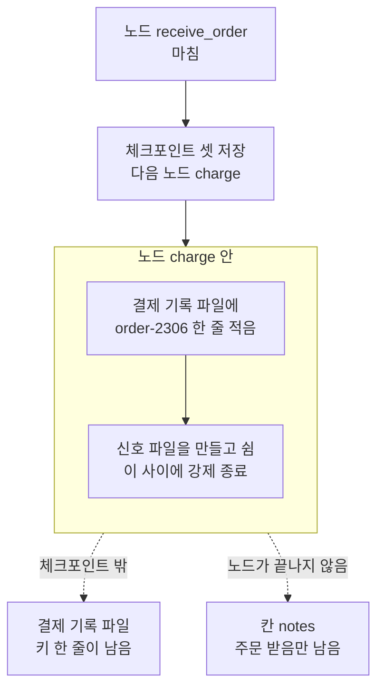
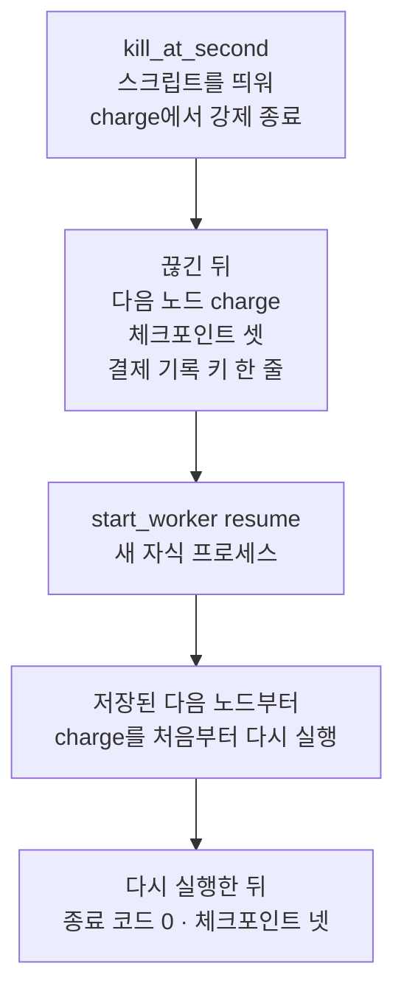
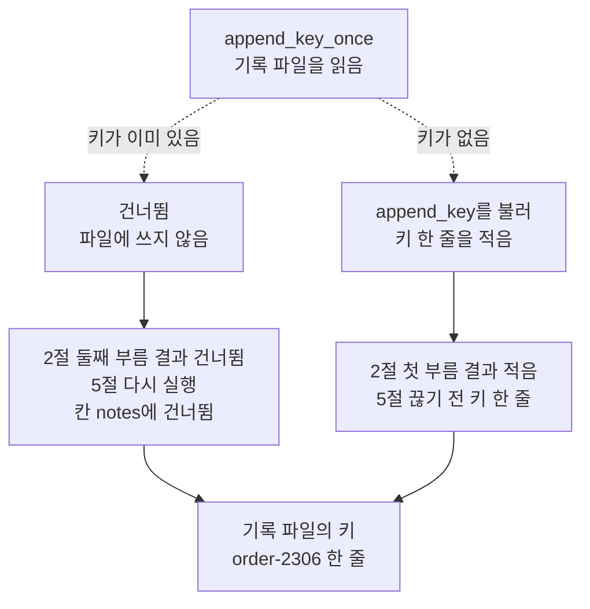
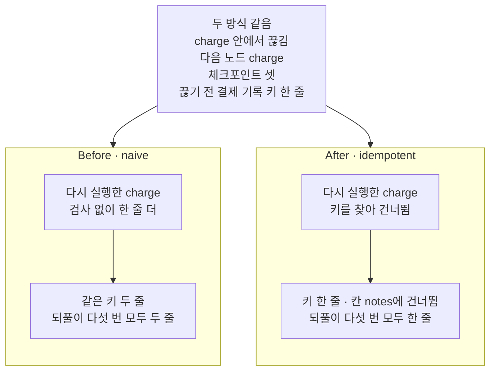

# 06-노드-재시작과-멱등성

## _src 본문 (HTML 원본)

```html
<!--meta: 강의 1h | 실습 2h | 코드 notebooks/06-노드-재시작과-멱등성.ipynb | 새 용어 3 -->
<style>html,body{overflow-x:hidden}.notebook,.nb-cell,.nb-main,.nb-input,.nb-result{min-width:0;max-width:100%}.nb-input pre,.nb-output{box-sizing:border-box;max-width:100%;overflow-x:auto}code.nb-source{display:block!important;width:100%!important;min-width:0!important;overflow-x:auto!important;padding:0!important}</style>
<h2 id="b1"><span class="no">1</span>학습 목표</h2><div class="goal"><ul>
<li>끊긴 노드를 다시 실행하면 그 노드가 바깥 파일에 한 쓰기도 되풀이되는 까닭을, 체크포인트로 설명할 수 있습니다.</li>
<li>멱등 키로 이미 한 일인지 확인해, 같은 쓰기를 한 번만 반영하는 함수를 적을 수 있습니다.</li>
<li>검사 없이 적는 노드와 건너뛰는 노드를 같은 자리에서 끊고, 결제 기록 파일의 줄 수로 견줄 수 있습니다.</li>
</ul></div>
<h2 id="b2"><span class="no">2</span>이 내용을 배우는 이유</h2><p>노드는 결제나 메일 보내기처럼 프로그램 바깥에 흔적을 남기는 일을 할 수 있습니다. 체크포인트는 노드가 끝난 뒤에야 그 노드가 칸에 낸 갱신을 저장합니다. 노드가 바깥에 쓴 뒤 끝나기 전에 프로그램이 끊기면, 이어 갈 때 그 노드를 처음부터 다시 실행합니다. 그러면 바깥에 한 쓰기도 한 번 더 일어납니다.</p><p>제목의 「노드 재시작」은 이렇게 끊긴 노드를 처음부터 다시 실행하는 일이고, 본문에서는 「다시 실행」이라고 씁니다. 「멱등성」은 몇 번 실행해도 결과가 한 번 실행한 것과 같은 성질입니다. 이 절은 같은 쓰기를 한 번만 반영하는 노드를 만들고, 끊고 다시 실행해도 기록이 한 줄인지 봅니다.</p>
<h2 id="b3"><span class="no">3</span>앞에서 배운 내용</h2><p><a href="../../part5/ch17-agent-overview/02-워크플로우가-충분한-조건.html">Ch 17 02절</a>에서는 결제·삭제·보내기처럼 프로그램 바깥의 상태를 바꾸는 동작을 부작용이라고 불렀습니다. <a href="../../part1/ch02-python/05-파일과-예외.html">Ch 2 05절</a>에서는 <code>with open</code>으로 파일을 읽고 썼습니다. <a href="../../part4/ch13-langgraph-basics/02-State-갱신.html">Ch 13 02절</a>의 이어 붙이기 규칙은 이 절의 칸 <code>notes</code>에 그대로 씁니다.</p><p><a href="04-내구-실행-모드-비교.html">04절</a>에서는 자식 프로세스를 둘째 노드에서 강제로 끝내고, 새 프로세스로 다시 실행했습니다. 저장 시점 <code>sync</code>에서는 첫째 노드까지의 체크포인트가 남아, 둘째 노드부터 이어 갔습니다. 그때 기록 파일에는 <code>second</code>가 두 번 적혔습니다. <a href="05-pending-writes와-장애-복구.html">05절</a>에서는 이어 갈 때 남은 쓰기가 있는 작업은 건너뛰고, 쓰기가 없는 작업만 다시 실행하는 것을 보았습니다. 이 절은 04절 함수를 도구 파일에서 가져와, 다시 실행된 노드의 바깥 쓰기를 봅니다.</p>
<h2 id="b4"><span class="no">4</span>핵심 개념</h2><h3>비유로 시작하기</h3><p><a href="01-체크포인터와-스레드.html">01절</a>부터 한 수를 둘 때마다 즉석사진을 찍어 판의 모습을 남겼습니다. 이번에는 판 옆에 기보를 한 장 둡니다. 기보는 둔 수를 한 줄씩 적는 종이이고, 사진과 달리 판 바깥에 남는 기록입니다. 한 수를 두고 기보에 적은 뒤, 사진을 찍기 전에 판이 엎어졌다고 합시다.</p><p>마지막 사진대로 말을 다시 놓으면, 판은 그 수를 두기 전으로 돌아갑니다. 그래서 같은 수를 다시 두고, 기보에도 다시 적습니다. 무조건 적으면 기보에 같은 수가 두 줄 남습니다. 적기 전에 그 차례의 수가 이미 적혀 있는지 보면, 기보에는 한 줄만 남습니다. 기보가 결제 기록 파일이고, 판이 엎어진 일이 강제 종료입니다.</p>
{{img:06-5-같은-수를-두-번-적은-기보와-한-번-적은-기보|흰 바탕에 나무 탁자 하나를 조금 위에서 본 그림입니다. 탁자 가운데에 말들이 모두 서 있는 체스판이 있습니다. 판 왼쪽에는 흰 종이 한 장이 있고, 같은 모양의 검은 나이트 그림 둘이 위아래로 그려져 있습니다. 판 오른쪽에는 흰 종이 한 장이 있고, 검은 나이트 그림 하나가 그려져 있습니다. 글자·숫자·사람·카메라·사진은 없는 그림|같은 수를 다시 둔 두 기보 가운데, 무조건 적은 왼쪽에는 같은 표시가 둘, 이미 적혔는지 본 오른쪽에는 하나가 남았습니다.}}
<p class="look"><b>그림 읽기</b> — 나무 탁자 가운데에 말들이 모두 선 체스판이 있고, 양옆에 흰 종이가 한 장씩 있습니다. 왼쪽 종이에는 같은 모양의 검은 나이트 그림이 위아래로 둘, 오른쪽 종이에는 하나 그려져 있습니다. 두 종이가 기보, 곧 결제 기록 파일이고, 나이트 그림 하나가 기보에 적은 수 한 줄, 곧 주문 키 한 줄입니다. 왼쪽이 검사 없이 적는 <code>naive</code>, 오른쪽이 이미 적힌 수를 건너뛰는 <code>idempotent</code>입니다. 판 위 말의 개수와 자리는 무엇과도 짝짓지 않습니다.</p>
<table><thead><tr><th>말</th><th>뜻</th></tr></thead><tbody><tr><td>노드 재시작</td><td>끊긴 노드를 이어 갈 때, 그 노드를 처음부터 다시 실행하는 일입니다. 사진을 찍기 전에 엎어진 판에서 같은 수를 다시 두는 것과 같습니다. 이 절에서는 둘째 노드 <code>charge</code>가 새 프로세스에서 처음부터 다시 실행되었습니다.</td></tr><tr><td>멱등성(idempotency)</td><td>몇 번 실행해도 결과가 한 번 실행한 것과 같은 성질입니다. 엘리베이터 호출 버튼은 여러 번 눌러도 엘리베이터가 한 번만 옵니다. 이 절에서는 함수 <code>append_key_once</code>를 두 번 불러도 기록 파일에 한 줄만 남았습니다.</td></tr><tr><td>멱등 키(idempotency key)</td><td>같은 일을 다시 해도 한 번만 반영하려고, 일마다 붙여 두는 이름입니다. 기보에서 수마다 붙이는 차례 번호와 같습니다. 이 절에서는 주문 키 <code>order-2306</code>이고, 이미 적혀 있으면 쓰지 않고 건너뜁니다.</td></tr></tbody></table>
<p>새 말을 이 절 코드에서 보면 이렇습니다. 노드 재시작은 노트북 4절에서 <code>start_worker(…, "resume")</code>로 띄운 새 프로세스가 <code>charge</code>를 다시 실행한 일입니다. 멱등성은 2절 출력 <code>두 번 부른 결과: 적음 건너뜀</code>에서 보입니다. 멱등 키는 2절 변수 <code>order_key</code>이고, 함수 <code>append_key_once</code>가 기록 파일에서 찾는 값입니다.</p>
{{mermaid:06-1-끊긴-노드의-갱신과-바깥-기록|위에서 아래로 읽는 흐름도입니다. 맨 위 파란 상자 노드 receive_order 마침에서 노란 상자 체크포인트 셋 저장 다음 노드 charge로, 다시 칸 노드 charge 안으로 화살표가 이어집니다. 칸 안에는 파란 상자 결제 기록 파일에 order-2306 한 줄 적음 아래에 파란 상자 신호 파일을 만들고 쉼 이 사이에 강제 종료가 있습니다. 칸에서 점선 두 갈래가 나가, 체크포인트 밖 갈래는 노란 상자 결제 기록 파일 키 한 줄이 남음으로, 노드가 끝나지 않음 갈래는 노란 상자 칸 notes 주문 받음만 남음으로 가는 그림|노드 charge는 결제 기록을 적은 뒤 쉬는 중에 끊겨, 파일에는 키가 남았고 체크포인트에는 charge의 갱신이 없었습니다.}}
<p class="look"><b>도식 읽기</b> — 위에서 아래로 읽습니다. 파란 상자는 스크립트의 노드와 코드이고, 노란 상자는 노트북 4절 출력입니다. 체크포인트 셋은 둘째 노드를 시작하기 전에 이미 저장되어 있었습니다. 점선 두 갈래는 끊긴 뒤 두 자리에 남은 것입니다. 결제 기록 파일에는 키가 있지만, 칸 notes에는 charge가 낼 글이 없습니다.</p>
<h3>끊긴 노드를 처음부터 다시 실행하는 까닭</h3><p>설치판 소스 <code>langgraph/pregel/_runner.py</code> 574~613행에서, 작업이 끝나면 그 작업이 칸에 낸 갱신을 체크포인터에 넘깁니다. 작업이 끝나기 전에 프로세스가 끊기면 넘길 갱신이 없습니다. 같은 판의 <code>langgraph/pregel/main.py</code> 2968행은 이어 갈 때 갱신이 저장되지 않은 작업만 실행합니다. 그래서 <code>charge</code>는 새 프로세스에서 첫 줄부터 다시 실행되고, 파일 쓰기도 다시 일어납니다.</p><p>체크포인트는 칸 값과 칸에 낸 갱신을 담을 뿐, 노드가 파일에 쓴 줄은 담지 않습니다. 그래서 저장 시점을 <code>sync</code>로 두어도 이 되풀이는 막지 못합니다. 공식 문서도 한 단계에서 노드가 실패하면, 마지막으로 성공한 단계부터 그래프를 다시 시작할 수 있다고 적습니다. 끝나지 못한 노드는 처음부터 다시 실행되므로, 바깥 쓰기는 노드 스스로 한 번만 반영되게 적어야 합니다.</p>
<h3>다른 상황에 적용</h3><p>메일 보내기·메시지 올리기·표에 줄 넣기처럼, 두 번 하면 흔적이 둘 남는 일은 모두 같습니다. 노드 안에서 이런 일을 한다면, 일마다 멱등 키를 정하고 이미 한 일인지 먼저 확인합니다. 결제 서비스 Stripe의 설명서는 요청에 멱등 키를 붙이는 방법을 적습니다. 같은 키로 다시 보낸 요청에는 첫 요청의 결과를 그대로 내놓는다고 합니다. 이 절은 실제 결제 서비스를 부르지 않았고, 기록 파일로만 흉내 냈습니다.</p>
<h3>비교와 경계</h3><p>05절의 남은 쓰기는 같은 단계에서 먼저 끝난 노드의 갱신을 지켜, 그 노드를 다시 실행하지 않게 했습니다. 이 절의 <code>charge</code>는 끝나기 전에 끊겨 지킬 갱신이 없었고, 그래서 다시 실행되었습니다. 저장 시점과 남은 쓰기는 노드가 끝난 뒤의 결과를 지킵니다. 노드 안에서 한 바깥 쓰기는 이 절처럼 멱등 키 확인으로 노드 스스로 지켜야 합니다.</p>
<h2 id="b5"><span class="no">5</span>실행 예제</h2><p>노트북은 먼저 주문 키를 기록 파일에 적는 함수 둘을 만들고, 두 번씩 불러 견줍니다. 다음으로 스크립트와 노드 이름·칸이 같은 설계 객체를 만듭니다. 예시 부분은 여기까지이고, 끊고 다시 실행하는 장면은 이 페이지 6블록의 Before와 After에 있습니다.</p><p>이 절은 모델을 부르지 않아 모델 요청은 0번이고, API 키 셀도 없습니다. 자식 프로세스는 모두 24번 띄우고, 그중 12번을 강제로 끝냅니다. 기록 파일·SQLite 파일·신호 파일은 노트북이 만든 빈 임시 폴더에 생깁니다.</p>
{{notebook:06-노드-재시작과-멱등성|example}}
<p class="look"><b>확인할 점</b> — 노트북 2절에서 <code>append_key</code>를 두 번 부른 뒤 <code>기록 파일의 키: ['order-2306', 'order-2306']</code>인지 봅니다. 같은 절에서 <code>append_key_once</code>를 두 번 부른 뒤에는 <code>두 번 부른 결과: 적음 건너뜀</code>과 <code>기록 파일의 키: ['order-2306']</code>인지 확인합니다. 3절에서는 <code>등록한 노드: ['receive_order', 'charge']</code>를 봅니다.</p>
{{mermaid:06-2-끊고-다시-실행하는-차례|위에서 아래로 상자 다섯이 한 줄로 이어진 흐름도입니다. 첫 파란 상자는 kill_at_second 스크립트를 띄워 charge에서 강제 종료입니다. 둘째 노란 상자는 끊긴 뒤 다음 노드 charge 체크포인트 셋 결제 기록 키 한 줄입니다. 셋째 파란 상자는 start_worker resume 새 자식 프로세스, 넷째 파란 상자는 저장된 다음 노드부터 charge를 처음부터 다시 실행입니다. 다섯째 노란 상자는 다시 실행한 뒤 종료 코드 0 체크포인트 넷인 그림|노트북은 스크립트를 둘째 노드에서 끊고 새 자식 프로세스로 다시 실행했고, 새 프로세스는 charge를 처음부터 다시 실행했습니다.}}
<p class="look"><b>도식 읽기</b> — 위에서 아래로 한 줄로 읽습니다. 파란 상자는 우리가 부른 함수와 스크립트가 하는 일이고, 노란 상자는 노트북 4·5절 출력입니다. 둘째 상자와 다섯째 상자의 값은 두 쓰기 방식에서 같았습니다. 넷째 상자에서 charge가 결제 기록을 다시 적으려 할 때, 쓰기 방식에 따라 결과가 갈립니다.</p>
{{mermaid:06-3-이미-적힌-키면-건너뛰는-두-갈래|위에서 아래로 읽는 흐름도입니다. 맨 위 파란 상자 append_key_once 기록 파일을 읽음에서 점선 두 갈래가 나갑니다. 키가 이미 있음 갈래는 파란 상자 건너뜀 파일에 쓰지 않음을 거쳐 노란 상자 2절 둘째 부름 결과 건너뜀 5절 다시 실행 칸 notes에 건너뜀으로 갑니다. 키가 없음 갈래는 파란 상자 append_key를 불러 키 한 줄을 적음을 거쳐 노란 상자 2절 첫 부름 결과 적음 5절 끊기 전 키 한 줄로 갑니다. 두 노란 상자는 맨 아래 노란 상자 기록 파일의 키 order-2306 한 줄로 모이는 그림|함수 append_key_once는 키가 이미 있으면 건너뛰어, 두 번 불러도 기록 파일에 한 줄만 남겼습니다.}}
<p class="look"><b>도식 읽기</b> — 위에서 아래로 읽고, 점선 두 갈래는 함수가 기록 파일을 읽은 뒤 고르는 길입니다. 파란 상자는 우리가 적은 함수의 코드이고, 노란 상자는 노트북 2절과 5절 출력입니다. 처음 부를 때는 키가 없어 적고, 다시 부를 때는 키가 있어 건너뜁니다. 두 갈래가 모인 맨 아래 상자에서 기록 파일의 키는 한 줄입니다.</p>
<h2 id="b6"><span class="no">6</span>일부러 실패해 보기</h2><p>아래 Before 셀은 쓰기 방식 <code>naive</code>로 스크립트를 띄워 둘째 노드에서 끊고, 새 프로세스로 다시 실행합니다. After 셀은 쓰기 방식만 <code>idempotent</code>로 바꿔 같은 장면을 만듭니다. After 뒤 6절은 두 쓰기 방식을 다섯 번씩 되풀이합니다.</p>
{{notebook:06-노드-재시작과-멱등성|failure}}
{{mermaid:06-4-검사-없이-적기와-건너뛰기의-결과|위에 회색 상자 하나가 있고 아래에 칸 둘이 나란히 놓인 그림입니다. 회색 상자에는 두 방식 같음 charge 안에서 끊김 다음 노드 charge 체크포인트 셋 끊기 전 결제 기록 키 한 줄이 적혀 있고, 두 칸으로 화살표가 갑니다. 칸 Before naive에는 파란 상자 다시 실행한 charge 검사 없이 한 줄 더 아래에 빨간 상자 같은 키 두 줄 되풀이 다섯 번 모두 두 줄이 있습니다. 칸 After idempotent에는 파란 상자 다시 실행한 charge 키를 찾아 건너뜀 아래에 노란 상자 키 한 줄 칸 notes에 건너뜀 되풀이 다섯 번 모두 한 줄이 있는 그림|같은 자리에서 끊고 다시 실행해도, 검사 없이 적는 쪽은 같은 키를 두 줄, 건너뛰는 쪽은 한 줄 남겼습니다.}}
<p class="look"><b>도식 읽기</b> — 맨 위 회색 상자는 두 쓰기 방식 모두에서 확인한 값이고, 노트북 4·5절 출력입니다. 칸 둘은 Before와 After이고, 칸 안은 위에서 아래로 다시 실행한 charge가 한 일과 그 결과입니다. 빨간 상자가 Before 결함이고, 노란 상자는 After 출력입니다. 두 칸의 다섯 번 되풀이는 6절 출력입니다.</p>
<table><thead><tr><th>견준 것</th><th>Before(쓰기 방식 <code>naive</code>)</th><th>After(쓰기 방식 <code>idempotent</code>)</th></tr></thead><tbody><tr><td>끊긴 뒤 다음 노드</td><td><code>('charge',)</code></td><td><code>('charge',)</code></td></tr><tr><td>끊긴 뒤 체크포인트 수</td><td>3</td><td>3</td></tr><tr><td>끊기 전에 적힌 키</td><td><code>['order-2306']</code></td><td><code>['order-2306']</code></td></tr><tr><td>다시 실행한 뒤 칸 <code>notes</code></td><td><code>['주문 받음', '적음']</code></td><td><code>['주문 받음', '건너뜀']</code></td></tr><tr><td>다시 실행한 뒤 체크포인트 수</td><td>4</td><td>4</td></tr><tr><td>결제 기록 파일에 같은 키가 적힌 줄 수</td><td>2</td><td>1</td></tr><tr><td>되풀이 다섯 번 중 키가 한 줄만 남은 횟수</td><td>0</td><td>5</td></tr></tbody></table>
<p>두 방식 모두 둘째 노드 안에서 끊겼고, 남은 체크포인트도 셋으로 같았습니다. 끊기 전에 결제 기록 파일에 적힌 키도 두 방식 모두 한 줄이었습니다. 새 프로세스는 두 방식 모두 <code>charge</code>를 처음부터 다시 실행했습니다.</p><p>달랐던 것은 다시 실행된 <code>charge</code>가 한 일입니다. 쓰기 방식 <code>naive</code>는 검사 없이 같은 키를 한 줄 더 적어, 결제 기록이 두 줄이 되었습니다. 쓰기 방식 <code>idempotent</code>는 파일에서 키를 찾아 <code>건너뜀</code>을 냈고, 결제 기록은 한 줄이었습니다. 칸 <code>notes</code>의 글은 다시 실행된 쪽이 낸 것이고, 끊긴 첫 실행이 낼 글은 체크포인트에 없습니다.</p><p>되풀이 다섯 번에서도 두 방식의 결과는 한 번도 바뀌지 않았습니다. 노트북 밖 준비 확인에서도 두 방식을 스무 번씩 끊어, 모두 같은 결과를 얻었습니다. 모델을 부르지 않아, 노트북 출력은 새 커널로 다시 실행해도 같아야 합니다. 새 커널로 두 번 실행했을 때 코드 셀 23개의 출력이 모두 같았습니다.</p>
<p class="look"><b>확인할 점</b> — Before의 마지막 셀에서 <code>같은 키가 적힌 줄 수: 2</code>, After의 마지막 셀에서 <code>같은 키가 적힌 줄 수: 1</code>인지 봅니다. 두 방식 모두 끊긴 뒤 <code>다음 노드: ('charge',)</code>이고 <code>끊기 전에 적힌 키: ['order-2306']</code>인지 확인합니다. 6절 되풀이에서는 줄 <code>naive | 0 | 5</code>와 <code>idempotent | 5 | 5</code>를 봅니다.</p>
<h2 id="b7"><span class="no">7</span>주의할 점과 실무 메모</h2><ul><li>이 절의 멱등 키 확인은 기록 파일을 읽은 뒤에 적습니다. 여러 프로그램이 같은 파일에 함께 쓰면, 둘 다 「아직 없다」고 읽고 둘 다 적을 수 있습니다. 이 장면은 실행하지 않았습니다. 실제 서비스에서는 데이터베이스가 같은 키의 둘째 줄을 받지 않게 하거나, 멱등 키를 받는 서비스를 씁니다.</li><li>멱등 키는 같은 일에 늘 같은 값이어야 합니다. 다시 실행할 때마다 새로 만드는 값을 키로 쓰면, 함수는 같은 주문을 다른 일로 봅니다. 이 절은 주문 키를 입력에 넣어 두고, 다시 실행할 때도 체크포인트의 같은 값을 썼습니다.</li><li>노트북 밖 확인에서는 강제 종료 대신 <a href="../../part4/ch16-guardrails/05-재시도-폴백과-감사-로그.html">Ch 16 05절</a> 모양의 실패 흉내로 <code>charge</code>를 멈춘 뒤, 05절처럼 이어 갔습니다. 쓰기 방식마다 열 번씩 했고, 이때도 검사 없이 적는 쪽은 두 줄, 건너뛰는 쪽은 한 줄이었습니다. 이 장면은 노트북에서 실행하지 않았습니다.</li><li>저장 시점 <code>exit</code>로 끊으면 04절처럼 체크포인트가 없어, 첫째 노드부터 다시 실행합니다. 이 조합은 이번에 실행하지 않았습니다.</li><li>신호 파일은 <code>charge</code>가 기록을 적은 뒤에 만듭니다. 그래서 신호 파일이 생긴 뒤 끊으면, 끊기 전에 기록은 늘 한 줄 적혀 있습니다. 기록을 적기 전에 끊기는 장면은 이 절에서 만들지 않았습니다.</li><li>Stripe 설명서는 멱등 키를 24시간이 지나면 지울 수 있다고도 적습니다. 멱등 키를 얼마 동안 둘지는 쓰는 서비스의 규칙을 따릅니다.</li><li>끊는 셀은 실행할 때마다 04절 함수 <code>new_prefix</code>로 새 앞머리 글을 골라, 새 파일을 씁니다. 그래서 셀을 다시 실행해도 앞 실행의 신호 파일이나 기록 파일 때문에 결과가 바뀌지 않습니다. 2절 셀은 같은 기록 파일에 이어 적으므로, 노트북 전체를 처음 값으로 보려면 1절 임시 폴더 셀부터 다시 실행합니다.</li><li>Python 설명서는 Windows에서 <code>kill()</code>이 <code>terminate()</code>와 같다고 적습니다. 설치판 Python 소스에서 Windows의 <code>terminate()</code>는 종료 코드 1로 끝냅니다. 교재 출력은 Linux에서 만들었고, Windows·macOS에서는 실행하지 않았습니다.</li><li>걸린 시간은 재지 않았습니다. 교재 출력은 Linux의 Python 3.12.13과 SQLite 3.53.1로 만들었습니다.</li></ul>
<h2 id="b8"><span class="no">8</span>정리와 다음 절</h2><ul><li>둘째 노드 안에서 끊긴 뒤 다시 실행하자, 노드 <code>charge</code>가 처음부터 다시 실행되었습니다.</li><li>검사 없이 적는 쓰기 방식 <code>naive</code>는 결제 기록에 같은 키를 두 줄 남겼습니다.</li><li>멱등 키가 이미 적혀 있으면 건너뛰는 쓰기 방식 <code>idempotent</code>는 한 줄만 남겼습니다.</li></ul><p><strong>다음 학습과 이어지는 지점</strong> — <a href="07-Persistence-실습.html">07절</a> 실습에서는 이 챕터에서 배운 것을 작은 흐름 하나에 모아 실행합니다.</p>
<h2 id="b9"><span class="no">9</span>복습 문제</h2><details class="quiz" open><summary>문제 4개 · 해설 포함</summary><p class="quiz-q">1. 끊긴 뒤 체크포인트에는 <code>charge</code>를 마친 기록이 없었는데, 결제 기록 파일에 키가 한 줄 있었던 까닭은 무엇인가요?</p><p class="quiz-a">노드 <code>charge</code>가 기록을 적은 뒤 쉬는 중에 끊겼기 때문입니다. 칸에 낸 갱신은 노드가 끝나야 저장되지만, 파일 쓰기는 이미 끝나 있었습니다. 틀렸다면 노트북 4절을 다시 읽습니다.</p><p class="quiz-q">2. 쓰기 방식 <code>naive</code>에서 같은 키가 두 줄 남은 까닭은 무엇인가요?</p><p class="quiz-a">새 프로세스가 <code>charge</code>를 처음부터 다시 실행했고, 함수 <code>append_key</code>가 검사 없이 한 줄을 더 적었기 때문입니다. 틀렸다면 노트북 4절을 다시 읽습니다.</p><p class="quiz-q">3. 쓰기 방식 <code>idempotent</code>에서도 <code>charge</code>는 다시 실행되었나요? 무엇으로 알 수 있나요?</p><p class="quiz-a">다시 실행되었습니다. 칸 <code>notes</code>에 다시 실행된 <code>charge</code>가 낸 글 <code>건너뜀</code>이 남았습니다. 틀렸다면 노트북 5절을 다시 읽습니다.</p><p class="quiz-q">4. 저장 시점을 <code>sync</code>로 두었는데도 같은 키가 두 줄 남은 까닭은 무엇인가요?</p><p class="quiz-a">체크포인트는 칸 값과 칸에 낸 갱신을 담을 뿐, 파일에 쓴 줄은 담지 않습니다. 저장 시점 <code>sync</code>는 첫째 노드까지를 지켰지만, 끊긴 둘째 노드는 다시 실행해야 했습니다. 틀렸다면 이 페이지의 핵심 개념을 다시 읽습니다.</p></details>
<h2 id="b10"><span class="no">10</span>참고 자료</h2><ul><li><div><a href="https://docs.langchain.com/oss/python/langgraph/checkpointers">LangGraph Checkpointers</a></div>확인 2026-09-25 · 노드가 실패하면 마지막으로 성공한 단계부터 그래프를 다시 시작할 수 있다고 적습니다. 남은 쓰기가 있는 노드는 이어 갈 때 다시 실행하지 않는다고도 적습니다.</li><li><div><a href="https://docs.stripe.com/api/idempotent_requests">Stripe Idempotent requests</a></div>확인 2026-09-25 · 같은 멱등 키로 다시 보낸 요청에 첫 요청의 결과를 그대로 내놓는다고 적습니다. 이 절에서는 부르지 않았습니다.</li><li><div><a href="https://docs.python.org/3.12/library/subprocess.html">Python 3.12 subprocess</a></div>확인 2026-09-25 · <code>kill()</code>이 Windows에서 <code>terminate()</code>와 같다고 적습니다.</li><li>langgraph 1.2.11 소스 <code>langgraph/pregel/_runner.py</code> 574~613행 — 작업이 끝날 때 그 작업의 갱신을 체크포인터에 넘기는 자리입니다.</li><li>같은 판 <code>langgraph/pregel/main.py</code> 2968행은 갱신이 저장되지 않은 작업만 실행하는 자리입니다.</li><li>같은 파일 2987~2988행은 저장 시점 <code>sync</code>가 단계마다 저장을 기다리는 자리입니다.</li><li>Ch 17 02절에서 부작용을 보았습니다. 04절에서 강제 종료 함수를, 05절에서 남은 쓰기를 보았습니다.</li></ul>
```

## 노트북 셀 (순서대로)

### [0] markdown {'html': 'skip'}

# 노드 재시작과 멱등성

**이 노트북에서 할 일**

1. 주문 키를 기록 파일에 한 줄 적는 함수 둘을 만들고, 두 번씩 불러 결과를 견줍니다.
2. 결제 기록을 적는 둘째 노드에서 자식 프로세스를 강제로 끝내고, 다시 실행해 기록 파일을 봅니다.
3. 이미 적힌 키를 건너뛰는 노드로 같은 장면을 만들어, 키가 한 줄만 남는지 확인합니다.

**준비물** — 이 노트북은 모델을 부르지 않습니다.
모델 요청은 0번이고, API 키 없이 실행합니다.
01절처럼 매번 같은 값을 내는 우리 노드로, 저장된 값이 맞는지 출력으로 가릅니다.

결제는 실제 결제 서비스를 부르지 않고, 기록 파일에 주문 키를 한 줄 적는 것으로 대신합니다.
실습 폴더 맨 위의 스크립트 `idempotency_worker.py`를 자식 프로세스로 실행합니다.
자식 프로세스는 모두 24번 띄우고, 그중 12번을 강제로 끝냅니다.
6절의 되풀이 장면은 쓰기 방식마다 다섯 번입니다.

노트북은 빈 임시 폴더를 만들어 그 폴더에서 실행합니다.
기록 파일·SQLite 파일·신호 파일은 모두 이 임시 폴더에 생기고, 실습 폴더에는 이 파일들을 남기지 않습니다.
읽어 오는 자료 파일은 없습니다.
교재 출력을 만든 실행에서는 노트북 전체가 30초 안에 끝났습니다.
설치 셀에 걸리는 시간은 네트워크에 따라 달라집니다.

**기준 버전** — 첫 셀에서 패키지 둘을 설치합니다.
그래프는 langgraph 1.2.11입니다.
SQLite 체크포인터는 langgraph-checkpoint-sqlite 3.0.3에 들어 있습니다.

교재 출력은 Linux의 Python 3.12.13과, 그 Python에 들어 있는 SQLite 3.53.1로 만들었습니다.
프로세스를 강제로 끝내는 방식과 종료 코드는 운영체제마다 다릅니다.
Windows·macOS에서는 실행하지 않았습니다.

**강의와 실습 범위** — 강의 시간에는 2~5절을 읽습니다.
두 함수를 견주고, 결제 기록을 적는 노드를 끊었다가 다시 실행하는 자리입니다.
6절은 같은 장면을 쓰기 방식마다 다섯 번씩 되풀이하는 자리이고, 실습 시간에 실행합니다.
4~6절의 끊는 셀은 실행할 때마다 새 파일을 써서, 다시 실행해도 같은 결과가 나옵니다.
노트북 전체를 처음 값으로 다시 보려면 1절 임시 폴더 셀부터 다시 실행합니다.

실습 폴더 `labs/part6/ch23-persistence`에서 `uv sync --locked`를 실행합니다.
그다음 `notebooks/` 폴더의 이 노트북을 열고, 실습 폴더의 `.venv` 커널을 고릅니다.
첫 셀부터 순서대로 실행합니다.

### [1] markdown {'html': 'skip'}

## 오늘 볼 그림


위에서 아래로 한 줄로 읽습니다.
파란 상자는 우리가 부른 함수와 스크립트가 하는 일이고, 노란 상자는 노트북 4·5절 출력입니다.
둘째 상자와 다섯째 상자의 값은 두 쓰기 방식에서 같았습니다.
넷째 상자에서 charge가 결제 기록을 다시 적으려 할 때, 쓰기 방식에 따라 결과가 갈립니다.

### [2] markdown {}

## 1. 준비

04절에서는 자식 프로세스를 둘째 노드에서 강제로 끝낸 뒤 다시 실행했습니다.
그때 저장 시점 `sync`에서도 기록 파일에는 `second`가 두 번 적혔습니다.
이 절은 그 장면을 결제 기록으로 바꿔, 다시 실행된 노드가 바깥에 한 쓰기가 어떻게 되는지 봅니다.
그리고 같은 쓰기를 한 번만 반영하는 방법을 확인합니다.

첫 셀은 패키지 둘을 설치하고 설치된 판 번호를 출력합니다.
설치에는 몇십 초가 걸릴 수 있습니다.

### [3] code {'execution': {'iopub.execute_input': '2026-09-25T12:36:11.459518Z', 'iopub.status.busy': '2026-09-25T12:36:11.459297Z', 'iopub.status.idle': '2026-09-25T12:36:11.880081Z', 'shell.execute_reply': '2026-09-25T12:36:11.879621Z'}, 'lesson_role': 'setup'}

```python
# 이 절에서 쓰는 패키지를 설치하고 버전을 확인합니다
%pip install -q "langgraph==1.2.11" "langgraph-checkpoint-sqlite==3.0.3"
from importlib.metadata import version

print("langgraph:", version("langgraph"))
print("langgraph-checkpoint-sqlite:", version("langgraph-checkpoint-sqlite"))
```

출력:
```
Note: you may need to restart the kernel to use updated packages.
langgraph: 1.2.11
langgraph-checkpoint-sqlite: 3.0.3

```

### [4] markdown {}

**결과 읽기** — 출력 줄 `langgraph: 1.2.11`과 `langgraph-checkpoint-sqlite: 3.0.3`이 보입니다.
두 판 모두 실습 폴더 잠금과 같은 판입니다.
이 노트북의 출력은 2026-09-25에 이 판으로 실행한 결과입니다.

다음 셀은 이 절에서 쓸 이름을 가져옵니다.
상태 형식과 그래프 이름은 Ch 13 01·02절과 같고, 모듈 `os`는 01절 임시 폴더 셀에서 썼습니다.
마지막 줄은 04절에서 배운 함수 다섯을 도구 파일 `checkpoint_tools.py`에서 가져옵니다.

### [5] code {'execution': {'iopub.execute_input': '2026-09-25T12:36:11.881294Z', 'iopub.status.busy': '2026-09-25T12:36:11.881201Z', 'iopub.status.idle': '2026-09-25T12:36:12.389721Z', 'shell.execute_reply': '2026-09-25T12:36:12.389319Z'}, 'lesson_role': 'setup'}

```python
# 그래프 이름(Ch 13 01·02절)과 모듈 os를 가져오고, 04절에서 배운 함수 다섯을 도구 파일에서 가져옵니다
import operator
import os
from typing import Annotated
from typing_extensions import TypedDict
from langgraph.graph import StateGraph, START, END
from checkpoint_tools import kill_at_second, new_prefix, read_record, read_saved, start_worker

print("도구 파일에서 가져온 함수:", "kill_at_second, new_prefix, read_record, read_saved, start_worker")
```

출력:
```
도구 파일에서 가져온 함수: kill_at_second, new_prefix, read_record, read_saved, start_worker

```

### [6] markdown {}

**결과 읽기** — 출력 줄 `도구 파일에서 가져온 함수: kill_at_second, new_prefix, read_record, read_saved, start_worker`가 보입니다.
다섯 함수는 04절 노트북 3절과 6절에서 처음 적은 함수입니다.

앞에서 배운 함수는 `checkpoint_tools.py`에 모아 두었습니다.
파일을 열면 코드를 볼 수 있습니다.
노트북과 같은 폴더(`notebooks/`)에 있는 파일입니다.
커널이 `notebooks/` 폴더에서 시작해야 이 파일을 가져올 수 있습니다.
그래서 임시 폴더로 작업 위치를 옮기기 전에 가져왔습니다.

04절에서는 함수의 인자 `mode`에 저장 시점 이름을 넘겼습니다.
이 절에서는 같은 자리에 쓰기 방식 이름을 넘기고, 스크립트가 넷째 글로 받습니다.
도구 파일의 다섯 함수는 04절 노트북의 함수와 글자까지 같습니다.

다음 셀은 실습 폴더 맨 위의 스크립트 `idempotency_worker.py` 자리를 찾습니다.
04절 자리 찾기 셀과 같은 모양이고, 찾을 파일 이름만 다릅니다.

### [7] code {'execution': {'iopub.execute_input': '2026-09-25T12:36:12.390477Z', 'iopub.status.busy': '2026-09-25T12:36:12.390413Z', 'iopub.status.idle': '2026-09-25T12:36:12.392897Z', 'shell.execute_reply': '2026-09-25T12:36:12.392588Z'}, 'lesson_role': 'setup'}

```python
# 실습 폴더 맨 위의 스크립트 idempotency_worker.py 자리를 찾습니다(임시 폴더로 옮기기 전에 합니다)
candidates = [".", "../../..", "../../../.."]
root_path = None
for candidate in candidates:
    if os.path.exists(candidate + "/labs/part6/ch23-persistence/idempotency_worker.py"):
        root_path = candidate
        break
print("찾은 프로젝트 맨 위:", root_path)
assert root_path is not None, "notebooks 폴더나 실습 폴더 맨 위에서 노트북을 열어 주세요."
# abspath()는 지금 작업 폴더 기준의 자리를, 컴퓨터 맨 위부터 적은 자리 글로 바꿉니다(자리 글은 출력하지 않음)
worker_path = os.path.abspath(root_path + "/labs/part6/ch23-persistence/idempotency_worker.py")
print("worker 파일이 있는가:", os.path.exists(worker_path))
```

출력:
```
찾은 프로젝트 맨 위: .
worker 파일이 있는가: True

```

### [8] markdown {}

**결과 읽기** — 출력 줄 `찾은 프로젝트 맨 위: .`은 교재 출력을 프로젝트 맨 위에서 실행했다는 뜻입니다.
교재 출력을 만든 실행 도구가 도구 파일 폴더를 따로 알려 주어, 이 자리에서도 가져오기가 되었습니다.
노트북을 `notebooks/` 폴더에서 열면 이 줄에 `../../../..`가 찍힙니다.
출력 줄 `worker 파일이 있는가: True`로, 스크립트 자리를 변수 `worker_path`에 담았습니다.

다음 셀은 01절처럼 빈 임시 폴더를 만들고, 그 폴더로 작업 위치를 옮깁니다.
이 절의 기록 파일·SQLite 파일·신호 파일은 모두 이 임시 폴더에 생깁니다.
자식 프로세스도 이 폴더를 작업 폴더로 물려받아, 같은 폴더에 파일을 씁니다.

### [9] code {'execution': {'iopub.execute_input': '2026-09-25T12:36:12.393664Z', 'iopub.status.busy': '2026-09-25T12:36:12.393595Z', 'iopub.status.idle': '2026-09-25T12:36:12.395950Z', 'shell.execute_reply': '2026-09-25T12:36:12.395601Z'}, 'lesson_role': 'setup'}

```python
# 파일이 생기는지 볼 빈 임시 폴더를 만들고, 그 폴더로 작업 위치를 옮깁니다(Ch 4 03절과 같은 모양)
import os
import tempfile

# mkdtemp()는 운영체제 임시 폴더 안에 새 폴더를 만들고, 그 폴더의 위치를 글로 내놓습니다
practice_folder = tempfile.mkdtemp(prefix="ch23-06-")
# chdir()는 터미널의 cd처럼 현재 작업 폴더를 옮깁니다
os.chdir(practice_folder)
print("임시 폴더 이름에 ch23-06-이 들어 있는가:", "ch23-06-" in practice_folder)
print("현재 작업 폴더의 파일:", os.listdir())
```

출력:
```
임시 폴더 이름에 ch23-06-이 들어 있는가: True
현재 작업 폴더의 파일: []

```

### [10] markdown {}

**결과 읽기** — 출력 줄 `임시 폴더 이름에 ch23-06-이 들어 있는가: True`로, 이 절의 폴더를 만들었습니다.
출력 줄 `현재 작업 폴더의 파일: []`로, 빈 폴더에서 시작합니다.

## 2. 같은 일을 두 번 하면

Ch 17 02절에서는 결제·삭제·보내기처럼 프로그램 바깥의 상태를 바꾸는 동작을 부작용이라고 불렀습니다.
이 절의 부작용은 결제 기록 파일에 주문 키를 한 줄 적는 일입니다.
주문 키는 주문 한 건에 붙인 이름이고, 이 절에서는 `order-2306` 하나를 씁니다.
체크포인트는 그래프의 칸 값과 칸에 낸 갱신을 담을 뿐, 이 파일에 적힌 줄은 저장하지 않습니다.

다음 셀은 기록 파일 끝에 주문 키 한 줄을 덧붙이는 함수입니다.
04절 스크립트의 기록 쓰기처럼 여는 방식 `"a"`로 파일 끝에 이어 씁니다.
적은 뒤에는 한 일을 글 `적음`으로 내놓습니다.

### [11] code {'execution': {'iopub.execute_input': '2026-09-25T12:36:12.396541Z', 'iopub.status.busy': '2026-09-25T12:36:12.396473Z', 'iopub.status.idle': '2026-09-25T12:36:12.397992Z', 'shell.execute_reply': '2026-09-25T12:36:12.397800Z'}}

```python
# 기록 파일 끝에 주문 키 한 줄을 덧붙이고, 한 일을 글 "적음"으로 내놓습니다
def append_key(record_name, order_key):
    # 여는 방식 "a"는 파일 끝에 이어 쓰고, 파일이 없으면 새로 만듭니다
    with open(record_name, "a", encoding="utf-8") as record_file:
        record_file.write(order_key + "\n")
    return "적음"
```

출력:
```

```

### [12] markdown {}

**결과 읽기** — 정의 셀이라 출력이 없습니다.
이 함수는 파일에 무엇이 적혀 있는지 보지 않고, 부를 때마다 한 줄을 더합니다.

다음 셀은 같은 주문 키로 이 함수를 두 번 부르고, 도구 파일의 `read_record`로 기록 파일을 읽습니다.
실행 전에 예상해 봅니다.
두 번 불렀으니 같은 키가 두 줄 적혀 있을 것입니다.

### [13] code {'execution': {'iopub.execute_input': '2026-09-25T12:36:12.398522Z', 'iopub.status.busy': '2026-09-25T12:36:12.398478Z', 'iopub.status.idle': '2026-09-25T12:36:12.400346Z', 'shell.execute_reply': '2026-09-25T12:36:12.400097Z'}}

```python
# 같은 주문 키로 append_key를 두 번 부르고, 기록 파일 twice.record에 적힌 키를 봅니다
order_key = "order-2306"
first_note = append_key("twice.record", order_key)
second_note = append_key("twice.record", order_key)
print("두 번 부른 결과:", first_note, second_note)
twice_keys = read_record("twice.record")
print("기록 파일의 키:", twice_keys)
```

출력:
```
두 번 부른 결과: 적음 적음
기록 파일의 키: ['order-2306', 'order-2306']

```

### [14] markdown {}

**결과 읽기** — 출력 줄 `두 번 부른 결과: 적음 적음`과 `기록 파일의 키: ['order-2306', 'order-2306']`입니다.
주문은 한 건인데, 결제 기록에는 같은 키가 두 줄 남았습니다.
실제 결제라면 같은 주문을 두 번 결제한 것과 같습니다.

멱등성(idempotency)은 몇 번 실행해도 결과가 한 번 실행한 것과 같은 성질입니다.
엘리베이터 호출 버튼은 여러 번 눌러도 엘리베이터가 한 번만 옵니다.
방금 본 함수 `append_key`는 두 번 부르면 줄이 둘이 되니, 멱등하지 않은 함수입니다.
다음 셀은 이미 적힌 키면 건너뛰는 함수를 만들어, 멱등하게 고칩니다.

### [15] code {'execution': {'iopub.execute_input': '2026-09-25T12:36:12.400876Z', 'iopub.status.busy': '2026-09-25T12:36:12.400836Z', 'iopub.status.idle': '2026-09-25T12:36:12.402649Z', 'shell.execute_reply': '2026-09-25T12:36:12.402346Z'}}

```python
# 기록 파일에 같은 주문 키가 이미 있으면 건너뛰고, 없을 때만 한 줄을 덧붙입니다
def append_key_once(record_name, order_key):
    written_keys = []
    # 기록 파일이 있을 때만 읽습니다(처음 부를 때는 파일이 없습니다)
    if os.path.exists(record_name):
        with open(record_name, encoding="utf-8") as record_file:
            written_keys = record_file.read().split()
    if order_key in written_keys:
        return "건너뜀"
    return append_key(record_name, order_key)
```

출력:
```

```

### [16] markdown {}

**결과 읽기** — 정의 셀이라 출력이 없습니다.
이 함수는 쓰기 전에 기록 파일을 읽어, 같은 키가 있으면 글 `건너뜀`을 내놓고 끝냅니다.
키가 없을 때만 함수 `append_key`를 불러 한 줄을 적습니다.
함수 `os.path.exists`는 04절에서 신호 파일을 기다릴 때 쓴 함수입니다.

이때 같은 일인지 가르는 값이 주문 키입니다.
멱등 키(idempotency key)는 같은 일을 다시 해도 한 번만 반영하려고, 일마다 붙여 두는 이름입니다.
기보에 수마다 차례 번호를 붙여 두면, 같은 차례의 수를 두 번 적지 않게 할 수 있는 것과 같습니다.
이 절에서는 `order-2306`이 멱등 키이고, 함수는 이 키가 이미 적혀 있는지로 가릅니다.

다음 셀은 같은 주문 키로 이 함수를 두 번 부릅니다.
실행 전에 예상해 봅니다.
첫 번째에는 적고, 두 번째에는 건너뛸 것입니다.

### [17] code {'execution': {'iopub.execute_input': '2026-09-25T12:36:12.403255Z', 'iopub.status.busy': '2026-09-25T12:36:12.403209Z', 'iopub.status.idle': '2026-09-25T12:36:12.405081Z', 'shell.execute_reply': '2026-09-25T12:36:12.404742Z'}}

```python
# 같은 주문 키로 append_key_once를 두 번 부르고, 기록 파일 once.record에 적힌 키를 봅니다
first_note = append_key_once("once.record", order_key)
second_note = append_key_once("once.record", order_key)
print("두 번 부른 결과:", first_note, second_note)
once_keys = read_record("once.record")
print("기록 파일의 키:", once_keys)
```

출력:
```
두 번 부른 결과: 적음 건너뜀
기록 파일의 키: ['order-2306']

```

### [18] markdown {}

**결과 읽기** — 출력 줄 `두 번 부른 결과: 적음 건너뜀`과 `기록 파일의 키: ['order-2306']`입니다.
두 번 불렀지만, 기록 파일에는 한 번 부른 것과 같은 한 줄만 남았습니다.
함수 `append_key_once`는 이 주문 키에 대해 멱등합니다.

## 3. 결제 기록을 적는 스크립트

이제 이 두 함수를 그래프의 노드 안에서 씁니다.
스크립트 `idempotency_worker.py`는 노드 `receive_order` → `charge` 두 개짜리 그래프를 한 번 실행합니다.
둘째 노드 `charge`가 결제 기록 파일에 주문 키를 적고, 04절 스크립트처럼 신호 파일을 만든 뒤 30초를 쉽니다.
스크립트 안의 두 함수는 이 노트북 2절의 두 함수와 글자까지 같습니다.
쓰기 방식이 `naive`면 `append_key`를, `idempotent`면 `append_key_once`를 부릅니다.

저장 시점은 `sync`로 두었습니다.
04절에서 본 대로, 둘째 노드에서 끊겨도 첫째 노드까지의 체크포인트가 남습니다.
끊긴 뒤 파일을 읽으려면, 04절처럼 스크립트와 노드 이름·칸이 같은 설계 객체가 있어야 합니다.
다음 네 셀이 그 설계 객체를 만들고, 이 노트북에서는 그래프를 실행하지 않고 읽기에만 씁니다.
첫 셀은 상태 형식이고, 칸 `order_key`에 주문 키를, 칸 `notes`에 노드가 한 일을 담습니다.

### [19] code {'execution': {'iopub.execute_input': '2026-09-25T12:36:12.405569Z', 'iopub.status.busy': '2026-09-25T12:36:12.405529Z', 'iopub.status.idle': '2026-09-25T12:36:12.406987Z', 'shell.execute_reply': '2026-09-25T12:36:12.406709Z'}}

```python
# 주문 키 칸과, 노드가 한 일을 이어 붙이는 칸을 둔 상태 형식을 만듭니다(스크립트와 같은 모양)
class OrderState(TypedDict):
    order_key: str
    notes: Annotated[list[str], operator.add]
```

출력:
```

```

### [20] markdown {}

**결과 읽기** — 정의 셀이라 출력이 없습니다.
칸 `order_key`는 규칙이 없어 입력한 값이 그대로 들어갑니다.
칸 `notes`에는 Ch 13 02절의 이어 붙이기 규칙을 적었습니다.

다음 셀은 첫째 노드 `receive_order`입니다.
스크립트의 같은 이름 노드와 글자까지 같고, 한 일 `주문 받음`을 칸 `notes`에 냅니다.

### [21] code {'execution': {'iopub.execute_input': '2026-09-25T12:36:12.407506Z', 'iopub.status.busy': '2026-09-25T12:36:12.407466Z', 'iopub.status.idle': '2026-09-25T12:36:12.408915Z', 'shell.execute_reply': '2026-09-25T12:36:12.408562Z'}}

```python
# 첫째 노드: 한 일 "주문 받음"을 목록에 담아 냅니다
def receive_order(state):
    return {"notes": ["주문 받음"]}
```

출력:
```

```

### [22] markdown {}

**결과 읽기** — 정의 셀이라 출력이 없습니다.

다음 셀은 둘째 노드 `charge`의 읽기용 판입니다.
스크립트의 `charge`는 결제 기록 파일에 쓰고 쉬지만, 이 셀의 `charge`는 파일에 쓰지 않습니다.
설계 객체를 읽기에만 쓰므로, 노드 이름과 칸에 내는 모양만 같으면 됩니다.

### [23] code {'execution': {'iopub.execute_input': '2026-09-25T12:36:12.409463Z', 'iopub.status.busy': '2026-09-25T12:36:12.409417Z', 'iopub.status.idle': '2026-09-25T12:36:12.410879Z', 'shell.execute_reply': '2026-09-25T12:36:12.410565Z'}}

```python
# 둘째 노드(읽기용): 스크립트의 charge와 같은 칸에 글 하나를 냅니다(이 셀의 charge는 파일에 쓰지 않습니다)
def charge(state):
    return {"notes": ["적음"]}
```

출력:
```

```

### [24] markdown {}

**결과 읽기** — 정의 셀이라 출력이 없습니다.
이 노트북에서는 이 노드를 실행하지 않습니다.

다음 셀은 두 노드를 차례로 잇는 설계 객체를 만듭니다.
노드와 엣지를 적는 여섯 줄은 스크립트의 여섯 줄과 글자까지 같습니다.

### [25] code {'execution': {'iopub.execute_input': '2026-09-25T12:36:12.411442Z', 'iopub.status.busy': '2026-09-25T12:36:12.411396Z', 'iopub.status.idle': '2026-09-25T12:36:12.413572Z', 'shell.execute_reply': '2026-09-25T12:36:12.413245Z'}}

```python
# 노드 둘을 START → receive_order → charge → END로 잇는 설계 객체를 만듭니다(스크립트와 같은 여섯 줄)
builder = StateGraph(OrderState)
builder.add_node("receive_order", receive_order)
builder.add_node("charge", charge)
builder.add_edge(START, "receive_order")
builder.add_edge("receive_order", "charge")
builder.add_edge("charge", END)
print("등록한 노드:", list(builder.nodes))
```

출력:
```
등록한 노드: ['receive_order', 'charge']

```

### [26] markdown {}

**결과 읽기** — 출력 줄 `등록한 노드: ['receive_order', 'charge']`입니다.
설계 객체 `builder`는 이 절 끝까지 파일을 읽을 때 씁니다.

### [27] markdown {'lesson_part': 'before'}

## 4. 검사 없이 적는 노드를 끊고 다시 실행하기 (Before)

### [28] markdown {'lesson_part': 'before'}

먼저 쓰기 방식 `naive`로 스크립트를 띄웁니다.
다음 셀은 04절 함수 `kill_at_second`로 스크립트를 띄우고, 둘째 노드에 들어오면 강제로 끝냅니다.
앞머리 글은 04절 함수 `new_prefix`로 고르고, 파일 이름 셋은 그 뒤에 끝말을 붙여 정합니다.
스레드 이름은 `naive`이고, 셀을 다시 실행해도 새 파일을 써서 같은 결과가 나옵니다.

실행 전에 예상해 봅니다.
04절 `sync`처럼 첫째 노드까지의 체크포인트 셋이 남고, 다음 노드는 `charge`일 것입니다.

### [29] code {'execution': {'iopub.execute_input': '2026-09-25T12:36:12.414115Z', 'iopub.status.busy': '2026-09-25T12:36:12.414074Z', 'iopub.status.idle': '2026-09-25T12:36:12.931998Z', 'shell.execute_reply': '2026-09-25T12:36:12.931587Z'}, 'lesson_part': 'before'}

```python
# 쓰기 방식 naive로 스크립트를 띄워 둘째 노드에서 강제로 끝내고, 파일에 남은 체크포인트를 봅니다
# 셀을 다시 실행해도 앞 실행의 파일과 섞이지 않게, 실행할 때마다 새 앞머리 글을 고릅니다
naive_prefix = new_prefix("naive")
naive_saved = kill_at_second(worker_path, builder, naive_prefix, "naive")
print("남은 칸 값:", naive_saved["칸 값"])
print("다음 노드:", naive_saved["다음 노드"])
print("체크포인트 수:", naive_saved["체크포인트 수"])
```

출력:
```
남은 칸 값: {'order_key': 'order-2306', 'notes': ['주문 받음']}
다음 노드: ('charge',)
체크포인트 수: 3

```

### [30] markdown {'lesson_part': 'before'}

**결과 읽기** — 출력 줄 `다음 노드: ('charge',)`와 `체크포인트 수: 3`입니다.
출력 줄 `남은 칸 값: {'order_key': 'order-2306', 'notes': ['주문 받음']}`에는 첫째 노드가 낸 글만 있습니다.
체크포인트에는 노드 `charge`를 마쳤다는 기록이 없습니다.
노드가 끝나야 그 노드가 칸에 낸 갱신이 저장되는데, `charge`는 쉬는 중에 끊겼기 때문입니다.

다음 셀은 끊긴 뒤 결제 기록 파일을 읽습니다.
실행 전에 예상해 봅니다.
노드 `charge`는 쉬기 전에 기록을 적었으니, 키가 이미 한 줄 있을 것입니다.

### [31] code {'execution': {'iopub.execute_input': '2026-09-25T12:36:12.932735Z', 'iopub.status.busy': '2026-09-25T12:36:12.932672Z', 'iopub.status.idle': '2026-09-25T12:36:12.934887Z', 'shell.execute_reply': '2026-09-25T12:36:12.934490Z'}, 'lesson_part': 'before'}

```python
# 끊긴 뒤 결제 기록 파일에 적힌 키를 봅니다(파일 이름은 kill_at_second가 앞머리 글로 만든 이름과 같습니다)
naive_files = {"sqlite": naive_prefix + ".sqlite", "signal": naive_prefix + ".signal", "record": naive_prefix + ".record"}
naive_before = read_record(naive_files["record"])
print("끊기 전에 적힌 키:", naive_before)
```

출력:
```
끊기 전에 적힌 키: ['order-2306']

```

### [32] markdown {'lesson_part': 'before'}

**결과 읽기** — 출력 줄 `끊기 전에 적힌 키: ['order-2306']`입니다.
체크포인트에는 결제를 마친 기록이 없는데, 바깥 파일에는 결제 기록이 이미 한 줄 있습니다.
이 어긋남이 이 절의 문제를 만듭니다.

다음 셀은 새 자식 프로세스로 같은 파일·같은 스레드를 다시 실행합니다.
04절 노트북 4절의 다시 실행 셀과 같은 모양이고, 스크립트는 저장된 다음 노드 `charge`부터 이어 갑니다.
다시 실행 단계에서는 둘째 노드가 쉬지 않으므로, 메서드 `wait`로 끝날 때까지 기다립니다.

### [33] code {'execution': {'iopub.execute_input': '2026-09-25T12:36:12.935559Z', 'iopub.status.busy': '2026-09-25T12:36:12.935501Z', 'iopub.status.idle': '2026-09-25T12:36:13.510664Z', 'shell.execute_reply': '2026-09-25T12:36:13.510238Z'}, 'lesson_part': 'before'}

```python
# 새 자식 프로세스로 같은 파일·같은 스레드를 다시 실행하고, 끝날 때까지 기다립니다
naive_again = start_worker(worker_path, naive_files, "naive", "resume")
resume_limit = 30
naive_again_code = naive_again.wait(timeout=resume_limit)
print("다시 실행한 프로세스의 종료 코드:", naive_again_code)
```

출력:
```
다시 실행한 프로세스의 종료 코드: 0

```

### [34] markdown {'lesson_part': 'before'}

**결과 읽기** — 출력 줄 `다시 실행한 프로세스의 종료 코드: 0`으로, 이번 프로세스는 스스로 끝났습니다.

다음 셀은 다시 실행한 뒤의 체크포인트와 결제 기록 파일을 봅니다.
목록의 메서드 `count`는 같은 값이 몇 번 들어 있는지 셉니다.
실행 전에 예상해 봅니다.
노드 `charge`가 다시 실행되며, 검사 없이 같은 키를 한 줄 더 적을 것입니다.

### [35] code {'execution': {'iopub.execute_input': '2026-09-25T12:36:13.511411Z', 'iopub.status.busy': '2026-09-25T12:36:13.511343Z', 'iopub.status.idle': '2026-09-25T12:36:13.514700Z', 'shell.execute_reply': '2026-09-25T12:36:13.514335Z'}, 'lesson_part': 'before'}

```python
# 다시 실행한 뒤 남은 칸 값·체크포인트 수와, 결제 기록 파일에 같은 키가 적힌 줄 수를 봅니다
naive_after = read_saved(builder, naive_files["sqlite"], "naive")
print("남은 칸 값:", naive_after["칸 값"])
print("체크포인트 수:", naive_after["체크포인트 수"])
naive_keys = read_record(naive_files["record"])
naive_count = naive_keys.count(order_key)
print("결제 기록 파일의 키:", naive_keys)
print("같은 키가 적힌 줄 수:", naive_count)
# 우리 코드와 저장 시점 sync가 정하는 값이라 실행마다 같아야 합니다
assert naive_count == 2, "쓰기 방식 naive는 같은 키를 두 줄 남겨야 합니다"
```

출력:
```
남은 칸 값: {'order_key': 'order-2306', 'notes': ['주문 받음', '적음']}
체크포인트 수: 4
결제 기록 파일의 키: ['order-2306', 'order-2306']
같은 키가 적힌 줄 수: 2

```

### [36] markdown {'lesson_part': 'before'}

**결과 읽기** — 출력 줄 `같은 키가 적힌 줄 수: 2`입니다.
주문은 한 건인데, 결제 기록에 같은 키가 두 줄 남았습니다.
출력 줄 `남은 칸 값: {'order_key': 'order-2306', 'notes': ['주문 받음', '적음']}`의 `적음`은 하나뿐입니다.
체크포인트로 보면 결제는 한 번인데, 바깥 파일에는 두 번 적혔습니다.
이것이 이 절의 Before 결함입니다.

노드 재시작은 끊긴 노드를 이어 갈 때, 그 노드를 처음부터 다시 실행하는 일입니다.
기보에 수를 적은 뒤 사진을 찍기 전에 판이 엎어지면, 사진대로 말을 놓고 그 수를 다시 두는 것과 같습니다.
이 셀에서는 끊긴 `charge`가 새 프로세스에서 처음부터 다시 실행되어, 같은 키를 한 번 더 적었습니다.
출력 줄 `체크포인트 수: 4`는 04절 `sync`를 끝까지 실행한 수와 같습니다.

### [37] markdown {'lesson_part': 'after'}

## 5. 이미 적힌 키를 건너뛰는 노드로 (After)

이제 결함을 고칩니다.
바꾸는 것은 쓰기 방식 하나이고, 스크립트의 `charge`가 `append_key` 대신 `append_key_once`를 부릅니다.
끊는 자리와 다시 실행하는 방법은 4절과 같습니다.

다음 셀은 쓰기 방식 `idempotent`로 스크립트를 띄워 둘째 노드에서 끊고, 남은 체크포인트를 봅니다.
실행 전에 예상해 봅니다.
여기까지는 4절과 같은 값이 나올 것입니다.

### [38] code {'execution': {'iopub.execute_input': '2026-09-25T12:36:13.515314Z', 'iopub.status.busy': '2026-09-25T12:36:13.515245Z', 'iopub.status.idle': '2026-09-25T12:36:14.037904Z', 'shell.execute_reply': '2026-09-25T12:36:14.037530Z'}, 'lesson_part': 'after'}

```python
# 쓰기 방식 idempotent로 스크립트를 띄워 둘째 노드에서 강제로 끝내고, 파일에 남은 체크포인트를 봅니다
# 셀을 다시 실행해도 앞 실행의 파일과 섞이지 않게, 실행할 때마다 새 앞머리 글을 고릅니다
idempotent_prefix = new_prefix("idempotent")
idempotent_saved = kill_at_second(worker_path, builder, idempotent_prefix, "idempotent")
print("남은 칸 값:", idempotent_saved["칸 값"])
print("다음 노드:", idempotent_saved["다음 노드"])
print("체크포인트 수:", idempotent_saved["체크포인트 수"])
```

출력:
```
남은 칸 값: {'order_key': 'order-2306', 'notes': ['주문 받음']}
다음 노드: ('charge',)
체크포인트 수: 3

```

### [39] markdown {'lesson_part': 'after'}

**결과 읽기** — 출력 줄 `다음 노드: ('charge',)`와 `체크포인트 수: 3`은 4절과 같습니다.
출력 줄 `남은 칸 값: {'order_key': 'order-2306', 'notes': ['주문 받음']}`도 같습니다.

다음 셀은 끊긴 뒤 결제 기록 파일을 읽습니다.
처음 부를 때는 파일에 키가 없으니, 이 방식도 한 줄을 적었을 것입니다.

### [40] code {'execution': {'iopub.execute_input': '2026-09-25T12:36:14.038630Z', 'iopub.status.busy': '2026-09-25T12:36:14.038571Z', 'iopub.status.idle': '2026-09-25T12:36:14.040640Z', 'shell.execute_reply': '2026-09-25T12:36:14.040293Z'}, 'lesson_part': 'after'}

```python
# 끊긴 뒤 결제 기록 파일에 적힌 키를 봅니다(파일 이름은 kill_at_second가 앞머리 글로 만든 이름과 같습니다)
idempotent_files = {"sqlite": idempotent_prefix + ".sqlite", "signal": idempotent_prefix + ".signal", "record": idempotent_prefix + ".record"}
idempotent_before = read_record(idempotent_files["record"])
print("끊기 전에 적힌 키:", idempotent_before)
```

출력:
```
끊기 전에 적힌 키: ['order-2306']

```

### [41] markdown {'lesson_part': 'after'}

**결과 읽기** — 출력 줄 `끊기 전에 적힌 키: ['order-2306']`으로, 4절과 같이 한 줄이 적혔습니다.

다음 셀은 4절처럼 새 자식 프로세스로 같은 파일·같은 스레드를 다시 실행합니다.

### [42] code {'execution': {'iopub.execute_input': '2026-09-25T12:36:14.041272Z', 'iopub.status.busy': '2026-09-25T12:36:14.041208Z', 'iopub.status.idle': '2026-09-25T12:36:14.621926Z', 'shell.execute_reply': '2026-09-25T12:36:14.621462Z'}, 'lesson_part': 'after'}

```python
# 새 자식 프로세스로 같은 파일·같은 스레드를 다시 실행하고, 끝날 때까지 기다립니다
idempotent_again = start_worker(worker_path, idempotent_files, "idempotent", "resume")
resume_limit = 30
idempotent_again_code = idempotent_again.wait(timeout=resume_limit)
print("다시 실행한 프로세스의 종료 코드:", idempotent_again_code)
```

출력:
```
다시 실행한 프로세스의 종료 코드: 0

```

### [43] markdown {'lesson_part': 'after'}

**결과 읽기** — 출력 줄 `다시 실행한 프로세스의 종료 코드: 0`입니다.

다음 셀은 다시 실행한 뒤의 체크포인트와 결제 기록 파일을 봅니다.
실행 전에 예상해 봅니다.
노드 `charge`는 이번에도 다시 실행되지만, 키를 찾아 쓰지 않을 것입니다.

### [44] code {'execution': {'iopub.execute_input': '2026-09-25T12:36:14.622747Z', 'iopub.status.busy': '2026-09-25T12:36:14.622676Z', 'iopub.status.idle': '2026-09-25T12:36:14.625876Z', 'shell.execute_reply': '2026-09-25T12:36:14.625508Z'}, 'lesson_part': 'after'}

```python
# 다시 실행한 뒤 남은 칸 값·체크포인트 수와, 결제 기록 파일에 같은 키가 적힌 줄 수를 봅니다
idempotent_after = read_saved(builder, idempotent_files["sqlite"], "idempotent")
print("남은 칸 값:", idempotent_after["칸 값"])
print("체크포인트 수:", idempotent_after["체크포인트 수"])
idempotent_keys = read_record(idempotent_files["record"])
idempotent_count = idempotent_keys.count(order_key)
print("결제 기록 파일의 키:", idempotent_keys)
print("같은 키가 적힌 줄 수:", idempotent_count)
# 우리 코드와 저장 시점 sync가 정하는 값이라 실행마다 같아야 합니다
assert idempotent_count == 1, "쓰기 방식 idempotent는 같은 키를 한 줄만 남겨야 합니다"
```

출력:
```
남은 칸 값: {'order_key': 'order-2306', 'notes': ['주문 받음', '건너뜀']}
체크포인트 수: 4
결제 기록 파일의 키: ['order-2306']
같은 키가 적힌 줄 수: 1

```

### [45] markdown {'lesson_part': 'after'}

**결과 읽기** — 출력 줄 `같은 키가 적힌 줄 수: 1`입니다.
끊고 다시 실행했는데도, 결제 기록에는 한 번 실행한 것과 같은 한 줄만 남았습니다.
출력 줄 `남은 칸 값: {'order_key': 'order-2306', 'notes': ['주문 받음', '건너뜀']}`의 `건너뜀`은 다시 실행된 `charge`가 낸 글입니다.
노드는 다시 실행되었고, 쓰기만 건너뛰었습니다.
출력 줄 `체크포인트 수: 4`는 4절과 같습니다.

## 6. 같은 장면 되풀이하기

4·5절은 쓰기 방식마다 한 번씩만 끊었습니다.
끊는 때가 조금씩 달라도 같은 결과가 나오는지, 같은 장면을 다섯 번씩 되풀이합니다.
먼저 끊기와 다시 실행하기와 기록 읽기를 한 번에 하는 함수를 만듭니다.
이 함수는 도구 파일의 `kill_at_second`·`start_worker`·`read_record`를 차례로 부릅니다.
파일 이름은 앞머리 글을 받아 만들고, 되풀이 셀은 회차마다 함수 `new_prefix`로 새 앞머리를 고릅니다.

### [46] code {'execution': {'iopub.execute_input': '2026-09-25T12:36:14.626590Z', 'iopub.status.busy': '2026-09-25T12:36:14.626533Z', 'iopub.status.idle': '2026-09-25T12:36:14.628718Z', 'shell.execute_reply': '2026-09-25T12:36:14.628352Z'}, 'lesson_part': 'after'}

```python
# 스크립트를 둘째 노드에서 끊은 뒤 새 자식 프로세스로 다시 실행하고, 결제 기록 파일의 키 목록을 내놓습니다
def kill_then_resume(worker_path, graph_builder, name_prefix, strategy):
    kill_at_second(worker_path, graph_builder, name_prefix, strategy)
    files = {"sqlite": name_prefix + ".sqlite", "signal": name_prefix + ".signal",
             "record": name_prefix + ".record"}
    again = start_worker(worker_path, files, strategy, "resume")
    resume_limit = 30
    again.wait(timeout=resume_limit)
    return read_record(files["record"])
```

출력:
```

```

### [47] markdown {'lesson_part': 'after'}

**결과 읽기** — 정의 셀이라 출력이 없습니다.
함수 이름의 앞부분은 강제 종료(kill), 뒷부분은 다시 실행(resume)을 뜻합니다.
노트북 전역 이름에 기대지 않고, 스크립트 자리·설계 객체·앞머리 글·쓰기 방식을 모두 인자로 받습니다.

다음 셀은 두 쓰기 방식을 다섯 번씩 되풀이하고, 키가 한 줄만 남은 횟수를 셉니다.
되풀이 수 5는 결과를 보기 전에 정했습니다.
실행 전에 예상해 봅니다.
4·5절처럼 `naive`는 0번, `idempotent`는 5번일 것입니다.

### [48] code {'execution': {'iopub.execute_input': '2026-09-25T12:36:14.629372Z', 'iopub.status.busy': '2026-09-25T12:36:14.629319Z', 'iopub.status.idle': '2026-09-25T12:36:25.589089Z', 'shell.execute_reply': '2026-09-25T12:36:25.588672Z'}, 'lesson_part': 'after'}

```python
# 쓰기 방식마다 다섯 번씩 끊고 다시 실행해, 결제 기록 파일에 키가 한 줄만 남은 횟수를 셉니다
repeat_count = 5
print("쓰기 방식 | 키가 한 줄만 남은 횟수 | 되풀이 수")
for strategy in ["naive", "idempotent"]:
    once_count = 0
    for i in range(repeat_count):
        # 회차마다 새 앞머리 글을 골라, 셀을 다시 실행해도 앞 실행의 파일과 섞이지 않게 합니다
        name_prefix = new_prefix(strategy)
        keys = kill_then_resume(worker_path, builder, name_prefix, strategy)
        if len(keys) == 1:
            once_count = once_count + 1
    print(strategy, "|", once_count, "|", repeat_count)
```

출력:
```
쓰기 방식 | 키가 한 줄만 남은 횟수 | 되풀이 수
naive | 0 | 5
idempotent | 5 | 5

```

### [49] markdown {'lesson_part': 'after'}

**결과 읽기** — 라벨 줄 아래 두 줄은 `naive | 0 | 5`와 `idempotent | 5 | 5`입니다.
다섯 번 모두, 쓰기 방식 `naive`는 같은 키를 두 줄 남겼고 `idempotent`는 한 줄만 남겼습니다.
노트북 밖 준비 확인에서도 두 방식을 스무 번씩 끊어, 한 번도 다른 결과가 나오지 않았습니다.

다음 셀은 작업 폴더에 남은 파일을 봅니다.

### [50] code {'execution': {'iopub.execute_input': '2026-09-25T12:36:25.589943Z', 'iopub.status.busy': '2026-09-25T12:36:25.589876Z', 'iopub.status.idle': '2026-09-25T12:36:25.591862Z', 'shell.execute_reply': '2026-09-25T12:36:25.591499Z'}, 'lesson_part': 'after'}

```python
# 작업 폴더에 남은 파일 수와, 4절 파일이 있는지 봅니다
file_names = sorted(os.listdir())
print("작업 폴더의 파일 수:", len(file_names))
print("4절 기록 파일 이름:", naive_files["record"])
print("그 파일이 있는가:", naive_files["record"] in file_names)
wal_name = naive_files["sqlite"] + "-wal"
print("4절 SQLite 파일의 옆 파일 -wal이 있는가:", wal_name in file_names)
```

출력:
```
작업 폴더의 파일 수: 38
4절 기록 파일 이름: naive-1.record
그 파일이 있는가: True
4절 SQLite 파일의 옆 파일 -wal이 있는가: False

```

### [51] markdown {'lesson_part': 'after'}

**결과 읽기** — 출력 줄 `작업 폴더의 파일 수: 38`입니다.
2절 기록 파일 둘, 4·5절 파일 여섯, 6절 열 번의 파일 셋씩입니다.
출력 줄 `4절 기록 파일 이름: naive-1.record`로, 4절에서 고른 앞머리가 `naive-1`이었습니다.
출력 줄 `4절 SQLite 파일의 옆 파일 -wal이 있는가: False`로, 연결을 모두 닫은 뒤라 옆 파일은 남지 않았습니다.
이 파일들은 모두 임시 폴더에 있어, 실습 폴더에는 남지 않습니다.

## 정리

1. 둘째 노드 안에서 끊긴 뒤 다시 실행하자, 노드 `charge`가 처음부터 다시 실행되었습니다.
2. 검사 없이 적는 쓰기 방식 `naive`는 결제 기록에 같은 키를 두 줄 남겼습니다.
3. 멱등 키가 이미 적혀 있으면 건너뛰는 쓰기 방식 `idempotent`는 한 줄만 남겼습니다.

07절 실습에서는 이 챕터에서 배운 것을 작은 흐름 하나에 모아 실행합니다.

## 그림

### 06-1-끊긴-노드의-갱신과-바깥-기록.mmd



노드 charge는 결제 기록을 적은 뒤 쉬는 중에 끊겨, 파일에는 키가 남았고 체크포인트에는 charge의 갱신이 없었습니다.

### 06-2-끊고-다시-실행하는-차례.mmd



노트북은 스크립트를 둘째 노드에서 끊고 새 자식 프로세스로 다시 실행했고, 새 프로세스는 charge를 처음부터 다시 실행했습니다.

### 06-3-이미-적힌-키면-건너뛰는-두-갈래.mmd



함수 append_key_once는 키가 이미 있으면 건너뛰어, 두 번 불러도 기록 파일에 한 줄만 남겼습니다.

### 06-4-검사-없이-적기와-건너뛰기의-결과.mmd



같은 자리에서 끊고 다시 실행해도, 검사 없이 적는 쪽은 같은 키를 두 줄, 건너뛰는 쪽은 한 줄 남겼습니다.

### 06-5-같은-수를-두-번-적은-기보와-한-번-적은-기보.prompt.md

# 06-5-같은-수를-두-번-적은-기보와-한-번-적은-기보 (Higgsfield 삽화)

설명 대상 문장(본문 b4 비유 단락): 한 수를 두고 기보에 적은 뒤, 사진을 찍기 전에 판이 엎어졌다고 합시다. 마지막 사진대로 말을 다시 놓으면 … 같은 수를 다시 두고, 기보에도 다시 적습니다. 무조건 적으면 기보에 같은 수가 두 줄 남습니다. 적기 전에 그 차례의 수가 이미 적혀 있는지 보면, 기보에는 한 줄만 남습니다. 기보가 결제 기록 파일이고, 판이 엎어진 일이 강제 종료입니다.

구성 요소와 배치: 나무 탁자 **하나**(조금 위에서 봄) · 가운데 체스판 **하나**(말이 서 있음 — 다시 놓은 판) · 판 왼쪽 흰 종이 **한 장**에 같은 모양 검은 나이트 그림 **둘**(위아래 — `naive`의 같은 키 두 줄) · 판 오른쪽 흰 종이 **한 장**에 나이트 그림 **하나**(`idempotent`의 한 줄). 04-5·05-5가 쓴 쓰러진 판·즉석사진·카메라는 되풀이하지 않고, 인계 §05 → §06 11항의 06 후보(기보 — 글자·숫자 없이 같은 표시 두 번 ↔ 한 번)를 셀 수 있는 모양(표시 둘 ↔ 하나)으로 그림. 사진첩(02·03)·도장·카드·스티커 없음. 사람·손·화살표·화면·시계·글자·숫자·연필·앞 챕터 소품(쟁반·서랍·바구니·저울·울타리·발자국·공구판·승강 상자·식당 전표·집게·세탁기·선반·봉투) 없음.

시선 순서: 가운데 판 → 왼쪽 종이의 같은 표시 둘 → 오른쪽 종이의 표시 하나.

검수 기준: 그림만 보고 「같은 판을 두고 적은 두 기록 가운데, 한쪽에는 같은 표시가 두 번, 다른 쪽에는 한 번 적혔다」가 읽히는가. 왼쪽 표시가 정확히 둘이고 같은 모양인가, 오른쪽이 정확히 하나인가. 글자·숫자·사람·손·카메라·사진이 없는가.

비유 계열: 챕터 리드 결정 11 **「체스판과 즉석사진」**(01절이 엶) — 06은 판 바깥의 기록(기보)을 더함.

## 프롬프트 (1차, 채택)

```text
Simple flat educational illustration, white background, limited soft palette, clean outlines, plain everyday objects, no text, no letters, no numbers, no logos. One wooden table seen from slightly above. In the middle of the table stands a chessboard with its chess pieces standing upright. To the left of the board lies one blank sheet of white paper with exactly two identical small black knight silhouettes drawn in ink, one directly above the other. To the right of the board lies one blank sheet of white paper with exactly one small black knight silhouette drawn in ink. Both sheets have no lines and no writing. No camera, no photos, no pencil, no people, no hands, no arrows, no screens, no clocks, no trays, no drawers, no baskets, no shelves, no envelopes, no clips, no photo albums, no stamps, no cards.
```

## 상태

- 2026-09-25 · `nano_banana_pro`(`jobs_wait` 응답 모델 이름 `nano_banana_2` — 01-5~05-5와 같은 표시) · 16:9 · 2k · `use_unlim: false` · count 1. 생성 전 잔액 **2435.75**(바로 앞 거래 10:23:49Z는 05절 몫).
- **1차 job `db7ef025-73f3-4dde-82f6-5943c262272f` 채택** — 거래 **2026-09-25T10:57:21Z 「Nano Banana Pro −2」**(결과 파일 이름 `hf_20260925_105721_db7ef025…`와 시각이 같음). 이 절 몫은 거래 한 줄, **2크레딧**. 재생성 0회. 결과 원본 `ae1e5fda3dc60a1e10bf037c7f13b7a13f1bd0988a5b644ccb0d60f62e90aada`(2752 × 1536).
- **그림에서 확인한 것(그림 읽기·alt에 반영)**: 흰 바탕 위 나무 탁자 하나(조금 위에서 봄, 다리 넷 중 셋이 보임). 가운데 체스판 하나, 말들이 모두 서 있음(양쪽 첫 줄 자리 모양 — 짝짓지 않음). **판 왼쪽 흰 종이 한 장에 같은 모양 검은 나이트 실루엣 둘이 위아래로**. **판 오른쪽 흰 종이 한 장에 검은 나이트 실루엣 하나.** 종이에 줄·글자 없음. 글자·숫자·사람·손·화살표·화면·시계·카메라·사진·연필·사진첩·쟁반·서랍·바구니·선반·봉투·집게·도장·카드 없음.
- 저장: 기기 셸에서 결과 URL을 `curl`로 받아(`/tmp/ch23-06/illu-1-orig.png`) `UV_CACHE_DIR=/tmp/uv-cache uv run --no-project --with pillow`로 RGB·폭 1100px(LANCZOS)로 줄여 `figures/06-5-같은-수를-두-번-적은-기보와-한-번-적은-기보.png`(1100 × 614, `47b1001a36ef16027b16f4d44b7fec2571935c0cfc05276bc7d9fd3234cea220`)로 저장했습니다.
- 결과 URL을 한 번 더 받아(`illu-1-again.png`, 원본과 해시 같음) 같은 폭으로 줄인 그림과 저장 PNG를 픽셀 대조했습니다(`ImageChops.difference` bbox `None`, 최대 차이 0). 저장 PNG와 해시가 같은 사본(`.cache/ch23-06-view/illu-1-1100.png`)을 직접 열어 개수를 세고 그림 읽기를 썼습니다.

