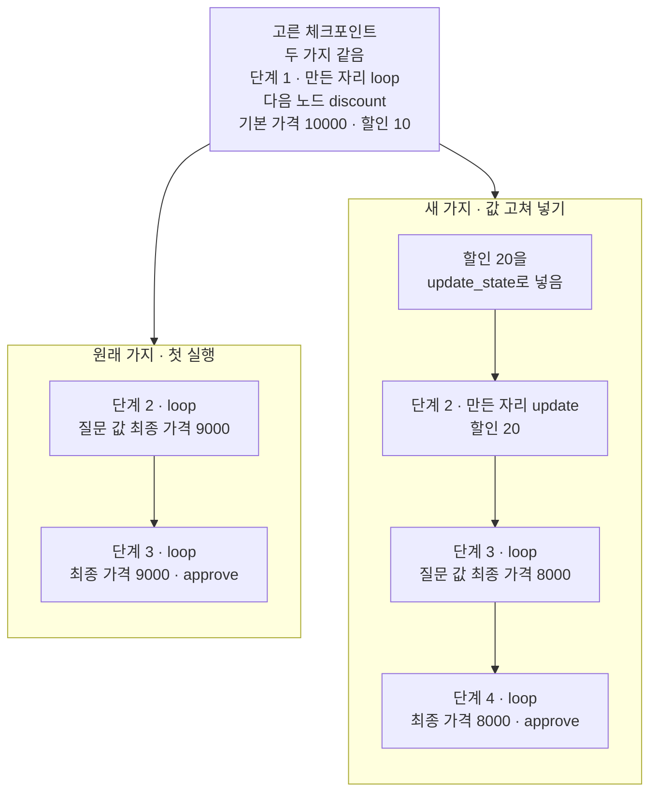
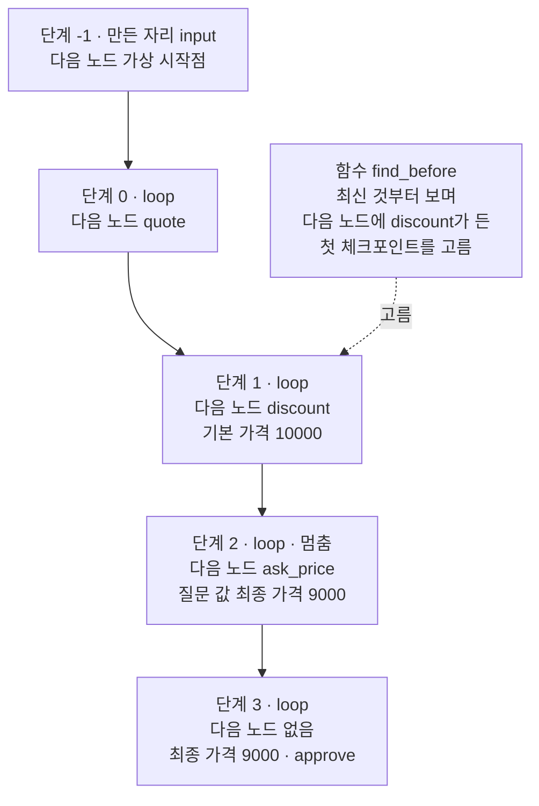
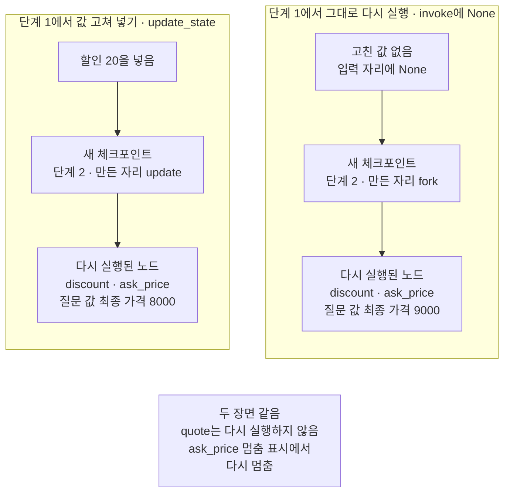
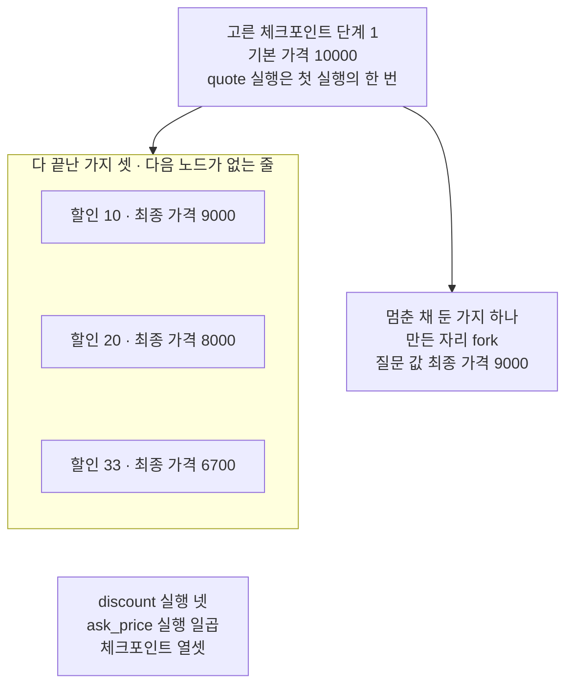

# 03-상태-기록과-다른-분기-재실행

## _src 본문 (HTML 원본)

```html
<!--meta: 강의 1h | 실습 2h | 코드 notebooks/03-상태-기록과-다른-분기-재실행.ipynb | 새 용어 3 -->
<style>html,body{overflow-x:hidden}.notebook,.nb-cell,.nb-main,.nb-input,.nb-result{min-width:0;max-width:100%}.nb-input pre,.nb-output{box-sizing:border-box;max-width:100%;overflow-x:auto}code.nb-source{display:block!important;width:100%!important;min-width:0!important;overflow-x:auto!important;padding:0!important}</style>
<h2 id="b1"><span class="no">1</span>학습 목표</h2><div class="goal"><ul>
<li>체크포인트 목록에서 돌아갈 체크포인트를 고르고, 그 줄의 단계 번호·만든 자리·다음 노드를 읽을 수 있습니다.</li>
<li>고른 체크포인트에 값을 고쳐 넣고 그 자리부터 다시 실행해, 원래 가지와 새 가지의 가격을 함께 읽을 수 있습니다.</li>
<li>값을 바꾸지 않고 다시 실행해도 뒤 노드가 다시 실행되고, 멈춤 표시에서 다시 멈추는 것을 설명할 수 있습니다.</li>
</ul></div>
<h2 id="b2"><span class="no">2</span>이 내용을 배우는 이유</h2><p>가격을 계산해 결제 확인까지 마친 뒤, 할인을 다르게 넣어야 했다는 것을 알았다고 합시다. 처음부터 다시 실행하면 견적 같은 앞 단계도 모두 다시 실행됩니다. 체크포인터에는 단계마다 체크포인트가 남아 있으니, 할인 전 자리로 돌아가 값만 바꿔 다시 실행할 수 있습니다. 이 절은 그렇게 만든 새 가지의 가격과 원래 가격이 기록에 함께 남는지 봅니다.</p><p>챕터 제목의 Time Travel은 지난 체크포인트로 돌아가 그 자리부터 다시 실행하는 일입니다. 본문에서는 지난 체크포인트에서 다시 실행이라고 씁니다. 절 제목은 지난 체크포인트로 돌아가 값을 바꾸고, 그 자리부터 새 가지로 다시 실행하는 일을 가리킵니다. 본문에서는 제목의 두 말 대신 새 가지와 다시 실행이라고 씁니다.</p>
<h2 id="b3"><span class="no">3</span>앞에서 배운 내용</h2><p><a href="../ch23-persistence/01-체크포인터와-스레드.html">Ch 23 01절</a>에서는 메서드 <code>get_state_history</code>가 한 스레드의 체크포인트를 최신 것부터 내놓았습니다. 체크포인트마다 단계 번호 <code>metadata["step"]</code>, 만든 자리 <code>metadata["source"]</code>, 다음 노드, 칸 값이 있었습니다. 그때 본 만든 자리는 <code>input</code>과 <code>loop</code> 둘이었습니다. 이 절은 그 목록을 한 줄씩 출력하는 함수 <code>print_history</code>를 도구 파일에서 가져옵니다. <a href="../ch23-persistence/05-pending-writes와-장애-복구.html">Ch 23 05절</a>에서는 입력 자리에 <code>None</code>을 넣어, 저장된 자리부터 이어 실행했습니다.</p><p><a href="01-interrupt-승인-게이트.html">01절</a>에서는 멈춤 표시로 멈춘 노드가, 사람의 답으로 이어 갈 때 첫 줄부터 다시 실행되었습니다. <a href="02-Command-resume으로-실행-재개.html">02절</a>에서는 노드가 목록에 글을 적게 해 실행 횟수를 셌고, 노드가 갱신을 내고 마칠 때마다 체크포인트가 하나씩 늘었습니다. 두 절 모두 스레드 설정으로 가장 최근 체크포인트에서 이어 갔습니다. 이 절은 목록에서 고른 지난 체크포인트에서 실행합니다.</p><p>상태 형식과 노드, 고정 엣지는 <a href="../../part4/ch13-langgraph-basics/01-StateGraph와-노드-엣지.html">Ch 13 01절</a> 모양 그대로이고, 이 절의 그래프에는 조건부 엣지가 없습니다. 함수 <code>print_history</code>는 Ch 23 01절 노트북의 같은 이름 함수를 글자 그대로 도구 파일 <code>approval_tools.py</code>에 옮긴 것입니다.</p>
<h2 id="b4"><span class="no">4</span>핵심 개념</h2><h3>비유로 시작하기</h3><p>01절의 도미노 줄을 다시 봅니다. 줄이 끝까지 넘어진 뒤, 가운데 한 자리부터 다른 도미노를 세워 보고 싶다고 합시다. Ch 23에서는 체크포인트를 즉석사진 한 장에 비유했습니다. 줄이 어디까지 넘어졌는지 찍어 둔 사진이 있으면, 그 자리부터 줄을 다시 세울 수 있습니다.</p><p>이때 원래 줄은 넘어진 그대로 두고, 그 자리 옆에서 다른 방향으로 새 줄을 세웁니다. 새 줄에도 빈자리를 비워 두었다면, 새 줄도 그 빈자리에서 멈춥니다. 탁자 위에는 원래 줄의 끝과 새 줄이 함께 남습니다.</p>
{{img:03-5-넘어진-줄-옆에-새로-세운-줄|흰 바탕에 탁자 하나를 조금 위에서 본 그림입니다. 탁자 앞쪽에 나무 도미노 한 줄이 왼쪽에서 오른쪽 끝까지 모두 넘어져 있습니다. 그 줄 가운데쯤에서 주황 도미노 줄이 오른쪽 위로 비스듬히 뻗어 나갑니다. 주황 줄은 앞쪽 넷이 넘어져 있고, 도미노 한 개 폭보다 좁은 틈을 두고 맨 끝 둘이 서 있습니다. 글자·숫자·사람·손은 없는 그림|넘어진 원래 줄은 그대로 두고, 가운데 자리 옆에서 새로 세운 줄은 서 있는 둘 앞의 틈에서 멈췄습니다.}}
<p class="look"><b>그림 읽기</b> — 탁자 위 나무 도미노 한 줄은 오른쪽 끝까지 모두 넘어져 있습니다. 그 가운데쯤에서 뻗어 나간 주황 줄은 넷이 넘어졌고, 좁은 틈 너머 맨 끝 둘은 서 있습니다. 넘어진 나무 줄이 원래 가지이고, 주황 줄이 고른 체크포인트에서 이어 붙인 새 가지입니다. 넘어진 넷이 서 있는 둘에 닿지 못한 그 틈이, 노트북 5절에서 새 가지가 다시 멈춘 확인 노드입니다. 틈은 도미노 한 개 폭보다 좁게 그려졌고, 도미노 개수와 틈의 폭은 무엇과도 짝짓지 않습니다.</p>
<table><thead><tr><th>말</th><th>뜻</th></tr></thead><tbody><tr><td>지난 체크포인트에서 다시 실행(Time Travel)</td><td>체크포인트 목록에서 지난 체크포인트 하나를 골라, 그 자리부터 그래프를 다시 실행하는 일입니다. 찍어 둔 사진을 보고 도미노 줄의 한 자리로 돌아가, 그 자리부터 줄을 다시 세우는 것과 같습니다. 이 절에서는 고른 체크포인트의 설정을 <code>invoke</code>에 넣고, 입력 자리에는 <code>None</code>을 넣습니다.</td></tr><tr><td>값 고쳐 넣기</td><td>고른 체크포인트의 칸 값 일부를 바꾼 체크포인트를 새로 만드는 일입니다. 줄을 다시 세울 자리의 도미노 하나를 다른 색 도미노로 바꿔 세우는 것과 같습니다. 이 절에서는 메서드 <code>update_state</code>이고, 새 체크포인트의 만든 자리는 <code>update</code>입니다.</td></tr><tr><td>새 가지(fork)</td><td>지난 체크포인트 하나에서 이어 붙여 새로 쌓은 체크포인트 줄입니다. 원래 도미노 줄은 넘어진 그대로 두고, 가운데 한 자리 옆에서 새 줄을 세우는 것과 같습니다. 이 절에서는 만든 자리가 <code>update</code>나 <code>fork</code>인 체크포인트에서 시작하고, 원래 가지의 줄과 한 목록에 섞여 남습니다.</td></tr></tbody></table>
<p>새 말을 이 절 코드에서 보면 이렇습니다. 지난 체크포인트에서 다시 실행은 노트북 7절 출력 <code>이 셀에서 실행된 노드: ['discount', 'ask_price']</code>입니다. 값 고쳐 넣기는 5절에서 <code>2 | update | ('discount',)</code>로 시작하는 줄이 생긴 셀입니다. 새 가지는 6절 출력 <code>스레드 설정으로 읽은 최종 가격: 8000</code>과 <code>따로 담아 둔 설정으로 읽은 최종 가격: 9000</code>에서 보입니다.</p>
{{mermaid:03-1-고른-체크포인트에서-이어-붙인-새-가지|위에 회색 상자 하나가 있고 아래에 칸 둘이 나란히 놓인 그림입니다. 회색 상자에는 고른 체크포인트 두 가지 같음, 단계 1 만든 자리 loop, 다음 노드 discount, 기본 가격 10000 할인 10이 적혀 있고, 두 칸으로 화살표가 갑니다. 칸 원래 가지 첫 실행에는 노란 상자 단계 2 loop 질문 값 최종 가격 9000 아래에 노란 상자 단계 3 loop 최종 가격 9000 approve가 있습니다. 칸 새 가지 값 고쳐 넣기에는 초록 상자 할인 20을 update_state로 넣음 아래로 노란 상자 셋이 차례로 이어집니다. 단계 2 만든 자리 update 할인 20, 단계 3 loop 질문 값 최종 가격 8000, 단계 4 loop 최종 가격 8000 approve인 그림|고른 체크포인트에 할인 20을 고쳐 넣자 새 가지가 생겼고, 원래 가지의 9000과 새 가지의 8000이 함께 남았습니다.}}
<p class="look"><b>도식 읽기</b> — 위에서 아래로 읽습니다. 맨 위 회색 상자는 두 가지가 함께 딛고 선 체크포인트이고, 노트북 4절에서 고른 단계 1 줄입니다. 칸 안의 노란 상자는 노트북 3절과 6절에서 출력한 체크포인트 줄이고, 초록 상자는 우리가 고쳐 넣은 값입니다. 두 칸 모두 단계 번호가 2부터 이어지지만, 서로 다른 체크포인트입니다.</p>
<h3>고른 자리부터 실행하면 일어나는 일</h3><p>체크포인트에는 그 자리까지의 칸 값과, 다음에 실행할 노드가 저장됩니다. 노트북 4절에서 고른 단계 1 체크포인트는 견적 노드를 마친 뒤라, 칸 <code>base_price</code>가 이미 <code>10000</code>입니다. 다음 노드가 <code>discount</code>이므로, 이 자리부터 실행하면 할인 노드부터 시작합니다. 그래서 새 가지를 셋 만들어도 견적 노드는 첫 실행의 한 번뿐이었습니다.</p><p>고른 자리 뒤 노드는 저장된 결과를 읽지 않고 다시 실행됩니다. 공식 문서도 다시 실행은 저장해 둔 결과를 읽기만 하는 것이 아니라, 노드를 다시 실행한다고 적습니다. 뒤에 멈춤 표시 노드가 있으면 그 노드도 다시 실행되어, 새 사람의 답을 기다리며 다시 멈춥니다. 노트북 5·7·8절에서 확인 노드가 매번 다시 멈춘 것이 이 모습입니다.</p><p>메서드 <code>update_state</code>는 스레드를 되돌리지 않습니다. 공식 문서는 고른 자리에서 새 체크포인트를 만들고, 원래 기록은 그대로 남는다고 적습니다. 설치판 소스 <code>langgraph/pregel/main.py</code> 2019행이 고른 자리의 단계 번호에 1을 더해 넘깁니다. 받는 함수는 <code>langgraph/pregel/_checkpoint.py</code>에 있고, 그 128행이 만든 자리 <code>update</code>를 적습니다. 그래서 단계 번호는 고른 자리보다 하나 큰 수입니다.</p>
<h3>다른 상황에 적용</h3><p>앞 단계 결과는 그대로 두고, 칸 하나만 바꿔 뒤 계산을 다시 보고 싶을 때 같은 방법을 씁니다. 고른 자리 뒤에 사람의 확인이 있으면, 바뀐 값으로 사람에게 다시 묻게 됩니다. 모델을 부르는 노드가 고른 자리 뒤에 있으면, 그 노드도 다시 실행되어 요청이 새로 나갑니다. 공식 문서는 그 결과가 달라질 수 있다고 적습니다. 이 절은 모델을 부르지 않아, 그 장면은 실행하지 않았습니다.</p>
<h3>비교와 경계</h3><p>01절과 02절은 스레드 설정으로 가장 최근 체크포인트에서 이어 갔습니다. Ch 23 05절의 <code>invoke(None, config)</code>도 스레드 설정이라 가장 최근 자리부터 이어 갔습니다. 이 절은 목록에서 고른 지난 체크포인트의 설정으로 실행합니다. <a href="../../part4/ch13-langgraph-basics/03-조건부-엣지.html">Ch 13 03절</a>의 조건부 엣지는 한 실행 안에서 다음 노드 하나를 골랐습니다. 새 가지는 한 스레드의 기록에 원래 가지와 나란히 남습니다.</p>
<h2 id="b5"><span class="no">5</span>실행 예제</h2><p>노트북은 먼저 할인을 정수 백분율로 계산하는 까닭을 보고, 노드 셋의 가격 그래프를 만듭니다. 첫 실행은 할인 10으로 9000원을 묻고 멈추며, 사람의 답 <code>approve</code>로 끝납니다. 체크포인트 목록에서 할인 노드 앞 체크포인트를 고르고, 할인 20을 고쳐 넣어 그 자리부터 다시 실행합니다. 새 가지는 8000원을 물으며 다시 멈추고, 같은 답으로 끝납니다.</p><p>이 절은 모델을 부르지 않아 모델 요청은 0번이고, API 키 셀도 없습니다. 사람의 답도 셀에 적은 값이라, 같은 입력에 늘 같은 출력이 나옵니다. 실제 서비스라면 질문 값을 화면에 띄우고, 사람이 고른 답을 같은 자리에 넣습니다. 체크포인트는 메모리에만 저장해, 파일은 하나도 쓰지 않습니다.</p>
{{notebook:03-상태-기록과-다른-분기-재실행}}
<p class="look"><b>확인할 점</b> — 노트북 3절에서 <code>체크포인트 수: 5</code>와 <code>1 | loop | ('discount',)</code>로 시작하는 줄을 봅니다. 5절에서 <code>2 | update | ('discount',)</code>와 <code>질문 값: {'final_price': 8000, 'question': '이 가격으로 결제할까요?'}</code>가 나오는지 봅니다. 6절에서 <code>스레드 설정으로 읽은 최종 가격: 8000</code>과 <code>따로 담아 둔 설정으로 읽은 최종 가격: 9000</code>도 확인합니다.</p>
{{mermaid:03-2-첫-실행의-체크포인트-목록과-고른-자리|위에서 아래로 노란 상자 다섯이 한 줄로 이어지고, 옆에 파란 상자 하나가 있는 그림입니다. 노란 상자는 차례로 단계 -1 만든 자리 input 다음 노드 가상 시작점, 단계 0 loop 다음 노드 quote, 단계 1 loop 다음 노드 discount 기본 가격 10000, 단계 2 loop 멈춤 다음 노드 ask_price 질문 값 최종 가격 9000, 단계 3 loop 다음 노드 없음 최종 가격 9000 approve입니다. 파란 상자 함수 find_before 최신 것부터 보며 다음 노드에 discount가 든 첫 체크포인트를 고름에서 점선 화살표 고름이 단계 1 상자로 가는 그림|첫 실행의 체크포인트 다섯 가운데, 견적을 마치고 할인 전인 단계 1 체크포인트를 골랐습니다.}}
<p class="look"><b>도식 읽기</b> — 위에서 아래로, 오래된 체크포인트부터 읽습니다. 노트북 3절의 출력은 최신 것부터라, 이 그림과 차례가 거꾸로입니다. 노란 상자는 모두 그 출력의 한 줄이고, 파란 상자는 4절에서 우리가 적은 함수입니다. 점선은 함수가 목록에서 고른 체크포인트를 가리킵니다.</p>
<h2 id="b6"><span class="no">6</span>실험 결과 해석</h2><p>노트북은 4절에서 고른 같은 체크포인트에서 세 번 실행했습니다. 할인 20을 고쳐 넣은 실행, 값을 바꾸지 않은 실행, 할인 33을 고쳐 넣은 실행입니다. 아래 표는 장면마다 새로 생긴 체크포인트의 만든 자리와, 그 셀에서 실행된 노드를 모은 것입니다.</p>
<table><thead><tr><th>장면</th><th>넣은 것</th><th>새 체크포인트의 만든 자리</th><th>그 셀에서 실행된 노드</th><th>질문 값의 최종 가격</th></tr></thead><tbody><tr><td>첫 실행(3절)</td><td>입력 할인 <code>10</code></td><td><code>input</code>·<code>loop</code></td><td><code>quote</code>·<code>discount</code>·<code>ask_price</code></td><td><code>9000</code></td></tr><tr><td>값 고쳐 넣기(5절)</td><td>할인 <code>20</code></td><td><code>update</code></td><td><code>discount</code>·<code>ask_price</code></td><td><code>8000</code></td></tr><tr><td>그대로 다시 실행(7절)</td><td>없음(<code>None</code>)</td><td><code>fork</code></td><td><code>discount</code>·<code>ask_price</code></td><td><code>9000</code></td></tr><tr><td>값 바꿔 보기(8절)</td><td>할인 <code>33</code></td><td><code>update</code></td><td><code>discount</code>·<code>ask_price</code></td><td><code>6700</code></td></tr></tbody></table>
<p>세 번 모두 견적 노드는 실행되지 않았고, 할인 노드와 확인 노드만 실행되었습니다. 값을 고쳐 넣은 두 번은 만든 자리가 <code>update</code>인 체크포인트에서 시작했습니다. 그대로 실행한 한 번은 만든 자리가 <code>fork</code>인 체크포인트에서 시작했습니다. 어느 쪽이든 새 체크포인트가 생겨, 지난 체크포인트를 고쳐 쓰지 않았습니다. 확인 노드는 세 번 모두 새로 계산한 최종 가격을 담아 다시 멈췄습니다.</p>
{{mermaid:03-3-값을-고쳐-넣은-가지와-그대로-다시-실행한-가지|칸 둘이 나란히 있고 두 칸 아래에 회색 상자 하나가 놓인 그림입니다. 칸 단계 1에서 값 고쳐 넣기 update_state에는 초록 상자 할인 20을 넣음, 노란 상자 새 체크포인트 단계 2 만든 자리 update, 노란 상자 다시 실행된 노드 discount ask_price 질문 값 최종 가격 8000이 차례로 있습니다. 칸 단계 1에서 그대로 다시 실행 invoke에 None에는 초록 상자 고친 값 없음 입력 자리에 None, 노란 상자 새 체크포인트 단계 2 만든 자리 fork, 노란 상자 다시 실행된 노드 discount ask_price 질문 값 최종 가격 9000이 차례로 있습니다. 두 칸 아래 회색 상자에는 두 장면 같음, quote는 다시 실행하지 않음, ask_price 멈춤 표시에서 다시 멈춤이 적혀 있고, 칸과는 화살표 없이 놓인 그림|값을 고쳐 넣어도, 그대로 다시 실행해도 새 체크포인트가 생겼고 고른 자리 뒤 노드가 다시 실행되었습니다.}}
<p class="look"><b>도식 읽기</b> — 왼쪽 칸은 노트북 5절, 오른쪽 칸은 7절이고, 두 칸 모두 고른 체크포인트 단계 1에서 출발합니다. 칸 안은 위에서 아래로 실행 차례이고, 초록 상자는 우리가 넣은 것, 노란 상자는 셀 출력에 나온 값입니다. 두 칸 아래 회색 상자는 두 장면의 출력에서 모두 확인한 사실이라, 칸과 화살표로 잇지 않았습니다. 두 칸의 차이는 넣은 것과 새 체크포인트의 만든 자리, 질문 값의 최종 가격입니다.</p>
<p>공식 문서는 값을 바꾸지 않은 다시 실행과 값을 고쳐 넣은 새 가지를 나눠 설명합니다. 이 판에서는 값을 바꾸지 않은 실행도 만든 자리가 <code>fork</code>인 체크포인트를 새로 만들었고, 이 절은 출력대로 적었습니다. 설치판 소스 <code>langgraph/pregel/_loop.py</code> 952~971행이 그 체크포인트를 저장하는 자리입니다. 주석은 다시 실행한 일이 새 가지를 만들도록 이 체크포인트를 저장한다고 적습니다.</p><p>문서의 절 이름과 만든 자리 이름은 엇갈려 짝지어집니다. 문서 「Fork」 절이 다루는 <code>update_state</code>는 만든 자리 <code>update</code>를 남겼습니다. 문서 「Replay」 절이 다루는 그대로 다시 실행은 만든 자리 <code>fork</code>를 남겼습니다. 문서를 읽을 때 절 이름을 만든 자리 이름으로 여기지 않습니다.</p><p>노트북 6절에서 스레드 설정으로 읽은 최종 가격은 <code>8000</code>, 따로 담아 둔 설정으로 읽은 값은 <code>9000</code>이었습니다. 새 가지를 만들어도 원래 가지의 체크포인트는 지워지지 않았습니다. 다만 스레드 설정은 가장 최근 체크포인트만 가리켜, 원래 가지는 담아 둔 설정으로 다시 읽었습니다. 9절 목록에는 다 끝난 가지 셋의 최종 가격 <code>6700</code>·<code>8000</code>·<code>9000</code>이 함께 있었습니다.</p>
{{mermaid:03-4-다-끝난-가지-셋과-노드-실행-횟수|위에 회색 상자 하나가 있고, 아래에 칸 하나와 노란 상자 하나가 나란히 놓인 그림입니다. 회색 상자에는 고른 체크포인트 단계 1, 기본 가격 10000, quote 실행은 첫 실행의 한 번이 적혀 있고, 칸과 노란 상자로 화살표가 갑니다. 칸 다 끝난 가지 셋 다음 노드가 없는 줄에는 노란 상자 셋이 위아래로 쌓였습니다. 할인 10 최종 가격 9000, 할인 20 최종 가격 8000, 할인 33 최종 가격 6700입니다. 옆 노란 상자는 멈춘 채 둔 가지 하나 만든 자리 fork 질문 값 최종 가격 9000이고, 칸 아래에 노란 상자 discount 실행 넷 ask_price 실행 일곱 체크포인트 열셋이 있는 그림|다 끝난 가지 셋(원래 가지 포함)과 멈춘 채 둔 가지 하나가 한 목록에 남았고, 견적 노드는 한 번만 실행되었습니다.}}
<p class="look"><b>도식 읽기</b> — 맨 위 회색 상자는 모든 가지가 딛고 선 체크포인트입니다. 칸 안 노란 상자 셋은 노트북 9절에서 다 끝난 체크포인트만 골라 출력한 값입니다. 출력은 최신 것부터라 할인 33이 먼저 나왔고, 그림에는 할인 차례로 적었습니다. 옆 노란 상자는 7절에서 멈춘 채 둔 가지이고, 맨 아래 노란 상자는 9절에서 센 수입니다. 화살표 없이 놓은 상자는 같은 셀들에서 함께 읽은 값입니다.</p>
<p>9절에서 센 실행 횟수는 견적 노드 <code>1</code>, 할인 노드 <code>4</code>, 확인 노드 <code>7</code>이었습니다. 확인 노드는 멈출 때 한 번, 사람의 답으로 이어 갈 때 한 번 더 실행되어 수가 컸습니다. 체크포인트는 모두 13개가 한 스레드의 목록에 쌓였습니다. 모델을 부르지 않아, 노트북 출력은 새 커널로 다시 실행해도 같아야 합니다. 새 커널로 두 번 실행했을 때 코드 셀 28개의 출력이 모두 같았습니다.</p>
<p class="look"><b>확인할 점</b> — 노트북 7절에서 <code>2 | fork | ('discount',)</code>로 시작하는 줄과 <code>체크포인트 수: 10</code>을 봅니다. 9절에서 <code>quote 실행 횟수: 1</code>과 <code>33 | 6700 | approve</code>가 나오는지 확인합니다.</p>
<h2 id="b7"><span class="no">7</span>주의할 점과 실무 메모</h2><ul><li>체크포인트 목록은 최신 것부터 놓여, 가지가 늘면 같은 조건의 체크포인트도 여럿이 됩니다. 노트북 9절에서 <code>find_before</code>로 다시 고르자 8절에서 만든 체크포인트가 나왔습니다. 돌아갈 체크포인트는 고른 때 변수에 담아 두고, 그 변수로 씁니다.</li><li>스레드 설정으로 사람의 답을 넘기면 가장 최근 체크포인트의 질문에 닿습니다. 노트북 8절에서도 7절에 멈춘 채 둔 가지가 아니라, 방금 멈춘 가지가 답을 받았습니다. 멈춘 채 둔 가지에 답을 넘기는 장면은 이번에 실행하지 않았습니다.</li><li>체크포인트에는 그래프의 칸 값이 저장되고, 바깥 파일은 들어 있지 않습니다. 고른 자리 앞에서 파일에 적었다면, 지난 체크포인트로 돌아가도 그 줄은 그대로 남습니다. 고른 자리 뒤 노드가 파일에 적는다면, 다시 실행할 때 01절 Before처럼 한 번 더 적습니다. 이 절은 파일을 쓰지 않아, 이 두 장면은 실행하지 않았습니다.</li><li><a href="../../part4/ch13-langgraph-basics/02-State-갱신.html">Ch 13 02절</a>처럼 이어 붙이기 규칙을 적은 칸에 값을 고쳐 넣으면, 새 값이 앞 값 뒤에 이어 붙었습니다. 노트북 밖 확인에서 목록 <code>['a']</code>에 <code>['edited']</code>를 넣자 <code>['a', 'edited']</code>가 되었습니다. 이 절의 다섯 칸은 규칙이 없어 덮어썼고, 그 장면은 노트북에서 실행하지 않았습니다.</li><li>메서드 <code>update_state</code>에 인자 <code>as_node</code>로 노드 이름을 주면, 그 노드가 값을 낸 것처럼 다음 노드가 정해집니다. 노트북 밖 확인에서 마지막 노드 이름을 주자 다음 노드가 <code>()</code>가 되었습니다. 인자를 주지 않으면 마지막으로 칸을 갱신한 노드로 본다고 설치판 <code>main.py</code> 2522~2524행이 적습니다. 이 절은 인자를 주지 않았습니다.</li><li>노트북 2절에서 할인을 소수 할인율로 계산하자 33%에서 <code>6699</code>가 나왔습니다. 그래서 할인은 정수 백분율 칸에 두고 <code>//</code>로 계산했습니다.</li><li>체크포인트 수와 실행 횟수는 노드 셋을 이 차례로 실행한 이 그래프의 값입니다. 셀 하나만 다시 실행하면 같은 스레드에 체크포인트가 더해져 값이 달라집니다. 처음 값으로 다시 보려면 1절 임시 폴더 셀부터 다시 실행합니다.</li><li>걸린 시간은 재지 않았습니다. 교재 출력은 Linux의 Python 3.12.13으로 만들었고, 다른 판과 Windows·macOS에서는 실행하지 않았습니다.</li></ul>
<h2 id="b8"><span class="no">8</span>정리와 다음 절</h2><ul><li>다음 노드가 <code>discount</code>인 체크포인트를 골라 할인을 고쳐 넣자, 만든 자리가 <code>update</code>인 체크포인트가 생겼습니다.</li><li>그 자리부터 다시 실행하자 뒤 노드만 다시 실행되어 <code>8000</code>에서 다시 멈췄고, 원래 가지의 <code>9000</code>도 남았습니다.</li><li>값을 바꾸지 않고 다시 실행해도 만든 자리가 <code>fork</code>인 체크포인트가 생기고, 뒤 노드가 다시 실행되었습니다.</li></ul><p><strong>다음 학습과 이어지는 지점</strong> — <a href="04-Human-in-the-Loop-실습.html">04절</a> 실습에서는 이 챕터에서 배운 것을 작은 흐름 하나에 모아 실행합니다.</p>
<h2 id="b9"><span class="no">9</span>복습 문제</h2><details class="quiz" open><summary>문제 4개 · 해설 포함</summary><p class="quiz-q">1. 5절에서 새 가지를 실행했는데 견적 노드 <code>quote</code>가 실행되지 않은 까닭은 무엇인가요?</p><p class="quiz-a">고른 체크포인트는 견적 노드를 마친 뒤라, 기본 가격 <code>10000</code>이 칸에 이미 저장되어 있었습니다. 다음 노드가 <code>discount</code>여서 할인 노드부터 실행했기 때문입니다. 틀렸다면 노트북 3절과 5절을 다시 읽습니다.</p><p class="quiz-q">2. 6절에서 스레드 설정으로 읽은 최종 가격은 8000, 따로 담아 둔 설정으로 읽은 값은 9000이었습니다. 까닭은 무엇인가요?</p><p class="quiz-a">스레드 설정은 가장 최근 체크포인트인 새 가지의 끝을 읽습니다. 따로 담아 둔 설정은 원래 가지의 끝 체크포인트를 가리켜, 그 체크포인트가 지워지지 않고 남아 있음을 보여 줍니다. 틀렸다면 노트북 6절을 다시 읽습니다.</p><p class="quiz-q">3. 7절에서 값을 고쳐 넣지 않고 다시 실행했는데 체크포인트가 늘었습니다. 새로 생긴 체크포인트의 만든 자리는 무엇이었나요?</p><p class="quiz-a">만든 자리가 <code>fork</code>인 체크포인트가 생겼고, 그 뒤 할인 노드와 확인 노드가 다시 실행되어 확인 노드에서 다시 멈췄습니다. 틀렸다면 노트북 7절을 다시 읽습니다.</p><p class="quiz-q">4. 9절에서 <code>find_before</code>로 다시 고르자 4절과 다른 체크포인트가 나왔습니다. 까닭은 무엇인가요?</p><p class="quiz-a">가지가 늘어 다음 노드가 <code>discount</code>인 체크포인트가 여럿이 되었습니다. 함수는 최신 것부터 보다가 처음 만난 것을 고르므로, 8절에서 만든 체크포인트가 나왔습니다. 틀렸다면 노트북 9절을 다시 읽습니다.</p></details>
<h2 id="b10"><span class="no">10</span>참고 자료</h2><ul><li><div><a href="https://docs.langchain.com/oss/python/langgraph/use-time-travel">LangGraph Time Travel</a></div>확인 2026-09-25 · 「Replay」 절 주의 글의 문장입니다. <code>Replay re-executes nodes—it doesn't just read from cache</code></li><li>같은 문서 「Fork」 절은 <code>update_state</code>가 스레드를 되돌리지 않고, 고른 자리에서 새 체크포인트를 만든다고 적습니다. 원래 기록은 그대로 남는다고도 적습니다.</li><li>같은 문서는 지난 체크포인트에서 다시 실행하면 멈춤 표시가 늘 다시 멈춘다고 적습니다. 목록은 최신 것부터 놓인다고도 적습니다.</li><li>langgraph 1.2.11 소스 <code>langgraph/pregel/_loop.py</code> 952~971행 — 만든 자리가 <code>fork</code>인 체크포인트를 저장하는 자리입니다. 지난 체크포인트 설정으로 다시 실행할 때 이 자리를 지납니다.</li><li>같은 판 <code>langgraph/pregel/main.py</code> 2019행과 <code>langgraph/pregel/_checkpoint.py</code> 128행 — <code>update_state</code>가 만든 체크포인트에 단계 번호와 만든 자리 <code>update</code>를 적는 자리입니다. <code>main.py</code> 2522~2524행은 인자 <code>as_node</code>를 주지 않았을 때의 동작을 적습니다.</li><li>Ch 23 01절에서 체크포인트 목록과 함수 <code>print_history</code>를 보았습니다.</li></ul>
```

## 노트북 셀 (순서대로)

### [0] markdown {'html': 'skip'}

# 상태 기록과 다른 분기 재실행

**이 노트북에서 할 일**

1. 끝난 실행의 체크포인트 목록에서, 돌아갈 체크포인트 하나를 고릅니다.
2. 고른 체크포인트에 할인 백분율을 고쳐 넣고, 그 자리부터 다시 실행해 새 가지를 만듭니다.
3. 원래 가지와 새 가지의 가격이 함께 남는지, 멈춤 표시에서 다시 멈추는지 봅니다.

**준비물** — 이 노트북은 모델을 부르지 않습니다.
모델 요청은 0번이고, API 키 없이 실행합니다.
사람의 답은 우리가 셀에 적어 넣는 값(`"approve"`)입니다.
실제 서비스라면 화면에서 사람이 고른 값을 같은 자리에 넣습니다.
매번 같은 값을 내는 우리 노드로, 가격과 노드가 실행된 차례를 봅니다.

체크포인트는 메모리에만 저장하고, 파일은 하나도 쓰지 않습니다.
그래도 01절과 같은 모양으로 빈 임시 폴더를 만들고, 마지막 셀에서 그 폴더가 비어 있는지 봅니다.
읽어 오는 자료 파일은 없습니다.
걸린 시간은 재지 않았습니다.

**기준 버전** — 첫 셀에서 패키지 둘을 설치합니다.
그래프는 langgraph 1.2.11, 체크포인터는 langgraph-checkpoint 4.2.0에 들어 있습니다.
교재 출력은 Linux의 Python 3.12.13으로 만들었습니다.
다른 판과 Windows·macOS에서는 실행하지 않았습니다.
설치 셀에 걸리는 시간은 네트워크에 따라 달라집니다.

**강의와 실습 범위** — 강의 시간에는 2~6절을 읽습니다.
체크포인트를 고르고, 값을 고쳐 넣어 새 가지를 만드는 자리입니다.
7~9절은 값을 바꾸지 않고 다시 실행하거나 값을 바꿔 보는 자리이고, 실습 시간에 실행합니다.
셀 하나만 다시 실행하면 같은 스레드에 체크포인트가 더해지고 실행 기록 목록도 늘어, 값이 달라집니다.
처음 값으로 다시 보려면 1절 임시 폴더 셀부터 다시 실행합니다.

실습 폴더 `labs/part6/ch24-human-in-the-loop`에서 `uv sync --locked`를 실행합니다.
그다음 `notebooks/` 폴더의 이 노트북을 열고, 실습 폴더의 `.venv` 커널을 고릅니다.
첫 셀부터 순서대로 실행합니다.

### [1] markdown {'html': 'skip'}

## 오늘 볼 그림


위에서 아래로 읽습니다.
맨 위 회색 상자는 두 가지가 함께 딛고 선 체크포인트이고, 노트북 4절에서 고른 단계 1 줄입니다.
칸 안의 노란 상자는 노트북 3절과 6절에서 출력한 체크포인트 줄이고, 초록 상자는 우리가 고쳐 넣은 값입니다.
두 칸 모두 단계 번호가 2부터 이어지지만, 서로 다른 체크포인트입니다.

### [2] markdown {}

## 1. 준비

02절까지는 멈춘 실행을 가장 최근 체크포인트에서 이어 갔습니다.
이 절에서는 이미 끝난 실행의 지난 체크포인트로 돌아가, 값을 바꿔 그 자리부터 다시 실행합니다.
절 제목은 지난 체크포인트로 돌아가 값을 바꾸고, 그 자리부터 새 가지로 다시 실행하는 일을 가리킵니다.
본문에서는 제목의 두 말 대신 새 가지와 다시 실행이라고 씁니다.

첫 셀은 01절과 같은 패키지 둘을 설치하고, 설치된 판 번호를 출력합니다.
설치에는 몇십 초가 걸릴 수 있습니다.

### [3] code {'execution': {'iopub.execute_input': '2026-09-25T14:52:28.141952Z', 'iopub.status.busy': '2026-09-25T14:52:28.141781Z', 'iopub.status.idle': '2026-09-25T14:52:28.567724Z', 'shell.execute_reply': '2026-09-25T14:52:28.567217Z'}, 'lesson_role': 'setup'}

```python
# 이 절에서 쓰는 패키지를 설치하고 버전을 확인합니다
%pip install -q "langgraph==1.2.11" "langgraph-checkpoint==4.2.0"
from importlib.metadata import version

print("langgraph:", version("langgraph"))
print("langgraph-checkpoint:", version("langgraph-checkpoint"))
```

출력:
```
Note: you may need to restart the kernel to use updated packages.
langgraph: 1.2.11
langgraph-checkpoint: 4.2.0

```

### [4] markdown {}

**결과 읽기** — 출력 줄 `langgraph: 1.2.11`과 `langgraph-checkpoint: 4.2.0`이 보입니다.
두 판 모두 실습 폴더 잠금과 같은 판입니다.
이 노트북의 출력은 2026-09-25에 이 판으로 실행한 결과입니다.

다음 셀은 이 절에서 쓸 이름을 가져옵니다.
상태 형식과 그래프 이름은 Ch 13 01절, 체크포인터 `InMemorySaver`는 Ch 23 01절과 같습니다.
함수 `interrupt`와 객체 `Command`는 01절에서 가져온 이름 그대로입니다.
마지막 가져오기 줄은 Ch 23 01절에서 배운 함수 `print_history`를 도구 파일 `approval_tools.py`에서 가져옵니다.

### [5] code {'execution': {'iopub.execute_input': '2026-09-25T14:52:28.569244Z', 'iopub.status.busy': '2026-09-25T14:52:28.569146Z', 'iopub.status.idle': '2026-09-25T14:52:29.095796Z', 'shell.execute_reply': '2026-09-25T14:52:29.095385Z'}, 'lesson_role': 'setup'}

```python
# 그래프 이름(Ch 13 01절)·체크포인터(Ch 23 01절)와, 01절에서 쓴 멈춤 표시 이름 둘을 가져옵니다
from typing_extensions import TypedDict
from langgraph.graph import StateGraph, START, END
from langgraph.checkpoint.memory import InMemorySaver
# interrupt는 노드를 멈추는 함수, Command는 멈춘 그래프에 사람의 답을 넘길 때 쓰는 객체입니다(01절)
from langgraph.types import Command, interrupt
# Ch 23 01절에서 배운 함수를 도구 파일에서 가져옵니다
from approval_tools import print_history

print("langgraph.types에서 가져온 이름:", "Command, interrupt")
print("도구 파일에서 가져온 함수:", "print_history")
```

출력:
```
langgraph.types에서 가져온 이름: Command, interrupt
도구 파일에서 가져온 함수: print_history

```

### [6] markdown {}

**결과 읽기** — 출력 줄 `도구 파일에서 가져온 함수: print_history`가 보입니다.

앞에서 배운 함수는 `approval_tools.py`에 모아 두었습니다.
파일을 열면 코드를 볼 수 있습니다.
노트북과 같은 폴더(`notebooks/`)에 있는 파일입니다.
커널이 `notebooks/` 폴더에서 시작해야 이 파일을 가져올 수 있어, 작업 위치를 옮기기 전에 가져왔습니다.
교재 출력을 만든 실행 도구는 이 폴더를 따로 알려 주어, 다른 자리에서 시작해도 가져오기가 되었습니다.

함수 `print_history`는 체크포인트 목록을 받아, 하나마다 한 줄을 출력합니다.
한 줄에는 단계 번호, 만든 자리, 다음 노드, 칸 값을 적습니다.
도구 파일의 이 함수는 Ch 23 01절 노트북의 같은 이름 함수를 글자 그대로 옮긴 것입니다.

다음 셀은 01절처럼 빈 임시 폴더를 만들고, 그 폴더로 작업 위치를 옮깁니다.
이 절은 파일을 쓰지 않지만, 마지막 셀에서 이 폴더가 그대로 비어 있는지 봅니다.
폴더 위치는 컴퓨터마다 달라 출력하지 않고, 폴더 이름의 앞머리만 확인합니다.

### [7] code {'execution': {'iopub.execute_input': '2026-09-25T14:52:29.096466Z', 'iopub.status.busy': '2026-09-25T14:52:29.096413Z', 'iopub.status.idle': '2026-09-25T14:52:29.098593Z', 'shell.execute_reply': '2026-09-25T14:52:29.098239Z'}, 'lesson_role': 'setup'}

```python
# 파일이 생기는지 볼 빈 임시 폴더를 만들고, 그 폴더로 작업 위치를 옮깁니다(Ch 23 01절과 같은 모양)
import os
import tempfile

# mkdtemp()는 운영체제 임시 폴더 안에 새 폴더를 만들고, 그 폴더의 위치를 글로 내놓습니다
practice_folder = tempfile.mkdtemp(prefix="ch24-03-")
# chdir()는 터미널의 cd처럼 현재 작업 폴더를 옮깁니다
os.chdir(practice_folder)
print("임시 폴더 이름에 ch24-03-이 들어 있는가:", "ch24-03-" in practice_folder)
print("현재 작업 폴더의 파일:", os.listdir())
```

출력:
```
임시 폴더 이름에 ch24-03-이 들어 있는가: True
현재 작업 폴더의 파일: []

```

### [8] markdown {}

**결과 읽기** — 출력 줄 `임시 폴더 이름에 ch24-03-이 들어 있는가: True`로, 이 절의 폴더를 만들었습니다.
출력 줄 `현재 작업 폴더의 파일: []`로, 빈 폴더에서 시작합니다.

## 2. 가격을 계산하고 묻는 그래프

이 절의 그래프는 노드 셋을 한 줄로 잇습니다.
견적 노드 `quote`가 기본 가격을 내고, 할인 노드 `discount`가 최종 가격을 냅니다.
확인 노드 `ask_price`는 01절처럼 최종 가격을 질문 값에 담아 멈춤 표시로 묻습니다.

할인은 백분율을 정수로 두고 계산합니다.
다음 셀은 그 까닭을 봅니다.
할인 33%를 소수 할인율 `0.33`으로 계산한 값과, 정수 `33`으로 계산한 값을 견줍니다.
연산자 `//`는 나눈 몫의 정수 부분만 내놓습니다.

### [9] code {'execution': {'iopub.execute_input': '2026-09-25T14:52:29.099254Z', 'iopub.status.busy': '2026-09-25T14:52:29.099207Z', 'iopub.status.idle': '2026-09-25T14:52:29.100902Z', 'shell.execute_reply': '2026-09-25T14:52:29.100602Z'}}

```python
# 할인 33%를 소수 할인율로 계산한 값과, 정수 백분율로 계산한 값을 견줍니다
sample_price = 10000
sample_rate = 0.33
float_price = sample_price * (1 - sample_rate)
print("소수 할인율로 계산한 값:", float_price)
print("int로 소수점 아래를 버린 값:", int(float_price))
# 100은 할인하지 않은 전체(100%)이고, //는 나눈 몫의 정수 부분만 내놓습니다
full_percent = 100
sample_percent = 33
print("정수 백분율로 계산한 값:", sample_price * (full_percent - sample_percent) // full_percent)
```

출력:
```
소수 할인율로 계산한 값: 6699.999999999999
int로 소수점 아래를 버린 값: 6699
정수 백분율로 계산한 값: 6700

```

### [10] markdown {}

**결과 읽기** — 출력 줄 `소수 할인율로 계산한 값: 6699.999999999999`입니다.
컴퓨터는 소수를 2진수로 담아, 끝자리에 아주 작은 어긋남이 생깁니다.
출력 줄 `int로 소수점 아래를 버린 값: 6699`로, 소수점 아래를 버리면 1원이 모자랍니다.
출력 줄 `정수 백분율로 계산한 값: 6700`은 소수를 거치지 않아 맞게 나왔습니다.
그래서 이 절의 할인 노드는 할인 백분율을 정수 칸에 두고 `//`로 계산합니다.

다음 셀은 이 절의 상태 형식을 만듭니다.
칸 `quantity`는 수량, 칸 `base_price`는 기본 가격, 칸 `percent`는 할인 백분율입니다.
칸 `final_price`는 최종 가격, 칸 `answer`는 사람의 답입니다.
다섯 칸 모두 규칙을 적지 않아, 새 값이 오면 덮어씁니다.
01절 `ApprovalState`·02절 `ReviewState`와 칸이 달라, 이름도 새로 붙였습니다.

### [11] code {'execution': {'iopub.execute_input': '2026-09-25T14:52:29.101502Z', 'iopub.status.busy': '2026-09-25T14:52:29.101456Z', 'iopub.status.idle': '2026-09-25T14:52:29.103244Z', 'shell.execute_reply': '2026-09-25T14:52:29.102890Z'}}

```python
# 수량·기본 가격·할인 백분율·최종 가격·사람의 답 칸을 둔 상태 형식을 만듭니다(Ch 13 01절 모양, 다섯 칸 모두 규칙 없음)
class PriceState(TypedDict):
    quantity: int
    base_price: int
    percent: int
    final_price: int
    answer: str
```

출력:
```

```

### [12] markdown {}

**결과 읽기** — 정의 셀이라 출력이 없습니다.
이 절의 그래프는 이 상태 형식 하나를 씁니다.

다음 셀은 견적 노드입니다.
수량에 한 개 값 2500원을 곱해, 기본 가격을 칸 `base_price`에 냅니다.
02절처럼 노드는 실행될 때마다 자기 이름을 목록 `price_calls`에 적습니다.
이 목록으로 어느 노드가 몇 번 실행되었는지 셉니다.
목록 `price_calls`는 뒤의 컴파일 셀에서 만듭니다.

### [13] code {'execution': {'iopub.execute_input': '2026-09-25T14:52:29.103856Z', 'iopub.status.busy': '2026-09-25T14:52:29.103801Z', 'iopub.status.idle': '2026-09-25T14:52:29.105542Z', 'shell.execute_reply': '2026-09-25T14:52:29.105230Z'}}

```python
# 견적 노드: 수량에 한 개 값을 곱해 기본 가격을 칸 base_price에 냅니다
def quote(state):
    # 실행될 때마다 노드 이름을 목록에 적어, 몇 번 실행되었는지 셀 수 있게 합니다(02절 모양)
    price_calls.append("quote")
    # 한 개 값 2500원은 이 절에서 정해 둔 값입니다
    unit_price = 2500
    return {"base_price": unit_price * state["quantity"]}
```

출력:
```

```

### [14] markdown {}

**결과 읽기** — 정의 셀이라 출력이 없습니다.
노드는 자기 칸 `base_price`만 냅니다.

다음 셀은 할인 노드입니다.
앞에서 본 대로, 기본 가격에 할인하고 남는 백분율을 곱한 뒤 `//`로 100으로 나눕니다.
결과는 원 단위 정수이고, 칸 `final_price`에 냅니다.

### [15] code {'execution': {'iopub.execute_input': '2026-09-25T14:52:29.106148Z', 'iopub.status.busy': '2026-09-25T14:52:29.106094Z', 'iopub.status.idle': '2026-09-25T14:52:29.107541Z', 'shell.execute_reply': '2026-09-25T14:52:29.107218Z'}}

```python
# 할인 노드: 기본 가격에서 할인 백분율만큼 뺀 최종 가격을 정수로 계산해 칸 final_price에 냅니다
def discount(state):
    price_calls.append("discount")
    full_percent = 100
    kept_percent = full_percent - state["percent"]
    # 곱한 뒤 //로 나누어, 소수를 거치지 않고 원 단위 정수로 계산합니다
    final_price = state["base_price"] * kept_percent // full_percent
    return {"final_price": final_price}
```

출력:
```

```

### [16] markdown {}

**결과 읽기** — 정의 셀이라 출력이 없습니다.
기본 가격이 10000원이고 할인이 10이면, 최종 가격은 9000원이 됩니다.

다음 셀은 확인 노드입니다.
01절의 노드처럼 질문 값을 만들어 함수 `interrupt`로 멈추고, 이어 갈 때 받은 답을 칸 `answer`에 냅니다.
질문 값에는 최종 가격과 질문 글을 담습니다.

### [17] code {'execution': {'iopub.execute_input': '2026-09-25T14:52:29.108026Z', 'iopub.status.busy': '2026-09-25T14:52:29.107984Z', 'iopub.status.idle': '2026-09-25T14:52:29.109669Z', 'shell.execute_reply': '2026-09-25T14:52:29.109326Z'}}

```python
# 확인 노드: 최종 가격을 질문 값에 담아 멈춤 표시로 묻고, 받은 답을 칸 answer에 냅니다(01절 모양)
def ask_price(state):
    price_calls.append("ask_price")
    question = {"final_price": state["final_price"], "question": "이 가격으로 결제할까요?"}
    # 처음 부를 때 이 줄에서 멈추고, 이어 갈 때는 사람의 답을 내놓습니다
    answer = interrupt(question)
    return {"answer": answer}
```

출력:
```

```

### [18] markdown {}

**결과 읽기** — 정의 셀이라 출력이 없습니다.
01절에서 본 것처럼, 이어 갈 때 이 노드는 첫 줄부터 다시 실행됩니다.
그래서 이어 갈 때마다 목록에 `ask_price`가 한 번 더 적힙니다.

다음 셀은 노드 셋을 등록하고, 가상 시작점부터 가상 끝점까지 한 줄로 잇습니다.
이 절의 그래프에는 조건부 엣지가 없습니다.

### [19] code {'execution': {'iopub.execute_input': '2026-09-25T14:52:29.110292Z', 'iopub.status.busy': '2026-09-25T14:52:29.110241Z', 'iopub.status.idle': '2026-09-25T14:52:29.112313Z', 'shell.execute_reply': '2026-09-25T14:52:29.112026Z'}}

```python
# 노드 셋을 등록하고 START → quote → discount → ask_price → END 차례로 잇습니다
price_builder = StateGraph(PriceState)
price_builder.add_node("quote", quote)
price_builder.add_node("discount", discount)
price_builder.add_node("ask_price", ask_price)
price_builder.add_edge(START, "quote")
price_builder.add_edge("quote", "discount")
price_builder.add_edge("discount", "ask_price")
price_builder.add_edge("ask_price", END)
print("고정 엣지로 적은 수:", len(price_builder.edges))
```

출력:
```
고정 엣지로 적은 수: 4

```

### [20] markdown {}

**결과 읽기** — 출력 줄 `고정 엣지로 적은 수: 4`입니다.
엣지 넷은 `START` → `quote` → `discount` → `ask_price` → `END` 차례입니다.

다음 셀은 체크포인터를 붙여 컴파일합니다.
체크포인터가 있어야 멈춘 자리와 지난 체크포인트가 남습니다.
노드가 이름을 적을 목록 `price_calls`도 여기서 만듭니다.

### [21] code {'execution': {'iopub.execute_input': '2026-09-25T14:52:29.112804Z', 'iopub.status.busy': '2026-09-25T14:52:29.112760Z', 'iopub.status.idle': '2026-09-25T14:52:29.115374Z', 'shell.execute_reply': '2026-09-25T14:52:29.115053Z'}}

```python
# 멈춘 자리와 지난 체크포인트를 저장하도록 체크포인터를 붙여 컴파일합니다
price_graph = price_builder.compile(checkpointer=InMemorySaver())
# 노드가 실행될 때마다 이름을 적을 목록입니다
price_calls = []
print("등록한 노드:", list(price_builder.nodes))
print("실행 기록 목록:", price_calls)
```

출력:
```
등록한 노드: ['quote', 'discount', 'ask_price']
실행 기록 목록: []

```

### [22] markdown {}

**결과 읽기** — 출력 줄 `등록한 노드: ['quote', 'discount', 'ask_price']`입니다.
출력 줄 `실행 기록 목록: []`로, 목록은 아직 비어 있습니다.

## 3. 첫 실행과 체크포인트 목록

다음 셀은 수량 `4`와 할인 `10`을 넣어 첫 실행을 합니다.
스레드 이름은 `price-2403`입니다.
셀을 실행하기 전 목록의 길이를 적어 두고, 이 셀에서 새로 적힌 이름만 잘라 출력합니다.
실행 전에 예상해 봅니다.
노드 셋이 차례로 실행되고, 확인 노드의 멈춤 표시에서 멈출 것입니다.

### [23] code {'execution': {'iopub.execute_input': '2026-09-25T14:52:29.115879Z', 'iopub.status.busy': '2026-09-25T14:52:29.115832Z', 'iopub.status.idle': '2026-09-25T14:52:29.120839Z', 'shell.execute_reply': '2026-09-25T14:52:29.120530Z'}}

```python
# 첫 실행: 수량 4·할인 10을 스레드 price-2403으로 넣고, 멈춘 뒤 실행된 노드와 질문 값을 봅니다
price_config = {"configurable": {"thread_id": "price-2403"}}
first_input = {"quantity": 4, "base_price": 0, "percent": 10, "final_price": 0, "answer": "대기"}
# 실행 전 목록 길이를 적어 두고, 이 셀에서 새로 적힌 이름만 잘라 봅니다
call_count = len(price_calls)
first_result = price_graph.invoke(first_input, price_config)
print("이 셀에서 실행된 노드:", price_calls[call_count:])
print("질문 값:", first_result["__interrupt__"][0].value)
```

출력:
```
이 셀에서 실행된 노드: ['quote', 'discount', 'ask_price']
질문 값: {'final_price': 9000, 'question': '이 가격으로 결제할까요?'}

```

### [24] markdown {}

**결과 읽기** — 출력 줄 `이 셀에서 실행된 노드: ['quote', 'discount', 'ask_price']`입니다.
출력 줄 `질문 값: {'final_price': 9000, 'question': '이 가격으로 결제할까요?'}`로, 최종 가격을 물으며 멈췄습니다.
기본 가격 10000원에서 10%를 뺀 값입니다.

다음 셀은 사람의 답 `approve`로 이어 갑니다.
실행 전에 예상해 봅니다.
01절처럼 확인 노드만 첫 줄부터 다시 실행되어 답을 받을 것입니다.

### [25] code {'execution': {'iopub.execute_input': '2026-09-25T14:52:29.121381Z', 'iopub.status.busy': '2026-09-25T14:52:29.121336Z', 'iopub.status.idle': '2026-09-25T14:52:29.123709Z', 'shell.execute_reply': '2026-09-25T14:52:29.123432Z'}}

```python
# 사람의 답 "approve"로 이어 가고, 이 셀에서 실행된 노드와 결과를 봅니다
call_count = len(price_calls)
first_done = price_graph.invoke(Command(resume="approve"), price_config)
print("이 셀에서 실행된 노드:", price_calls[call_count:])
print("이어 간 뒤 결과:", first_done)
```

출력:
```
이 셀에서 실행된 노드: ['ask_price']
이어 간 뒤 결과: {'quantity': 4, 'base_price': 10000, 'percent': 10, 'final_price': 9000, 'answer': 'approve'}

```

### [26] markdown {}

**결과 읽기** — 출력 줄 `이 셀에서 실행된 노드: ['ask_price']`로, 확인 노드만 다시 실행되었습니다.
출력 줄 `이어 간 뒤 결과:`의 딕셔너리에는 `'final_price': 9000`과 `'answer': 'approve'`가 있습니다.
첫 실행은 여기서 끝났습니다.

다음 셀은 이 스레드의 체크포인트 목록을 받아, 함수 `print_history`로 한 줄씩 봅니다.
Ch 23 01절처럼 목록은 최신 것부터 놓입니다.

### [27] code {'execution': {'iopub.execute_input': '2026-09-25T14:52:29.124212Z', 'iopub.status.busy': '2026-09-25T14:52:29.124171Z', 'iopub.status.idle': '2026-09-25T14:52:29.126431Z', 'shell.execute_reply': '2026-09-25T14:52:29.126017Z'}}

```python
# 스레드 price-2403의 체크포인트 목록을 받아 수를 세고, 한 줄씩 봅니다(목록은 최신 것부터)
first_history = list(price_graph.get_state_history(price_config))
print("체크포인트 수:", len(first_history))
print_history(first_history)
# 노드 셋을 한 번씩 실행하고 한 번 멈춘 우리 그래프의 수라, 실행마다 같아야 합니다
assert len(first_history) == 5, "첫 실행을 마친 뒤 체크포인트는 다섯이어야 합니다"
```

출력:
```
체크포인트 수: 5
단계 번호 | 만든 자리 | 다음 노드 | 칸 값
3 | loop | () | {'quantity': 4, 'base_price': 10000, 'percent': 10, 'final_price': 9000, 'answer': 'approve'}
2 | loop | ('ask_price',) | {'quantity': 4, 'base_price': 10000, 'percent': 10, 'final_price': 9000, 'answer': '대기'}
1 | loop | ('discount',) | {'quantity': 4, 'base_price': 10000, 'percent': 10, 'final_price': 0, 'answer': '대기'}
0 | loop | ('quote',) | {'quantity': 4, 'base_price': 0, 'percent': 10, 'final_price': 0, 'answer': '대기'}
-1 | input | ('__start__',) | {}

```

### [28] markdown {}

**결과 읽기** — 출력 줄 `체크포인트 수: 5`입니다.
라벨 줄 아래 맨 아래 줄 `-1 | input | ('__start__',) | {}`는 첫 입력을 받은 때의 체크포인트입니다.
그 위 넷은 만든 자리가 `loop`이고, 단계 번호가 0부터 3까지입니다.
단계 1 줄은 다음 노드가 `('discount',)`이고, 칸 `base_price`가 이미 `10000`입니다.
단계 2 줄은 확인 노드에서 멈춘 때이고, 맨 위 단계 3 줄이 첫 실행의 끝입니다.

단계 1 줄은 견적 노드를 마치고 할인 노드를 실행하기 전의 자리입니다.
이 자리로 돌아가면, 기본 가격은 그대로 두고 할인만 다르게 계산해 볼 수 있습니다.

## 4. 돌아갈 체크포인트 고르기

지난 체크포인트에서 다시 실행(Time Travel)은 지난 체크포인트 하나를 골라, 그 자리부터 다시 실행하는 일입니다.
Ch 23에서는 체크포인트를 즉석사진 한 장에 비유했습니다.
도미노 줄이 어디까지 넘어졌는지 찍은 사진을 보고, 그 자리부터 줄을 다시 세우는 것과 같습니다.
이 절 코드에서는 고른 체크포인트의 설정을 `invoke`에 넣는 일이고, 5절과 7절에서 봅니다.

다음 셀은 목록에서 체크포인트 하나를 찾는 함수입니다.
목록을 최신 것부터 보며, 다음 노드에 주어진 이름이 든 첫 체크포인트를 내놓습니다.
찾으면 `break`로 반복을 멈추고, 하나도 없으면 처음 값 `None`을 그대로 내놓습니다.

### [29] code {'execution': {'iopub.execute_input': '2026-09-25T14:52:29.126933Z', 'iopub.status.busy': '2026-09-25T14:52:29.126892Z', 'iopub.status.idle': '2026-09-25T14:52:29.128687Z', 'shell.execute_reply': '2026-09-25T14:52:29.128345Z'}}

```python
# 체크포인트 목록을 최신 것부터 보며, 다음 노드에 node_name이 든 첫 체크포인트를 찾아 내놓습니다
def find_before(history, node_name):
    found = None
    for snapshot in history:
        # 속성 next는 다음에 실행할 노드 이름들의 튜플이고, in은 그 안에 이름이 있는지 봅니다
        if node_name in snapshot.next:
            found = snapshot
            # 처음 찾은 것에서 반복을 멈춥니다(하나도 없으면 None을 그대로 내놓습니다)
            break
    return found
```

출력:
```

```

### [30] markdown {}

**결과 읽기** — 정의 셀이라 출력이 없습니다.
이 함수는 인자로 받은 목록만 읽고, 노트북의 다른 이름에 기대지 않습니다.

다음 셀은 3절에서 받은 첫 실행의 목록에서, 다음 노드가 `discount`인 체크포인트를 고릅니다.
목록 맨 앞(첫 실행의 끝) 체크포인트의 설정도 변수에 따로 담아 둡니다.
뒤에서 새 가지를 만든 뒤, 이 설정으로 첫 실행의 끝을 다시 읽습니다.

### [31] code {'execution': {'iopub.execute_input': '2026-09-25T14:52:29.129215Z', 'iopub.status.busy': '2026-09-25T14:52:29.129170Z', 'iopub.status.idle': '2026-09-25T14:52:29.130830Z', 'shell.execute_reply': '2026-09-25T14:52:29.130509Z'}}

```python
# 첫 실행의 목록에서 다음 노드가 discount인 체크포인트를 고르고, 그 한 줄을 봅니다
chosen = find_before(first_history, "discount")
print_history([chosen])
# 목록 맨 앞(첫 실행의 끝) 체크포인트의 설정을 따로 담아 둡니다(설정에 든 아이디는 실행마다 달라 출력하지 않음)
first_end_config = first_history[0].config
print("따로 담아 둔 체크포인트의 최종 가격:", first_history[0].values["final_price"])
```

출력:
```
단계 번호 | 만든 자리 | 다음 노드 | 칸 값
1 | loop | ('discount',) | {'quantity': 4, 'base_price': 10000, 'percent': 10, 'final_price': 0, 'answer': '대기'}
따로 담아 둔 체크포인트의 최종 가격: 9000

```

### [32] markdown {}

**결과 읽기** — 라벨 줄 아래 한 줄은 `1 | loop | ('discount',)`로 시작합니다.
3절 목록의 단계 1 줄과 같은 체크포인트입니다.
출력 줄 `따로 담아 둔 체크포인트의 최종 가격: 9000`으로, 첫 실행의 끝 설정을 담아 두었습니다.
설정 딕셔너리에는 실행마다 바뀌는 체크포인트 아이디가 들어 있어 출력하지 않았습니다.

## 5. 값을 고쳐 넣고 새 가지 만들기

값 고쳐 넣기는 고른 체크포인트의 칸 값 일부를 바꾼 체크포인트를 새로 만드는 일입니다.
줄을 다시 세울 자리의 도미노 하나를 다른 색 도미노로 바꿔 세우는 것과 같습니다.
이 절 코드에서는 메서드 `update_state`에 고른 체크포인트의 설정과 바꿀 칸 값을 넣습니다.
메서드는 새로 만든 체크포인트의 설정을 내놓습니다.

다음 셀은 고른 체크포인트에 할인 `20`을 고쳐 넣습니다.
실행 전에 예상해 봅니다.
고른 체크포인트는 그대로 두고, 할인만 다른 체크포인트가 하나 더 생길 것입니다.

### [33] code {'execution': {'iopub.execute_input': '2026-09-25T14:52:29.131399Z', 'iopub.status.busy': '2026-09-25T14:52:29.131358Z', 'iopub.status.idle': '2026-09-25T14:52:29.133602Z', 'shell.execute_reply': '2026-09-25T14:52:29.133329Z'}}

```python
# 고른 체크포인트에 할인 20을 고쳐 넣고, 새로 생긴 체크포인트를 봅니다
branch_config = price_graph.update_state(chosen.config, {"percent": 20})
branch_state = price_graph.get_state(branch_config)
print_history([branch_state])
# 속성 parent_config는 바로 앞 체크포인트(부모)의 설정입니다
print("새 체크포인트의 부모가 고른 체크포인트인가:", branch_state.parent_config == chosen.config)
update_history = list(price_graph.get_state_history(price_config))
print("체크포인트 수:", len(update_history))
```

출력:
```
단계 번호 | 만든 자리 | 다음 노드 | 칸 값
2 | update | ('discount',) | {'quantity': 4, 'base_price': 10000, 'percent': 20, 'final_price': 0, 'answer': '대기'}
새 체크포인트의 부모가 고른 체크포인트인가: True
체크포인트 수: 6

```

### [34] markdown {}

**결과 읽기** — 라벨 줄 아래 한 줄은 `2 | update | ('discount',)`로 시작하고, 칸 값에 `'percent': 20`이 있습니다.
만든 자리가 `update`인 새 체크포인트이고, 단계 번호는 고른 자리보다 하나 큽니다.
출력 줄 `새 체크포인트의 부모가 고른 체크포인트인가: True`로, 새 체크포인트는 고른 체크포인트 뒤에 붙었습니다.
출력 줄 `체크포인트 수: 6`으로, 목록에 하나가 더해졌습니다.

다음 노드는 여전히 `discount`이고, 칸 `final_price`는 아직 처음 값 그대로입니다.

새 가지(fork)는 지난 체크포인트 하나에서 이어 붙여 새로 쌓은 체크포인트 줄입니다.
원래 도미노 줄은 넘어진 그대로 두고, 가운데 한 자리 옆에서 새 줄을 세우는 것과 같습니다.
이 절 코드에서는 방금 만든 `update` 체크포인트에서 시작하는 줄입니다.

다음 셀은 새 체크포인트의 설정 `branch_config`로, 입력 자리에 `None`을 넣어 실행합니다.
Ch 23 05절처럼 `None`을 넣으면, 설정이 가리키는 체크포인트부터 이어 실행합니다.
실행 전에 예상해 봅니다.
견적 노드는 다시 실행되지 않고, 할인 노드부터 실행되어 확인 노드에서 멈출 것입니다.

### [35] code {'execution': {'iopub.execute_input': '2026-09-25T14:52:29.134173Z', 'iopub.status.busy': '2026-09-25T14:52:29.134128Z', 'iopub.status.idle': '2026-09-25T14:52:29.136607Z', 'shell.execute_reply': '2026-09-25T14:52:29.136306Z'}}

```python
# 새 체크포인트의 설정으로, 입력 자리에 None을 넣어 실행하고 실행된 노드와 질문 값을 봅니다
call_count = len(price_calls)
branch_result = price_graph.invoke(None, branch_config)
print("이 셀에서 실행된 노드:", price_calls[call_count:])
print("질문 값:", branch_result["__interrupt__"][0].value)
```

출력:
```
이 셀에서 실행된 노드: ['discount', 'ask_price']
질문 값: {'final_price': 8000, 'question': '이 가격으로 결제할까요?'}

```

### [36] markdown {}

**결과 읽기** — 출력 줄 `이 셀에서 실행된 노드: ['discount', 'ask_price']`로, 견적 노드는 실행되지 않았습니다.
출력 줄 `질문 값: {'final_price': 8000, 'question': '이 가격으로 결제할까요?'}`로, 새 최종 가격을 물으며 멈췄습니다.
할인 노드가 고쳐 넣은 할인으로 다시 계산했고, 확인 노드의 멈춤 표시에서 다시 멈췄습니다.

다음 셀은 스레드 설정 `price_config`로 사람의 답 `approve`를 넘깁니다.
스레드 설정은 그 스레드의 가장 최근 체크포인트를 가리킵니다.
가장 최근 체크포인트는 새 가지에서 멈춘 자리라, 답은 새 가지의 질문에 닿을 것입니다.

### [37] code {'execution': {'iopub.execute_input': '2026-09-25T14:52:29.137081Z', 'iopub.status.busy': '2026-09-25T14:52:29.137025Z', 'iopub.status.idle': '2026-09-25T14:52:29.139670Z', 'shell.execute_reply': '2026-09-25T14:52:29.139340Z'}}

```python
# 스레드 설정 price_config로 사람의 답 "approve"를 넘기고, 실행된 노드와 결과를 봅니다
call_count = len(price_calls)
branch_done = price_graph.invoke(Command(resume="approve"), price_config)
print("이 셀에서 실행된 노드:", price_calls[call_count:])
print("이어 간 뒤 결과:", branch_done)
```

출력:
```
이 셀에서 실행된 노드: ['ask_price']
이어 간 뒤 결과: {'quantity': 4, 'base_price': 10000, 'percent': 20, 'final_price': 8000, 'answer': 'approve'}

```

### [38] markdown {}

**결과 읽기** — 출력 줄 `이 셀에서 실행된 노드: ['ask_price']`입니다.
출력 줄 `이어 간 뒤 결과:`의 딕셔너리에는 `'percent': 20`과 `'final_price': 8000`이 있습니다.
새 가지도 사람의 답을 받아 끝났습니다.

## 6. 두 가지가 함께 남은 기록

다음 셀은 체크포인트 목록을 다시 받아 한 줄씩 봅니다.
실행 전에 예상해 봅니다.
첫 실행의 체크포인트 다섯은 지워지지 않고, 새 가지의 체크포인트가 그 앞에 쌓였을 것입니다.

### [39] code {'execution': {'iopub.execute_input': '2026-09-25T14:52:29.140186Z', 'iopub.status.busy': '2026-09-25T14:52:29.140146Z', 'iopub.status.idle': '2026-09-25T14:52:29.142326Z', 'shell.execute_reply': '2026-09-25T14:52:29.142084Z'}}

```python
# 체크포인트 목록을 다시 받아 수를 세고, 한 줄씩 봅니다(두 가지의 줄이 한 목록에 섞여 있습니다)
both_history = list(price_graph.get_state_history(price_config))
print("체크포인트 수:", len(both_history))
print_history(both_history)
```

출력:
```
체크포인트 수: 8
단계 번호 | 만든 자리 | 다음 노드 | 칸 값
4 | loop | () | {'quantity': 4, 'base_price': 10000, 'percent': 20, 'final_price': 8000, 'answer': 'approve'}
3 | loop | ('ask_price',) | {'quantity': 4, 'base_price': 10000, 'percent': 20, 'final_price': 8000, 'answer': '대기'}
2 | update | ('discount',) | {'quantity': 4, 'base_price': 10000, 'percent': 20, 'final_price': 0, 'answer': '대기'}
3 | loop | () | {'quantity': 4, 'base_price': 10000, 'percent': 10, 'final_price': 9000, 'answer': 'approve'}
2 | loop | ('ask_price',) | {'quantity': 4, 'base_price': 10000, 'percent': 10, 'final_price': 9000, 'answer': '대기'}
1 | loop | ('discount',) | {'quantity': 4, 'base_price': 10000, 'percent': 10, 'final_price': 0, 'answer': '대기'}
0 | loop | ('quote',) | {'quantity': 4, 'base_price': 0, 'percent': 10, 'final_price': 0, 'answer': '대기'}
-1 | input | ('__start__',) | {}

```

### [40] markdown {}

**결과 읽기** — 출력 줄 `체크포인트 수: 8`입니다.
라벨 줄 아래 위 세 줄이 새 가지이고, 단계 번호가 아래에서부터 `2`·`3`·`4`입니다.
그 가운데 단계 2 줄은 만든 자리가 `update`이고, 위 두 줄은 `loop`입니다.
그 아래 다섯 줄은 3절에서 본 첫 실행의 목록 그대로입니다.
단계 번호 2와 3이 두 번씩 보여, 두 가지의 줄이 한 목록에 섞여 있습니다.

다음 셀은 스레드 설정과, 4절에서 따로 담아 둔 설정으로 각각 체크포인트를 읽습니다.
두 체크포인트의 최종 가격을 견줍니다.

### [41] code {'execution': {'iopub.execute_input': '2026-09-25T14:52:29.142909Z', 'iopub.status.busy': '2026-09-25T14:52:29.142867Z', 'iopub.status.idle': '2026-09-25T14:52:29.144529Z', 'shell.execute_reply': '2026-09-25T14:52:29.144220Z'}}

```python
# 스레드 설정으로 읽은 체크포인트와, 따로 담아 둔 설정으로 읽은 체크포인트의 최종 가격을 견줍니다
latest_state = price_graph.get_state(price_config)
first_end_state = price_graph.get_state(first_end_config)
print("스레드 설정으로 읽은 최종 가격:", latest_state.values["final_price"])
print("따로 담아 둔 설정으로 읽은 최종 가격:", first_end_state.values["final_price"])
# 우리 노드가 정수로 계산한 가격이라 실행마다 같아야 합니다
assert latest_state.values["final_price"] == 8000, "새 가지의 최종 가격은 8000이어야 합니다"
assert first_end_state.values["final_price"] == 9000, "원래 가지의 최종 가격은 9000이어야 합니다"
```

출력:
```
스레드 설정으로 읽은 최종 가격: 8000
따로 담아 둔 설정으로 읽은 최종 가격: 9000

```

### [42] markdown {}

**결과 읽기** — 출력 줄 `스레드 설정으로 읽은 최종 가격: 8000`입니다.
스레드 설정은 가장 최근 체크포인트, 곧 새 가지의 끝을 읽었습니다.
출력 줄 `따로 담아 둔 설정으로 읽은 최종 가격: 9000`으로, 원래 가지의 끝도 그대로 남았습니다.
원래 가지를 다시 읽으려면, 그 체크포인트의 설정을 이렇게 담아 두어야 합니다.

## 7. 값을 바꾸지 않고 다시 실행하기

이번에는 값을 고쳐 넣지 않고, 4절에서 고른 체크포인트의 설정 그대로 실행합니다.
공식 문서는 지난 체크포인트 설정으로 다시 실행해도 노드를 다시 실행한다고 적습니다.
저장해 둔 결과를 읽기만 하는 것이 아닙니다.

다음 셀은 고른 체크포인트의 설정 `chosen.config`로, 입력 자리에 `None`을 넣어 실행합니다.
실행 전에 예상해 봅니다.
할인 10은 그대로이니, 할인 노드가 다시 계산해 첫 실행과 같은 가격을 물으며 멈출 것입니다.

### [43] code {'execution': {'iopub.execute_input': '2026-09-25T14:52:29.145030Z', 'iopub.status.busy': '2026-09-25T14:52:29.144988Z', 'iopub.status.idle': '2026-09-25T14:52:29.147646Z', 'shell.execute_reply': '2026-09-25T14:52:29.147359Z'}}

```python
# 값을 고쳐 넣지 않고, 고른 체크포인트의 설정 그대로 입력 자리에 None을 넣어 실행합니다
call_count = len(price_calls)
replay_result = price_graph.invoke(None, chosen.config)
print("이 셀에서 실행된 노드:", price_calls[call_count:])
print("질문 값:", replay_result["__interrupt__"][0].value)
```

출력:
```
이 셀에서 실행된 노드: ['discount', 'ask_price']
질문 값: {'final_price': 9000, 'question': '이 가격으로 결제할까요?'}

```

### [44] markdown {}

**결과 읽기** — 출력 줄 `이 셀에서 실행된 노드: ['discount', 'ask_price']`로, 할인 노드와 확인 노드가 다시 실행되었습니다.
출력 줄 `질문 값: {'final_price': 9000, 'question': '이 가격으로 결제할까요?'}`로, 확인 노드에서 다시 멈췄습니다.
값을 바꾸지 않았어도 고른 자리 뒤 노드는 다시 실행되었습니다.

다음 셀은 체크포인트 수를 세고, 목록 맨 앞 두 줄을 봅니다.
목록 뒤의 `[:2]`는 맨 앞 두 개, 곧 가장 최근 체크포인트 둘을 잘라 냅니다.

### [45] code {'execution': {'iopub.execute_input': '2026-09-25T14:52:29.148153Z', 'iopub.status.busy': '2026-09-25T14:52:29.148093Z', 'iopub.status.idle': '2026-09-25T14:52:29.150630Z', 'shell.execute_reply': '2026-09-25T14:52:29.150256Z'}}

```python
# 체크포인트 수를 세고, 목록 맨 앞 두 줄(가장 최근 체크포인트 둘)을 봅니다
replay_history = list(price_graph.get_state_history(price_config))
print("체크포인트 수:", len(replay_history))
print_history(replay_history[:2])
# 라이브러리가 적는 만든 자리라, 실행마다 같아야 합니다
assert replay_history[1].metadata["source"] == "fork", "둘째 줄의 만든 자리는 fork여야 합니다"
```

출력:
```
체크포인트 수: 10
단계 번호 | 만든 자리 | 다음 노드 | 칸 값
3 | loop | ('ask_price',) | {'quantity': 4, 'base_price': 10000, 'percent': 10, 'final_price': 9000, 'answer': '대기'}
2 | fork | ('discount',) | {'quantity': 4, 'base_price': 10000, 'percent': 10, 'final_price': 0, 'answer': '대기'}

```

### [46] markdown {}

**결과 읽기** — 출력 줄 `체크포인트 수: 10`으로, 두 개가 늘었습니다.
라벨 줄 아래 둘째 줄은 `2 | fork | ('discount',)`로 시작합니다.
만든 자리가 `fork`인 체크포인트가 새로 생겼고, 칸 값은 고른 체크포인트와 같습니다.
첫째 줄 `3 | loop | ('ask_price',)`는 할인 노드를 마치고 확인 노드에서 멈춘 자리입니다.

값을 바꾸지 않아도, 고른 자리에서 새 가지가 하나 더 생겼습니다.
설치판 소스 `langgraph/pregel/_loop.py` 952~971행이 이 체크포인트를 만드는 자리입니다.
그 주석은 다시 실행한 일이 새 가지를 만들도록 이 체크포인트를 저장한다고 적습니다.
이 가지는 답을 넘기지 않고 멈춘 채로 둡니다.

## 8. 값 바꿔 보기: 할인 33%

값 하나만 바꿔 봅니다.
4절에서 고른 같은 체크포인트에, 이번에는 할인 `33`을 고쳐 넣고 실행합니다.
2절 처음 셀에서 소수 할인율로 계산하면 1원이 모자랐던 값입니다.
실행 전에 예상해 봅니다.
정수 백분율로 계산하니, 확인 노드가 그 셀의 정수 계산 값을 물으며 멈출 것입니다.

### [47] code {'execution': {'iopub.execute_input': '2026-09-25T14:52:29.151162Z', 'iopub.status.busy': '2026-09-25T14:52:29.151114Z', 'iopub.status.idle': '2026-09-25T14:52:29.153531Z', 'shell.execute_reply': '2026-09-25T14:52:29.153245Z'}}

```python
# 값 바꿔 보기: 같은 체크포인트에 할인 33을 고쳐 넣고, 그 설정으로 입력 자리에 None을 넣어 실행합니다
third_config = price_graph.update_state(chosen.config, {"percent": 33})
call_count = len(price_calls)
third_result = price_graph.invoke(None, third_config)
print("이 셀에서 실행된 노드:", price_calls[call_count:])
print("질문 값:", third_result["__interrupt__"][0].value)
```

출력:
```
이 셀에서 실행된 노드: ['discount', 'ask_price']
질문 값: {'final_price': 6700, 'question': '이 가격으로 결제할까요?'}

```

### [48] markdown {}

**결과 읽기** — 출력 줄 `이 셀에서 실행된 노드: ['discount', 'ask_price']`입니다.
출력 줄 `질문 값: {'final_price': 6700, 'question': '이 가격으로 결제할까요?'}`로, 예상대로 물었습니다.
같은 체크포인트에서 새 가지를 또 하나 만들었습니다.

다음 셀은 스레드 설정으로 사람의 답 `approve`를 넘깁니다.
가장 최근 체크포인트는 방금 멈춘 자리이므로, 답은 이 가지의 질문에 닿을 것입니다.

### [49] code {'execution': {'iopub.execute_input': '2026-09-25T14:52:29.154043Z', 'iopub.status.busy': '2026-09-25T14:52:29.153992Z', 'iopub.status.idle': '2026-09-25T14:52:29.156508Z', 'shell.execute_reply': '2026-09-25T14:52:29.156148Z'}}

```python
# 스레드 설정으로 사람의 답 "approve"를 넘기고, 결과를 봅니다
third_done = price_graph.invoke(Command(resume="approve"), price_config)
print("이어 간 뒤 결과:", third_done)
```

출력:
```
이어 간 뒤 결과: {'quantity': 4, 'base_price': 10000, 'percent': 33, 'final_price': 6700, 'answer': 'approve'}

```

### [50] markdown {}

**결과 읽기** — 출력 줄 `이어 간 뒤 결과:`의 딕셔너리에는 `'percent': 33`과 `'final_price': 6700`이 있습니다.
7절에서 멈춘 채 둔 가지가 아니라, 가장 최근 가지의 질문에 답이 닿았습니다.

## 9. 가지 견주기

다음 셀은 체크포인트 목록에서 다음 노드가 없는 줄, 곧 다 끝난 체크포인트만 골라 봅니다.
실행 전에 예상해 봅니다.
사람의 답을 받아 끝난 가지는 첫 실행과 5절, 8절의 셋입니다.

### [51] code {'execution': {'iopub.execute_input': '2026-09-25T14:52:29.157001Z', 'iopub.status.busy': '2026-09-25T14:52:29.156960Z', 'iopub.status.idle': '2026-09-25T14:52:29.159454Z', 'shell.execute_reply': '2026-09-25T14:52:29.159064Z'}}

```python
# 목록에서 다음 노드가 없는(다 끝난) 체크포인트만 골라, 할인 백분율·최종 가격·사람의 답을 봅니다
all_history = list(price_graph.get_state_history(price_config))
print("체크포인트 수:", len(all_history))
print("할인 백분율 | 최종 가격 | 사람의 답")
for snapshot in all_history:
    # 빈 튜플 ()은 더 실행할 노드가 없다는 뜻입니다
    if snapshot.next == ():
        print(snapshot.values["percent"], "|", snapshot.values["final_price"], "|", snapshot.values["answer"])
```

출력:
```
체크포인트 수: 13
할인 백분율 | 최종 가격 | 사람의 답
33 | 6700 | approve
20 | 8000 | approve
10 | 9000 | approve

```

### [52] markdown {}

**결과 읽기** — 출력 줄 `체크포인트 수: 13`입니다.
라벨 줄 아래 세 줄은 `33 | 6700 | approve`, `20 | 8000 | approve`, `10 | 9000 | approve`입니다.
목록이 최신 것부터라, 가장 나중에 만든 가지가 먼저 나왔습니다.
7절에서 멈춘 채 둔 가지는 끝나지 않아 여기에 없습니다.

다음 셀은 노드마다 지금까지 실행된 횟수를 셉니다.
실행 전에 예상해 봅니다.
견적 노드는 고른 자리 앞 노드이니, 첫 실행에서 한 번만 실행되었을 것입니다.

### [53] code {'execution': {'iopub.execute_input': '2026-09-25T14:52:29.159971Z', 'iopub.status.busy': '2026-09-25T14:52:29.159925Z', 'iopub.status.idle': '2026-09-25T14:52:29.161560Z', 'shell.execute_reply': '2026-09-25T14:52:29.161292Z'}}

```python
# 노드마다 지금까지 실행된 횟수를 셉니다
print("quote 실행 횟수:", price_calls.count("quote"))
print("discount 실행 횟수:", price_calls.count("discount"))
print("ask_price 실행 횟수:", price_calls.count("ask_price"))
# 고른 자리 앞 노드라 첫 실행에서 한 번만 실행되어야 합니다
assert price_calls.count("quote") == 1, "견적 노드는 한 번만 실행되어야 합니다"
```

출력:
```
quote 실행 횟수: 1
discount 실행 횟수: 4
ask_price 실행 횟수: 7

```

### [54] markdown {}

**결과 읽기** — 출력 줄 `quote 실행 횟수: 1`입니다.
새 가지 셋은 모두 첫 실행이 낸 기본 가격을 그대로 이어 썼습니다.
출력 줄 `discount 실행 횟수: 4`는 첫 실행과 새 가지 셋에서 한 번씩입니다.
출력 줄 `ask_price 실행 횟수: 7`은 멈출 때와 이어 갈 때 모두 실행되어 늘었습니다.

확인 노드는 첫 실행에서 두 번, 5절과 8절 가지에서 두 번씩, 7절 가지에서 한 번 실행되었습니다.
다음 셀은 4절의 함수 `find_before`로, 지금 목록에서 체크포인트를 다시 골라 봅니다.

### [55] code {'execution': {'iopub.execute_input': '2026-09-25T14:52:29.162029Z', 'iopub.status.busy': '2026-09-25T14:52:29.161988Z', 'iopub.status.idle': '2026-09-25T14:52:29.163708Z', 'shell.execute_reply': '2026-09-25T14:52:29.163339Z'}}

```python
# 4절의 함수로 지금 목록에서 다음 노드가 discount인 체크포인트를 다시 골라 봅니다
again = find_before(all_history, "discount")
print_history([again])
```

출력:
```
단계 번호 | 만든 자리 | 다음 노드 | 칸 값
2 | update | ('discount',) | {'quantity': 4, 'base_price': 10000, 'percent': 33, 'final_price': 0, 'answer': '대기'}

```

### [56] markdown {}

**결과 읽기** — 라벨 줄 아래 한 줄은 `2 | update | ('discount',)`로 시작하고, 칸 값에 `'percent': 33`이 있습니다.
4절에서 고른 단계 1 체크포인트가 아니라, 8절에서 만든 체크포인트가 나왔습니다.
가지가 늘면 다음 노드가 `discount`인 체크포인트도 여럿이 됩니다.
함수는 최신 것부터 보다가 처음 만난 것을 고르므로, 가장 최근 것이 나옵니다.

돌아갈 체크포인트는 고른 때 변수에 담아 두고, 그 변수로 다시 씁니다.
다음 셀은 작업 폴더에 남은 파일을 봅니다.
이 절은 체크포인트를 메모리에만 저장해, 파일이 없어야 합니다.

### [57] code {'execution': {'iopub.execute_input': '2026-09-25T14:52:29.164314Z', 'iopub.status.busy': '2026-09-25T14:52:29.164260Z', 'iopub.status.idle': '2026-09-25T14:52:29.165982Z', 'shell.execute_reply': '2026-09-25T14:52:29.165714Z'}}

```python
# 작업 폴더에 남은 파일을 봅니다(이 절은 체크포인트를 메모리에만 저장했습니다)
file_names = sorted(os.listdir())
print("작업 폴더의 파일:", file_names)
print("파일 수:", len(file_names))
```

출력:
```
작업 폴더의 파일: []
파일 수: 0

```

### [58] markdown {}

**결과 읽기** — 출력 줄 `작업 폴더의 파일: []`와 `파일 수: 0`입니다.
임시 폴더는 처음처럼 비어 있고, 이 절은 파일을 하나도 쓰지 않았습니다.

## 정리

1. 다음 노드가 `discount`인 체크포인트를 골라 할인을 고쳐 넣자, 만든 자리가 `update`인 체크포인트가 생겼습니다.
2. 그 자리부터 다시 실행하자 뒤 노드만 다시 실행되어 `8000`에서 다시 멈췄고, 원래 가지의 `9000`도 남았습니다.
3. 값을 바꾸지 않고 다시 실행해도 만든 자리가 `fork`인 체크포인트가 생기고, 뒤 노드가 다시 실행되었습니다.

04절 실습에서는 이 챕터에서 배운 것을 작은 흐름 하나에 모아 실행합니다.

## 그림

### 03-1-고른-체크포인트에서-이어-붙인-새-가지.mmd



고른 체크포인트에 할인 20을 고쳐 넣자 새 가지가 생겼고, 원래 가지의 9000과 새 가지의 8000이 함께 남았습니다.

### 03-2-첫-실행의-체크포인트-목록과-고른-자리.mmd



첫 실행의 체크포인트 다섯 가운데, 견적을 마치고 할인 전인 단계 1 체크포인트를 골랐습니다.

### 03-3-값을-고쳐-넣은-가지와-그대로-다시-실행한-가지.mmd



값을 고쳐 넣어도, 그대로 다시 실행해도 새 체크포인트가 생겼고 고른 자리 뒤 노드가 다시 실행되었습니다.

### 03-4-다-끝난-가지-셋과-노드-실행-횟수.mmd



다 끝난 가지 셋(원래 가지 포함)과 멈춘 채 둔 가지 하나가 한 목록에 남았고, 견적 노드는 한 번만 실행되었습니다.

### 03-5-넘어진-줄-옆에-새로-세운-줄.prompt.md

# 03-5-넘어진-줄-옆에-새로-세운-줄 (Higgsfield 삽화)

설명 대상 문장(본문 b4 비유 단락): 01절의 도미노 줄을 다시 봅니다. 줄이 끝까지 넘어진 뒤, 가운데 한 자리부터 다른 도미노를 세워 보고 싶다고 합시다. … 이때 원래 줄은 넘어진 그대로 두고, 그 자리 옆에서 다른 방향으로 새 줄을 세웁니다. 새 줄에도 빈자리를 비워 두었다면, 새 줄도 그 빈자리에서 멈춥니다. 탁자 위에는 원래 줄의 끝과 새 줄이 함께 남습니다.

구성 요소와 배치: 흰 탁자 **하나**(조금 위에서 봄) · 나무 도미노 **한 줄**(왼쪽 → 오른쪽 끝까지 **모두 넘어짐** = 원래 가지, 끝까지 간 첫 실행) · 그 줄 **가운데**에서 **주황 도미노 줄**이 오른쪽 위로 비스듬히(= 고른 체크포인트에서 이어 붙인 새 가지) · 주황 줄 앞쪽은 넘어짐 → **빈자리 하나** → 빈자리 뒤 **둘은 서 있음**(= 새 가지가 확인 노드의 멈춤 표시에서 다시 멈춤). 비유 계열 **「도미노 줄과 비워 둔 자리」**(챕터 리드 결정 10 — 01-5 컵 둘, 02-6 파란 구슬과 연두색 도미노, 03은 색이 다른 새 줄). Ch 13 갈림길(레일)처럼 보이지 않게 레일·길 없이 도미노만. Ch 23 사진 한 장 = 체크포인트는 본문 한 문장으로만 잇고 사진은 그리지 않음(금지 소품). 「조각」이라는 말은 쓰지 않음. 앞 챕터 소품(도장·쟁반·서랍·바구니·저울·울타리·발자국·공구판·승강 상자·세탁기·체스판·즉석사진·기보·리본)과 01절 컵·02절 구슬 없음. 사람·손·화살표·화면·시계·글자·숫자 없음.

시선 순서: 나무 줄 왼쪽 → 오른쪽 끝까지 넘어진 줄 / 가운데에서 갈라져 나온 주황 줄 → 넘어진 주황 도미노 → 빈자리 → 서 있는 주황 둘.

검수 기준: 그림만 보고 「원래 줄은 끝까지 넘어졌고, 가운데에서 새로 세운 줄은 빈자리 앞에서 멈췄다」가 읽히는가. 나무 줄 하나가 모두 넘어짐, 가운데에서 색이 다른 줄 하나, 그 줄 끝에 서 있는 도미노와 그 앞 빈자리인가. 글자·숫자·사람·손·컵·구슬이 없는가.

## 프롬프트 (1차, 채택)

```text
Simple flat educational illustration, white background, limited soft palette, clean outlines, plain everyday objects, no text, no letters, no numbers, no logos. A plain white table seen from slightly above. One long straight row of wooden dominoes runs from left to right, and every domino in this row has fallen flat, all the way to the right end. From the middle of this row, a second row of pale orange dominoes starts right beside it and runs diagonally toward the upper right. In the orange row, the dominoes near its start have fallen flat, then there is one empty gap, and the two orange dominoes after the gap still stand upright. No people, no hands, no arrows, no cups, no marbles, no screens, no clocks, no trays, no drawers, no baskets, no fences, no chess pieces, no photos, no stamps, no ribbons.
```

## 상태

- 2026-09-25 · `nano_banana_pro`(`jobs_wait` 응답 모델 이름 `nano_banana_2` — 01·02절·Ch 23과 같은 표시) · 16:9 · 2k · `use_unlim: false` · count 1. 생성 전 잔액 **2427.75**(바로 앞 거래 14:26:19Z는 02절 몫).
- **1차 job `b6d66b2b-9e64-4f57-88fb-e4f905ccbb7e` 채택** — 거래 **2026-09-25T14:53:44Z 「Nano Banana Pro −2」**(결과 파일 이름 `hf_20260925_145344_b6d66b2b…`와 시각이 같음). 이 절 몫은 거래 한 줄, **2크레딧**. 재생성 0회. 결과 원본 `ee42eb50383be81c301e44e5ab87ed514dd565564e2c33aa9678c018da3c23af`(2752 × 1536).
- **그림에서 확인한 것(그림 읽기·alt에 반영)**: 흰 바탕 위 연한 베이지 탁자 하나(조금 위에서 봄). 탁자 앞쪽에 나무색 도미노 **한 줄 열다섯**이 왼쪽에서 오른쪽 끝까지 모두 넘어져 있음. 그 줄 **가운데쯤(여덟째·아홉째 위)**에서 **주황 도미노 줄**이 오른쪽 위로 비스듬히 뻗음 — 주황 **넷이 넘어져** 겹쳐 있고, 그림자가 진 빈 탁자 자리를 조금 둔 뒤 맨 끝 **둘이 서 있음**(탁자 뒤쪽 가장자리 가까이). 빈자리는 도미노 한 개 폭보다 좁게 보여, 그림 읽기에 「빈자리를 조금 둔 뒤」로 적음. 글자·숫자·사람·손·화살표·화면·컵·구슬·앞 챕터 소품 없음(도미노 가운데 금 한 줄은 도미노 무늬). 도미노 개수는 본문에서 짝짓지 않음(그림 읽기에 적음).
- 저장: 기기 셸에서 결과 URL을 `curl`로 받아(`/tmp/ch24-03/illu/illu-1-orig.png`) `UV_CACHE_DIR=/tmp/uv-cache uv run --no-project --with pillow`로 RGB·폭 1100px(LANCZOS)로 줄여 `figures/03-5-넘어진-줄-옆에-새로-세운-줄.png`(1100 × 614, `b8427c9a8f462c083874b8e723df0734f73330ecd9c2bc50413e51eded1065cc`)로 저장했습니다.
- 결과 URL을 한 번 더 받아(`illu-1-again.png`, 원본과 해시 같음) 같은 폭으로 줄인 그림과 저장 PNG를 픽셀 대조했습니다(`ImageChops.difference` bbox `None`, 최대 차이 0). 저장 PNG와 해시가 같은 사본(`.cache/ch24-03-view/illu-1-1100.png`)과 원본 잘라 낸 사본(`crop-gap.png`)을 직접 열어 개수를 세고 그림 읽기를 썼습니다.
- **마감 반영(2026-09-25, 검토 B-6 · 사람이 볼 것 4)**: 저장 PNG(`b8427c9a…`, 1100 × 614)를 마감 담당이 다시 열어 보았습니다. 나무 도미노 열다섯은 모두 넘어졌고, 여덟째·아홉째 위에서 주황 줄이 오른쪽 위로 뻗습니다. 주황 넷이 넘어져 겹쳐 있고, 맨 끝 둘은 서 있습니다. 넘어진 넷의 끝과 서 있는 둘 사이의 틈은 도미노 한 개 폭보다 좁아, 01절 비유처럼 「도미노 하나를 놓을 빈자리」로는 읽히기 어렵습니다. **다시 만들지 않고**(Higgsfield 0, 남은 재생성 한 번은 쓰지 않음) 보이는 대로 글을 고쳤습니다 — alt 「도미노 한 개 폭보다 좁은 틈을 두고 맨 끝 둘이 서 있습니다」, 캡션 「새로 세운 줄은 서 있는 둘 앞의 틈에서 멈췄습니다」, 그림 읽기 「넘어진 넷이 서 있는 둘에 닿지 못한 그 틈이 … 다시 멈춘 확인 노드」·「틈은 도미노 한 개 폭보다 좁게 그려졌고, 도미노 개수와 틈의 폭은 무엇과도 짝짓지 않습니다」. 다시 만들지는 강사 확인 대상(챕터 요약 §12).

