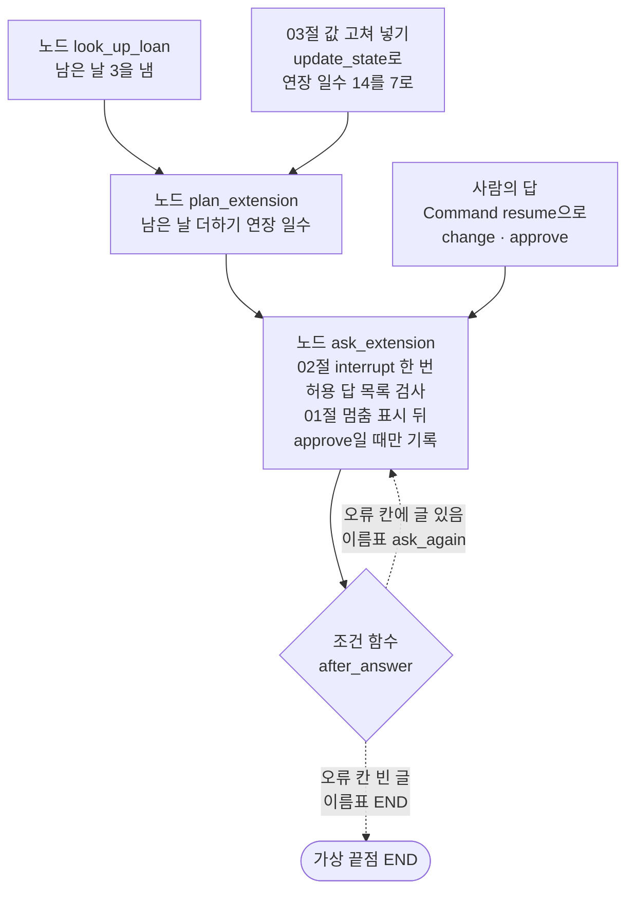
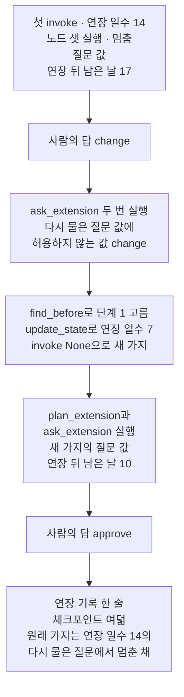
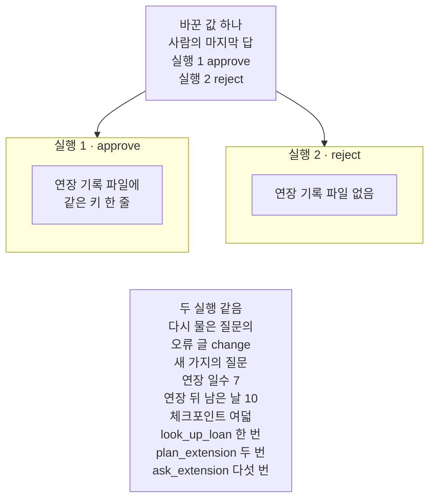

# 04-Human-in-the-Loop-실습

## _src 본문 (HTML 원본)

```html
<!--meta: 실습 30분 | 코드 notebooks/04-Human-in-the-Loop-실습.ipynb | 새 용어 0 -->
<style>html,body{overflow-x:hidden}.notebook,.nb-cell,.nb-main,.nb-input,.nb-result{min-width:0;max-width:100%}.nb-input pre,.nb-output{box-sizing:border-box;max-width:100%;overflow-x:auto}code.nb-source{display:block!important;width:100%!important;min-width:0!important;overflow-x:auto!important;padding:0!important}</style>
<h2 id="b1"><span class="no">1</span>학습 목표</h2><div class="goal"><ul>
<li>승인 지점·다시 묻기·값 고쳐 넣기를 한 그래프에 붙여, 대출 연장 신청 한 건을 처리할 수 있습니다.</li>
<li>허용 답 목록에 없는 답으로 다시 물은 뒤, 지난 체크포인트에 값을 고쳐 넣고 새 가지에서 다시 물을 수 있습니다.</li>
<li>사람의 마지막 답 하나만 바꿔 다시 실행하고, 연장 기록 파일의 줄 수로 두 실행을 견줄 수 있습니다.</li>
</ul></div>
<h2 id="b2"><span class="no">2</span>이 내용을 배우는 이유</h2><p>이 챕터에서는 사람이 확인하는 자리를 절마다 따로 익혔습니다. <a href="01-interrupt-승인-게이트.html">01절</a>은 멈춤 표시로 묻고, 승인일 때만 기록을 적었습니다. <a href="02-Command-resume으로-실행-재개.html">02절</a>은 허용 답 목록에 없는 답이 오면 조건부 엣지로 다시 물었습니다. <a href="03-상태-기록과-다른-분기-재실행.html">03절</a>은 지난 체크포인트에 값을 고쳐 넣고, 그 자리부터 새 가지로 다시 실행했습니다. 실제 창구에서는 이 일들이 한 신청 안에서 함께 일어납니다.</p>
<p>이번 실습은 세 기능을 대출 연장 신청 한 건에 모아 실행합니다. 신청서에는 연장 일수가 잘못 적혀 있고, 직원은 질문 값을 보고 그 값을 고칩니다. 사람의 마지막 답 하나만 바꿔 한 번 더 실행하고, 두 실행을 견줍니다. 01절 값 바꿔 보기도 거절과 승인을 견줬습니다. 새로 볼 것은 다시 묻기와 새 가지를 거친 흐름에서도, 기록이 마지막 답 하나로 갈리는지입니다.</p>
<p>이번 절은 이 챕터의 실습입니다. 01~03절에서 쓴 이름과 Ch 2에서 배운 문법만 쓰고, 따로 내는 과제는 없습니다. 강사와 함께 노트북 셀을 차례로 실행합니다.</p>
<p><strong>이 절의 질문</strong> — 사람의 답으로는 값을 바꿀 수 없을 때, 직원은 어떻게 값을 고쳐 다시 물을까요? 사람의 마지막 답 하나를 바꾸면 결과의 어디까지 달라질까요?</p>
<h2 id="b3"><span class="no">3</span>앞에서 배운 내용</h2><p>이번 실습은 아래 절에서 배운 이름을 그대로 씁니다. 함수는 도구 파일 <code>approval_tools.py</code>에서 가져오고, 상태 형식·노드·조건 함수는 노트북에 적습니다.</p>
<table><thead><tr><th>절</th><th>배운 것</th><th>실습에서 쓰는 곳</th></tr></thead><tbody><tr><td><a href="01-interrupt-승인-게이트.html">01절</a></td><td>멈춤 표시·질문 값·사람의 답으로 이어 가기, 묻고 나서 승인일 때만 적는 노드 <code>ask_then_charge</code>, 함수 <code>append_key</code>·<code>read_record</code>(도구 파일)</td><td>노드 <code>ask_extension</code>의 멈춤 표시와, 답이 <code>approve</code>일 때만 연장 기록을 적는 줄</td></tr><tr><td><a href="02-Command-resume으로-실행-재개.html">02절</a></td><td>허용 답 목록, 다시 묻기(조건부 엣지로 같은 노드로 되돌아가기), 조건 함수 <code>after_answer</code>, 노드가 목록에 이름을 적어 실행 횟수 세기</td><td>목록에 없는 첫 답 <code>change</code>에 다시 묻기, 목록 <code>extend_calls</code></td></tr><tr><td><a href="03-상태-기록과-다른-분기-재실행.html">03절</a></td><td>체크포인트 목록과 함수 <code>print_history</code>·<code>find_before</code>(도구 파일), 값 고쳐 넣기(<code>update_state</code>), 입력 자리에 <code>None</code>을 넣어 새 가지 실행</td><td>연장 일수 <code>14</code>를 <code>7</code>로 고쳐 넣고 새 가지에서 다시 묻기</td></tr><tr><td><a href="../ch23-persistence/07-Persistence-실습.html">Ch 23 07절</a></td><td>이용자 번호 <code>M-0317</code>·대출 키 <code>loan-2307</code>, 이용자 번호를 스레드 이름으로 쓰기</td><td>오늘 처리할 연장 신청, 두 실행의 스레드 이름</td></tr><tr><td><a href="../../part4/ch13-langgraph-basics/01-StateGraph와-노드-엣지.html">Ch 13 01절</a>·<a href="../../part4/ch13-langgraph-basics/03-조건부-엣지.html">03절</a></td><td>상태 형식·노드·고정 엣지, 조건부 엣지와 이름표 표</td><td>그래프 조립</td></tr></tbody></table>
<p>붙인 기능은 01절 승인 지점, 02절 다시 묻기, 03절 값 고쳐 넣기와 새 가지 셋입니다. 세 기능이 모두 흐름 안에서 일하도록, 신청서의 연장 일수를 잘못 적힌 값으로 두었습니다. 직원의 첫 답 <code>change</code>는 목록에 없어 그래프가 다시 묻습니다. 답으로는 연장 일수를 바꿀 수 없어, 직원은 지난 체크포인트로 돌아가 값을 고쳐 넣습니다. 기록은 새 가지에서 받은 마지막 답이 <code>approve</code>일 때만 적힙니다.</p>
<p>01절의 적고 나서 묻는 노드와, 묻기 전에 멱등하게 먼저 적는 노드는 뺐습니다. 이번 흐름에는 묻기 전에 해야 하는 쓰기가 없기 때문입니다. 02절 <code>while True</code> 모양과 오류 두 장면은 02절에서 이미 견줘 뺐습니다. 03절의 값을 바꾸지 않은 다시 실행과 소수 할인율 계산은, 값을 고쳐야 하는 이번 흐름에 나오지 않아 뺐습니다.</p>
<p><a href="../ch23-persistence/07-Persistence-실습.html">Ch 23 07절</a> 실습처럼, 이 챕터의 실습도 모델을 부르지 않습니다. 이 챕터 실습 폴더에는 모델 패키지가 없고, 01~03절도 매번 같은 값을 내는 우리 노드로 결과를 갈랐습니다. 사람의 답도 셀에 적은 값입니다.</p>
<h2 id="b4"><span class="no">4</span>핵심 개념</h2><h3>비유로 시작하기</h3><p>01~03절에서는 도미노 줄을 절마다 따로 세워 보았습니다. 01절 줄에는 사람이 도미노를 놓을 빈자리를 두었습니다. 02절에서는 빈자리에 맞지 않는 물건을 치우고, 맞는 도미노를 다시 기다렸습니다. 03절에서는 찍어 둔 사진을 보고 한 자리로 돌아가, 다른 색 도미노로 바꿔 새 줄을 세웠습니다. 이번에는 따로 세워 본 세 줄을 이어, 빈자리가 하나 있는 긴 줄 하나로 세웁니다.</p>
{{img:04-4-따로-세운-세-줄을-이은-긴-줄|흰 바탕에 흰 탁자 하나를 조금 위에서 본 그림입니다. 탁자 왼쪽에는 연한 파랑, 초록, 노랑 도미노가 색마다 짧은 줄 하나씩, 세 줄로 위아래에 떨어져 서 있습니다. 탁자 오른쪽에는 같은 세 색을 파랑, 초록, 노랑 차례로 이어 붙인 긴 줄 하나가 서 있습니다. 긴 줄의 노랑 부분 끝 가까이에 도미노 하나가 빠진 빈자리가 있습니다. 넘어진 도미노는 없고, 글자·숫자·사람·손은 없는 그림|따로 세워 본 세 줄을 이어 긴 줄 하나로 세웠고, 긴 줄에는 빈자리 하나를 남겼습니다.}}
<p class="look"><b>그림 읽기</b> — 탁자 왼쪽에는 연한 파랑·초록·노랑 도미노가 색마다 짧은 줄 하나씩, 세 줄로 떨어져 서 있습니다. 오른쪽에는 같은 세 색을 파랑, 초록, 노랑 차례로 이어 붙인 긴 줄 하나가 서 있습니다. 긴 줄의 노랑 부분 끝 가까이에는 도미노 하나가 빠진 빈자리가 있습니다. 왼쪽 세 줄은 01~03절에서 따로 익힌 기능이고, 오른쪽 긴 줄은 그 기능을 이어 붙인 이번 그래프입니다. 빈자리는 확인 노드의 멈춤 표시이고, 색과 절, 도미노 개수는 서로 짝짓지 않습니다.</p>
<h3>실습 조립의 구성</h3>
{{mermaid:04-1-세-절-기능을-붙인-연장-신청-그래프|위에서 아래로 읽는 그림입니다. 맨 위에 파란 상자 노드 look_up_loan 남은 날 3을 냄과 초록 상자 03절 값 고쳐 넣기 update_state로 연장 일수 14를 7로가 나란히 있고, 두 상자에서 파란 상자 노드 plan_extension 남은 날 더하기 연장 일수로 화살표가 갑니다. 그 아래 파란 상자 노드 ask_extension에는 02절 interrupt 한 번, 허용 답 목록 검사, 01절 멈춤 표시 뒤, approve일 때만 기록이 적혀 있습니다. 오른쪽 위 초록 상자 사람의 답 Command resume으로 change approve에서도 이 상자로 화살표가 들어갑니다. 노드 ask_extension에서 회색 마름모 조건 함수 after_answer로 화살표가 가고, 마름모에서 나가는 점선 둘 가운데 하나는 오류 칸에 글 있음 이름표 ask_again으로 노드 ask_extension에 되돌아가고, 다른 하나는 오류 칸 빈 글 이름표 END로 회색 둥근 상자 가상 끝점 END에 닿는 그림|03절 값 고쳐 넣기는 계산 노드 앞에, 01절 승인 지점과 02절 다시 묻기는 확인 노드 안팎에 붙였습니다.}}
<p class="look"><b>도식 읽기</b> — 위에서 아래로 읽습니다. 파란 상자는 우리가 적은 노드이고, 초록 상자는 우리가 넣는 값과 사람의 답입니다. 회색 마름모는 노드로 등록하지 않는 조건 함수 <code>after_answer</code>이고, 마름모에서 나가는 점선 둘이 조건부 엣지입니다. 상자 안의 절 번호는 그 기능을 배운 절입니다. 고쳐 넣은 연장 일수는 계산 노드부터 다시 실행하는 새 가지로 들어갑니다.</p>
<table><thead><tr><th>이름</th><th>하는 일</th><th>가져온 곳</th></tr></thead><tbody><tr><td><code>ExtendState</code></td><td>대출 키·기록 파일 이름·연장 일수·남은 날·연장 뒤 남은 날·사람의 답·오류 글 칸</td><td>이 절에서 만듦(칸이 달라 새 이름)</td></tr><tr><td><code>look_up_loan</code>·<code>plan_extension</code></td><td>남은 날 3을 내는 대출 조회 노드, 남은 날에 연장 일수를 더하는 계산 노드</td><td>이 절에서 만듦(03절 노드처럼 목록에 이름을 적음)</td></tr><tr><td><code>ask_extension</code></td><td>질문 값으로 멈추고, 목록에 든 답만 받아 <code>approve</code>일 때만 연장 기록을 적는 확인 노드</td><td>01절 <code>ask_then_charge</code>와 02절 <code>ask_once</code> 모양을 한 노드에 모음</td></tr><tr><td><code>after_answer</code>·이름표 표</td><td>오류 칸을 보고 같은 노드로 되돌아가 다시 묻거나 끝냄</td><td>02절 조건 함수 셀과 글자까지 같음</td></tr><tr><td><code>append_key()</code>·<code>read_record()</code></td><td>기록 파일에 키 한 줄 적기, 기록 파일의 키 목록</td><td>도구 파일(Ch 23 06·04절)</td></tr><tr><td><code>print_history()</code>·<code>find_before()</code></td><td>체크포인트 목록을 한 줄씩 출력하기, 다음 노드로 돌아갈 체크포인트 고르기</td><td>도구 파일(Ch 23 01절·이 챕터 03절)</td></tr></tbody></table>
<h3>두 번의 실행</h3><p>실행 1은 사람의 답 차례가 <code>change</code>·<code>approve</code>이고, 실행 2는 마지막 답 하나만 <code>reject</code>입니다. 두 실행 모두 연장 일수 14로 첫 질문을 받고, 첫 답 <code>change</code>에 다시 묻는 질문에서 멈춥니다. 그다음 다음 노드가 <code>plan_extension</code>인 체크포인트에 연장 일수 7을 고쳐 넣고, 새 가지에서 다시 묻습니다. 두 실행은 체크포인터를 따로 붙인 그래프라, 스레드 이름이 같아도 기록이 섞이지 않습니다. 연장 기록 파일 이름도 실행마다 다르게 씁니다.</p>
<h3>비교와 경계</h3><p>질문 값에 답하는 것만으로는 연장 일수를 바꿀 수 없습니다. 노드 <code>ask_extension</code>은 목록에 든 답만 받고, 목록에 없는 답이면 오류 글을 담아 다시 묻습니다. 값을 바꾸려면 03절처럼 지난 체크포인트에 값을 고쳐 넣고, 그 자리부터 새 가지로 다시 실행합니다. 이때 고른 자리 앞의 대출 조회 노드는 다시 실행되지 않습니다.</p><p>연장 기록을 적는 줄은 멈춤 표시 뒤에 있습니다. 01절에서 본 것처럼, 노드는 이어 갈 때 첫 줄부터 다시 실행됩니다. 그래도 적는 줄에는 사람의 답을 받은 뒤에만 닿아, 승인일 때 한 번만 적습니다. 원래 가지는 다시 물은 질문에서 멈춘 채 남고, 그 가지에서는 기록을 적지 않았습니다.</p>
<h2 id="b5"><span class="no">5</span>실행 예제</h2><p>노트북은 먼저 연장 신청의 값과 사람의 답 차례를 정하고, 상태 형식·노드 셋·조건 함수로 그래프를 조립합니다. 실행 1은 첫 답 <code>change</code>로 다시 물은 뒤, 지난 체크포인트에 연장 일수 7을 고쳐 넣고 새 가지에서 <code>approve</code>로 끝냅니다. 실행 2는 마지막 답 하나만 <code>reject</code>로 바꿔 같은 차례를 되풀이하고, 마지막에 두 실행을 견줍니다.</p><p>이 절은 모델을 부르지 않아 모델 요청은 0번이고, API 키 셀도 없습니다. 사람의 답은 셀에 적은 값이고, 실제 서비스라면 화면에서 사람이 고른 값을 같은 자리에 넣습니다. 체크포인트는 메모리에만 저장하고, 연장 기록 파일은 노트북이 만든 빈 임시 폴더에 생깁니다.</p>
{{notebook:04-Human-in-the-Loop-실습}}
<p class="look"><b>확인할 점</b> — 노트북 6절에서 <code>다시 물은 질문 값: {'days': 14, 'due_days': 17, 'error': '허용하지 않는 값: change'}</code>을 봅니다. 값을 고쳐 넣은 셀에서 <code>이 셀에서 실행된 노드: ['plan_extension', 'ask_extension']</code>이 나오는지 확인합니다. 7절에서는 <code>연장 기록 파일이 있는가: False</code>를 보고, 8절 두 줄로 두 실행을 맞춰 봅니다.</p>
<h3>실행 1의 실제 순서</h3>
{{mermaid:04-2-실행-1의-실제-차례|위에서 아래로 상자 일곱이 한 줄로 이어진 흐름도입니다. 첫 노란 상자는 첫 invoke 연장 일수 14 노드 셋 실행 멈춤 질문 값 연장 뒤 남은 날 17, 둘째 초록 상자는 사람의 답 change입니다. 셋째 노란 상자는 ask_extension 두 번 실행 다시 물은 질문 값에 허용하지 않는 값 change, 넷째 파란 상자는 find_before로 단계 1 고름 update_state로 연장 일수 7 invoke None으로 새 가지입니다. 다섯째 노란 상자는 plan_extension과 ask_extension 실행 새 가지의 질문 값 연장 뒤 남은 날 10, 여섯째 초록 상자는 사람의 답 approve입니다. 일곱째 노란 상자는 연장 기록 한 줄 체크포인트 여덟, 원래 가지는 연장 일수 14의 다시 물은 질문에서 멈춘 채인 그림|실행 1은 첫 답 change에 다시 물은 뒤, 연장 일수 7을 고쳐 넣은 새 가지에서 approve를 받아 기록을 한 줄 적었습니다.}}
<p class="look"><b>도식 읽기</b> — 위에서 아래로 한 줄로 읽습니다. 초록 상자는 사람의 답이고, 파란 상자는 우리가 부른 함수와 메서드입니다. 넷째 파란 상자는 셀 둘에서 부른 줄을 묶었고, 그 안의 연장 일수 7은 04-1에서 초록으로 그린 고쳐 넣은 값입니다. 노란 상자는 노트북 6절 출력이고, 일곱째 상자의 체크포인트 여덟만 8절 출력입니다. 맨 아래 상자의 원래 가지는 셋째 상자의 질문에서 멈춘 채 남은 가지입니다.</p>
<h2 id="b6"><span class="no">6</span>실험 결과 해석</h2><p>두 실행은 사람의 마지막 답 하나만 달랐습니다. 결과는 아래 표와 같았습니다.</p>
<table><thead><tr><th>실행</th><th>사람의 답 차례</th><th>다시 물은 질문의 오류 글</th><th>새 가지의 질문 값</th><th>체크포인트 수<br>실행 횟수</th><th>같은 키가 적힌 줄 수</th></tr></thead><tbody><tr><td>실행 1</td><td><code>['change', 'approve']</code></td><td><code>허용하지 않는 값: change</code></td><td><code>{'days': 7, 'due_days': 10, 'error': ''}</code></td><td>8<br><code>1 2 5</code></td><td>1</td></tr><tr><td>실행 2(바꾼 값)</td><td><code>['change', 'reject']</code></td><td><code>허용하지 않는 값: change</code></td><td><code>{'days': 7, 'due_days': 10, 'error': ''}</code></td><td>8<br><code>1 2 5</code></td><td>0(파일 없음)</td></tr></tbody></table>
{{mermaid:04-3-마지막-답만-바꾼-두-실행|맨 위 초록 상자 바꾼 값 하나 사람의 마지막 답 실행 1 approve 실행 2 reject에서 아래 칸 둘로 화살표가 갑니다. 왼쪽 칸 실행 1 approve에는 노란 상자 연장 기록 파일에 같은 키 한 줄이, 오른쪽 칸 실행 2 reject에는 노란 상자 연장 기록 파일 없음이 있습니다. 두 칸 아래 회색 상자에는 두 실행 같음, 다시 물은 질문의 오류 글 change, 새 가지의 질문 연장 일수 7 연장 뒤 남은 날 10, 체크포인트 여덟, look_up_loan 한 번 plan_extension 두 번 ask_extension 다섯 번이 적힌 그림|사람의 마지막 답만 바꾸자 연장 기록이 한 줄에서 없음으로 바뀌었고, 다시 묻기와 새 가지의 값은 같았습니다.}}
<p class="look"><b>도식 읽기</b> — 맨 위 초록 상자는 두 실행에서 바꾼 값 하나입니다. 왼쪽 칸이 실행 1, 오른쪽 칸이 실행 2이고, 노란 상자는 노트북 6·7절 출력입니다. 두 칸 아래 회색 상자는 두 실행 출력에서 모두 확인한 값입니다. 두 칸끼리는 화살표로 잇지 않았습니다.</p>
<p>두 실행 모두 첫 답 <code>change</code>에 그래프는 기록 없이 오류 글을 담아 다시 물었습니다. 두 실행 모두 다음 노드가 <code>plan_extension</code>인 체크포인트에 연장 일수 7을 고쳐 넣었습니다. 새 가지는 계산 노드부터 실행되었고, 대출 조회 노드는 두 실행 모두 한 번만 실행되었습니다. 체크포인트 수도 두 실행이 같았습니다.</p><p>달라진 것은 새 가지의 마지막 질문에서 받은 답과, 기록 파일의 줄 수입니다. 실행 1은 <code>approve</code>를 받아 연장 기록을 한 줄 적었습니다. 실행 2는 <code>reject</code>를 받아 적는 줄에 닿지 않았고, 기록 파일도 만들지 않았습니다. 01절 값 바꿔 보기와 같은 차이가, 다시 묻기와 새 가지를 거친 뒤에도 마지막 답 하나로 생겼습니다.</p><p>실행 1에서 따로 읽은 원래 가지는 연장 일수 14의 다시 물은 질문에서 멈춘 채였고, 그 가지에서는 기록이 적히지 않았습니다. 모델을 부르지 않아, 이 값들은 새 커널로 다시 실행해도 같아야 합니다. 새 커널로 두 번 실행했을 때 코드 셀 28개의 출력이 모두 같았습니다.</p>
<h2 id="b7"><span class="no">7</span>주의할 점과 실무 메모</h2><ul><li>연장 일수 14와 7, 사람의 답 차례는 이 절에서 실행 전에 정한 값입니다. 이용자 번호와 대출 키는 <a href="../ch23-persistence/07-Persistence-실습.html">Ch 23 07절</a> 값 그대로이고, 실제 이용자와 대출이 아닙니다.</li><li>자료실 규칙 「한 번에 7일까지」도 흐름을 보이려고 정한 예입니다. 그래프는 이 규칙을 검사하지 않고, 사람이 질문 값을 보고 판단합니다.</li><li>연장 기록은 실제 서비스를 부르지 않고, 기록 파일에 대출 키 한 줄을 적는 것으로 대신했습니다. 남은 날 3도 대출 기록을 읽지 않고 노드에 정해 둔 값입니다.</li><li>원래 가지는 다시 물은 질문에서 멈춘 채 두었습니다. 멈춘 채 둔 가지에 답을 넘기는 장면은 03절처럼 이번에도 실행하지 않았습니다.</li><li>원래 가지에서 이미 승인해 기록을 적은 뒤, 지난 체크포인트로 돌아가 다시 묻는 장면도 03절처럼 이번에 실행하지 않았습니다. 이번 흐름에서는 원래 가지가 승인 전에 멈춰, 기록은 새 가지에서만 적혔습니다.</li><li>스레드 설정으로 사람의 답을 넘기면 가장 최근 체크포인트의 질문에 닿습니다. 이번에도 마지막 답은 새 가지의 질문에 닿았고, 원래 가지의 멈춘 질문은 그대로였습니다.</li><li>두 실행은 체크포인터를 따로 붙여 컴파일했습니다. 한 체크포인터에 같은 스레드 이름을 쓰면 실행 2가 실행 1의 스레드에 이어 붙게 됩니다. 그 장면은 이번에 실행하지 않았습니다.</li><li>셀 하나만 다시 실행하면 같은 스레드에 체크포인트가 더해지고, 기록 파일의 줄도 늘 수 있습니다. 처음 값으로 다시 보려면 1절 임시 폴더 셀부터 차례로 다시 실행합니다.</li><li>체크포인트 수와 실행 횟수는 노드 셋을 이 차례로 실행한 이 그래프의 값입니다.</li><li>걸린 시간은 재지 않았습니다. 교재 출력은 Linux의 Python 3.12.13으로 만들었고, 다른 판과 Windows·macOS에서는 실행하지 않았습니다.</li></ul>
<h2 id="b8"><span class="no">8</span>정리와 다음 절</h2><ul><li>허용 답 목록에 없는 첫 답 <code>change</code>에 그래프는 기록 없이 다시 물었고, 원래 가지는 그 질문에서 멈춘 채 남았습니다.</li><li>다음 노드가 <code>plan_extension</code>인 체크포인트에 연장 일수 7을 고쳐 넣자, 계산 노드부터 새 가지로 다시 실행되었습니다.</li><li>마지막 답이 <code>approve</code>인 실행 1은 연장 기록을 한 줄 남겼고, <code>reject</code>인 실행 2는 기록 파일을 만들지 않았습니다.</li></ul><p><strong>다음 학습과 이어지는 지점</strong> — 이 절로 Ch 24가 끝납니다. <a href="../ch25-streaming/01-일곱-가지-stream-mode.html">Ch 25 01절</a>에서는 한 실행에서 생긴 사건을 일곱 방식으로 받아 보는 방법을 다룹니다.</p>
<h2 id="b9"><span class="no">9</span>복습 문제</h2><details class="quiz" open><summary>문제 4개 · 해설 포함</summary><p class="quiz-q">1. [하] 두 실행에서 바꾼 값은 무엇이고, 같게 둔 것은 무엇입니까?</p><p class="quiz-a">사람의 마지막 답을 <code>approve</code>에서 <code>reject</code>로 바꿨습니다. 신청 값·첫 답 <code>change</code>·고쳐 넣은 연장 일수 7·설계 객체는 같게 두었습니다. 체크포인터와 기록 파일 이름은 두 실행이 섞이지 않게 따로 썼습니다.</p><p class="quiz-q">2. [중] 첫 답 <code>change</code>를 넣었는데 연장 일수는 그대로이고 같은 질문이 다시 나온 까닭은 무엇입니까?</p><p class="quiz-a">답이 허용 답 목록에 없어, 확인 노드가 오류 글만 칸에 내고 조건부 엣지가 같은 노드로 되돌아갔기 때문입니다. 확인 노드는 답을 검사할 뿐 연장 일수를 바꾸지 않습니다. 값을 바꾸려면 지난 체크포인트에 값을 고쳐 넣습니다. 틀렸다면 노트북 6절을 다시 읽습니다.</p><p class="quiz-q">3. [중] 새 가지를 실행했을 때 <code>look_up_loan</code>이 다시 실행되지 않은 까닭은 무엇입니까?</p><p class="quiz-a">고른 체크포인트는 대출 조회를 마친 뒤라, 칸 <code>left_days</code>에 <code>3</code>이 이미 저장되어 있었습니다. 다음 노드가 <code>plan_extension</code>이어서 계산 노드부터 실행했습니다. 실행 횟수 <code>1 2 5</code>의 첫 값으로 확인했습니다. 틀렸다면 노트북 6절과 03절을 다시 읽습니다.</p><p class="quiz-q">4. [상] 동료가 「새 가지에서 다시 물었으니, 원래 가지의 14일 연장도 함께 기록되었을 것」이라고 말합니다. 이 절 결과로 무엇이라고 답하나요?</p><p class="quiz-a">그렇지 않다고 답합니다. 원래 가지는 연장 일수 14의 다시 물은 질문에서 멈춘 채 남았고, 그 질문에는 답을 넘기지 않았습니다. 연장 기록을 적는 줄은 승인을 받은 뒤에만 닿으므로, 실행 1의 기록은 새 가지에서 적은 한 줄뿐이었습니다. 틀렸다면 노트북 6절 끝의 두 셀을 다시 읽습니다.</p></details>
<h2 id="b10"><span class="no">10</span>참고 자료</h2><ul><li>01절 — 멈춤 표시와, 묻고 나서 승인일 때만 적는 노드 <code>ask_then_charge</code>.</li><li>02절 — 허용 답 목록, 조건부 엣지로 다시 묻기, 조건 함수 <code>after_answer</code>.</li><li>03절 — 체크포인트 목록, 함수 <code>find_before</code>, 메서드 <code>update_state</code>로 값 고쳐 넣기와 새 가지.</li><li><a href="../ch23-persistence/01-체크포인터와-스레드.html">Ch 23 01절</a> — 함수 <code>print_history</code>와 체크포인트 목록.</li><li>Ch 23 07절 — 이용자 번호 <code>M-0317</code>과 대출 키 <code>loan-2307</code>.</li><li>기준 버전은 노트북 1절 첫 셀에서 설치한 패키지 둘의 판입니다.</li></ul>
```

## 노트북 셀 (순서대로)

### [0] markdown {'html': 'skip'}

# Human-in-the-Loop 실습: 연장 일수를 고쳐 다시 묻고 승인일 때만 기록하기

**이 노트북에서 할 일**

1. 대출 연장 신청 한 건을 묻는 그래프에 승인 지점, 다시 묻기, 값 고쳐 넣기를 함께 붙입니다.
2. 허용 답 목록에 없는 답으로 다시 물은 뒤, 지난 체크포인트에 연장 일수를 고쳐 넣고 새 가지에서 다시 묻습니다.
3. 사람의 마지막 답 하나만 바꿔 다시 실행하고, 연장 기록 파일로 두 실행을 견줍니다.

**준비물** — 이 노트북은 모델을 부르지 않습니다.
모델 요청은 0번이고, API 키 없이 실행합니다.
사람의 답은 우리가 셀에 적어 넣는 값(`"change"`·`"approve"`·`"reject"`)입니다.
실제 서비스라면 화면에서 사람이 고른 값을 같은 자리에 넣습니다.
01절처럼 매번 같은 값을 내는 우리 노드로, 기록 파일과 체크포인트를 출력으로 가릅니다.

연장 기록은 실제 서비스가 아니라, 기록 파일에 대출 키를 한 줄 적는 것으로 대신합니다.
노트북은 빈 임시 폴더를 만들어 그 폴더에서 실행합니다.
연장 기록 파일은 이 임시 폴더에 생기고, 실습 폴더에는 파일을 남기지 않습니다.
체크포인트는 메모리에만 저장하고, 읽어 오는 자료 파일은 없습니다.

걸린 시간은 재지 않았습니다.
설치 셀에 걸리는 시간은 네트워크에 따라 달라집니다.

**기준 버전** — 첫 셀에서 패키지 둘을 설치합니다.
그래프는 langgraph 1.2.11, 체크포인터는 langgraph-checkpoint 4.2.0에 들어 있습니다.
교재 출력은 Linux의 Python 3.12.13으로 만들었습니다.
다른 판과 Windows·macOS에서는 실행하지 않았습니다.

**실습 범위** — 이 절은 챕터 끝 실습 절이고 30분 안에 끝나는 분량입니다.
강사와 함께 첫 셀부터 차례로 실행하고, 따로 내는 과제는 없습니다.
01~03절에서 쓴 이름과 Ch 2에서 배운 문법만 씁니다.
셀 하나만 다시 실행하면 같은 스레드에 체크포인트가 더해지고, 기록 파일의 줄도 늘 수 있습니다.
처음 값으로 다시 보려면 1절 임시 폴더 셀부터 차례로 다시 실행합니다.

실습 폴더 `labs/part6/ch24-human-in-the-loop`에서 `uv sync --locked`를 실행합니다.
그다음 `notebooks/` 폴더의 이 노트북을 열고, 실습 폴더의 `.venv` 커널을 고릅니다.
첫 셀부터 순서대로 실행합니다.

### [1] markdown {'html': 'skip'}

## 오늘 볼 그림

![위에서 아래로 읽는 그림입니다. 맨 위에 파란 상자 노드 look_up_loan 남은 날 3을 냄과 초록 상자 03절 값 고쳐 넣기 update_state로 연장 일수 14를 7로가 나란히 있고, 두 상자에서 파란 상자 노드 plan_extension 남은 날 더하기 연장 일수로 화살표가 갑니다. 그 아래 파란 상자 노드 ask_extension에는 02절 interrupt 한 번, 허용 답 목록 검사, 01절 멈춤 표시 뒤, approve일 때만 기록이 적혀 있습니다. 오른쪽 위 초록 상자 사람의 답 Command resume으로 change approve에서도 이 상자로 화살표가 들어갑니다. 노드 ask_extension에서 회색 마름모 조건 함수 after_answer로 화살표가 가고, 마름모에서 나가는 점선 둘 가운데 하나는 오류 칸에 글 있음 이름표 ask_again으로 노드 ask_extension에 되돌아가고, 다른 하나는 오류 칸 빈 글 이름표 END로 회색 둥근 상자 가상 끝점 END에 닿는 그림](attachment:04-1-세-절-기능을-붙인-연장-신청-그래프.png)

위에서 아래로 읽습니다.
파란 상자는 우리가 적은 노드이고, 초록 상자는 우리가 넣는 값과 사람의 답입니다.
회색 마름모는 노드로 등록하지 않는 조건 함수 `after_answer`이고, 마름모에서 나가는 점선 둘이 조건부 엣지입니다.
상자 안의 절 번호는 그 기능을 배운 절입니다.
고쳐 넣은 연장 일수는 계산 노드부터 다시 실행하는 새 가지로 들어갑니다.

### [2] markdown {}

## 1. 준비

이번 절은 이 챕터의 실습입니다.
01절 승인 지점, 02절 다시 묻기, 03절 값 고쳐 넣기와 새 가지를 대출 연장 신청 한 건에 모읍니다.
첫 셀은 01절과 같은 패키지 둘을 설치하고, 설치된 판 번호를 출력합니다.
설치에는 몇십 초가 걸릴 수 있습니다.

### [3] code {'execution': {'iopub.execute_input': '2026-09-25T15:27:35.004814Z', 'iopub.status.busy': '2026-09-25T15:27:35.004661Z', 'iopub.status.idle': '2026-09-25T15:27:35.447692Z', 'shell.execute_reply': '2026-09-25T15:27:35.447110Z'}, 'lesson_role': 'setup'}

```python
# 이 절에서 쓰는 패키지를 설치하고 버전을 확인합니다
%pip install -q "langgraph==1.2.11" "langgraph-checkpoint==4.2.0"
from importlib.metadata import version

print("langgraph:", version("langgraph"))
print("langgraph-checkpoint:", version("langgraph-checkpoint"))
```

출력:
```
Note: you may need to restart the kernel to use updated packages.
langgraph: 1.2.11
langgraph-checkpoint: 4.2.0

```

### [4] markdown {}

**결과 읽기** — 출력 줄 `langgraph: 1.2.11`과 `langgraph-checkpoint: 4.2.0`이 보입니다.
두 판 모두 실습 폴더 잠금과 같은 판입니다.
이 노트북의 출력은 2026-09-25에 이 판으로 실행한 결과입니다.

다음 셀은 이 절에서 쓸 이름을 가져옵니다.
상태 형식과 그래프 이름은 Ch 13 01절, 체크포인터 `InMemorySaver`는 Ch 23 01절과 같습니다.
함수 `interrupt`와 객체 `Command`는 01절에서 가져온 이름 그대로입니다.
마지막 가져오기 줄은 앞에서 배운 함수 넷을 도구 파일 `approval_tools.py`에서 가져옵니다.
이 절에서 새로 배우는 이름은 없습니다.

### [5] code {'execution': {'iopub.execute_input': '2026-09-25T15:27:35.448917Z', 'iopub.status.busy': '2026-09-25T15:27:35.448828Z', 'iopub.status.idle': '2026-09-25T15:27:35.920566Z', 'shell.execute_reply': '2026-09-25T15:27:35.920231Z'}, 'lesson_role': 'setup'}

```python
# 그래프 이름(Ch 13 01절)·체크포인터(Ch 23 01절)와, 01절에서 쓴 멈춤 표시 이름 둘을 가져옵니다
from typing_extensions import TypedDict
from langgraph.graph import StateGraph, START, END
from langgraph.checkpoint.memory import InMemorySaver
# interrupt는 노드를 멈추는 함수, Command는 멈춘 그래프에 사람의 답을 넘길 때 쓰는 객체입니다(01절)
from langgraph.types import Command, interrupt
# Ch 23 01·04·06절과 03절에서 배운 함수 넷을 도구 파일에서 가져옵니다
from approval_tools import append_key, find_before, print_history, read_record

print("langgraph.types에서 가져온 이름:", "Command, interrupt")
print("도구 파일에서 가져온 함수:", "append_key, find_before, print_history, read_record")
```

출력:
```
langgraph.types에서 가져온 이름: Command, interrupt
도구 파일에서 가져온 함수: append_key, find_before, print_history, read_record

```

### [6] markdown {}

**결과 읽기** — 출력 줄 `도구 파일에서 가져온 함수: append_key, find_before, print_history, read_record`가 보입니다.
함수 `append_key`와 `read_record`는 01절이 도구 파일로 옮겨 가져온 Ch 23 함수입니다.
함수 `print_history`는 Ch 23 01절, 함수 `find_before`는 이 챕터 03절 노트북 4절에서 처음 적은 함수입니다.
가져오기 줄 주석의 「03절」도 Ch 23이 아니라 이 챕터 03절입니다.
이 절에서 도구 파일에 더한 함수는 없습니다.

앞에서 배운 함수는 `approval_tools.py`에 모아 두었습니다.
파일을 열면 코드를 볼 수 있습니다.
노트북과 같은 폴더(`notebooks/`)에 있는 파일입니다.
커널이 `notebooks/` 폴더에서 시작해야 이 파일을 가져올 수 있어, 작업 위치를 옮기기 전에 가져왔습니다.
교재 출력을 만든 실행 도구는 이 폴더를 따로 알려 주어, 다른 자리에서 시작해도 가져오기가 되었습니다.

다음 셀은 01절처럼 빈 임시 폴더를 만들고, 그 폴더로 작업 위치를 옮깁니다.
이 절의 연장 기록 파일은 모두 이 임시 폴더에 생깁니다.
폴더 위치는 컴퓨터마다 달라 출력하지 않고, 폴더 이름의 앞머리만 확인합니다.

### [7] code {'execution': {'iopub.execute_input': '2026-09-25T15:27:35.921218Z', 'iopub.status.busy': '2026-09-25T15:27:35.921162Z', 'iopub.status.idle': '2026-09-25T15:27:35.923314Z', 'shell.execute_reply': '2026-09-25T15:27:35.922959Z'}, 'lesson_role': 'setup'}

```python
# 파일이 생기는지 볼 빈 임시 폴더를 만들고, 그 폴더로 작업 위치를 옮깁니다(Ch 23 01절과 같은 모양)
import os
import tempfile

# mkdtemp()는 운영체제 임시 폴더 안에 새 폴더를 만들고, 그 폴더의 위치를 글로 내놓습니다
practice_folder = tempfile.mkdtemp(prefix="ch24-04-")
# chdir()는 터미널의 cd처럼 현재 작업 폴더를 옮깁니다
os.chdir(practice_folder)
print("임시 폴더 이름에 ch24-04-이 들어 있는가:", "ch24-04-" in practice_folder)
print("현재 작업 폴더의 파일:", os.listdir())
```

출력:
```
임시 폴더 이름에 ch24-04-이 들어 있는가: True
현재 작업 폴더의 파일: []

```

### [8] markdown {}

**결과 읽기** — 출력 줄 `임시 폴더 이름에 ch24-04-이 들어 있는가: True`로, 이 절의 폴더를 만들었습니다.
출력 줄 `현재 작업 폴더의 파일: []`로, 빈 폴더에서 시작합니다.

## 2. 오늘 처리할 연장 신청

Ch 23 07절 실습에서는 이용자 `M-0317`의 대출 `loan-2307`을 기록했습니다.
이번에는 그 대출에 연장 신청이 들어왔습니다.
신청서에는 연장 일수가 14일로 적혀 있지만, 자료실 규칙은 한 번에 7일까지 연장합니다.
직원은 질문 값을 보고 연장을 승인하거나 거절하고, 승인일 때만 연장 기록을 적습니다.

다음 셀은 오늘 쓸 값 넷을 정하고 출처와 함께 출력합니다.
네 값 모두 실행 전에 정했습니다.

### [9] code {'execution': {'iopub.execute_input': '2026-09-25T15:27:35.923860Z', 'iopub.status.busy': '2026-09-25T15:27:35.923807Z', 'iopub.status.idle': '2026-09-25T15:27:35.925559Z', 'shell.execute_reply': '2026-09-25T15:27:35.925311Z'}}

```python
# 오늘 처리할 연장 신청의 값 넷을 정합니다(모두 실행 전에 정한 값)
member_id = "M-0317"
loan_key = "loan-2307"
print("이용자 번호:", member_id)
print("대출 키:", loan_key)
print("두 값의 출처: Ch 23 07절 실습의 이용자 번호와 대출 키 그대로")
# 신청서에 잘못 적힌 연장 일수와, 직원이 고쳐 넣을 연장 일수입니다
asked_days = 14
fixed_days = 7
print("신청서에 적힌 연장 일수:", asked_days, "| 고쳐 넣을 연장 일수:", fixed_days)
print("연장 일수 출처: 이 절에서 실행 전에 정한 값(자료실 규칙은 한 번에 7일까지로 정함)")
```

출력:
```
이용자 번호: M-0317
대출 키: loan-2307
두 값의 출처: Ch 23 07절 실습의 이용자 번호와 대출 키 그대로
신청서에 적힌 연장 일수: 14 | 고쳐 넣을 연장 일수: 7
연장 일수 출처: 이 절에서 실행 전에 정한 값(자료실 규칙은 한 번에 7일까지로 정함)

```

### [10] markdown {}

**결과 읽기** — 출력 줄 `이용자 번호: M-0317`과 `대출 키: loan-2307`로 오늘 쓸 값을 확인합니다.
출력 줄 `신청서에 적힌 연장 일수: 14 | 고쳐 넣을 연장 일수: 7`이 두 연장 일수입니다.
이용자 번호는 Ch 23 07절처럼 스레드 이름으로 씁니다.
연장 일수 14는 그래프에 처음 넣는 값이고, 7은 6절에서 지난 체크포인트에 고쳐 넣을 값입니다.

다음 셀은 받아들일 답 목록과, 사람이 차례로 넣을 답 둘을 정합니다.
허용 답 목록은 02절과 같은 두 값입니다.
첫 답 `change`는 연장 일수를 바꿔 달라는 뜻으로 적은 값이지만, 목록에 없습니다.

### [11] code {'execution': {'iopub.execute_input': '2026-09-25T15:27:35.926115Z', 'iopub.status.busy': '2026-09-25T15:27:35.926069Z', 'iopub.status.idle': '2026-09-25T15:27:35.927690Z', 'shell.execute_reply': '2026-09-25T15:27:35.927389Z'}}

```python
# 받아들일 답 목록과, 사람이 차례로 넣을 답 둘을 정합니다(실행 전에 정한 값)
allowed_answers = ["approve", "reject"]
# 첫 답 change는 연장 일수를 바꿔 달라는 뜻으로 적은 값이고, 허용 답 목록에는 없습니다
answer_turns = ["change", "approve"]
print("허용 답 목록:", allowed_answers)
print("사람의 답 차례:", answer_turns)
print("사람의 답 출처: 이 절에서 실행 전에 정한 값(실행 2에서는 마지막 답 하나만 바꿈)")
```

출력:
```
허용 답 목록: ['approve', 'reject']
사람의 답 차례: ['change', 'approve']
사람의 답 출처: 이 절에서 실행 전에 정한 값(실행 2에서는 마지막 답 하나만 바꿈)

```

### [12] markdown {}

**결과 읽기** — 출력 줄 `허용 답 목록: ['approve', 'reject']`와 `사람의 답 차례: ['change', 'approve']`입니다.
실행 1에서는 첫 질문에 `change`, 새 가지의 질문에 `approve`를 차례로 넣습니다.
실행 2에서는 마지막 답 하나만 `reject`로 바꿉니다.
사람의 답은 우리가 셀에 적어 넣는 값이고, 실제 서비스라면 화면에서 사람이 고른 값을 넣습니다.

## 3. 재료 · 상태 형식과 노드 셋, 조건 함수

다음 셀은 이 절의 상태 형식을 만듭니다.
칸 `loan_key`는 대출 키, 칸 `record_name`은 연장 기록 파일 이름, 칸 `days`는 연장 일수입니다.
칸 `left_days`는 지금 반납까지 남은 날, 칸 `due_days`는 연장 뒤 남은 날입니다.
칸 `answer`는 사람의 답이고, 칸 `error`에는 02절처럼 받아들이지 않은 까닭을 담습니다.
일곱 칸 모두 규칙을 적지 않아 새 값이 오면 덮어쓰고, 01~03절과 칸이 달라 이름도 새로 붙였습니다.

### [13] code {'execution': {'iopub.execute_input': '2026-09-25T15:27:35.928217Z', 'iopub.status.busy': '2026-09-25T15:27:35.928160Z', 'iopub.status.idle': '2026-09-25T15:27:35.929554Z', 'shell.execute_reply': '2026-09-25T15:27:35.929348Z'}}

```python
# 대출 키·기록 파일 이름·연장 일수·남은 날·연장 뒤 남은 날·사람의 답·오류 글 칸을 둔 상태 형식입니다(일곱 칸 모두 규칙 없음)
class ExtendState(TypedDict):
    loan_key: str
    record_name: str
    days: int
    left_days: int
    due_days: int
    answer: str
    error: str
```

출력:
```

```

### [14] markdown {}

**결과 읽기** — 정의 셀이라 출력이 없습니다.
이 절의 그래프는 이 상태 형식 하나를 씁니다.

다음 셀은 대출 조회 노드입니다.
지금 반납까지 남은 날을 칸 `left_days`에 냅니다.
남은 날 3일은 대출 기록을 읽는 대신 이 절에서 정해 둔 값입니다.
노드는 02·03절처럼 실행될 때마다 자기 이름을 목록 `extend_calls`에 적습니다.
이 목록은 6절 첫 셀에서 만듭니다.

### [15] code {'execution': {'iopub.execute_input': '2026-09-25T15:27:35.930056Z', 'iopub.status.busy': '2026-09-25T15:27:35.929998Z', 'iopub.status.idle': '2026-09-25T15:27:35.931676Z', 'shell.execute_reply': '2026-09-25T15:27:35.931342Z'}}

```python
# 대출 조회 노드: 지금 반납까지 남은 날을 칸 left_days에 냅니다
def look_up_loan(state):
    # 실행될 때마다 노드 이름을 목록에 적어, 몇 번 실행되었는지 셀 수 있게 합니다(02·03절 모양)
    extend_calls.append("look_up_loan")
    # 남은 날 3은 대출 기록을 읽는 대신 이 절에서 정해 둔 값입니다
    left_days = 3
    return {"left_days": left_days}
```

출력:
```

```

### [16] markdown {}

**결과 읽기** — 정의 셀이라 출력이 없습니다.
노드는 자기 칸 `left_days`만 냅니다.

다음 셀은 계산 노드입니다.
남은 날에 연장 일수를 더해, 연장 뒤 남은 날을 칸 `due_days`에 냅니다.
연장 일수 14로 계산하면 17일, 7로 계산하면 10일이 됩니다.

### [17] code {'execution': {'iopub.execute_input': '2026-09-25T15:27:35.932283Z', 'iopub.status.busy': '2026-09-25T15:27:35.932240Z', 'iopub.status.idle': '2026-09-25T15:27:35.933639Z', 'shell.execute_reply': '2026-09-25T15:27:35.933362Z'}}

```python
# 계산 노드: 남은 날에 연장 일수를 더해, 연장 뒤 남은 날을 칸 due_days에 냅니다
def plan_extension(state):
    extend_calls.append("plan_extension")
    due_days = state["left_days"] + state["days"]
    return {"due_days": due_days}
```

출력:
```

```

### [18] markdown {}

**결과 읽기** — 정의 셀이라 출력이 없습니다.
6절에서 연장 일수를 고쳐 넣으면, 새 가지에서는 이 노드부터 다시 실행됩니다.

다음 셀은 확인 노드입니다.
01절 `ask_then_charge`처럼 먼저 멈춤 표시로 묻고, 답이 `approve`일 때만 연장 기록을 적습니다.
02절 `ask_once`처럼 함수 `interrupt`는 한 번만 부르고, 목록에 없는 답이면 오류 글을 칸 `error`에 냅니다.
질문 값에는 연장 일수, 연장 뒤 남은 날, 오류 글을 담습니다.

### [19] code {'execution': {'iopub.execute_input': '2026-09-25T15:27:35.934098Z', 'iopub.status.busy': '2026-09-25T15:27:35.934051Z', 'iopub.status.idle': '2026-09-25T15:27:35.935886Z', 'shell.execute_reply': '2026-09-25T15:27:35.935578Z'}}

```python
# 확인 노드: 질문 값으로 멈추고, 허용 답 목록에 든 답만 받아 approve일 때만 연장 기록을 적습니다(01·02절 모양)
def ask_extension(state):
    extend_calls.append("ask_extension")
    question = {"days": state["days"], "due_days": state["due_days"], "error": state["error"]}
    # 처음 부를 때 이 줄에서 멈추고, 이어 갈 때는 사람의 답을 내놓습니다(interrupt는 한 번만 부름)
    answer = interrupt(question)
    if answer in allowed_answers:
        # 적는 줄은 멈춤 표시 뒤에 있어, 답이 approve일 때만 닿습니다
        if answer == "approve":
            append_key(state["record_name"], state["loan_key"])
        return {"answer": answer, "error": ""}
    return {"error": "허용하지 않는 값: " + answer}
```

출력:
```

```

### [20] markdown {}

**결과 읽기** — 정의 셀이라 출력이 없습니다.
연장 기록을 적는 줄은 멈춤 표시 뒤, 목록 검사 안에 있습니다.
01절에서 본 것처럼 이어 갈 때 노드는 첫 줄부터 다시 실행됩니다.
그래도 적는 줄에는 사람의 답을 받은 뒤에만 닿습니다.

다음 셀은 02절의 조건 함수 `after_answer`를 그대로 다시 적습니다.
오류 칸이 빈 글이면 끝점 `END`를, 글이 있으면 이름표 `"ask_again"`을 내놓습니다.
노트북이 가져온 이름 `END`에 기대는 함수라, 도구 파일에 두지 않고 노트북에 적습니다.

### [21] code {'execution': {'iopub.execute_input': '2026-09-25T15:27:35.936383Z', 'iopub.status.busy': '2026-09-25T15:27:35.936340Z', 'iopub.status.idle': '2026-09-25T15:27:35.937806Z', 'shell.execute_reply': '2026-09-25T15:27:35.937528Z'}}

```python
# 칸 error를 보고, 오류 글이 없으면 끝점 END를, 있으면 이름표 "ask_again"을 내놓는 조건 함수입니다
def after_answer(state):
    if state["error"] == "":
        return END
    return "ask_again"
```

출력:
```

```

### [22] markdown {}

**결과 읽기** — 정의 셀이라 출력이 없습니다.
02절 노트북의 조건 함수 셀과 글자까지 같은 셀입니다.

## 4. 조립 · 노드를 등록하고 엣지로 잇기

다음 셀은 설계 객체를 만들고 노드 셋을 등록합니다.

### [23] code {'execution': {'iopub.execute_input': '2026-09-25T15:27:35.938342Z', 'iopub.status.busy': '2026-09-25T15:27:35.938295Z', 'iopub.status.idle': '2026-09-25T15:27:35.940264Z', 'shell.execute_reply': '2026-09-25T15:27:35.939965Z'}}

```python
# 설계 객체를 만들고, 노드 셋을 등록합니다
builder = StateGraph(ExtendState)
builder.add_node("look_up_loan", look_up_loan)
builder.add_node("plan_extension", plan_extension)
builder.add_node("ask_extension", ask_extension)
print("등록한 노드:", list(builder.nodes))
```

출력:
```
등록한 노드: ['look_up_loan', 'plan_extension', 'ask_extension']

```

### [24] markdown {}

**결과 읽기** — 출력 줄 `등록한 노드: ['look_up_loan', 'plan_extension', 'ask_extension']`입니다.

다음 셀은 노드 셋을 고정 엣지로 차례로 잇고, 확인 노드 뒤에는 02절처럼 조건부 엣지를 적습니다.
이름표 표는 이름표 `"ask_again"`을 같은 노드로, 끝점 `END`를 끝점으로 잇습니다.

### [25] code {'execution': {'iopub.execute_input': '2026-09-25T15:27:35.940767Z', 'iopub.status.busy': '2026-09-25T15:27:35.940722Z', 'iopub.status.idle': '2026-09-25T15:27:35.942628Z', 'shell.execute_reply': '2026-09-25T15:27:35.942352Z'}}

```python
# 노드 셋을 고정 엣지로 잇고, 확인 노드 뒤에는 02절처럼 조건부 엣지를 적습니다
builder.add_edge(START, "look_up_loan")
builder.add_edge("look_up_loan", "plan_extension")
builder.add_edge("plan_extension", "ask_extension")
# 이름표 ask_again은 같은 노드로 되돌아가 다시 묻고, 끝점 END는 그래프를 마칩니다
path_map = {"ask_again": "ask_extension", END: END}
builder.add_conditional_edges("ask_extension", after_answer, path_map)
print("고정 엣지로 적은 수:", len(builder.edges))
print("조건부 엣지를 적은 노드 수:", len(builder.branches))
```

출력:
```
고정 엣지로 적은 수: 3
조건부 엣지를 적은 노드 수: 1

```

### [26] markdown {}

**결과 읽기** — 출력 줄 `고정 엣지로 적은 수: 3`과 `조건부 엣지를 적은 노드 수: 1`입니다.
고정 엣지 셋은 `START` → `look_up_loan` → `plan_extension` → `ask_extension` 차례입니다.
확인 노드 다음에 갈 곳은 조건 함수가 고릅니다.
설계 객체 `builder`는 두 실행에 함께 씁니다.

## 5. 결과를 볼 기록 장치

결과는 앞에서 배운 함수와 목록으로 봅니다.
함수 `print_history`는 체크포인트 목록을 한 줄씩 출력하고, 함수 `find_before`는 돌아갈 체크포인트를 고릅니다.
함수 `read_record`는 연장 기록 파일의 줄을 목록으로 내놓습니다.
노드가 이름을 적는 목록 `extend_calls`로는 노드마다 실행된 횟수를 셉니다.

## 6. 실행 1 · 다시 묻고, 고쳐 넣은 값으로 새 가지에서 승인하기

다음 셀은 실행 1의 그래프를 컴파일합니다.
체크포인터를 붙여야 멈춘 자리와 지난 체크포인트가 남습니다.
노드가 이름을 적을 목록과 스레드 설정도 여기서 만듭니다.

### [27] code {'execution': {'iopub.execute_input': '2026-09-25T15:27:35.943109Z', 'iopub.status.busy': '2026-09-25T15:27:35.943060Z', 'iopub.status.idle': '2026-09-25T15:27:35.945686Z', 'shell.execute_reply': '2026-09-25T15:27:35.945337Z'}}

```python
# 실행 1의 그래프: 설계 객체에 체크포인터를 붙여 컴파일하고, 노드가 이름을 적을 목록을 만듭니다
one_graph = builder.compile(checkpointer=InMemorySaver())
extend_calls = []
# 스레드 이름은 이용자 번호입니다(Ch 23 07절처럼)
one_config = {"configurable": {"thread_id": member_id}}
print("스레드 이름:", one_config["configurable"]["thread_id"])
print("실행 기록 목록:", extend_calls)
```

출력:
```
스레드 이름: M-0317
실행 기록 목록: []

```

### [28] markdown {}

**결과 읽기** — 출력 줄 `스레드 이름: M-0317`과 `실행 기록 목록: []`입니다.

다음 셀은 연장 신청을 입력으로 넣어 첫 실행을 합니다.
연장 일수는 신청서에 적힌 14이고, 기록 파일 이름은 `extend-1.record`입니다.
03절처럼 셀을 실행하기 전 목록 길이를 적어 두고, 이 셀에서 새로 적힌 이름만 잘라 출력합니다.
실행 전에 예상해 봅니다.
노드 셋이 차례로 실행되고, 확인 노드의 멈춤 표시에서 멈출 것입니다.

### [29] code {'execution': {'iopub.execute_input': '2026-09-25T15:27:35.946208Z', 'iopub.status.busy': '2026-09-25T15:27:35.946151Z', 'iopub.status.idle': '2026-09-25T15:27:35.951525Z', 'shell.execute_reply': '2026-09-25T15:27:35.951241Z'}}

```python
# 연장 신청을 입력으로 넣어 첫 실행을 하고, 이 셀에서 실행된 노드와 질문 값을 봅니다
one_input = {"loan_key": loan_key, "record_name": "extend-1.record", "days": asked_days, "left_days": 0, "due_days": 0, "answer": "대기", "error": ""}
call_count = len(extend_calls)
one_result = one_graph.invoke(one_input, one_config)
print("이 셀에서 실행된 노드:", extend_calls[call_count:])
print("질문 값:", one_result["__interrupt__"][0].value)
```

출력:
```
이 셀에서 실행된 노드: ['look_up_loan', 'plan_extension', 'ask_extension']
질문 값: {'days': 14, 'due_days': 17, 'error': ''}

```

### [30] markdown {}

**결과 읽기** — 출력 줄 `이 셀에서 실행된 노드: ['look_up_loan', 'plan_extension', 'ask_extension']`입니다.
출력 줄 `질문 값: {'days': 14, 'due_days': 17, 'error': ''}`로, 연장 뒤 남은 날 17을 물으며 멈췄습니다.
직원은 이 질문 값을 보고, 연장 일수가 규칙보다 길다는 것을 압니다.

다음 셀은 사람의 첫 답 `change`로 이어 갑니다.
실행 전에 예상해 봅니다.
답이 허용 답 목록에 없으니, 02절처럼 확인 노드가 오류 글을 담아 같은 자리에서 다시 물을 것입니다.
연장 일수는 답으로 바뀌지 않고, 기록도 적지 않을 것입니다.

### [31] code {'execution': {'iopub.execute_input': '2026-09-25T15:27:35.951991Z', 'iopub.status.busy': '2026-09-25T15:27:35.951949Z', 'iopub.status.idle': '2026-09-25T15:27:35.954476Z', 'shell.execute_reply': '2026-09-25T15:27:35.954255Z'}}

```python
# 사람의 첫 답 change로 이어 가고, 이 셀에서 실행된 노드와 다시 물은 질문 값을 봅니다
call_count = len(extend_calls)
one_result = one_graph.invoke(Command(resume=answer_turns[0]), one_config)
print("이 셀에서 실행된 노드:", extend_calls[call_count:])
print("다시 물은 질문 값:", one_result["__interrupt__"][0].value)
```

출력:
```
이 셀에서 실행된 노드: ['ask_extension', 'ask_extension']
다시 물은 질문 값: {'days': 14, 'due_days': 17, 'error': '허용하지 않는 값: change'}

```

### [32] markdown {}

**결과 읽기** — 출력 줄 `이 셀에서 실행된 노드: ['ask_extension', 'ask_extension']`입니다.
확인 노드가 첫 줄부터 다시 실행되어 답을 받고, 조건부 엣지로 되돌아가 한 번 더 실행되었습니다.
출력 줄 `다시 물은 질문 값: {'days': 14, 'due_days': 17, 'error': '허용하지 않는 값: change'}`로 까닭을 담아 멈췄습니다.
연장 일수는 14 그대로이고, 사람의 답으로는 이 값을 바꿀 수 없습니다.

다음 셀은 이 스레드의 체크포인트 목록을 받아, 함수 `print_history`로 한 줄씩 봅니다.
03절처럼 목록은 최신 것부터 놓입니다.

### [33] code {'execution': {'iopub.execute_input': '2026-09-25T15:27:35.954946Z', 'iopub.status.busy': '2026-09-25T15:27:35.954904Z', 'iopub.status.idle': '2026-09-25T15:27:35.956932Z', 'shell.execute_reply': '2026-09-25T15:27:35.956689Z'}}

```python
# 스레드의 체크포인트 목록을 받아 수를 세고, 한 줄씩 봅니다(목록은 최신 것부터)
one_history = list(one_graph.get_state_history(one_config))
print("체크포인트 수:", len(one_history))
print_history(one_history)
```

출력:
```
체크포인트 수: 5
단계 번호 | 만든 자리 | 다음 노드 | 칸 값
3 | loop | ('ask_extension',) | {'loan_key': 'loan-2307', 'record_name': 'extend-1.record', 'days': 14, 'left_days': 3, 'due_days': 17, 'answer': '대기', 'error': '허용하지 않는 값: change'}
2 | loop | ('ask_extension',) | {'loan_key': 'loan-2307', 'record_name': 'extend-1.record', 'days': 14, 'left_days': 3, 'due_days': 17, 'answer': '대기', 'error': ''}
1 | loop | ('plan_extension',) | {'loan_key': 'loan-2307', 'record_name': 'extend-1.record', 'days': 14, 'left_days': 3, 'due_days': 0, 'answer': '대기', 'error': ''}
0 | loop | ('look_up_loan',) | {'loan_key': 'loan-2307', 'record_name': 'extend-1.record', 'days': 14, 'left_days': 0, 'due_days': 0, 'answer': '대기', 'error': ''}
-1 | input | ('__start__',) | {}

```

### [34] markdown {}

**결과 읽기** — 출력 줄 `체크포인트 수: 5`입니다.
라벨 줄 아래 맨 위 줄은 단계 3이고, 칸 `error`에 오류 글이 든 다시 물은 자리입니다.
그 아래 단계 2 줄은 첫 질문에서 멈춘 자리이고, 칸 `due_days`가 `17`입니다.
단계 1 줄은 다음 노드가 `('plan_extension',)`이고, 칸 `left_days`가 이미 `3`입니다.

단계 1 줄은 대출 조회를 마치고 계산 노드를 실행하기 전의 자리입니다.
이 자리로 돌아가면, 남은 날은 그대로 두고 연장 일수만 고쳐 다시 계산할 수 있습니다.

### [35] code {'execution': {'iopub.execute_input': '2026-09-25T15:27:35.957434Z', 'iopub.status.busy': '2026-09-25T15:27:35.957394Z', 'iopub.status.idle': '2026-09-25T15:27:35.959281Z', 'shell.execute_reply': '2026-09-25T15:27:35.958923Z'}}

```python
# 목록에서 다음 노드가 plan_extension인 체크포인트를 고르고, 그 한 줄을 봅니다
chosen = find_before(one_history, "plan_extension")
print_history([chosen])
# 목록 맨 앞(다시 물은 자리)의 설정을 따로 담아 둡니다(설정에 든 아이디는 실행마다 달라 출력하지 않음)
paused_config = one_history[0].config
print("따로 담아 둔 체크포인트의 연장 일수:", one_history[0].values["days"])
```

출력:
```
단계 번호 | 만든 자리 | 다음 노드 | 칸 값
1 | loop | ('plan_extension',) | {'loan_key': 'loan-2307', 'record_name': 'extend-1.record', 'days': 14, 'left_days': 3, 'due_days': 0, 'answer': '대기', 'error': ''}
따로 담아 둔 체크포인트의 연장 일수: 14

```

### [36] markdown {}

**결과 읽기** — 라벨 줄 아래 한 줄은 `1 | loop | ('plan_extension',)`로 시작합니다.
위 목록의 단계 1 줄과 같은 체크포인트입니다.
출력 줄 `따로 담아 둔 체크포인트의 연장 일수: 14`로, 다시 물은 자리의 설정을 담아 두었습니다.
설정 딕셔너리에는 실행마다 바뀌는 체크포인트 아이디가 들어 있어 출력하지 않았습니다.

다음 셀은 고른 체크포인트에 연장 일수 7을 고쳐 넣습니다.
그다음 새 체크포인트의 설정으로, 입력 자리에 `None`을 넣어 새 가지를 실행합니다.
실행 전에 예상해 봅니다.
만든 자리가 `update`인 체크포인트가 생기고, 계산 노드부터 다시 실행되어 새 질문에서 멈출 것입니다.
대출 조회 노드는 다시 실행되지 않을 것입니다.

### [37] code {'execution': {'iopub.execute_input': '2026-09-25T15:27:35.959744Z', 'iopub.status.busy': '2026-09-25T15:27:35.959702Z', 'iopub.status.idle': '2026-09-25T15:27:35.962608Z', 'shell.execute_reply': '2026-09-25T15:27:35.962316Z'}}

```python
# 고른 체크포인트에 연장 일수 7을 고쳐 넣고, 새 체크포인트의 설정으로 새 가지를 실행합니다
branch_config = one_graph.update_state(chosen.config, {"days": fixed_days})
branch_state = one_graph.get_state(branch_config)
print_history([branch_state])
call_count = len(extend_calls)
one_result = one_graph.invoke(None, branch_config)
print("이 셀에서 실행된 노드:", extend_calls[call_count:])
print("새 가지의 질문 값:", one_result["__interrupt__"][0].value)
```

출력:
```
단계 번호 | 만든 자리 | 다음 노드 | 칸 값
2 | update | ('plan_extension',) | {'loan_key': 'loan-2307', 'record_name': 'extend-1.record', 'days': 7, 'left_days': 3, 'due_days': 0, 'answer': '대기', 'error': ''}
이 셀에서 실행된 노드: ['plan_extension', 'ask_extension']
새 가지의 질문 값: {'days': 7, 'due_days': 10, 'error': ''}

```

### [38] markdown {}

**결과 읽기** — 라벨 줄 아래 한 줄은 `2 | update | ('plan_extension',)`로 시작하고, 칸 값에 `'days': 7`이 있습니다.
출력 줄 `이 셀에서 실행된 노드: ['plan_extension', 'ask_extension']`로, 대출 조회 노드는 실행되지 않았습니다.
출력 줄 `새 가지의 질문 값: {'days': 7, 'due_days': 10, 'error': ''}`로, 고친 값으로 다시 계산해 물었습니다.
고른 체크포인트의 칸 `error`는 빈 글이라, 새 질문에는 오류 글이 없습니다.

다음 셀은 스레드 설정 `one_config`로 사람의 마지막 답 `approve`를 넘깁니다.
03절처럼 스레드 설정은 가장 최근 체크포인트, 곧 새 가지에서 멈춘 자리를 가리킵니다.
실행 전에 예상해 봅니다.
확인 노드가 다시 실행되어 답을 받고, 연장 기록을 한 줄 적은 뒤 끝날 것입니다.

### [39] code {'execution': {'iopub.execute_input': '2026-09-25T15:27:35.963094Z', 'iopub.status.busy': '2026-09-25T15:27:35.963041Z', 'iopub.status.idle': '2026-09-25T15:27:35.965606Z', 'shell.execute_reply': '2026-09-25T15:27:35.965368Z'}}

```python
# 스레드 설정으로 사람의 마지막 답 approve를 넘기고, 이 셀에서 실행된 노드와 결과를 봅니다
call_count = len(extend_calls)
one_done = one_graph.invoke(Command(resume=answer_turns[1]), one_config)
print("이 셀에서 실행된 노드:", extend_calls[call_count:])
print("이어 간 뒤 결과:", one_done)
```

출력:
```
이 셀에서 실행된 노드: ['ask_extension']
이어 간 뒤 결과: {'loan_key': 'loan-2307', 'record_name': 'extend-1.record', 'days': 7, 'left_days': 3, 'due_days': 10, 'answer': 'approve', 'error': ''}

```

### [40] markdown {}

**결과 읽기** — 출력 줄 `이 셀에서 실행된 노드: ['ask_extension']`입니다.
출력 줄 `이어 간 뒤 결과:`의 딕셔너리에는 `'days': 7`과 `'due_days': 10`, `'answer': 'approve'`가 있습니다.
새 가지는 사람의 답을 받아 끝났습니다.

다음 셀은 연장 기록 파일의 키와 줄 수, 노드마다 실행된 횟수를 봅니다.
실행 전에 예상해 봅니다.
연장 기록은 한 줄이고, 대출 조회 노드는 첫 실행의 한 번만 실행되었을 것입니다.

### [41] code {'execution': {'iopub.execute_input': '2026-09-25T15:27:35.966107Z', 'iopub.status.busy': '2026-09-25T15:27:35.966065Z', 'iopub.status.idle': '2026-09-25T15:27:35.967843Z', 'shell.execute_reply': '2026-09-25T15:27:35.967574Z'}}

```python
# 연장 기록 파일의 키와 같은 키가 적힌 줄 수, 노드마다 실행된 횟수를 봅니다
one_keys = read_record("extend-1.record")
one_count = one_keys.count(loan_key)
print("연장 기록 파일의 키:", one_keys)
print("같은 키가 적힌 줄 수:", one_count)
print("실행 횟수 look_up_loan · plan_extension · ask_extension:", extend_calls.count("look_up_loan"), extend_calls.count("plan_extension"), extend_calls.count("ask_extension"))
# 우리 노드가 정하는 값이라 실행마다 같아야 합니다
assert one_count == 1, "마지막 답이 approve이면 연장 기록은 한 줄이어야 합니다"
```

출력:
```
연장 기록 파일의 키: ['loan-2307']
같은 키가 적힌 줄 수: 1
실행 횟수 look_up_loan · plan_extension · ask_extension: 1 2 5

```

### [42] markdown {}

**결과 읽기** — 출력 줄 `연장 기록 파일의 키: ['loan-2307']`와 `같은 키가 적힌 줄 수: 1`입니다.
출력 줄 `실행 횟수 look_up_loan · plan_extension · ask_extension: 1 2 5`입니다.
대출 조회 노드는 한 번, 계산 노드는 첫 실행과 새 가지에서 한 번씩 실행되었습니다.
확인 노드는 다섯 번 실행되었지만, 연장 기록은 승인을 받은 한 번만 적혔습니다.

확인 노드는 첫 질문에서 한 번, 첫 답 `change`에 두 번, 새 가지에서 두 번 실행되었습니다.
다음 셀은 앞에서 따로 담아 둔 설정 `paused_config`로, 원래 가지의 체크포인트를 읽습니다.

### [43] code {'execution': {'iopub.execute_input': '2026-09-25T15:27:35.968316Z', 'iopub.status.busy': '2026-09-25T15:27:35.968273Z', 'iopub.status.idle': '2026-09-25T15:27:35.970260Z', 'shell.execute_reply': '2026-09-25T15:27:35.969854Z'}}

```python
# 따로 담아 둔 설정으로, 다시 물은 질문에서 멈춘 채 둔 원래 가지의 체크포인트를 읽습니다
paused_state = one_graph.get_state(paused_config)
print("원래 가지의 다음 노드:", paused_state.next)
print("원래 가지의 연장 일수:", paused_state.values["days"])
print("원래 가지에 남은 질문 값:", paused_state.tasks[0].interrupts[0].value)
```

출력:
```
원래 가지의 다음 노드: ('ask_extension',)
원래 가지의 연장 일수: 14
원래 가지에 남은 질문 값: {'days': 14, 'due_days': 17, 'error': '허용하지 않는 값: change'}

```

### [44] markdown {}

**결과 읽기** — 출력 줄 `원래 가지의 다음 노드: ('ask_extension',)`와 `원래 가지의 연장 일수: 14`입니다.
원래 가지는 다시 물은 질문에서 멈춘 채 남았고, 그 질문에는 아무 답도 넘기지 않았습니다.
그래서 연장 일수 14로는 기록이 적히지 않았습니다.

이 실행에서 세 절의 기능이 모두 쓰였습니다.
목록에 없는 첫 답에는 02절처럼 다시 물었고, 03절처럼 지난 체크포인트에 값을 고쳐 넣어 새 가지를 만들었습니다.
연장 기록은 01절처럼 멈춤 표시 뒤에서, 승인을 받은 때만 적혔습니다.

## 7. 실행 2 · 사람의 마지막 답 하나만 바꾸기

실행 2에서는 사람의 답 차례 가운데 마지막 답 하나만 `reject`로 바꿉니다.
01절 값 바꿔 보기도 거절과 승인을 견줬습니다.
새로 볼 것은 다시 묻기와 새 가지를 거친 흐름에서도, 기록이 마지막 답 하나로 갈리는지입니다.
원래 가지에 답을 넘기는 장면은 이 실습에서 실행하지 않습니다.
다음 셀은 답을 바꾸고, 새 체크포인터를 붙여 설계 객체를 다시 컴파일합니다.

### [45] code {'execution': {'iopub.execute_input': '2026-09-25T15:27:35.970726Z', 'iopub.status.busy': '2026-09-25T15:27:35.970687Z', 'iopub.status.idle': '2026-09-25T15:27:35.973022Z', 'shell.execute_reply': '2026-09-25T15:27:35.972709Z'}}

```python
# 실행 2 · 바꿀 값: 사람의 마지막 답 하나만 reject로 바꾸고, 새 체크포인터를 붙여 다시 컴파일합니다
answer_turns[1] = "reject"
two_graph = builder.compile(checkpointer=InMemorySaver())
two_config = {"configurable": {"thread_id": member_id}}
# 목록 extend_calls는 이어 쓰므로, 실행 2가 시작하는 자리를 적어 둡니다
two_start = len(extend_calls)
print("사람의 답 차례:", answer_turns)
print("스레드 이름:", two_config["configurable"]["thread_id"])
```

출력:
```
사람의 답 차례: ['change', 'reject']
스레드 이름: M-0317

```

### [46] markdown {}

**결과 읽기** — 출력 줄 `사람의 답 차례: ['change', 'reject']`가 실행 2의 설정입니다.
출력 줄 `스레드 이름: M-0317`은 실행 1과 같습니다.
그래프에 새 체크포인터를 붙여, 스레드 이름이 같아도 실행 1의 체크포인트와 섞이지 않습니다.

다음 셀은 실행 1과 같은 신청을 넣되, 기록 파일 이름만 `extend-2.record`로 바꿉니다.
첫 실행 뒤에는 첫 답 `change`로 이어 갑니다.
실행 전에 예상해 봅니다.
실행 1처럼 오류 글을 담아 다시 물을 것입니다.

### [47] code {'execution': {'iopub.execute_input': '2026-09-25T15:27:35.973529Z', 'iopub.status.busy': '2026-09-25T15:27:35.973487Z', 'iopub.status.idle': '2026-09-25T15:27:35.977535Z', 'shell.execute_reply': '2026-09-25T15:27:35.977253Z'}}

```python
# 실행 1과 같은 신청을 기록 파일 이름만 바꿔 넣고, 첫 답 change로 이어 가 다시 물은 질문 값을 봅니다
two_input = {"loan_key": loan_key, "record_name": "extend-2.record", "days": asked_days, "left_days": 0, "due_days": 0, "answer": "대기", "error": ""}
two_graph.invoke(two_input, two_config)
two_result = two_graph.invoke(Command(resume=answer_turns[0]), two_config)
print("다시 물은 질문 값:", two_result["__interrupt__"][0].value)
```

출력:
```
다시 물은 질문 값: {'days': 14, 'due_days': 17, 'error': '허용하지 않는 값: change'}

```

### [48] markdown {}

**결과 읽기** — 출력 줄 `다시 물은 질문 값: {'days': 14, 'due_days': 17, 'error': '허용하지 않는 값: change'}`는 실행 1과 같습니다.

다음 셀은 실행 1처럼 다음 노드가 `plan_extension`인 체크포인트를 고릅니다.
그 체크포인트에 연장 일수 7을 고쳐 넣고, 새 가지를 실행합니다.

### [49] code {'execution': {'iopub.execute_input': '2026-09-25T15:27:35.977993Z', 'iopub.status.busy': '2026-09-25T15:27:35.977952Z', 'iopub.status.idle': '2026-09-25T15:27:35.980816Z', 'shell.execute_reply': '2026-09-25T15:27:35.980478Z'}}

```python
# 다음 노드가 plan_extension인 체크포인트를 골라 연장 일수 7을 고쳐 넣고, 새 가지를 실행합니다
two_history = list(two_graph.get_state_history(two_config))
two_chosen = find_before(two_history, "plan_extension")
print_history([two_chosen])
two_branch_config = two_graph.update_state(two_chosen.config, {"days": fixed_days})
two_result = two_graph.invoke(None, two_branch_config)
print("새 가지의 질문 값:", two_result["__interrupt__"][0].value)
```

출력:
```
단계 번호 | 만든 자리 | 다음 노드 | 칸 값
1 | loop | ('plan_extension',) | {'loan_key': 'loan-2307', 'record_name': 'extend-2.record', 'days': 14, 'left_days': 3, 'due_days': 0, 'answer': '대기', 'error': ''}
새 가지의 질문 값: {'days': 7, 'due_days': 10, 'error': ''}

```

### [50] markdown {}

**결과 읽기** — 라벨 줄 아래 한 줄은 `1 | loop | ('plan_extension',)`로 시작해, 실행 1과 같은 자리를 골랐습니다.
출력 줄 `새 가지의 질문 값: {'days': 7, 'due_days': 10, 'error': ''}`도 실행 1과 같습니다.

다음 셀은 스레드 설정으로 사람의 마지막 답 `reject`를 넘기고, 연장 기록 파일이 있는지 봅니다.
실행 횟수는 실행 2에서 새로 적힌 이름만 잘라 셉니다.
실행 전에 예상해 봅니다.
확인 노드는 답을 받지만 승인이 아니어서 기록을 적지 않고, 기록 파일도 없을 것입니다.

### [51] code {'execution': {'iopub.execute_input': '2026-09-25T15:27:35.981354Z', 'iopub.status.busy': '2026-09-25T15:27:35.981313Z', 'iopub.status.idle': '2026-09-25T15:27:35.983894Z', 'shell.execute_reply': '2026-09-25T15:27:35.983593Z'}}

```python
# 스레드 설정으로 사람의 마지막 답 reject를 넘기고, 연장 기록 파일이 있는지와 실행 횟수를 봅니다
two_done = two_graph.invoke(Command(resume=answer_turns[1]), two_config)
print("칸 answer:", two_done["answer"])
two_exists = os.path.exists("extend-2.record")
print("연장 기록 파일이 있는가:", two_exists)
# 실행 2에서 새로 적힌 이름만 잘라, 노드마다 실행된 횟수를 셉니다
two_calls = extend_calls[two_start:]
print("실행 횟수 look_up_loan · plan_extension · ask_extension:", two_calls.count("look_up_loan"), two_calls.count("plan_extension"), two_calls.count("ask_extension"))
# 거절이면 적는 줄에 닿지 않으므로 실행마다 같아야 합니다
assert not two_exists, "마지막 답이 reject이면 연장 기록 파일이 없어야 합니다"
```

출력:
```
칸 answer: reject
연장 기록 파일이 있는가: False
실행 횟수 look_up_loan · plan_extension · ask_extension: 1 2 5

```

### [52] markdown {}

**결과 읽기** — 출력 줄 `칸 answer: reject`와 `연장 기록 파일이 있는가: False`입니다.
출력 줄 `실행 횟수 look_up_loan · plan_extension · ask_extension: 1 2 5`는 실행 1과 같습니다.
확인 노드는 실행 1과 같은 횟수로 실행되었지만, 이번에는 적는 줄에 한 번도 닿지 않았습니다.

## 8. 두 실행 견주기

다음 셀은 두 실행을 실행 이름·그래프·설정·기록 파일 이름 한 줄씩으로 모읍니다.

### [53] code {'execution': {'iopub.execute_input': '2026-09-25T15:27:35.984379Z', 'iopub.status.busy': '2026-09-25T15:27:35.984338Z', 'iopub.status.idle': '2026-09-25T15:27:35.986048Z', 'shell.execute_reply': '2026-09-25T15:27:35.985734Z'}}

```python
# 두 실행을 실행 이름·그래프·설정·기록 파일 이름 한 줄씩으로 모읍니다
runs = []
runs.append(["실행 1", one_graph, one_config, "extend-1.record"])
runs.append(["실행 2", two_graph, two_config, "extend-2.record"])
print("모은 실행 수:", len(runs))
```

출력:
```
모은 실행 수: 2

```

### [54] markdown {}

**결과 읽기** — 출력 줄 `모은 실행 수: 2`입니다.

다음 셀은 실행마다 스레드 설정으로 가장 최근 체크포인트를 읽어 한 줄씩 출력합니다.
기록 파일이 없으면 01절처럼 적힌 줄 수를 0으로 둡니다.

### [55] code {'execution': {'iopub.execute_input': '2026-09-25T15:27:35.986542Z', 'iopub.status.busy': '2026-09-25T15:27:35.986502Z', 'iopub.status.idle': '2026-09-25T15:27:35.989317Z', 'shell.execute_reply': '2026-09-25T15:27:35.988943Z'}}

```python
# 실행마다 마지막 답·연장 일수·연장 뒤 남은 날·체크포인트 수·같은 키가 적힌 줄 수를 한 줄씩 출력합니다
print("실행 | 마지막 답 | 연장 일수 | 연장 뒤 남은 날 | 체크포인트 수 | 같은 키가 적힌 줄 수")
for run in runs:
    run_state = run[1].get_state(run[2])
    run_history = list(run[1].get_state_history(run[2]))
    # 기록 파일이 없으면 적힌 줄이 없으므로 0으로 둡니다(01절 모양)
    key_count = 0
    if os.path.exists(run[3]):
        run_keys = read_record(run[3])
        key_count = run_keys.count(loan_key)
    print(run[0], "|", run_state.values["answer"], "|", run_state.values["days"], "|", run_state.values["due_days"], "|", len(run_history), "|", key_count)
```

출력:
```
실행 | 마지막 답 | 연장 일수 | 연장 뒤 남은 날 | 체크포인트 수 | 같은 키가 적힌 줄 수
실행 1 | approve | 7 | 10 | 8 | 1
실행 2 | reject | 7 | 10 | 8 | 0

```

### [56] markdown {}

**결과 읽기** — 라벨 줄 아래 두 줄은 `실행 1 | approve | 7 | 10 | 8 | 1`과 `실행 2 | reject | 7 | 10 | 8 | 0`입니다.
두 실행에서 다른 것은 마지막 답과, 기록 파일에 적힌 줄 수입니다.
연장 일수·연장 뒤 남은 날·체크포인트 수는 같았습니다.
두 실행 모두 스레드 설정은 새 가지의 끝을 읽어, 고쳐 넣은 연장 일수가 나왔습니다.

다음 셀은 작업 폴더에 남은 파일을 봅니다.

### [57] code {'execution': {'iopub.execute_input': '2026-09-25T15:27:35.989846Z', 'iopub.status.busy': '2026-09-25T15:27:35.989806Z', 'iopub.status.idle': '2026-09-25T15:27:35.991635Z', 'shell.execute_reply': '2026-09-25T15:27:35.991279Z'}}

```python
# 작업 폴더에 남은 파일을 봅니다(모두 이 절의 임시 폴더 안에 있습니다)
file_names = sorted(os.listdir())
print("작업 폴더의 파일:", file_names)
print("파일 수:", len(file_names))
```

출력:
```
작업 폴더의 파일: ['extend-1.record']
파일 수: 1

```

### [58] markdown {}

**결과 읽기** — 출력 줄 `작업 폴더의 파일: ['extend-1.record']`와 `파일 수: 1`입니다.
실행 2는 거절로 끝나 기록 파일을 만들지 않았습니다.
파일은 모두 임시 폴더에 있어, 실습 폴더에는 남지 않습니다.

## 정리

1. 허용 답 목록에 없는 첫 답 `change`에 그래프는 기록 없이 다시 물었고, 원래 가지는 그 질문에서 멈춘 채 남았습니다.
2. 다음 노드가 `plan_extension`인 체크포인트에 연장 일수 7을 고쳐 넣자, 계산 노드부터 새 가지로 다시 실행되었습니다.
3. 마지막 답이 `approve`인 실행 1은 연장 기록을 한 줄 남겼고, `reject`인 실행 2는 기록 파일을 만들지 않았습니다.

이 절로 Ch 24가 끝납니다.
Ch 25 01절에서는 한 실행에서 생긴 사건을 일곱 방식으로 받아 보는 방법을 다룹니다.

## 그림

### 04-1-세-절-기능을-붙인-연장-신청-그래프.mmd



03절 값 고쳐 넣기는 계산 노드 앞에, 01절 승인 지점과 02절 다시 묻기는 확인 노드 안팎에 붙였습니다.

### 04-2-실행-1의-실제-차례.mmd



실행 1은 첫 답 change에 다시 물은 뒤, 연장 일수 7을 고쳐 넣은 새 가지에서 approve를 받아 기록을 한 줄 적었습니다.

### 04-3-마지막-답만-바꾼-두-실행.mmd



사람의 마지막 답만 바꾸자 연장 기록이 한 줄에서 없음으로 바뀌었고, 다시 묻기와 새 가지의 값은 같았습니다.

### 04-4-따로-세운-세-줄을-이은-긴-줄.prompt.md

# 04-4-따로-세운-세-줄을-이은-긴-줄 (Higgsfield 삽화)

설명 대상 문장(본문 b4 비유 단락): 01~03절에서는 도미노 줄을 절마다 따로 세워 보았습니다. … 이번에는 따로 세워 본 세 줄을 이어, 빈자리가 하나 있는 긴 줄 하나로 세웁니다.

구성 요소와 배치: 흰 탁자 **하나**(조금 위에서 봄) · 탁자 왼쪽에 **짧은 줄 셋**(연한 파랑 한 줄 · 연한 초록 한 줄 · 연한 노랑 한 줄, 서로 떨어져 모두 서 있음 = 01~03절에서 따로 익힌 기능) · 탁자 오른쪽에 **긴 줄 하나**(같은 세 색을 이어 붙임 = 이번 실습에서 조립한 그래프) · 긴 줄 끝 가까이 **빈자리 하나**(도미노 한 개가 빠짐 = 확인 노드의 멈춤 표시) · 모든 도미노가 서 있음(실행 전). 비유 계열 **「도미노 줄과 비워 둔 자리」**(챕터 리드 결정 10). 01-5 컵 · 02-6 파란 구슬과 연두색 도미노 한 개 · 03-5 넘어진 나무 줄과 주황 줄을 되풀이하지 않고, 「조립」이 읽히도록 **따로 선 짧은 줄 셋 ↔ 이어 붙인 긴 줄 하나**를 한 탁자에 나란히 둠. Ch 5 토큰 뜻으로 정한 말(과정 금지어)은 쓰지 않음. 앞 챕터 소품(도장·쟁반·서랍·바구니·저울·울타리·발자국·공구판·승강 상자·세탁기·체스판·즉석사진·기보·리본)과 컵·구슬·레일 없음. 사람·손·화살표·화면·시계·글자·숫자 없음.

시선 순서: 왼쪽 짧은 줄 셋(색마다 한 줄) → 오른쪽 긴 줄(같은 세 색이 차례로) → 긴 줄 끝 가까이의 빈자리.

검수 기준: 그림만 보고 「따로 서 있던 색이 다른 세 줄을 이어 긴 줄 하나를 만들었고, 긴 줄에는 빈자리가 하나 있다」가 읽히는가. 짧은 줄이 셋이고 색이 서로 다른가, 긴 줄이 같은 세 색으로 되어 있는가, 빈자리가 하나인가, 넘어진 도미노·글자·숫자·사람·손·컵·구슬이 없는가.

## 프롬프트 (1차, 채택)

```text
Simple flat educational illustration, white background, limited soft palette, clean outlines, plain everyday objects, no text, no letters, no numbers, no logos. A plain white table seen from slightly above. On the left part of the table, three short separate rows of standing dominoes lie apart from each other: one short row of pale blue dominoes, one short row of pale green dominoes, and one short row of pale yellow dominoes. On the right part of the table, one long straight row of standing dominoes is made by joining the same three colors end to end: a pale blue section, then a pale green section, then a pale yellow section. Near the end of the long row there is one clearly empty gap where one domino is missing. All dominoes stand upright and none have fallen. Large, simple objects. No people, no hands, no arrows, no cups, no marbles, no screens, no clocks, no trays, no drawers, no baskets, no fences, no chess pieces, no photos, no stamps, no ribbons, no rails.
```

## 상태

- 2026-09-25 · `nano_banana_pro`(`jobs_wait` 응답 모델 이름 `nano_banana_2` — 01~03절·Ch 23과 같은 표시) · 16:9 · 2k · `use_unlim: false` · count 1. 생성 전 잔액 **2425.75**(바로 앞 거래 14:53:44Z는 03절 몫).
- **1차 job `8434076e-428a-4312-8a2b-0716be792e1a` 채택** — 거래 **2026-09-25T15:29:48Z 「Nano Banana Pro −2」**(결과 파일 이름 `hf_20260925_152948_8434076e…`와 시각이 같음). 이 절 몫은 거래 한 줄, **2크레딧**. 재생성 0회. 결과 원본 `646a24164ac6e4b12434a668356ef364c5c56df0981453aa1217311dee3aa464`(2752 × 1536).
- **그림에서 확인한 것(그림 읽기·alt에 반영)**: 흰 바탕 위 흰 탁자 하나(조금 위에서 봄, 앞다리 둘이 보임). 탁자 왼쪽에 짧은 줄 셋이 위에서 아래로 떨어져 놓임 — 연한 파랑 셋 · 연한 초록 셋 · 연한 노랑 셋, 모두 서 있음. 탁자 오른쪽 가운데에 긴 줄 하나 — 왼쪽부터 파랑 넷 → 초록 넷 → 노랑 셋 → **빈자리 하나** → 노랑 셋, 모두 서 있음(빈자리는 도미노 한 개 폭보다 조금 넓게 뚜렷함). 넘어진 도미노·글자·숫자·사람·손·화살표·화면·컵·구슬·레일·앞 챕터 소품 없음. 짧은 줄(셋씩)과 긴 줄의 색 부분(넷·넷·셋·셋)의 개수가 서로 다르므로 그림 읽기에 「도미노 개수는 무엇과도 짝짓지 않습니다」.
- 저장: 기기 셸에서 결과 URL을 `curl`로 받아(`/tmp/ch24-04/illu/illu-1-orig.png`) `UV_CACHE_DIR=/tmp/uv-cache uv run --no-project --with pillow`로 RGB·폭 1100px(LANCZOS)로 줄여 `figures/04-4-따로-세운-세-줄을-이은-긴-줄.png`(1100 × 614, `f9f4b5527a161ea6179c811860228281abcd84f28f42bdc37995a3e48b1870bf`)로 저장했습니다.
- 결과 URL을 한 번 더 받아(`illu-1-again.png`, 원본과 해시 같음) 같은 폭으로 줄인 그림과 저장 PNG를 픽셀 대조했습니다(`ImageChops.difference` bbox `None`, 최대 차이 0). 저장 PNG와 해시가 같은 사본(`.cache/ch24-04-view/illu-1-1100.png`)을 직접 열어 개수를 세고 그림 읽기를 썼습니다.

