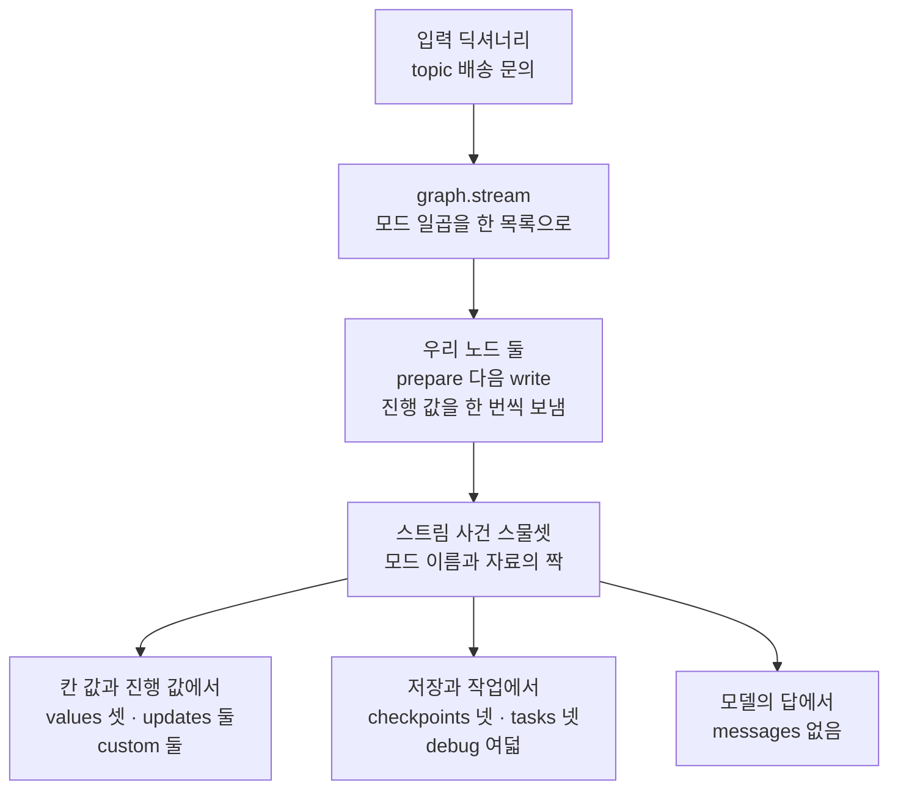
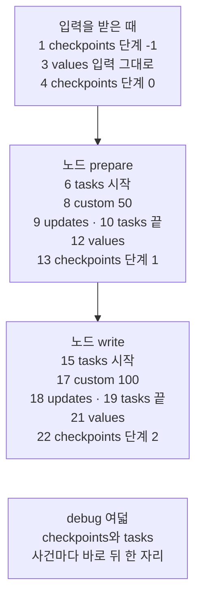
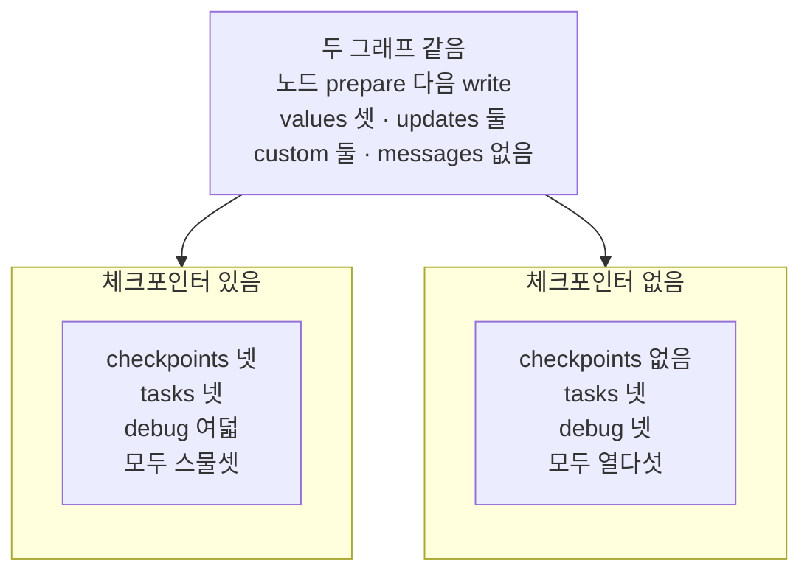
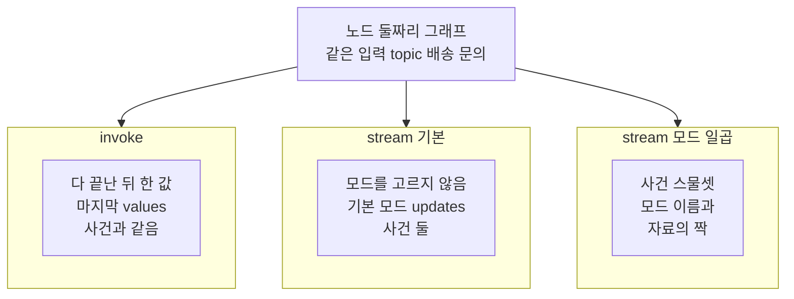

# 01-일곱-가지-stream-mode

## _src 본문 (HTML 원본)

```html
<!--meta: 강의 1h | 실습 1.5h | 코드 notebooks/01-일곱-가지-stream-mode.ipynb | 새 용어 3 -->
<style>html,body{overflow-x:hidden}.notebook,.nb-cell,.nb-main,.nb-input,.nb-result{min-width:0;max-width:100%}.nb-input pre,.nb-output{box-sizing:border-box;max-width:100%;overflow-x:auto}code.nb-source{display:block!important;width:100%!important;min-width:0!important;overflow-x:auto!important;padding:0!important}</style>
<h2 id="b1"><span class="no">1</span>학습 목표</h2><div class="goal"><ul>
<li>스트림 모드 일곱을 한 목록으로 골라 그래프를 한 번 실행하고, 모드마다 사건 수와 나온 자리를 셀 수 있습니다.</li>
<li>모드마다 사건 하나가 어떤 모양인지 출력에서 읽고, 실행 가운데 언제 나오는지 설명할 수 있습니다.</li>
<li>체크포인터나 모델이 없을 때 어느 모드의 사건이 사라지는지 출력으로 가를 수 있습니다.</li>
</ul></div>
<h2 id="b2"><span class="no">2</span>이 내용을 배우는 이유</h2><p>Ch 13부터 그래프는 <code>invoke</code>로 실행했고, 다 끝난 뒤의 칸 값만 받았습니다. 노드가 많거나 모델이 답을 오래 쓰면, 사용자는 끝날 때까지 아무것도 보지 못합니다. <a href="../../part2/ch06-langchain-start/04-스트리밍과-content-blocks.html">Ch 6 04절</a>의 스트리밍(streaming)은 결과를 끝까지 기다리지 않고, 생기는 대로 하나씩 받는 방법이었습니다. 그래프를 실행하는 동안에도 노드 시작·칸 갱신·체크포인트 저장 같은 일이 차례로 생깁니다.</p><p>절 제목의 stream mode는 그 일들 가운데 무엇을 어떤 모양으로 받을지 고르는 이름입니다. 본문에서는 스트림 모드라고 씁니다. 설치한 langgraph에는 스트림 모드가 일곱 있습니다. 화면에 보일 진행 표시와 나중에 살펴볼 저장 기록은 서로 다른 모드에서 옵니다. 그래서 이 절은 일곱 모드를 한 실행에서 모두 받아, 무엇이 언제 나오는지 먼저 셉니다.</p>
<h2 id="b3"><span class="no">3</span>앞에서 배운 내용</h2><p><a href="../../part2/ch06-langchain-start/04-스트리밍과-content-blocks.html">Ch 6 04절</a>에서는 모델의 <code>stream()</code>이 제너레이터를 내놓고, <code>for</code>가 꺼낼 때 요청이 나간다는 것을 배웠습니다. <a href="../../part4/ch13-langgraph-basics/01-StateGraph와-노드-엣지.html">Ch 13 01절</a>에서는 상태 형식·노드·엣지로 그래프를 만들고 <code>invoke</code>로 실행했습니다. <a href="../ch23-persistence/01-체크포인터와-스레드.html">Ch 23 01절</a>에서는 체크포인터 <code>InMemorySaver</code>와 스레드, 체크포인트 목록의 단계 번호와 만든 자리를 보았습니다. <a href="../ch23-persistence/05-pending-writes와-장애-복구.html">Ch 23 05절</a>의 작업(task)은 한 단계에서 노드 하나를 한 번 실행하는 일이었습니다.</p><p><a href="../ch24-human-in-the-loop/01-interrupt-승인-게이트.html">Ch 24 01절</a>에서는 <code>invoke</code> 결과의 키 <code>__interrupt__</code>로 멈춤 표시를 받았습니다. 그다음 <code>Command(resume=…)</code>로 사람의 답을 넘겨 이어 갔습니다. 그때는 결과를 한꺼번에 받았고, 스트림 사건은 받지 않았습니다. 이 절 노트북 9절에서 같은 장면을 <code>stream</code>으로 받아 봅니다.</p><p><a href="../ch23-persistence/03-스레드-재개와-대화-이어가기.html">Ch 23 03절</a>의 스레드 재개는 객체를 새로 만든 뒤 같은 스레드로 대화를 이어 가는 일이었습니다. <a href="../ch23-persistence/04-내구-실행-모드-비교.html">Ch 23 04절</a>·06절 스크립트의 단계 <code>resume</code>은 강제 종료 뒤 새 프로세스로 다시 실행하는 단계였습니다. Ch 24의 <code>Command(resume=…)</code>은 멈춰 기다리던 실행에 사람의 답을 넣어 이어 가는 일입니다. 셋은 서로 다른 장면이고, 스트림 모드 가운데 이어 가기만 따로 받는 모드는 없습니다.</p><p><a href="../ch22-middleware/06-커스텀-감사-미들웨어.html">Ch 22 06절</a>의 감사 기록에서 사건 하나는 훅이 사건 이름과 값 몇 개를 적어 남긴 것이었습니다. 이 절의 스트림 사건은 메서드 <code>stream</code>이 내놓는 값 하나이고, 둘은 다른 말입니다.</p>
<h2 id="b4"><span class="no">4</span>핵심 개념</h2><h3>비유로 시작하기</h3><p>대나무 홈통에 물을 흘려 보낸다고 합시다. 물은 한꺼번에 쏟아지지 않고, 방울로 하나씩 차례로 떨어집니다. 홈통 아래에 구멍을 여럿 뚫고 구멍마다 그릇을 대면, 같은 물줄기를 그릇마다 나눠 받습니다. 구멍마다 떨어지는 방울 수가 달라, 어떤 그릇은 비어 있기도 합니다.</p><p>홈통에 한 번 흘린 물이 그래프를 한 번 실행한 것이고, 떨어지는 방울 하나가 스트림 사건 하나입니다. 구멍과 그 아래 그릇 하나가 스트림 모드 하나입니다. 빈 그릇은 이 절에서 사건이 0개였던 모드 <code>messages</code>입니다.</p><p>비유와 다른 점이 하나 있습니다. 홈통은 구멍 하나를 막으면 그 물이 다른 구멍으로 더 흘러나옵니다. 그래프는 고르지 않은 모드의 사건을 다른 모드로 넘기지 않습니다. 노트북 7절에서 모드 하나만 골라도, 일곱을 함께 골라도 그 모드의 사건 수는 같았습니다.</p>
{{img:01-5-대나무-홈통과-일곱-그릇|흰 바탕에 긴 대나무 홈통 하나가 짧은 나무 기둥 둘 위에 가로로 놓인 그림입니다. 홈통 아랫면에 작은 구멍 일곱이 고르게 뚫려 있고, 구멍마다 바로 아래에 흰 그릇이 하나씩, 모두 일곱이 한 줄로 놓였습니다. 왼쪽부터 첫째에서 다섯째까지와 일곱째 구멍에서는 물방울이 떨어지고, 그 그릇 여섯에는 물이 서로 다른 높이로 담겼습니다. 왼쪽에서 여섯째 구멍에서는 물방울이 떨어지지 않고, 그 아래 그릇은 비어 있습니다. 글자·숫자·사람·손은 없는 그림|한 홈통에서 떨어진 물을 일곱 그릇이 나눠 받았고, 물방울이 오지 않은 여섯째 그릇만 비었습니다.}}
<p class="look"><b>그림 읽기</b> — 긴 대나무 홈통 하나의 아랫면에 구멍 일곱이 있고, 구멍마다 아래에 흰 그릇이 하나씩 놓였습니다. 여섯 구멍에서 물방울이 떨어져, 그릇 여섯에 물이 서로 다른 높이로 담겼습니다. 왼쪽에서 여섯째 구멍만 물방울이 없고, 그 아래 그릇은 비어 있습니다. 빈 그릇은 노트북 4절 표의 여섯째 줄인 모드 <code>messages</code>입니다. 다른 그릇의 물 높이는 모드마다의 사건 수와 짝짓지 않습니다.</p>
<table><thead><tr><th>말</th><th>뜻</th></tr></thead><tbody><tr><td>스트림 모드(stream mode)</td><td>한 실행에서 생긴 일 가운데 무엇을 어떤 모양으로 받을지 고르는 이름입니다. 홈통 아래 어느 구멍에 그릇을 댈지 고르는 것과 같습니다. 이 절에서는 인자 <code>stream_mode</code>에 넣는 글이고, 설치한 판에는 일곱이 있습니다.</td></tr><tr><td>스트림 사건</td><td>메서드 <code>stream</code>이 한 번에 하나씩 내놓는 값입니다. 홈통에서 떨어지는 물방울 한 방울과 같습니다. 이 절에서는 <code>for</code>가 한 번 꺼낼 때마다 받는 값이고, 모드를 목록으로 고르면 (모드 이름, 자료) 짝입니다.</td></tr><tr><td>진행 값</td><td>노드가 실행 도중에 쓰기 함수로 직접 보내는 값입니다. 부엌에서 요리하는 사람이 「재료 손질 끝」 하고 알려 주는 말과 같습니다. 이 절에서는 <code>get_stream_writer()</code>로 꺼낸 함수에 넣은 딕셔너리이고, 모드 <code>custom</code>을 골라야 받습니다.</td></tr></tbody></table>
<p>새 말을 이 절 코드에서 보면 이렇습니다. 스트림 모드 일곱은 노트북 4절 출력 <code>모드 수: 7</code>에서 보입니다. 스트림 사건은 3절 출력 <code>받은 사건: {'prepare': {'topic': '배송 문의'}}</code>처럼 한 줄씩 나왔습니다. 진행 값은 5절 출력 <code>custom | {'stage': 'prepare', 'progress': 50}</code>입니다.</p>
{{mermaid:01-1-한-실행에서-받은-일곱-모드|위에서 아래로 읽는 흐름도입니다. 초록 상자 입력 딕셔너리 topic 배송 문의가 회색 상자 graph.stream 모드 일곱을 한 목록으로, 파란 상자 우리 노드 둘 prepare 다음 write를 거쳐 노란 상자 스트림 사건 스물셋으로 이어집니다. 그 아래에 노란 상자 셋이 나란히 놓입니다. 칸 값과 진행 값에서 values 셋 updates 둘 custom 둘, 저장과 작업에서 checkpoints 넷 tasks 넷 debug 여덟, 모델의 답에서 messages 없음인 그림|일곱 모드를 한 목록으로 고른 한 실행에서 사건 스물세 개가 나왔고, 그 가운데 messages만 비었습니다.}}
<p class="look"><b>도식 읽기</b> — 위에서 아래로 읽습니다. 초록 상자는 넣은 입력, 회색 상자는 라이브러리 메서드, 파란 상자는 우리가 적은 노드입니다. 노란 상자는 모두 노트북 4절에서 출력으로 확인한 값입니다. 맨 아래 세 상자는 사건이 무엇에서 나오느냐로 이 절이 나눈 무리이고, 셋 사이에 차례는 없습니다.</p>
<h3>일곱 모드를 세 무리로 나눠 보기</h3><p>일곱 모드는 사건이 무엇에서 나오느냐로 세 무리로 나눠 볼 수 있습니다. 모드 <code>values</code>·<code>updates</code>·<code>custom</code>은 칸 값과 노드가 보낸 값에서 나옵니다. 모드 <code>checkpoints</code>·<code>tasks</code>·<code>debug</code>는 체크포인트 저장과 작업의 시작·끝에서 나옵니다. 공식 문서와 설치판 설명은 모드 <code>messages</code>가 노드 안에서 부른 모델의 답을 보낸다고 적습니다.</p><p>이 나눔은 이 절이 설명하려고 정한 것이고, 라이브러리가 정한 무리는 아닙니다. 모드 <code>debug</code>는 체크포인트 사건과 작업 사건을 한 모양으로 감싸 다시 보냅니다. 노트북 5절에서 debug 사건 여덟의 <code>type</code>은 <code>checkpoint</code> 넷, <code>task</code>와 <code>task_result</code> 둘씩이었습니다.</p>
<h3>한꺼번에 받기와 하나씩 받기</h3><p>메서드 <code>invoke</code>와 <code>stream</code>은 같은 실행을 받는 두 방법입니다. 노트북 6절 출력 <code>둘이 같은가: True</code>로, <code>invoke</code>의 결과는 4절 실행의 마지막 <code>values</code> 사건과 같았습니다. 설치판 <code>langgraph/pregel/main.py</code> 3913~3955행도 <code>invoke</code>가 안에서 <code>stream</code>을 부르고 마지막 <code>values</code> 사건을 남기는 모습입니다. 그래서 <code>invoke</code>는 끝까지 기다렸다가 한 값을 받는 방법이고, <code>stream</code>은 생기는 대로 하나씩 받는 방법입니다.</p><p>메서드 <code>stream</code>을 부르는 줄에서는 실행이 시작되지 않습니다. 노트북 3절에서 부른 뒤 꺼내기 전 체크포인트 수는 0이었고, 다 꺼낸 뒤 4였습니다. 인자 <code>stream_mode</code>를 주지 않자 컴파일한 그래프는 모드 <code>updates</code>를 썼습니다. 설치판 <code>langgraph/graph/state.py</code> 1357행이 이 기본값을 정합니다.</p>
<h2 id="b5"><span class="no">5</span>실행 예제</h2><p>노트북은 먼저 노드 둘짜리 그래프를 기본 모드로 받아, 사건이 하나씩 나오는 모습을 봅니다. 그다음 일곱 모드를 한 목록으로 골라 한 번 실행하고, 모드마다 사건 수·나온 자리·모양을 셉니다. 5절은 모드마다 사건 내용을 한 줄씩 출력합니다.</p><p>이 절은 모델을 부르지 않아 모델 요청은 0번이고, API 키 셀도 없습니다. 노드 둘은 매번 같은 값을 내는 우리 코드라, 같은 입력에 늘 같은 사건이 같은 차례로 나옵니다. 체크포인트 아이디·작업 아이디·시각은 실행마다 달라 출력하지 않았습니다. 읽거나 쓰는 파일은 없습니다.</p>
{{notebook:01-일곱-가지-stream-mode}}
<p class="look"><b>확인할 점</b> — 노트북 3절에서 <code>stream이 준 객체 종류: generator</code>와 <code>꺼내기 전 체크포인트 수: 0</code>이 나오는지 봅니다. 4절에서 <code>받은 사건 수: 23</code>과 모드마다의 줄, 예를 들어 <code>custom | 2 | [8, 17]</code>을 확인합니다. 5절에서 debug 사건의 <code>type</code> 여덟이 체크포인트 넷과 작업 넷인지 봅니다.</p>
{{mermaid:01-2-스물세-사건이-나온-자리|위에서 아래로 노란 상자 넷이 놓인 흐름도입니다. 첫 상자 입력을 받은 때에는 1 checkpoints 단계 -1, 3 values 입력 그대로, 4 checkpoints 단계 0이 적혀 있습니다. 둘째 상자 노드 prepare에는 6 tasks 시작, 8 custom 50, 9 updates, 10 tasks 끝, 12 values, 13 checkpoints 단계 1이 적혀 있습니다. 셋째 상자 노드 write에는 15 tasks 시작, 17 custom 100, 18 updates, 19 tasks 끝, 21 values, 22 checkpoints 단계 2가 적혀 있습니다. 맨 아래 상자는 debug 여덟, checkpoints와 tasks 사건마다 바로 뒤 한 자리인 그림|노드마다 작업 시작, 진행 값, 갱신, 작업 끝, 칸 값 전체, 체크포인트의 차례로 사건이 나왔습니다.}}
<p class="look"><b>도식 읽기</b> — 위에서 아래로 실행 차례대로 읽습니다. 상자 안의 수는 사건 스물셋 가운데 나온 자리이고, 노트북 4절 출력입니다. 상자에 없는 자리 2·5·7 같은 곳은 맨 아래 상자의 debug 사건입니다. 노드 두 상자는 같은 차례로 사건을 냈습니다.</p>
<h2 id="b6"><span class="no">6</span>실험 결과 해석</h2><p>일곱 모드를 한 목록으로 고른 한 실행에서 사건 23개가 나왔습니다. 아래 표는 모드마다 사건 수, 23개 가운데 나온 자리, 사건 하나의 모양을 모은 것입니다. 수와 자리는 노트북 4절, 모양은 5절 출력입니다.</p>
<table><thead><tr><th>모드</th><th>사건 수</th><th>나온 자리</th><th>사건 하나의 모양</th><th>언제 나오나</th></tr></thead><tbody><tr><td><code>values</code></td><td>3</td><td>3·12·21</td><td>칸 전체 딕셔너리(키 <code>topic</code>·<code>draft</code>)</td><td>입력을 칸에 넣은 뒤와, 노드가 끝날 때마다</td></tr><tr><td><code>updates</code></td><td>2</td><td>9·18</td><td><code>{노드 이름: 바꾼 칸}</code></td><td>노드가 끝날 때마다</td></tr><tr><td><code>checkpoints</code></td><td>4</td><td>1·4·13·22</td><td>키 여섯(<code>config</code>·<code>parent_config</code>·<code>values</code>·<code>metadata</code>·<code>next</code>·<code>tasks</code>)</td><td>체크포인트를 저장할 때마다(단계 -1·0·1·2)</td></tr><tr><td><code>tasks</code></td><td>4</td><td>6·10·15·19</td><td>시작은 키 <code>id</code>·<code>name</code>·<code>input</code>·<code>triggers</code>, 끝은 키 <code>id</code>·<code>name</code>·<code>error</code>·<code>result</code>·<code>interrupts</code></td><td>노드가 시작할 때와 끝날 때</td></tr><tr><td><code>debug</code></td><td>8</td><td>2·5·7·11·14·16·20·23</td><td>키 <code>step</code>·<code>timestamp</code>·<code>type</code>·<code>payload</code></td><td>체크포인트 사건과 작업 사건 바로 뒤</td></tr><tr><td><code>messages</code></td><td>0</td><td>—</td><td>사건 없음(모델의 답을 보내는 모드, 02절)</td><td>노드가 모델을 부르지 않고 글만 냄</td></tr><tr><td><code>custom</code></td><td>2</td><td>8·17</td><td>노드가 보낸 딕셔너리 그대로(키 <code>stage</code>·<code>progress</code>)</td><td>노드가 쓰기 함수를 부를 때</td></tr></tbody></table>
<p>진행 값은 8·17번째, 노드의 갱신은 9·18번째에 나왔습니다. 노드가 실행 도중에 보낸 값이 그 노드의 갱신보다 먼저 옵니다. 모드 <code>values</code>는 입력을 칸에 넣은 뒤 한 번과 노드가 끝날 때마다 한 번씩, 모두 셋입니다. 모드 <code>checkpoints</code>의 넷은 단계 -1·0·1·2입니다. Ch 23 01절의 노드 하나짜리 그래프는 한 번 실행에 셋이었고, 이 그래프는 노드가 하나 더 있어 넷입니다.</p><p>사건 수는 이 그래프의 모양이 정합니다. 노드가 둘이라 갱신 사건은 둘이고, 쓰기 함수를 두 번 불러 진행 값 사건도 둘입니다. 노드 수가 다르거나 체크포인터가 없으면 수가 달라지므로, 23을 다른 그래프에 그대로 쓰지 않습니다.</p>
{{mermaid:01-3-체크포인터가-있을-때와-없을-때|위에 회색 상자 하나, 아래에 칸 둘이 나란히 놓인 그림입니다. 회색 상자에는 두 그래프 같음, 노드 prepare 다음 write, values 셋 updates 둘, custom 둘 messages 없음이 적혀 있고 두 칸으로 화살표가 갑니다. 칸 체크포인터 있음의 노란 상자에는 checkpoints 넷 tasks 넷 debug 여덟 모두 스물셋, 칸 체크포인터 없음의 노란 상자에는 checkpoints 없음 tasks 넷 debug 넷 모두 열다섯이 적혀 있는 그림|체크포인터를 빼자 checkpoints 사건이 사라지고 debug가 줄었지만, tasks 사건은 넷 그대로였습니다.}}
<p class="look"><b>도식 읽기</b> — 맨 위 회색 상자는 두 그래프에서 모두 같았던 값이고, 노트북 8절 견주기 출력입니다. 칸 둘은 같은 설계 객체를 체크포인터와 함께, 또 체크포인터 없이 컴파일한 그래프입니다. 두 칸은 나란한 실행이라 화살표 없이 놓았고, 노란 상자는 8절 출력입니다.</p>
<p>노트북 8절에서 같은 설계 객체를 체크포인터 없이 컴파일하자, 사건은 15개였습니다. 모드 <code>checkpoints</code>는 0개가 되었고, <code>debug</code>는 체크포인트를 감싼 사건이 빠져 여덟에서 넷으로 줄었습니다. 모드 <code>tasks</code>는 체크포인터가 없어도 넷 그대로였습니다. 공식 문서의 모드 표는 <code>tasks</code>에도 체크포인터가 필요하다고 적지만, 설치한 판의 출력은 달랐습니다.</p><p>노트북 7절에서 새 스레드로 한 번 더 받자, 사건 수 23과 모드 이름 차례가 같았습니다. 모드를 하나씩 골라 일곱 번 따로 실행해도, 모드마다 사건 수가 한 실행 때와 같았습니다. 여러 모드를 함께 골라도 그래프는 한 번 실행되고, 사건마다 모드 이름이 붙어 나올 뿐입니다.</p>
{{mermaid:01-4-같은-그래프를-받는-세-방법|위에 파란 상자 노드 둘짜리 그래프, 같은 입력 topic 배송 문의가 있고, 아래 칸 셋으로 화살표가 갑니다. 칸 invoke에는 노란 상자 다 끝난 뒤 한 값, 마지막 values 사건과 같음이 있습니다. 칸 stream 기본에는 노란 상자 모드를 고르지 않음, 기본 모드 updates, 사건 둘이 있습니다. 칸 stream 모드 일곱에는 노란 상자 사건 스물셋, 모드 이름과 자료의 짝이 있는 그림|같은 그래프도 invoke로는 다 끝난 뒤 한 값을, stream으로는 고른 모드의 사건을 하나씩 받았습니다.}}
<p class="look"><b>도식 읽기</b> — 위에서 아래로 읽습니다. 파란 상자는 2절에서 만든 우리 그래프이고, 칸 셋은 같은 입력으로 따로 실행한 세 방법입니다. 노란 상자는 노트북 3·4·6절 출력입니다.</p>
<p>노트북 9절은 Ch 24 01절의 멈춤 표시를 모드 <code>updates</code>로 받았습니다. 첫 실행의 사건은 키 <code>__interrupt__</code> 하나였고, 질문 값이 담겨 있었습니다. 사람의 답 <code>approve</code>로 이어 가자 사건은 <code>{'ask_send': {'answer': 'approve'}}</code> 한 줄이었습니다. 이어 가기는 이름 붙은 따로의 사건이 아니라, 이어 간 노드의 갱신으로 보였습니다.</p><p>모델을 부르지 않아, 노트북 출력은 새 커널로 다시 실행해도 같아야 합니다. 새 커널로 두 번 실행했을 때 코드 셀 28개의 출력이 모두 같았습니다.</p>
<p class="look"><b>확인할 점</b> — 노트북 7절에서 <code>모드 이름 차례가 같은가: True</code>와, 따로 실행한 수가 한 실행의 수와 같은지 봅니다. 8절에서 <code>checkpoints | 4 | 0</code>과 <code>tasks | 4 | 4</code>를 확인합니다. 9절에서 사건의 키 <code>['__interrupt__']</code>와, 이어 간 뒤의 사건 한 줄을 봅니다.</p>
<h2 id="b7"><span class="no">7</span>주의할 점과 실무 메모</h2><ul><li>공식 문서의 모드 표는 <code>checkpoints</code>와 <code>tasks</code>에 체크포인터가 필요하다고 적습니다. 설치한 langgraph 1.2.11에서는 체크포인터 없이도 작업 사건 넷과 debug 사건 넷이 나왔습니다. 이 절은 설치한 판의 출력을 기준으로 적었습니다.</li><li>사건 수 23과 모드마다의 수는 노드 둘·쓰기 함수 두 번·체크포인터 하나인 이 그래프의 값입니다. 모델을 부르는 노드의 <code>messages</code> 사건은 02절에서 실제 모델로 봅니다.</li><li>설치판 <code>langgraph/pregel/_messages.py</code> 49~54행은 모드 <code>messages</code>가 모델의 스트림 청크와 함께, 노드가 내놓은 메시지 객체도 보낸다고 적습니다. 이 절 노드는 모델을 부르지 않고 글만 내놓아 사건이 0개였습니다. 노드가 메시지 객체를 내놓는 경우는 이번에 실행하지 않았습니다.</li><li>체크포인트 사건의 키 <code>config</code>, 작업 사건의 키 <code>id</code>, debug 사건의 키 <code>timestamp</code>는 실행마다 달라 출력하지 않았습니다.</li><li>모드를 목록으로 고르면 사건이 (모드 이름, 자료) 짝으로 나옵니다. 모드를 고르지 않거나 이름 하나를 글로 주면, 노트북 3절처럼 자료만 나옵니다.</li><li>공식 문서에는 인자 <code>version="v2"</code>로 사건 모양을 딕셔너리 하나로 맞추는 방법이 있습니다. 하위 그래프 안의 사건까지 받는 인자 <code>subgraphs=True</code>와 비동기 메서드 <code>astream</code>도 있습니다. 셋 모두 이번에 실행하지 않았고, 설치판 기본값은 <code>version="v1"</code>입니다.</li><li>함수 <code>collect_events</code>는 사건을 목록에 모두 모은 뒤에 내놓습니다. 사용자 화면에 바로 보여야 하는 곳에서는 노트북 3절처럼 <code>for</code> 안에서 사건을 바로 씁니다.</li><li>셀 하나만 다시 실행하면 같은 스레드에 체크포인트가 이어 쌓입니다. 노트북 밖에서 스레드 <code>all-1</code>로 한 번 더 실행하자, 사건은 23개 그대로였지만 단계 번호가 3~6으로 이어졌습니다. 처음 값으로 다시 보려면 2절 그래프 셀부터 다시 실행합니다.</li><li>걸린 시간은 재지 않았습니다. 교재 출력은 Linux의 Python 3.12.13으로 만들었고, 다른 판과 Windows·macOS에서는 실행하지 않았습니다.</li></ul>
<h2 id="b8"><span class="no">8</span>정리와 다음 절</h2><ul><li>메서드 <code>stream</code>은 제너레이터를 내놓았고, <code>for</code>로 꺼낼 때 실행이 시작되어 스트림 사건이 하나씩 나왔습니다.</li><li>스트림 모드 일곱을 한 목록으로 고르자 한 실행에서 사건 23개가 나왔습니다. 노드가 모델을 부르지 않고 글만 내서, <code>messages</code>만 0개였습니다.</li><li>체크포인터를 빼자 <code>checkpoints</code> 사건이 사라지고 <code>debug</code>가 줄었지만, <code>tasks</code>는 넷 그대로였습니다.</li></ul><p><strong>다음 학습과 이어지는 지점</strong> — <a href="02-토큰과-중간-진행-스트리밍.html">02절</a>에서는 모델을 부르는 노드로, 스트림 청크와 진행 값을 함께 받습니다.</p>
<h2 id="b9"><span class="no">9</span>복습 문제</h2><details class="quiz" open><summary>문제 4개 · 해설 포함</summary><p class="quiz-q">1. 메서드 <code>stream</code>을 부른 뒤, 꺼내기 전 체크포인트 수가 0이었던 까닭은 무엇인가요?</p><p class="quiz-a">메서드 <code>stream</code>이 내놓은 것이 제너레이터라, <code>for</code>가 첫 사건을 꺼낼 때 실행이 시작되기 때문입니다. 틀렸다면 노트북 3절을 다시 읽습니다.</p><p class="quiz-q">2. 한 실행에서 노드 <code>prepare</code>의 진행 값 사건이 그 노드의 갱신 사건보다 먼저 나온 까닭은 무엇인가요?</p><p class="quiz-a">노드가 실행 도중에 쓰기 함수로 진행 값을 보냈고, 갱신 사건은 노드가 끝난 뒤에 나오기 때문입니다. 틀렸다면 노트북 4·5절을 다시 읽습니다.</p><p class="quiz-q">3. 체크포인터를 빼자 debug 사건이 여덟에서 넷으로 줄어든 까닭은 무엇인가요?</p><p class="quiz-a">모드 <code>debug</code>는 체크포인트 사건과 작업 사건을 감싸 보내는데, 체크포인트 사건 넷이 사라졌기 때문입니다. 작업 사건 넷은 그대로 남았습니다. 틀렸다면 노트북 8절을 다시 읽습니다.</p><p class="quiz-q">4. Ch 24 01절의 멈춤 표시를 모드 <code>updates</code>로 받았을 때, 사람의 답으로 이어 가기는 어떤 사건으로 보였나요?</p><p class="quiz-a">이어 간 노드가 끝나며 낸 갱신 한 줄(<code>{'ask_send': {'answer': 'approve'}}</code>)로 보였습니다. 이어 가기만 따로 받는 모드는 없습니다. 틀렸다면 노트북 9절을 다시 읽습니다.</p></details>
<h2 id="b10"><span class="no">10</span>참고 자료</h2><ul><li><div><a href="https://docs.langchain.com/oss/python/langgraph/streaming">LangGraph Streaming</a></div>확인 2026-09-25 · 모드 일곱의 표와, 여러 모드를 고를 때 (모드, 자료) 짝이 나온다는 설명이 있습니다. 표는 <code>checkpoints</code>·<code>tasks</code>에 체크포인터가 필요하다고 적습니다.</li><li>langgraph 1.2.11 소스 <code>langgraph/types.py</code> 122~135행은 <code>StreamMode</code>의 이름 일곱과 모드마다의 설명입니다. 138~141행은 쓰기 함수가 모드 <code>custom</code>이 아니면 아무 일도 하지 않는다고 적습니다.</li><li>같은 판 <code>langgraph/graph/state.py</code> 1357행은 컴파일한 그래프의 기본 모드 <code>updates</code>입니다. <code>langgraph/config.py</code> 126행은 함수 <code>get_stream_writer</code>입니다.</li><li>같은 판 <code>langgraph/pregel/main.py</code> 2655~2672행은 메서드 <code>stream</code>의 인자입니다. 3913~3955행은 <code>invoke</code>가 안에서 <code>stream</code>을 부르는 자리입니다.</li><li>Ch 6 04절에서 제너레이터를, Ch 23 01절에서 체크포인트 목록을, Ch 24 01절에서 멈춤 표시를 보았습니다.</li></ul>
```

## 노트북 셀 (순서대로)

### [0] markdown {'html': 'skip'}

# 일곱 가지 stream mode

**이 노트북에서 할 일**

1. 노드 둘짜리 그래프를 `stream`으로 실행해, 사건이 하나씩 나오는 모습을 봅니다.
2. 스트림 모드 일곱을 한 목록으로 골라 한 번 실행하고, 모드마다 사건 수·나온 자리·모양을 봅니다.
3. 두 번 실행·모드마다 따로 실행·체크포인터 없이 실행해, 사건 수가 어떻게 되는지 견줍니다.

**준비물** — 이 노트북은 모델을 부르지 않습니다.
모델 요청은 0번이고, API 키 없이 실행합니다.
그래서 모드 `messages`의 사건은 0개이고, 실제 모델로 보는 일은 02절 몫입니다.
노드 둘은 매번 같은 값을 내는 우리 코드라, 새 커널로 다시 실행해도 출력이 같습니다.
걸린 시간은 재지 않았습니다.

체크포인터는 메모리에만 저장하고, 읽거나 쓰는 파일은 없습니다.
그래서 임시 폴더를 만들지 않고, 실습 폴더에도 파일을 남기지 않습니다.

**기준 버전** — 첫 셀에서 패키지 둘을 설치합니다.
그래프는 langgraph 1.2.11, 체크포인터는 langgraph-checkpoint 4.2.0에 들어 있습니다.
교재 출력은 Linux의 Python 3.12.13으로 만들었습니다.
다른 판과 Windows·macOS에서는 실행하지 않았습니다.

**강의와 실습 범위** — 강의 시간에는 2~5절을 읽습니다.
사건이 하나씩 나오는 모습과, 일곱 모드가 내놓는 사건의 수·자리·모양을 보는 자리입니다.
6~9절은 같은 결과를 다른 방법으로 다시 받아 보는 자리이고, 실습 시간에 실행합니다.
셀 하나만 다시 실행하면 같은 스레드에 체크포인트가 이어 쌓여, 단계 번호와 체크포인트 수가 달라집니다.
처음 값으로 다시 보려면 2절 그래프 셀부터 다시 실행합니다.

실습 폴더 `labs/part6/ch25-streaming`에서 `uv sync --locked`를 실행합니다.
그다음 `notebooks/` 폴더의 이 노트북을 열고, 실습 폴더의 `.venv` 커널을 고릅니다.
첫 셀부터 순서대로 실행합니다.

### [1] markdown {'html': 'skip'}

## 오늘 볼 그림


위에서 아래로 읽습니다.
초록 상자는 넣은 입력, 회색 상자는 라이브러리 메서드, 파란 상자는 우리가 적은 노드입니다.
노란 상자는 모두 노트북 4절에서 출력으로 확인한 값입니다.
맨 아래 세 상자는 사건이 무엇에서 나오느냐로 이 절이 나눈 무리이고, 셋 사이에 차례는 없습니다.

### [2] markdown {}

## 1. 준비

Ch 13부터 그래프는 `invoke`로 실행해, 다 끝난 뒤의 칸 값만 받았습니다.
이 절에서는 메서드 `stream`으로 실행하며, 실행 도중 생기는 일을 하나씩 받습니다.
절 제목의 stream mode는 그 일을 어떤 방식으로 받을지 고르는 이름입니다.
이 노트북에서는 스트림 모드라고 쓰고, 4절에서 일곱 모드를 한 번에 받아 봅니다.

첫 셀은 패키지 둘을 설치하고 설치된 판 번호를 출력합니다.
설치에는 몇십 초가 걸릴 수 있습니다.

### [3] code {'execution': {'iopub.execute_input': '2026-09-25T17:46:34.444235Z', 'iopub.status.busy': '2026-09-25T17:46:34.444066Z', 'iopub.status.idle': '2026-09-25T17:46:35.052053Z', 'shell.execute_reply': '2026-09-25T17:46:35.051451Z'}, 'lesson_role': 'setup'}

```python
# 이 절에서 쓰는 패키지를 설치하고 버전을 확인합니다
%pip install -q "langgraph==1.2.11" "langgraph-checkpoint==4.2.0"
from importlib.metadata import version

print("langgraph:", version("langgraph"))
print("langgraph-checkpoint:", version("langgraph-checkpoint"))
```

출력:
```
Note: you may need to restart the kernel to use updated packages.
langgraph: 1.2.11
langgraph-checkpoint: 4.2.0

```

### [4] markdown {}

**결과 읽기** — 출력 줄 `langgraph: 1.2.11`과 `langgraph-checkpoint: 4.2.0`이 보입니다.
두 판 모두 실습 폴더 잠금과 같은 판입니다.
이 노트북의 출력은 2026-09-25에 이 판으로 실행한 결과입니다.

다음 셀은 이 절에서 쓸 이름을 가져옵니다.
상태 형식과 그래프 이름은 Ch 13 01절, 체크포인터 `InMemorySaver`는 Ch 23 01절과 같습니다.
새로 쓰는 이름은 `get_args`·`get_stream_writer`·`StreamMode` 셋이고, 쓰는 자리에서 하나씩 풉니다.
객체 `Command`와 함수 `interrupt`는 Ch 24 01절에서 쓴 이름이고, 9절에서만 씁니다.

### [5] code {'execution': {'iopub.execute_input': '2026-09-25T17:46:35.053344Z', 'iopub.status.busy': '2026-09-25T17:46:35.053241Z', 'iopub.status.idle': '2026-09-25T17:46:35.569998Z', 'shell.execute_reply': '2026-09-25T17:46:35.569487Z'}, 'lesson_role': 'setup'}

```python
# 그래프 이름(Ch 13 01절)·체크포인터(Ch 23 01절)와, 스트림에 쓸 이름을 가져옵니다
from typing import get_args
from typing_extensions import TypedDict
from langgraph.graph import StateGraph, START, END
from langgraph.checkpoint.memory import InMemorySaver
# get_stream_writer는 노드 안에서 진행 값을 보낼 쓰기 함수를 꺼내는 함수입니다
from langgraph.config import get_stream_writer
# StreamMode는 모드 이름 목록을 적은 형식, Command·interrupt는 Ch 24 01절에서 쓴 이름입니다
from langgraph.types import Command, StreamMode, interrupt

print("langgraph.config에서 가져온 이름:", "get_stream_writer")
print("langgraph.types에서 가져온 이름:", "Command, StreamMode, interrupt")
```

출력:
```
langgraph.config에서 가져온 이름: get_stream_writer
langgraph.types에서 가져온 이름: Command, StreamMode, interrupt

```

### [6] markdown {}

**결과 읽기** — 출력 줄 `langgraph.types에서 가져온 이름: Command, StreamMode, interrupt`가 보입니다.
함수 `get_args`는 파이썬에 들어 있는 모듈 `typing`의 함수이고, 4절에서 씁니다.

## 2. 노드 둘짜리 그래프

그래프는 Ch 13 01절처럼 노드 둘을 한 줄로 잇습니다.
노드 `prepare`는 문의 제목의 앞뒤 빈칸을 지우고, 노드 `write`는 안내 초안을 씁니다.
먼저 상태 형식을 만듭니다.
칸 `topic`은 문의 제목, 칸 `draft`는 안내 초안이고, 둘 다 규칙이 없어 새 값이 오면 덮어씁니다.

### [7] code {'execution': {'iopub.execute_input': '2026-09-25T17:46:35.570879Z', 'iopub.status.busy': '2026-09-25T17:46:35.570807Z', 'iopub.status.idle': '2026-09-25T17:46:35.572504Z', 'shell.execute_reply': '2026-09-25T17:46:35.572174Z'}}

```python
# 문의 제목과 안내 초안 칸을 둔 상태 형식을 만듭니다(Ch 13 01절 모양, 두 칸 모두 규칙 없음)
class DraftState(TypedDict):
    topic: str
    draft: str
```

출력:
```

```

### [8] markdown {}

**결과 읽기** — 정의 셀이라 출력이 없습니다.
이 절의 노드 둘짜리 그래프가 이 상태 형식을 씁니다.

진행 값은 노드가 실행 도중에 직접 보내는 값입니다.
부엌에서 요리하는 사람이 「재료 손질 끝」 하고 알려 주는 말과 같습니다.
이 절에서는 노드가 딕셔너리 `{"stage": …, "progress": …}`를 보냅니다.

함수 `get_stream_writer`는 노드 안에서 불러, 진행 값을 보낼 쓰기 함수를 꺼냅니다.
꺼낸 쓰기 함수에 값을 넣어 부르면, 그 값이 스트림으로 나갑니다.
다음 셀은 진행 값 50을 보낸 뒤, 칸 `topic`의 앞뒤 빈칸을 지운 글을 내는 노드입니다.

### [9] code {'execution': {'iopub.execute_input': '2026-09-25T17:46:35.573145Z', 'iopub.status.busy': '2026-09-25T17:46:35.573100Z', 'iopub.status.idle': '2026-09-25T17:46:35.574947Z', 'shell.execute_reply': '2026-09-25T17:46:35.574593Z'}}

```python
# 진행 값을 보내고, 문의 제목의 앞뒤 빈칸을 지운 글을 칸 topic에 내는 노드입니다
def prepare(state):
    # get_stream_writer()는 이 실행의 쓰기 함수를 내놓고, 쓰기 함수는 받은 값을 스트림으로 보냅니다
    writer = get_stream_writer()
    writer({"stage": "prepare", "progress": 50})
    return {"topic": state["topic"].strip()}
```

출력:
```

```

### [10] markdown {}

**결과 읽기** — 정의 셀이라 출력이 없습니다.
진행 값의 숫자 50은 우리가 정한 값이고, 라이브러리가 계산한 값이 아닙니다.
메서드 `strip`은 글 앞뒤의 빈칸을 지운 새 글을 내놓습니다.

다음 셀은 진행 값 100을 보낸 뒤, 문의 제목 뒤에 「안내 초안」을 붙인 글을 칸 `draft`에 내는 노드입니다.

### [11] code {'execution': {'iopub.execute_input': '2026-09-25T17:46:35.575425Z', 'iopub.status.busy': '2026-09-25T17:46:35.575383Z', 'iopub.status.idle': '2026-09-25T17:46:35.577155Z', 'shell.execute_reply': '2026-09-25T17:46:35.576822Z'}}

```python
# 진행 값을 보내고, 문의 제목 뒤에 「안내 초안」을 붙인 글을 칸 draft에 내는 노드입니다
def write(state):
    writer = get_stream_writer()
    writer({"stage": "write", "progress": 100})
    draft = state["topic"] + " 안내 초안"
    return {"draft": draft}
```

출력:
```

```

### [12] markdown {}

**결과 읽기** — 정의 셀이라 출력이 없습니다.
두 노드 모두 진행 값을 한 번씩 보내므로, 한 실행에서 진행 값은 둘입니다.

다음 셀은 노드 둘을 이어 그래프를 만들고, Ch 23 01절처럼 체크포인터 `InMemorySaver`를 붙여 컴파일합니다.
체크포인터를 뺀 그래프와는 8절에서 견줍니다.

### [13] code {'execution': {'iopub.execute_input': '2026-09-25T17:46:35.577803Z', 'iopub.status.busy': '2026-09-25T17:46:35.577746Z', 'iopub.status.idle': '2026-09-25T17:46:35.580235Z', 'shell.execute_reply': '2026-09-25T17:46:35.579949Z'}}

```python
# 노드 둘을 START → prepare → write → END로 잇고, 체크포인터를 붙여 컴파일합니다
builder = StateGraph(DraftState)
builder.add_node("prepare", prepare)
builder.add_node("write", write)
builder.add_edge(START, "prepare")
builder.add_edge("prepare", "write")
builder.add_edge("write", END)
graph = builder.compile(checkpointer=InMemorySaver())
print("등록한 노드:", list(builder.nodes))
```

출력:
```
등록한 노드: ['prepare', 'write']

```

### [14] markdown {}

**결과 읽기** — 출력 줄 `등록한 노드: ['prepare', 'write']`가 보입니다.

## 3. 사건을 하나씩 받기

메서드 `stream`은 `invoke`와 같은 입력과 설정을 받습니다.
다만 끝난 뒤의 칸 값 대신, 실행 도중 생긴 일을 하나씩 꺼낼 수 있는 객체를 내놓습니다.
Ch 6 04절 모델의 `stream()`처럼, 이 객체는 제너레이터(generator)입니다.
제너레이터는 `for`가 하나를 꺼낼 때마다 다음 값을 만들어, 부르는 줄에서는 실행이 시작되지 않습니다.

다음 셀은 `stream`을 부르기만 하고 꺼내지는 않은 채, 객체 종류와 체크포인트 수를 봅니다.
실행 전에 예상해 봅니다.
실행이 아직 시작되지 않았다면, 이 스레드의 체크포인트는 0개일 것입니다.

### [15] code {'execution': {'iopub.execute_input': '2026-09-25T17:46:35.580795Z', 'iopub.status.busy': '2026-09-25T17:46:35.580744Z', 'iopub.status.idle': '2026-09-25T17:46:35.582653Z', 'shell.execute_reply': '2026-09-25T17:46:35.582309Z'}}

```python
# 입력을 넣어 stream을 부르고, 아직 꺼내지 않은 채 객체 종류와 체크포인트 수를 봅니다
first_input = {"topic": " 배송 문의 ", "draft": ""}
default_config = {"configurable": {"thread_id": "default"}}
default_stream = graph.stream(first_input, default_config)
print("stream이 준 객체 종류:", type(default_stream).__name__)
# 실행이 시작됐다면 이 스레드에 체크포인트가 쌓였을 것입니다
before_history = list(graph.get_state_history(default_config))
print("꺼내기 전 체크포인트 수:", len(before_history))
```

출력:
```
stream이 준 객체 종류: generator
꺼내기 전 체크포인트 수: 0

```

### [16] markdown {}

**결과 읽기** — 출력 줄 `stream이 준 객체 종류: generator`와 `꺼내기 전 체크포인트 수: 0`이 보입니다.
메서드 `stream`을 부른 줄에서는 그래프가 아직 한 노드도 실행하지 않았습니다.

스트림 사건은 메서드 `stream`이 한 번에 하나씩 내놓는 값입니다.
홈통에서 물이 한 방울씩 떨어질 때의 방울 하나와 같습니다.
이 절 코드에서는 `for`가 한 번 꺼낼 때마다 받는 값이 스트림 사건 하나입니다.
다음 셀은 사건을 하나씩 꺼내며 바로 출력하고, 다 꺼낸 뒤 체크포인트 수를 봅니다.

### [17] code {'execution': {'iopub.execute_input': '2026-09-25T17:46:35.583203Z', 'iopub.status.busy': '2026-09-25T17:46:35.583151Z', 'iopub.status.idle': '2026-09-25T17:46:35.588470Z', 'shell.execute_reply': '2026-09-25T17:46:35.588135Z'}}

```python
# for로 사건을 하나씩 꺼내 바로 출력하고, 다 꺼낸 뒤 체크포인트 수를 봅니다
for event in default_stream:
    print("받은 사건:", event)
after_history = list(graph.get_state_history(default_config))
print("다 꺼낸 뒤 체크포인트 수:", len(after_history))
# 인자 stream_mode를 주지 않았을 때 이 그래프가 쓰는 모드 이름입니다
print("이 그래프의 기본 모드:", graph.stream_mode)
```

출력:
```
받은 사건: {'prepare': {'topic': '배송 문의'}}
받은 사건: {'write': {'draft': '배송 문의 안내 초안'}}
다 꺼낸 뒤 체크포인트 수: 4
이 그래프의 기본 모드: updates

```

### [18] markdown {}

**결과 읽기** — 출력 줄 `받은 사건: {'prepare': {'topic': '배송 문의'}}`와 `받은 사건: {'write': {'draft': '배송 문의 안내 초안'}}`가 보입니다.
사건은 둘이고, 노드 이름과 그 노드가 낸 갱신이 짝지어 있습니다.
출력 줄 `다 꺼낸 뒤 체크포인트 수: 4`로, 꺼내는 동안 실행이 끝까지 갔습니다.
출력 줄 `이 그래프의 기본 모드: updates`는 모드를 고르지 않았을 때 쓰는 모드 이름입니다.

두 노드 모두 진행 값을 보냈는데, 받은 사건에는 진행 값이 없습니다.
진행 값은 모드 `custom`을 골라야 받을 수 있기 때문입니다.
설치판 `langgraph/types.py` 138~141행은 쓰기 함수가 모드 `custom`이 아니면 아무 일도 하지 않는다고 적습니다.
4절에서는 모드를 모두 골라 이 진행 값도 함께 받습니다.

## 4. 일곱 모드를 한 실행에서 받기

스트림 모드(stream mode)는 한 실행에서 생긴 일 가운데 무엇을 어떤 모양으로 받을지 고르는 이름입니다.
홈통 아래 여러 구멍 가운데 어느 구멍에 그릇을 댈지 고르는 것과 같습니다.
이 절 코드에서는 메서드 `stream`의 인자 `stream_mode`에 넣는 글입니다.
3절은 이 인자를 주지 않아, 기본 모드 `updates`를 썼습니다.

설치한 판이 받는 모드 이름은 `langgraph.types`의 `StreamMode`에 적혀 있습니다.
이 이름은 정해 둔 글 가운데 하나만 받는다고 적은 형식이고, Ch 19 02절의 `Literal`과 같은 모양입니다.
함수 `get_args`는 이런 형식에서 정해 둔 글들을 꺼내 줍니다.
다음 셀은 모드 이름을 꺼내 목록으로 만듭니다.

### [19] code {'execution': {'iopub.execute_input': '2026-09-25T17:46:35.589059Z', 'iopub.status.busy': '2026-09-25T17:46:35.589017Z', 'iopub.status.idle': '2026-09-25T17:46:35.590944Z', 'shell.execute_reply': '2026-09-25T17:46:35.590505Z'}}

```python
# 설치한 langgraph가 받는 모드 이름 일곱을 꺼내 목록으로 만듭니다
all_modes = list(get_args(StreamMode))
print("모드 수:", len(all_modes))
print("모드 이름:", all_modes)
```

출력:
```
모드 수: 7
모드 이름: ['values', 'updates', 'checkpoints', 'tasks', 'debug', 'messages', 'custom']

```

### [20] markdown {}

**결과 읽기** — 출력 줄 `모드 수: 7`과 `모드 이름: ['values', 'updates', 'checkpoints', 'tasks', 'debug', 'messages', 'custom']`이 보입니다.
이 노트북은 모드를 모두 이 차례로 적습니다.
공식 문서의 모드 표도 같은 이름 일곱을 적습니다.

인자 `stream_mode`에는 모드 이름 하나를 글로 줄 수도, 여럿을 목록으로 줄 수도 있습니다.
목록으로 주면 사건 하나가 (모드 이름, 자료) 짝으로 나와, 어느 모드에서 온 사건인지 가를 수 있습니다.
다음 셀은 그래프를 한 번 실행하며 받은 사건을 차례대로 목록에 모으는 함수입니다.

### [21] code {'execution': {'iopub.execute_input': '2026-09-25T17:46:35.591494Z', 'iopub.status.busy': '2026-09-25T17:46:35.591442Z', 'iopub.status.idle': '2026-09-25T17:46:35.593053Z', 'shell.execute_reply': '2026-09-25T17:46:35.592799Z'}}

```python
# 그래프를 한 번 실행하며 받은 사건을 차례대로 목록에 모아 내놓습니다
def collect_events(graph_to_run, graph_input, config, modes):
    events = []
    # stream_mode에 목록을 주면, 사건 하나가 (모드 이름, 자료) 짝으로 나옵니다
    for event in graph_to_run.stream(graph_input, config, stream_mode=modes):
        events.append(event)
    return events
```

출력:
```

```

### [22] markdown {}

**결과 읽기** — 정의 셀이라 출력이 없습니다.
이 함수는 사건을 모두 모은 뒤에 목록을 내놓습니다.
화면에 바로 보여야 하는 곳에서는 3절처럼 `for` 안에서 사건을 바로 씁니다.
이 절은 사건 수와 차례를 세려고 목록에 모읍니다.

다음 셀은 일곱 모드를 한 목록으로 골라, 새 스레드 `all-1`로 한 번 실행합니다.
실행 전에 예상해 봅니다.
3절의 사건 둘보다 훨씬 많은 사건이 나오고, 이 스레드의 체크포인트는 3절처럼 넷일 것입니다.

### [23] code {'execution': {'iopub.execute_input': '2026-09-25T17:46:35.593645Z', 'iopub.status.busy': '2026-09-25T17:46:35.593596Z', 'iopub.status.idle': '2026-09-25T17:46:35.598155Z', 'shell.execute_reply': '2026-09-25T17:46:35.597766Z'}}

```python
# 일곱 모드를 한 목록으로 골라, 새 스레드 all-1로 그래프를 한 번 실행합니다
all_config = {"configurable": {"thread_id": "all-1"}}
all_events = collect_events(graph, first_input, all_config, all_modes)
print("받은 사건 수:", len(all_events))
first_event = all_events[0]
print("첫 사건의 종류와 길이:", type(first_event).__name__, len(first_event))
print("첫 사건의 모드 이름:", first_event[0])
all_history = list(graph.get_state_history(all_config))
print("이 스레드의 체크포인트 수:", len(all_history))
```

출력:
```
받은 사건 수: 23
첫 사건의 종류와 길이: tuple 2
첫 사건의 모드 이름: checkpoints
이 스레드의 체크포인트 수: 4

```

### [24] markdown {}

**결과 읽기** — 출력 줄 `받은 사건 수: 23`입니다.
출력 줄 `첫 사건의 종류와 길이: tuple 2`로, 사건 하나가 둘짜리 튜플입니다.
출력 줄 `첫 사건의 모드 이름: checkpoints`로, 맨 앞 사건은 모드 `checkpoints`에서 왔습니다.
출력 줄 `이 스레드의 체크포인트 수: 4`는 3절과 같습니다.
모드를 일곱 골라도 그래프는 한 번만 실행되었습니다.

다음 셀은 사건 목록에서 한 모드의 사건이 몇 번째에 나왔는지 찾는 함수입니다.
자리는 사람이 세는 대로 1부터 셉니다.

### [25] code {'execution': {'iopub.execute_input': '2026-09-25T17:46:35.598821Z', 'iopub.status.busy': '2026-09-25T17:46:35.598770Z', 'iopub.status.idle': '2026-09-25T17:46:35.600434Z', 'shell.execute_reply': '2026-09-25T17:46:35.600112Z'}}

```python
# 사건 목록에서 한 모드의 사건이 몇 번째(1부터 셈)에 나왔는지 목록으로 내놓습니다
def positions_of(events, mode):
    places = []
    for index in range(len(events)):
        # 사건 하나는 (모드 이름, 자료) 짝이라, [0]이 모드 이름입니다
        if events[index][0] == mode:
            places.append(index + 1)
    return places
```

출력:
```

```

### [26] markdown {}

**결과 읽기** — 정의 셀이라 출력이 없습니다.
목록의 자리는 0부터 세므로, 찾은 자리에 1을 더해 적습니다.

다음 셀은 모드마다 사건 수와 나온 자리를 한 줄씩 출력합니다.

### [27] code {'execution': {'iopub.execute_input': '2026-09-25T17:46:35.601016Z', 'iopub.status.busy': '2026-09-25T17:46:35.600973Z', 'iopub.status.idle': '2026-09-25T17:46:35.602935Z', 'shell.execute_reply': '2026-09-25T17:46:35.602576Z'}}

```python
# 모드마다 사건 수와, 스물세 사건 가운데 나온 자리를 한 줄씩 출력합니다
print("모드 | 사건 수 | 나온 자리")
for mode in all_modes:
    places = positions_of(all_events, mode)
    print(mode, "|", len(places), "|", places)
```

출력:
```
모드 | 사건 수 | 나온 자리
values | 3 | [3, 12, 21]
updates | 2 | [9, 18]
checkpoints | 4 | [1, 4, 13, 22]
tasks | 4 | [6, 10, 15, 19]
debug | 8 | [2, 5, 7, 11, 14, 16, 20, 23]
messages | 0 | []
custom | 2 | [8, 17]

```

### [28] markdown {}

**결과 읽기** — 라벨 줄 아래 첫 줄은 `values | 3 | [3, 12, 21]`, 둘째 줄은 `updates | 2 | [9, 18]`입니다.
그 아래는 `checkpoints | 4 | [1, 4, 13, 22]`와 `tasks | 4 | [6, 10, 15, 19]`, `debug | 8 | [2, 5, 7, 11, 14, 16, 20, 23]`입니다.
마지막 두 줄은 `messages | 0 | []`와 `custom | 2 | [8, 17]`입니다.
사건 수를 모두 더하면 3 + 2 + 4 + 4 + 8 + 0 + 2 = 23으로, 앞 셀의 사건 수와 같습니다.

진행 값(`custom`)은 8·17번째에 나왔고, 바로 뒤 9·18번째에 노드의 갱신(`updates`)이 나왔습니다.
노드가 실행 도중에 보낸 진행 값이, 노드가 끝나고 낸 갱신보다 먼저 옵니다.
모드 `messages`는 사건이 0개입니다.
이 그래프의 노드는 모델을 부르지 않았고, 모델의 답을 받는 일은 02절에서 봅니다.

## 5. 모드마다 무엇이 나오는가

다음 셀은 모드마다 첫 사건의 자료가 무슨 자료형이고 어떤 키를 가졌는지 한 줄씩 봅니다.
사건 목록의 자리는 0부터 세므로, 나온 자리에서 1을 빼서 꺼냅니다.

### [29] code {'execution': {'iopub.execute_input': '2026-09-25T17:46:35.603433Z', 'iopub.status.busy': '2026-09-25T17:46:35.603385Z', 'iopub.status.idle': '2026-09-25T17:46:35.605244Z', 'shell.execute_reply': '2026-09-25T17:46:35.604894Z'}}

```python
# 모드마다 첫 사건의 자료가 어떤 모양인지(자료형과 키) 한 줄씩 봅니다
print("모드 | 자료형 | 키")
for mode in all_modes:
    places = positions_of(all_events, mode)
    if len(places) == 0:
        print(mode, "| 사건 없음")
    else:
        # 나온 자리는 1부터 세었고 목록의 자리는 0부터라, 1을 빼서 꺼냅니다
        first_data = all_events[places[0] - 1][1]
        print(mode, "|", type(first_data).__name__, "|", list(first_data))
```

출력:
```
모드 | 자료형 | 키
values | dict | ['topic', 'draft']
updates | dict | ['prepare']
checkpoints | dict | ['config', 'parent_config', 'values', 'metadata', 'next', 'tasks']
tasks | dict | ['id', 'name', 'input', 'triggers']
debug | dict | ['step', 'timestamp', 'type', 'payload']
messages | 사건 없음
custom | dict | ['stage', 'progress']

```

### [30] markdown {}

**결과 읽기** — 라벨 줄 아래 여섯 모드의 자료형은 모두 `dict`이고, `messages | 사건 없음` 한 줄만 다릅니다.
모드 `values`의 키 `['topic', 'draft']`는 상태 형식의 칸 둘입니다.
모드 `updates`의 키 `['prepare']`는 노드 이름이고, 모드 `custom`의 키 `['stage', 'progress']`는 우리가 보낸 진행 값 그대로입니다.
나머지 셋은 라이브러리가 정한 키이고, 아래 셀에서 하나씩 봅니다.

다음 셀은 칸 값과 진행 값에 관한 세 모드(`values`·`updates`·`custom`)의 사건만 나온 차례대로 출력합니다.
사건 목록을 `for mode, data in …`로 돌면, 둘짜리 튜플의 앞 값이 `mode`에, 뒤 값이 `data`에 들어갑니다.
Ch 6 04절에서 `for role, content in …`으로 메시지 짝을 풀었던 것과 같은 모양입니다.

### [31] code {'execution': {'iopub.execute_input': '2026-09-25T17:46:35.605823Z', 'iopub.status.busy': '2026-09-25T17:46:35.605781Z', 'iopub.status.idle': '2026-09-25T17:46:35.607485Z', 'shell.execute_reply': '2026-09-25T17:46:35.607190Z'}}

```python
# 칸 값에 관한 세 모드(values·updates·custom)의 사건만 나온 차례대로 출력합니다
state_modes = ["values", "updates", "custom"]
for mode, data in all_events:
    if mode in state_modes:
        print(mode, "|", data)
```

출력:
```
values | {'topic': ' 배송 문의 ', 'draft': ''}
custom | {'stage': 'prepare', 'progress': 50}
updates | {'prepare': {'topic': '배송 문의'}}
values | {'topic': '배송 문의', 'draft': ''}
custom | {'stage': 'write', 'progress': 100}
updates | {'write': {'draft': '배송 문의 안내 초안'}}
values | {'topic': '배송 문의', 'draft': '배송 문의 안내 초안'}

```

### [32] markdown {}

**결과 읽기** — 일곱 줄이 나옵니다.
첫 줄 `values | {'topic': ' 배송 문의 ', 'draft': ''}`는 넣은 입력 그대로이고, 빈칸이 남아 있습니다.
그다음 `custom | {'stage': 'prepare', 'progress': 50}` 뒤에 `updates | {'prepare': {'topic': '배송 문의'}}`가 옵니다.
마지막 줄 `values | {'topic': '배송 문의', 'draft': '배송 문의 안내 초안'}`은 다 끝난 뒤의 칸 값 전체입니다.

모드 `values`는 칸 전체를 보내므로, 칸이 많아지면 사건 하나가 커집니다.
모드 `updates`는 노드가 바꾼 칸만 보내고, 모드 `custom`은 노드가 보낸 값을 그대로 보냅니다.
진행 값은 상태의 칸에 들어가지 않으므로, 셀 주석의 「칸 값에 관한 세 모드」는 칸 값과 진행 값에 관한 세 모드로 읽습니다.
노드마다 진행 값을 보낸 뒤에 노드가 끝나므로, 진행 값 사건이 갱신 사건보다 먼저입니다.

다음 셀은 모드 `checkpoints`의 사건을 봅니다.
사건 하나는 체크포인트를 저장할 때마다 나오고, 설치판 설명은 `get_state()`와 같은 모양이라고 적습니다.
Ch 23 01절 체크포인트 목록처럼 단계 번호·만든 자리·다음 노드·칸 값을 한 줄씩 출력합니다.

### [33] code {'execution': {'iopub.execute_input': '2026-09-25T17:46:35.608067Z', 'iopub.status.busy': '2026-09-25T17:46:35.608024Z', 'iopub.status.idle': '2026-09-25T17:46:35.609913Z', 'shell.execute_reply': '2026-09-25T17:46:35.609583Z'}}

```python
# 모드 checkpoints의 사건마다 단계 번호·만든 자리·다음 노드·칸 값을 봅니다(Ch 23 01절 목록과 같은 칸)
print("단계 번호 | 만든 자리 | 다음 노드 | 칸 값")
for mode, data in all_events:
    if mode == "checkpoints":
        # 키 config에는 실행마다 달라지는 아이디가 있어 출력하지 않습니다
        saved = data["metadata"]
        print(saved["step"], "|", saved["source"], "|", data["next"], "|", data["values"])
```

출력:
```
단계 번호 | 만든 자리 | 다음 노드 | 칸 값
-1 | input | ['__start__'] | {}
0 | loop | ['prepare'] | {'topic': ' 배송 문의 ', 'draft': ''}
1 | loop | ['write'] | {'topic': '배송 문의', 'draft': ''}
2 | loop | [] | {'topic': '배송 문의', 'draft': '배송 문의 안내 초안'}

```

### [34] markdown {}

**결과 읽기** — 라벨 줄 아래 첫 줄은 `-1 | input | ['__start__'] | {}`입니다.
둘째 줄은 `0 | loop | ['prepare'] | {'topic': ' 배송 문의 ', 'draft': ''}`입니다.
그 아래 `1 | loop | ['write']`와 `2 | loop | []`로 시작하는 두 줄이 이어집니다.
단계 -1은 입력을 받은 때, 단계 0은 입력을 칸에 넣은 뒤, 단계 1·2는 노드 둘이 끝난 뒤입니다.

Ch 23 01절의 노드 하나짜리 그래프는 한 번 실행에 체크포인트가 셋(단계 -1·0·1)이었습니다.
노드가 둘인 이 그래프는 둘째 노드를 마친 단계 2까지 넷입니다.
다만 Ch 23 01절 `get_state_history`는 최신 것부터 내놓았고, 스트림은 저장한 차례대로 내놓습니다.

모드 `tasks`는 작업의 시작과 끝을 알립니다.
작업(task)은 Ch 23 05절에서 본 대로, 한 단계에서 노드 하나를 한 번 실행하는 일입니다.
다음 셀은 사건마다 노드 이름과, 시작 사건인지 끝 사건인지를 봅니다.
끝 사건에만 키 `result`가 있어, 그 키가 있는지로 가릅니다.

### [35] code {'execution': {'iopub.execute_input': '2026-09-25T17:46:35.610400Z', 'iopub.status.busy': '2026-09-25T17:46:35.610359Z', 'iopub.status.idle': '2026-09-25T17:46:35.612150Z', 'shell.execute_reply': '2026-09-25T17:46:35.611840Z'}}

```python
# 모드 tasks의 사건마다 노드 이름과, 시작 사건인지 끝 사건인지를 봅니다
for mode, data in all_events:
    if mode == "tasks":
        # 끝 사건에만 키 result가 있습니다(키 id의 값은 실행마다 달라 출력하지 않음)
        if "result" in data:
            print(data["name"], "| 끝 |", list(data), "| result:", data["result"])
        else:
            print(data["name"], "| 시작 |", list(data))
```

출력:
```
prepare | 시작 | ['id', 'name', 'input', 'triggers']
prepare | 끝 | ['id', 'name', 'error', 'result', 'interrupts'] | result: {'topic': '배송 문의'}
write | 시작 | ['id', 'name', 'input', 'triggers']
write | 끝 | ['id', 'name', 'error', 'result', 'interrupts'] | result: {'draft': '배송 문의 안내 초안'}

```

### [36] markdown {}

**결과 읽기** — 첫 줄은 `prepare | 시작 | ['id', 'name', 'input', 'triggers']`입니다.
둘째 줄은 `prepare | 끝 | ['id', 'name', 'error', 'result', 'interrupts'] | result: {'topic': '배송 문의'}`입니다.
셋째·넷째 줄은 노드 `write`의 시작과 끝입니다.
끝 사건의 키 `result`는 모드 `updates`가 보낸 그 노드의 갱신과 같습니다.
공식 문서는 이 모드가 작업의 결과와 오류를 함께 알린다고 적습니다.

모드 `debug`는 모드 `checkpoints`·`tasks`의 사건을 한 모양으로 감싸 다시 보냅니다.
사건마다 키 `type`에 무엇을 감쌌는지 적혀 있습니다.
다음 셀은 이 키의 값만 모아 봅니다.

### [37] code {'execution': {'iopub.execute_input': '2026-09-25T17:46:35.612648Z', 'iopub.status.busy': '2026-09-25T17:46:35.612605Z', 'iopub.status.idle': '2026-09-25T17:46:35.614251Z', 'shell.execute_reply': '2026-09-25T17:46:35.613915Z'}}

```python
# 모드 debug의 사건마다 키 type의 값을 모아, 무엇을 감싸 보냈는지 봅니다
debug_types = []
for mode, data in all_events:
    if mode == "debug":
        # 키 timestamp의 시각은 실행마다 달라 출력하지 않습니다
        debug_types.append(data["type"])
print("debug 사건의 type:", debug_types)
```

출력:
```
debug 사건의 type: ['checkpoint', 'checkpoint', 'task', 'task_result', 'checkpoint', 'task', 'task_result', 'checkpoint']

```

### [38] markdown {}

**결과 읽기** — 출력 줄 `debug 사건의 type: ['checkpoint', 'checkpoint', 'task', 'task_result', 'checkpoint', 'task', 'task_result', 'checkpoint']`입니다.
값 `checkpoint` 넷은 체크포인트 사건, `task`와 `task_result` 둘씩은 작업의 시작·끝 사건과 짝이 맞습니다.
4절 표에서 debug 사건 여덟은 모두 체크포인트 사건이나 작업 사건 바로 뒤에 나왔습니다.
그래서 debug 사건 수 8은 체크포인트 사건 4와 작업 사건 4를 더한 값입니다.

## 6. invoke가 내놓는 값

Ch 13부터 써 온 `invoke`는 다 끝난 뒤의 칸 값 전체를 내놓았습니다.
다음 셀은 같은 입력을 새 스레드 `invoke`에서 실행하고, 4절 실행의 마지막 `values` 사건과 견줍니다.
실행 전에 예상해 봅니다.
마지막 `values` 사건도 다 끝난 뒤의 칸 값 전체이니, 둘은 같을 것입니다.

### [39] code {'execution': {'iopub.execute_input': '2026-09-25T17:46:35.614765Z', 'iopub.status.busy': '2026-09-25T17:46:35.614710Z', 'iopub.status.idle': '2026-09-25T17:46:35.618065Z', 'shell.execute_reply': '2026-09-25T17:46:35.617726Z'}}

```python
# 같은 입력을 invoke로 실행한 결과와, 4절 실행의 마지막 values 사건을 견줍니다
invoke_config = {"configurable": {"thread_id": "invoke"}}
invoke_result = graph.invoke(first_input, invoke_config)
print("invoke 결과:", invoke_result)
last_values = None
for mode, data in all_events:
    if mode == "values":
        last_values = data
print("마지막 values 사건:", last_values)
print("둘이 같은가:", invoke_result == last_values)
```

출력:
```
invoke 결과: {'topic': '배송 문의', 'draft': '배송 문의 안내 초안'}
마지막 values 사건: {'topic': '배송 문의', 'draft': '배송 문의 안내 초안'}
둘이 같은가: True

```

### [40] markdown {}

**결과 읽기** — 출력 줄 `invoke 결과: {'topic': '배송 문의', 'draft': '배송 문의 안내 초안'}`와 `둘이 같은가: True`가 보입니다.
메서드 `invoke`는 사건을 하나씩 보여 주지 않고, 마지막 칸 값만 내놓습니다.
설치판 `langgraph/pregel/main.py` 3913~3955행은 `invoke`가 안에서 `stream`을 부르고, 마지막 `values` 사건을 남기는 자리입니다.
같은 실행을 한꺼번에 받느냐, 하나씩 받느냐의 차이입니다.

## 7. 두 번 받아도, 따로 받아도 같은가

다음 셀은 같은 입력을 새 스레드 `all-2`로 한 번 더 받아, 사건의 모드 이름 차례를 4절 실행과 한 자리씩 견줍니다.
노드 코드와 그래프 모양이 차례를 정하므로, 같아야 합니다.
체크포인트 아이디와 시각은 실행마다 달라, 모드 이름만 견줍니다.

### [41] code {'execution': {'iopub.execute_input': '2026-09-25T17:46:35.618643Z', 'iopub.status.busy': '2026-09-25T17:46:35.618592Z', 'iopub.status.idle': '2026-09-25T17:46:35.622508Z', 'shell.execute_reply': '2026-09-25T17:46:35.622110Z'}}

```python
# 새 스레드 all-2로 한 번 더 실행해, 사건 수와 모드 이름 차례가 4절 실행과 같은지 봅니다
second_config = {"configurable": {"thread_id": "all-2"}}
second_events = collect_events(graph, first_input, second_config, all_modes)
print("두 실행의 사건 수:", len(all_events), len(second_events))
same_order = True
for index in range(len(all_events)):
    if all_events[index][0] != second_events[index][0]:
        same_order = False
print("모드 이름 차례가 같은가:", same_order)
# 노드 코드와 그래프 모양이 정하는 차례라, 실행마다 같아야 합니다
assert same_order, "두 실행의 사건 차례가 같아야 합니다"
```

출력:
```
두 실행의 사건 수: 23 23
모드 이름 차례가 같은가: True

```

### [42] markdown {}

**결과 읽기** — 출력 줄 `두 실행의 사건 수: 23 23`과 `모드 이름 차례가 같은가: True`입니다.
모델을 부르지 않는 이 그래프는 몇 번 실행해도 사건 차례가 같습니다.
그래서 이 노트북의 사건 수와 자리는 새 커널로 다시 실행해도 같게 나옵니다.

모드를 일곱 함께 고르면, 모드 하나만 고를 때보다 사건이 줄거나 늘까요?
다음 셀은 모드마다 하나만 골라 새 스레드로 일곱 번 따로 실행하고, 4절 한 실행의 사건 수와 견줍니다.
모드 하나도 목록 `[mode]`로 주어, 사건이 짝으로 나오게 했습니다.

### [43] code {'execution': {'iopub.execute_input': '2026-09-25T17:46:35.623018Z', 'iopub.status.busy': '2026-09-25T17:46:35.622975Z', 'iopub.status.idle': '2026-09-25T17:46:35.632942Z', 'shell.execute_reply': '2026-09-25T17:46:35.632585Z'}}

```python
# 모드를 하나씩만 골라 새 스레드로 일곱 번 따로 실행하고, 4절 한 실행의 사건 수와 견줍니다
print("모드 | 한 실행에서 | 따로 실행에서")
for mode in all_modes:
    one_config = {"configurable": {"thread_id": "one-" + mode}}
    # 모드 하나도 목록 [mode]로 주어, 사건이 짝으로 나오게 합니다
    one_events = collect_events(graph, first_input, one_config, [mode])
    together = positions_of(all_events, mode)
    print(mode, "|", len(together), "|", len(one_events))
```

출력:
```
모드 | 한 실행에서 | 따로 실행에서
values | 3 | 3
updates | 2 | 2
checkpoints | 4 | 4
tasks | 4 | 4
debug | 8 | 8
messages | 0 | 0
custom | 2 | 2

```

### [44] markdown {}

**결과 읽기** — 라벨 줄 아래 일곱 줄에서 두 수가 모두 같습니다.
예를 들어 `debug | 8 | 8`과 `messages | 0 | 0`입니다.
모드를 함께 골라도, 한 모드가 받는 사건은 그 모드만 고를 때와 같았습니다.
여러 모드를 골라도 그래프는 한 번 실행되고, 사건마다 모드 이름이 붙어 나옵니다.

## 8. 체크포인터를 빼면

모드 `checkpoints`는 체크포인트를 저장할 때 나오므로, 체크포인터가 없으면 사건도 없을 것입니다.
공식 문서의 모드 표는 모드 `tasks`에도 체크포인터가 있어야 한다고 적습니다.
다음 셀은 2절의 설계 객체를 체크포인터 없이 다시 컴파일하고, 일곱 모드를 한 번 실행합니다.
체크포인터가 없으니 스레드 이름을 담은 설정도 넘기지 않습니다.

### [45] code {'execution': {'iopub.execute_input': '2026-09-25T17:46:35.633482Z', 'iopub.status.busy': '2026-09-25T17:46:35.633432Z', 'iopub.status.idle': '2026-09-25T17:46:35.637137Z', 'shell.execute_reply': '2026-09-25T17:46:35.636761Z'}}

```python
# 2절의 설계 객체를 체크포인터 없이 다시 컴파일하고, 일곱 모드를 한 목록으로 한 번 실행합니다
plain_graph = builder.compile()
# 체크포인터가 없으니 스레드 이름을 담은 설정도 넘기지 않습니다(None)
plain_events = collect_events(plain_graph, first_input, None, all_modes)
print("받은 사건 수:", len(plain_events))
plain_types = []
for mode, data in plain_events:
    if mode == "debug":
        plain_types.append(data["type"])
print("debug 사건의 type:", plain_types)
```

출력:
```
받은 사건 수: 15
debug 사건의 type: ['task', 'task_result', 'task', 'task_result']

```

### [46] markdown {}

**결과 읽기** — 출력 줄 `받은 사건 수: 15`로, 체크포인터가 있을 때의 23보다 여덟 줄었습니다.
출력 줄 `debug 사건의 type: ['task', 'task_result', 'task', 'task_result']`로, 체크포인트를 감싼 사건이 없습니다.

다음 셀은 모드마다 체크포인터가 있을 때와 없을 때의 사건 수를 한 줄씩 견줍니다.

### [47] code {'execution': {'iopub.execute_input': '2026-09-25T17:46:35.637705Z', 'iopub.status.busy': '2026-09-25T17:46:35.637655Z', 'iopub.status.idle': '2026-09-25T17:46:35.639501Z', 'shell.execute_reply': '2026-09-25T17:46:35.639152Z'}}

```python
# 모드마다 체크포인터가 있을 때와 없을 때의 사건 수를 한 줄씩 견줍니다
print("모드 | 체크포인터 있음 | 체크포인터 없음")
for mode in all_modes:
    with_saver = positions_of(all_events, mode)
    without_saver = positions_of(plain_events, mode)
    print(mode, "|", len(with_saver), "|", len(without_saver))
```

출력:
```
모드 | 체크포인터 있음 | 체크포인터 없음
values | 3 | 3
updates | 2 | 2
checkpoints | 4 | 0
tasks | 4 | 4
debug | 8 | 4
messages | 0 | 0
custom | 2 | 2

```

### [48] markdown {}

**결과 읽기** — 라벨 줄 아래 `checkpoints | 4 | 0`과 `debug | 8 | 4`에서만 수가 다릅니다.
줄 `tasks | 4 | 4`처럼, 작업 사건은 체크포인터가 없어도 넷이 나왔습니다.
설치한 판에서는 문서 표와 달리, 모드 `tasks`에 체크포인터가 필요하지 않았습니다.
이 노트북은 설치한 판의 출력을 기준으로 적습니다.
나머지 모드의 사건 수는 체크포인터와 관계없이 같았습니다.

## 9. 멈춤 표시와 이어 가기를 사건으로 받기

Ch 24 01절에서는 `invoke`로 멈춤 표시를 받고, `Command(resume=…)`로 사람의 답을 넘겨 이어 갔습니다.
그때는 결과의 키 `__interrupt__`로 멈춘 것을 알았고, 스트림 사건은 받지 않았습니다.
이 절에서는 같은 장면을 모드 `updates`로 받아 봅니다.

Ch 23 03절의 스레드 재개는 객체를 새로 만든 뒤 같은 스레드로 대화를 이어 가는 일이었습니다.
Ch 23 04·06절 스크립트의 단계 `resume`은 강제 종료 뒤 새 프로세스로 다시 실행하는 단계였습니다.
이 절 9절은 Ch 24의 장면, 곧 멈춰 기다리던 실행에 사람의 답을 넣어 이어 가는 일만 봅니다.
스트림 모드 일곱 가운데 이어 가기만 따로 받는 모드는 없습니다.

먼저 문의 제목과 사람의 답 칸을 둔 상태 형식을 새로 만듭니다.
칸 구성이 2절과 달라, 이름도 새로 붙입니다.

### [49] code {'execution': {'iopub.execute_input': '2026-09-25T17:46:35.639993Z', 'iopub.status.busy': '2026-09-25T17:46:35.639950Z', 'iopub.status.idle': '2026-09-25T17:46:35.641553Z', 'shell.execute_reply': '2026-09-25T17:46:35.641256Z'}}

```python
# 문의 제목과 사람의 답 칸을 둔 상태 형식을 만듭니다(칸 구성이 2절과 달라 새 이름)
class SendState(TypedDict):
    topic: str
    answer: str
```

출력:
```

```

### [50] markdown {}

**결과 읽기** — 정의 셀이라 출력이 없습니다.

다음 셀은 Ch 24 01절의 `ask_only`처럼, 멈춤 표시로 사람에게 묻고 받은 답을 칸 `answer`에 내는 노드입니다.
질문 값은 문의 제목과 질문 글 `보낼까요?`를 담은 딕셔너리입니다.

### [51] code {'execution': {'iopub.execute_input': '2026-09-25T17:46:35.642165Z', 'iopub.status.busy': '2026-09-25T17:46:35.642121Z', 'iopub.status.idle': '2026-09-25T17:46:35.643771Z', 'shell.execute_reply': '2026-09-25T17:46:35.643504Z'}}

```python
# 멈춤 표시로 안내 초안을 보낼지 묻고, 받은 답을 칸 answer에 내는 노드입니다
def ask_send(state):
    question = {"topic": state["topic"], "question": "보낼까요?"}
    # interrupt는 처음 부를 때 이 줄에서 멈추고, 이어 갈 때는 사람의 답을 내놓습니다
    answer = interrupt(question)
    return {"answer": answer}
```

출력:
```

```

### [52] markdown {}

**결과 읽기** — 정의 셀이라 출력이 없습니다.

다음 셀은 이 노드 하나로 그래프를 만들고, 체크포인터를 붙여 컴파일합니다.
Ch 24 01절에서 본 대로, 멈춤 표시를 쓰려면 체크포인터와 스레드 이름이 있어야 합니다.

### [53] code {'execution': {'iopub.execute_input': '2026-09-25T17:46:35.644272Z', 'iopub.status.busy': '2026-09-25T17:46:35.644229Z', 'iopub.status.idle': '2026-09-25T17:46:35.646177Z', 'shell.execute_reply': '2026-09-25T17:46:35.645848Z'}}

```python
# 노드 하나를 START → ask_send → END로 잇고, 체크포인터를 붙여 컴파일합니다
send_builder = StateGraph(SendState)
send_builder.add_node("ask_send", ask_send)
send_builder.add_edge(START, "ask_send")
send_builder.add_edge("ask_send", END)
send_graph = send_builder.compile(checkpointer=InMemorySaver())
send_config = {"configurable": {"thread_id": "send"}}
print("등록한 노드:", list(send_builder.nodes))
```

출력:
```
등록한 노드: ['ask_send']

```

### [54] markdown {}

**결과 읽기** — 출력 줄 `등록한 노드: ['ask_send']`입니다.

다음 셀은 첫 실행을 모드 `updates`로 받아, 사건마다 키를 출력합니다.
멈춤 표시 항목에는 아이디도 있어, 질문 값만 꺼냅니다.
실행 전에 예상해 봅니다.
노드가 멈춤 표시에서 멈추므로, 노드의 갱신 대신 멈춤 표시가 사건으로 나올 것입니다.

### [55] code {'execution': {'iopub.execute_input': '2026-09-25T17:46:35.646746Z', 'iopub.status.busy': '2026-09-25T17:46:35.646703Z', 'iopub.status.idle': '2026-09-25T17:46:35.649147Z', 'shell.execute_reply': '2026-09-25T17:46:35.648916Z'}}

```python
# 첫 실행을 모드 updates로 받아, 사건마다 키와 멈춤 표시의 질문 값을 봅니다
send_input = {"topic": "배송 문의", "answer": "대기"}
for event in send_graph.stream(send_input, send_config, stream_mode="updates"):
    print("사건의 키:", list(event))
    # 멈춤 표시 항목에는 아이디도 있어, 속성 value의 질문 값만 꺼냅니다
    if "__interrupt__" in event:
        print("질문 값:", event["__interrupt__"][0].value)
```

출력:
```
사건의 키: ['__interrupt__']
질문 값: {'topic': '배송 문의', 'question': '보낼까요?'}

```

### [56] markdown {}

**결과 읽기** — 사건은 하나이고, 출력 줄 `사건의 키: ['__interrupt__']`입니다.
Ch 24 01절 `invoke` 결과에 생겼던 키 `__interrupt__`가, 모드 `updates`에서는 사건 하나로 나왔습니다.
출력 줄 `질문 값: {'topic': '배송 문의', 'question': '보낼까요?'}`는 노드가 함수 `interrupt`에 넣은 딕셔너리 그대로입니다.

다음 셀은 사람의 답 `approve`를 `Command(resume=…)`에 담아, 같은 스레드로 이어 가며 모드 `updates`로 받습니다.
실행 전에 예상해 봅니다.
노드가 답을 받아 끝나고, 노드의 갱신 하나가 사건으로 나올 것입니다.

### [57] code {'execution': {'iopub.execute_input': '2026-09-25T17:46:35.649742Z', 'iopub.status.busy': '2026-09-25T17:46:35.649693Z', 'iopub.status.idle': '2026-09-25T17:46:35.652133Z', 'shell.execute_reply': '2026-09-25T17:46:35.651827Z'}}

```python
# 사람의 답 "approve"를 Command의 자리 resume에 담아 같은 스레드로 이어 가며, 모드 updates로 받습니다
for event in send_graph.stream(Command(resume="approve"), send_config, stream_mode="updates"):
    print("받은 사건:", event)
```

출력:
```
받은 사건: {'ask_send': {'answer': 'approve'}}

```

### [58] markdown {}

**결과 읽기** — 출력 줄 `받은 사건: {'ask_send': {'answer': 'approve'}}` 하나입니다.
이어 가기는 따로 이름 붙은 사건이 아니라, 이어 간 노드가 끝나며 낸 갱신 한 줄로 보였습니다.
멈춤 표시와 이어 가기 모두 이번에는 모드 `updates`의 사건으로 받았습니다.

## 정리

1. 메서드 `stream`은 제너레이터를 내놓았고, `for`로 꺼낼 때 실행이 시작되어 사건이 하나씩 나왔습니다.
2. 스트림 모드 일곱을 한 목록으로 고르자 한 실행에서 사건 23개가 나왔습니다. 노드가 모델을 부르지 않고 글만 내서, `messages`만 0개였습니다.
3. 체크포인터를 빼자 `checkpoints` 사건이 사라지고 `debug`가 줄었지만, `tasks`는 넷 그대로였습니다.

02절에서는 실제 모델을 부르는 노드로, 모드 `messages`의 스트림 청크와 진행 값을 한 실행에서 함께 받습니다.

## 그림

### 01-1-한-실행에서-받은-일곱-모드.mmd



일곱 모드를 한 목록으로 고른 한 실행에서 사건 스물세 개가 나왔고, 그 가운데 messages만 비었습니다.

### 01-2-스물세-사건이-나온-자리.mmd



노드마다 작업 시작, 진행 값, 갱신, 작업 끝, 칸 값 전체, 체크포인트의 차례로 사건이 나왔습니다.

### 01-3-체크포인터가-있을-때와-없을-때.mmd



체크포인터를 빼자 checkpoints 사건이 사라지고 debug가 줄었지만, tasks 사건은 넷 그대로였습니다.

### 01-4-같은-그래프를-받는-세-방법.mmd



같은 그래프도 invoke로는 다 끝난 뒤 한 값을, stream으로는 고른 모드의 사건을 하나씩 받았습니다.

### 01-5-대나무-홈통과-일곱-그릇.prompt.md

# 01-5-대나무-홈통과-일곱-그릇 (Higgsfield 삽화)

설명 대상 문장(본문 b4 비유 단락): 대나무 홈통에 물을 흘려 보낸다고 합시다. 물은 한꺼번에 쏟아지지 않고, 방울로 하나씩 차례로 떨어집니다. 홈통 아래에 구멍을 여럿 뚫고 구멍마다 그릇을 대면, 같은 물줄기를 그릇마다 나눠 받습니다. 구멍마다 떨어지는 방울 수가 달라, 어떤 그릇은 비어 있기도 합니다. … 홈통에 한 번 흘린 물이 그래프를 한 번 실행한 것이고, 떨어지는 방울 하나가 스트림 사건 하나입니다. 구멍과 그 아래 그릇 하나가 스트림 모드 하나입니다. 빈 그릇은 이 절에서 사건이 0개였던 모드 `messages`입니다.

구성 요소와 배치: 대나무 홈통 **하나**(가로, 앞에서 봄, 짧은 나무 기둥 둘 위) · 홈통 아랫면에 작은 구멍 **일곱**(고르게) · 구멍마다 바로 아래 흰 그릇 **하나씩, 모두 일곱**(한 줄) · 구멍 **여섯**에서 물방울이 떨어지고 그 그릇 여섯에는 물이 서로 다른 높이 · **왼쪽에서 여섯째** 구멍은 물방울 없음, 그 아래 그릇은 비어 있음(= `messages`, 노트북 4절 표의 여섯째 줄). 비유 계열 **「대나무 홈통과 물방울」**(챕터 리드 결정 10, 01절이 엶). 앞 챕터 소품(쟁반·서랍·바구니·저울·울타리·발자국·공구판·승강 상자·세탁기·체스판·즉석사진·도미노·구슬·모래시계·회전 레일) 없음. 사람·손·화살표·화면·시계·글자·숫자 없음.

시선 순서: 홈통 한 줄 → 구멍 일곱과 떨어지는 물방울 → 물이 담긴 그릇 여섯 → 물방울이 없는 여섯째 구멍과 빈 그릇.

검수 기준: 그림만 보고 「한 홈통의 물을 그릇 여럿이 나눠 받는데, 물이 오지 않은 그릇 하나는 비었다」가 읽히는가. 구멍과 그릇이 일곱씩인가, 물방울이 없는 구멍이 하나이고 그 아래 그릇만 비었는가. 글자·숫자·사람·손이 없는가.

## 프롬프트 (1차, 채택)

```text
Simple flat educational illustration, white background, limited soft palette, clean outlines, plain everyday objects, no text, no letters, no numbers, no logos. One long straight horizontal bamboo water pipe resting on two short wooden posts, seen from the front. The pipe has exactly seven small holes evenly spaced along its underside. Directly under each hole stands one small round white bowl, so there are exactly seven bowls in one straight row on the ground. Water drops fall from six of the holes into six bowls, and these six bowls hold water at different levels. The sixth bowl from the left is completely empty and dry, and no drop falls from the hole above it. No people, no hands, no arrows, no screens, no clocks, no hourglasses, no marbles, no trays, no baskets, no dominoes.
```

## 상태

- 2026-09-25 · `nano_banana_pro`(`jobs_wait` 응답 모델 이름 `nano_banana_2` — Ch 23·24와 같은 표시) · 16:9 · 2k · `use_unlim: false` · count 1. 생성 전 잔액 **2423.75**(바로 앞 거래 15:29:48Z는 Ch 24 04절 몫).
- **1차 job `cde26edf-d411-4ad1-a753-2407b4441a4c` 채택** — 거래 **2026-09-25T17:42:24Z 「Nano Banana Pro −2」**(결과 파일 이름 `hf_20260925_174224_cde26edf…`와 시각이 같음). 이 절 몫은 거래 한 줄, **2크레딧**. 재생성 0회. 결과 원본 `13280ade8e8ad9072f12b21b65694c63581037968227b9e0c44d3de5834b5f9a`(2752 × 1536).
- **그림에서 확인한 것(그림 읽기·alt에 반영)**: 흰 바탕에 올리브색 대나무 홈통 하나가 가로로 놓임(마디 여섯 줄, 왼쪽 끝은 열린 대롱). 짧은 나무 기둥 둘(왼쪽 첫째·둘째 구멍 사이, 오른쪽 여섯째·일곱째 구멍 사이)이 홈통을 받침. 홈통 아랫면에 작은 구멍 **일곱**. 구멍마다 바로 아래 흰 그릇 **일곱**이 한 줄. **왼쪽부터 첫째~다섯째와 일곱째 구멍 아래에 물방울 둘씩**, 그 그릇 여섯에 푸른 물이 서로 다른 높이로 담김(첫째~셋째는 물 윗면이, 넷째·다섯째·일곱째는 그릇 안쪽 아랫부분이 푸르게 보임). **여섯째 구멍 아래에는 물방울이 없고, 여섯째 그릇 안은 크림색으로 비어 있음**(잘라 크게 본 사본 `.cache/ch25-01-view/crop-right.png`로 다시 확인). 글자·숫자·사람·손·화살표·화면·시계·앞 챕터 소품 없음.
- 저장: 기기 셸에서 결과 URL을 `curl`로 받아(`/tmp/ch25-01/illu/illu-1-orig.png`) `UV_CACHE_DIR=/tmp/uv-cache uv run --no-project --with pillow`로 RGB·폭 1100px(LANCZOS)로 줄여 `figures/01-5-대나무-홈통과-일곱-그릇.png`(1100 × 614, `d4c2d8bfd8f7ee26eef4063e9738c8f33aeadac2e263a5f67cdf50352c310737`)로 저장했습니다.
- 결과 URL을 한 번 더 받아(`illu-1-again.png`, 원본과 해시 같음) 같은 폭으로 줄인 그림과 저장 PNG를 픽셀 대조했습니다(`ImageChops.difference` bbox `None`, 최대 차이 0). 저장 PNG와 해시가 같은 사본(`.cache/ch25-01-view/illu-1-1100.png`)을 직접 열어 개수를 세고 그림 읽기를 썼습니다.

