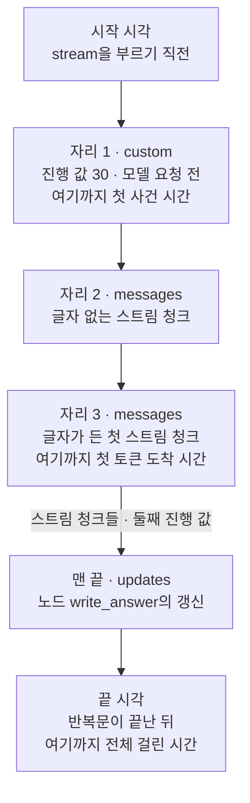
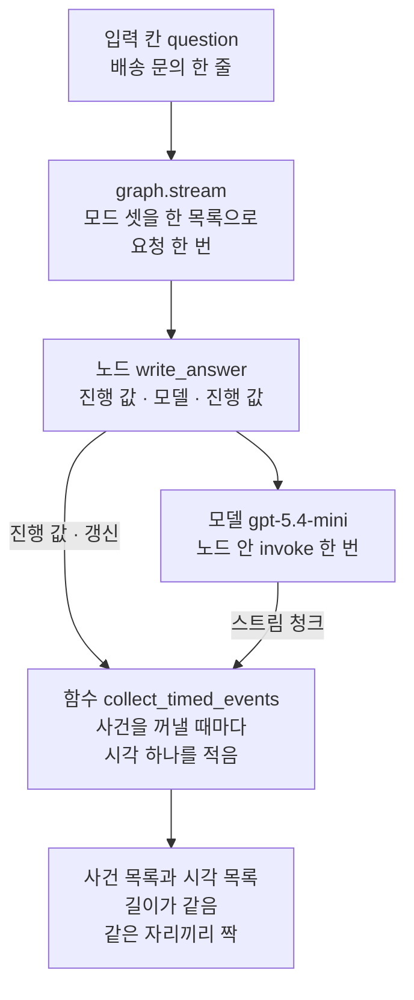
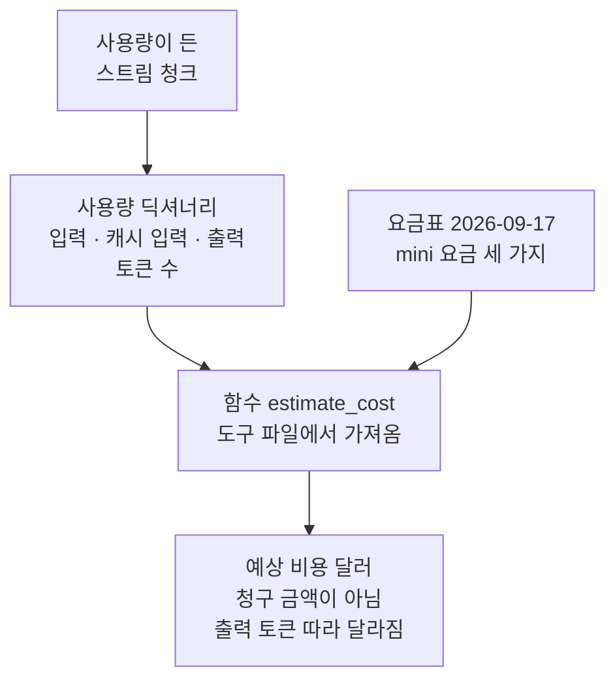
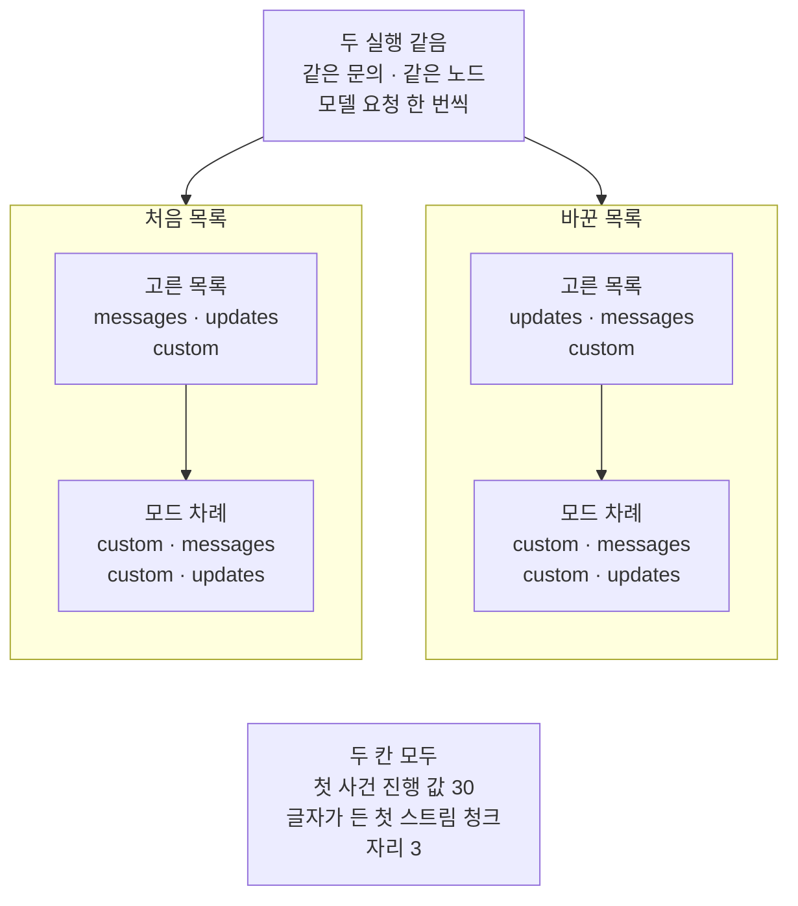

# 03-TTFT와-total-비교

## _src 본문 (HTML 원본)

```html
<!--meta: 강의 1h | 실습 2h | 코드 notebooks/03-TTFT와-total-비교.ipynb | 새 용어 2 -->
<style>html,body{overflow-x:hidden}.notebook,.nb-cell,.nb-main,.nb-input,.nb-result{min-width:0;max-width:100%}.nb-input pre,.nb-output{box-sizing:border-box;max-width:100%;overflow-x:auto}code.nb-source{display:block!important;width:100%!important;min-width:0!important;overflow-x:auto!important;padding:0!important}</style>
<h2 id="b1"><span class="no">1</span>학습 목표</h2><div class="goal"><ul>
<li>모드 셋을 한 실행에서 함께 받으며 사건마다 시각을 적고, 세 시간을 계산할 수 있습니다.</li>
<li>첫 사건과 글자가 든 첫 스트림 청크가 몇 번째 사건인지 가르고, 세 시각의 차례를 설명할 수 있습니다.</li>
<li>요청 한 번의 사용량으로 예상 비용을 셈하고, 실행마다 같은 값과 달라지는 값을 가를 수 있습니다.</li>
</ul></div>
<h2 id="b2"><span class="no">2</span>이 내용을 배우는 이유</h2><p><a href="02-토큰과-중간-진행-스트리밍.html">02절</a>에서는 진행 값과 스트림 청크, 갱신을 한 실행에서 함께 받았습니다. 무엇을 받느냐에 따라, 사용자가 화면에서 무언가를 처음 보는 때도 달라집니다. 진행 표시는 모델을 기다리기 전에 뜨고, 답의 첫 글자는 모델이 답을 쓰기 시작해야 옵니다. 그래서 사용자가 기다리는 시간은 하나가 아니라 여럿입니다.</p><p>절 제목의 TTFT는 <a href="../../part4/ch15-evaluation-advanced/05-로컬-트레이싱과-지연.html">Ch 15 05절</a>에서 배운 첫 토큰 도착 시간(time to first token)입니다. 절 제목의 total은 그래프 실행을 시작한 때부터 끝날 때까지 걸린 시간이고, 본문에서는 전체 걸린 시간이라고 씁니다. 이 절은 여기에 첫 사건 시간을 더해, 세 시간을 한 요청 안에서 잽니다. 모드마다 따로 요청하면 요청 종류부터 달라질 수 있기 때문입니다.</p>
<h2 id="b3"><span class="no">3</span>앞에서 배운 내용</h2><p><a href="02-토큰과-중간-진행-스트리밍.html">02절</a>에서는 모델을 부르는 노드 <code>write_answer</code>를 모드 셋으로 한 번 실행했습니다. 사건은 진행 값 30, 스트림 청크들, 진행 값 100, 갱신의 차례로 나왔습니다. 모드 <code>messages</code>의 첫 스트림 청크에는 글자가 없었고, 사용량은 스트림 청크 하나에만 있었습니다. 02절은 모드 <code>messages</code>를 고르지 않으면 노드 안 <code>invoke</code>가 스트리밍 요청을 보내지 않는다고 설치판 소스로 적었습니다. 이 절은 02절 그래프를 그대로 쓰고, <a href="01-일곱-가지-stream-mode.html">01절</a> 함수 <code>positions_of</code>와 02절 함수 <code>mode_order</code>를 도구 파일에서 가져옵니다.</p><p><a href="../../part4/ch15-evaluation-advanced/05-로컬-트레이싱과-지연.html">Ch 15 05절</a>에서는 모델의 <code>stream()</code>으로 답을 받으며 첫 토큰 도착 시간을 쟀습니다. 그 절은 글자가 든 첫 스트림 청크를 받은 때까지로 쟀습니다. 시각은 <a href="../../part2/ch06-langchain-start/06-토큰-비용-지연-비교.html">Ch 6 06절</a>처럼 <code>time.perf_counter()</code>로 읽고, 두 값을 빼 걸린 초를 냈습니다. Ch 6 06절은 요금표와 함수 <code>estimate_cost</code>로 요청 한 번의 예상 비용도 셌습니다. 이 절은 그 함수를 <a href="../ch21-create-agent/01-create-agent와-ReAct-루프.html">Ch 21</a> 도구 파일 <code>runner_tools.py</code>에서 그대로 옮겨 씁니다.</p>
<h2 id="b4"><span class="no">4</span>핵심 개념</h2><h3>비유로 시작하기</h3><p>01절부터 대나무 홈통에 물을 흘려 그릇에 받는 모습으로 스트리밍을 보았습니다. 이번에는 물을 흘리기 시작한 때부터 시간을 잽니다. 물이 닿기 전에 02절의 종이 먼저 울립니다. 조금 뒤 첫 물방울이 그릇 바닥에 닿고, 더 지나 그릇이 가득 찹니다.</p><p>종이 울린 때까지가 첫 사건 시간, 첫 방울이 닿은 때까지가 첫 토큰 도착 시간입니다. 그릇이 가득 찰 때까지가 전체 걸린 시간입니다. 세 시간 모두 물을 흘리기 시작한 때부터 잽니다.</p><p>비유와 다른 점이 있습니다. 홈통에서는 빈 방울이 떨어지지 않지만, 모드 <code>messages</code>의 첫 스트림 청크에는 글자가 없었습니다. 그래서 첫 토큰 도착 시간은 글자가 든 첫 스트림 청크를 받은 때로 잽니다.</p>
{{img:03-5-첫-방울만-든-그릇과-가득-찬-그릇|흰 바탕에 연두색 대나무 홈통 끝 둘이 나무 기둥에 하나씩 얹혀 서로 마주 보고, 홈통 끝마다 아래에 흰 그릇이 하나씩 놓인 그림입니다. 왼쪽 그릇은 비어 있고 바닥 가운데에 물방울 하나만 있습니다. 오른쪽 그릇은 옅은 파란 물로 가장자리까지 가득 차 있습니다. 글자·숫자·사람·손은 없는 그림|같은 홈통 끝에서 받는 그릇을 두 때로 나눠 보면, 첫 방울이 닿은 때와 그릇이 가득 찬 때가 다릅니다.}}
<p class="look"><b>그림 읽기</b> — 연두색 대나무 홈통 끝 둘이 나무 기둥 위에서 서로 마주 보고, 끝마다 아래에 흰 그릇이 하나씩 있습니다. 왼쪽 그릇 바닥 가운데에는 물방울 하나만 있고, 오른쪽 그릇은 가장자리까지 물이 찼습니다. 같은 그릇을 두 때로 나눠 본 모습으로 읽습니다. 왼쪽 그릇이 첫 방울이 닿은 때, 곧 첫 토큰 도착 시간의 끝이고, 오른쪽 그릇이 다 받은 때, 곧 전체 걸린 시간의 끝입니다. 물방울 하나를 스트림 청크 하나와 짝짓지 않습니다.</p>
<table><thead><tr><th>말</th><th>뜻</th></tr></thead><tbody><tr><td>첫 사건 시간</td><td>메서드 <code>stream</code>을 부른 때부터, 모드와 관계없이 처음 받은 사건까지 걸린 시간입니다. 가게에 전화를 걸고 「잠시만 기다려 주세요」를 듣기까지 걸린 시간과 같습니다. 이 절에서는 시각 목록의 첫 값에서 시작 시각을 뺀 초이고, 첫 사건은 진행 값 30이었습니다.</td></tr><tr><td>첫 토큰 도착 시간</td><td>Ch 15 05절에서 배운 말로, 글자가 든 첫 스트림 청크를 받기까지 걸린 시간입니다. 그 절은 식당에서 첫 접시가 나올 때까지 기다린 시간에 빗댔습니다. 이 절에서는 셋째 사건의 시각에서 시작 시각을 뺀 초입니다. Ch 15 05절은 모델의 <code>stream()</code>을 부르기 직전부터 쟀고, 이 절은 그보다 조금 앞에서부터 잽니다.</td></tr><tr><td>전체 걸린 시간</td><td>메서드 <code>stream</code>을 부른 때부터 마지막 사건까지 다 받고 끝날 때까지 걸린 시간입니다. 가게 전화로 치면 안내를 끝까지 듣고 전화를 끊을 때까지 걸린 시간입니다. 이 절에서는 반복문이 끝난 뒤 적은 끝 시각에서 시작 시각을 뺀 초입니다.</td></tr></tbody></table>
<p>새 말을 이 절 코드에서 보면 이렇습니다. 첫 사건 시간은 노트북 4절 출력 <code>첫 사건 시간(초):</code> 뒤 값입니다. 첫 토큰 도착 시간은 5절, 전체 걸린 시간은 6절 출력의 같은 이름 줄입니다.</p>
{{mermaid:03-1-세-시간을-재는-자리|위에서 아래로 여섯 상자가 화살표로 이어진 그림입니다. 파란 상자 시작 시각 stream을 부르기 직전에서 노란 상자 자리 1 custom 진행 값 30 모델 요청 전 여기까지 첫 사건 시간, 노란 상자 자리 2 messages 글자 없는 스트림 청크, 노란 상자 자리 3 messages 글자가 든 첫 스트림 청크 여기까지 첫 토큰 도착 시간으로 이어집니다. 그 뒤 스트림 청크들과 둘째 진행 값을 지나 노란 상자 맨 끝 updates 노드 write_answer의 갱신, 파란 상자 끝 시각 for가 끝난 뒤 여기까지 전체 걸린 시간으로 이어지는 그림|세 시간은 모두 같은 시작 시각부터 재고, 어느 사건까지 재는지만 다릅니다.}}
<p class="look"><b>도식 읽기</b> — 위에서 아래로 한 실행의 차례대로 읽습니다. 파란 상자는 우리 함수가 시각을 적은 자리이고, 노란 상자는 노트북 3~6절 출력으로 확인한 사건입니다. 세 시간은 모두 맨 위 시작 시각부터 재며, 어디까지 재는지는 상자 셋의 끝줄에 적었습니다. 초 값은 실행마다 달라, 그림에 적지 않았습니다.</p>
<h3>한 요청 안에서 세 시간을 잽니다</h3><p>함수 <code>collect_timed_events</code>는 메서드 <code>stream</code>을 부르기 직전에 시작 시각을 적습니다. 그다음 사건을 하나 꺼낼 때마다 시각을 하나씩 적고, 반복문이 끝나면 끝 시각을 적습니다. 그래서 사건 목록과 시각 목록은 길이가 같고, 같은 자리끼리 짝을 이룹니다. 01절에서 본 것처럼 실행은 반복문이 첫 사건을 꺼낼 때 시작됩니다.</p><p>세 모드를 한 요청으로 받으니, 세 시간은 같은 요청의 같은 답에서 나옵니다. 02절에서 본 대로 모드 <code>messages</code>를 고르지 않은 실행은 스트리밍 요청을 보내지 않습니다. 모드마다 따로 요청하면 요청 종류와 답 길이가 함께 달라져, 세 시간을 한 줄에 놓고 견줄 수 없습니다.</p>
<h3>세 시각의 차례는 사건 차례가 정합니다</h3><p>첫 사건은 노드가 모델 요청 전에 보낸 진행 값이라 자리 1입니다. 모델의 답은 그 뒤에 오고, 글자가 든 첫 스트림 청크는 자리 3이었습니다. 끝 시각은 마지막 사건인 갱신을 받은 뒤에 적습니다. 시각을 사건 차례대로 적으니, 세 시간이 커지는 차례는 초 값과 관계없이 같습니다.</p>
<h2 id="b5"><span class="no">5</span>실행 예제</h2><p>노트북은 02절 그래프를 다시 만들고, 사건마다 시각을 적는 함수 <code>collect_timed_events</code>를 새로 적습니다. 3절에서 모드 셋으로 한 번 실행하고, 4~6절에서 세 시간을 하나씩 계산합니다. 7절은 세 시각의 차례를 견주고 세 시간을 함수 하나로 묶습니다. 8절은 사용량으로 예상 비용을 셈하고, 9절은 모드 목록의 차례만 바꿔 한 번 더 실행합니다.</p><p>실제 OpenAI 모델 <code>gpt-5.4-mini</code>를 temperature 0으로 부릅니다. 모델 요청은 3절과 9절에서 한 번씩, 모두 2번입니다. 요금표로 어림한 예상 비용은 0.001달러 아래이고, 청구 금액이 아닙니다. 잰 초와 답 글, 스트림 청크 수는 실행마다 달라질 수 있습니다. 읽거나 쓰는 파일은 없습니다.</p>
{{notebook:03-TTFT와-total-비교}}
<p class="look"><b>확인할 점</b> — 노트북 3절에서 <code>사건마다 시각이 하나씩인가: True</code>를 봅니다. 4절 <code>첫 사건의 자료: {'stage': 'before_model', 'progress': 30}</code>과 5절 <code>글자가 든 첫 스트림 청크의 자리: 3</code>을 확인합니다. 7절 두 비교가 모두 <code>True</code>인지 봅니다. 교재 출력에서는 첫 사건 시간 0.003초, 첫 토큰 도착 시간 1.51초였습니다. 전체 걸린 시간은 1.758초였고, 다시 실행하면 달라집니다.</p>
{{mermaid:03-2-사건마다-시각을-적는-함수|위에서 아래로 읽는 흐름도입니다. 초록 상자 입력 칸 question 배송 문의 한 줄이 회색 상자 graph.stream 모드 셋을 한 목록으로 요청 한 번을 거쳐 파란 상자 노드 write_answer로 이어집니다. 노드에서 보라 상자 모델 gpt-5.4-mini 노드 안 invoke 한 번으로 화살표가 갑니다. 노드는 진행 값과 갱신을, 모델은 스트림 청크를 파란 상자 함수 collect_timed_events로 보내고, 함수에서 노란 상자 사건 목록과 시각 목록 길이가 같음 같은 자리끼리 짝으로 이어지는 그림|사건은 노드와 모델에서 나오고, 우리 함수는 사건을 꺼낼 때마다 시각을 하나씩 적습니다.}}
<p class="look"><b>도식 읽기</b> — 위에서 아래로 읽습니다. 초록 상자는 넣은 입력, 회색 상자는 라이브러리 메서드, 파란 상자는 우리가 적은 노드와 함수입니다. 보라 상자는 실제로 부른 모델이고, 노란 상자는 노트북 3절 출력으로 확인한 값입니다. 진행 값과 갱신은 노드에서, 스트림 청크는 모델에서 함수로 옵니다.</p>
<h2 id="b6"><span class="no">6</span>실험 결과 해석</h2><p>한 요청 안에서 적은 세 시각은 사건 차례대로 커졌습니다. 아래 표는 세 시간이 어느 사건까지의 시간인지와 교재 출력의 초를 모은 것입니다. 초는 교재 출력의 값이고, 다시 실행하면 달라집니다.</p>
<table><thead><tr><th>시간</th><th>어디까지</th><th>사건 자리</th><th>교재 출력(초)</th><th>다시 실행하면</th></tr></thead><tbody><tr><td>첫 사건 시간</td><td>모드 <code>custom</code>의 진행 값 30(모델 요청 전)</td><td>1</td><td>0.003</td><td>자리와 자료는 같음, 초는 달라짐</td></tr><tr><td>첫 토큰 도착 시간</td><td>모드 <code>messages</code>의 글자가 든 첫 스트림 청크</td><td>3</td><td>1.51</td><td>자리는 같음, 초는 달라짐</td></tr><tr><td>전체 걸린 시간</td><td>마지막 사건 <code>updates</code>를 받고 반복문이 끝난 때</td><td>맨 끝 뒤</td><td>1.758</td><td>초는 달라짐</td></tr></tbody></table>
<p>첫 사건은 모델 요청 전에 보낸 진행 값이라, 모델의 답을 기다린 시간이 들어 있지 않습니다. 모드 <code>messages</code>의 첫 사건은 자리 2였지만 글자가 없어, 첫 토큰 도착 시간은 자리 3의 시각으로 쟀습니다. 노트북 7절의 두 비교는 모두 <code>True</code>였습니다. 이 차례는 사건이 나온 차례로 정해지므로, 이 절의 결론은 초가 아니라 이 차례에 둡니다.</p><p>요청 한 번의 사용량은 사용량이 든 스트림 청크에서 읽었습니다. 입력 토큰과 캐시 입력 토큰의 수는 노트북 8절 결과 읽기에 있습니다. 출력 토큰과 예상 비용은 실행마다 달라져, 결과 읽기와 「확인할 점」에만 적었습니다.</p>
{{mermaid:03-3-사용량이-든-스트림-청크와-예상-비용|위에서 아래로 읽는 흐름도입니다. 노란 상자 사용량이 든 스트림 청크가 노란 상자 사용량 딕셔너리 입력 캐시 입력 출력 토큰 수로 이어집니다. 이 상자와 초록 상자 요금표 2026-09-17 mini 요금 세 가지가 함께 파란 상자 함수 estimate_cost 도구 파일에서 가져옴으로 들어가고, 노란 상자 예상 비용 달러 청구 금액이 아님 출력 토큰 따라 달라짐으로 이어지는 그림|사용량이 든 스트림 청크의 토큰 수와 요금표로, 요청 한 번의 예상 비용을 셉니다.}}
<p class="look"><b>도식 읽기</b> — 위에서 아래로 읽습니다. 노란 상자는 노트북 8절 출력이고, 초록 상자는 셀에 적은 요금표, 파란 상자는 도구 파일에서 가져온 함수입니다. 토큰 수와 예상 비용은 그림에 적지 않았고, 값은 노트북 8절 출력에서 봅니다.</p>
<p>노트북 9절에서 모드 목록의 차례만 바꾸자, 모드 차례와 첫 사건, 글자가 든 첫 스트림 청크의 자리는 3절과 같았습니다. 모드 목록은 받을 모드를 고를 뿐이고, 사건 차례는 노드 코드가 정합니다. 두 실행의 초는 따로 보낸 요청의 값이라, 그 차이를 목록 차례 탓으로 읽지 않습니다.</p>
{{mermaid:03-4-모드-목록의-차례만-바꾼-실행|맨 위 회색 상자 두 실행 같음 같은 문의 같은 노드 모델 요청 한 번씩에서 나란한 두 칸으로 화살표가 갑니다. 왼쪽 칸 처음 목록에서는 파란 상자 고른 목록 messages updates custom이 노란 상자 모드 차례 custom messages custom updates로 이어집니다. 오른쪽 칸 바꾼 목록에서는 파란 상자 고른 목록 updates messages custom이 같은 모드 차례의 노란 상자로 이어집니다. 맨 아래 회색 상자에는 두 칸 모두 첫 사건 진행 값 30 글자가 든 첫 스트림 청크 자리 3이 적힌 그림|모드 목록의 차례만 바꿔도, 모드 차례와 첫 사건, 글자가 든 첫 스트림 청크의 자리는 같았습니다.}}
<p class="look"><b>도식 읽기</b> — 맨 위 회색 상자는 두 실행에 같게 둔 조건이고, 왼쪽과 오른쪽 칸은 모드 목록만 바꾼 나란한 실행입니다. 파란 상자는 우리가 고른 모드 목록이고, 노란 상자는 노트북 3절과 9절의 모드 차례 출력입니다. 맨 아래 회색 상자는 4·5절과 9절 출력에서 모두 확인한 값입니다.</p>
<p>모델을 부르는 절이라 초와 답 글, 스트림 청크 수는 실행마다 달라질 수 있습니다. 새 커널로 세 번 실행해 견주자, 사건 수·초·출력 토큰·예상 비용이 찍힌 셀 여덟은 실행에 따라 달랐습니다. 모드 차례·자리·진행 값·두 비교의 <code>True</code>가 찍힌 나머지 셀 열여섯은 세 번 모두 같았습니다.</p>
<p class="look"><b>확인할 점</b> — 노트북 9절에서 <code>모드 차례: ['custom', 'messages', 'custom', 'updates']</code>가 3절과 같은지 봅니다. 7절 <code>4~6절에서 계산한 값과 같은가: True</code>를 확인합니다. 교재 출력의 출력 토큰은 40개, 예상 비용은 0.000215달러였고, 다시 실행하면 달라질 수 있습니다.</p>
<h2 id="b7"><span class="no">7</span>주의할 점과 실무 메모</h2><ul><li>걸린 시간은 이 절의 주제라서 실제로 쟀습니다. <a href="../../part4/ch15-evaluation-advanced/05-로컬-트레이싱과-지연.html">Ch 15 05절</a>·<a href="../../part5/ch17-agent-overview/04-자율성의-대가.html">Ch 17 04절</a>·<a href="../../part5/ch18-workflow-patterns/03-병렬-섹셔닝과-투표.html">Ch 18 03절</a>도 시간이 주제인 자리에서만 쟀습니다. 잰 초는 교재 출력을 만든 기기에서 <code>time.perf_counter()</code>로 읽은 값이라, 기기·네트워크·실행한 때에 따라 달라집니다.</li><li>요청은 조건마다 한 번씩만 보냈습니다. 여러 번 재어 가운데 값이나 <a href="../../part4/ch15-evaluation-advanced/06-대화당-비용-백분위수.html">Ch 15 06절</a>의 백분위수를 보지 않았으므로, 두 실행의 빠르기를 견주지 않았습니다.</li><li>이 절은 모드 <code>messages</code>를 고르지 않은, 스트리밍하지 않은 실행과 걸린 시간을 견주지 않았습니다. 그래서 스트리밍이 첫 글자까지의 시간이나 전체 걸린 시간을 줄이는지는 이 절 결과로 말할 수 없습니다.</li><li>노트북을 쓰기 전에 노트북 밖에서 3절 실행과 9절 실행을 다섯 번씩, 모두 열 번 보냈습니다. 9절의 바꾼 목록은 그 전에 정해 둔 예입니다. 모드 차례, 첫 사건의 자료, 글자가 든 첫 스트림 청크의 자리 3, 두 비교의 <code>True</code>는 열 번 모두 같았습니다. 사건 수와 초, 출력 토큰은 실행마다 달랐습니다. 첫 사건 시간은 새 커널 세 번에서는 같았지만, 노트북 밖에서는 0.003~0.006초로 달라 결론에 쓰지 않았습니다.</li><li>노트북 밖 열 번 모두, 첫 토큰 도착 시간이 전체 걸린 시간의 절반을 넘었습니다. 두 문장짜리 짧은 답에서 본 모양이고, 긴 답에서도 같다고 말할 수는 없습니다.</li><li>첫 토큰 도착 시간에는 네트워크를 오간 시간과 서버에서 답을 만든 시간이 함께 들어 있고, 이 절은 둘을 가르지 않았습니다. 시작 시각을 적은 때와 그래프가 첫 노드를 시작한 때의 차이도 따로 재지 않았습니다.</li><li>세 시각의 차례는 사건을 받은 차례대로 시각을 적어서 정해집니다. 교재 출력을 만든 기기에서 <code>time.get_clock_info("perf_counter")</code>는 뒤로 가지 않는 시계라고 알렸습니다. 속성 <code>monotonic</code>이 <code>True</code>였고, 이 확인은 노트북 밖에서 했습니다.</li><li>모드 목록에 <code>messages</code>가 없으면 글자가 든 스트림 청크가 없어, 함수 <code>first_text_place</code>가 <code>None</code>을 내놓습니다. 그런 실행에 함수 <code>three_times</code>를 쓰면 <code>None</code>에서 1을 빼는 줄에서 셀이 오류로 멈춥니다. 이번에 실행하지 않았습니다.</li><li>사용량이 든 스트림 청크는 OpenAI 기본 주소와 기본 클라이언트로 모델을 부를 때 붙습니다. 설치판 langchain-openai 1.6.0 <code>chat_models/base.py</code> 1332~1351행으로 확인했습니다. 다른 주소로 부르면 이 스트림 청크가 없어 8절 셀이 멈출 수 있고, 이번에 실행하지 않았습니다.</li><li>예상 비용은 2026-09-17 요금표로 어림한 값이고, 청구 금액이 아닙니다. 모델이 쓴 답 글과 잰 초, 토큰, 예상 비용에는 <code>assert</code>를 걸지 않았습니다.</li><li>비동기 메서드 <code>astream</code>과 인자 <code>version="v2"</code>는 01·02절처럼 이번에도 실행하지 않았습니다.</li><li>교재 출력은 Linux의 Python 3.12.13으로 만들었고, 다른 판과 Windows·macOS에서는 실행하지 않았습니다.</li></ul>
<h2 id="b8"><span class="no">8</span>정리와 다음 절</h2><ul><li>모드 셋을 한 실행에서 함께 받으며 사건마다 시각을 적자, 한 요청 안에서 세 시간을 모두 잴 수 있었습니다.</li><li>첫 사건은 모델 요청 전의 진행 값이었고, 글자가 든 첫 스트림 청크는 셋째 사건이었습니다.</li><li>세 시각은 사건 차례대로 커졌고, 모드 목록의 차례를 바꿔도 사건 차례는 같았습니다.</li></ul><p><strong>다음 학습과 이어지는 지점</strong> — <a href="04-Streaming-실습.html">04절 실습</a>에서는 이 챕터에서 배운 것을 작은 흐름 하나에 모아 실행합니다.</p>
<h2 id="b9"><span class="no">9</span>복습 문제</h2><details class="quiz" open><summary>문제 4개 · 해설 포함</summary><p class="quiz-q">1. 첫 사건 시간에 모델의 답을 기다린 시간이 들어 있지 않은 까닭은 무엇인가요?</p><p class="quiz-a">첫 사건이 노드가 모델 요청보다 먼저 보낸 진행 값 30이었기 때문입니다. 틀렸다면 노트북 4절을 다시 읽습니다.</p><p class="quiz-q">2. 첫 토큰 도착 시간을 모드 <code>messages</code>의 첫 사건 시각으로 재지 않은 까닭은 무엇인가요?</p><p class="quiz-a">자리 2의 첫 스트림 청크에는 글자가 없었기 때문입니다. 그래서 글자가 든 첫 스트림 청크인 자리 3의 시각으로 쟀습니다. 틀렸다면 노트북 5절을 다시 읽습니다.</p><p class="quiz-q">3. 세 시간을 모드마다 따로 요청해 재지 않은 까닭은 무엇인가요?</p><p class="quiz-a">모드마다 따로 요청하면 요청 종류와 답 길이가 함께 달라지기 때문입니다. 모드 <code>messages</code>를 고르지 않은 요청은 스트리밍 요청이 아니고, 따로 보낸 요청이라 답 길이도 다를 수 있습니다. 그래서 한 요청 안에서 세 시간을 잽니다. 틀렸다면 본문 「핵심 개념」과 노트북 3절을 다시 읽습니다.</p><p class="quiz-q">4. 모드 목록의 차례를 바꾸자 첫 사건이 바뀌었나요?</p><p class="quiz-a">바뀌지 않았습니다. 모드 차례와 첫 사건, 글자가 든 첫 스트림 청크의 자리가 3절과 같았습니다. 사건 차례는 노드 코드가 정하기 때문입니다. 틀렸다면 노트북 9절을 다시 읽습니다.</p></details>
<h2 id="b10"><span class="no">10</span>참고 자료</h2><ul><li><div><a href="https://docs.python.org/3.12/library/time.html#time.perf_counter">time.perf_counter</a></div>확인 2026-09-25 · 내놓는 값의 기준점이 정해져 있지 않아, 두 번 부른 값의 차이만 뜻이 있다고 적습니다. 같은 문서의 <code>get_clock_info</code>는 시계가 뒤로 갈 수 있는지 알려 줍니다.</li><li><div><a href="https://developers.openai.com/api/docs/guides/latency-optimization">Latency optimization</a></div>확인 2026-09-25 · OpenAI 안내 문서입니다. 스트리밍이 기다리는 시간을 줄인다고 적고, 기다리는 것과 진행을 지켜보는 것은 크게 다르다고 적습니다. 이는 문서의 설명이고, 이 절은 스트리밍하지 않은 실행과 견주지 않았습니다. 첫 토큰 도착 시간의 정의는 없어, 이 절은 Ch 15 05절의 정의를 씁니다.</li><li><div><a href="https://docs.langchain.com/oss/python/langgraph/streaming">LangGraph Streaming</a></div>확인 2026-09-25 · 모드를 목록으로 골라 여러 모드를 함께 받는 방법이 있습니다. 모드 <code>messages</code>의 사건이 (스트림 청크, 칸 <code>metadata</code>) 짝이라는 설명도 있습니다.</li><li>Ch 15 05절에서 첫 토큰 도착 시간을, Ch 6 06절에서 걸린 초와 예상 비용을, 02절에서 사건 차례를 보았습니다.</li></ul>
```

## 노트북 셀 (순서대로)

### [0] markdown {'html': 'skip'}

# TTFT와 total 비교

**이 노트북에서 할 일**

1. 02절 그래프를 모드 셋으로 한 번 실행하며, 사건마다 받은 시각을 적습니다.
2. 적은 시각으로 첫 사건 시간, 첫 토큰 도착 시간, 전체 걸린 시간을 계산합니다.
3. 세 시각의 차례와 요청 한 번의 예상 비용을 보고, 모드 목록의 차례만 바꿔 다시 실행합니다.

**준비물** — 프로젝트 폴더의 `.env` 파일에 `OPENAI_API_KEY`가 있어야 합니다.
모델은 `gpt-5.4-mini`이고, 모델 요청은 3절과 9절에서 한 번씩, 모두 2번입니다.
요금표로 어림한 예상 비용은 두 요청을 합쳐 0.001달러 아래이고, 청구 금액이 아닙니다.
이 절은 걸린 시간이 주제라서, 시간을 실제로 잽니다.
잰 초와 답 글, 스트림 청크 수는 실행마다 달라질 수 있습니다.

읽거나 쓰는 파일은 없고, 체크포인터도 쓰지 않습니다.
앞에서 배운 함수 셋은 도구 파일 `stream_tools.py`에서 가져옵니다.

**기준 버전** — 첫 셀에서 패키지 넷을 설치합니다.
판은 langchain 1.4.0과 langchain-openai 1.6.0입니다.
langgraph 1.2.11과 python-dotenv 1.2.3도 함께 설치합니다.
교재 출력은 Linux의 Python 3.12.13으로 만들었습니다.
다른 판과 Windows·macOS에서는 실행하지 않았습니다.

**강의와 실습 범위** — 강의 시간에는 2~6절을 읽습니다.
02절 그래프에 시각을 적는 함수를 붙여, 세 시간을 하나씩 재는 자리입니다.
7~9절은 세 시간을 모아 보고, 예상 비용과 목록 차례를 바꾼 실행을 보는 자리입니다.
7~9절은 실습 시간에 실행합니다.

실습 폴더 `labs/part6/ch25-streaming`에서 `uv sync --locked`를 실행합니다.
그다음 `notebooks/` 폴더의 이 노트북을 열고, 실습 폴더의 `.venv` 커널을 고릅니다.
첫 셀부터 순서대로 실행합니다.

### [1] markdown {'html': 'skip'}

## 오늘 볼 그림


위에서 아래로 한 실행의 차례대로 읽습니다.
파란 상자는 우리 함수가 시각을 적은 자리이고, 노란 상자는 노트북 3~6절 출력으로 확인한 사건입니다.
세 시간은 모두 맨 위 시작 시각부터 재며, 어디까지 재는지는 상자 셋의 끝줄에 적었습니다.
초 값은 실행마다 달라, 그림에 적지 않았습니다.

### [2] markdown {}

## 1. 준비

02절에서는 모드 셋을 한 실행에서 함께 받아, 사건이 나온 차례를 보았습니다.
이 절은 같은 그래프를 한 번 실행하며, 사건마다 받은 시각을 적어 걸린 시간을 잽니다.
절 제목의 TTFT는 Ch 15 05절에서 배운 첫 토큰 도착 시간(time to first token)입니다.
절 제목의 total은 그래프 실행을 시작한 때부터 끝날 때까지 걸린 시간입니다.
본문에서는 이 시간을 전체 걸린 시간이라고 씁니다.

첫 셀은 패키지 넷을 설치하고 설치된 판 번호를 출력합니다.
설치에는 몇십 초가 걸릴 수 있습니다.

### [3] code {'execution': {'iopub.execute_input': '2026-09-25T18:45:15.871290Z', 'iopub.status.busy': '2026-09-25T18:45:15.871104Z', 'iopub.status.idle': '2026-09-25T18:45:16.569763Z', 'shell.execute_reply': '2026-09-25T18:45:16.569171Z'}, 'lesson_role': 'setup'}

```python
# 이 절에서 쓰는 패키지를 설치하고 버전을 확인합니다
%pip install -q "langchain==1.4.0" "langchain-openai==1.6.0" "langgraph==1.2.11" "python-dotenv==1.2.3"
from importlib.metadata import version

print("langchain:", version("langchain"))
print("langchain-openai:", version("langchain-openai"))
print("langgraph:", version("langgraph"))
print("python-dotenv:", version("python-dotenv"))
```

출력:
```
Note: you may need to restart the kernel to use updated packages.
langchain: 1.4.0
langchain-openai: 1.6.0
langgraph: 1.2.11
python-dotenv: 1.2.3

```

### [4] markdown {}

**결과 읽기** — 출력 줄 `langchain: 1.4.0`과 `langgraph: 1.2.11`이 보입니다.
네 판 모두 실습 폴더 잠금과 같은 판입니다.

다음 셀은 이 절에서 쓸 이름을 가져옵니다.
첫 줄 `import time`은 시각을 읽는 함수 `time.perf_counter`가 든 기능 묶음을 가져옵니다.
Ch 6 06절과 Ch 15 05절에서 걸린 초를 잴 때 쓴 함수입니다.
그다음 줄들은 02절과 같은 이름이고, 마지막 가져오기 줄은 앞에서 배운 함수 셋을 도구 파일에서 가져옵니다.

### [5] code {'execution': {'iopub.execute_input': '2026-09-25T18:45:16.570946Z', 'iopub.status.busy': '2026-09-25T18:45:16.570855Z', 'iopub.status.idle': '2026-09-25T18:45:17.074035Z', 'shell.execute_reply': '2026-09-25T18:45:17.073611Z'}, 'lesson_role': 'setup'}

```python
# 시각을 읽는 기능 묶음(Ch 6 06절)과, 02절 그래프를 만드는 이름을 가져옵니다
import time
from typing_extensions import TypedDict
from langchain.chat_models import init_chat_model
from langgraph.graph import StateGraph, START, END
from langgraph.config import get_stream_writer
# 앞에서 배운 함수 셋은 도구 파일에서 가져옵니다
from stream_tools import estimate_cost, mode_order, positions_of

print("도구 파일에서 가져온 함수:", "estimate_cost, mode_order, positions_of")
```

출력:
```
도구 파일에서 가져온 함수: estimate_cost, mode_order, positions_of

```

### [6] markdown {}

**결과 읽기** — 출력 줄 `도구 파일에서 가져온 함수: estimate_cost, mode_order, positions_of`가 보입니다.
함수 `positions_of`는 01절 노트북 4절, `mode_order`는 02절 노트북 4절에서 처음 적었습니다.
함수 `estimate_cost`는 Ch 6 06절에서 배웠고, 사용량 딕셔너리와 세 요금을 받아 예상 비용(달러)을 내놓습니다.
이 함수는 Ch 21 도구 파일 `runner_tools.py`에 있던 같은 이름 함수를 그대로 옮겼습니다.

앞에서 배운 함수는 `stream_tools.py`에 모아 두었습니다.
파일을 열면 코드를 볼 수 있습니다.
노트북과 같은 폴더(`notebooks/`)에 있는 파일입니다.
커널이 `notebooks/` 폴더에서 시작해야 이 파일을 가져올 수 있습니다.
교재 출력을 만든 실행 도구는 이 폴더를 따로 알려 주어, 다른 자리에서 시작해도 가져오기가 되었습니다.

### [7] markdown {}

API 키가 있는지 확인합니다. `True` 값이 나오면 다음으로 넘어갑니다.

### [8] code {'execution': {'iopub.execute_input': '2026-09-25T18:45:17.074705Z', 'iopub.status.busy': '2026-09-25T18:45:17.074651Z', 'iopub.status.idle': '2026-09-25T18:45:17.080103Z', 'shell.execute_reply': '2026-09-25T18:45:17.079749Z'}, 'lesson_role': 'setup'}

```python
# .env 파일에서 OpenAI API 키를 읽습니다(키 값은 출력하지 않습니다)
import os
from dotenv import find_dotenv, load_dotenv

env_path = find_dotenv(usecwd=True)
load_dotenv(env_path)
has_key = os.getenv("OPENAI_API_KEY") is not None
print("OPENAI_API_KEY 설정 여부:", has_key)
assert has_key, "프로젝트 폴더의 .env 파일에 OPENAI_API_KEY를 적어 주세요."
```

출력:
```
OPENAI_API_KEY 설정 여부: True

```

### [9] markdown {}

실습에 쓸 모델을 준비합니다.
temperature 값을 0으로 두어 매번 비슷한 답을 고르게 합니다.

### [10] code {'execution': {'iopub.execute_input': '2026-09-25T18:45:17.080678Z', 'iopub.status.busy': '2026-09-25T18:45:17.080625Z', 'iopub.status.idle': '2026-09-25T18:45:18.053123Z', 'shell.execute_reply': '2026-09-25T18:45:18.052759Z'}}

```python
# 실습에 쓸 모델을 준비합니다
model = init_chat_model(
    "openai:gpt-5.4-mini",
    temperature=0,
    reasoning_effort="none",
)
print("모델 이름:", model.model_name)
print("temperature:", model.temperature)
```

출력:
```
모델 이름: gpt-5.4-mini
temperature: 0.0

```

### [11] markdown {}

**결과 읽기** — 모델 이름 `gpt-5.4-mini`, temperature `0.0`이 보이면 준비가 끝났습니다.
이 노트북의 출력은 2026-09-25에 이 모델로 실행한 결과입니다.
temperature 값을 0으로 두어도, 실행마다 답 문장이 달라질 수 있습니다.
이 셀은 모델 객체만 만들고, 모델 요청은 아직 보내지 않습니다.

## 2. 02절과 같은 그래프

걸린 시간을 재려면, 02절에서 사건 차례를 본 그 그래프에 같은 요청을 보내야 합니다.
그래서 이 절은 02절 그래프를 다시 만듭니다.
다음 네 셀은 02절 노트북 2절의 네 셀과 같은 코드입니다.
노드가 노트북의 모델 객체와 시스템 메시지 글을 읽어서, 도구 파일로 옮기지 않았습니다.
먼저 칸 `question`과 `answer`를 둔 상태 형식을 만듭니다.

### [12] code {'execution': {'iopub.execute_input': '2026-09-25T18:45:18.053808Z', 'iopub.status.busy': '2026-09-25T18:45:18.053747Z', 'iopub.status.idle': '2026-09-25T18:45:18.055508Z', 'shell.execute_reply': '2026-09-25T18:45:18.055257Z'}}

```python
# 문의 글과 모델이 쓴 답 글 칸을 둔 상태 형식을 만듭니다(Ch 13 01절 모양, 두 칸 모두 규칙 없음)
class AnswerState(TypedDict):
    question: str
    answer: str
```

출력:
```

```

### [13] markdown {}

**결과 읽기** — 정의 셀이라 출력이 없습니다.

다음 셀은 02절과 같은 시스템 메시지 글을 정합니다.

### [14] code {'execution': {'iopub.execute_input': '2026-09-25T18:45:18.056106Z', 'iopub.status.busy': '2026-09-25T18:45:18.056055Z', 'iopub.status.idle': '2026-09-25T18:45:18.057554Z', 'shell.execute_reply': '2026-09-25T18:45:18.057254Z'}}

```python
# 모델에게 줄 시스템 메시지 글을 정합니다(답을 두 문장으로 짧게 받으려고)
system_text = "배송 문의에 답하는 안내 도우미입니다. 두 문장의 한국어로 답하세요."
print("시스템 메시지 글:", system_text)
```

출력:
```
시스템 메시지 글: 배송 문의에 답하는 안내 도우미입니다. 두 문장의 한국어로 답하세요.

```

### [15] markdown {}

**결과 읽기** — 출력 줄 `시스템 메시지 글: 배송 문의에 답하는 안내 도우미입니다. 두 문장의 한국어로 답하세요.`가 보입니다.
답을 두 문장으로 부탁해, 모델의 답이 짧게 끝나게 했습니다.

다음 셀은 02절의 노드 `write_answer`입니다.
모델 요청 앞에 진행 값 30을, 뒤에 진행 값 100을 보냅니다.

### [16] code {'execution': {'iopub.execute_input': '2026-09-25T18:45:18.058127Z', 'iopub.status.busy': '2026-09-25T18:45:18.058070Z', 'iopub.status.idle': '2026-09-25T18:45:18.059764Z', 'shell.execute_reply': '2026-09-25T18:45:18.059509Z'}}

```python
# 모델 요청 앞뒤에 진행 값을 보내고, 모델이 쓴 답 글을 칸 answer에 내는 노드입니다
def write_answer(state):
    writer = get_stream_writer()
    writer({"stage": "before_model", "progress": 30})
    messages = [("system", system_text), ("user", state["question"])]
    # 모델 요청은 이 줄에서 한 번 나가고, 답을 다 받은 뒤에 다음 줄로 갑니다
    response = model.invoke(messages)
    writer({"stage": "after_model", "progress": 100})
    return {"answer": response.text}
```

출력:
```

```

### [17] markdown {}

**결과 읽기** — 정의 셀이라 출력이 없습니다.
진행 값 30은 모델 요청을 보내기 전에 나갑니다.
그래서 이 절의 첫 사건은 모델의 답을 기다리지 않고 나올 것입니다.

다음 셀은 노드 하나를 START → write_answer → END로 이어, 체크포인터 없이 컴파일합니다.

### [18] code {'execution': {'iopub.execute_input': '2026-09-25T18:45:18.060335Z', 'iopub.status.busy': '2026-09-25T18:45:18.060284Z', 'iopub.status.idle': '2026-09-25T18:45:18.062602Z', 'shell.execute_reply': '2026-09-25T18:45:18.062280Z'}}

```python
# 노드 하나를 START → write_answer → END로 잇고, 체크포인터 없이 컴파일합니다
builder = StateGraph(AnswerState)
builder.add_node("write_answer", write_answer)
builder.add_edge(START, "write_answer")
builder.add_edge("write_answer", END)
graph = builder.compile()
print("등록한 노드:", list(builder.nodes))
```

출력:
```
등록한 노드: ['write_answer']

```

### [19] markdown {}

**결과 읽기** — 출력 줄 `등록한 노드: ['write_answer']`가 보입니다.

## 3. 사건마다 시각 적기

시각은 시계를 읽은 값이고, 걸린 시간은 두 시각의 차이입니다.
함수 `time.perf_counter()`가 내놓는 수는 그 하나만으로는 뜻이 없습니다.
두 번 읽어 뒤 값에서 앞 값을 빼야 그 사이에 걸린 초가 됩니다.

01절 함수 `collect_events`는 사건을 다 모은 뒤에 목록을 내놓아, 사건마다 받은 때를 알 수 없습니다.
다음 셀의 함수 `collect_timed_events`는 사건을 꺼낼 때마다 그때의 시각을 하나씩 적습니다.
메서드 `stream`을 부르기 직전에 시작 시각을, 반복문 `for`가 끝난 뒤에 끝 시각을 적습니다.
네 가지를 딕셔너리 하나에 담아 내놓습니다.

### [20] code {'execution': {'iopub.execute_input': '2026-09-25T18:45:18.063144Z', 'iopub.status.busy': '2026-09-25T18:45:18.063094Z', 'iopub.status.idle': '2026-09-25T18:45:18.064954Z', 'shell.execute_reply': '2026-09-25T18:45:18.064636Z'}}

```python
# 그래프를 한 번 실행하며, 사건을 꺼낼 때마다 그때의 시각을 적어 딕셔너리로 내놓습니다
def collect_timed_events(graph_to_run, graph_input, config, modes):
    # 메서드 stream을 부르기 직전의 시각을 시작 시각으로 적습니다
    timed_run = {"start": time.perf_counter(), "events": [], "times": []}
    for event in graph_to_run.stream(graph_input, config, stream_mode=modes):
        timed_run["events"].append(event)
        # 사건을 담은 바로 뒤에 시각을 적어, 두 목록의 자리를 맞춥니다
        timed_run["times"].append(time.perf_counter())
    timed_run["end"] = time.perf_counter()
    return timed_run
```

출력:
```

```

### [21] markdown {}

**결과 읽기** — 정의 셀이라 출력이 없습니다.
키 `start`와 `end`에는 시작 시각과 끝 시각이 하나씩 들어갑니다.
키 `events`와 `times`에는 사건과 시각이 같은 자리끼리 짝을 이루어 들어갑니다.
01절에서 본 것처럼, 메서드 `stream`을 부르기만 해서는 실행이 시작되지 않습니다.
실행은 반복문이 첫 사건을 꺼낼 때 시작됩니다.

다음 셀은 02절과 같은 문의로 그래프를 한 번 실행합니다(모델 요청 1번).
모드 목록도 02절과 같은 `["messages", "updates", "custom"]`입니다.
모드마다 따로 요청하지 않고, 한 요청 안에서 세 시간을 모두 잽니다.

### [22] code {'execution': {'iopub.execute_input': '2026-09-25T18:45:18.065430Z', 'iopub.status.busy': '2026-09-25T18:45:18.065384Z', 'iopub.status.idle': '2026-09-25T18:45:19.827275Z', 'shell.execute_reply': '2026-09-25T18:45:19.826336Z'}}

```python
# 모드 셋을 한 목록으로 골라 한 번 실행하며, 사건마다 시각을 적습니다(모델 요청 1번)
answer_input = {"question": "주문한 책이 아직 오지 않았어요. 언제 받을 수 있나요?", "answer": ""}
answer_modes = ["messages", "updates", "custom"]
# 체크포인터가 없어 설정 자리에는 None을 넘깁니다(02절과 같음)
timed_run = collect_timed_events(graph, answer_input, None, answer_modes)
answer_events = timed_run["events"]
event_times = timed_run["times"]
print("받은 사건 수:", len(answer_events))
print("사건마다 시각이 하나씩인가:", len(answer_events) == len(event_times))
print("모드 차례:", mode_order(answer_events))
```

출력:
```
받은 사건 수: 43
사건마다 시각이 하나씩인가: True
모드 차례: ['custom', 'messages', 'custom', 'updates']

```

### [23] markdown {}

**결과 읽기** — 출력 줄 `사건마다 시각이 하나씩인가: True`와 `모드 차례: ['custom', 'messages', 'custom', 'updates']`가 보입니다.
사건 목록과 시각 목록의 길이가 같아, 자리마다 사건 하나와 시각 하나가 짝을 이룹니다.
모드 차례는 02절처럼 진행 값, 스트림 청크들, 진행 값, 갱신의 차례입니다.

이번 실행에서는 출력 줄 `받은 사건 수: 43`입니다.
모델의 답이 몇 개의 스트림 청크로 나뉘어 오느냐에 따라, 이 수는 달라질 수 있습니다.

## 4. 첫 사건 시간

첫 사건 시간은 메서드 `stream`을 부른 때부터, 모드와 관계없이 처음 받은 사건까지 걸린 시간입니다.
가게에 전화를 걸고 「잠시만 기다려 주세요」라는 말을 듣기까지 걸린 시간과 같습니다.
이 절 코드에서는 시각 목록의 첫 값 `event_times[0]`에서 시작 시각을 뺀 초입니다.

다음 셀은 첫 사건의 모드와 자료, 첫 사건 시간을 봅니다.
실행 전에 예상해 봅니다.
첫 사건은 모델 요청 전에 보낸 진행 값 30일 것입니다.

### [24] code {'execution': {'iopub.execute_input': '2026-09-25T18:45:19.829219Z', 'iopub.status.busy': '2026-09-25T18:45:19.829052Z', 'iopub.status.idle': '2026-09-25T18:45:19.833044Z', 'shell.execute_reply': '2026-09-25T18:45:19.832317Z'}}

```python
# 첫 사건의 모드와 자료를 보고, 시작부터 첫 사건까지 걸린 시간(초)을 계산합니다
start_time = timed_run["start"]
first_event_seconds = round(event_times[0] - start_time, 3)
print("첫 사건의 모드 이름:", answer_events[0][0])
print("첫 사건의 자료:", answer_events[0][1])
print("첫 사건 시간(초):", first_event_seconds)
```

출력:
```
첫 사건의 모드 이름: custom
첫 사건의 자료: {'stage': 'before_model', 'progress': 30}
첫 사건 시간(초): 0.003

```

### [25] markdown {}

**결과 읽기** — 출력 줄 `첫 사건의 모드 이름: custom`과 `첫 사건의 자료: {'stage': 'before_model', 'progress': 30}`이 보입니다.
예상대로 첫 사건은 모델 요청 앞에 보낸 진행 값입니다.
그래서 첫 사건 시간에는 모델의 답을 기다린 시간이 들어 있지 않습니다.
화면은 이 사건을 받자마자 「답을 쓰는 중」 같은 표시를 띄울 수 있습니다.

이번 실행에서는 출력 줄 `첫 사건 시간(초): 0.003`입니다.
잰 초는 기기와 네트워크, 실행한 때에 따라 달라집니다.

## 5. 첫 토큰 도착 시간

Ch 15 05절에서 첫 토큰 도착 시간은 답의 첫 글자를 받기까지 걸린 시간이었습니다.
그 절은 모델의 `stream()`을 부르기 직전부터, 글자가 든 첫 스트림 청크가 도착할 때까지로 쟀습니다.
이 절은 그보다 조금 앞인, 그래프의 메서드 `stream`을 부르기 직전부터 잽니다.
02절 5절에서 본 대로, 모드 `messages`의 첫 스트림 청크에는 글자가 없었습니다.
그래서 모드 `messages`의 첫 사건과 글자가 든 첫 스트림 청크를 나눠 봅니다.

다음 셀은 모드 `messages`의 첫 사건이 몇 번째인지와, 그 스트림 청크의 글자 수를 봅니다.

### [26] code {'execution': {'iopub.execute_input': '2026-09-25T18:45:19.834556Z', 'iopub.status.busy': '2026-09-25T18:45:19.834417Z', 'iopub.status.idle': '2026-09-25T18:45:19.837653Z', 'shell.execute_reply': '2026-09-25T18:45:19.837038Z'}}

```python
# 모드 messages의 첫 사건이 몇 번째인지와, 그 스트림 청크의 글자 수를 봅니다(01절 함수 positions_of)
message_places = positions_of(answer_events, "messages")
first_message = answer_events[message_places[0] - 1][1]
print("모드 messages 첫 사건의 자리:", message_places[0])
print("그 스트림 청크의 글자 수:", len(first_message[0].text))
```

출력:
```
모드 messages 첫 사건의 자리: 2
그 스트림 청크의 글자 수: 0

```

### [27] markdown {}

**결과 읽기** — 출력 줄 `모드 messages 첫 사건의 자리: 2`와 `그 스트림 청크의 글자 수: 0`이 보입니다.
진행 값 30 바로 다음에 모드 `messages`의 사건이 왔지만, 그 스트림 청크에는 글자가 없었습니다.
이 사건의 시각을 쓰면, 답의 글자가 오기 전의 시각을 재게 됩니다.

다음 셀은 글자가 든 첫 스트림 청크가 몇 번째 사건인지 찾는 함수입니다.
사건을 앞에서부터 보다가, 모드가 `messages`이고 스트림 청크의 글이 빈 글이 아닌 첫 사건에서 멈춥니다.
끝까지 찾지 못하면 `None`을 내놓습니다.

### [28] code {'execution': {'iopub.execute_input': '2026-09-25T18:45:19.838773Z', 'iopub.status.busy': '2026-09-25T18:45:19.838668Z', 'iopub.status.idle': '2026-09-25T18:45:19.841807Z', 'shell.execute_reply': '2026-09-25T18:45:19.841178Z'}}

```python
# 사건 목록에서 글자가 든 첫 스트림 청크가 몇 번째(1부터 셈) 사건인지 내놓습니다
def first_text_place(events):
    for index in range(len(events)):
        mode = events[index][0]
        data = events[index][1]
        # 모드 messages의 자료는 (스트림 청크, 칸 metadata) 짝이라, [0]이 스트림 청크입니다
        if mode == "messages" and data[0].text != "":
            return index + 1
    # 끝까지 찾지 못하면 None을 내놓습니다
    return None
```

출력:
```

```

### [29] markdown {}

**결과 읽기** — 정의 셀이라 출력이 없습니다.
두 조건을 `and`로 이어, 둘 다 맞을 때만 자리를 내놓습니다.
모드 `custom`의 자료는 딕셔너리라서, 모드를 먼저 보고 나서 스트림 청크의 글을 봅니다.

다음 셀은 이 함수로 자리를 찾고, 그 사건의 시각으로 첫 토큰 도착 시간을 계산합니다.

### [30] code {'execution': {'iopub.execute_input': '2026-09-25T18:45:19.843183Z', 'iopub.status.busy': '2026-09-25T18:45:19.843085Z', 'iopub.status.idle': '2026-09-25T18:45:19.845689Z', 'shell.execute_reply': '2026-09-25T18:45:19.845209Z'}}

```python
# 글자가 든 첫 스트림 청크의 자리를 찾고, 시작부터 그 사건까지 걸린 시간(초)을 계산합니다
text_place = first_text_place(answer_events)
# 자리는 1부터 세므로, 시각 목록에서는 한 칸 앞 [text_place - 1]에 있습니다
text_time = event_times[text_place - 1]
first_token_seconds = round(text_time - start_time, 3)
print("글자가 든 첫 스트림 청크의 자리:", text_place)
print("첫 토큰 도착 시간(초):", first_token_seconds)
```

출력:
```
글자가 든 첫 스트림 청크의 자리: 3
첫 토큰 도착 시간(초): 1.51

```

### [31] markdown {}

**결과 읽기** — 출력 줄 `글자가 든 첫 스트림 청크의 자리: 3`이 보입니다.
모드 `messages`의 둘째 사건부터 답의 글자가 왔습니다.
첫 토큰 도착 시간은 이 셋째 사건의 시각에서 시작 시각을 뺀 값입니다.

이번 실행에서는 출력 줄 `첫 토큰 도착 시간(초): 1.51`입니다.
4절의 첫 사건 시간과 달리, 모델 요청을 보내고 첫 글자를 받기까지 기다린 시간이 들어 있습니다.

## 6. 전체 걸린 시간

전체 걸린 시간은 메서드 `stream`을 부른 때부터 마지막 사건까지 다 받고 끝날 때까지 걸린 시간입니다.
가게 전화로 치면, 안내를 끝까지 듣고 전화를 끊을 때까지 걸린 시간입니다.
이 절 코드에서는 반복문이 끝난 뒤 적은 끝 시각에서 시작 시각을 뺀 초입니다.
Ch 15 05절은 같은 시간을 다른 이름으로 불렀고, 이 챕터는 전체 걸린 시간이라고 씁니다.

다음 셀은 마지막 사건의 모드와 전체 걸린 시간을 봅니다.
자리 `-1`은 목록의 맨 끝 자리입니다.

### [32] code {'execution': {'iopub.execute_input': '2026-09-25T18:45:19.846910Z', 'iopub.status.busy': '2026-09-25T18:45:19.846799Z', 'iopub.status.idle': '2026-09-25T18:45:19.849895Z', 'shell.execute_reply': '2026-09-25T18:45:19.849287Z'}}

```python
# 마지막 사건의 모드를 보고, 시작부터 끝 시각까지 걸린 시간(초)을 계산합니다
end_time = timed_run["end"]
total_seconds = round(end_time - start_time, 3)
# 자리 -1은 목록의 맨 끝 사건입니다
print("마지막 사건의 모드 이름:", answer_events[-1][0])
print("전체 걸린 시간(초):", total_seconds)
```

출력:
```
마지막 사건의 모드 이름: updates
전체 걸린 시간(초): 1.758

```

### [33] markdown {}

**결과 읽기** — 출력 줄 `마지막 사건의 모드 이름: updates`가 보입니다.
노드가 끝나며 낸 갱신이 마지막 사건이고, 칸 `answer`의 답 글 전체가 여기에 담겨 옵니다.
끝 시각은 이 갱신을 받고 반복문이 끝난 뒤에 적었습니다.

이번 실행에서는 출력 줄 `전체 걸린 시간(초): 1.758`입니다.

## 7. 세 시간 모아 보기

세 시각은 사건을 받은 차례대로 적었습니다.
첫 사건은 자리 1, 글자가 든 첫 스트림 청크는 자리 3이고, 끝 시각은 마지막 사건 뒤에 적었습니다.
실행 전에 예상해 봅니다.
앞 사건의 시각을 먼저 적었으니, 다음 셀의 두 비교는 모두 `True`일 것입니다.

### [34] code {'execution': {'iopub.execute_input': '2026-09-25T18:45:19.851046Z', 'iopub.status.busy': '2026-09-25T18:45:19.850931Z', 'iopub.status.idle': '2026-09-25T18:45:19.853228Z', 'shell.execute_reply': '2026-09-25T18:45:19.852711Z'}}

```python
# 세 시각을 차례대로 견줍니다(사건을 받은 차례로 정해지는 크기 관계)
print("첫 사건 시각이 글자가 든 첫 스트림 청크 시각보다 앞인가:", event_times[0] < text_time)
print("글자가 든 첫 스트림 청크 시각이 끝 시각보다 앞인가:", text_time < end_time)
```

출력:
```
첫 사건 시각이 글자가 든 첫 스트림 청크 시각보다 앞인가: True
글자가 든 첫 스트림 청크 시각이 끝 시각보다 앞인가: True

```

### [35] markdown {}

**결과 읽기** — 두 출력 줄이 모두 `True`입니다.
그래서 세 시간은 첫 사건 시간, 첫 토큰 도착 시간, 전체 걸린 시간의 차례로 커집니다.
이 차례는 사건이 나온 차례로 정해지므로, 초 값이 달라져도 같습니다.
Ch 15 05절 출력 「첫 토큰이 끝보다 먼저 왔는가: True」와 같은 모양입니다.

다음 셀은 세 시간을 한 딕셔너리로 계산하는 함수입니다.
4~6절에서 하나씩 한 계산을 묶어, 9절의 다른 실행에도 그대로 씁니다.

### [36] code {'execution': {'iopub.execute_input': '2026-09-25T18:45:19.854283Z', 'iopub.status.busy': '2026-09-25T18:45:19.854176Z', 'iopub.status.idle': '2026-09-25T18:45:19.857122Z', 'shell.execute_reply': '2026-09-25T18:45:19.856574Z'}}

```python
# 시각을 적은 실행 기록(collect_timed_events의 결과)에서 세 시간(초)을 계산해 딕셔너리로 내놓습니다
def three_times(run_record):
    start_at = run_record["start"]
    # 5절 함수로 글자가 든 첫 스트림 청크의 자리를 찾습니다
    place = first_text_place(run_record["events"])
    text_at = run_record["times"][place - 1]
    seconds = {"첫 사건 시간": round(run_record["times"][0] - start_at, 3)}
    seconds["첫 토큰 도착 시간"] = round(text_at - start_at, 3)
    seconds["전체 걸린 시간"] = round(run_record["end"] - start_at, 3)
    return seconds
```

출력:
```

```

### [37] markdown {}

**결과 읽기** — 정의 셀이라 출력이 없습니다.
함수 안에서 5절 함수 `first_text_place`를 불러, 글자가 든 첫 스트림 청크의 자리를 찾습니다.
그래서 이 셀보다 5절의 함수 셀을 먼저 실행해 두어야 합니다.

다음 셀은 3절 실행의 세 시간을 이 함수로 계산하고, 4~6절 값과 견줍니다.

### [38] code {'execution': {'iopub.execute_input': '2026-09-25T18:45:19.858071Z', 'iopub.status.busy': '2026-09-25T18:45:19.857964Z', 'iopub.status.idle': '2026-09-25T18:45:19.860570Z', 'shell.execute_reply': '2026-09-25T18:45:19.860042Z'}}

```python
# 3절 실행의 세 시간을 함수로 계산하고, 4~6절에서 하나씩 계산한 값과 견줍니다
answer_seconds = three_times(timed_run)
earlier_seconds = {"첫 사건 시간": first_event_seconds}
earlier_seconds["첫 토큰 도착 시간"] = first_token_seconds
earlier_seconds["전체 걸린 시간"] = total_seconds
print("세 시간(초):", answer_seconds)
print("4~6절에서 계산한 값과 같은가:", answer_seconds == earlier_seconds)
```

출력:
```
세 시간(초): {'첫 사건 시간': 0.003, '첫 토큰 도착 시간': 1.51, '전체 걸린 시간': 1.758}
4~6절에서 계산한 값과 같은가: True

```

### [39] markdown {}

**결과 읽기** — 출력 줄 `4~6절에서 계산한 값과 같은가: True`가 보입니다.
라벨 `세 시간(초):` 뒤 딕셔너리의 세 값은 4~6절 출력의 세 값과 같습니다.
같은 실행의 같은 시각으로 같은 계산을 했기 때문입니다.

다음 셀은 첫 토큰 도착 시간을 기준으로, 전체 걸린 시간을 두 구간으로 나눠 봅니다.
앞 구간은 사용자가 첫 글자를 기다리는 시간입니다.
뒤 구간은 글자가 이어 붙는 것을 지켜보는 시간입니다.

### [40] code {'execution': {'iopub.execute_input': '2026-09-25T18:45:19.861522Z', 'iopub.status.busy': '2026-09-25T18:45:19.861439Z', 'iopub.status.idle': '2026-09-25T18:45:19.863619Z', 'shell.execute_reply': '2026-09-25T18:45:19.863203Z'}}

```python
# 첫 글자를 받기까지 기다린 시간과, 첫 글자 뒤 끝날 때까지 걸린 시간을 나눠 봅니다
after_text_seconds = round(end_time - text_time, 3)
print("구간 | 초")
print("시작부터 첫 글자까지 |", first_token_seconds)
print("첫 글자부터 끝까지 |", after_text_seconds)
```

출력:
```
구간 | 초
시작부터 첫 글자까지 | 1.51
첫 글자부터 끝까지 | 0.248

```

### [41] markdown {}

**결과 읽기** — 라벨 줄 `구간 | 초` 아래 두 줄이 두 구간입니다.
두 구간을 더하면 6절의 전체 걸린 시간과 거의 같고, 반올림 때문에 끝자리가 다를 수 있습니다.

이번 실행에서는 첫 글자까지 1.51초, 첫 글자부터 끝까지 0.248초였습니다.
두 구간의 크기는 답 길이와 실행한 때에 따라 달라져, 이 절의 결론에 쓰지 않습니다.
스트리밍하지 않은 실행과는 견주지 않아, 스트리밍이 기다림을 줄이는지도 이 결과로 말할 수 없습니다.

## 8. 사용량과 예상 비용

Ch 6 06절은 걸린 초와 함께 요청 한 번의 예상 비용을 셌습니다.
이 절도 3절 요청 한 번의 사용량으로 예상 비용을 셉니다.
02절 5절에서 본 대로, 사용량은 스트림 청크 하나에만 들어 있었습니다.
다음 셀은 사용량이 든 스트림 청크를 찾아 토큰 수를 봅니다.

### [42] code {'execution': {'iopub.execute_input': '2026-09-25T18:45:19.864634Z', 'iopub.status.busy': '2026-09-25T18:45:19.864556Z', 'iopub.status.idle': '2026-09-25T18:45:19.867421Z', 'shell.execute_reply': '2026-09-25T18:45:19.866933Z'}}

```python
# 사용량이 든 스트림 청크를 찾아, 3절 요청 한 번의 토큰 수를 봅니다
answer_usage = None
usage_count = 0
for mode, data in answer_events:
    if mode == "messages" and data[0].usage_metadata is not None:
        answer_usage = data[0].usage_metadata
        usage_count = usage_count + 1
print("사용량이 든 스트림 청크 수:", usage_count)
print("입력 토큰 수:", answer_usage["input_tokens"])
print("캐시 입력 토큰 수:", answer_usage["input_token_details"]["cache_read"])
print("출력 토큰 수:", answer_usage["output_tokens"])
```

출력:
```
사용량이 든 스트림 청크 수: 1
입력 토큰 수: 47
캐시 입력 토큰 수: 0
출력 토큰 수: 40

```

### [43] markdown {}

**결과 읽기** — 출력 줄 `사용량이 든 스트림 청크 수: 1`과 `입력 토큰 수: 47`이 보입니다.
사용량이 든 스트림 청크가 하나라, 그 사용량이 이 요청 한 번의 사용량입니다.
출력 줄 `캐시 입력 토큰 수: 0`이라, 입력 토큰은 모두 일반 입력 요금으로 셉니다.

이번 실행에서는 출력 줄 `출력 토큰 수: 40`입니다.
출력 토큰 수는 모델이 쓴 답 글에 따라 실행마다 달라질 수 있습니다.

다음 셀은 Ch 6 06절 요금표와 확인한 날짜를 적습니다.
요금은 모델 `gpt-5.4-mini`의 100만 토큰당 달러입니다.

### [44] code {'execution': {'iopub.execute_input': '2026-09-25T18:45:19.868580Z', 'iopub.status.busy': '2026-09-25T18:45:19.868482Z', 'iopub.status.idle': '2026-09-25T18:45:19.870737Z', 'shell.execute_reply': '2026-09-25T18:45:19.870334Z'}}

```python
# Ch 6 06절 요금표(100만 토큰당 달러)와 확인한 날짜를 적습니다
pricing_date = "2026-09-17"
mini_prices = {"ordinary_input": 0.75, "cached_input": 0.075, "output": 4.50}
print("요금 확인 날짜:", pricing_date)
print("mini 요금:", mini_prices)
```

출력:
```
요금 확인 날짜: 2026-09-17
mini 요금: {'ordinary_input': 0.75, 'cached_input': 0.075, 'output': 4.5}

```

### [45] markdown {}

**결과 읽기** — 출력 줄 `요금 확인 날짜: 2026-09-17`이 보입니다.
라벨 `mini 요금:` 뒤 딕셔너리는 일반 입력, 캐시 입력, 출력 토큰의 100만 개당 달러입니다.
출력 요금은 셀에 4.50으로 적었지만, 출력에서는 끝자리 0 없이 찍힙니다.

다음 셀은 함수 `estimate_cost`에 3절 사용량과 세 요금을 넣어 예상 비용을 셉니다.

### [46] code {'execution': {'iopub.execute_input': '2026-09-25T18:45:19.871735Z', 'iopub.status.busy': '2026-09-25T18:45:19.871649Z', 'iopub.status.idle': '2026-09-25T18:45:19.873946Z', 'shell.execute_reply': '2026-09-25T18:45:19.873368Z'}}

```python
# 3절 요청 한 번의 예상 비용(달러)을 셉니다(Ch 6 06절 함수 estimate_cost)
answer_cost = estimate_cost(
    answer_usage, mini_prices["ordinary_input"], mini_prices["cached_input"], mini_prices["output"]
)
print("예상 비용(달러):", round(answer_cost, 6))
```

출력:
```
예상 비용(달러): 0.000215

```

### [47] markdown {}

**결과 읽기** — 라벨 `예상 비용(달러):` 뒤 값이 요금표로 어림한 예상 비용이고, 청구 금액이 아닙니다.
세 요금은 식 안에 숫자로 적지 않고, 앞 셀의 딕셔너리에서 꺼내 넣었습니다.

이번 실행에서는 `0.000215`달러였습니다.
출력 토큰 수가 달라지면 이 값도 달라집니다.
이 노트북은 모델 요청을 두 번 보내므로, 노트북 한 번의 예상 비용은 이 값의 두 배쯤입니다.

## 9. 값 바꿔 보기 · 모드 목록의 차례만 바꾸기

값 하나만 바꿔 봅니다.
바꿀 값은 모드 목록의 차례이고, 3절 목록을 `["updates", "messages", "custom"]`으로 바꿉니다.
실행 전에 예상해 봅니다.
사건 차례는 노드 코드가 정하니, 모드 `updates`를 앞에 적어도 첫 사건은 진행 값 30일 것입니다.
글자가 든 첫 스트림 청크의 자리도 3 그대로일 것입니다.

다음 셀은 같은 문의로 그래프를 한 번 더 실행합니다(모델 요청 1번).

### [48] code {'execution': {'iopub.execute_input': '2026-09-25T18:45:19.875014Z', 'iopub.status.busy': '2026-09-25T18:45:19.874904Z', 'iopub.status.idle': '2026-09-25T18:45:20.719046Z', 'shell.execute_reply': '2026-09-25T18:45:20.718185Z'}}

```python
# 모드 목록의 차례만 바꿔, 같은 문의로 한 번 더 실행하며 시각을 적습니다(모델 요청 1번)
swapped_modes = ["updates", "messages", "custom"]
swapped_run = collect_timed_events(graph, answer_input, None, swapped_modes)
swapped_events = swapped_run["events"]
print("모드 차례:", mode_order(swapped_events))
print("첫 사건의 자료:", swapped_events[0][1])
print("글자가 든 첫 스트림 청크의 자리:", first_text_place(swapped_events))
```

출력:
```
모드 차례: ['custom', 'messages', 'custom', 'updates']
첫 사건의 자료: {'stage': 'before_model', 'progress': 30}
글자가 든 첫 스트림 청크의 자리: 3

```

### [49] markdown {}

**결과 읽기** — 출력 줄 `모드 차례: ['custom', 'messages', 'custom', 'updates']`는 3절과 같습니다.
출력 줄 `첫 사건의 자료: {'stage': 'before_model', 'progress': 30}`도 3절과 같습니다.
출력 줄 `글자가 든 첫 스트림 청크의 자리: 3`도 5절과 같습니다.
목록에서 모드 `updates`를 맨 앞에 적었지만, 첫 사건은 여전히 진행 값이었습니다.
모드 목록은 받을 모드를 고를 뿐이고, 사건 차례는 노드 코드가 정합니다.

다음 셀은 두 실행의 세 시간을 한 줄씩 견줍니다.

### [50] code {'execution': {'iopub.execute_input': '2026-09-25T18:45:20.721221Z', 'iopub.status.busy': '2026-09-25T18:45:20.721054Z', 'iopub.status.idle': '2026-09-25T18:45:20.725336Z', 'shell.execute_reply': '2026-09-25T18:45:20.724264Z'}}

```python
# 두 실행의 세 시간(초)을 한 줄씩 견줍니다(7절 함수 three_times)
swapped_seconds = three_times(swapped_run)
print("시간 | 3절 실행 | 목록 차례를 바꾼 실행")
for name in answer_seconds:
    print(name, "|", answer_seconds[name], "|", swapped_seconds[name])
```

출력:
```
시간 | 3절 실행 | 목록 차례를 바꾼 실행
첫 사건 시간 | 0.003 | 0.003
첫 토큰 도착 시간 | 1.51 | 0.642
전체 걸린 시간 | 1.758 | 0.84

```

### [51] markdown {}

**결과 읽기** — 라벨 줄 `시간 | 3절 실행 | 목록 차례를 바꾼 실행` 아래 세 줄이 두 실행의 세 시간입니다.
두 실행 모두 사건 차례가 같아, 세 값이 위에서 아래로 커집니다.

이번 실행에서는 줄 `첫 토큰 도착 시간 | 1.51 | 0.642`와 `전체 걸린 시간 | 1.758 | 0.84`입니다.
두 요청은 따로 보낸 요청이라, 초의 차이를 모드 목록 차례 탓으로 읽지 않습니다.

## 정리

1. 모드 셋을 한 실행에서 함께 받으며 사건마다 시각을 적자, 한 요청 안에서 세 시간을 모두 잴 수 있었습니다.
2. 첫 사건은 모델 요청 전의 진행 값이었고, 글자가 든 첫 스트림 청크는 셋째 사건이었습니다.
3. 세 시각은 사건 차례대로 커졌고, 모드 목록의 차례를 바꿔도 사건 차례는 같았습니다.

04절 실습에서는 이 챕터에서 배운 것을 작은 흐름 하나에 모아 실행합니다.

## 그림

### 03-1-세-시간을-재는-자리.mmd



세 시간은 모두 같은 시작 시각부터 재고, 어느 사건까지 재는지만 다릅니다.

### 03-2-사건마다-시각을-적는-함수.mmd



사건은 노드와 모델에서 나오고, 우리 함수는 사건을 꺼낼 때마다 시각을 하나씩 적습니다.

### 03-3-사용량이-든-스트림-청크와-예상-비용.mmd



사용량이 든 스트림 청크의 토큰 수와 요금표로, 요청 한 번의 예상 비용을 셉니다.

### 03-4-모드-목록의-차례만-바꾼-실행.mmd



모드 목록의 차례만 바꿔도, 모드 차례와 첫 사건, 글자가 든 첫 스트림 청크의 자리는 같았습니다.

### 03-5-첫-방울만-든-그릇과-가득-찬-그릇.prompt.md

# 03-5-첫-방울만-든-그릇과-가득-찬-그릇 (Higgsfield 삽화)

설명 대상 문장(본문 b4 비유 단락): 01절부터 대나무 홈통에 물을 흘려 그릇에 받는 모습으로 스트리밍을 보았습니다. 이번에는 물을 흘리기 시작한 때부터 시간을 잽니다. 물이 닿기 전에 02절의 종이 먼저 울립니다. 조금 뒤 첫 물방울이 그릇 바닥에 닿고, 더 지나 그릇이 가득 찹니다. … 종이 울린 때까지가 첫 사건 시간, 첫 방울이 닿은 때까지가 첫 토큰 도착 시간입니다. 그릇이 가득 찰 때까지가 전체 걸린 시간입니다.

구성 요소와 배치: 짧은 대나무 홈통 끝 **둘**(나무 기둥 하나씩에 얹힘, 나란히 — 같은 홈통을 두 때로 나눠 보인 모습) · 홈통 끝마다 바로 아래 **흰 그릇 하나씩**(01-5와 같은 물건) · **왼쪽 그릇**은 비어 있고 바닥 가운데 **물방울 하나만**(= 첫 방울이 닿은 때, 첫 토큰 도착 시간의 끝) · **오른쪽 그릇**은 물이 가장자리까지 가득(= 다 받은 때, 전체 걸린 시간의 끝). 비유 계열 **「대나무 홈통과 물방울」**(챕터 리드 결정 10, 01절이 엶). 02-5의 종·기우는 대나무 통은 되풀이하지 않음(인계 11항), 첫 사건(종)은 본문 문장으로만. 금지 소품(쟁반·서랍·바구니·저울·울타리·발자국·공구판·승강 상자·세탁기·체스판·즉석사진·도미노·구슬·모래시계·회전 레일·도장·식당 전표·컨베이어) 없음. 사람·손·동물·화살표·화면·시계·글자·숫자 없음.

시선 순서: 왼쪽 홈통 끝 → 물방울 하나만 든 왼쪽 그릇 → 오른쪽 홈통 끝 → 가득 찬 오른쪽 그릇.

검수 기준: 그림만 보고 「같은 모양 그릇 둘 가운데 왼쪽에는 첫 방울 하나만, 오른쪽은 가득 찼다」가 읽히는가. 그릇이 정확히 둘인가, 왼쪽 그릇의 방울이 하나인가, 오른쪽 그릇이 가득 찼는가. 글자·숫자·사람·손·시계·종·기우는 통이 없는가.

## 프롬프트 (1차, 채택)

```text
Simple flat educational illustration, white background, limited soft palette, clean outlines, plain everyday objects, no text, no letters, no numbers, no logos. Two identical short green bamboo water spouts stand side by side, each held by one small wooden post, and each has one identical plain white bowl directly below its open end. The left bowl is empty except for exactly one single small water drop resting at the center of its bottom. The right bowl is filled with clear light blue water right up to the brim. Large objects, simple front view, the two spout-and-bowl pairs clearly separated with space between them. No people, no hands, no animals, no arrows, no screens, no clocks, no hourglasses, no trays, no bells, no marbles, no other drops.
```

## 상태

- 2026-09-25 · `nano_banana_pro`(`jobs_wait` 응답 모델 이름 `nano_banana_2` — 01-5·02-5와 같은 표시) · 16:9 · 2k · `use_unlim: false` · count 1. 생성 전 잔액 **2419.75**(바로 앞 거래 18:12:32Z는 이 챕터 02절 몫).
- **1차 job `f3a1cbad-825c-4153-a304-0a33fb213357` 채택** — 거래 **2026-09-25T18:43:32Z 「Nano Banana Pro −2」**(결과 파일 이름 `hf_20260925_184332_f3a1cbad…`와 시각이 같음). 이 절 몫은 거래 한 줄, **2크레딧**. 재생성 0회. 결과 원본 `2e13fb1a1971059c07e557509bf3e16a4968834d0e591920971afbecdf721768`(2752 × 1536).
- **그림에서 확인한 것(그림 읽기·alt에 반영)**: 흰 바탕에 연두색 대나무 홈통 끝 **둘** — 왼쪽 것은 오른쪽 아래로, 오른쪽 것은 왼쪽 아래로 기울어 서로 마주 봄. 각각 갈색 나무 기둥 **하나**에 얹힘(기둥 밑에 작은 풀). 홈통 끝마다 아래에 같은 모양의 흰 그릇 **하나씩**, 모두 **둘**. **왼쪽 그릇**은 비어 있고 바닥 가운데에 파란 물방울 **하나**. **오른쪽 그릇**은 옅은 파란 물이 가장자리까지 참. 홈통에서 떨어지는 물줄기·방울 없음. 글자·숫자·사람·손·화살표·화면·시계·종·기우는 통·앞 챕터 소품 없음.
- 검수: 「같은 그릇 둘 가운데 왼쪽은 첫 방울 하나, 오른쪽은 가득」이 그림만으로 읽힘 → 채택. 홈통 둘이 마주 보는 배치(생성 요청 글은 「side by side」)는 두 때를 나란히 놓은 뜻과 어긋나지 않아 두었습니다.
- 저장: 기기 셸에서 결과 URL을 `curl`로 받아(`/tmp/ch25-03/illu/illu-1-orig.png`) `UV_CACHE_DIR=/tmp/uv-cache uv run --no-project --with pillow`로 RGB·폭 1100px(LANCZOS)로 줄여 `figures/03-5-첫-방울만-든-그릇과-가득-찬-그릇.png`(1100 × 614, `60a8a4c342dc33827fbabd5ede42f7386fac74aa569b1785e52efa20e38f38c1`)로 저장했습니다.
- 결과 URL을 한 번 더 받아(`illu-1-again.png`, 원본과 해시 같음) 같은 폭으로 줄인 그림과 저장 PNG를 픽셀 대조했습니다(`ImageChops.difference` bbox `None`, 최대 차이 0). 저장 PNG와 해시가 같은 사본(`.cache/ch25-03-view/illu-1-1100.png`)을 직접 열어 개수를 세고 그림 읽기를 썼습니다.

