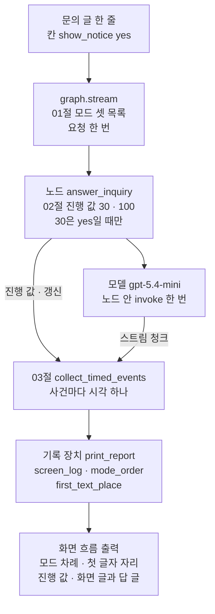
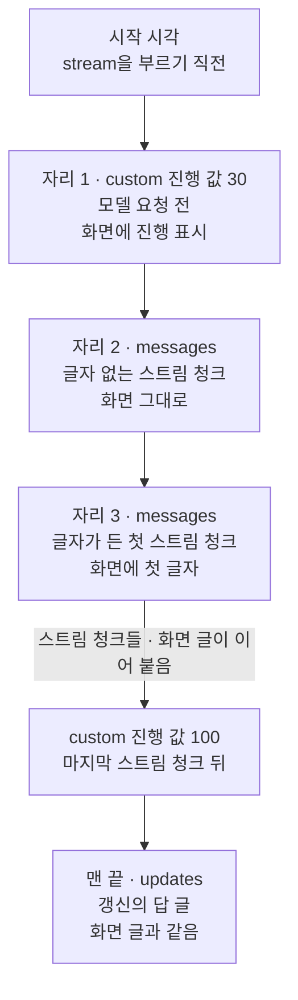
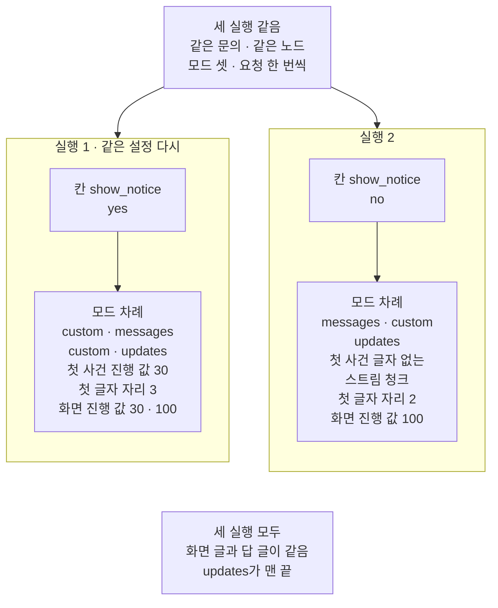

# 04-Streaming-실습

## _src 본문 (HTML 원본)

```html
<!--meta: 실습 30분 | 코드 notebooks/04-Streaming-실습.ipynb | 새 용어 0 -->
<style>html,body{overflow-x:hidden}.notebook,.nb-cell,.nb-main,.nb-input,.nb-result{min-width:0;max-width:100%}.nb-input pre,.nb-output{box-sizing:border-box;max-width:100%;overflow-x:auto}code.nb-source{display:block!important;width:100%!important;min-width:0!important;overflow-x:auto!important;padding:0!important}</style>
<h2 id="b1"><span class="no">1</span>학습 목표</h2><div class="goal"><ul>
<li>모드 목록·진행 값·스트림 청크 이어 붙이기·시각 적기를 그래프 하나에 모아, 문의 답을 흘려 보일 수 있습니다.</li>
<li>기록 장치의 출력으로 첫 사건의 모드, 글자가 든 첫 스트림 청크의 자리, 화면에 띄운 진행 값을 읽을 수 있습니다.</li>
<li>같은 설정으로 다시 보낸 실행과 값 하나를 바꾼 실행을 견주어, 설정 탓으로 달라진 값을 가를 수 있습니다.</li>
</ul></div>
<h2 id="b2"><span class="no">2</span>이 내용을 배우는 이유</h2><p>이 챕터에서는 스트리밍을 절마다 따로 익혔습니다. <a href="01-일곱-가지-stream-mode.html">01절</a>은 스트림 모드를 목록으로 골라 한 실행에서 함께 받았습니다. <a href="02-토큰과-중간-진행-스트리밍.html">02절</a>은 모델을 부르는 노드에서 진행 값과 스트림 청크를 함께 받고, 스트림 청크의 글을 이어 붙였습니다. <a href="03-TTFT와-total-비교.html">03절</a>은 사건마다 받은 시각을 적어 세 시간을 쟀습니다. 실제 문의 창에서는 이 일들이 한 번의 요청 안에서 함께 일어납니다.</p>
<p>이번 실습은 세 절의 기능을 자료실 문의 하나에 모아, 문의 창 화면을 코드로 흉내 냅니다. 같은 설정으로 한 번 더 보낸 뒤, 모델 요청 전 진행 값 하나만 끄고 다시 실행합니다. <a href="02-토큰과-중간-진행-스트리밍.html">02절</a> 8절은 모드 <code>messages</code>를 빼 보았고, <a href="03-TTFT와-total-비교.html">03절</a> 9절은 모드 목록의 차례를 바꿔 보았습니다. 새로 볼 것은 요청 전 진행 값이 없을 때, 첫 사건이 무엇이 되고 화면이 몇 번째 사건에서 처음 바뀌는지입니다.</p>
<p>이번 절은 이 챕터의 실습입니다. 01~03절에서 쓴 이름과 Ch 2에서 배운 문법만 쓰고, 따로 내는 과제는 없습니다. 강사와 함께 노트북 셀을 차례로 실행합니다.</p>
<p><strong>이 절의 질문</strong> — 세 절의 기능을 한 그래프에 붙이면, 문의 하나의 답은 어떤 차례로 화면에 뜰까요? 모델 요청 전 진행 값 하나를 끄면, 화면이 처음 바뀌는 사건은 어떻게 달라질까요?</p>
<h2 id="b3"><span class="no">3</span>앞에서 배운 내용</h2><p>이번 실습은 아래 절에서 배운 이름을 그대로 씁니다. 함수는 도구 파일 <code>stream_tools.py</code>에서 가져오고, 상태 형식·노드·기록 장치 함수는 노트북에 적습니다.</p>
<table><thead><tr><th>절</th><th>배운 것</th><th>실습에서 쓰는 곳</th></tr></thead><tbody><tr><td><a href="01-일곱-가지-stream-mode.html">01절</a></td><td>스트림 모드를 목록으로 골라 한 실행에서 함께 받기, 사건 하나 = (모드 이름, 자료) 짝, 함수 <code>positions_of</code>(도구 파일)</td><td>모드 셋 목록 <code>answer_modes</code>, 함수 <code>screen_log</code>의 <code>for mode, data in events</code>, 7·8절 진행 값의 자리와 수</td></tr><tr><td><a href="02-토큰과-중간-진행-스트리밍.html">02절</a></td><td>노드 안 <code>get_stream_writer</code>로 진행 값 보내기, 모델을 부르는 노드와 스트림 청크, 스트림 청크 글 이어 붙이기, 함수 <code>mode_order</code>(도구 파일)</td><td>노드 <code>answer_inquiry</code>의 진행 값 30·100, 함수 <code>screen_log</code>의 화면 글, 기록 장치의 모드 차례</td></tr><tr><td><a href="03-TTFT와-total-비교.html">03절</a></td><td>사건마다 시각 적기(<code>collect_timed_events</code>), 글자가 든 첫 스트림 청크 자리(<code>first_text_place</code>), 세 시간(<code>three_times</code>) — 이 절에서 도구 파일로 옮김</td><td>세 번의 실행, 기록 장치의 첫 글자 자리, 8절 세 시간 표</td></tr><tr><td><a href="../../part2/ch06-langchain-start/01-계층-지도와-첫-호출.html">Ch 6 01절</a>·<a href="../../part4/ch13-langgraph-basics/01-StateGraph와-노드-엣지.html">Ch 13 01절</a></td><td>모델 만들기, 상태 형식·노드·엣지로 그래프 만들기</td><td>준비 셀과 그래프 조립</td></tr><tr><td><a href="../ch24-human-in-the-loop/04-Human-in-the-Loop-실습.html">Ch 24 04절</a></td><td>자료실 대출 연장 신청 소재</td><td>오늘 처리할 문의 글(이 절에서 실행 전에 정함)</td></tr></tbody></table>
<p>붙인 기능은 01절 모드 목록, 02절 진행 값과 스트림 청크 이어 붙이기, 03절 사건마다 시각 적기 셋입니다. 세 기능이 모두 흐름 안에서 일하도록, 문의 창이 받은 사건을 화면에 띄울 것으로 바꿔 읽게 했습니다. 모드 목록은 세 실행 모두 같은 <code>["messages", "updates", "custom"]</code>이고, 기록 장치가 사건을 (모드 이름, 자료) 짝으로 풉니다. 진행 값은 화면에 띄운 진행 값 목록이 되고, 스트림 청크의 글은 화면 글로 이어 붙습니다. 사건마다 적은 시각은 8절에서 세 시간이 됩니다.</p>
<p>01절의 일곱 모드 전부와 체크포인터, 멈춤 표시는 문의 창 화면에 쓰이지 않아 뺐습니다. 02절 칸 <code>metadata</code> 읽기는 노드가 하나라 노드 이름으로 거를 일이 없어 뺐습니다. 02절의 모드 <code>messages</code>를 뺀 실행과 03절의 목록 차례 바꾸기는 앞 절 실험을 되풀이하게 되어 뺐습니다. 03절의 예상 비용과 두 구간 나누기도 화면에 띄울 값이 아니라 뺐습니다.</p>
<h2 id="b4"><span class="no">4</span>핵심 개념</h2><h3>비유로 시작하기</h3><p>01절부터 대나무 홈통에 물을 흘려 그릇에 받는 모습으로 스트리밍을 보았습니다. 이번에는 짧은 홈통 세 마디를 끈으로 묶어 긴 홈통 하나로 잇습니다. 마디마다 01·02·03절에서 익힌 기능이 하나씩 들어 있다고 봅니다. 긴 홈통 윗머리 옆에는 물이 닿기 전에 먼저 올리는 작은 깃발을 세웁니다.</p>
{{img:04-4-마디를-이은-두-홈통과-깃발|흰 바탕에 긴 연두색 대나무 홈통 둘이 위아래로 나란히 놓인 그림입니다. 홈통마다 짧은 마디 셋을 이어 이음매 두 곳을 갈색 끈으로 묶었고, 낮은 나무 받침 위에서 오른쪽으로 조금 기울어 있습니다. 위 홈통은 위가 열린 반쪽 관, 아래 홈통은 둥근 관 모양입니다. 위 홈통 왼쪽 끝 옆에는 가는 대나무 막대에 단 노란 천 깃발 하나가 서 있고, 아래 홈통 왼쪽 끝 옆에는 같은 막대만 깃발 없이 서 있습니다. 두 홈통의 오른쪽 끝에서 물방울 몇 개가 작은 나무 받침 위 흰 그릇에 하나씩 떨어집니다. 글자·숫자·사람·손은 없는 그림|마디 셋으로 이은 두 홈통 가운데 위 홈통에만 물보다 먼저 올린 깃발이 있고, 비유에서 두 실행의 차이는 이 깃발 하나입니다.}}
<p class="look"><b>그림 읽기</b> — 긴 대나무 홈통 둘이 위아래로 나란히 있고, 두 홈통 모두 짧은 마디 셋을 끈 두 곳으로 묶어 이었습니다. 위 홈통 왼쪽 끝 옆에만 노란 깃발 하나가 서 있고, 아래 홈통 옆에는 같은 막대만 서 있습니다. 위 홈통은 위가 열린 반쪽 관, 아래 홈통은 둥근 관으로 모양이 조금 다르게 그려졌습니다. 비유에서 두 실행의 차이는 깃발 하나뿐이라, 위 홈통이 실행 1, 깃발이 없는 아래 홈통이 실행 2입니다. 마디 셋은 01·02·03절 기능이고, 끝의 흰 그릇에 떨어지는 물방울 수는 스트림 청크 수와 짝짓지 않습니다.</p>
<p>긴 홈통이 이 절의 그래프이고, 끝의 그릇이 문의 창 화면입니다. 깃발은 모델 요청 전 진행 값이고, <a href="02-토큰과-중간-진행-스트리밍.html">02절</a> 그림의 종처럼 물보다 먼저 화면에 알립니다. 실행 2는 깃발만 뺀 홈통에 같은 물을 흘리는 일입니다.</p><p>비유와 다른 점이 있습니다. 홈통에서 깃발을 빼면, 그릇에 처음 닿는 것은 물방울입니다. 그래프에서 진행 값을 빼면, 첫 사건은 글자 없는 스트림 청크가 됩니다. 그래서 화면은 첫 사건이 아니라 둘째 사건에서 처음 바뀝니다.</p>
<h3>실습 조립의 구성</h3>
{{mermaid:04-1-세-절-기능을-붙인-문의-그래프|위에서 아래로 읽는 흐름도입니다. 초록 상자 문의 글 한 줄 칸 show_notice yes가 회색 상자 graph.stream 01절 모드 셋 목록 요청 한 번을 거쳐 파란 상자 노드 answer_inquiry 02절 진행 값 30과 100, 30은 yes일 때만으로 이어집니다. 노드에서 보라 상자 모델 gpt-5.4-mini 노드 안 invoke 한 번으로 화살표가 갑니다. 노드는 진행 값과 갱신을, 모델은 스트림 청크를 파란 상자 03절 collect_timed_events 사건마다 시각 하나로 보냅니다. 그 아래 파란 상자 기록 장치 print_report screen_log mode_order first_text_place를 거쳐 노란 상자 화면 흐름 출력 모드 차례 첫 글자 자리 진행 값 화면 글과 답 글로 이어지는 그림|01절 모드 목록, 02절 진행 값, 03절 시각 적기를 한 그래프에 붙이고, 기록 장치가 사건을 화면 흐름으로 바꿔 읽습니다.}}
<p class="look"><b>도식 읽기</b> — 위에서 아래로 읽습니다. 초록 상자는 넣은 입력, 회색 상자는 라이브러리 메서드, 파란 상자는 우리가 적은 노드와 함수입니다. 보라 상자는 실제로 부른 모델이고, 노란 상자는 노트북 5~7절 기록 장치의 출력입니다. 상자 안의 절 번호는 그 기능을 배운 절이고, 진행 값과 갱신은 노드에서, 스트림 청크는 모델에서 옵니다. 노란 상자의 첫 글자 자리는 글자가 든 첫 스트림 청크의 자리입니다.</p>
<h3>화면이 처음 바뀌는 사건</h3><p>화면이 처음 바뀌는 사건은, 화면에 띄울 것이 든 첫 사건입니다. 진행 값은 받자마자 진행 표시를 띄울 수 있고, 글자가 든 스트림 청크는 답 글을 늘립니다. 글자가 없는 스트림 청크는 받아도 화면이 그대로입니다. <a href="03-TTFT와-total-비교.html">03절</a>에서 본 대로, 시각은 사건 차례대로 적습니다.</p><p>그래서 모델 요청 전 진행 값이 있으면 화면은 첫 사건에서 바뀌고, 그때까지가 첫 사건 시간입니다. 진행 값이 없으면 첫 사건은 글자 없는 스트림 청크이고, 화면은 글자가 든 첫 스트림 청크에서 처음 바뀝니다. 그때까지가 첫 토큰 도착 시간입니다. 이 절은 초가 아니라 이 자리의 차이로 두 설정을 견줍니다.</p>
<h2 id="b5"><span class="no">5</span>실행 예제</h2><p>노트북은 먼저 오늘 처리할 문의 글과 시스템 메시지 글을 정합니다. 칸 셋의 상태 형식과 노드 하나짜리 그래프를 만들고, 사건을 화면에 띄울 것으로 바꿔 읽는 기록 장치 함수 둘을 적습니다. 실행 1은 요청 전 진행 값을 켜고, 6절은 같은 설정으로 한 번 더 보냅니다. 실행 2는 진행 값 하나만 끄고, 8절에서 세 실행을 견줍니다.</p><p>실제 OpenAI 모델 <code>gpt-5.4-mini</code>를 temperature 0으로 부릅니다. 모델 요청은 5·6·7절에서 한 번씩, 모두 3번입니다. 요금표로 어림한 예상 비용은 0.002달러 아래이고, 청구 금액이 아닙니다. 초와 답 글, 스트림 청크 수는 실행마다 달라질 수 있습니다. 읽거나 쓰는 파일은 없습니다.</p>
{{notebook:04-Streaming-실습}}
<p class="look"><b>확인할 점</b> — 노트북 5절 기록 장치 출력에서 <code>첫 사건의 모드 이름: custom</code>과 <code>화면에 띄운 진행 값: [30, 100]</code>을 봅니다. 7절에서 <code>글자가 든 첫 스트림 청크의 자리: 2</code>와 <code>첫 사건 스트림 청크의 글자 수: 0</code>을 확인합니다. 교재 출력에서는 실행 1의 사건이 62개, 실행 2의 사건이 60개였고, 다시 실행하면 달라질 수 있습니다.</p>
<h3>실행 1의 실제 순서</h3>
{{mermaid:04-2-실행-1의-사건과-화면|위에서 아래로 여섯 상자가 화살표로 이어진 그림입니다. 파란 상자 시작 시각 stream을 부르기 직전에서 노란 상자 자리 1 custom 진행 값 30 모델 요청 전 화면에 진행 표시, 노란 상자 자리 2 messages 글자 없는 스트림 청크 화면 그대로, 노란 상자 자리 3 messages 글자가 든 첫 스트림 청크 화면에 첫 글자로 이어집니다. 그 뒤 스트림 청크들과 화면 글이 이어 붙는 화살표를 지나 노란 상자 custom 진행 값 100 마지막 스트림 청크 뒤, 노란 상자 맨 끝 updates 갱신의 답 글 화면 글과 같음으로 이어지는 그림|실행 1에서는 모델 요청 전 진행 값이 첫 사건이라, 화면은 첫 사건에서 처음 바뀝니다.}}
<p class="look"><b>도식 읽기</b> — 위에서 아래로 실행 1의 차례대로 읽습니다. 파란 상자는 우리 함수가 시작 시각을 적은 자리이고, 노란 상자는 노트북 5절 출력으로 확인한 사건입니다. 자리 2가 글자 없는 스트림 청크라는 것은, 모드 차례와 글자가 든 첫 스트림 청크의 자리 3에서 나옵니다. 사건 수와 초는 실행마다 달라, 그림에 적지 않았습니다.</p>
<h2 id="b6"><span class="no">6</span>실험 결과 해석</h2><p>세 실행은 문의 글·노드·모드 목록이 같고, 칸 <code>show_notice</code>만 실행 2에서 달랐습니다. 아래 표는 노트북 5~8절 출력에서 세 실행 모두 코드가 정하는 값만 모은 것입니다.</p>
<table><thead><tr><th>실행</th><th>칸 <code>show_notice</code></th><th>모드 차례</th><th>첫 사건</th><th>글자가 든 첫 스트림 청크 자리</th><th>화면에 띄운 진행 값</th><th>화면 글 == 답 글</th></tr></thead><tbody><tr><td>실행 1</td><td><code>"yes"</code></td><td>custom · messages · custom · updates</td><td>custom 진행 값 30</td><td>3</td><td>[30, 100]</td><td>True</td></tr><tr><td>같은 설정 다시</td><td><code>"yes"</code></td><td>custom · messages · custom · updates</td><td>custom 진행 값 30</td><td>3</td><td>[30, 100]</td><td>True</td></tr><tr><td>실행 2</td><td><code>"no"</code></td><td>messages · custom · updates</td><td>messages 글자 없는 스트림 청크</td><td>2</td><td>[100]</td><td>True</td></tr></tbody></table>
<p>같은 설정으로 다시 보낸 실행은 표의 값이 모두 실행 1과 같았습니다. 실행 2는 모드 차례에서 맨 앞 <code>custom</code>이 빠졌고, 첫 사건은 글자 없는 스트림 청크였습니다. 글자가 든 첫 스트림 청크는 자리 3에서 자리 2로 한 자리 당겨졌습니다. 화면에 띄운 진행 값은 <code>[100]</code> 하나였고, 그 진행 값은 스트림 청크를 다 받은 뒤에 왔습니다.</p>
{{mermaid:04-3-요청-전-진행-값을-끈-실행|맨 위 회색 상자 세 실행 같음 같은 문의 같은 노드 모드 셋 요청 한 번씩에서 나란한 두 칸으로 화살표가 갑니다. 왼쪽 칸 실행 1 같은 설정 다시에서는 초록 상자 칸 show_notice yes가 노란 상자 모드 차례 custom messages custom updates 첫 사건 진행 값 30 첫 글자 자리 3 화면 진행 값 30과 100으로 이어집니다. 오른쪽 칸 실행 2에서는 초록 상자 칸 show_notice no가 노란 상자 모드 차례 messages custom updates 첫 사건 글자 없는 스트림 청크 첫 글자 자리 2 화면 진행 값 100으로 이어집니다. 맨 아래 회색 상자에는 세 실행 모두 화면 글과 답 글이 같음 updates가 맨 끝이 적힌 그림|칸 show_notice 하나만 바꾸자, 첫 사건과 글자가 든 첫 스트림 청크의 자리, 화면에 띄운 진행 값이 달라졌습니다.}}
<p class="look"><b>도식 읽기</b> — 맨 위 회색 상자는 세 실행에 같게 둔 조건입니다. 왼쪽과 오른쪽 칸은 칸 show_notice만 바꾼 나란한 설정입니다. 왼쪽 칸의 값은 실행 1과, 같은 설정으로 다시 보낸 실행에서 모두 같았습니다. 초록 상자는 넣은 값이고, 노란 상자는 노트북 5~7절 기록 장치와 7절 출력입니다. 첫 글자 자리는 글자가 든 첫 스트림 청크의 자리이고, 맨 아래 회색 상자는 세 실행 모두에서 확인한 값입니다.</p>
<p>세 실행 모두 화면에 이어 붙인 글이 마지막 갱신의 답 글과 같았습니다. 진행 값을 꺼도 스트림 청크를 이어 붙이는 일은 달라지지 않았습니다. 달라진 것은 화면이 처음 바뀌기 전에 무엇이 오느냐입니다. 실행 1에서는 모델 요청 전의 진행 값이, 실행 2에서는 글자 없는 스트림 청크가 먼저 왔습니다.</p><p>사건 수와 초는 같은 설정으로 보낸 두 실행 사이에서도 달라질 수 있는 값입니다. 그래서 세 실행의 초를 견주어 어느 설정이 빠르다고 말하지 않습니다. 새 커널로 세 번 실행해 견주자, 사건 수·답 글·초가 찍힌 셀 다섯은 실행에 따라 달랐습니다. 모드 차례·자리·진행 값·<code>True</code>가 찍힌 나머지 셀 열다섯은 세 번 모두 같았습니다.</p>
<p class="look"><b>확인할 점</b> — 노트북 8절 첫 표에서 줄 <code>실행 2 | messages | 2 | 1</code>만 다른지 봅니다. 교재 출력의 첫 토큰 도착 시간은 실행 1 0.666초, 같은 설정 다시 0.699초, 실행 2 0.568초였습니다. 따로 보낸 요청의 초라, 다시 실행하면 세 값의 크기 차례도 바뀔 수 있습니다.</p>
<h2 id="b7"><span class="no">7</span>주의할 점과 실무 메모</h2><ul><li>문의 글과 시스템 메시지 글은 이 절에서 실행 전에 정한 예입니다. <a href="../ch24-human-in-the-loop/04-Human-in-the-Loop-실습.html">Ch 24 04절</a>의 대출 연장 소재를 이어 받았고, 실제 이용자가 보낸 글이 아닙니다. 시스템 메시지 글은 02절 글에서 「배송」만 「자료실 이용」으로 바꿨습니다.</li><li>노트북을 쓰기 전에 문의와 판단 규칙을 적어 두고, 노트북 밖에서 실행 1 설정과 실행 2 설정을 다섯 번씩 보냈습니다. 열 번 모두 모드 차례, 첫 사건, 글자가 든 첫 스트림 청크의 자리, 화면에 띄운 진행 값이 설정마다 같았습니다. 첫 후보가 규칙을 채워, 미리 적어 둔 둘째 후보(02절 배송 문의 그대로)는 보내지 않았습니다.</li><li>노트북 밖 다섯 번씩에서는 실행 2 설정의 첫 사건 시간이 실행 1 설정보다 늘 컸습니다. 따로 보낸 요청의 초라서, 이 절의 결론에는 쓰지 않았습니다.</li><li>실행 2는 첫 사건과 글자가 든 첫 스트림 청크가 이웃한 자리라, 두 시간이 셋째 자리까지 같게 찍힐 수 있습니다. 노트북 밖 다섯 번 가운데 한 번이 그랬습니다. 시각을 사건 차례대로 적으므로, 첫 사건 시간이 첫 토큰 도착 시간보다 클 수는 없습니다.</li><li>칸 <code>show_notice</code>는 참·거짓 값 대신 글 <code>"yes"</code>·<code>"no"</code>로 적었습니다. 01~03절에서 쓴 모양만 쓰려고 정한 것입니다.</li><li>함수 <code>print_report</code>는 마지막 사건이 노드의 갱신이라고 보고 자리 <code>-1</code>을 읽습니다. 모드 목록에 <code>updates</code>가 없으면 이 줄에서 셀이 오류로 멈춥니다. 이번에 실행하지 않았습니다.</li><li>걸린 시간은 03절 함수로 쟀지만, 조건마다 한 번씩만 보냈습니다. 여러 번 재어 가운데 값을 보지 않았고, 스트리밍하지 않은 실행과도 견주지 않았습니다.</li><li>요청 전 진행 값을 끄면 이용자가 빈 화면을 얼마나 오래 보는지는, 초를 여러 번 재어야 말할 수 있습니다. 이번에는 사건의 자리까지만 보았습니다.</li><li>모델이 쓴 답 글과 잰 초에는 <code>assert</code>를 걸지 않았습니다. 이 노트북의 <code>assert</code>는 키 확인 셀 하나뿐입니다.</li><li>비동기 메서드 <code>astream</code>, 인자 <code>version="v2"</code>, 노드가 여럿인 그래프의 스트리밍은 이번에도 실행하지 않았습니다.</li><li>예상 비용은 2026-09-17 요금표로 어림한 값이고, 청구 금액이 아닙니다. 교재 출력은 Linux의 Python 3.12.13으로 만들었고, 다른 판과 Windows·macOS에서는 실행하지 않았습니다.</li></ul>
<h2 id="b8"><span class="no">8</span>정리와 다음 절</h2><ul><li>모드 목록, 진행 값, 스트림 청크 이어 붙이기, 사건마다 시각 적기를 그래프 하나에 모아 문의 창 화면을 흉내 냈습니다.</li><li>요청 전 진행 값을 켠 실행은 첫 사건이 진행 값 30이었고, 같은 설정으로 다시 보내도 모드 차례와 자리가 같았습니다.</li><li>진행 값 하나만 끄자 첫 사건이 글자 없는 스트림 청크가 되어, 화면은 자리 2의 첫 글자에서 처음 바뀌었습니다.</li></ul><p><strong>다음 학습과 이어지는 지점</strong> — 이 절로 Ch 25가 끝납니다. <a href="../ch26-delegation/01-Subagent-도구-위임.html">Ch 26 01절</a>에서는 전문 에이전트를 도구로 감싸 일을 맡기는 위임 구조를 다룹니다. <a href="../../part7/ch30-fastapi-serving/04-astream과-응답-스트림.html">Ch 30 04절</a>은 모드 <code>custom</code>의 사건을 비동기 메서드 <code>astream</code>으로 받아 이어 붙입니다. <a href="../../part7/ch30-fastapi-serving/09-실제-Agent-HTTP-통합.html">09절</a>은 모드 <code>messages</code>의 스트림 청크를 같은 메서드로 받아 서버 응답으로 보냅니다.</p>
<h2 id="b9"><span class="no">9</span>복습 문제</h2><details class="quiz" open><summary>문제 4개 · 해설 포함</summary><p class="quiz-q">1. [하] 실행 1의 첫 사건이 진행 값 30이었던 까닭은 무엇인가요?</p><p class="quiz-a">노드가 칸 <code>show_notice</code>가 <code>"yes"</code>일 때 모델 요청보다 먼저 진행 값 30을 보냈기 때문입니다. 틀렸다면 노트북 3절 노드 셀과 5절을 다시 읽습니다.</p><p class="quiz-q">2. [중] 실행 2의 첫 사건은 무엇이었고, 화면은 몇 번째 사건에서 처음 바뀌었나요?</p><p class="quiz-a">첫 사건은 글자가 없는 스트림 청크였습니다. 이 사건으로는 화면 글이 바뀌지 않아, 화면은 자리 2의 글자가 든 첫 스트림 청크에서 처음 바뀌었습니다. 틀렸다면 노트북 7절을 다시 읽습니다.</p><p class="quiz-q">3. [중] 실행 2로 가기 전에 같은 설정으로 한 번 더 보낸 까닭은 무엇인가요?</p><p class="quiz-a">설정이 같아도 달라지는 값과 늘 같은 값을 먼저 가르려는 것입니다. 모드 차례와 자리는 같았고, 사건 수와 초는 달라질 수 있는 값이었습니다. 그래서 실행 2에서 달라진 자리만 설정 탓으로 읽습니다. 틀렸다면 노트북 6·8절을 다시 읽습니다.</p><p class="quiz-q">4. [상] 동료가 「요청 전 진행 값을 끄면 답이 더 빨리 온다」고 말합니다. 이 절 결과로 무엇이라고 답하나요?</p><p class="quiz-a">이 절 결과로는 말할 수 없다고 답합니다. 초는 따로 보낸 요청마다 한 번씩만 쟀고, 같은 설정으로 다시 보낸 실행에서도 달라질 수 있었습니다. 이 절이 보인 것은 첫 사건과 화면이 처음 바뀌는 자리의 차이입니다. 틀렸다면 노트북 8절과 03절 노트북 9절 설명을 다시 읽습니다.</p></details>
<h2 id="b10"><span class="no">10</span>참고 자료</h2><ul><li>01절 — 스트림 모드를 목록으로 골라 한 실행에서 함께 받기, 함수 <code>positions_of</code>.</li><li>02절 — 진행 값과 스트림 청크, 스트림 청크 이어 붙이기, 함수 <code>mode_order</code>.</li><li>03절 — 사건마다 시각 적기, 함수 <code>collect_timed_events</code>·<code>first_text_place</code>·<code>three_times</code>.</li><li><div><a href="https://docs.langchain.com/oss/python/langgraph/streaming">LangGraph Streaming</a></div>03절 참고 자료와 같은 문서입니다. 모드를 목록으로 골라 여러 모드를 함께 받는 방법이 있습니다.</li><li>Ch 6 06절 — 요금표와 예상 비용. Ch 24 04절 — 대출 연장 소재.</li><li>기준 버전은 노트북 1절 첫 셀에서 설치한 패키지 넷의 판입니다.</li></ul>
```

## 노트북 셀 (순서대로)

### [0] markdown {'html': 'skip'}

# Streaming 실습: 요청 전 진행 값을 켜고 끄며 자료실 문의 답 흘려 보이기

**이 노트북에서 할 일**

1. 01~03절의 모드 목록, 진행 값, 스트림 청크 이어 붙이기, 사건마다 시각 적기를 그래프 하나에 모읍니다.
2. 자료실 문의 하나를 실행하며, 화면에 띄울 진행 값과 답 글을 사건 차례대로 기록합니다.
3. 같은 설정으로 한 번 더 실행한 뒤, 모델 요청 전 진행 값 하나만 끄고 세 실행을 견줍니다.

**준비물** — 프로젝트 폴더의 `.env` 파일에 `OPENAI_API_KEY`가 있어야 합니다.
모델은 `gpt-5.4-mini`이고, 모델 요청은 5·6·7절에서 한 번씩, 모두 3번입니다.
요금표로 어림한 예상 비용은 세 요청을 합쳐 0.002달러 아래이고, 청구 금액이 아닙니다.
걸린 시간은 03절 함수로 재지만, 초와 답 글, 스트림 청크 수는 실행마다 달라질 수 있습니다.
그래서 세 실행을 견줄 때는 사건의 모드와 자리를 봅니다.

읽거나 쓰는 파일은 없고, 체크포인터도 쓰지 않습니다.
앞에서 배운 함수 다섯은 도구 파일 `stream_tools.py`에서 가져옵니다.

**기준 버전** — 첫 셀에서 패키지 넷을 설치합니다.
판은 langchain 1.4.0과 langchain-openai 1.6.0입니다.
langgraph 1.2.11과 python-dotenv 1.2.3도 함께 설치합니다.
교재 출력은 Linux의 Python 3.12.13으로 만들었습니다.
다른 판과 Windows·macOS에서는 실행하지 않았습니다.

**실습 범위** — 이 절은 챕터 끝 실습 절이고 30분 안에 끝나는 분량입니다.
강사와 함께 첫 셀부터 차례로 실행하고, 따로 내는 과제는 없습니다.
01~03절에서 쓴 이름과 Ch 2에서 배운 문법만 씁니다.
실행 셀 하나만 다시 실행하면 모델 요청이 한 번 더 나가고, 사건 수와 초가 달라질 수 있습니다.

실습 폴더 `labs/part6/ch25-streaming`에서 `uv sync --locked`를 실행합니다.
그다음 `notebooks/` 폴더의 이 노트북을 열고, 실습 폴더의 `.venv` 커널을 고릅니다.
첫 셀부터 순서대로 실행합니다.

### [1] markdown {'html': 'skip'}

## 오늘 볼 그림


위에서 아래로 읽습니다.
초록 상자는 넣은 입력, 회색 상자는 라이브러리 메서드, 파란 상자는 우리가 적은 노드와 함수입니다.
보라 상자는 실제로 부른 모델이고, 노란 상자는 노트북 5~7절 기록 장치의 출력입니다.
상자 안의 절 번호는 그 기능을 배운 절이고, 진행 값과 갱신은 노드에서, 스트림 청크는 모델에서 옵니다.
노란 상자의 첫 글자 자리는 글자가 든 첫 스트림 청크의 자리입니다.

### [2] markdown {}

## 1. 준비

이번 절은 이 챕터의 실습입니다.
01절 모드 목록, 02절 진행 값과 스트림 청크 이어 붙이기, 03절 사건마다 시각 적기를 문의 하나에 모읍니다.
첫 셀은 02·03절과 같은 패키지 넷을 설치하고, 설치된 판 번호를 출력합니다.
설치에는 몇십 초가 걸릴 수 있습니다.

### [3] code {'execution': {'iopub.execute_input': '2026-09-25T19:15:56.809133Z', 'iopub.status.busy': '2026-09-25T19:15:56.808969Z', 'iopub.status.idle': '2026-09-25T19:15:57.421987Z', 'shell.execute_reply': '2026-09-25T19:15:57.421453Z'}, 'lesson_role': 'setup'}

```python
# 이 절에서 쓰는 패키지를 설치하고 버전을 확인합니다
%pip install -q "langchain==1.4.0" "langchain-openai==1.6.0" "langgraph==1.2.11" "python-dotenv==1.2.3"
from importlib.metadata import version

print("langchain:", version("langchain"))
print("langchain-openai:", version("langchain-openai"))
print("langgraph:", version("langgraph"))
print("python-dotenv:", version("python-dotenv"))
```

출력:
```
Note: you may need to restart the kernel to use updated packages.
langchain: 1.4.0
langchain-openai: 1.6.0
langgraph: 1.2.11
python-dotenv: 1.2.3

```

### [4] markdown {}

**결과 읽기** — 출력 줄 `langchain: 1.4.0`과 `langgraph: 1.2.11`이 보입니다.
네 판 모두 실습 폴더 잠금과 같은 판입니다.

다음 셀은 이 절에서 쓸 이름을 가져옵니다.
모델을 만드는 함수 `init_chat_model`은 Ch 6 01절, 상태 형식과 그래프 이름은 Ch 13 01절과 같습니다.
함수 `get_stream_writer`는 01·02절에서 진행 값을 보낼 때 썼습니다.
마지막 가져오기 줄은 앞에서 배운 함수 다섯을 도구 파일 `stream_tools.py`에서 가져옵니다.
이 절에서 새로 배우는 이름은 없습니다.

### [5] code {'execution': {'iopub.execute_input': '2026-09-25T19:15:57.423070Z', 'iopub.status.busy': '2026-09-25T19:15:57.422966Z', 'iopub.status.idle': '2026-09-25T19:15:57.866240Z', 'shell.execute_reply': '2026-09-25T19:15:57.865938Z'}, 'lesson_role': 'setup'}

```python
# 모델(Ch 6 01절)·그래프(Ch 13 01절)를 만드는 이름과, 진행 값을 보낼 쓰기 함수를 가져옵니다
from typing_extensions import TypedDict
from langchain.chat_models import init_chat_model
from langgraph.graph import StateGraph, START, END
from langgraph.config import get_stream_writer
# 01~03절에서 배운 함수 다섯은 도구 파일에서 가져옵니다
from stream_tools import collect_timed_events, first_text_place, mode_order, positions_of, three_times

print("도구 파일에서 가져온 함수:", "collect_timed_events, first_text_place, mode_order, positions_of, three_times")
```

출력:
```
도구 파일에서 가져온 함수: collect_timed_events, first_text_place, mode_order, positions_of, three_times

```

### [6] markdown {}

**결과 읽기** — 출력 줄 `도구 파일에서 가져온 함수: collect_timed_events, first_text_place, mode_order, positions_of, three_times`가 보입니다.
함수 `positions_of`는 01절 노트북 4절, `mode_order`는 02절 노트북 4절에서 처음 적었습니다.
함수 `collect_timed_events`·`first_text_place`·`three_times`는 03절 노트북 3·5·7절에서 처음 적었습니다.

03절 함수 셋은 이 절에서 도구 파일로 옮겼고, 설명 주석과 본문은 03절 셀 글 그대로입니다.
그래서 함수 `three_times` 안 주석의 「5절 함수」는 03절 노트북 5절을 가리킵니다.
함수 `collect_timed_events`가 기능 묶음 `time`을 쓰므로, 도구 파일 맨 위에 `import time` 줄이 생겼습니다.

앞에서 배운 함수는 `stream_tools.py`에 모아 두었습니다.
파일을 열면 코드를 볼 수 있습니다.
노트북과 같은 폴더(`notebooks/`)에 있는 파일입니다.
커널이 `notebooks/` 폴더에서 시작해야 이 파일을 가져올 수 있습니다.
교재 출력을 만든 실행 도구는 이 폴더를 따로 알려 주어, 다른 자리에서 시작해도 가져오기가 되었습니다.

### [7] markdown {}

API 키가 있는지 확인합니다. `True` 값이 나오면 다음으로 넘어갑니다.

### [8] code {'execution': {'iopub.execute_input': '2026-09-25T19:15:57.866998Z', 'iopub.status.busy': '2026-09-25T19:15:57.866926Z', 'iopub.status.idle': '2026-09-25T19:15:57.872544Z', 'shell.execute_reply': '2026-09-25T19:15:57.872179Z'}, 'lesson_role': 'setup'}

```python
# .env 파일에서 OpenAI API 키를 읽습니다(키 값은 출력하지 않습니다)
import os
from dotenv import find_dotenv, load_dotenv

env_path = find_dotenv(usecwd=True)
load_dotenv(env_path)
has_key = os.getenv("OPENAI_API_KEY") is not None
print("OPENAI_API_KEY 설정 여부:", has_key)
assert has_key, "프로젝트 폴더의 .env 파일에 OPENAI_API_KEY를 적어 주세요."
```

출력:
```
OPENAI_API_KEY 설정 여부: True

```

### [9] markdown {}

실습에 쓸 모델을 준비합니다.
temperature 값을 0으로 두어 매번 비슷한 답을 고르게 합니다.

### [10] code {'execution': {'iopub.execute_input': '2026-09-25T19:15:57.873152Z', 'iopub.status.busy': '2026-09-25T19:15:57.873089Z', 'iopub.status.idle': '2026-09-25T19:15:58.765503Z', 'shell.execute_reply': '2026-09-25T19:15:58.765137Z'}}

```python
# 실습에 쓸 모델을 준비합니다
model = init_chat_model(
    "openai:gpt-5.4-mini",
    temperature=0,
    reasoning_effort="none",
)
print("모델 이름:", model.model_name)
print("temperature:", model.temperature)
```

출력:
```
모델 이름: gpt-5.4-mini
temperature: 0.0

```

### [11] markdown {}

**결과 읽기** — 모델 이름 `gpt-5.4-mini`, temperature `0.0`이 보이면 준비가 끝났습니다.
이 노트북의 출력은 2026-09-25에 이 모델로 실행한 결과입니다.
temperature 값을 0으로 두어도, 실행마다 답 문장이 달라질 수 있습니다.
이 셀은 모델 객체만 만들고, 모델 요청은 아직 보내지 않습니다.

## 2. 오늘 처리할 문의

자료실 홈페이지에 문의 창이 있다고 합시다.
이용자가 문의를 보내면, 창은 답이 다 올 때까지 기다리지 않고 받은 것부터 띄웁니다.
모델에게 요청을 보내기 전에, 「답을 준비하고 있습니다」 같은 진행 표시를 먼저 띄울 수도 있습니다.
이 절은 그 창을 코드로 흉내 내어, 무엇이 언제 화면에 뜨는지 봅니다.
다음 셀은 오늘 처리할 문의 글과 시스템 메시지 글을 정하고, 출처와 함께 출력합니다.

### [12] code {'execution': {'iopub.execute_input': '2026-09-25T19:15:58.766110Z', 'iopub.status.busy': '2026-09-25T19:15:58.766051Z', 'iopub.status.idle': '2026-09-25T19:15:58.767672Z', 'shell.execute_reply': '2026-09-25T19:15:58.767381Z'}}

```python
# 오늘 처리할 자료실 문의 글과, 모델에게 줄 시스템 메시지 글을 정합니다
system_text = "자료실 이용 문의에 답하는 안내 도우미입니다. 두 문장의 한국어로 답하세요."
question_text = "빌린 책의 반납 날짜를 늘리려면 어떻게 하나요?"
print("시스템 메시지 글:", system_text)
print("문의 글:", question_text)
print("두 글의 출처: 이 절에서 실행 전에 정한 글(02절 배송 문의를 자료실 문의로 바꿈)")
```

출력:
```
시스템 메시지 글: 자료실 이용 문의에 답하는 안내 도우미입니다. 두 문장의 한국어로 답하세요.
문의 글: 빌린 책의 반납 날짜를 늘리려면 어떻게 하나요?
두 글의 출처: 이 절에서 실행 전에 정한 글(02절 배송 문의를 자료실 문의로 바꿈)

```

### [13] markdown {}

**결과 읽기** — 출력 줄 `문의 글: 빌린 책의 반납 날짜를 늘리려면 어떻게 하나요?`가 보입니다.
두 글은 이 절에서 실행 전에 정했고, 결과를 보고 바꾸지 않았습니다.
시스템 메시지 글은 02절 글에서 「배송」을 「자료실 이용」으로만 바꿨습니다.
답을 두 문장으로 부탁해, 모델의 답이 짧게 끝나게 했습니다.

## 3. 재료 만들기

먼저 상태 형식을 만듭니다.
칸 `question`과 `answer`는 02절과 같고, 칸 `show_notice`를 하나 더 둡니다.
칸 `show_notice`에는 모델 요청 전에 진행 값을 보낼지를 글 `"yes"`나 `"no"`로 적습니다.
칸 구성이 02절과 달라, 상태 형식에도 새 이름을 붙입니다.

### [14] code {'execution': {'iopub.execute_input': '2026-09-25T19:15:58.768253Z', 'iopub.status.busy': '2026-09-25T19:15:58.768197Z', 'iopub.status.idle': '2026-09-25T19:15:58.769641Z', 'shell.execute_reply': '2026-09-25T19:15:58.769369Z'}}

```python
# 문의 글·답 글과, 요청 전 진행 값을 보낼지 적는 칸을 둔 상태 형식입니다(Ch 13 01절 모양, 세 칸 모두 규칙 없음)
class InquiryState(TypedDict):
    question: str
    answer: str
    show_notice: str
```

출력:
```

```

### [15] markdown {}

**결과 읽기** — 정의 셀이라 출력이 없습니다.

다음 셀은 문의에 답하는 노드입니다.
02절 노드 `write_answer`와 같은 차례에, 요청 전 진행 값을 보낼지 고르는 `if` 하나를 더했습니다.
칸 `show_notice`가 `"yes"`일 때만 진행 값 30을 보내고, 진행 값 100은 늘 보냅니다.

### [16] code {'execution': {'iopub.execute_input': '2026-09-25T19:15:58.770161Z', 'iopub.status.busy': '2026-09-25T19:15:58.770113Z', 'iopub.status.idle': '2026-09-25T19:15:58.771859Z', 'shell.execute_reply': '2026-09-25T19:15:58.771595Z'}}

```python
# 칸 show_notice가 "yes"일 때만 모델 요청 전 진행 값을 보내고, 모델이 쓴 답 글을 칸 answer에 내는 노드입니다
def answer_inquiry(state):
    writer = get_stream_writer()
    if state["show_notice"] == "yes":
        writer({"stage": "before_model", "progress": 30})
    messages = [("system", system_text), ("user", state["question"])]
    # 모델 요청은 이 줄에서 한 번 나가고, 답을 다 받은 뒤에 다음 줄로 갑니다
    response = model.invoke(messages)
    writer({"stage": "after_model", "progress": 100})
    return {"answer": response.text}
```

출력:
```

```

### [17] markdown {}

**결과 읽기** — 정의 셀이라 출력이 없습니다.
진행 값 딕셔너리 둘은 02절 노드와 같은 값입니다.
칸 `show_notice`는 노드 안에서만 읽고, 모델에게 보내는 메시지 목록에는 넣지 않습니다.

다음 셀은 노드 하나를 START → answer_inquiry → END로 이어, 체크포인터 없이 컴파일합니다.

### [18] code {'execution': {'iopub.execute_input': '2026-09-25T19:15:58.772401Z', 'iopub.status.busy': '2026-09-25T19:15:58.772353Z', 'iopub.status.idle': '2026-09-25T19:15:58.774428Z', 'shell.execute_reply': '2026-09-25T19:15:58.774180Z'}}

```python
# 노드 하나를 START → answer_inquiry → END로 잇고, 체크포인터 없이 컴파일합니다
builder = StateGraph(InquiryState)
builder.add_node("answer_inquiry", answer_inquiry)
builder.add_edge(START, "answer_inquiry")
builder.add_edge("answer_inquiry", END)
graph = builder.compile()
print("등록한 노드:", list(builder.nodes))
```

출력:
```
등록한 노드: ['answer_inquiry']

```

### [19] markdown {}

**결과 읽기** — 출력 줄 `등록한 노드: ['answer_inquiry']`가 보입니다.

## 4. 결과를 볼 기록 장치

화면에 무엇이 뜨는지 보려면, 받은 사건을 화면에 띄울 것으로 바꿔 읽는 장치가 있어야 합니다.
다음 셀의 함수 `screen_log`는 사건을 차례로 읽어, 진행 값은 목록에 모으고 스트림 청크의 글은 이어 붙입니다.
02절 7절에서 스트림 청크의 글을 차례로 이어 붙이던 셀을 함수 하나로 묶은 모양입니다.
글자가 없는 스트림 청크는 빈 글이라, 이어 붙여도 화면의 글이 바뀌지 않습니다.

### [20] code {'execution': {'iopub.execute_input': '2026-09-25T19:15:58.774987Z', 'iopub.status.busy': '2026-09-25T19:15:58.774934Z', 'iopub.status.idle': '2026-09-25T19:15:58.776404Z', 'shell.execute_reply': '2026-09-25T19:15:58.776175Z'}}

```python
# 사건을 차례로 읽어, 화면에 띄울 진행 값 목록과 이어 붙인 답 글을 딕셔너리로 내놓습니다
def screen_log(events):
    screen = {"notices": [], "text": ""}
    for mode, data in events:
        if mode == "custom":
            screen["notices"].append(data["progress"])
        # 모드 messages의 자료는 (스트림 청크, 칸 metadata) 짝이라, [0]이 스트림 청크입니다
        if mode == "messages":
            screen["text"] = screen["text"] + data[0].text
    return screen
```

출력:
```

```

### [21] markdown {}

**결과 읽기** — 정의 셀이라 출력이 없습니다.
키 `notices`에는 진행 값의 `progress`가 받은 차례대로 쌓입니다.
키 `text`에는 스트림 청크의 글이 받은 차례대로 이어 붙습니다.

다음 셀은 실행 기록 하나를 받아, 화면 흐름을 보는 값을 한 줄씩 출력하는 함수입니다.
모드 차례는 02절 함수 `mode_order`로, 글자가 든 첫 스트림 청크의 자리는 03절 함수 `first_text_place`로 봅니다.
마지막 사건인 갱신에 담긴 답 글과, 화면에 이어 붙인 글이 같은지도 봅니다.

### [22] code {'execution': {'iopub.execute_input': '2026-09-25T19:15:58.776920Z', 'iopub.status.busy': '2026-09-25T19:15:58.776867Z', 'iopub.status.idle': '2026-09-25T19:15:58.778445Z', 'shell.execute_reply': '2026-09-25T19:15:58.778166Z'}}

```python
# 시각을 적은 실행 기록 하나(collect_timed_events의 결과)에서, 화면 흐름을 보는 값을 한 줄씩 출력합니다
def print_report(run_record):
    events = run_record["events"]
    screen = screen_log(events)
    # 마지막 사건은 노드의 갱신이고, {노드 이름: {칸 이름: 값}} 모양입니다
    final_answer = events[-1][1]["answer_inquiry"]["answer"]
    print("모드 차례:", mode_order(events))
    print("첫 사건의 모드 이름:", events[0][0])
    print("글자가 든 첫 스트림 청크의 자리:", first_text_place(events))
    print("화면에 띄운 진행 값:", screen["notices"])
    print("화면 글과 답 글이 같은가:", screen["text"] == final_answer)
```

출력:
```

```

### [23] markdown {}

**결과 읽기** — 정의 셀이라 출력이 없습니다.
함수 안에서 앞 셀의 `screen_log`를 부르므로, 앞 셀을 먼저 실행해 두어야 합니다.
자리 `-1`은 03절 6절에서 본 대로 목록의 맨 끝 자리입니다.
답 글이나 초처럼 실행마다 달라지는 값은 이 함수가 출력하지 않습니다.

## 5. 실행 1 · 요청 전 진행 값을 켠 실행

실행 1은 칸 `show_notice`를 `"yes"`로 두고, 02·03절과 같은 모드 셋으로 한 번 실행합니다.
03절 함수 `collect_timed_events`로 사건마다 받은 시각도 함께 적습니다.
실행 전에 예상해 봅니다.
노드가 모델 요청 전에 진행 값을 보내니, 첫 사건은 모드 `custom`의 진행 값 30일 것입니다.

### [24] code {'execution': {'iopub.execute_input': '2026-09-25T19:15:58.779012Z', 'iopub.status.busy': '2026-09-25T19:15:58.778962Z', 'iopub.status.idle': '2026-09-25T19:15:59.837325Z', 'shell.execute_reply': '2026-09-25T19:15:59.836289Z'}}

```python
# 실행 1: 요청 전 진행 값을 켜고, 모드 셋을 한 목록으로 골라 한 번 실행합니다(모델 요청 1번)
answer_modes = ["messages", "updates", "custom"]
first_input = {"question": question_text, "answer": "", "show_notice": "yes"}
# 체크포인터가 없어 설정 자리에는 None을 넘깁니다(02·03절과 같음)
first_run = collect_timed_events(graph, first_input, None, answer_modes)
first_events = first_run["events"]
print("받은 사건 수:", len(first_events))
print("사건마다 시각이 하나씩인가:", len(first_events) == len(first_run["times"]))
```

출력:
```
받은 사건 수: 62
사건마다 시각이 하나씩인가: True

```

### [25] markdown {}

**결과 읽기** — 출력 줄 `사건마다 시각이 하나씩인가: True`가 보입니다.
03절처럼 사건 목록과 시각 목록이 같은 자리끼리 짝을 이룹니다.

이번 실행에서는 출력 줄 `받은 사건 수: 62`입니다.
모델의 답이 몇 개의 스트림 청크로 나뉘어 오느냐에 따라, 이 수는 달라질 수 있습니다.

다음 셀은 앞에서 만든 기록 장치로 실행 1의 화면 흐름을 출력합니다.

### [26] code {'execution': {'iopub.execute_input': '2026-09-25T19:15:59.839148Z', 'iopub.status.busy': '2026-09-25T19:15:59.838961Z', 'iopub.status.idle': '2026-09-25T19:15:59.843008Z', 'shell.execute_reply': '2026-09-25T19:15:59.842059Z'}}

```python
# 실행 1의 화면 흐름을 기록 장치로 출력합니다
print_report(first_run)
```

출력:
```
모드 차례: ['custom', 'messages', 'custom', 'updates']
첫 사건의 모드 이름: custom
글자가 든 첫 스트림 청크의 자리: 3
화면에 띄운 진행 값: [30, 100]
화면 글과 답 글이 같은가: True

```

### [27] markdown {}

**결과 읽기** — 출력 줄 `모드 차례: ['custom', 'messages', 'custom', 'updates']`는 02·03절과 같은 차례입니다.
출력 줄 `첫 사건의 모드 이름: custom`으로, 예상대로 진행 값이 첫 사건이었습니다.
출력 줄 `글자가 든 첫 스트림 청크의 자리: 3`이라, 답의 첫 글자는 셋째 사건에서 화면에 뜹니다.
출력 줄 `화면에 띄운 진행 값: [30, 100]`과 `화면 글과 답 글이 같은가: True`도 보입니다.
화면에 이어 붙인 글은 마지막 갱신의 답 글과 같았습니다.

다음 셀은 첫 사건의 자료와, 화면에 쌓인 답 글을 봅니다.

### [28] code {'execution': {'iopub.execute_input': '2026-09-25T19:15:59.844558Z', 'iopub.status.busy': '2026-09-25T19:15:59.844421Z', 'iopub.status.idle': '2026-09-25T19:15:59.847541Z', 'shell.execute_reply': '2026-09-25T19:15:59.847103Z'}}

```python
# 실행 1의 첫 사건 자료를 보고, 화면에 쌓인 답 글을 봅니다(실행마다 달라질 수 있는 글)
print("첫 사건의 자료:", first_events[0][1])
first_screen = screen_log(first_events)
print("화면에 쌓인 답 글:")
print(first_screen["text"])
```

출력:
```
첫 사건의 자료: {'stage': 'before_model', 'progress': 30}
화면에 쌓인 답 글:
대출 중인 책은 자료실 데스크나 홈페이지의 대출 내역에서 반납 연장 신청을 하시면 됩니다.  
다만 예약이 걸린 책이나 연장 가능 횟수를 초과한 경우에는 연장이 되지 않을 수 있습니다.

```

### [29] markdown {}

**결과 읽기** — 출력 줄 `첫 사건의 자료: {'stage': 'before_model', 'progress': 30}`이 보입니다.
화면은 이 진행 값을 받자마자 「답을 준비하고 있습니다」 같은 표시를 띄울 수 있습니다.
이 사건은 모델 요청 전에 나오므로, 화면이 처음 바뀌기까지 걸린 시간이 첫 사건 시간입니다.

라벨 줄 `화면에 쌓인 답 글:` 아래가 이번 실행에서 화면에 쌓인 답 글입니다.
이번 실행에서는 두 문장이 두 줄로 찍혔고, 실행마다 문장이 달라질 수 있습니다.

## 6. 같은 설정으로 한 번 더

실행 2로 가기 전에, 실행 1과 같은 설정으로 한 번 더 보냅니다.
같은 설정에서도 실행마다 같은 값과 달라지는 값을 먼저 가르려는 것입니다.
실행 전에 예상해 봅니다.
모드 차례와 자리는 노드 코드가 정하니 같고, 사건 수는 달라질 수 있을 것입니다.

### [30] code {'execution': {'iopub.execute_input': '2026-09-25T19:15:59.848998Z', 'iopub.status.busy': '2026-09-25T19:15:59.848860Z', 'iopub.status.idle': '2026-09-25T19:16:00.983665Z', 'shell.execute_reply': '2026-09-25T19:16:00.982333Z'}}

```python
# 실행 1과 같은 설정으로 한 번 더 실행하고, 기록 장치로 화면 흐름을 봅니다(모델 요청 1번)
again_run = collect_timed_events(graph, first_input, None, answer_modes)
again_events = again_run["events"]
print_report(again_run)
```

출력:
```
모드 차례: ['custom', 'messages', 'custom', 'updates']
첫 사건의 모드 이름: custom
글자가 든 첫 스트림 청크의 자리: 3
화면에 띄운 진행 값: [30, 100]
화면 글과 답 글이 같은가: True

```

### [31] markdown {}

**결과 읽기** — 기록 장치의 다섯 출력 줄이 실행 1과 같습니다.
출력 줄 `글자가 든 첫 스트림 청크의 자리: 3`과 `화면에 띄운 진행 값: [30, 100]`이 다시 보입니다.

다음 셀은 두 실행의 모드 차례와 받은 사건 수를 견줍니다.

### [32] code {'execution': {'iopub.execute_input': '2026-09-25T19:16:00.985266Z', 'iopub.status.busy': '2026-09-25T19:16:00.985097Z', 'iopub.status.idle': '2026-09-25T19:16:00.987780Z', 'shell.execute_reply': '2026-09-25T19:16:00.987395Z'}}

```python
# 같은 설정으로 보낸 두 실행의 모드 차례와 받은 사건 수를 견줍니다
print("두 실행의 모드 차례가 같은가:", mode_order(first_events) == mode_order(again_events))
print("두 실행의 받은 사건 수:", len(first_events), len(again_events))
```

출력:
```
두 실행의 모드 차례가 같은가: True
두 실행의 받은 사건 수: 62 60

```

### [33] markdown {}

**결과 읽기** — 출력 줄 `두 실행의 모드 차례가 같은가: True`가 보입니다.

이번 실행에서는 출력 줄 `두 실행의 받은 사건 수: 62 60`으로, 사건 수가 두 실행에서 달랐습니다.
설정이 같아도 사건 수는 달라질 수 있어, 사건 수의 차이는 설정 탓으로 읽지 않습니다.

## 7. 실행 2 · 요청 전 진행 값만 끈 실행

값 하나만 바꿔 봅니다.
바꿀 값은 칸 `show_notice`이고, `"yes"`를 `"no"`로 바꿉니다.
문의 글, 노드, 모드 목록은 실행 1과 같습니다.
실행 전에 예상해 봅니다.
진행 값 30이 없으니 첫 사건은 모드 `messages`의 스트림 청크이고, 진행 값은 100 하나만 올 것입니다.

다음 셀은 같은 문의로 그래프를 한 번 더 실행합니다(모델 요청 1번).

### [34] code {'execution': {'iopub.execute_input': '2026-09-25T19:16:00.988683Z', 'iopub.status.busy': '2026-09-25T19:16:00.988606Z', 'iopub.status.idle': '2026-09-25T19:16:01.952315Z', 'shell.execute_reply': '2026-09-25T19:16:01.951399Z'}}

```python
# 실행 2: 칸 show_notice 하나만 "no"로 바꿔, 같은 문의로 한 번 더 실행합니다(모델 요청 1번)
second_input = {"question": question_text, "answer": "", "show_notice": "no"}
second_run = collect_timed_events(graph, second_input, None, answer_modes)
second_events = second_run["events"]
print("받은 사건 수:", len(second_events))
print("사건마다 시각이 하나씩인가:", len(second_events) == len(second_run["times"]))
```

출력:
```
받은 사건 수: 60
사건마다 시각이 하나씩인가: True

```

### [35] markdown {}

**결과 읽기** — 출력 줄 `사건마다 시각이 하나씩인가: True`가 보입니다.

이번 실행에서는 출력 줄 `받은 사건 수: 60`입니다.
실행 1과 같은 문의라도, 이 수는 실행마다 달라질 수 있습니다.

다음 셀은 같은 기록 장치로 실행 2의 화면 흐름을 출력합니다.

### [36] code {'execution': {'iopub.execute_input': '2026-09-25T19:16:01.953664Z', 'iopub.status.busy': '2026-09-25T19:16:01.953529Z', 'iopub.status.idle': '2026-09-25T19:16:01.956472Z', 'shell.execute_reply': '2026-09-25T19:16:01.955944Z'}}

```python
# 실행 2의 화면 흐름을 기록 장치로 출력합니다
print_report(second_run)
```

출력:
```
모드 차례: ['messages', 'custom', 'updates']
첫 사건의 모드 이름: messages
글자가 든 첫 스트림 청크의 자리: 2
화면에 띄운 진행 값: [100]
화면 글과 답 글이 같은가: True

```

### [37] markdown {}

**결과 읽기** — 출력 줄 `모드 차례: ['messages', 'custom', 'updates']`가 보입니다.
맨 앞의 `custom`이 빠졌고, 예상대로 첫 사건의 모드가 `messages`로 바뀌었습니다.
출력 줄 `글자가 든 첫 스트림 청크의 자리: 2`는 실행 1보다 한 자리 앞입니다.
출력 줄 `화면에 띄운 진행 값: [100]`이라, 화면에는 모델 요청 뒤의 진행 값만 떴습니다.
출력 줄 `화면 글과 답 글이 같은가: True`는 실행 1과 같습니다.

다음 셀은 실행 2의 첫 사건이 어떤 스트림 청크인지와, 진행 값이 나온 자리를 봅니다.

### [38] code {'execution': {'iopub.execute_input': '2026-09-25T19:16:01.957548Z', 'iopub.status.busy': '2026-09-25T19:16:01.957447Z', 'iopub.status.idle': '2026-09-25T19:16:01.960506Z', 'shell.execute_reply': '2026-09-25T19:16:01.960011Z'}}

```python
# 실행 2의 첫 사건 스트림 청크와, 진행 값이 나온 자리를 봅니다(01절 함수 positions_of)
second_first = second_events[0][1]
print("첫 사건 스트림 청크의 글자 수:", len(second_first[0].text))
notice_places = positions_of(second_events, "custom")
print("진행 값의 자리가 마지막 사건 바로 앞인가:", notice_places == [len(second_events) - 1])
```

출력:
```
첫 사건 스트림 청크의 글자 수: 0
진행 값의 자리가 마지막 사건 바로 앞인가: True

```

### [39] markdown {}

**결과 읽기** — 출력 줄 `첫 사건 스트림 청크의 글자 수: 0`이 보입니다.
02절 5절에서 본 글자 없는 첫 스트림 청크가, 이번에는 첫 사건이 되었습니다.
이 사건을 받아도 화면의 글은 바뀌지 않고, 자리 2의 첫 글자에서 화면이 처음 바뀝니다.
출력 줄 `진행 값의 자리가 마지막 사건 바로 앞인가: True`로, 진행 값 100은 스트림 청크를 다 받은 뒤에 왔습니다.

## 8. 세 실행 견주기

세 실행을 한 표로 놓고, 무엇이 설정 탓으로 달라졌는지 봅니다.
실행 1과 같은 설정 다시 사이에서 달라진 값은, 설정이 같아도 달라지는 값입니다.
실행 1과 실행 2 사이에서만 달라진 값을, 칸 `show_notice`를 바꾼 탓으로 읽습니다.
다음 셀은 세 실행의 첫 사건 모드, 글자가 든 첫 스트림 청크의 자리, 진행 값 수를 한 줄씩 출력합니다.

### [40] code {'execution': {'iopub.execute_input': '2026-09-25T19:16:01.961331Z', 'iopub.status.busy': '2026-09-25T19:16:01.961269Z', 'iopub.status.idle': '2026-09-25T19:16:01.963413Z', 'shell.execute_reply': '2026-09-25T19:16:01.963102Z'}}

```python
# 세 실행의 첫 사건 모드, 글자가 든 첫 스트림 청크의 자리, 진행 값 수를 한 줄씩 견줍니다
runs = {"실행 1": first_run, "같은 설정 다시": again_run, "실행 2": second_run}
print("실행 | 첫 사건 | 글자가 든 첫 스트림 청크 자리 | 진행 값 수")
for name in runs:
    events = runs[name]["events"]
    notices = positions_of(events, "custom")
    print(name, "|", events[0][0], "|", first_text_place(events), "|", len(notices))
```

출력:
```
실행 | 첫 사건 | 글자가 든 첫 스트림 청크 자리 | 진행 값 수
실행 1 | custom | 3 | 2
같은 설정 다시 | custom | 3 | 2
실행 2 | messages | 2 | 1

```

### [41] markdown {}

**결과 읽기** — 라벨 줄 `실행 | 첫 사건 | 글자가 든 첫 스트림 청크 자리 | 진행 값 수` 아래 세 줄이 세 실행입니다.
줄 `실행 1 | custom | 3 | 2`와 `같은 설정 다시 | custom | 3 | 2`는 같습니다.
줄 `실행 2 | messages | 2 | 1`만 세 값이 모두 다릅니다.
그래서 이 세 값의 차이는 칸 `show_notice`를 바꾼 탓으로 읽습니다.

다음 셀은 세 실행의 받은 사건 수와 세 시간(초)을 한 줄씩 출력합니다.

### [42] code {'execution': {'iopub.execute_input': '2026-09-25T19:16:01.964486Z', 'iopub.status.busy': '2026-09-25T19:16:01.964300Z', 'iopub.status.idle': '2026-09-25T19:16:01.967546Z', 'shell.execute_reply': '2026-09-25T19:16:01.967157Z'}}

```python
# 세 실행의 받은 사건 수와 세 시간(초)을 한 줄씩 견줍니다(03절 함수 three_times)
print("실행 | 사건 수 | 첫 사건 시간 | 첫 토큰 도착 시간 | 전체 걸린 시간")
for name in runs:
    seconds = three_times(runs[name])
    count = len(runs[name]["events"])
    print(name, "|", count, "|", seconds["첫 사건 시간"], "|", seconds["첫 토큰 도착 시간"], "|", seconds["전체 걸린 시간"])
```

출력:
```
실행 | 사건 수 | 첫 사건 시간 | 첫 토큰 도착 시간 | 전체 걸린 시간
실행 1 | 62 | 0.003 | 0.666 | 1.055
같은 설정 다시 | 60 | 0.003 | 0.699 | 1.131
실행 2 | 60 | 0.537 | 0.568 | 0.96

```

### [43] markdown {}

**결과 읽기** — 라벨 줄 `실행 | 사건 수 | 첫 사건 시간 | 첫 토큰 도착 시간 | 전체 걸린 시간` 아래 세 줄이 세 실행입니다.
사건 수와 초는 같은 설정으로 보낸 두 실행 사이에서도 달라질 수 있는 값입니다.
그래서 세 실행의 초를 견주어 어느 설정이 빠르다고 말하지 않습니다.

이번 실행에서는 줄 `실행 1 | 62 | 0.003 | 0.666 | 1.055`와 `실행 2 | 60 | 0.537 | 0.568 | 0.96`입니다.
실행 2의 첫 사건은 모델이 보낸 스트림 청크라, 첫 사건 시간에 모델을 기다린 시간이 들어 있습니다.
줄 `같은 설정 다시 | 60 | 0.003 | 0.699 | 1.131`의 첫 토큰 도착 시간과 전체 걸린 시간도 실행 1과 달랐습니다.

## 정리

1. 모드 목록, 진행 값, 스트림 청크 이어 붙이기, 사건마다 시각 적기를 그래프 하나에 모아 문의 창 화면을 흉내 냈습니다.
2. 요청 전 진행 값을 켠 실행은 첫 사건이 진행 값 30이었고, 같은 설정으로 다시 보내도 모드 차례와 자리가 같았습니다.
3. 진행 값 하나만 끄자 첫 사건이 글자 없는 스트림 청크가 되어, 화면은 자리 2의 첫 글자에서 처음 바뀌었습니다.

이 절로 Ch 25가 끝납니다.
Ch 26 01절에서는 전문 에이전트를 도구로 감싸 일을 맡기는 위임 구조를 다룹니다.

## 그림

### 04-1-세-절-기능을-붙인-문의-그래프.mmd



01절 모드 목록, 02절 진행 값, 03절 시각 적기를 한 그래프에 붙이고, 기록 장치가 사건을 화면 흐름으로 바꿔 읽습니다.

### 04-2-실행-1의-사건과-화면.mmd



실행 1에서는 모델 요청 전 진행 값이 첫 사건이라, 화면은 첫 사건에서 처음 바뀝니다.

### 04-3-요청-전-진행-값을-끈-실행.mmd



칸 show_notice 하나만 바꾸자, 첫 사건과 글자가 든 첫 스트림 청크의 자리, 화면에 띄운 진행 값이 달라졌습니다.

### 04-4-마디를-이은-두-홈통과-깃발.prompt.md

# 04-4-마디를-이은-두-홈통과-깃발 (Higgsfield 삽화)

설명 대상 문장(본문 b4 비유 단락): 01절부터 대나무 홈통에 물을 흘려 그릇에 받는 모습으로 스트리밍을 보았습니다. 이번에는 짧은 홈통 세 마디를 끈으로 묶어 긴 홈통 하나로 잇습니다. 마디마다 01·02·03절에서 익힌 기능이 하나씩 들어 있다고 봅니다. 긴 홈통 윗머리에는 물이 닿기 전에 먼저 올리는 작은 깃발을 꽂습니다. … 실행 2는 깃발만 뺀 홈통에 같은 물을 흘리는 일입니다.

구성 요소와 배치: 긴 대나무 홈통 **둘**(위·아래로 나란히 — 실행 1과 실행 2) · 홈통마다 짧은 마디 **셋**을 끝끼리 이음, 이음매 **둘**마다 갈색 끈 묶음(= 01·02·03절 기능을 이은 조립) · 낮은 나무 받침(작업대 모양, 앞 세 장의 Y자 받침·나무 기둥과 다른 모양) · 홈통 오른쪽 끝마다 아래에 흰 그릇 **하나씩**(= 문의 창 화면), 끝에서 물방울 몇 개가 그릇으로 떨어짐 · **위 홈통 왼쪽 끝**에만 가는 대나무 막대에 단 작은 노란 천 깃발 **하나**(= 모델 요청 전 진행 값) · **아래 홈통 왼쪽 끝**에는 같은 막대만 있고 깃발 없음(= 실행 2, 칸 `show_notice` `no`). 비유 계열 **「대나무 홈통과 물방울」**(챕터 리드 결정 10, 01절이 엶). 앞 세 장의 소품(구멍 일곱·흰 그릇 일곱 · 종 둘·기우는 통·Y자 받침 · 마주 보는 홈통 끝 둘·첫 방울 그릇과 가득 찬 그릇)은 되풀이하지 않음(`grep`로 `figures/*.prompt.md`에 trestle·flag 0 확인 — 다른 챕터의 깃발 쪽지·깃발 쟁반과는 다른 물건·뜻). 금지 소품(쟁반·서랍·바구니·저울·울타리·발자국·공구판·승강 상자·세탁기·체스판·즉석사진·도미노·구슬·모래시계·회전 레일·도장·식당 전표·컨베이어) 없음. 사람·손·동물·화살표·화면·시계·글자·숫자 없음.

시선 순서: 위 홈통 왼쪽 끝 깃발 → 위 홈통의 세 마디와 끈 → 위 그릇 → 아래 홈통 왼쪽 끝 빈 막대 → 아래 홈통의 세 마디 → 아래 그릇.

검수 기준: 그림만 보고 「같은 모양으로 이은 긴 홈통 둘 가운데 위쪽에만 깃발이 있다」가 읽히는가. 홈통이 정확히 둘인가, 홈통마다 마디가 셋(이음매 둘)으로 보이는가, 깃발이 위 홈통에만 하나인가, 아래 막대에 깃발이 없는가, 그릇이 홈통마다 하나인가. 글자·숫자·사람·손·시계·종·기우는 통이 없는가. 물방울 수는 스트림 청크 수와 짝짓지 않음.

## 프롬프트 (1차, 탈락)

```text
Simple flat educational illustration, white background, limited soft palette, clean outlines, plain everyday objects, no text, no letters, no numbers, no logos. Two identical long green bamboo gutters are placed one above the other across the picture, parallel, each resting on low plain wooden trestles. Each gutter is clearly made of three shorter bamboo sections joined end to end, with a visible brown rope binding at each of the two joints. Each gutter slopes gently down to the right, and a few small water drops fall from its right end into one plain white bowl directly below it. At the left end of the upper gutter stands one small plain yellow cloth flag on a thin bamboo stick. At the same place on the lower gutter stands the same thin bamboo stick with no flag. Large objects, simple side view, generous empty space between the upper and lower gutters. No people, no hands, no animals, no arrows, no screens, no clocks, no bells, no hourglasses, no trays, no baskets, no fences, no marbles.
```

## 프롬프트 (2차 — 재생성 1회, 채택)

1차 그림은 위 그릇이 받침 없이 떠 있고, 위 그릇과 아래 그릇 사이에도 물방울 셋이 떨어져 「위 줄 물이 아래 줄로 흘러간다」로 읽힐 수 있었습니다(두 실행은 따로 보낸 요청). 그릇마다 받침을 두고, 그릇 사이에는 물이 떨어지지 않게 적어 한 번 다시 만들었습니다.

```text
Simple flat educational illustration, white background, limited soft palette, clean outlines, plain everyday objects, no text, no letters, no numbers, no logos. Two identical long green bamboo gutters are placed one above the other across the picture, parallel, each resting on low plain wooden trestles. Each gutter is clearly made of three shorter bamboo sections joined end to end, with a visible brown rope binding at each of the two joints. Each gutter slopes gently down to the right and ends above its own plain white bowl, and each bowl rests on its own small low wooden stand directly under that gutter end. Three small water drops fall only in the short gap between each gutter end and its own bowl. No water falls between the upper bowl and the lower bowl; the upper set and the lower set are completely separate. At the left end of the upper gutter stands one small plain yellow cloth flag on a thin bamboo stick. At the same place on the lower gutter stands the same thin bamboo stick with no flag. Large objects, simple side view, generous empty space between the upper and lower sets. No people, no hands, no animals, no arrows, no screens, no clocks, no bells, no hourglasses, no trays, no baskets, no fences, no marbles.
```

## 상태

- 2026-09-25 · `nano_banana_pro`(`jobs_wait` 응답 모델 이름 `nano_banana_2` — 01-5·02-5·03-5와 같은 표시) · 16:9 · 2k · `use_unlim: false` · count 1. 생성 전 잔액 **2417.75**(바로 앞 거래 18:43:32Z는 이 챕터 03절 몫).
- **1차 job `8af32746-b044-47a4-90f6-b0d9d78e0820` 탈락** — 거래 2026-09-25T19:19:51Z 「Nano Banana Pro −2」. 원본 `b67b648ddd6f…`(2752 × 1536, 기기 `/tmp/ch25-04/illu/illu-1-orig.png`). 홈통 둘·마디 셋·끈 둘·위에만 깃발·그릇 둘은 맞았으나, 위 그릇이 떠 있고 두 그릇 사이에 물방울 셋이 떨어져 두 줄이 이어진 것처럼 읽힘.
- **2차 job `61323491-89d7-4fc5-97b4-755d9b4d9e2c` 채택**(재생성 1회) — 거래 **2026-09-25T19:20:59Z 「Nano Banana Pro −2」**(결과 파일 이름 `hf_20260925_192058_61323491…`와 시각이 맞음). 이 절 몫은 거래 두 줄, **4크레딧**. 결과 원본 `216e55ff1318fcf504184622babdad87ecc2c1d690419bb745cdd9cc84424f4d`(2752 × 1536).
- **그림에서 확인한 것(그림 읽기·alt에 반영)**: 흰 바탕에 긴 연두색 대나무 홈통 **둘**이 위아래로 나란히, 둘 다 오른쪽으로 조금 기욺. 홈통마다 갈색 끈 묶음 **둘**(이음매) — 끈 사이로 마디 **셋**(마디 안에도 대나무 마디 줄무늬가 보임). 홈통은 낮은 나무 받침(작업대 모양) 위에 얹힘. **위 홈통 왼쪽 끝 옆**에 가는 대나무 막대에 단 **노란 천 깃발 하나**. **아래 홈통 왼쪽 끝 옆**에는 같은 막대만 있고 깃발 없음. 두 홈통의 오른쪽 끝 아래에 작은 나무 받침 위 **흰 그릇 하나씩**(모두 둘), 끝과 그릇 사이에만 물방울(위 셋 · 아래 둘) — 그릇 사이에는 물방울 없음. 위 홈통은 위쪽 테두리가 따로 보이는 반쪽 관 모양이고 아래 홈통은 둥근 관 모양으로 그려져 두 홈통의 모양이 조금 다름(그림 읽기에는 쓰지 않음). 글자·숫자·사람·손·화살표·화면·시계·종·기우는 통·앞 챕터 소품 없음.
- 검수: 「같은 마디 셋으로 이은 두 홈통 가운데 위에만 깃발」과 「두 줄은 따로 물을 받음」이 그림만으로 읽힘 → 채택. 두 홈통 모양의 작은 차이는 비유와 무관해 두었습니다(강사 확인).
- 저장: 기기 셸에서 결과 URL을 `curl`로 받아(`/tmp/ch25-04/illu/illu-2-orig.png`) `UV_CACHE_DIR=/tmp/uv-cache uv run --no-project --with pillow`로 RGB·폭 1100px(LANCZOS)로 줄여 `figures/04-4-마디를-이은-두-홈통과-깃발.png`(1100 × 614, `5e8a920b027e9aec293b2d13f797167dfc732bab67f508215b1bb92c82e86241`)로 저장했습니다.
- 결과 URL을 한 번 더 받아(`illu-2-again.png`, 원본과 해시 같음) 같은 폭으로 줄인 그림과 저장 PNG를 픽셀 대조했습니다(`ImageChops.difference` bbox `None`, 최대 차이 0). 저장 PNG와 해시가 같은 사본(`.cache/ch25-04-view/illu-2-1100.png`)을 직접 열어 개수를 세고 그림 읽기를 썼습니다.
- 마감(2026-09-25, 검토 B-7): 위의 「두 홈통 모양의 작은 차이는 … 두었습니다」를 학생 글에 밝힘 — 저장 PNG를 다시 직접 보고 그림 읽기·캡션·alt에 「위 홈통은 위가 열린 반쪽 관, 아래 홈통은 둥근 관」과 「비유에서 두 실행의 차이는 깃발 하나뿐」을 적음. 다시 만들지 않음(재생성 1회를 이미 씀, 강사 확인).

