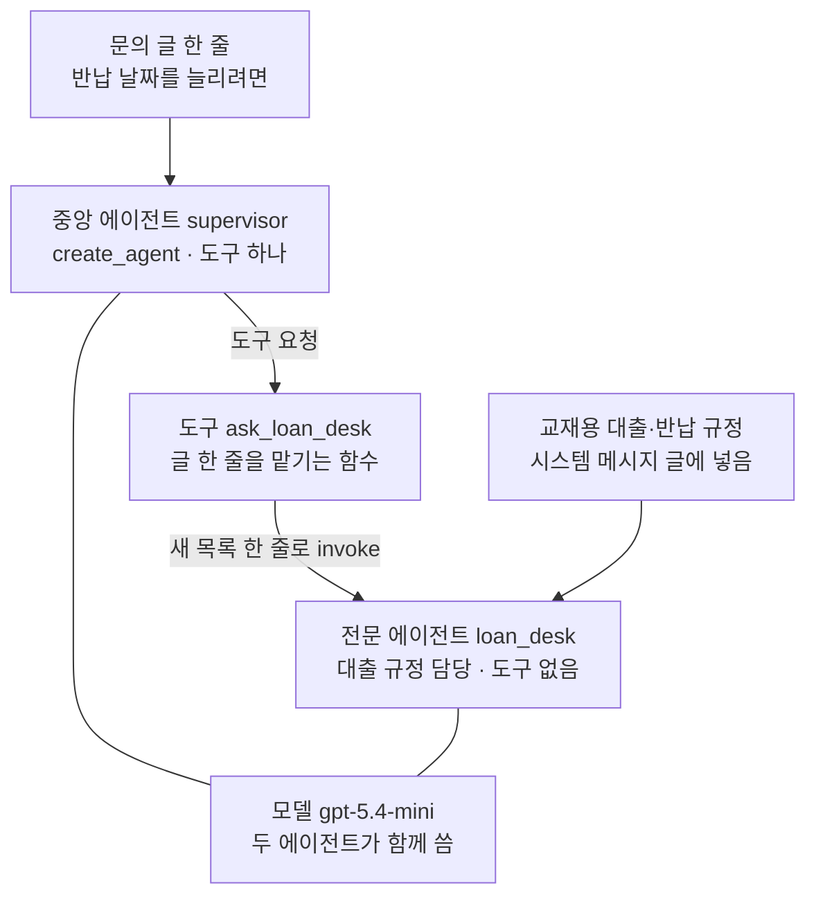
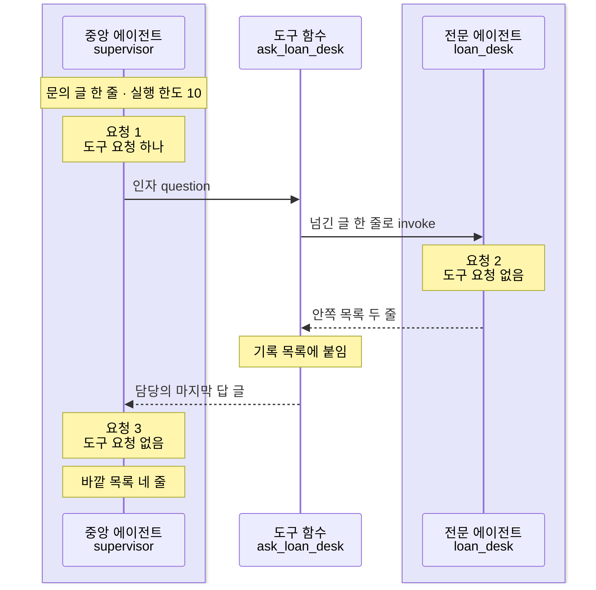
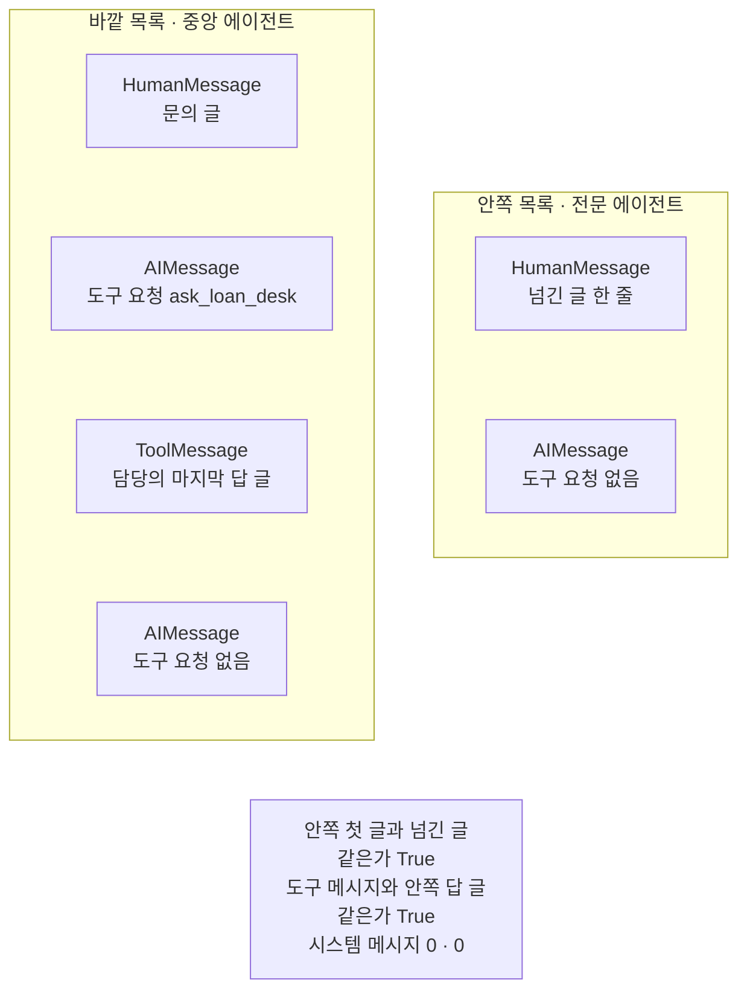
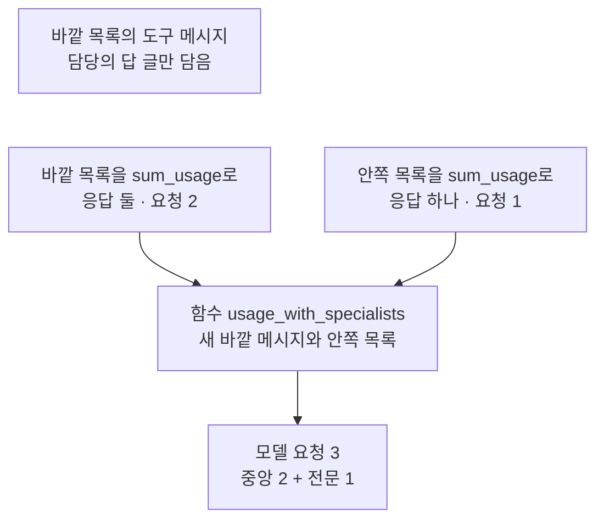
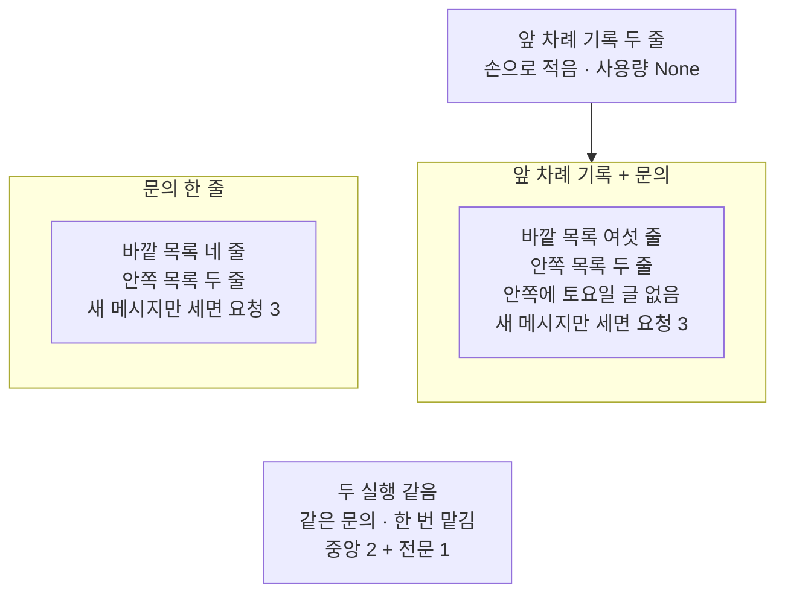

# 01-Subagent-도구-위임

## _src 본문 (HTML 원본)

```html
<!--meta: 강의 1h | 실습 1h | 코드 notebooks/01-Subagent-도구-위임.ipynb | 새 용어 4 -->
<style>html,body{overflow-x:hidden}.notebook,.nb-cell,.nb-main,.nb-input,.nb-result{min-width:0;max-width:100%}.nb-input pre,.nb-output{box-sizing:border-box;max-width:100%;overflow-x:auto}code.nb-source{display:block!important;width:100%!important;min-width:0!important;overflow-x:auto!important;padding:0!important}</style>
<h2 id="b1"><span class="no">1</span>학습 목표</h2><div class="goal"><ul>
<li>전문 에이전트를 도구 함수 안에서 부르게 감싸, 중앙 에이전트가 일을 맡기는 한 실행을 만들 수 있습니다.</li>
<li>중앙 에이전트의 바깥 목록과 전문 에이전트의 안쪽 목록을 나란히 출력하고, 두 목록이 이어지는 자리를 설명할 수 있습니다.</li>
<li>전문 에이전트의 요청까지 모델 요청 수를 세고, 바깥 목록만 세면 빠지는 까닭을 말할 수 있습니다.</li>
</ul></div>
<h2 id="b2"><span class="no">2</span>이 내용을 배우는 이유</h2><p><a href="../ch21-create-agent/01-create-agent와-ReAct-루프.html">Ch 21</a>에서 만든 에이전트는 모델 하나가 도구 여럿을 직접 골라 썼습니다. 맡을 분야가 늘면, 분야마다의 도구 설명과 규정 글이 모두 한 에이전트의 요청에 실립니다. 사람의 창구라면 분야마다 담당을 두고, 안내 창구는 담당에게 물어 답을 받아 옵니다. 에이전트도 같은 모양으로 짤 수 있습니다.</p><p>이 챕터는 에이전트 여럿이 일을 나눠 맡는 모양 셋을 차례로 봅니다. 이 절은 그 첫째로, 한 에이전트가 다른 에이전트를 도구처럼 불러 일을 맡기는 모양입니다. 절 제목의 Subagent는 이렇게 불려 일을 맡는 에이전트를 가리키고, 본문에서는 서브에이전트라고 씁니다. 이 절은 두 에이전트가 각각 어떤 메시지 목록으로 일했는지, 모델 요청이 몇 번 나갔는지 셉니다.</p>
<h2 id="b3"><span class="no">3</span>앞에서 배운 내용</h2><p><a href="../../part2/ch08-context-engineering/03-Compress와-Isolate.html">Ch 8 03절</a>에서는 나누기(Isolate)를 배웠습니다. 업무마다 메시지 목록을 따로 만들어, 요청 하나에 한 업무의 자료만 넣는 일이었습니다. 그 절은 서브에이전트가 따로 받은 컨텍스트로 일하는 모양을 이 절로 미뤘습니다. <a href="../ch22-middleware/08-컨텍스트-분리와-Isolate.html">Ch 22 08절</a>의 컨텍스트 분리(Isolate)도 같은 생각을 미들웨어로 해 본 것입니다.</p><p><a href="../../part5/ch18-workflow-patterns/04-동적-오케스트레이터와-워커.html">Ch 18 04절</a>의 작업 나눠 맡기기에서는 계획 모델이 쓴 작업 목록을 코드가 받아, 작업 모델에게 나눠 보냈습니다. 그때 누구에게 무엇을 보낼지는 코드가 정했습니다. 이 절에서는 중앙 에이전트의 모델이 도구를 골라, 맡길지와 넘길 글을 정합니다.</p><p><a href="../../part5/ch19-model-tools/01-tool과-Ch4-함수-재사용.html">Ch 19 01절</a>에서는 <code>@tool</code> 줄로 함수를 도구로 만들었습니다. <a href="../../part5/ch19-model-tools/05-bind_tools와-병렬-호출.html">05절</a>의 <code>sum_usage</code>는 목록의 응답마다 요청 하나로 세었습니다. <a href="../../part5/ch19-model-tools/06-오류와-읽기-쓰기-분리.html">06절</a>의 <code>show_messages</code>는 목록을 한 줄씩 출력했습니다. 두 함수와 예상 비용 함수(<a href="../../part2/ch06-langchain-start/06-토큰-비용-지연-비교.html">Ch 6 06절</a>)는 이 챕터 도구 파일 <code>delegation_tools.py</code>에서 가져옵니다.</p><p><a href="../ch21-create-agent/01-create-agent와-ReAct-루프.html">Ch 21 01절</a>에서는 <code>create_agent</code>로 모델 노드와 도구 실행 노드가 있는 에이전트 그래프를 만들었습니다. <a href="../../part5/ch20-tool-node/03-recursion-limit과-명시적-종료.html">Ch 20 03절</a>의 실행 한도는 그래프 단계 수의 상한이었습니다. 이 절은 두 에이전트를 그 방법으로 만들고, 중앙 에이전트에 작은 실행 한도를 줍니다.</p>
<h2 id="b4"><span class="no">4</span>핵심 개념</h2><h3>비유로 시작하기</h3><p>큰 배 한 척이 항구 앞바다에 닻을 내리고 서 있습니다. 큰 배는 부두까지 들어가지 않고, 작은 보트 한 척을 내려 부두로 보냅니다. 보트는 부두에서 상자 하나만 싣고 큰 배로 돌아옵니다. 부두에 쌓인 다른 상자들은 큰 배에 실리지 않습니다.</p><p>큰 배가 중앙 에이전트이고, 작은 보트가 일을 맡는 전문 에이전트입니다. 보트가 싣고 온 상자 하나가 도구가 내놓은 담당의 마지막 답 글입니다. 부두에 남은 상자는 담당만 가진 규정 글처럼 바깥으로 오지 않는 것입니다. 보트가 부두에서 한 일은 담당의 안쪽 목록에만 남습니다.</p><p>비유와 다른 점이 있습니다. 큰 배는 보트가 돌아올 때까지 기다리기만 합니다. 중앙 에이전트는 상자를 받은 뒤 모델 요청을 한 번 더 보내 최종 답을 씁니다. 그래서 한 번 맡기면 중앙 쪽 요청이 둘입니다.</p>
{{img:01-6-큰-배와-작은-보트|흰 바탕에 잔잔한 파란 바다가 아래쪽에 있는 항구 그림입니다. 왼쪽에 회색 큰 화물선 한 척이 서 있고, 뱃머리에서 닻 사슬이 물속으로 곧게 내려갑니다. 가운데에는 사람이 없는 작은 나무 보트 한 척이 뱃머리를 큰 배 쪽으로 두고, 나무 상자 하나를 싣고 있습니다. 오른쪽 나무 부두 위에는 나무 상자 셋이 쌓여 있고, 그 옆에 작은 창고가 있습니다. 글자·숫자·사람·손·화살표는 없는 그림|닻을 내린 큰 배는 그 자리에 있고, 작은 보트만 부두에서 상자 하나를 싣고 큰 배 쪽으로 돌아옵니다.}}
<p class="look"><b>그림 읽기</b> — 왼쪽 큰 화물선은 닻을 내리고 서 있고, 가운데 작은 보트는 상자 하나만 싣고 큰 배 쪽을 향합니다. 오른쪽 부두에는 상자 셋이 쌓인 채 남아 있습니다. 큰 배가 중앙 에이전트, 작은 보트가 전문 에이전트, 보트의 상자 하나가 담당의 마지막 답 글입니다. 부두에 남은 상자는 담당만 가진 규정 글처럼 큰 배로 오지 않는 것입니다. 부두 상자의 수 셋과 큰 배 갑판 왼쪽 끝의 붉은 짐은 어떤 값과도 짝짓지 않습니다.</p>
<table><thead><tr><th>말</th><th>뜻</th></tr></thead><tbody><tr><td>서브에이전트(subagent)</td><td>중앙 에이전트가 도구로 감싸 불러 쓰며, 일 하나를 맡기는 전문 에이전트입니다. 안내 창구 직원이 전화로 대출 담당에게 물어 답을 받아 오는 것과 같습니다. 이 절에서는 도구 <code>ask_loan_desk</code> 안에서 부르는 <code>loan_desk</code>입니다.</td></tr><tr><td>중앙 에이전트</td><td>문의한 사람과 대화하며, 일을 맡길지 고르고 받은 답으로 최종 답을 쓰는 에이전트입니다. 도서관 입구의 안내 창구와 같습니다. 이 절에서는 코드 이름 <code>supervisor</code>이고, 도구 하나를 가졌습니다.</td></tr><tr><td>전문 에이전트</td><td>한 분야만 맡아 답하는 에이전트입니다. 대출 창구에 앉은 직원과 같습니다. 이 절에서는 교재용 규정 글을 시스템 메시지 글에 넣고 도구 없이 만든 대출 규정 담당입니다.</td></tr><tr><td>바깥 목록 · 안쪽 목록</td><td>중앙 에이전트의 메시지 목록이 바깥 목록이고, 전문 에이전트가 한 번 불려 받고 쓴 메시지 목록이 안쪽 목록입니다. 안내 창구의 상담 기록장과 담당이 따로 쓴 메모장과 같습니다. 이 절에서는 <code>first_result["messages"]</code>와 기록 목록의 항목 <code>specialist_runs[0]</code>입니다.</td></tr></tbody></table>
<p>새 말을 이 절 코드에서 보면 이렇습니다. 서브에이전트를 부른 흔적은 노트북 4절 출력 <code>전문 에이전트를 부른 횟수: 1</code>입니다. 바깥 목록은 <code>바깥 목록: ['HumanMessage', 'AIMessage', 'ToolMessage', 'AIMessage']</code>로 출력됩니다. 안쪽 목록은 <code>안쪽 목록: ['HumanMessage', 'AIMessage']</code>입니다.</p>
{{mermaid:01-1-도구로-감싼-전문-에이전트|위에서 아래로 읽는 흐름도입니다. 초록 상자 문의 글 한 줄 반납 날짜를 늘리려면에서 회색 상자 중앙 에이전트 supervisor create_agent 도구 하나로 화살표가 갑니다. 회색 상자에서 도구 요청이라는 화살표가 파란 상자 도구 ask_loan_desk 글 한 줄을 맡기는 함수로 가고, 파란 상자에서 새 목록 한 줄로 invoke라는 화살표가 회색 상자 전문 에이전트 loan_desk 대출 규정 담당 도구 없음으로 갑니다. 초록 상자 교재용 대출·반납 규정 시스템 메시지 글에 넣음도 전문 에이전트로 화살표가 갑니다. 맨 아래 보라 상자 모델 gpt-5.4-mini 두 에이전트가 함께 씀이 두 회색 상자와 화살표 없는 선으로 이어진 그림|중앙 에이전트는 도구 하나만 가졌고, 그 도구 함수가 도구 없는 전문 에이전트를 글 한 줄로 부릅니다.}}
<p class="look"><b>도식 읽기</b> — 위에서 아래로 읽습니다. 초록 상자는 넣은 글, 파란 상자는 우리가 적은 도구 함수, 회색 상자는 create_agent가 만든 에이전트 그래프입니다. 보라 상자는 이 절에서 실제로 부른 모델이고, 화살표 없는 선은 두 에이전트가 모델 객체 하나를 함께 쓴다는 뜻입니다. 전문 에이전트에게 가는 화살표는 도구 함수에서 오는 것 하나뿐이고, 중앙 에이전트와 바로 이어지지 않습니다.</p>
<h3>도구 안에서 부르면 새 목록으로 일합니다</h3><p>도구 함수 <code>ask_loan_desk</code>는 담당을 부를 때, 넘긴 글 한 줄만 든 새 메시지 목록을 만듭니다. 그래서 담당은 중앙 에이전트가 문의한 사람과 나눈 대화를 받지 않습니다. 담당의 응답 객체도 바깥 목록에 들어가지 않고, 마지막 답 글만 도구 메시지로 옮겨집니다. Ch 8 03절이 말한 나누기(Isolate)가 이 모양입니다.</p><p>공식 문서도 서브에이전트는 기본적으로 지난 대화를 기억하지 않고, 대화 기록은 중앙 에이전트가 가진다고 적습니다. 문서는 과제 글만 넘기는 방법과, 중앙 에이전트의 메시지 기록을 넘기는 방법을 함께 적습니다. 이 절은 과제 글 한 줄만 넘기고, 기록을 넘기는 방법은 실행하지 않았습니다.</p>
<h3>요청 수는 두 목록을 함께 셉니다</h3><p>함수 <code>sum_usage</code>는 한 목록 안의 응답마다 요청 하나로 셉니다. 담당의 응답은 안쪽 목록에만 있으므로, 바깥 목록만 세면 담당의 요청이 빠집니다. 한 번 맡기면 요청은 중앙 둘과 담당 하나입니다. 중앙 둘은 도구를 요청한 응답과 마지막 응답이고, 담당 하나는 도구가 없는 담당의 응답입니다.</p><p>중앙 에이전트가 도구 요청 없는 모델 응답으로 끝낸 실행에서, 셈을 적으면 이렇습니다. 중앙 쪽 요청 수는 도구를 요청한 응답 수에 1을 더한 값입니다. 담당은 도구가 없어 부를 때마다 요청이 한 번이라, 담당 쪽 요청 수는 부른 횟수와 같습니다. 호출 한도에 닿아 끝난 실행은 마지막 1이 없고, 04절 7절과 05절 실행 2가 그 경우입니다.</p>
<h2 id="b5"><span class="no">5</span>실행 예제</h2><p>노트북은 먼저 교재용 규정 글로 대출 규정 담당을 만들고, 그 담당을 부르는 도구와 중앙 에이전트를 만듭니다. 4절은 <a href="../ch25-streaming/04-Streaming-실습.html">Ch 25 04절</a>의 대출 연장 문의 한 줄로 중앙 에이전트를 실행하고, 바깥 목록과 안쪽 목록을 나란히 봅니다. 5절은 두 목록의 요청 수를 세어 더합니다. 6절은 같은 문의 앞에 앞 차례 기록 두 줄을 붙여 한 번 더 실행합니다.</p><p>실제 OpenAI 모델 <code>gpt-5.4-mini</code>를 temperature 0으로 부르고, 두 에이전트가 모델 객체 하나를 함께 씁니다. 중앙 에이전트가 한 번 맡기면 실행 한 번에 모델 요청이 3번이라, 노트북 한 번에 모두 6번입니다. 요금표로 어림한 예상 비용은 0.003달러 아래이고, 청구 금액이 아닙니다. 답 글과 맡기는 횟수는 실행마다 달라질 수 있습니다. 읽거나 쓰는 파일은 없습니다.</p>
{{notebook:01-Subagent-도구-위임}}
<p class="look"><b>확인할 점</b> — 노트북 4절에서 <code>전문 에이전트를 부른 횟수: 1</code>과 <code>안쪽 목록의 메시지 수: 2</code>를 봅니다. 같은 절에서 <code>시스템 메시지 수(바깥, 안쪽): 0 0</code>과 두 줄의 <code>True</code>를 확인합니다. 5절에서 <code>바깥 목록만 센 요청 수: 2</code>와 <code>모델 요청 수(중앙 + 전문): 3</code>을 견줍니다. 맡기는 횟수는 모델이 정하므로, 다시 실행하면 달라질 수 있습니다.</p>
{{mermaid:01-2-한-번-맡긴-실행의-차례|세로선 셋이 있는 차례 그림입니다. 왼쪽부터 연보라 띠 안의 중앙 에이전트 supervisor, 도구 함수 ask_loan_desk, 연보라 띠 안의 전문 에이전트 loan_desk입니다. 중앙 에이전트에 노란 메모 문의 글 한 줄 실행 한도 10과 요청 1 도구 요청 하나가 붙고, 인자 question 화살표가 도구 함수로 갑니다. 도구 함수에서 넘긴 글 한 줄로 invoke 화살표가 전문 에이전트로 가고 노란 메모 요청 2 도구 요청 없음이 붙습니다. 전문 에이전트에서 안쪽 목록 두 줄 점선이 도구 함수로 돌아오고 노란 메모 기록 목록에 붙임이 붙습니다. 도구 함수에서 담당의 마지막 답 글 점선이 중앙 에이전트로 돌아오고, 노란 메모 요청 3 도구 요청 없음과 바깥 목록 네 줄이 붙은 그림|한 번 맡긴 실행에서 모델 요청은 중앙 에이전트, 전문 에이전트, 다시 중앙 에이전트의 차례로 모두 세 번 나갔습니다.}}
<p class="look"><b>도식 읽기</b> — 위에서 아래로 실행 차례대로 읽고, 세로선은 왼쪽부터 중앙 에이전트, 도구 함수, 전문 에이전트입니다. 연보라 띠는 실제로 부른 모델 gpt-5.4-mini가 요청을 받은 자리입니다. 노란 메모는 노트북 4·5절 출력이고, 요청 번호는 나간 차례입니다. 실선 화살표는 부르는 쪽, 점선 화살표는 내놓은 값이 돌아오는 쪽입니다.</p>
<h2 id="b6"><span class="no">6</span>실험 결과 해석</h2><p>중앙 에이전트는 두 실행 모두 담당에게 한 번 맡겼습니다. 아래 표는 두 실행의 목록 줄 수와 모델 요청 수, 교재 출력의 토큰 수를 모은 것입니다. 토큰 수와 예상 비용은 교재 출력의 값이고, 다시 실행하면 달라질 수 있습니다.</p>
<table><thead><tr><th>값</th><th>문의 한 줄(4·5절)</th><th>앞 차례 기록 + 문의(6절)</th><th>다시 실행하면</th></tr></thead><tbody><tr><td>바깥 목록 줄 수</td><td>4</td><td>6</td><td>맡기는 횟수에 따라 달라질 수 있음(넣은 메시지 수도 더해짐)</td></tr><tr><td>안쪽 목록 줄 수</td><td>2</td><td>2</td><td>담당이 도구가 없어 부를 때마다 두 줄</td></tr><tr><td>모델 요청 수(중앙 + 전문)</td><td>3</td><td>3</td><td>한 번 맡기면 중앙 2 + 전문 1</td></tr><tr><td>입력 토큰(교재 출력)</td><td>685</td><td>757</td><td>달라질 수 있음</td></tr><tr><td>출력 토큰(교재 출력)</td><td>104</td><td>101</td><td>달라질 수 있음</td></tr><tr><td>예상 비용(교재 출력, 달러)</td><td>0.000982</td><td>세지 않음</td><td>달라질 수 있음</td></tr></tbody></table>
<p>담당의 안쪽 목록은 두 실행 모두 두 줄이었습니다. 첫 줄은 넘긴 글이고, 둘째 줄은 도구 요청이 없는 담당의 응답입니다. 안쪽 첫 글과 넘긴 글이 같은지, 도구 메시지와 안쪽 답 글이 같은지는 모두 <code>True</code>였습니다. 두 목록은 넘긴 글 하나와 답 글 하나로만 이어져 있습니다.</p>
{{mermaid:01-3-바깥-목록과-안쪽-목록|칸 둘이 나란히 있고 아래에 노란 상자 하나가 있는 그림입니다. 왼쪽 칸 바깥 목록 중앙 에이전트에는 노란 상자 넷 HumanMessage 문의 글, AIMessage 도구 요청 ask_loan_desk, ToolMessage 담당의 마지막 답 글, AIMessage 도구 요청 없음이 위에서 아래로 놓였습니다. 오른쪽 칸 안쪽 목록 전문 에이전트에는 노란 상자 둘 HumanMessage 넘긴 글 한 줄, AIMessage 도구 요청 없음이 놓였습니다. 아래 노란 상자에는 안쪽 첫 글과 넘긴 글 같은가 True, 도구 메시지와 안쪽 답 글 같은가 True, 시스템 메시지 0 · 0이 적힌 그림|한 번 맡긴 실행에서 바깥 목록은 네 줄, 안쪽 목록은 두 줄이었고, 두 목록은 넘긴 글과 답 글로만 이어졌습니다.}}
<p class="look"><b>도식 읽기</b> — 왼쪽 칸이 중앙 에이전트의 바깥 목록, 오른쪽 칸이 전문 에이전트의 안쪽 목록입니다. 칸 안 상자는 위에서 아래로 목록의 차례이고, 노트북 4절에서 출력한 종류입니다. 아래 노란 상자는 4절의 두 True 비교와 시스템 메시지 수 출력입니다. 두 칸 사이에 화살표를 두지 않은 것은, 안쪽 목록이 바깥 목록에 들어가지 않기 때문입니다.</p>
<p>바깥 목록만 세자 요청 수는 2였고, 안쪽 목록에서 담당의 요청 1이 따로 나왔습니다. 둘을 더한 모델 요청 수 3은 한 번 맡긴 실행의 셈인 중앙 2 + 전문 1과 같습니다. 담당의 응답은 바깥 목록에 없으니, 요청 수와 토큰은 두 목록을 함께 세야 빠짐이 없습니다.</p>
{{mermaid:01-4-두-목록을-함께-센-요청-수|위에서 아래로 읽는 흐름도입니다. 맨 위 회색 상자 바깥 목록의 도구 메시지 담당의 답 글만 담음 아래에 노란 상자 둘이 나란히 있습니다. 왼쪽 바깥 목록을 sum_usage로 응답 둘 요청 2, 오른쪽 안쪽 목록을 sum_usage로 응답 하나 요청 1입니다. 두 노란 상자에서 파란 상자 함수 usage_with_specialists 새 바깥 메시지와 안쪽 목록으로 화살표가 가고, 거기서 노란 상자 모델 요청 3 중앙 2 + 전문 1로 화살표가 가는 그림|바깥 목록만 세면 요청 2였고, 안쪽 목록의 요청 1을 더하자 한 번 맡긴 실행의 모델 요청 3이 되었습니다.}}
<p class="look"><b>도식 읽기</b> — 위에서 아래로 읽습니다. 맨 위 회색 상자는 바깥 목록만 세면 담당의 요청이 빠지는 까닭입니다. 노란 상자는 노트북 5절 출력이고, 파란 상자는 5절에서 만든 함수입니다. 맨 아래 상자의 요청 3은 한 번 맡긴 이번 실행의 값이고, 중앙 2 + 전문 1은 한 번 맡기면 늘 같은 셈입니다.</p>
<p>앞 차례 기록 두 줄을 붙인 6절 실행에서는 바깥 목록이 여섯 줄로 늘었습니다. 안쪽 목록은 두 줄 그대로였고, 토요일 운영을 묻고 답한 기록은 안쪽 목록에 없었습니다. 기록은 중앙 에이전트의 목록에만 쌓이고 담당에게는 넘어가지 않았습니다. 이번 실행이 더한 메시지만 잘라 세자, 모델 요청 수도 4절과 같은 3이었습니다.</p>
{{mermaid:01-5-앞-차례-기록을-붙인-실행|칸 둘이 나란히 있는 그림입니다. 오른쪽 칸 위에 초록 상자 앞 차례 기록 두 줄 손으로 적음 사용량 None이 있고 오른쪽 칸으로 화살표가 갑니다. 왼쪽 칸 문의 한 줄의 노란 상자에는 바깥 목록 네 줄, 안쪽 목록 두 줄, 새 메시지만 세면 요청 3이 적혀 있습니다. 오른쪽 칸 앞 차례 기록 + 문의의 노란 상자에는 바깥 목록 여섯 줄, 안쪽 목록 두 줄, 안쪽에 토요일 글 없음, 새 메시지만 세면 요청 3이 적혀 있습니다. 맨 아래 회색 상자에는 두 실행 같음, 같은 문의 한 번 맡김, 중앙 2 + 전문 1이 적힌 그림|앞 차례 기록 두 줄을 붙이자 바깥 목록만 두 줄 늘었고, 안쪽 목록 두 줄과 모델 요청 3은 같았습니다.}}
<p class="look"><b>도식 읽기</b> — 두 칸은 넣은 메시지 목록만 바꾼 나란한 실행이고, 노란 상자는 노트북 4~6절 출력입니다. 초록 상자는 6절에서 손으로 적어 넣은 기록이고, 오른쪽 칸 실행에만 들어갔습니다. 맨 아래 회색 상자는 두 칸 출력에서 모두 확인한 값입니다. 안쪽에 토요일 글이 없다는 줄은 기록을 넣은 오른쪽 칸에서만 확인했습니다.</p>
<p>모델을 부르는 절이라 답 글과 토큰 수는 실행마다 달라질 수 있습니다. 새 커널로 두 번 실행해 견주자, 최종 답 글·토큰·예상 비용이 찍힌 셀 넷은 실행에 따라 달랐습니다. 목록 줄 수·종류·두 <code>True</code>·요청 수가 찍힌 셀을 포함한 나머지 스물넷은 두 번 모두 같았습니다. 담당의 답 글이 찍힌 셀도 이번 두 번에서는 같았지만, 모델 글이라 달라질 수 있습니다.</p>
<p class="look"><b>확인할 점</b> — 노트북 6절에서 <code>손으로 적은 응답의 사용량: None</code>과 <code>안쪽 목록에 앞 차례 글이 있는가: False</code>를 확인합니다. 마지막 표의 두 줄에서 바깥 줄 수만 다르고, 안쪽 줄 수와 모델 요청 수가 같은지 봅니다. 교재 출력의 토큰 수와 예상 비용은 다시 실행하면 달라질 수 있어, 이 절의 결론에 쓰지 않았습니다.</p>
<h2 id="b7"><span class="no">7</span>주의할 점과 실무 메모</h2><ul><li>맡기는 횟수는 중앙 에이전트의 모델이 정합니다. 노트북 밖에서 4절과 6절 실행을 다섯 번씩 보내자, 열 번 모두 한 번 맡겼고 안쪽 목록 두 줄과 두 <code>True</code>도 같았습니다. 그래도 같은 요청이 실행한 때에 따라 달라질 수 있습니다. 한 응답에서 두 번 맡기면 중앙 2 + 전문 2, 응답 둘에서 한 번씩 맡기면 중앙 3 + 전문 2가 됩니다.</li><li>중앙 에이전트가 넘긴 글은 노트북 밖 열 번과 새 커널 두 번 모두, 문의 글을 고치지 않은 그대로였습니다. 그래도 모델이 쓰는 인자라 고쳐 쓴 글을 넘길 수도 있어, 넘긴 글의 내용은 결론에 쓰지 않았습니다.</li><li>규정 글은 이 절이 실행 전에 정한 교재용 글이고, 실제 도서관 규정이 아닙니다. 대출·연체 문장은 Ch 21 01절 규정 글과 같고, 연장 두 문장은 이 절에서 더했습니다. 흐름을 보여 주려고 정한 예입니다.</li><li>함수 <code>sum_usage</code>는 목록 안의 <code>AIMessage</code>를 모두 요청 하나로 셉니다. 손으로 적은 응답은 요청이 아니고 사용량도 <code>None</code>이라, 노트북 밖에서 바깥 목록째 넘기자 토큰 수를 꺼내다 멈췄습니다. 그래서 노트북은 이번 실행이 더한 메시지만 잘라 셌습니다.</li><li>중앙 실행에 준 실행 한도 10은 요금 사고를 막으려는 값이고, 한도를 넘는 장면은 실행하지 않았습니다. 담당은 도구가 없어 모델 노드 한 번으로 끝나므로 따로 한도를 주지 않았습니다. 설치판 langchain 1.4.0 <code>agents/factory.py</code> 1829~1831행이 기본 한도 9999를 정합니다.</li><li>이 한도 10은 도구 함수 안에서 부른 담당의 실행에는 닿지 않습니다. 같은 파일 1857행이 담당의 그래프에도 한도 9999를 붙여 두기 때문입니다. 노트북 밖 모델 없는 작은 그래프로 확인했고, 노트북에서는 실행하지 않았습니다. 담당이 도구를 가지면 담당을 부를 때에도 한도를 따로 주어야 합니다.</li><li>설치판 <code>create_agent</code>에는 한 응답의 도구 요청 수를 막는 인자가 없습니다. 설치판 langchain 1.4.0 <code>agents/factory.py</code> 1964행은 한 응답의 도구 요청마다 도구 실행 노드를 따로 부릅니다. 이 작업들은 같은 단계에서 함께 실행됩니다. 공식 문서도 중앙 에이전트가 한 차례에 서브에이전트 여럿을 부를 수 있다고 적습니다. 이 장면은 이번에 실행하지 않았습니다.</li><li>기록 목록 <code>specialist_runs</code>는 4절과 6절 실행 셀에서 새로 만듭니다. 실행 셀을 다시 실행하면 목록도 새로 만들어져, 앞 실행의 안쪽 목록이 섞이지 않습니다. 도구 함수는 이 이름을 노트북에서 찾으므로, 도구 정의 셀만 옮겨 쓸 때는 기록 목록도 함께 만들어야 합니다.</li><li>중앙 에이전트의 기록을 담당에게 넘기는 방법과, 공식 문서의 비동기 서브에이전트는 실행하지 않았습니다. 중앙 에이전트를 스트리밍할 때 담당의 스트림 청크가 섞이는 모양도 실행하지 않았습니다.</li><li>걸린 시간은 재지 않았습니다. 교재 출력은 Linux의 Python 3.12.13으로 만들었고, 다른 판과 Windows·macOS에서는 실행하지 않았습니다.</li></ul>
<h2 id="b8"><span class="no">8</span>정리와 다음 절</h2><ul><li>전문 에이전트를 도구 함수 안에서 부르게 감싸면, 중앙 에이전트는 도구를 고르듯 일을 맡깁니다.</li><li>담당은 넘긴 글 한 줄로 시작한 두 줄짜리 안쪽 목록으로 일했고, 바깥 목록에는 답 글만 도구 메시지로 들어왔습니다.</li><li>바깥 목록만 세면 담당의 요청이 빠지고, 한 번 맡기면 모델 요청은 중앙 2 + 전문 1입니다.</li></ul><p><strong>다음 학습과 이어지는 지점</strong> — <a href="02-Handoff-상태-전환.html">02절</a>에서는 일을 맡겼다 답을 받는 대신, 다음 차례에 대화할 담당을 바꿉니다.</p>
<h2 id="b9"><span class="no">9</span>복습 문제</h2><details class="quiz" open><summary>문제 4개 · 해설 포함</summary><p class="quiz-q">1. 중앙 에이전트의 바깥 목록에 담당의 응답 객체가 없는 까닭은 무엇인가요?</p><p class="quiz-a">담당은 도구 함수 안에서 새 목록으로 실행되고, 도구 함수는 담당의 마지막 답 글만 내놓기 때문입니다. 그 글이 바깥 목록의 도구 메시지 내용이 됩니다. 틀렸다면 노트북 4절을 다시 읽습니다.</p><p class="quiz-q">2. 바깥 목록만 <code>sum_usage</code>로 세면 요청 수가 얼마로 나오고, 무엇이 빠지나요?</p><p class="quiz-a">한 번 맡긴 이번 실행에서는 중앙 에이전트의 응답 둘만 세어 2가 나오고, 안쪽 목록에 있는 담당의 요청 하나가 빠집니다. 틀렸다면 노트북 5절을 다시 읽습니다.</p><p class="quiz-q">3. 앞 차례 기록 두 줄을 붙였을 때 바깥 목록과 안쪽 목록의 줄 수는 어떻게 되었나요?</p><p class="quiz-a">한 번 맡긴 이번 실행에서는 바깥 목록만 두 줄 늘어 여섯 줄이 되었고, 안쪽 목록은 두 줄 그대로였습니다. 기록은 중앙 에이전트의 목록에만 쌓였습니다. 틀렸다면 노트북 6절을 다시 읽습니다.</p><p class="quiz-q">4. 동료가 「중앙 에이전트가 한 응답에서 담당을 두 번 부르면 요청은 여섯 번」이라고 말합니다. 이 절의 셈으로는 몇 번인가요?</p><p class="quiz-a">네 번입니다. 최종 답까지 쓰고 끝나면, 중앙 쪽은 도구를 요청한 응답 하나에 1을 더해 둘입니다. 담당 쪽은 부른 횟수만큼 둘입니다. 틀렸다면 본문 「핵심 개념」의 「요청 수는 두 목록을 함께 셉니다」를 다시 읽습니다.</p></details>
<h2 id="b10"><span class="no">10</span>참고 자료</h2><ul><li><div><a href="https://docs.langchain.com/oss/python/langchain/multi-agent/subagents">LangChain Subagents</a></div>확인 2026-09-28 · 도구 함수 안에서 서브에이전트를 부르고 마지막 메시지를 내놓는 예가 있습니다. 서브에이전트가 기본적으로 지난 대화를 기억하지 않는다는 설명도 있습니다. 과제 글만 넘기는 방법과 기록을 넘기는 방법, 한 차례에 여럿을 부를 수 있다는 설명도 함께 있습니다.</li><li>langchain 1.4.0 소스 <code>agents/factory.py</code> 1829~1831행은 <code>create_agent</code>가 만든 그래프의 실행 한도 9999입니다. 1857행에서 그 설정을 그래프에 붙입니다.</li><li>langchain 1.4.0 소스 <code>agents/factory.py</code> 1964행은 한 응답의 도구 요청마다 도구 실행 노드를 따로 부르는 자리입니다. 도구 실행 노드의 소스 <code>prebuilt/tool_node.py</code>는 langgraph-prebuilt 1.1.0에 들어 있습니다. 이 패키지는 langgraph를 설치하면 함께 설치됩니다. 그 821~824행은 한 번에 받은 도구 요청 여럿을 함께 실행하는 자리입니다.</li><li>나누기(Isolate)는 Ch 8 03절, 요청 수 세기와 메시지 목록 출력은 Ch 19 05·06절에서 보았습니다. 함수 <code>create_agent</code>는 Ch 21 01절에서 배웠습니다.</li></ul>
```

## 노트북 셀 (순서대로)

### [0] markdown {'html': 'skip'}

# Subagent 도구 위임

**이 노트북에서 할 일**

1. 대출 규정 담당(전문 에이전트)을 만들고, 도구 함수 안에서 부르게 감쌉니다.
2. 중앙 에이전트가 그 도구로 일을 맡긴 한 실행에서, 바깥 목록과 안쪽 목록을 나란히 봅니다.
3. 전문 에이전트의 요청까지 모델 요청 수를 세고, 앞 차례 기록을 붙인 실행과 견줍니다.

**준비물** — 프로젝트 폴더의 `.env` 파일에 `OPENAI_API_KEY`가 있어야 합니다.
모델은 `gpt-5.4-mini`이고, 중앙 에이전트를 4절과 6절에서 한 번씩 실행합니다.
중앙 에이전트가 한 번 맡기면 실행 한 번에 모델 요청이 3번이라, 모두 6번입니다.
요금표로 어림한 예상 비용은 두 실행을 합쳐 0.003달러 아래이고, 청구 금액이 아닙니다.

모델의 답 글과 맡기는 횟수는 실행마다 달라질 수 있습니다.
걸린 시간은 재지 않았습니다.

읽거나 쓰는 파일은 없습니다.
앞 챕터에서 배운 함수 넷은 도구 파일 `delegation_tools.py`에서 가져옵니다.

**기준 버전** — 첫 셀에서 패키지 넷을 설치합니다.
판은 langchain 1.4.0과 langchain-openai 1.6.0입니다.
langgraph 1.2.11과 python-dotenv 1.2.3도 함께 설치합니다.
교재 출력은 Linux의 Python 3.12.13으로 만들었습니다.
다른 판과 Windows·macOS에서는 실행하지 않았습니다.

**강의와 실습 범위** — 강의 시간에는 2~4절을 읽습니다.
전문 에이전트를 도구로 감싸고, 한 실행에서 두 메시지 목록을 나란히 보는 자리입니다.
5~6절은 모델 요청 수 세기와 값 바꿔 보기이고, 실습 시간에 실행합니다.

실습 폴더 `labs/part6/ch26-delegation`에서 `uv sync --locked`를 실행합니다.
그다음 `notebooks/` 폴더의 이 노트북을 열고, 실습 폴더의 `.venv` 커널을 고릅니다.
첫 셀부터 순서대로 실행합니다.

### [1] markdown {'html': 'skip'}

## 오늘 볼 그림


위에서 아래로 읽습니다.
초록 상자는 넣은 글, 파란 상자는 우리가 적은 도구 함수, 회색 상자는 create_agent가 만든 에이전트 그래프입니다.
보라 상자는 이 절에서 실제로 부른 모델이고, 화살표 없는 선은 두 에이전트가 모델 객체 하나를 함께 쓴다는 뜻입니다.
전문 에이전트에게 가는 화살표는 도구 함수에서 오는 것 하나뿐이고, 중앙 에이전트와 바로 이어지지 않습니다.

### [2] markdown {}

## 1. 준비

이 절에서는 에이전트가 다른 에이전트에게 일을 맡기는 모양을 처음 봅니다.
절 제목의 Subagent는 서브에이전트를 가리키고, 뜻은 3절에서 풉니다.

첫 셀은 패키지 넷을 설치하고 설치된 판 번호를 출력합니다.
설치에는 몇십 초가 걸릴 수 있습니다.

### [3] code {'execution': {'iopub.execute_input': '2026-09-28T06:21:29.430692Z', 'iopub.status.busy': '2026-09-28T06:21:29.430587Z', 'iopub.status.idle': '2026-09-28T06:21:30.265737Z', 'shell.execute_reply': '2026-09-28T06:21:30.265247Z'}, 'lesson_role': 'setup'}

```python
# 이 절에서 쓰는 패키지를 설치하고 버전을 확인합니다
%pip install -q "langchain==1.4.0" "langchain-openai==1.6.0" "langgraph==1.2.11" "python-dotenv==1.2.3"
from importlib.metadata import version

print("langchain:", version("langchain"))
print("langchain-openai:", version("langchain-openai"))
print("langgraph:", version("langgraph"))
print("python-dotenv:", version("python-dotenv"))
```

출력:
```
Note: you may need to restart the kernel to use updated packages.
langchain: 1.4.0
langchain-openai: 1.6.0
langgraph: 1.2.11
python-dotenv: 1.2.3

```

### [4] markdown {}

**결과 읽기** — 출력 줄 `langchain: 1.4.0`과 `langgraph: 1.2.11`이 보입니다.
네 판 모두 실습 폴더 잠금과 같은 판입니다.

다음 셀은 이 절에서 쓸 이름을 가져옵니다.
함수 `create_agent`는 Ch 21 01절, 함수 `init_chat_model`은 Ch 6 01절에서 썼습니다.
메시지 클래스 `HumanMessage`와 `AIMessage`는 Ch 13 04절에서 보았습니다.
줄 `@tool`에 쓰는 이름 `tool`은 Ch 19 01절에서 가져왔습니다.
마지막 가져오기 줄은 앞 챕터에서 배운 함수 넷을 도구 파일 `delegation_tools.py`에서 가져옵니다.

### [5] code {'execution': {'iopub.execute_input': '2026-09-28T06:21:30.266714Z', 'iopub.status.busy': '2026-09-28T06:21:30.266607Z', 'iopub.status.idle': '2026-09-28T06:21:31.117828Z', 'shell.execute_reply': '2026-09-28T06:21:31.117080Z'}, 'lesson_role': 'setup'}

```python
# 에이전트(Ch 21 01절)·모델(Ch 6 01절)·메시지(Ch 13 04절)·도구(Ch 19 01절)를 만드는 이름을 가져옵니다
from langchain.agents import create_agent
from langchain.chat_models import init_chat_model
from langchain.messages import AIMessage, HumanMessage
from langchain.tools import tool
# 앞 챕터에서 배운 함수 넷은 도구 파일에서 가져옵니다
from delegation_tools import estimate_cost, show_messages, sum_usage, tool_call_names

print("도구 파일에서 가져온 함수:", "estimate_cost, show_messages, sum_usage, tool_call_names")
```

출력:
```
도구 파일에서 가져온 함수: estimate_cost, show_messages, sum_usage, tool_call_names

```

### [6] markdown {}

**결과 읽기** — 출력 줄 `도구 파일에서 가져온 함수: estimate_cost, show_messages, sum_usage, tool_call_names`가 보입니다.
Ch 19 06절 함수 `show_messages`는 메시지 목록을 한 줄씩 출력합니다.
Ch 19 04절 함수 `tool_call_names`는 응답 하나에 든 도구 요청의 이름을 모읍니다.
Ch 19 05절 함수 `sum_usage`는 목록 안 응답마다 요청 하나로 세고 토큰을 더합니다.
Ch 6 06절 함수 `estimate_cost`는 사용량과 요금표로 예상 비용을 셉니다.

앞에서 배운 함수는 `delegation_tools.py`에 모아 두었습니다.
파일을 열면 코드를 볼 수 있습니다.
노트북과 같은 폴더(`notebooks/`)에 있는 파일입니다.
커널이 `notebooks/` 폴더에서 시작해야 이 파일을 가져올 수 있습니다.
교재 출력을 만든 실행 도구는 이 폴더를 따로 알려 주어, 다른 자리에서 시작해도 가져오기가 되었습니다.

### [7] markdown {}

API 키가 있는지 확인합니다. `True` 값이 나오면 다음으로 넘어갑니다.

### [8] code {'execution': {'iopub.execute_input': '2026-09-28T06:21:31.118929Z', 'iopub.status.busy': '2026-09-28T06:21:31.118834Z', 'iopub.status.idle': '2026-09-28T06:21:31.125107Z', 'shell.execute_reply': '2026-09-28T06:21:31.124596Z'}, 'lesson_role': 'setup'}

```python
# .env 파일에서 OpenAI API 키를 읽습니다(키 값은 출력하지 않습니다)
import os
from dotenv import find_dotenv, load_dotenv

env_path = find_dotenv(usecwd=True)
load_dotenv(env_path)
has_key = os.getenv("OPENAI_API_KEY") is not None
print("OPENAI_API_KEY 설정 여부:", has_key)
assert has_key, "프로젝트 폴더의 .env 파일에 OPENAI_API_KEY를 적어 주세요."
```

출력:
```
OPENAI_API_KEY 설정 여부: True

```

### [9] markdown {}

실습에 쓸 모델을 준비합니다.
temperature 값을 0으로 두어 매번 비슷한 답을 고르게 합니다.

### [10] code {'execution': {'iopub.execute_input': '2026-09-28T06:21:31.126140Z', 'iopub.status.busy': '2026-09-28T06:21:31.126056Z', 'iopub.status.idle': '2026-09-28T06:21:32.440135Z', 'shell.execute_reply': '2026-09-28T06:21:32.439641Z'}}

```python
# 실습에 쓸 모델을 준비합니다
model = init_chat_model(
    "openai:gpt-5.4-mini",
    temperature=0,
    reasoning_effort="none",
)
print("모델 이름:", model.model_name)
print("temperature:", model.temperature)
```

출력:
```
모델 이름: gpt-5.4-mini
temperature: 0.0

```

### [11] markdown {}

**결과 읽기** — 모델 이름 `gpt-5.4-mini`, temperature `0.0`이 보이면 준비가 끝났습니다.
이 노트북의 출력은 2026-09-28에 이 모델로 실행한 결과입니다.
temperature 값을 0으로 두어도, 실행마다 답 문장이 달라질 수 있습니다.
이 셀은 모델 객체만 만들고, 모델 요청은 아직 보내지 않습니다.
이 절의 두 에이전트는 이 모델 객체 하나를 함께 씁니다.

## 2. 대출 규정 담당 만들기

도서관 자료실 문의 창구에, 대출·반납 규정만 맡아 답하는 담당을 둔다고 합시다.
이렇게 한 분야만 맡아 답하는 에이전트를 이 챕터에서는 전문 에이전트라고 부릅니다.
먼저 담당이 근거로 쓸 규정 글을 정합니다.
이 글은 교재용으로 만든 규정이고, 실제 도서관 규정이 아닙니다.

### [12] code {'execution': {'iopub.execute_input': '2026-09-28T06:21:32.441065Z', 'iopub.status.busy': '2026-09-28T06:21:32.440984Z', 'iopub.status.idle': '2026-09-28T06:21:32.443359Z', 'shell.execute_reply': '2026-09-28T06:21:32.443016Z'}}

```python
# 대출 규정 담당이 근거로 쓸 규정 글을 정합니다(교재용으로 만든 글 — 실제 도서관 규정이 아님)
loan_rules = "[교재용 대출·반납 규정] 일반 도서는 1인 5권까지 14일 동안 대출할 수 있습니다."
loan_rules = loan_rules + " 반납 예정일 전에 한 번, 7일 연장할 수 있습니다."
loan_rules = loan_rules + " 예약한 사람이 있는 책은 연장할 수 없습니다."
loan_rules = loan_rules + " 연체한 일수만큼 새 대출이 제한됩니다."
print("규정 글:")
print(loan_rules)
```

출력:
```
규정 글:
[교재용 대출·반납 규정] 일반 도서는 1인 5권까지 14일 동안 대출할 수 있습니다. 반납 예정일 전에 한 번, 7일 연장할 수 있습니다. 예약한 사람이 있는 책은 연장할 수 없습니다. 연체한 일수만큼 새 대출이 제한됩니다.

```

### [13] markdown {}

**결과 읽기** — 라벨 줄 아래에 `[교재용 대출·반납 규정]`으로 시작하는 규정 네 문장이 한 줄로 보입니다.
첫 문장과 마지막 문장은 Ch 21 01절 규정 글의 대출·연체 문장과 같습니다.
연장 두 문장은 이 절에서 더했고, 연장 일수 7은 Ch 24 04절 실습에서 고쳐 넣은 값과 같습니다.

다음 셀은 이 규정 글을 시스템 메시지 글에 넣어 전문 에이전트를 만듭니다.
Ch 21 01절처럼 `create_agent`에 모델 객체, 도구 목록, 시스템 메시지 글을 넘깁니다.
이번에는 도구 목록을 비워 둡니다.
답 길이는 두 문장으로 정해, 답 글이 짧게 끝나게 합니다.

### [14] code {'execution': {'iopub.execute_input': '2026-09-28T06:21:32.444164Z', 'iopub.status.busy': '2026-09-28T06:21:32.444097Z', 'iopub.status.idle': '2026-09-28T06:21:32.449600Z', 'shell.execute_reply': '2026-09-28T06:21:32.449190Z'}}

```python
# 규정 글을 시스템 메시지 글에 넣어, 도구가 없는 전문 에이전트(대출 규정 담당)를 만듭니다
loan_desk_text = "도서관 자료실의 대출 규정 담당입니다. 아래 교재용 규정만 근거로 두 문장의 한국어로 답하세요.\n"
loan_desk_text = loan_desk_text + loan_rules
loan_desk = create_agent(model, tools=[], system_prompt=loan_desk_text)
# 도구가 없으면 노드는 모델 하나뿐이라, 한 번 실행에 모델 요청이 한 번입니다
desk_graph = loan_desk.get_graph()
print("대출 규정 담당의 노드:", list(desk_graph.nodes))
```

출력:
```
대출 규정 담당의 노드: ['__start__', 'model', '__end__']

```

### [15] markdown {}

**결과 읽기** — 출력 줄 `대출 규정 담당의 노드: ['__start__', 'model', '__end__']`가 보입니다.
도구가 없어 도구 실행 노드 `tools`가 없고, 모델 노드를 한 번 지나면 끝납니다.
그래서 이 담당을 한 번 실행하면 모델 요청은 한 번입니다.

## 3. 전문 에이전트를 도구로 감싸기

이제 이 담당을 다른 에이전트가 부를 수 있게 도구로 감쌉니다.
도구 함수 안에서 담당의 `invoke`를 부르면, 담당에게 일을 맡기는 도구가 됩니다.
이렇게 도구로 감싸 불러 쓰는 전문 에이전트를 서브에이전트(subagent)라고 부릅니다.
그 도구를 가지고 문의한 사람과 대화하는 쪽은 중앙 에이전트입니다.

함수 위의 `@tool` 줄은 데코레이터 줄입니다.
데코레이터 줄은 함수 위에 붙여 그 함수를 다른 것으로 감싸는 표시이고, 뜻은 Ch 2 09절에 있습니다.
이 셀에서는 이 줄이 아래 함수를 도구로 등록합니다.
Ch 19 01절처럼 매개변수 `question: str`은 모델이 넘길 인자가 되고, 독스트링은 도구 설명이 됩니다.

도구 함수는 모델이 넘긴 인자만 받습니다.
그래서 담당이 받고 쓴 메시지 목록은 노트북의 기록 목록 `specialist_runs`에 붙여 둡니다.
이 기록 목록은 4절과 6절의 실행 셀에서 새로 만듭니다.

### [16] code {'execution': {'iopub.execute_input': '2026-09-28T06:21:32.450303Z', 'iopub.status.busy': '2026-09-28T06:21:32.450243Z', 'iopub.status.idle': '2026-09-28T06:21:32.453465Z', 'shell.execute_reply': '2026-09-28T06:21:32.453055Z'}}

```python
# 문의 글 하나를 대출 규정 담당에게 맡기고, 담당의 마지막 답 글을 내놓는 도구입니다
@tool
def ask_loan_desk(question: str):
    """도서관 대출·반납 규정을 묻는 질문 하나를 대출 규정 담당에게 맡기고, 담당의 답 글을 받습니다."""
    # 담당은 이 글 한 줄만 든 새 메시지 목록으로 일합니다
    inner_input = {"messages": [HumanMessage(content=question)]}
    inner_result = loan_desk.invoke(inner_input)
    # 도구 함수는 모델이 넘긴 인자만 받아, 안쪽 메시지 목록은 노트북의 기록 목록에 붙여 둡니다
    specialist_runs.append(inner_result["messages"])
    return inner_result["messages"][-1].text
```

출력:
```

```

### [17] markdown {}

**결과 읽기** — 정의 셀이라 출력이 없습니다.
담당에게 넘기는 메시지 목록에는 인자 `question`의 글 한 줄만 들어갑니다.
도구가 내놓는 값은 담당의 마지막 답 글이고, 이 글이 중앙 에이전트 쪽 도구 메시지의 내용이 됩니다.

다음 셀은 중앙 에이전트의 모델이 보게 될 도구 이름과 설명과 인자를 봅니다.

### [18] code {'execution': {'iopub.execute_input': '2026-09-28T06:21:32.454362Z', 'iopub.status.busy': '2026-09-28T06:21:32.454296Z', 'iopub.status.idle': '2026-09-28T06:21:32.459148Z', 'shell.execute_reply': '2026-09-28T06:21:32.458685Z'}}

```python
# 중앙 에이전트의 모델이 보게 될 도구 이름·설명·인자를 봅니다
print("도구 이름:", ask_loan_desk.name)
print("도구 설명:", ask_loan_desk.description)
print("인자:", ask_loan_desk.args)
```

출력:
```
도구 이름: ask_loan_desk
도구 설명: 도서관 대출·반납 규정을 묻는 질문 하나를 대출 규정 담당에게 맡기고, 담당의 답 글을 받습니다.
인자: {'question': {'title': 'Question', 'type': 'string'}}

```

### [19] markdown {}

**결과 읽기** — 출력 줄 `도구 이름: ask_loan_desk`와 `인자: {'question': {'title': 'Question', 'type': 'string'}}`가 보입니다.
도구 설명 줄은 함수의 독스트링과 같은 글입니다.
중앙 에이전트의 모델은 이 설명을 읽고, 인자 `question`에 넣을 글을 스스로 씁니다.
담당의 규정 글과 시스템 메시지 글은 이 도구 정보에 들어 있지 않습니다.

다음 셀은 이 도구 하나를 가진 중앙 에이전트를 만듭니다.
시스템 메시지 글에는 대출·반납 규정 질문을 도구에 맡기라고 적고, 답 길이를 두 문장으로 정합니다.
코드 이름 `supervisor`는 공식 문서가 중앙 에이전트를 달리 부르는 이름에서 땄습니다.

### [20] code {'execution': {'iopub.execute_input': '2026-09-28T06:21:32.459949Z', 'iopub.status.busy': '2026-09-28T06:21:32.459882Z', 'iopub.status.idle': '2026-09-28T06:21:32.468845Z', 'shell.execute_reply': '2026-09-28T06:21:32.468488Z'}}

```python
# 도구 하나를 가진 중앙 에이전트를 만듭니다(코드 이름 supervisor — 요청은 아직 보내지 않음)
central_text = "도서관 자료실 문의 창구의 안내 도우미입니다."
central_text = central_text + " 대출·반납 규정을 묻는 질문은 직접 답하지 말고 ask_loan_desk 도구에 맡기세요."
central_text = central_text + " 도구가 준 답을 바탕으로 두 문장의 한국어로 답하세요."
supervisor = create_agent(model, tools=[ask_loan_desk], system_prompt=central_text)
supervisor_graph = supervisor.get_graph()
print("중앙 에이전트의 노드:", list(supervisor_graph.nodes))
```

출력:
```
중앙 에이전트의 노드: ['__start__', 'model', 'tools', '__end__']

```

### [21] markdown {}

**결과 읽기** — 출력 줄 `중앙 에이전트의 노드: ['__start__', 'model', 'tools', '__end__']`가 보입니다.
Ch 21 01절처럼 모델 노드와 도구 실행 노드가 있는 에이전트 그래프입니다.
도구 실행 노드가 도구 `ask_loan_desk`를 부르면, 그 안에서 담당의 그래프가 따로 실행됩니다.

다음 셀은 중앙 에이전트를 실행할 때 줄 실행 한도를 정합니다.
실행 한도는 Ch 20 03절에서 본 그래프 단계 수의 상한입니다.
중앙 에이전트가 도구를 끝없이 부르면 요청도 끝없이 나가므로, 한도를 작게 주어 몇 단계 안에서 멈추게 합니다.

### [22] code {'execution': {'iopub.execute_input': '2026-09-28T06:21:32.469648Z', 'iopub.status.busy': '2026-09-28T06:21:32.469585Z', 'iopub.status.idle': '2026-09-28T06:21:32.471557Z', 'shell.execute_reply': '2026-09-28T06:21:32.471265Z'}}

```python
# 모델이 도구를 끝없이 부르더라도 몇 단계 안에서 멈추도록, 실행 한도를 작게 정합니다(Ch 20 03절)
print("create_agent 그래프의 기본 실행 한도:", supervisor.config["recursion_limit"])
run_limit = {"recursion_limit": 10}
print("이 절에서 줄 실행 한도:", run_limit["recursion_limit"])
```

출력:
```
create_agent 그래프의 기본 실행 한도: 9999
이 절에서 줄 실행 한도: 10

```

### [23] markdown {}

**결과 읽기** — 출력 줄 `create_agent 그래프의 기본 실행 한도: 9999`와 `이 절에서 줄 실행 한도: 10`이 보입니다.
기본값 그대로면 멈추기 전에 요청이 아주 많이 나갈 수 있습니다.
한 번 맡기는 실행은 모델 노드, 도구 실행 노드, 모델 노드의 세 단계라 한도 10 안에서 끝납니다.
한도를 넘는 장면은 이번에 실행하지 않았습니다.

이 한도는 도구 함수 안에서 부른 담당의 실행에는 닿지 않습니다.
함수 `create_agent`가 담당의 그래프에도 기본 한도 9999를 붙여 두기 때문입니다.
노트북 밖 모델 없는 작은 그래프로 확인했고, 노트북에서는 실행하지 않았습니다.

## 4. 한 번 실행하고 두 목록 보기

문의 글은 Ch 25 04절 실습의 대출 연장 문의를 그대로 씁니다.
실행 전에 예상해 봅니다.
중앙 에이전트가 담당에게 한 번 맡기면, 모델 요청은 중앙 둘과 담당 하나로 모두 3번일 것입니다.

다음 셀은 기록 목록을 새로 만들고, 문의 한 줄로 중앙 에이전트를 실행합니다.
설정 자리에는 3절에서 정한 실행 한도를 넘깁니다.

### [24] code {'execution': {'iopub.execute_input': '2026-09-28T06:21:32.472217Z', 'iopub.status.busy': '2026-09-28T06:21:32.472154Z', 'iopub.status.idle': '2026-09-28T06:21:35.709168Z', 'shell.execute_reply': '2026-09-28T06:21:35.708339Z'}}

```python
# 기록 목록을 새로 만들고, 대출 연장 문의 한 줄로 중앙 에이전트를 실행합니다(한 번 맡기면 모델 요청 3번)
specialist_runs = []
question_text = "빌린 책의 반납 날짜를 늘리려면 어떻게 하나요?"
first_input = {"messages": [HumanMessage(content=question_text)]}
first_result = supervisor.invoke(first_input, run_limit)
outer_messages = first_result["messages"]
print("바깥 목록의 메시지 수:", len(outer_messages))
print("전문 에이전트를 부른 횟수:", len(specialist_runs))
```

출력:
```
바깥 목록의 메시지 수: 4
전문 에이전트를 부른 횟수: 1

```

### [25] markdown {}

**결과 읽기** — 출력 줄 `바깥 목록의 메시지 수: 4`와 `전문 에이전트를 부른 횟수: 1`이 보입니다.
중앙 에이전트가 이번 실행에서 담당에게 한 번 맡겼습니다.
이 절은 중앙 에이전트의 메시지 목록을 바깥 목록, 담당이 받고 쓴 목록을 안쪽 목록이라고 부릅니다.

맡기는 횟수는 모델이 정하는 값이라 실행마다 달라질 수 있습니다.
노트북 밖에서 같은 문의를 다섯 번 보냈을 때는 다섯 번 모두 한 번 맡겼습니다.

다음 셀은 바깥 목록을 Ch 19 06절 함수 `show_messages`로 한 줄씩 출력합니다.

### [26] code {'execution': {'iopub.execute_input': '2026-09-28T06:21:35.711247Z', 'iopub.status.busy': '2026-09-28T06:21:35.711065Z', 'iopub.status.idle': '2026-09-28T06:21:35.714782Z', 'shell.execute_reply': '2026-09-28T06:21:35.714008Z'}}

```python
# 중앙 에이전트의 메시지 목록(바깥 목록)을 차례로 출력합니다(Ch 19 06절 함수 show_messages)
print("바깥 목록:")
show_messages(outer_messages)
```

출력:
```
바깥 목록:
HumanMessage
AIMessage | 도구 호출 요청: ['ask_loan_desk']
ToolMessage | 결과 상태: success | 내용: 반납 예정일 전에 한 번만 7일 연장할 수 있습니다. 다만 예약한 사람이 있는 책은 연장할 수 없습니다.
AIMessage | 도구 호출 요청: []

```

### [27] markdown {}

**결과 읽기** — 라벨 줄 아래에 넷째 줄까지 보입니다.
둘째 줄 `AIMessage | 도구 호출 요청: ['ask_loan_desk']`는 중앙 에이전트의 첫 응답입니다.
셋째 줄 `ToolMessage`는 도구가 내놓은 담당의 답 글이고, 넷째 줄은 도구 요청이 없는 마지막 응답입니다.

셋째 줄의 내용은 담당이 쓴 답 글이라 실행마다 달라질 수 있어, 결론에 쓰지 않습니다.

다음 셀은 중앙 에이전트의 첫 응답에서, 담당에게 넘긴 글을 꺼냅니다.
넘긴 글은 중앙 에이전트의 모델이 인자 `question`에 쓴 글입니다.

### [28] code {'execution': {'iopub.execute_input': '2026-09-28T06:21:35.716404Z', 'iopub.status.busy': '2026-09-28T06:21:35.716320Z', 'iopub.status.idle': '2026-09-28T06:21:35.718378Z', 'shell.execute_reply': '2026-09-28T06:21:35.718092Z'}}

```python
# 중앙 에이전트의 첫 응답에서 도구 이름과, 담당에게 넘긴 글을 꺼냅니다
first_response = outer_messages[1]
print("도구 이름:", tool_call_names(first_response))
passed_text = first_response.tool_calls[0]["args"]["question"]
print("넘긴 글:", passed_text)
```

출력:
```
도구 이름: ['ask_loan_desk']
넘긴 글: 빌린 책의 반납 날짜를 늘리려면 어떻게 하나요?

```

### [29] markdown {}

**결과 읽기** — 출력 줄 `도구 이름: ['ask_loan_desk']`가 보입니다.
둘째 줄은 중앙 에이전트가 인자로 쓴 글이고, 이 글이 담당이 받는 유일한 글입니다.

이번 실행에서는 넘긴 글이 4절 첫 셀의 문의 글을 고치지 않은 그대로였습니다.
모델이 쓰는 인자라, 다른 실행에서는 고쳐 쓴 글을 넘길 수도 있습니다.

다음 셀은 기록 목록에 붙여 둔 안쪽 목록을 꺼내 봅니다.
도구가 한 번 불렸으니 기록 목록의 첫 항목이 그 목록입니다.

### [30] code {'execution': {'iopub.execute_input': '2026-09-28T06:21:35.719253Z', 'iopub.status.busy': '2026-09-28T06:21:35.719186Z', 'iopub.status.idle': '2026-09-28T06:21:35.721921Z', 'shell.execute_reply': '2026-09-28T06:21:35.721272Z'}}

```python
# 기록 목록에 붙여 둔, 담당이 받고 쓴 메시지 목록(안쪽 목록)을 봅니다
inner_messages = specialist_runs[0]
print("안쪽 목록의 메시지 수:", len(inner_messages))
print("안쪽 목록:")
show_messages(inner_messages)
```

출력:
```
안쪽 목록의 메시지 수: 2
안쪽 목록:
HumanMessage
AIMessage | 도구 호출 요청: []

```

### [31] markdown {}

**결과 읽기** — 출력 줄 `안쪽 목록의 메시지 수: 2`가 보입니다.
라벨 줄 아래에는 `HumanMessage`와 `AIMessage | 도구 호출 요청: []` 두 줄이 있습니다.
담당은 넘긴 글 한 줄만 받고, 답을 한 번 써서 끝났습니다.
바깥 목록의 도구 요청 응답과 도구 메시지는 안쪽 목록에 없습니다.

두 목록을 나란히 견주려고, 메시지 종류 이름만 모으는 함수를 만듭니다.
Ch 21 01절에서 메시지 칸의 종류 이름을 모은 반복문을 함수로 묶었습니다.

### [32] code {'execution': {'iopub.execute_input': '2026-09-28T06:21:35.722791Z', 'iopub.status.busy': '2026-09-28T06:21:35.722719Z', 'iopub.status.idle': '2026-09-28T06:21:35.724587Z', 'shell.execute_reply': '2026-09-28T06:21:35.724202Z'}}

```python
# 메시지 목록에서 종류 이름만 차례대로 모아 목록으로 내놓습니다
def message_kinds(messages):
    kinds = []
    for message in messages:
        kinds.append(type(message).__name__)
    return kinds
```

출력:
```

```

### [33] markdown {}

**결과 읽기** — 정의 셀이라 출력이 없습니다.
같은 이름을 담은 목록이 나오므로, 목록 메서드 `count`로 한 종류의 수를 셀 수 있습니다.

다음 셀은 두 목록의 종류를 나란히 보고, 시스템 메시지가 있는지 셉니다.

### [34] code {'execution': {'iopub.execute_input': '2026-09-28T06:21:35.725397Z', 'iopub.status.busy': '2026-09-28T06:21:35.725324Z', 'iopub.status.idle': '2026-09-28T06:21:35.727140Z', 'shell.execute_reply': '2026-09-28T06:21:35.726765Z'}}

```python
# 바깥 목록과 안쪽 목록의 종류를 나란히 보고, 시스템 메시지가 있는지 셉니다
outer_kinds = message_kinds(outer_messages)
inner_kinds = message_kinds(inner_messages)
print("바깥 목록:", outer_kinds)
print("안쪽 목록:", inner_kinds)
print("시스템 메시지 수(바깥, 안쪽):", outer_kinds.count("SystemMessage"), inner_kinds.count("SystemMessage"))
```

출력:
```
바깥 목록: ['HumanMessage', 'AIMessage', 'ToolMessage', 'AIMessage']
안쪽 목록: ['HumanMessage', 'AIMessage']
시스템 메시지 수(바깥, 안쪽): 0 0

```

### [35] markdown {}

**결과 읽기** — 출력 줄 `바깥 목록: ['HumanMessage', 'AIMessage', 'ToolMessage', 'AIMessage']`가 보입니다.
출력 줄 `안쪽 목록: ['HumanMessage', 'AIMessage']`와 `시스템 메시지 수(바깥, 안쪽): 0 0`도 보입니다.
Ch 21 01절에서 본 것처럼, 에이전트는 시스템 메시지 글을 메시지 칸에 담지 않습니다.
그래서 담당의 규정 글은 담당의 요청에만 실리고, 두 목록 어디에도 없습니다.

Ch 8 03절의 나누기(Isolate)는 업무마다 메시지 목록을 따로 만들어 보내는 일이었습니다.
담당은 중앙 에이전트의 목록이 아니라, 넘긴 글 한 줄로 시작한 자기 목록으로 일했습니다.

다음 셀은 두 목록이 이어지는 자리를 확인합니다.
안쪽 첫 글은 넘긴 글과 같아야 하고, 바깥의 도구 메시지 내용은 안쪽 마지막 답 글과 같아야 합니다.

### [36] code {'execution': {'iopub.execute_input': '2026-09-28T06:21:35.727797Z', 'iopub.status.busy': '2026-09-28T06:21:35.727745Z', 'iopub.status.idle': '2026-09-28T06:21:35.730031Z', 'shell.execute_reply': '2026-09-28T06:21:35.729725Z'}}

```python
# 두 목록이 이어지는 자리를 봅니다(안쪽 첫 글과 넘긴 글, 도구 메시지와 안쪽 마지막 답 글)
print("안쪽 첫 글이 넘긴 글과 같은가:", inner_messages[0].content == passed_text)
tool_message = outer_messages[2]
inner_answer = inner_messages[-1].text
print("도구 메시지 내용이 안쪽 마지막 답 글과 같은가:", tool_message.content == inner_answer)
```

출력:
```
안쪽 첫 글이 넘긴 글과 같은가: True
도구 메시지 내용이 안쪽 마지막 답 글과 같은가: True

```

### [37] markdown {}

**결과 읽기** — 두 줄 모두 `True`입니다.
두 목록은 넘긴 글 하나와 답 글 하나로만 이어져 있습니다.
담당이 쓴 응답 객체는 바깥 목록에 들어가지 않고, 그 글만 도구 메시지로 옮겨졌습니다.

다음 셀은 중앙 에이전트가 문의한 사람에게 줄 마지막 답 글을 봅니다.

### [38] code {'execution': {'iopub.execute_input': '2026-09-28T06:21:35.730588Z', 'iopub.status.busy': '2026-09-28T06:21:35.730542Z', 'iopub.status.idle': '2026-09-28T06:21:35.732304Z', 'shell.execute_reply': '2026-09-28T06:21:35.731964Z'}}

```python
# 중앙 에이전트가 문의한 사람에게 줄 마지막 답 글을 봅니다(실행마다 달라질 수 있는 값)
final_answer = outer_messages[-1].text
print("최종 답 글:")
print(final_answer)
print("글자 수:", len(final_answer))
```

출력:
```
최종 답 글:
반납 예정일 전에 한 번만 7일 연장할 수 있습니다.  
다만 예약한 사람이 있는 책은 연장할 수 없습니다.
글자 수: 60

```

### [39] markdown {}

**결과 읽기** — 라벨 줄 `최종 답 글:` 아래는 중앙 에이전트가 담당의 답을 바탕으로 쓴 안내 글입니다.
답 글은 실행마다 달라질 수 있어, 이 절의 결론에 쓰지 않습니다.

이번 실행에서는 답 글이 두 줄이었고, 출력 줄 `글자 수: 60`입니다.
담당의 답 글과 같은 두 문장을 두 줄로 나눠 쓴 글이었습니다.

## 5. 모델 요청 수 세기

Ch 19 05절 함수 `sum_usage`는 한 목록 안의 응답마다 요청 하나로 셉니다.
그런데 담당의 응답은 안쪽 목록에만 있고, 바깥 목록에는 없습니다.
실행 전에 예상해 봅니다.
바깥 목록만 세면 담당의 요청이 빠져, 요청 수가 2로 나올 것입니다.

### [40] code {'execution': {'iopub.execute_input': '2026-09-28T06:21:35.732855Z', 'iopub.status.busy': '2026-09-28T06:21:35.732807Z', 'iopub.status.idle': '2026-09-28T06:21:35.734538Z', 'shell.execute_reply': '2026-09-28T06:21:35.734251Z'}}

```python
# 바깥 목록만 Ch 19 05절 함수 sum_usage로 세고, 바깥 목록의 응답 수와 견줍니다
outer_usage = sum_usage(outer_messages)
print("바깥 목록만 센 요청 수:", outer_usage["requests"])
print("바깥 목록의 응답 수:", outer_kinds.count("AIMessage"))
```

출력:
```
바깥 목록만 센 요청 수: 2
바깥 목록의 응답 수: 2

```

### [41] markdown {}

**결과 읽기** — 출력 줄 `바깥 목록만 센 요청 수: 2`와 `바깥 목록의 응답 수: 2`가 보입니다.
바깥 목록만 세면 중앙 에이전트의 요청 둘만 셉니다.

다음 셀은 기록 목록의 안쪽 목록마다 요청 수를 셉니다.

### [42] code {'execution': {'iopub.execute_input': '2026-09-28T06:21:35.735150Z', 'iopub.status.busy': '2026-09-28T06:21:35.735103Z', 'iopub.status.idle': '2026-09-28T06:21:35.736726Z', 'shell.execute_reply': '2026-09-28T06:21:35.736417Z'}}

```python
# 기록 목록의 안쪽 목록마다 요청 수를 셉니다(바깥 목록에 없던 담당의 요청)
for inner_list in specialist_runs:
    inner_usage = sum_usage(inner_list)
    print("안쪽 목록 요청 수:", inner_usage["requests"])
```

출력:
```
안쪽 목록 요청 수: 1

```

### [43] markdown {}

**결과 읽기** — 출력 줄 `안쪽 목록 요청 수: 1`이 한 줄 보입니다.
바깥 목록에서 빠졌던 담당의 요청 하나가 여기에 있습니다.

두 값을 한꺼번에 더하는 함수를 만듭니다.
바깥 목록에는 우리가 넣은 메시지도 들어 있어, 함수는 이번 실행이 더한 바깥 메시지만 받습니다.
넣은 메시지를 빼야 하는 까닭은 6절에서 출력으로 봅니다.

### [44] code {'execution': {'iopub.execute_input': '2026-09-28T06:21:35.737402Z', 'iopub.status.busy': '2026-09-28T06:21:35.737337Z', 'iopub.status.idle': '2026-09-28T06:21:35.739654Z', 'shell.execute_reply': '2026-09-28T06:21:35.739368Z'}}

```python
# 이번 실행이 더한 바깥 메시지와 안쪽 목록 여럿의 요청 수·토큰을 모두 더해 내놓습니다
def usage_with_specialists(new_messages, inner_runs):
    total = sum_usage(new_messages)
    for inner_list in inner_runs:
        inner_usage = sum_usage(inner_list)
        # 요청 수·입력 토큰·출력 토큰 세 키를 차례로 더합니다
        for key in total:
            total[key] = total[key] + inner_usage[key]
    return total
```

출력:
```

```

### [45] markdown {}

**결과 읽기** — 정의 셀이라 출력이 없습니다.
안쪽 반복문은 딕셔너리의 키 셋(요청 수·입력 토큰·출력 토큰)을 차례로 더합니다.

다음 셀은 넣은 메시지 뒤, 이번 실행이 더한 바깥 메시지만 잘라 담당의 요청과 함께 셉니다.
자르기 `목록[n:]`은 Ch 16 01절처럼 앞 n개를 뺀 나머지를 내놓습니다.

### [46] code {'execution': {'iopub.execute_input': '2026-09-28T06:21:35.740268Z', 'iopub.status.busy': '2026-09-28T06:21:35.740207Z', 'iopub.status.idle': '2026-09-28T06:21:35.743287Z', 'shell.execute_reply': '2026-09-28T06:21:35.742902Z'}}

```python
# 넣은 메시지 뒤, 이번 실행이 더한 바깥 메시지만 잘라 담당의 요청과 함께 셉니다
input_count = len(first_input["messages"])
first_new = outer_messages[input_count:]
first_total = usage_with_specialists(first_new, specialist_runs)
print("이번 실행이 더한 바깥 메시지 수:", len(first_new))
print("모델 요청 수(중앙 + 전문):", first_total["requests"])
print("입력 토큰:", first_total["input_tokens"], "| 출력 토큰:", first_total["output_tokens"])
```

출력:
```
이번 실행이 더한 바깥 메시지 수: 3
모델 요청 수(중앙 + 전문): 3
입력 토큰: 685 | 출력 토큰: 104

```

### [47] markdown {}

**결과 읽기** — 출력 줄 `이번 실행이 더한 바깥 메시지 수: 3`과 `모델 요청 수(중앙 + 전문): 3`이 보입니다.
앞 두 셀의 요청 2와 요청 1을 더한 값입니다.
한 번 맡기면 요청은 중앙 둘과 담당 하나입니다.
중앙 둘은 도구를 요청한 응답과 마지막 응답이고, 담당 하나는 도구가 없는 담당의 응답입니다.

이번 실행에서는 출력 줄 `입력 토큰: 685 | 출력 토큰: 104`입니다.
토큰 수는 답 글 길이에 따라 실행마다 달라질 수 있습니다.

다음 셀은 Ch 6 06절 함수 `estimate_cost`로 이번 실행의 예상 비용을 셉니다.
요금은 과정 요금표(2026-09-17)의 100만 토큰당 달러이고, 예상 비용은 청구 금액이 아닙니다.

### [48] code {'execution': {'iopub.execute_input': '2026-09-28T06:21:35.743913Z', 'iopub.status.busy': '2026-09-28T06:21:35.743859Z', 'iopub.status.idle': '2026-09-28T06:21:35.745714Z', 'shell.execute_reply': '2026-09-28T06:21:35.745379Z'}}

```python
# 2026-09-17 요금표(100만 토큰당 달러)로 이번 실행의 예상 비용을 셉니다(Ch 6 06절 함수 estimate_cost)
input_rate = 0.75
cached_input_rate = 0.075
output_rate = 4.50
first_cost = estimate_cost(first_total, input_rate, cached_input_rate, output_rate)
rounded_cost = round(first_cost, 6)
print("예상 비용(달러):", rounded_cost)
```

출력:
```
예상 비용(달러): 0.000982

```

### [49] markdown {}

**결과 읽기** — 출력 줄 `예상 비용(달러):`에 이번 실행의 어림값이 보입니다.
토큰 수가 실행마다 달라, 이 값도 달라질 수 있습니다.
합친 사용량에는 캐시 입력 칸이 없어, 입력 토큰을 모두 입력 요금으로 셉니다.

이번 실행에서는 `예상 비용(달러): 0.000982`였습니다.
바깥 목록만 세었다면 담당의 토큰이 빠진 만큼 작게 어림했을 것입니다.

## 6. 값 바꿔 보기: 앞 차례 기록을 붙이면

값 하나만 바꿔 봅니다.
바꿀 값은 중앙 에이전트에게 넣는 메시지 목록입니다.
같은 문의 앞에, 앞 차례에 주고받은 대화 두 줄을 손으로 적어 붙입니다.
실행 전에 예상해 봅니다.
바깥 목록은 두 줄 늘고, 안쪽 목록은 두 줄 그대로일 것입니다.

### [50] code {'execution': {'iopub.execute_input': '2026-09-28T06:21:35.746295Z', 'iopub.status.busy': '2026-09-28T06:21:35.746247Z', 'iopub.status.idle': '2026-09-28T06:21:35.748284Z', 'shell.execute_reply': '2026-09-28T06:21:35.747926Z'}}

```python
# 앞 차례에 주고받은 대화 두 줄을 손으로 적고, 같은 대출 연장 문의를 뒤에 붙입니다
history = [
    HumanMessage(content="자료실은 토요일에도 여나요?"),
    AIMessage(content="네, 토요일에는 10:00~17:00에 운영합니다."),
]
second_messages = history + [HumanMessage(content=question_text)]
print("중앙 에이전트에게 넣을 메시지 수:", len(second_messages))
print("손으로 적은 응답의 사용량:", history[1].usage_metadata)
```

출력:
```
중앙 에이전트에게 넣을 메시지 수: 3
손으로 적은 응답의 사용량: None

```

### [51] markdown {}

**결과 읽기** — 출력 줄 `중앙 에이전트에게 넣을 메시지 수: 3`이 보입니다.
출력 줄 `손으로 적은 응답의 사용량: None`처럼, 손으로 적은 응답에는 사용량이 없습니다.
함수 `sum_usage`는 목록 안의 `AIMessage`를 모두 요청으로 세므로, 이 응답도 요청으로 셉니다.
사용량이 `None`이라 이 목록째 넘기면 토큰 수를 꺼내다 멈춥니다.
노트북에서는 이 장면을 실행하지 않았고, 노트북 밖에서 확인했습니다.

다음 셀은 기록 목록을 새로 만들고, 세 줄을 넣어 중앙 에이전트를 한 번 더 실행합니다.

### [52] code {'execution': {'iopub.execute_input': '2026-09-28T06:21:35.748909Z', 'iopub.status.busy': '2026-09-28T06:21:35.748863Z', 'iopub.status.idle': '2026-09-28T06:21:38.532329Z', 'shell.execute_reply': '2026-09-28T06:21:38.531282Z'}}

```python
# 기록 목록을 새로 만들고, 세 줄을 넣어 중앙 에이전트를 한 번 더 실행합니다(한 번 맡기면 모델 요청 3번)
specialist_runs = []
second_input = {"messages": second_messages}
second_result = supervisor.invoke(second_input, run_limit)
second_outer = second_result["messages"]
print("바깥 목록:", message_kinds(second_outer))
print("전문 에이전트를 부른 횟수:", len(specialist_runs))
```

출력:
```
바깥 목록: ['HumanMessage', 'AIMessage', 'HumanMessage', 'AIMessage', 'ToolMessage', 'AIMessage']
전문 에이전트를 부른 횟수: 1

```

### [53] markdown {}

**결과 읽기** — 출력 줄 `바깥 목록: ['HumanMessage', 'AIMessage', 'HumanMessage', 'AIMessage', 'ToolMessage', 'AIMessage']`가 보입니다.
앞 두 줄은 우리가 넣은 기록이고, 뒤 넷은 4절 실행과 같은 모양입니다.
출력 줄 `전문 에이전트를 부른 횟수: 1`로, 이번에도 한 번 맡겼습니다.

다음 셀은 두 번째 실행의 안쪽 목록을 보고, 앞 차례 글이 들어 있는지 봅니다.

### [54] code {'execution': {'iopub.execute_input': '2026-09-28T06:21:38.534781Z', 'iopub.status.busy': '2026-09-28T06:21:38.534661Z', 'iopub.status.idle': '2026-09-28T06:21:38.537475Z', 'shell.execute_reply': '2026-09-28T06:21:38.537142Z'}}

```python
# 두 번째 실행의 안쪽 목록을 보고, 앞 차례 글(토요일)이 안쪽 목록에 들어 있는지 봅니다
second_inner = specialist_runs[0]
print("안쪽 목록:", message_kinds(second_inner))
history_found = False
for message in second_inner:
    if "토요일" in message.text:
        history_found = True
print("안쪽 목록에 앞 차례 글이 있는가:", history_found)
```

출력:
```
안쪽 목록: ['HumanMessage', 'AIMessage']
안쪽 목록에 앞 차례 글이 있는가: False

```

### [55] markdown {}

**결과 읽기** — 출력 줄 `안쪽 목록: ['HumanMessage', 'AIMessage']`와 `안쪽 목록에 앞 차례 글이 있는가: False`가 보입니다.
바깥 목록이 늘어도, 담당은 넘긴 글 한 줄로 시작한 두 줄 목록으로 일했습니다.

다음 셀은 넣은 세 줄 뒤, 이번 실행이 더한 바깥 메시지만 잘라 요청 수를 셉니다.

### [56] code {'execution': {'iopub.execute_input': '2026-09-28T06:21:38.538256Z', 'iopub.status.busy': '2026-09-28T06:21:38.538189Z', 'iopub.status.idle': '2026-09-28T06:21:38.540342Z', 'shell.execute_reply': '2026-09-28T06:21:38.540038Z'}}

```python
# 넣은 세 줄 뒤, 이번 실행이 더한 바깥 메시지만 잘라 요청 수를 셉니다
second_count = len(second_messages)
second_new = second_outer[second_count:]
second_total = usage_with_specialists(second_new, specialist_runs)
print("이번 실행이 더한 바깥 메시지:", message_kinds(second_new))
print("모델 요청 수(중앙 + 전문):", second_total["requests"])
print("입력 토큰:", second_total["input_tokens"], "| 출력 토큰:", second_total["output_tokens"])
```

출력:
```
이번 실행이 더한 바깥 메시지: ['AIMessage', 'ToolMessage', 'AIMessage']
모델 요청 수(중앙 + 전문): 3
입력 토큰: 757 | 출력 토큰: 101

```

### [57] markdown {}

**결과 읽기** — 출력 줄 `이번 실행이 더한 바깥 메시지: ['AIMessage', 'ToolMessage', 'AIMessage']`가 보입니다.
출력 줄 `모델 요청 수(중앙 + 전문): 3`으로, 4절과 같은 셈이 나왔습니다.
넣은 세 줄을 잘라 내자 손으로 적은 응답이 빠지고, 중앙 둘과 담당 하나가 남았습니다.

이번 실행에서는 출력 줄 `입력 토큰: 757 | 출력 토큰: 101`입니다.
앞 차례 기록 두 줄이 중앙 에이전트의 요청에 함께 실려, 이번 실행에서는 입력 토큰이 4절보다 많았습니다.

다음 셀은 두 실행의 바깥 줄 수·안쪽 줄 수·모델 요청 수를 한 줄씩 견줍니다.

### [58] code {'execution': {'iopub.execute_input': '2026-09-28T06:21:38.541045Z', 'iopub.status.busy': '2026-09-28T06:21:38.540990Z', 'iopub.status.idle': '2026-09-28T06:21:38.543509Z', 'shell.execute_reply': '2026-09-28T06:21:38.543181Z'}}

```python
# 두 실행의 바깥 줄 수·안쪽 줄 수·모델 요청 수를 한 줄씩 견줍니다
print("실행 | 바깥 줄 수 | 안쪽 줄 수 | 모델 요청 수")
print("문의 한 줄 |", len(outer_messages), "|", len(inner_messages), "|", first_total["requests"])
print("앞 차례 기록 + 문의 |", len(second_outer), "|", len(second_inner), "|", second_total["requests"])
```

출력:
```
실행 | 바깥 줄 수 | 안쪽 줄 수 | 모델 요청 수
문의 한 줄 | 4 | 2 | 3
앞 차례 기록 + 문의 | 6 | 2 | 3

```

### [59] markdown {}

**결과 읽기** — 라벨 줄 아래 `문의 한 줄 | 4 | 2 | 3`과 `앞 차례 기록 + 문의 | 6 | 2 | 3`이 보입니다.
바깥 줄 수만 두 줄 늘고, 안쪽 줄 수와 모델 요청 수는 같았습니다.
앞 차례 기록은 중앙 에이전트의 목록에만 쌓이고, 담당에게는 넘어가지 않았습니다.

## 정리

1. 전문 에이전트를 도구 함수 안에서 부르게 감싸면, 중앙 에이전트는 도구를 고르듯 일을 맡깁니다.
2. 담당은 넘긴 글 한 줄로 시작한 두 줄짜리 안쪽 목록으로 일했고, 바깥 목록에는 답 글만 도구 메시지로 들어왔습니다.
3. 바깥 목록만 세면 담당의 요청이 빠지고, 한 번 맡기면 모델 요청은 중앙 2 + 전문 1입니다.

02절에서는 담당에게 일을 맡겼다 답을 받는 대신, 다음 차례에 대화할 담당 자체를 바꾸는 모양을 봅니다.

## 그림

### 01-1-도구로-감싼-전문-에이전트.mmd



중앙 에이전트는 도구 하나만 가졌고, 그 도구 함수가 도구 없는 전문 에이전트를 글 한 줄로 부릅니다.

### 01-2-한-번-맡긴-실행의-차례.mmd



한 번 맡긴 실행에서 모델 요청은 중앙 에이전트, 전문 에이전트, 다시 중앙 에이전트의 차례로 모두 세 번 나갔습니다.

### 01-3-바깥-목록과-안쪽-목록.mmd



한 번 맡긴 실행에서 바깥 목록은 네 줄, 안쪽 목록은 두 줄이었고, 두 목록은 넘긴 글과 답 글로만 이어졌습니다.

### 01-4-두-목록을-함께-센-요청-수.mmd



바깥 목록만 세면 요청 2였고, 안쪽 목록의 요청 1을 더하자 한 번 맡긴 실행의 모델 요청 3이 되었습니다.

### 01-5-앞-차례-기록을-붙인-실행.mmd



앞 차례 기록 두 줄을 붙이자 바깥 목록만 두 줄 늘었고, 안쪽 목록 두 줄과 모델 요청 3은 같았습니다.

### 01-6-큰-배와-작은-보트.prompt.md

# 01-6-큰-배와-작은-보트 (Higgsfield 삽화)

설명 대상 문장(본문 b4 비유 단락): 큰 배 한 척이 항구 앞바다에 닻을 내리고 서 있습니다. 큰 배는 부두까지 들어가지 않고, 작은 보트 한 척을 내려 부두로 보냅니다. 보트는 부두에서 상자 하나만 싣고 큰 배로 돌아옵니다. 부두에 쌓인 다른 상자들은 큰 배에 실리지 않습니다. … 큰 배가 중앙 에이전트이고, 작은 보트가 일을 맡는 전문 에이전트입니다. 보트가 싣고 온 상자 하나가 도구가 내놓은 담당의 마지막 답 글입니다.

구성 요소와 배치: 항구를 옆에서 봄 · 왼쪽 **큰 화물선 하나**(닻 사슬이 물속으로 곧게 내려감 = 제자리에 있는 중앙 에이전트) · 가운데 **사람이 없는 작은 보트 하나**가 큰 배 쪽으로 돌아가며 **나무 상자 정확히 하나**를 실음(= 전문 에이전트와 담당의 마지막 답 글) · 오른쪽 **짧은 나무 부두 하나와 작은 창고 하나**, 부두 위에 **나무 상자 여럿이 쌓여 남음**(= 담당만 가진 규정 글처럼 바깥으로 오지 않는 것). 비유 계열 **「항구의 예인선과 바지선」**(챕터 리드 결정 9 후보 A, 01절이 엶 — 항구·배·밧줄이 중심, 물은 물결선 몇 개만). 금지 소품(쟁반·서랍·바구니·저울·울타리·발자국·공구판·승강 상자·세탁기·체스판·즉석사진·도미노·홈통·물방울·가마·전표·구슬·모래시계 등) 없음. 사람·손·동물·화살표·화면·시계·표지·글자·숫자 없음.

시선 순서: 닻을 내린 큰 배 → 상자 하나를 실은 작은 보트(뱃머리가 큰 배 쪽) → 상자가 쌓여 남은 부두.

검수 기준: 그림만 보고 「큰 배는 제자리에 있고, 작은 보트가 부두에서 상자 하나만 싣고 큰 배 쪽으로 온다. 부두에는 상자가 남아 있다」가 읽히는가. 보트가 하나인가, 보트의 상자가 정확히 하나인가, 보트가 큰 배 쪽을 향하는가. 글자·숫자·사람·손·화살표·물방울·홈통이 없는가.

## 프롬프트 (1차, 채택)

```text
Simple flat educational illustration, white background, limited soft palette, clean outlines, plain everyday objects, no text, no letters, no numbers, no logos. A small harbor seen from the side, filling the frame. On the left, one large cargo ship stays anchored, its anchor chain going straight down into the water. On the right, one short wooden pier with one small shed; several wooden crates stay stacked on the pier. In the middle, one small empty motor boat heads back toward the large ship, carrying exactly one single wooden crate. Calm flat water with only a few simple wave lines. No people, no hands, no animals, no arrows, no screens, no clocks, no signs, no pipes, no water drops.
```

## 상태

- 2026-09-28 · `nano_banana_pro`(`jobs_wait` 응답 모델 이름 `nano_banana_2` — Ch 25 삽화와 같은 표시) · 16:9 · 2k · `use_unlim: false` · count 1. 생성 전 잔액 **2361**(바로 앞 거래 06:10:49.743Z는 다른 세션 몫 — 이 절이 생성을 요청하기 전).
- **1차 job `4b22c6aa-c3fb-433e-bb20-a290359293aa` 채택** — 거래 **2026-09-28T06:14:29.026844Z 「Nano Banana Pro −2」**(결과 파일 이름 `hf_20260928_061428_4b22c6aa…`와 시각이 맞음). 이 절 몫은 거래 한 줄, **2크레딧**. 재생성 0회. 결과 원본 `32c77ca93c4d69e3511cebeb64e6ebd24193abd7d2009b4648490775c7099ef5`(2752 × 1536).
- **그림에서 확인한 것(그림 읽기·alt에 반영)**: 흰 바탕, 아래쪽에 잔잔한 파란 바다(흰 물결선 여러 개). 왼쪽에 회색 선체·흰 선실·굴뚝의 큰 화물선 **하나**(왼쪽 가장자리에서 잘림), 뱃머리 구멍에서 닻 사슬이 물속 아래 가장자리까지 곧게 내려감. 갑판 왼쪽 끝에 붉은 짐 상자 일부가 보임(잘림). 가운데에 사람이 없는 작은 나무 보트 **하나** — 뾰족한 뱃머리가 왼쪽(큰 배 쪽), 뒤에 모터, 나무 상자 **하나**를 실음. 오른쪽에 기둥 둘인 나무 부두와 작은 창고(오른쪽 가장자리에서 잘림), 부두 위 나무 상자 **셋**(아래 둘·위 하나). 글자·숫자·사람·손·화살표·화면·시계·표지·물방울·홈통 없음.
- 검수: 「큰 배는 닻을 내려 제자리 · 작은 보트가 상자 하나만 싣고 큰 배 쪽으로 옴 · 부두에 상자가 남음」이 그림만으로 읽힘 → 채택. 위쪽 하늘(흰 바탕)이 넓게 비고 큰 배와 창고가 양쪽 가장자리에서 잘린 것은 관계 판독에 영향이 없어 두었습니다(다시 만들지 않음 — 강사 확인 대상에 한 줄). 붉은 짐 상자는 그림 읽기에서 뜻을 두지 않는다고 밝힘.
- 저장: 기기 셸에서 결과 URL을 `curl`로 받아(`/tmp/ch26-01/illu/illu-1-orig.png`) `UV_CACHE_DIR=/tmp/uv-cache uv run --no-project --with pillow`로 RGB·폭 1100px(LANCZOS)로 줄여 `figures/01-6-큰-배와-작은-보트.png`(1100 × 614, `da4bd22189799700f830256c2cb1c43b0d0b163f33fbc2f702d21a2521d4bdc3`)로 저장했습니다.
- 결과 URL을 한 번 더 받아(`illu-1-again.png`, 원본과 해시 같음) 같은 폭으로 줄인 그림과 저장 PNG를 픽셀 대조했습니다(`ImageChops.difference` bbox `None`, 최대 차이 0). 저장 PNG와 같은 사본(`.cache/ch26-01-view/illu-1-1100.png`)을 직접 열어 개수를 세고 그림 읽기를 썼습니다.

