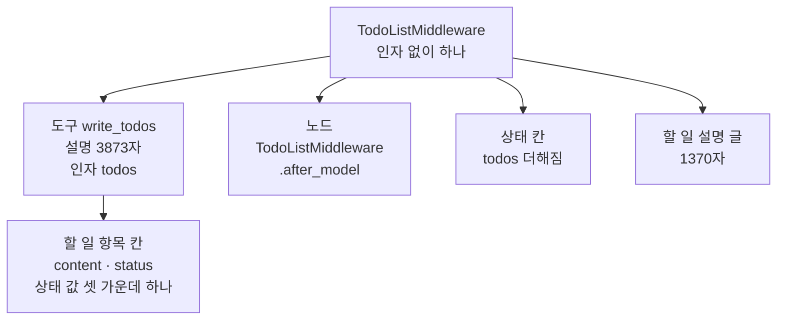
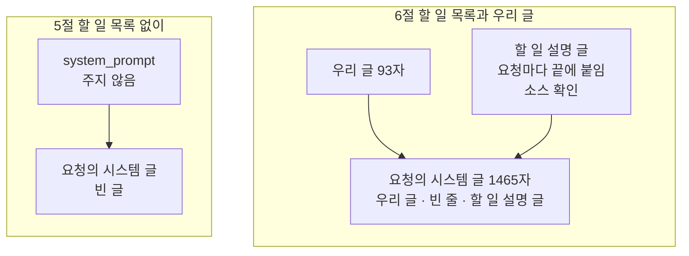
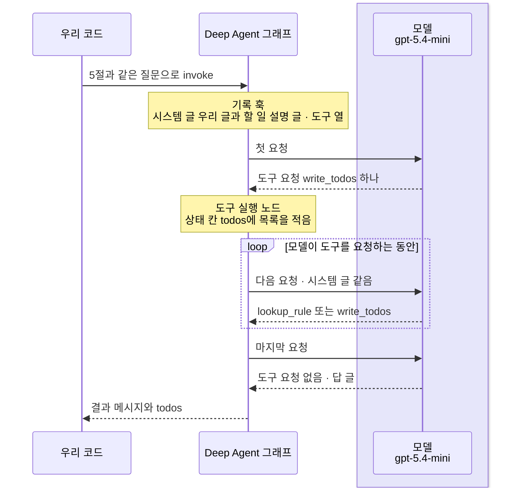
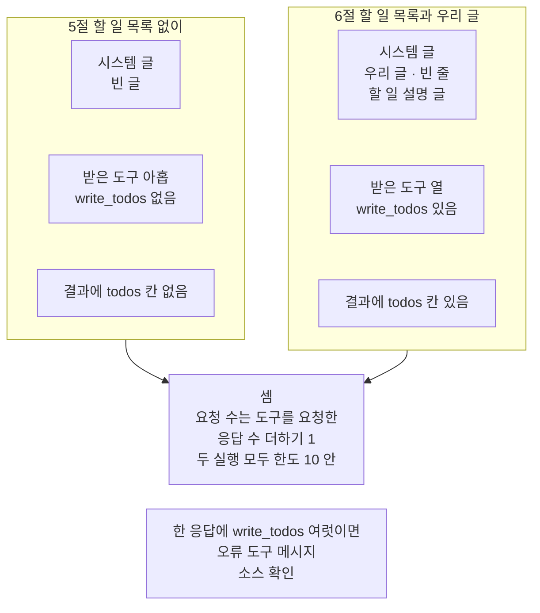

# 03-플래닝과-시스템-프롬프트

## _src 본문 (HTML 원본)

```html
<!--meta: 강의 1h | 실습 2h | 코드 notebooks/03-플래닝과-시스템-프롬프트.ipynb | 새 용어 0 -->
<style>html,body{overflow-x:hidden}.notebook,.nb-cell,.nb-main,.nb-input,.nb-result{min-width:0;max-width:100%}.nb-input pre,.nb-output{box-sizing:border-box;max-width:100%;overflow-x:auto}code.nb-source{display:block!important;width:100%!important;min-width:0!important;overflow-x:auto!important;padding:0!important}</style>
<h2 id="b1"><span class="no">1</span>학습 목표</h2><div class="goal"><ul>
<li>할 일 목록 미들웨어가 모델 요청에 더하는 도구·할 일 설명 글·상태 칸을 출력으로 짚을 수 있습니다.</li>
<li>우리 시스템 메시지 글과 할 일 설명 글이 요청의 시스템 메시지에서 합쳐지는 차례를 설명할 수 있습니다.</li>
<li>할 일 목록을 켠 실행에서 구조 값과 흔들리는 값을 나누고, 요청 수를 셈으로 말할 수 있습니다.</li>
</ul></div>
<h2 id="b2"><span class="no">2</span>이 내용을 배우는 이유</h2><p>긴 일을 맡기면 모델은 무엇부터 할지 정해야 합니다. Deep Agents는 모델이 할 일을 목록으로 적고 고쳐 가게 하는 미들웨어를 줍니다. 그런데 deepagents 0.7부터 이 미들웨어는 기본 조립에서 빠졌고, 기본 시스템 메시지 글도 비었습니다. 그래서 무엇을 켜면 모델 요청에 무엇이 실리는지 직접 봐야 합니다.</p><p>이 절은 앞 절반에서 모델 없이 할 일 목록 미들웨어가 더하는 것을 봅니다. 뒤 절반에서는 할 일 목록 없이 한 번, 켜고 한 번 실제 모델로 실행합니다. 절 제목의 플래닝은 계획 세우기를 뜻하고, 시스템 프롬프트는 시스템 메시지 글을 가리킵니다. 할 일 목록에 적히는 항목은 실행마다 달라져서, 결론은 요청에 실린 글과 칸으로 씁니다.</p>
<h2 id="b3"><span class="no">3</span>앞에서 배운 내용</h2><p><a href="../../part2/ch07-prompt-engineering/01-역할별-메시지와-제약.html">Ch 7 01절</a>에서는 모델에게 역할과 규칙을 먼저 알려 주는 글을 system 메시지로 나눠 보냈습니다. <a href="../ch21-create-agent/01-create-agent와-ReAct-루프.html">Ch 21 01절</a>에서는 함수 <code>create_agent</code>의 인자 <code>system_prompt=</code>에 시스템 메시지 글을 넘겼습니다. <a href="../../part5/ch19-model-tools/02-Pydantic-인자와-반환-스키마.html">Ch 19 02절</a>에서는 입력 형식 클래스로 도구 인자의 모양을 정했고, 세 글 가운데 하나만 받는 칸을 만들었습니다. 그 형식을 JSON 모양으로 바꾸는 메서드 <code>model_json_schema()</code>는 <a href="../../part2/ch06-langchain-start/03-구조화-출력과-검증.html">Ch 6 03절</a>에서 썼습니다.</p><p><a href="../../part5/ch17-agent-overview/03-모델-도구-루프와-정지-조건.html">Ch 17 03절</a>에서는 모델과 도구가 도는 루프를 정지 조건이 멈추게 했습니다. <a href="../../part5/ch18-workflow-patterns/04-동적-오케스트레이터와-워커.html">Ch 18 04절</a>에서는 계획 모델이 작업 목록을 쓰고, 코드가 그 목록을 검사해 작업 모델을 불렀습니다. <a href="../ch26-delegation/04-호출-수-비용-종료-조건-비교.html">Ch 26 04절</a>은 필요한 분야의 답이 모였는지 보는 완료 조건을 코드로 판정했습니다.</p><p><a href="../ch22-middleware/01-미들웨어와-6개-훅.html">Ch 22 01절</a>에서 노드형 훅과 감싸기형 훅을 나눴고, <a href="../ch22-middleware/02-PII-마스킹-이식.html">02절</a>에서 모델 요청을 감싸는 기록 훅을 만들었습니다. <a href="../ch22-middleware/07-순서와-합성.html">07절</a>에서는 먼저 등록한 미들웨어가 바깥에서 요청을 감싼다는 차례를 보았습니다.</p><p><a href="01-하네스와-일곱-기능.html">01절</a> 5절에서는 할 일 목록 미들웨어를 넘기면 노드 하나와 도구 <code>write_todos</code>가 더해지는 것만 보았습니다. <a href="02-create-deep-agent와-도구.html">02절</a>에서는 자료실 규정 도구를 더한 Deep Agent를 호출 한도 두 곳과 함께 실행했습니다. 요청 수는 두 방법으로 셌습니다. 02절은 시스템 메시지 글을 주지 않고, 이 절로 넘겼습니다.</p>
<h2 id="b4"><span class="no">4</span>핵심 개념</h2><h3>비유로 시작하기</h3><p>01절의 유리 온실 안에, 흙을 채운 긴 나무 화단이 있다고 합시다. 화단 앞 가장자리에는 짧은 막대가 한 줄로 서 있고, 막대마다 색이 다른 씨앗 봉투가 하나씩 꽂혀 있습니다. 왼쪽 몇 막대 뒤에는 벌써 새싹이 올라왔고, 오른쪽 막대 뒤의 흙은 아직 비어 있습니다. 봉투 줄만 보면 무엇을 어떤 차례로 심을지, 어디까지 심었는지가 한눈에 보입니다.</p><p>봉투 줄이 할 일 목록이고, 봉투 하나가 할 일 항목 하나입니다. 새싹이 올라온 자리는 상태 <code>completed</code>, 빈 흙 자리는 상태 <code>pending</code>에 해당합니다. 봉투 수와 새싹 수는 항목 수와 짝짓지 않습니다.</p><p>비유와 다른 점이 있습니다. 화단에서는 봉투를 하나씩 바꿔 꽂지만, 도구 <code>write_todos</code>는 부를 때마다 목록 전체를 새로 적습니다. 또 새싹은 실제로 자란 결과이지만, 상태 <code>completed</code>는 모델이 적은 표시일 뿐입니다. 하는 중을 뜻하는 상태 <code>in_progress</code>의 자리는 그림에 없습니다.</p>
{{img:03-5-봉투를-꽂은-화단|흰 바탕에 유리 온실 안을 앞에서 본 그림입니다. 화면 대부분을 흙을 채운 긴 나무 화단이 차지합니다. 화단 앞면에 짧은 나무 막대 다섯이 고르게 서 있고, 막대마다 글자 없는 씨앗 봉투가 하나씩 걸려 있습니다. 봉투 색은 왼쪽부터 하늘색·노랑·초록·분홍·보라입니다. 왼쪽 세 막대 뒤쪽 흙에는 작은 새싹 여섯 포기가 났고, 오른쪽 두 막대 뒤의 흙은 비어 있습니다. 사람·손·연장·화분·글자·숫자·화살표는 없는 그림|봉투를 꽂은 줄이 심을 차례를 보여 주고, 왼쪽 세 자리에는 새싹이 났지만 오른쪽 두 자리는 아직 비어 있습니다.}}
<p class="look"><b>그림 읽기</b> — 온실 안 긴 화단 앞면에 막대 다섯이 서 있고, 막대마다 색이 다른 씨앗 봉투가 하나씩 걸려 있습니다. 봉투에는 글자가 없어 색으로만 가립니다. 왼쪽 세 막대 뒤쪽 흙에는 새싹이 났고, 오른쪽 두 막대 뒤의 흙은 비어 있습니다. 봉투 줄이 할 일 목록, 봉투 하나가 항목 하나, 새싹이 난 자리가 <code>completed</code>, 빈 흙 자리가 <code>pending</code>입니다. 막대 수와 새싹 수는 어떤 값과도 짝짓지 않고, 새싹이 자란 모습이 걸린 시간을 뜻하지도 않습니다.</p>
<h3>할 일 목록 미들웨어가 더하는 넷</h3><p>할 일 목록은 모델이 긴 일을 단계로 나눠 적고, 단계마다 상태를 고쳐 적는 목록입니다. 여행 준비표에 할 일을 줄마다 적고, 마친 줄에 표시를 해 가는 것과 같습니다. 이 절 코드에서는 미들웨어 <code>TodoListMiddleware()</code>를 인자 <code>middleware=</code>에 넘기면 켜집니다.</p><p>켜면 넷이 더해집니다. 모델이 부를 도구 <code>write_todos</code>, 응답 뒤에 도는 노드 <code>TodoListMiddleware.after_model</code>, 상태 칸 <code>todos</code>, 시스템 메시지에 붙일 할 일 설명 글입니다. 도구 설명은 <code>도구 설명 글자 수: 3873</code>, 할 일 설명 글은 <code>안내 글 글자 수: 1370</code>으로 출력되었습니다. deepagents 0.7부터는 이 넷이 기본 조립에서 빠져, 직접 넘겨야 켜집니다.</p><p>출력 라벨의 「안내 글」은 이 할 일 설명 글이고, 「결과 칸」은 실행 결과에 나오는 상태 칸입니다. 할 일 항목은 칸 <code>content</code>와 <code>status</code>를 가집니다. 항목의 <code>status</code> 값은 <code>pending</code>·<code>in_progress</code>·<code>completed</code> 가운데 하나입니다. 출력 라벨 <code>상태 칸에 넣을 수 있는 값:</code>의 상태 칸은 이 칸 <code>status</code>를 가리키고, 그래프의 상태 칸 <code>todos</code>와 다릅니다.</p>
{{mermaid:03-1-할-일-목록이-더하는-넷|위에서 아래로 읽는 흐름도입니다. 맨 위 파란 상자 TodoListMiddleware 인자 없이 하나에서 노란 상자 넷으로 화살표가 갑니다. 첫째는 도구 write_todos 설명 3873자 인자 todos이고, 그 아래 노란 상자 할 일 항목 칸 content와 status, 상태 값 셋 가운데 하나로 이어집니다. 둘째는 노드 TodoListMiddleware.after_model, 셋째는 상태 칸 todos 더해짐, 넷째는 할 일 설명 글 1370자인 그림|할 일 목록 미들웨어 하나를 넘기자 도구 하나·노드 하나·상태 칸 하나가 더해졌고, 요청에 붙일 할 일 설명 글 1370자가 함께 왔습니다.}}
<p class="look"><b>도식 읽기</b> — 위에서 아래로 읽습니다. 맨 위 파란 상자는 우리가 만든 미들웨어 객체이고, 노란 상자는 노트북 2·3절 출력으로 확인한 값입니다. 도구 설명과 할 일 설명 글은 모델에게 가는 글이라, 켜면 요청마다 이만큼의 글이 더 실립니다. 맨 위 상자에서 나온 화살표 넷은 미들웨어 하나가 서로 다른 자리에 더하는 것입니다. 왼쪽 아래 상자는 도구 write_todos가 받는 할 일 항목의 모양입니다.</p>
<h3>시스템 메시지 글이 합쳐지는 차례</h3><p>설치판 <code>graph.py</code> 912~920행에서 함수 <code>create_deep_agent</code>는 인자 <code>system_prompt=</code>의 글을 시스템 메시지 맨 앞에 둡니다. 이 과정 설정처럼 모델별로 덧붙는 글이 없으면, 우리 글이 곧 시스템 메시지 글입니다. 인자를 주지 않으면 빈 글이고, 0.7.0 릴리스 노트도 기본 글이 비었다고 적습니다.</p><p>설치판 <code>todo.py</code> 231~256행에서 할 일 목록 미들웨어는 요청을 감싸는 훅입니다. 요청마다 원래 시스템 메시지 글 뒤에 줄바꿈 둘과 할 일 설명 글을 붙입니다. 그래서 요청에 실리는 시스템 메시지 글은 우리 글, 빈 줄, 할 일 설명 글 차례가 됩니다. 이 절 6절의 기록 훅은 그 글을 <code>첫 요청 시스템 글 글자 수: 1465</code>로 적었습니다.</p>
{{mermaid:03-2-시스템-글이-합쳐지는-차례|나란한 두 칸으로 된 흐름도입니다. 왼쪽 칸 5절 할 일 목록 없이에는 초록 상자 system_prompt 주지 않음에서 노란 상자 요청의 시스템 글 빈 글로 화살표가 갑니다. 오른쪽 칸 6절 할 일 목록과 우리 글에는 초록 상자 우리 글 93자와 회색 상자 할 일 설명 글 요청마다 끝에 붙임 소스 확인에서 노란 상자 요청의 시스템 글 1465자 우리 글 빈 줄 할 일 설명 글 차례로 화살표가 가는 그림|우리 글을 주지 않은 요청의 시스템 글은 빈 글이었고, 할 일 목록을 켜자 우리 글 뒤에 빈 줄과 할 일 설명 글이 붙은 1465자가 되었습니다.}}
<p class="look"><b>도식 읽기</b> — 왼쪽 칸과 오른쪽 칸은 5절과 6절의 서로 다른 설정이라 나란히 두었고, 칸 안은 위에서 아래로 읽습니다. 초록 상자는 우리가 정한 값이고, 노란 상자는 기록 훅이 적은 첫 요청의 시스템 메시지 글입니다. 회색 상자는 붙이는 동작을 설치판 소스로 확인한 것이고, 붙은 결과는 오른쪽 노란 상자 출력으로 보았습니다.</p>
<h3>계획은 누가 세우는가</h3><p>Ch 18 04절에서는 코드가 계획 요청과 작업 요청을 나눴고, 계획 모델이 쓴 작업 목록을 코드가 검사했습니다. 할 일 목록 미들웨어는 계획을 세우라고 강제하지 않습니다. 도구와 할 일 설명 글을 줄 뿐이고, 도구 <code>write_todos</code>를 부를지는 모델이 고릅니다. 이 절은 그 선택을 돕도록, 할 일 목록부터 적으라는 규칙을 우리 시스템 메시지 글에 넣었습니다.</p><p>할 일 목록의 상태는 Ch 17 03절의 정지 조건도, Ch 26 04절의 완료 조건도 아닙니다. 루프는 모델이 도구 요청 없는 답을 낼 때 끝납니다. 상태 <code>completed</code>는 모델이 적은 표시이고, 코드가 판정한 값이 아닙니다.</p><h3>실제 모델을 부를 때의 안전 설정</h3><p>02절처럼 호출 한도를 두 곳에 줍니다. 할 일 목록을 고쳐 적을 때마다 요청이 하나씩 늘어, 바깥 호출 한도는 02절의 3보다 넉넉한 10으로 둡니다. general-purpose 명세의 자기 호출 한도는 02절과 같은 2입니다. 한 번 실행의 모델 요청은 10에, 도구 <code>task</code>를 부른 횟수 × 2를 더한 값을 넘지 않습니다.</p>
<h2 id="b5"><span class="no">5</span>실행 예제</h2><p>노트북 2절은 기준 Deep Agent와 할 일 목록 미들웨어를 넘긴 Deep Agent를 견주고, 도구와 상태 칸을 봅니다. 3절은 할 일 설명 글을 속성으로 읽고, 우리 시스템 메시지 글을 준 조립이 같은지 봅니다. 4절은 02절의 규정 도구·명세와 새 기록 훅, 할 일 목록 출력 함수를 준비합니다. 5절은 할 일 목록 없이, 6절은 할 일 목록과 우리 글을 더해 같은 질문으로 한 번씩 실행합니다. 7절은 요청 수와 두 실행의 첫 요청 입력 토큰을 견줍니다.</p><p>모델 요청은 5절과 6절 실행 셀에서만 나갑니다. 노트북 밖에서 같은 질문을 다섯 번씩 보냈을 때 5절은 2번, 6절은 4~5번이었습니다. 요금표로 어림한 예상 비용은 두 실행을 합쳐 0.02달러 아래이고, 청구 금액이 아닙니다. 읽거나 쓰는 파일은 없고, 걸린 시간은 재지 않았습니다.</p>
{{notebook:03-플래닝과-시스템-프롬프트}}
<p class="look"><b>확인할 점</b> — 노트북 2절에서 <code>더해진 도구: ['write_todos']</code>와 <code>더해진 결과 칸: ['todos']</code>를 확인합니다. 5절에서 <code>첫 요청의 시스템 글: ''</code>을 봅니다. 6절에서 <code>우리 글 + 빈 줄 + 안내 글과 같은가: True</code>와 <code>받은 도구 수: 10</code>을 봅니다. 7절에서 두 방법으로 센 요청 수가 같은지 확인합니다.</p>
{{mermaid:03-3-할-일-목록을-켠-실행|세로선 셋이 있는 차례 그림입니다. 왼쪽부터 우리 코드, Deep Agent 그래프, 연보라 띠 안의 모델 gpt-5.4-mini입니다. 우리 코드에서 5절과 같은 질문으로 invoke 화살표가 그래프로 갑니다. 그래프에 노란 메모 기록 훅 시스템 글 우리 글과 할 일 설명 글, 도구 열이 붙고 첫 요청 화살표가 모델로 가며 도구 요청 write_todos 하나 점선이 돌아옵니다. 노란 메모 도구 실행 노드 상태 칸 todos에 목록을 적음이 붙은 뒤, 모델이 도구를 요청하는 동안 되풀이 틀 안에서 다음 요청과 lookup_rule 또는 write_todos 요청이 오갑니다. 마지막 요청에 도구 요청 없음과 답 글이 돌아오고, 결과 메시지와 todos 점선이 우리 코드로 돌아오는 그림|이번 실행에서 모델은 첫 응답에서 write_todos를 하나 요청했고, 요청마다 같은 시스템 글과 도구 열을 받았습니다.}}
<p class="look"><b>도식 읽기</b> — 위에서 아래로 실행 차례대로 읽고, 세로선은 왼쪽부터 우리 코드, 그래프, 모델입니다. 연보라 띠는 실제로 부른 모델 gpt-5.4-mini의 자리이고, 노란 메모는 노트북 6절 출력입니다. 되풀이 틀은 모델이 도구를 요청하는 동안 도는 부분이라, 몇 번 도는지는 그리지 않았습니다. 그 횟수와 할 일 목록을 고쳐 적은 횟수는 실행마다 달라질 수 있기 때문입니다.</p>
<h2 id="b6"><span class="no">6</span>실험 결과 해석</h2><p>할 일 목록 미들웨어 하나를 넘기자 도구 <code>write_todos</code>, 노드 하나, 상태 칸 <code>todos</code>가 더해졌습니다. 시스템 메시지 글을 준 에이전트도 노드와 도구가 같았습니다. 시스템 메시지 글은 그래프가 아니라 요청에 실리는 값입니다.</p><p>아래 표는 이 절이 확인한 값과 그 성격입니다. 구조 값은 코드가 정하는 값이고, 모델 판단 값은 모델이 고른 값입니다. 흔들리는 값은 실행마다 달라질 수 있어 결론에 쓰지 않습니다.</p>
<table><thead><tr><th>확인한 것</th><th>교재 출력</th><th>값의 성격</th></tr></thead><tbody><tr><td>할 일 목록 미들웨어가 더한 것</td><td><code>더해진 도구: ['write_todos']</code> · <code>더해진 노드: ['TodoListMiddleware.after_model']</code> · <code>더해진 결과 칸: ['todos']</code></td><td>구조 값</td></tr><tr><td>요청에 더 실리는 글</td><td><code>도구 설명 글자 수: 3873</code> · <code>안내 글 글자 수: 1370</code></td><td>구조 값(모델 없이 셈)</td></tr><tr><td>5절 요청의 시스템 메시지 글</td><td><code>첫 요청의 시스템 글: ''</code> · <code>받은 도구 수: 9</code></td><td>구조 값</td></tr><tr><td>6절 요청의 시스템 메시지 글</td><td><code>첫 요청 시스템 글 글자 수: 1465</code> · <code>우리 글 + 빈 줄 + 안내 글과 같은가: True</code> · <code>받은 도구 수: 10</code></td><td>구조 값(요청마다 같음)</td></tr><tr><td>6절 첫 응답과 응답마다 <code>write_todos</code> 수</td><td>첫 응답 <code>['write_todos']</code> · 응답마다 0 또는 1 · <code>task</code> 0</td><td>모델 판단 값</td></tr><tr><td>할 일 목록·6절 요청 수·토큰·예상 비용</td><td>교재 출력 요청 5번 · 항목 넷 모두 <code>completed</code> · <code>입력 토큰: 17048 | 출력 토큰: 344</code> · <code>예상 비용(달러): 0.014334</code>(다른 커널은 요청 4번)</td><td>흔들리는 값</td></tr></tbody></table>
<p>5절 요청의 시스템 메시지 글은 빈 글이었습니다. 6절 요청의 글은 모든 요청에서 우리 글, 빈 줄, 할 일 설명 글 차례였습니다. 모델이 받은 도구는 5절 아홉, 6절 열이었고, 두 실행 모두 <code>execute</code>는 빠졌습니다. 할 일 설명 글과 도구 설명은 첫 요청에만이 아니라 요청마다 실립니다.</p>
{{mermaid:03-4-두-실행-견주기|나란한 두 칸과 아래 회색 상자 둘로 된 흐름도입니다. 왼쪽 칸 5절 할 일 목록 없이에는 노란 상자 셋 시스템 글 빈 글, 받은 도구 아홉 write_todos 없음, 결과에 todos 칸 없음이 위아래로 있습니다. 오른쪽 칸 6절 할 일 목록과 우리 글에는 노란 상자 셋 시스템 글 우리 글 빈 줄 할 일 설명 글, 받은 도구 열 write_todos 있음, 결과에 todos 칸 있음이 있습니다. 두 칸에서 회색 상자 셈 요청 수는 도구를 요청한 응답 수 더하기 1, 두 실행 모두 한도 10 안으로 화살표가 가고, 그 아래에 회색 상자 한 응답에 write_todos 여럿이면 오류 도구 메시지 소스 확인이 있는 그림|두 실행은 시스템 글·받은 도구·상태 칸이 달랐고, 요청 수는 두 실행 모두 도구를 요청한 응답 수에 1을 더한 값이었습니다.}}
<p class="look"><b>도식 읽기</b> — 왼쪽 칸과 오른쪽 칸은 5절과 6절의 서로 다른 설정이라 나란히 두었고, 칸 안의 노란 상자는 노트북 출력입니다. 가운데 회색 상자는 두 커널과 흔들림 확인에서 모두 맞은 셈이고, 요청 수 자체는 그리지 않았습니다. 맨 아래 회색 상자는 설치판 소스로만 확인한 규칙이라, 이 노트북에서는 일어나지 않았습니다.</p>
<p>흔들림 확인 다섯 번과 두 커널에서 모두, 6절 모델은 첫 응답에서 <code>write_todos</code>를 하나 요청했습니다. 어느 응답에도 <code>write_todos</code> 요청이 둘 이상 들지 않았고, 도구 <code>task</code>는 부르지 않았습니다. 요청 수는 두 실행 모두 도구를 요청한 응답 수에 1을 더한 값이었습니다. 6절 요청 수는 할 일 목록을 고쳐 적은 횟수에 따라 달라졌습니다. 도구 <code>write_todos</code>를 두 번 부르면 요청 4, 세 번 부르면 요청 5가 됩니다.</p><p>이번 실행에서는 첫 요청 입력 토큰이 1874에서 3106으로, 1232 늘었습니다. 두 커널과 노트북 밖 다섯 번에서 모두 같은 값이었지만, 서비스가 센 값이라 다른 모델과 판에서는 달라질 수 있습니다. 늘어난 까닭은 요청에 우리 글 93자, 할 일 설명 글 1370자, 도구 설명 3873자가 더 실렸기 때문입니다. 셋 가운데 가장 긴 글은 할 일 설명 글이 아니라 도구 설명입니다. 요청에는 이 셋과 함께 도구 <code>write_todos</code>의 인자 형식도 실렸습니다.</p>
<p>새 커널로 두 번 실행해 견주자, 코드 셀 서른 가운데 스물셋의 출력이 셀마다 같았습니다. 달랐던 일곱 셀은 모두 할 일 목록을 켠 6·7절 실행의 메시지·할 일 목록·요청 수·토큰·예상 비용이 찍힌 셀입니다. 시스템 메시지 글·받은 도구·첫 요청 입력 토큰은 두 번 모두 같았고, 두 번 모두 같았던 값만 결론과 그림에 썼습니다.</p>
<p class="look"><b>확인할 점</b> — 노트북 6절 <code>응답마다 write_todos 요청 수:</code> 목록에 2 이상이 없는지 봅니다. 7절 <code>응답으로 센 요청 수:</code>와 <code>기록 훅이 센 요청 수:</code>가 같은 수인지 확인합니다. 교재 출력에서는 <code>응답으로 센 요청 수: 5</code>였고, 다시 실행하면 4처럼 달라질 수 있습니다.</p>
<h2 id="b7"><span class="no">7</span>주의할 점과 실무 메모</h2><ul><li>상태 <code>completed</code>는 모델이 적은 표시입니다. 규정을 바르게 옮겼는지는 따로 검사합니다. Ch 26 04절처럼 코드로 판정하는 완료 조건과는 다릅니다.</li><li>설치판 <code>todo.py</code> 286~336행에서, 한 응답에 <code>write_todos</code>가 둘 이상 들면 노드 <code>TodoListMiddleware.after_model</code>이 모두 오류 도구 메시지로 막습니다. 이번 실행에서는 그런 응답이 없어, 이 노트북에서는 일어나지 않았습니다.</li><li>기록 훅을 할 일 미들웨어보다 앞에 두면, 할 일 설명 글이 붙기 전의 시스템 메시지 글을 적습니다. 노트북 밖에서 모델 없이 확인한 차례이고, 이 노트북에서는 실행하지 않았습니다.</li><li>바깥 인자 <code>middleware=</code>에 넣은 할 일 목록 미들웨어는 general-purpose 서브에이전트로 옮겨 가지 않습니다. 설치판 <code>graph.py</code> 777행에서 확인했습니다. 노트북 밖에서 모델 없이 보니, 이 절 명세의 요청에는 <code>write_todos</code>도 할 일 설명 글도 없었습니다. 0.7.0 릴리스 노트도 서브에이전트에 쓰려면 그 명세의 미들웨어에 따로 넣으라고 적습니다.</li><li>설치판 <code>graph.py</code> 628~640행 주석은 할 일 목록 미들웨어에 빈 설명 글을 넘겨 줄인다고 적습니다. 같은 판의 기본 조립에는 이 미들웨어가 없고, 우리가 직접 넘긴 미들웨어는 기본 설명 글 전체를 붙였습니다. 이 절 출력의 <code>1465</code>자가 그 결과입니다.</li><li>할 일 설명 글 스스로도 몇 단계로 끝나는 짧은 일에는 이 도구를 쓰지 말라고 적습니다. 켜 두면 짧은 일에도 요청마다 할 일 설명 글과 도구 설명이 함께 실립니다.</li><li>노트북을 쓰기 전에 두 실행을 노트북 밖에서 다섯 번씩 보냈습니다. 시스템 메시지 글·받은 도구·상태 칸은 다섯 번 모두 같았고, 6절 모델은 다섯 번 모두 첫 응답에서 <code>write_todos</code>를 불렀습니다. 6절 요청 수와 할 일 항목 글은 실행마다 달랐습니다. 같은 요청도 실행한 때에 따라 할 일 목록을 쓰는 모양이 달라질 수 있어, 이 절은 그 값을 결론에 쓰지 않습니다.</li><li>우리 시스템 메시지 글·질문·바깥 한도 10은 흐름을 보여 주려고 실행 전에 정한 예이고, 결과를 보고 바꾸지 않았습니다. 우리 글이 <code>write_todos</code>를 먼저 쓰라고 적었으므로, 모델이 규칙 없이 스스로 계획을 세웠다고 읽지 않습니다.</li><li>걸린 시간은 재지 않았습니다. 교재 출력은 Linux의 Python 3.12.13으로 만들었고, 다른 판과 Windows·macOS에서는 실행하지 않았습니다.</li></ul>
<h2 id="b8"><span class="no">8</span>정리와 다음 절</h2><ul><li>할 일 목록 미들웨어는 도구 <code>write_todos</code>, 노드 하나, 상태 칸 <code>todos</code>, 시스템 메시지에 붙는 할 일 설명 글을 더합니다.</li><li>우리 글을 주지 않은 요청의 시스템 메시지 글은 빈 글이었습니다. 할 일 미들웨어는 요청마다 우리 글 뒤에 할 일 설명 글을 붙였습니다.</li><li>할 일 목록을 켠 실행에서도 요청 수는 도구를 요청한 응답 수에 1을 더한 값이었습니다.</li></ul><p><strong>다음 학습과 이어지는 지점</strong> — <a href="04-파일시스템과-중간-결과.html">04절</a>에서는 중간 결과를 파일로 적어 두는 장면을 봅니다. 디스크에 쓰는 백엔드와 상태 칸에 두는 백엔드를 견줍니다.</p>
<h2 id="b9"><span class="no">9</span>복습 문제</h2><details class="quiz" open><summary>문제 4개 · 해설 포함</summary><p class="quiz-q">1. 할 일 목록 미들웨어 하나를 넘긴 Deep Agent에는 어떤 도구·노드·상태 칸이 더해지나요?</p><p class="quiz-a">도구 <code>write_todos</code>, 노드 <code>TodoListMiddleware.after_model</code>, 상태 칸 <code>todos</code>가 더해집니다. 요청에는 할 일 설명 글도 붙습니다. 틀렸다면 노트북 2절을 다시 읽습니다.</p><p class="quiz-q">2. 우리 시스템 메시지 글을 주고 할 일 목록을 켠 요청의 시스템 메시지 글은 어떤 차례인가요? 둘 다 주지 않으면 어떻게 되나요?</p><p class="quiz-a">우리 글, 빈 줄, 할 일 설명 글 차례이고, 요청마다 같습니다. 둘 다 주지 않으면 빈 글입니다. 틀렸다면 노트북 3절과 5·6절 기록 훅 셀을 다시 읽습니다.</p><p class="quiz-q">3. 동료가 「할 일 목록의 항목이 모두 completed이니 안내문 내용이 맞다」고 말합니다. 맞나요?</p><p class="quiz-a">맞지 않습니다. 상태 <code>completed</code>는 모델이 적은 표시이고, 코드가 판정한 값이 아닙니다. 안내문이 규정과 맞는지는 따로 검사해야 합니다. 틀렸다면 노트북 6절과 본문 「주의할 점」을 다시 읽습니다.</p><p class="quiz-q">4. 할 일 목록을 켠 실행에서, 모델이 <code>write_todos</code>를 세 번 부르고 <code>lookup_rule</code> 셋을 한 응답에 함께 요청했습니다. 도구를 요청한 응답이 이 넷뿐이라면 모델 요청은 몇 번인가요?</p><p class="quiz-a">5번입니다. 도구를 요청한 응답 넷에 마지막 답 하나를 더합니다. 틀렸다면 노트북 7절을 다시 읽습니다.</p></details>
<h2 id="b10"><span class="no">10</span>참고 자료</h2><ul><li><div><a href="https://docs.langchain.com/oss/python/deepagents/overview">Deep Agents overview</a></div>확인 2026-09-28 · 0.7부터 할 일 계획은 직접 켜야 쓰는 기능이고, 그 전에는 기본으로 들어 있었다고 적습니다. 기능 무리 넷 가운데 Delegation에 할 일 계획과 서브에이전트를 함께 둡니다.</li><li><div><a href="https://github.com/langchain-ai/deepagents/releases/tag/deepagents%3D%3D0.7.0">deepagents 0.7.0 release</a></div>확인 2026-09-28 · 기본 조립에서 <code>TodoListMiddleware</code>·<code>write_todos</code>·상태 칸 <code>todos</code>·할 일 설명 글이 빠졌다고 적습니다. 기본 시스템 메시지 글이 비었고, 서브에이전트에서 쓰려면 명세마다 미들웨어를 넣으라고 적습니다.</li><li><div><a href="https://github.com/langchain-ai/deepagents/pull/5009">deepagents PR #5009</a></div>확인 2026-09-28 · <code>gpt-5.5</code> 기본 에이전트에 hello 한 줄을 보낸 첫 요청의 입력 토큰을 적습니다. 0.6.12 판은 5,395토큰, 바꾼 판은 1,895토큰이었다고 적습니다. 약 65%이고, 기본 글 비우기·할 일 목록 끄기·도구 설명 줄이기를 함께 한 값입니다. 이 과정에서는 재지 않았고, 이 절 7절과는 모델·질문·조건이 다릅니다.</li><li>설치판 langchain 1.4.0 소스 <code>agents/middleware/todo.py</code> 42행은 상태 칸 <code>todos</code>입니다. 119~136행은 할 일 설명 글이고, 131행이 한 응답에 여럿 부르지 말라는 줄입니다. 153~164행은 도구, 231~256행은 할 일 설명 글 붙이기, 286~336행은 여럿 요청 막기입니다.</li><li>설치판 deepagents 0.7.0 소스 <code>graph.py</code> 349~351행은 인자가 없을 때 빈 글을 보낸다는 독스트링입니다. 912~920행은 시스템 메시지 글을 합치는 자리입니다. 777행은 general-purpose가 물려받을 미들웨어를 고르는 자리입니다.</li></ul>
```

## 노트북 셀 (순서대로)

### [0] markdown {'html': 'skip'}

# 플래닝과 시스템 프롬프트

**이 노트북에서 할 일**

1. 할 일 목록 미들웨어가 모델 요청에 더하는 도구·할 일 설명 글·상태 칸을 모델 없이 봅니다.
2. 우리 시스템 메시지 글과 할 일 설명 글이 요청에서 어떤 차례로 합쳐지는지 봅니다.
3. 할 일 목록 없이 한 번, 켜고 한 번 실제 모델로 실행해 할 일 목록과 요청 수를 봅니다.

**준비물** — 프로젝트 폴더의 `.env` 파일에 `OPENAI_API_KEY`가 있어야 합니다.
모델은 `gpt-5.4-mini`이고, 5절과 6절에서 Deep Agent를 한 번씩 실행합니다.
노트북 밖에서 같은 질문을 다섯 번씩 보냈을 때, 5절은 요청 2번, 6절은 4~5번이었습니다.
바깥 호출 한도 10과 서브에이전트 호출 한도 2를 주어, 요청이 끝없이 늘지 않게 막습니다.
요금표로 어림한 예상 비용은 두 실행을 합쳐 0.02달러 아래이고, 청구 금액이 아닙니다.

모델이 적는 할 일 목록과 답 글은 실행마다 달라질 수 있습니다.
걸린 시간은 재지 않았습니다.
읽거나 쓰는 파일은 없습니다.
앞에서 배운 함수 여섯은 도구 파일 `harness_tools.py`에서 가져옵니다.

**기준 버전** — 첫 셀에서 패키지 넷을 설치합니다.
판은 deepagents 0.7.0과 langchain 1.4.0입니다.
나머지 둘은 `langchain-openai` 1.6.0과 `python-dotenv` 1.2.3입니다.
교재 출력은 Linux의 Python 3.12.13으로 만들었습니다.
다른 판과 Windows·macOS에서는 실행하지 않았습니다.

**강의와 실습 범위** — 강의 시간에는 2·3절을 읽습니다.
할 일 목록 미들웨어가 요청에 무엇을 더하고, 시스템 메시지 글이 어떻게 합쳐지는지 보는 자리입니다.
4~7절은 실제 모델로 두 번 실행하고 견주는 실습이고, 실습 시간에 실행합니다.

실습 폴더 `labs/part6/ch27-deepagents`에서 `uv sync --locked`를 실행합니다.
그다음 `notebooks/` 폴더의 이 노트북을 열고, 실습 폴더의 `.venv` 커널을 고릅니다.
첫 셀부터 순서대로 실행합니다.

### [1] markdown {'html': 'skip'}

## 오늘 볼 그림


위에서 아래로 읽습니다.
맨 위 파란 상자는 우리가 만든 미들웨어 객체이고, 노란 상자는 노트북 2·3절 출력으로 확인한 값입니다.
도구 설명과 할 일 설명 글은 모델에게 가는 글이라, 켜면 요청마다 이만큼의 글이 더 실립니다.
맨 위 상자에서 나온 화살표 넷은 미들웨어 하나가 서로 다른 자리에 더하는 것입니다.
왼쪽 아래 상자는 도구 write_todos가 받는 할 일 항목의 모양입니다.

### [2] markdown {}

## 1. 준비

이 절에서는 02절의 Deep Agent에 할 일 목록 미들웨어와 우리 시스템 메시지 글을 더합니다.
절 제목의 플래닝은 계획 세우기를 뜻하고, 시스템 프롬프트는 시스템 메시지 글을 가리킵니다.

첫 셀은 패키지 넷을 설치하고 설치된 판 번호를 출력합니다.
설치에는 몇십 초가 걸릴 수 있습니다.

### [3] code {'execution': {'iopub.execute_input': '2026-09-28T13:03:44.869503Z', 'iopub.status.busy': '2026-09-28T13:03:44.869328Z', 'iopub.status.idle': '2026-09-28T13:03:45.597672Z', 'shell.execute_reply': '2026-09-28T13:03:45.597058Z'}, 'lesson_role': 'setup'}

```python
# 이 절에서 쓰는 패키지를 설치하고 버전을 확인합니다
%pip install -q "deepagents==0.7.0" "langchain==1.4.0" "langchain-openai==1.6.0" "python-dotenv==1.2.3"
from importlib.metadata import version

print("deepagents:", version("deepagents"))
print("langchain:", version("langchain"))
print("langchain-openai:", version("langchain-openai"))
print("python-dotenv:", version("python-dotenv"))
```

출력:
```
Note: you may need to restart the kernel to use updated packages.
deepagents: 0.7.0
langchain: 1.4.0
langchain-openai: 1.6.0
python-dotenv: 1.2.3

```

### [4] markdown {}

**결과 읽기** — 출력 줄 `deepagents: 0.7.0`과 `langchain: 1.4.0`이 보입니다.
네 판 모두 실습 폴더 잠금과 같은 판입니다.

다음 셀은 이 절에서 쓸 이름을 가져옵니다.
미들웨어 `TodoListMiddleware`는 01절 5절에서 조립만 보았고, 이 절에서 실제로 씁니다.
함수 `wrap_model_call`과 미들웨어 `ModelCallLimitMiddleware`는 02절처럼 씁니다.
마지막 가져오기 줄은 02절과 같은 함수 여섯을 도구 파일 `harness_tools.py`에서 가져옵니다.

### [5] code {'execution': {'iopub.execute_input': '2026-09-28T13:03:45.598977Z', 'iopub.status.busy': '2026-09-28T13:03:45.598870Z', 'iopub.status.idle': '2026-09-28T13:03:47.036125Z', 'shell.execute_reply': '2026-09-28T13:03:47.035766Z'}, 'lesson_role': 'setup'}

```python
# Deep Agents(01절)·미들웨어(Ch 22·이 절)·모델(Ch 6 01절)·메시지(Ch 13 04절)·도구(Ch 19 01절) 이름을 가져옵니다
from deepagents import create_deep_agent
from langchain.agents.middleware import ModelCallLimitMiddleware, TodoListMiddleware, wrap_model_call
from langchain.chat_models import init_chat_model
from langchain.messages import HumanMessage
from langchain.tools import tool
# 앞 챕터와 01절에서 배운 함수 여섯은 도구 파일에서 가져옵니다(02절과 같은 여섯)
from harness_tools import estimate_cost, names_only_in, show_messages, sum_usage, tool_call_names, tool_names

print("도구 파일에서 가져온 함수:", "estimate_cost, names_only_in, show_messages, sum_usage, tool_call_names, tool_names")
```

출력:
```
도구 파일에서 가져온 함수: estimate_cost, names_only_in, show_messages, sum_usage, tool_call_names, tool_names

```

### [6] markdown {}

**결과 읽기** — 출력 줄 `도구 파일에서 가져온 함수: estimate_cost, names_only_in, show_messages, sum_usage, tool_call_names, tool_names`가 보입니다.
여섯 함수의 뜻은 02절 1절에 적었습니다.
앞에서 배운 함수는 `harness_tools.py`에 모아 두었고, 파일을 열면 코드를 볼 수 있습니다.
커널이 `notebooks/` 폴더에서 시작해야 이 파일을 가져올 수 있습니다.

### [7] markdown {}

API 키가 있는지 확인합니다. `True` 값이 나오면 다음으로 넘어갑니다.

### [8] code {'execution': {'iopub.execute_input': '2026-09-28T13:03:47.036852Z', 'iopub.status.busy': '2026-09-28T13:03:47.036792Z', 'iopub.status.idle': '2026-09-28T13:03:47.042162Z', 'shell.execute_reply': '2026-09-28T13:03:47.041780Z'}, 'lesson_role': 'setup'}

```python
# .env 파일에서 OpenAI API 키를 읽습니다(키 값은 출력하지 않습니다)
import os
from dotenv import find_dotenv, load_dotenv

env_path = find_dotenv(usecwd=True)
load_dotenv(env_path)
has_key = os.getenv("OPENAI_API_KEY") is not None
print("OPENAI_API_KEY 설정 여부:", has_key)
assert has_key, "프로젝트 폴더의 .env 파일에 OPENAI_API_KEY를 적어 주세요."
```

출력:
```
OPENAI_API_KEY 설정 여부: True

```

### [9] markdown {}

실습에 쓸 모델을 준비합니다.
temperature 값을 0으로 두어 매번 비슷한 답을 고르게 합니다.

### [10] code {'execution': {'iopub.execute_input': '2026-09-28T13:03:47.042782Z', 'iopub.status.busy': '2026-09-28T13:03:47.042727Z', 'iopub.status.idle': '2026-09-28T13:03:47.964515Z', 'shell.execute_reply': '2026-09-28T13:03:47.964212Z'}}

```python
# 실습에 쓸 모델을 준비합니다
model = init_chat_model(
    "openai:gpt-5.4-mini",
    temperature=0,
    reasoning_effort="none",
)
print("모델 이름:", model.model_name)
print("temperature:", model.temperature)
```

출력:
```
모델 이름: gpt-5.4-mini
temperature: 0.0

```

### [11] markdown {}

**결과 읽기** — 모델 이름 `gpt-5.4-mini`, temperature `0.0`이 보이면 준비가 끝났습니다.
이 노트북의 출력은 2026-09-28에 이 모델로 실행한 결과입니다.
temperature 값을 0으로 두어도, 실행마다 답 문장이 달라질 수 있습니다.
이 셀은 모델 객체만 만들고, 모델 요청은 아직 보내지 않습니다.
모델 요청은 5절과 6절 실행 셀에서만 나갑니다.

01절에서 본 것처럼, 함수 `create_deep_agent`에는 이 모델 객체를 그대로 넘깁니다.
2·3절은 이 객체로 Deep Agent를 만들기만 하고, 모델을 부르지 않습니다.

## 2. 할 일 목록 미들웨어가 더하는 것

할 일 목록은 모델이 긴 일을 단계로 나눠 적고, 단계마다 상태를 고쳐 적는 목록입니다.
01절에서 한 줄로 정의했고, 이 절에서 본격으로 다룹니다.
deepagents 0.7부터는 Deep Agent의 기본 조립에서 빠져, 쓰려면 미들웨어 `TodoListMiddleware`를 직접 넘깁니다.
01절 5절에서는 이 미들웨어가 노드 하나와 도구 하나를 더하는 것까지 보았습니다.
이 절은 그 미들웨어가 모델에게 가는 요청에 무엇을 더하는지 봅니다.

먼저 견줄 기준 Deep Agent를 02절 3절처럼 만듭니다.

### [12] code {'execution': {'iopub.execute_input': '2026-09-28T13:03:47.965277Z', 'iopub.status.busy': '2026-09-28T13:03:47.965221Z', 'iopub.status.idle': '2026-09-28T13:03:48.014297Z', 'shell.execute_reply': '2026-09-28T13:03:48.013998Z'}}

```python
# 01절처럼 인자 없이 Deep Agent를 만들어, 견줄 기준 도구 목록을 얻습니다(요청은 보내지 않음)
base_agent = create_deep_agent(model=model)
base_tools = tool_names(base_agent)
print("기본 도구 수:", len(base_tools))
```

출력:
```
기본 도구 수: 9

```

### [13] markdown {}

**결과 읽기** — 출력 줄 `기본 도구 수: 9`가 보입니다.
02절 3절 첫 셀과 같은 글이고, 같은 수가 나왔습니다.

다음 셀은 할 일 목록 미들웨어 하나를 넘겨 만들고, 기준과 견줍니다.
실행 전에 예상해 봅니다.
01절 5절처럼 도구 하나와 노드 하나가 더해질 것입니다.

### [14] code {'execution': {'iopub.execute_input': '2026-09-28T13:03:48.014971Z', 'iopub.status.busy': '2026-09-28T13:03:48.014916Z', 'iopub.status.idle': '2026-09-28T13:03:48.025731Z', 'shell.execute_reply': '2026-09-28T13:03:48.025366Z'}}

```python
# 할 일 목록 미들웨어 하나를 넘겨 만들고, 기준과 견주어 더해진 도구와 노드를 봅니다(요청은 보내지 않음)
todo_middleware = TodoListMiddleware()
todo_agent = create_deep_agent(model=model, middleware=[todo_middleware])
todo_tools = tool_names(todo_agent)
print("더해진 도구:", names_only_in(base_tools, todo_tools))
base_graph = base_agent.get_graph()
todo_graph = todo_agent.get_graph()
added_nodes = names_only_in(list(base_graph.nodes), list(todo_graph.nodes))
print("더해진 노드:", added_nodes)
```

출력:
```
더해진 도구: ['write_todos']
더해진 노드: ['TodoListMiddleware.after_model']

```

### [15] markdown {}

**결과 읽기** — 출력 줄 `더해진 도구: ['write_todos']`와 `더해진 노드: ['TodoListMiddleware.after_model']`이 보입니다.
01절 5절 출력과 같습니다.
Ch 22 01절 말로, 더해진 노드는 모델 응답 뒤에 도는 노드형 훅의 자리입니다.
설치판 `todo.py` 286~336행에서 이 훅은 한 응답에 `write_todos` 요청이 둘 이상 들면 모두 오류 도구 메시지로 막습니다.

다음 셀은 미들웨어가 더하는 도구 `write_todos`를 봅니다.
속성 `tools`는 미들웨어가 에이전트에 더하는 도구 목록입니다.
이 도구의 인자는 Ch 19 02절에서 본 입력 형식 클래스(`args_schema`)가 정합니다.
Ch 6 03절 메서드 `model_json_schema()`가 그 형식을 JSON 모양 딕셔너리로 바꿉니다.
그 안의 칸 `$defs`에는 할 일 항목 하나의 양식 `Todo`가 따로 적혀 있습니다.

### [16] code {'execution': {'iopub.execute_input': '2026-09-28T13:03:48.026394Z', 'iopub.status.busy': '2026-09-28T13:03:48.026340Z', 'iopub.status.idle': '2026-09-28T13:03:48.030240Z', 'shell.execute_reply': '2026-09-28T13:03:48.029892Z'}}

```python
# 미들웨어가 더하는 도구 write_todos의 이름·설명 길이·인자와, 할 일 항목 하나의 칸을 봅니다
todo_tool = todo_middleware.tools[0]
print("도구 이름:", todo_tool.name)
print("도구 설명 글자 수:", len(todo_tool.description))
print("인자:", list(todo_tool.args))
# 입력 형식 클래스를 JSON 모양 딕셔너리로 바꾸고, 안에 따로 적힌 할 일 항목 양식 Todo의 칸을 꺼냅니다
input_form = todo_tool.args_schema.model_json_schema()
item_fields = input_form["$defs"]["Todo"]["properties"]
print("할 일 항목의 칸:", list(item_fields))
print("상태 칸에 넣을 수 있는 값:", item_fields["status"]["enum"])
```

출력:
```
도구 이름: write_todos
도구 설명 글자 수: 3873
인자: ['todos']
할 일 항목의 칸: ['content', 'status']
상태 칸에 넣을 수 있는 값: ['pending', 'in_progress', 'completed']

```

### [17] markdown {}

**결과 읽기** — 출력 줄 `도구 이름: write_todos`와 `도구 설명 글자 수: 3873`이 보입니다.
도구 설명은 모델이 읽는 글이라, 이 도구를 켜면 요청마다 이만큼의 글이 함께 실립니다.
라벨 `인자:` 뒤는 `['todos']` 하나이고, 할 일 항목은 칸 `content`와 `status`를 가집니다.
항목의 `status` 값은 `pending`·`in_progress`·`completed` 셋 가운데 하나입니다.
차례로 아직 안 함·하는 중·마침을 뜻하고, Ch 19 02절에서 본 세 글 가운데 하나를 고르는 칸과 같은 모양입니다.

라벨 `상태 칸에 넣을 수 있는 값:`의 상태 칸은 할 일 항목의 칸 `status`를 가리킵니다.
그래프의 상태 칸 `todos`와는 다른 칸입니다.
설치판 `todo.py` 153~164행에서 이 도구는 받은 목록 전체로 상태 칸 `todos`를 바꿔 적습니다.
항목 하나의 상태만 고칠 때도, 모델은 목록 전체를 다시 보냅니다.

다음 셀은 두 Deep Agent가 실행 결과로 내놓는 칸 이름을 견줍니다.
메서드 `get_output_jsonschema()`는 결과 딕셔너리의 칸을 JSON 모양으로 적어 내놓습니다.
칸 이름은 그 딕셔너리의 `properties` 키에 있습니다.

### [18] code {'execution': {'iopub.execute_input': '2026-09-28T13:03:48.030768Z', 'iopub.status.busy': '2026-09-28T13:03:48.030722Z', 'iopub.status.idle': '2026-09-28T13:03:48.042592Z', 'shell.execute_reply': '2026-09-28T13:03:48.042225Z'}}

```python
# 두 Deep Agent가 실행 결과로 내놓는 칸 이름을 견주어, 할 일 목록이 더한 상태 칸을 봅니다
base_form = base_agent.get_output_jsonschema()
todo_form = todo_agent.get_output_jsonschema()
base_keys = list(base_form["properties"])
todo_keys = list(todo_form["properties"])
print("기준 결과 칸:", base_keys)
print("더해진 결과 칸:", names_only_in(base_keys, todo_keys))
```

출력:
```
기준 결과 칸: ['messages', 'structured_response', 'files']
더해진 결과 칸: ['todos']

```

### [19] markdown {}

**결과 읽기** — 출력 줄 `기준 결과 칸: ['messages', 'structured_response', 'files']`와 `더해진 결과 칸: ['todos']`가 보입니다.
할 일 목록은 이 상태 칸 `todos`에 담깁니다.
라벨의 「결과 칸」은 실행 결과에 나오는 상태 칸을 가리킵니다.
설치판 `todo.py` 42행에서 이 칸은 없어도 되는 칸이라, 모델이 `write_todos`를 부르기 전에는 결과에 없습니다.

## 3. 시스템 메시지 글이 붙는 자리

시스템 메시지는 모델에게 역할과 규칙을 먼저 알려 주는 메시지입니다.
Ch 21 01절에서는 함수 `create_agent`의 인자 `system_prompt=`에 이 글을 넘겼습니다.
함수 `create_deep_agent`도 같은 이름의 인자로 받은 글을 시스템 메시지 맨 앞에 둡니다.
이 인자를 주지 않으면, 0.7의 Deep Agent는 빈 시스템 메시지 글로 요청을 보냅니다.
설치판 `graph.py` 912~920행과 독스트링 349~351행에서 확인했고, 5절 실행에서 출력으로 봅니다.

할 일 목록 미들웨어는 이 시스템 메시지에 할 일 설명 글을 붙입니다.
다음 셀은 그 글을 모델에게 보내지 않고, 미들웨어의 속성으로만 읽습니다.

### [20] code {'execution': {'iopub.execute_input': '2026-09-28T13:03:48.043228Z', 'iopub.status.busy': '2026-09-28T13:03:48.043176Z', 'iopub.status.idle': '2026-09-28T13:03:48.045219Z', 'shell.execute_reply': '2026-09-28T13:03:48.044856Z'}}

```python
# 할 일 미들웨어가 시스템 메시지에 붙일 안내 글을 속성으로만 읽습니다(모델에게 보내지 않음)
guide_text = todo_middleware.system_prompt
guide_lines = guide_text.splitlines()
print("안내 글 첫 줄:", guide_lines[0])
print("안내 글 글자 수:", len(guide_text))
# 한 응답에 write_todos를 여럿 부르지 말라는 영어 줄이 들어 있는지 봅니다
parallel_rule = "never be called multiple times in parallel"
print("한 응답에 여럿 부르지 말라는 줄이 있는가:", parallel_rule in guide_text)
```

출력:
```
안내 글 첫 줄: ## `write_todos`
안내 글 글자 수: 1370
한 응답에 여럿 부르지 말라는 줄이 있는가: True

```

### [21] markdown {}

**결과 읽기** — 출력 줄 `안내 글 글자 수: 1370`과 `한 응답에 여럿 부르지 말라는 줄이 있는가: True`가 보입니다.
라벨 `안내 글 첫 줄:` 뒤는 도구 이름을 단 제목 줄입니다.
라벨의 「안내 글」은 이 절에서 부르는 할 일 설명 글입니다.
할 일 설명 글은 영어로, 여러 단계의 일에만 할 일 목록을 쓰고 단계를 마치면 바로 고쳐 적으라고 적습니다.
설치판 `todo.py` 131행이 한 응답에 `write_todos`를 여럿 부르지 말라는 줄입니다.

설치판 `todo.py` 231~256행에서 이 미들웨어는 모델 요청마다 시스템 메시지를 새로 만듭니다.
원래 시스템 메시지 글 뒤에 줄바꿈 둘과 이 할 일 설명 글을 붙입니다.
요청을 감싸는 훅이라, 그래프에 넣어 둔 글은 그대로 두고 나가는 요청만 바꿉니다.

다음 셀은 우리 시스템 메시지 글을 정하고, 그 글을 준 Deep Agent의 조립을 견줍니다.
우리 글은 할 일 목록부터 적으라는 규칙이라, 할 일 목록을 켠 에이전트에만 줍니다.

### [22] code {'execution': {'iopub.execute_input': '2026-09-28T13:03:48.045718Z', 'iopub.status.busy': '2026-09-28T13:03:48.045667Z', 'iopub.status.idle': '2026-09-28T13:03:48.056578Z', 'shell.execute_reply': '2026-09-28T13:03:48.056169Z'}}

```python
# 우리 시스템 메시지 글을 정하고, 그 글과 할 일 미들웨어를 함께 넘긴 Deep Agent의 조립을 견줍니다
our_system_text = "당신은 교육센터 자료실 안내를 돕는 도우미입니다. 규정을 여러 개 찾아야 하는 일은 먼저 write_todos로 할 일 목록을 적고 시작하세요. 답은 한국어로 씁니다."
print("우리 글 글자 수:", len(our_system_text))
prompt_agent = create_deep_agent(model=model, system_prompt=our_system_text, middleware=[todo_middleware])
prompt_graph = prompt_agent.get_graph()
print("노드가 같은가:", list(prompt_graph.nodes) == list(todo_graph.nodes))
print("도구가 같은가:", tool_names(prompt_agent) == todo_tools)
```

출력:
```
우리 글 글자 수: 93
노드가 같은가: True
도구가 같은가: True

```

### [23] markdown {}

**결과 읽기** — 출력 줄 `우리 글 글자 수: 93`, `노드가 같은가: True`, `도구가 같은가: True`가 보입니다.
시스템 메시지 글을 주어도 노드와 도구는 그대로입니다.
시스템 메시지 글은 그래프 모양이 아니라, 요청이 나갈 때마다 실리는 값이기 때문입니다.

실행 전에 예상해 봅니다.
이 에이전트의 요청에 실리는 시스템 메시지 글은 우리 글, 빈 줄, 할 일 설명 글 차례일 것입니다.
글자 수로는 93 + 2 + 1370이고, 6절에서 기록 훅으로 확인합니다.

## 4. 실제 모델을 부를 준비

5·6절에서는 02절의 자료실 규정 도구로 같은 질문을 두 번 실행합니다.
다음 셀은 02절 2절의 규정 글 셀과 같은 글입니다.

### [24] code {'execution': {'iopub.execute_input': '2026-09-28T13:03:48.057287Z', 'iopub.status.busy': '2026-09-28T13:03:48.057236Z', 'iopub.status.idle': '2026-09-28T13:03:48.059066Z', 'shell.execute_reply': '2026-09-28T13:03:48.058706Z'}}

```python
# 도구가 찾을 교재용 규정 글 넷을 주제어마다 정합니다(실제 도서관 규정이 아님)
library_rules = {
    "대출": "일반 도서는 1인 5권까지 14일 동안 대출할 수 있습니다.",
    "연장": "반납 예정일 전에 한 번, 7일 연장할 수 있습니다. 예약한 사람이 있는 책은 연장할 수 없습니다.",
    "연체": "연체한 일수만큼 새 대출이 제한됩니다.",
    "운영": "평일은 09:00~20:00, 토요일은 10:00~17:00에 운영합니다.",
}
print("규정 주제어:", list(library_rules))
```

출력:
```
규정 주제어: ['대출', '연장', '연체', '운영']

```

### [25] markdown {}

**결과 읽기** — 출력 줄 `규정 주제어: ['대출', '연장', '연체', '운영']`이 보입니다.
02절과 같은 교재용 규정이고, 실제 도서관 규정이 아닙니다.

다음 셀도 02절의 도구 셀과 같은 글입니다.
맨 위 `@tool` 줄이 아래 함수를 도구로 등록하는 것도 02절과 같습니다.

### [26] code {'execution': {'iopub.execute_input': '2026-09-28T13:03:48.059589Z', 'iopub.status.busy': '2026-09-28T13:03:48.059542Z', 'iopub.status.idle': '2026-09-28T13:03:48.061923Z', 'shell.execute_reply': '2026-09-28T13:03:48.061721Z'}}

```python
# 주제어 하나로 규정 글 하나를 찾는 도구를 만듭니다(맨 @tool 줄 — Ch 19 01절)
@tool
def lookup_rule(topic: str):
    """교육센터 자료실 규정 하나를 주제어로 찾습니다. topic에는 대출, 연장, 연체, 운영 가운데 하나를 넣습니다."""
    # 없는 주제어면 오류 대신 정해 둔 안내 글을 내놓습니다
    if topic in library_rules:
        return library_rules[topic]
    return "그런 주제어의 규정은 없습니다. 대출, 연장, 연체, 운영 가운데 하나를 넣어 주세요."
```

출력:
```

```

### [27] markdown {}

**결과 읽기** — 정의 셀이라 출력이 없습니다.
도구 `lookup_rule`은 주제어 하나로 규정 글 하나를 찾고, 없는 주제어에는 정해 둔 글을 내놓습니다.

다음 셀은 바깥 에이전트의 호출 한도입니다.
할 일 목록을 고쳐 적을 때마다 모델 요청이 하나씩 늘어납니다.
그래서 02절의 3보다 넉넉한 10을 줍니다.

### [28] code {'execution': {'iopub.execute_input': '2026-09-28T13:03:48.062583Z', 'iopub.status.busy': '2026-09-28T13:03:48.062535Z', 'iopub.status.idle': '2026-09-28T13:03:48.064444Z', 'shell.execute_reply': '2026-09-28T13:03:48.064061Z'}}

```python
# 바깥 에이전트의 모델 요청을 열 번까지로 막는 호출 한도를 만듭니다(02절 셀과 한도만 다름)
outer_limit = ModelCallLimitMiddleware(run_limit=10, exit_behavior="end")
print("바깥 호출 한도:", outer_limit.run_limit)
```

출력:
```
바깥 호출 한도: 10

```

### [29] markdown {}

**결과 읽기** — 출력 줄 `바깥 호출 한도: 10`이 보입니다.
02절 셀과 한도만 다른 글입니다.

다음 셀은 02절과 같은 글의 general-purpose 명세이고, 자기 호출 한도는 2입니다.
01절에서 본 것처럼 바깥 호출 한도는 이 서브에이전트로 옮겨 가지 않아, 두 곳에 따로 줍니다.

### [30] code {'execution': {'iopub.execute_input': '2026-09-28T13:03:48.065004Z', 'iopub.status.busy': '2026-09-28T13:03:48.064959Z', 'iopub.status.idle': '2026-09-28T13:03:48.066607Z', 'shell.execute_reply': '2026-09-28T13:03:48.066268Z'}}

```python
# 기본 서브에이전트와 같은 이름의 명세를 만들고, 그 안에 자기 호출 한도 둘을 넣습니다(01절 6절 모양)
helper_limit = ModelCallLimitMiddleware(run_limit=2, exit_behavior="end")
helper_spec = {
    "name": "general-purpose",
    "description": "교재용 도우미입니다. 맡긴 일을 짧게 처리합니다.",
    "system_prompt": "맡긴 일을 두 문장의 한국어로 처리하세요.",
    "middleware": [helper_limit],
}
print("명세의 키:", list(helper_spec))
```

출력:
```
명세의 키: ['name', 'description', 'system_prompt', 'middleware']

```

### [31] markdown {}

**결과 읽기** — 출력 줄 `명세의 키: ['name', 'description', 'system_prompt', 'middleware']`가 보입니다.
한 번 실행의 모델 요청은 10에, 도구 `task`를 부른 횟수 × 2를 더한 값을 넘지 않습니다.

다음 셀은 모델 요청마다 시스템 메시지 글과 도구 이름을 적는 기록 훅입니다.
02절 훅 `record_tool_names`에 시스템 메시지 글 기록을 더한 새 판이라, 이름을 `record_request`로 바꿨습니다.
속성 `request.system_message`가 이번 요청의 시스템 메시지이고, 그 속성 `text`가 글입니다.

### [32] code {'execution': {'iopub.execute_input': '2026-09-28T13:03:48.067203Z', 'iopub.status.busy': '2026-09-28T13:03:48.067159Z', 'iopub.status.idle': '2026-09-28T13:03:48.068952Z', 'shell.execute_reply': '2026-09-28T13:03:48.068615Z'}}

```python
# 모델 요청이 나갈 때마다, 그 요청의 시스템 메시지 글과 도구 이름을 기록 목록에 붙이는 훅입니다(Ch 22 02절 기록 훅 모양)
@wrap_model_call
def record_request(request, handler):
    seen_system_texts.append(request.system_message.text)
    names = []
    for item in request.tools:
        names.append(item.name)
    seen_tool_lists.append(names)
    # 기록만 하고, 요청은 그대로 모델에게 보냅니다
    return handler(request)
```

출력:
```

```

### [33] markdown {}

**결과 읽기** — 정의 셀이라 출력이 없습니다.
기록 목록 `seen_system_texts`와 `seen_tool_lists`는 실행 셀마다 새로 만듭니다.
6절에서는 이 훅을 인자 `middleware=` 목록에서 할 일 미들웨어 뒤에 둡니다.
Ch 22 07절에서 본 것처럼 먼저 등록한 미들웨어가 바깥에서 요청을 감쌉니다.
그래서 뒤에 둔 기록 훅은 할 일 설명 글이 붙은 뒤의 요청을 봅니다.

다음 셀은 할 일 목록을 한 줄에 하나씩 출력하는 함수이고, 이 절에서 처음 만듭니다.

### [34] code {'execution': {'iopub.execute_input': '2026-09-28T13:03:48.069503Z', 'iopub.status.busy': '2026-09-28T13:03:48.069455Z', 'iopub.status.idle': '2026-09-28T13:03:48.071244Z', 'shell.execute_reply': '2026-09-28T13:03:48.070851Z'}}

```python
# 할 일 목록을 한 줄에 하나씩, 상태와 항목 글로 출력합니다(내놓는 값 없음)
def show_todos(todos):
    for item in todos:
        print(item["status"], "|", item["content"])
```

출력:
```

```

### [35] markdown {}

**결과 읽기** — 정의 셀이라 출력이 없습니다.
할 일 항목 하나는 칸 `content`와 `status`를 가진 딕셔너리입니다.
이 함수는 두 칸을 꺼내 상태, 세로 막대, 항목 글 차례로 한 줄에 출력합니다.

## 5. 할 일 목록 없이 한 번 실행하기

먼저 할 일 목록도 우리 글도 없이, 한도와 기록 훅만 준 Deep Agent를 만듭니다.
02절 `rule_agent`와 같은 모양이고, 바깥 한도와 기록 훅만 다릅니다.

### [36] code {'execution': {'iopub.execute_input': '2026-09-28T13:03:48.071781Z', 'iopub.status.busy': '2026-09-28T13:03:48.071739Z', 'iopub.status.idle': '2026-09-28T13:03:48.083004Z', 'shell.execute_reply': '2026-09-28T13:03:48.082661Z'}}

```python
# 할 일 목록도 우리 글도 없이, 우리 도구·호출 한도·기록 훅·명세만 넘겨 Deep Agent를 만듭니다(요청은 아직 보내지 않음)
plain_agent = create_deep_agent(
    model=model,
    tools=[lookup_rule],
    middleware=[outer_limit, record_request],
    subagents=[helper_spec],
)
plain_tools = tool_names(plain_agent)
print("그래프에 등록된 도구 수:", len(plain_tools))
print("write_todos가 있는가:", "write_todos" in plain_tools)
```

출력:
```
그래프에 등록된 도구 수: 10
write_todos가 있는가: False

```

### [37] markdown {}

**결과 읽기** — 출력 줄 `그래프에 등록된 도구 수: 10`과 `write_todos가 있는가: False`가 보입니다.
기본 도구 아홉과 우리 도구 하나이고, 할 일 도구는 없습니다.

질문은 자료실에 처음 온 학생에게 줄 안내문이고, 규정 셋을 찾아야 답할 수 있습니다.
실행 전에 정한 글이고, 결과를 보고 바꾸지 않았습니다.
입력 딕셔너리 `first_input`은 6절에서도 그대로 다시 씁니다.

### [38] code {'execution': {'iopub.execute_input': '2026-09-28T13:03:48.083527Z', 'iopub.status.busy': '2026-09-28T13:03:48.083484Z', 'iopub.status.idle': '2026-09-28T13:03:50.781864Z', 'shell.execute_reply': '2026-09-28T13:03:50.781105Z'}}

```python
# 기록 목록을 새로 만들고, 할 일 목록 없는 Deep Agent에 질문 한 줄을 넣어 한 번 실행합니다
seen_system_texts = []
seen_tool_lists = []
question = "교육센터 자료실에 처음 온 학생에게 줄 안내문을 쓰려고 합니다. 대출, 연장, 연체 규정을 찾아 세 문장으로 정리해 주세요."
first_input = {"messages": [HumanMessage(content=question)]}
input_count = len(first_input["messages"])
plain_result = plain_agent.invoke(first_input)
plain_messages = plain_result["messages"]
print("결과 메시지 수:", len(plain_messages))
```

출력:
```
결과 메시지 수: 6

```

### [39] markdown {}

**결과 읽기** — 출력 줄 `결과 메시지 수: 6`이 보입니다.
넣은 질문 하나 뒤에 메시지 다섯이 더해졌습니다.

메시지 수는 모델이 도구를 몇 번 고르는지에 따라 달라질 수 있습니다.
노트북 밖에서 같은 질문을 다섯 번 보냈을 때는 다섯 번 모두 여섯이었습니다.

다음 셀은 결과 메시지를 Ch 19 06절 함수 `show_messages`로 봅니다.

### [40] code {'execution': {'iopub.execute_input': '2026-09-28T13:03:50.783278Z', 'iopub.status.busy': '2026-09-28T13:03:50.783155Z', 'iopub.status.idle': '2026-09-28T13:03:50.786497Z', 'shell.execute_reply': '2026-09-28T13:03:50.785929Z'}}

```python
# 결과 메시지를 차례로 봅니다(Ch 19 06절 함수 show_messages)
print("결과 메시지:")
show_messages(plain_messages)
```

출력:
```
결과 메시지:
HumanMessage
AIMessage | 도구 호출 요청: ['lookup_rule', 'lookup_rule', 'lookup_rule']
ToolMessage | 결과 상태: success | 내용: 일반 도서는 1인 5권까지 14일 동안 대출할 수 있습니다.
ToolMessage | 결과 상태: success | 내용: 반납 예정일 전에 한 번, 7일 연장할 수 있습니다. 예약한 사람이 있는 책은 연장할 수 없습니다.
ToolMessage | 결과 상태: success | 내용: 연체한 일수만큼 새 대출이 제한됩니다.
AIMessage | 도구 호출 요청: []

```

### [41] markdown {}

**결과 읽기** — 라벨 줄 아래 둘째 줄이 `AIMessage | 도구 호출 요청: ['lookup_rule', 'lookup_rule', 'lookup_rule']`입니다.
모델이 첫 응답에서 우리 도구를 세 번 함께 요청했습니다.
이어지는 `ToolMessage` 셋은 규정 글이고, 마지막 줄은 도구 요청이 없는 답입니다.

이번 실행에서 세 도구 메시지의 내용은 대출·연장·연체 규정이었습니다.
한 응답에 도구 요청을 몇 개 함께 넣을지는 모델이 정하는 값입니다.
노트북 밖 다섯 번에서도 모두 세 개를 한 응답에 함께 요청했습니다.

다음 셀은 기록 훅이 적은 요청과 상태 칸을 봅니다.
함수 `repr`는 글을 따옴표와 함께 보여 주어, 빈 글도 `''`로 보입니다.

### [42] code {'execution': {'iopub.execute_input': '2026-09-28T13:03:50.787683Z', 'iopub.status.busy': '2026-09-28T13:03:50.787583Z', 'iopub.status.idle': '2026-09-28T13:03:50.790462Z', 'shell.execute_reply': '2026-09-28T13:03:50.790003Z'}}

```python
# 기록 훅이 적은 요청 수와 첫 요청의 시스템 메시지 글·받은 도구를 보고, 결과에 todos 칸이 있는지 봅니다
first_plain_text = seen_system_texts[0]
print("기록된 모델 요청 수:", len(seen_system_texts))
print("첫 요청의 시스템 글:", repr(first_plain_text))
print("받은 도구 수:", len(seen_tool_lists[0]))
print("받은 도구에 write_todos가 있는가:", "write_todos" in seen_tool_lists[0])
print("결과에 todos 칸이 있는가:", "todos" in plain_result)
```

출력:
```
기록된 모델 요청 수: 2
첫 요청의 시스템 글: ''
받은 도구 수: 9
받은 도구에 write_todos가 있는가: False
결과에 todos 칸이 있는가: False

```

### [43] markdown {}

**결과 읽기** — 출력 줄 `기록된 모델 요청 수: 2`와 `첫 요청의 시스템 글: ''`이 보입니다.
우리 글을 주지 않은 Deep Agent는 빈 시스템 메시지 글로 요청을 보냈습니다.
출력 줄 `받은 도구 수: 9`와 `받은 도구에 write_todos가 있는가: False`는 02절과 같은 목록입니다.
출력 줄 `결과에 todos 칸이 있는가: False`도 보입니다.

요청 2번은 도구를 요청한 응답 하나에 마지막 응답 하나를 더한 수입니다.
노트북 밖 다섯 번에서도 모두 2번이었습니다.

## 6. 값 바꿔 보기: 할 일 목록과 우리 글 더하기

바꿀 값은 인자 `system_prompt=`와, 인자 `middleware=` 목록의 할 일 미들웨어입니다.
도구·한도·명세·질문 입력은 5절과 같습니다.
기록 훅은 목록에서 할 일 미들웨어 뒤에 둡니다.

### [44] code {'execution': {'iopub.execute_input': '2026-09-28T13:03:50.791461Z', 'iopub.status.busy': '2026-09-28T13:03:50.791386Z', 'iopub.status.idle': '2026-09-28T13:03:50.812874Z', 'shell.execute_reply': '2026-09-28T13:03:50.812204Z'}}

```python
# 같은 부품에 우리 시스템 메시지 글과 할 일 미들웨어를 더해 만듭니다(기록 훅은 할 일 미들웨어 뒤에 둠)
plan_agent = create_deep_agent(
    model=model,
    tools=[lookup_rule],
    system_prompt=our_system_text,
    middleware=[outer_limit, todo_middleware, record_request],
    subagents=[helper_spec],
)
plan_tools = tool_names(plan_agent)
print("그래프에 등록된 도구 수:", len(plan_tools))
print("더해진 도구:", names_only_in(plain_tools, plan_tools))
```

출력:
```
그래프에 등록된 도구 수: 11
더해진 도구: ['write_todos']

```

### [45] markdown {}

**결과 읽기** — 출력 줄 `그래프에 등록된 도구 수: 11`과 `더해진 도구: ['write_todos']`가 보입니다.
5절 에이전트에 할 일 도구 하나만 더해졌습니다.

실행 전에 예상해 봅니다.
모델이 먼저 `write_todos`로 할 일 목록을 적고, 규정을 찾은 뒤 목록을 고쳐 적을 것입니다.
할 일 목록을 적는 응답이 더해지므로, 모델 요청은 5절보다 늘어날 것입니다.

### [46] code {'execution': {'iopub.execute_input': '2026-09-28T13:03:50.813837Z', 'iopub.status.busy': '2026-09-28T13:03:50.813755Z', 'iopub.status.idle': '2026-09-28T13:03:56.329178Z', 'shell.execute_reply': '2026-09-28T13:03:56.327981Z'}}

```python
# 기록 목록을 새로 만들고, 할 일 목록을 켠 Deep Agent에 5절과 같은 질문 입력을 넣어 한 번 실행합니다
seen_system_texts = []
seen_tool_lists = []
plan_result = plan_agent.invoke(first_input)
plan_messages = plan_result["messages"]
print("결과 메시지 수:", len(plan_messages))
```

출력:
```
결과 메시지 수: 12

```

### [47] markdown {}

**결과 읽기** — 라벨 `결과 메시지 수:` 뒤에 이번 실행의 메시지 수가 보입니다.
5절의 여섯보다 메시지가 늘었습니다.

이번 실행에서는 `결과 메시지 수: 12`였습니다.
할 일 목록을 고쳐 적은 횟수에 따라 달라지는 값이라, 다시 실행하면 바뀔 수 있습니다.
새 커널로 한 번 더 실행했을 때는 10이었습니다.

다음 셀은 결과 메시지를 차례로 봅니다.

### [48] code {'execution': {'iopub.execute_input': '2026-09-28T13:03:56.331094Z', 'iopub.status.busy': '2026-09-28T13:03:56.330949Z', 'iopub.status.idle': '2026-09-28T13:03:56.334378Z', 'shell.execute_reply': '2026-09-28T13:03:56.333687Z'}}

```python
# 결과 메시지를 차례로 봅니다(Ch 19 06절 함수 show_messages)
print("결과 메시지:")
show_messages(plan_messages)
```

출력:
```
결과 메시지:
HumanMessage
AIMessage | 도구 호출 요청: ['write_todos']
ToolMessage | 결과 상태: success | 내용: Updated todo list to [{'content': '대출 규정 확인', 'status': 'in_progress'}, {'content': '연장 규정 확인', 'status': 'pending'}, {'content': '연체 규정 확인', 'status': 'pending'}, {'content': '세 문장 안내문으로 정리', 'status': 'pending'}]
AIMessage | 도구 호출 요청: ['lookup_rule', 'lookup_rule', 'lookup_rule']
ToolMessage | 결과 상태: success | 내용: 일반 도서는 1인 5권까지 14일 동안 대출할 수 있습니다.
ToolMessage | 결과 상태: success | 내용: 반납 예정일 전에 한 번, 7일 연장할 수 있습니다. 예약한 사람이 있는 책은 연장할 수 없습니다.
ToolMessage | 결과 상태: success | 내용: 연체한 일수만큼 새 대출이 제한됩니다.
AIMessage | 도구 호출 요청: ['write_todos']
ToolMessage | 결과 상태: success | 내용: Updated todo list to [{'content': '대출 규정 확인', 'status': 'completed'}, {'content': '연장 규정 확인', 'status': 'completed'}, {'content': '연체 규정 확인', 'status': 'completed'}, {'content': '세 문장 안내문으로 정리', 'status': 'in_progress'}]
AIMessage | 도구 호출 요청: ['write_todos']
ToolMessage | 결과 상태: success | 내용: Updated todo list to [{'content': '대출 규정 확인', 'status': 'completed'}, {'content': '연장 규정 확인', 'status': 'completed'}, {'content': '연체 규정 확인', 'status': 'completed'}, {'content': '세 문장 안내문으로 정리', 'status': 'completed'}]
AIMessage | 도구 호출 요청: []

```

### [49] markdown {}

**결과 읽기** — 라벨 줄 아래 둘째 줄이 `AIMessage | 도구 호출 요청: ['write_todos']`입니다.
모델이 첫 응답에서 할 일 목록부터 적었습니다.
바로 아래 `ToolMessage`의 내용은 `Updated todo list to`로 시작하는 도구 결과입니다.

이번 실행에서 모델은 규정 셋을 한 응답에 함께 찾은 뒤, `write_todos`를 두 번 더 불렀습니다.
한 번은 세 규정 항목을 `completed`로, 마지막 항목을 `in_progress`로 고쳐 적었습니다.
다음 번에는 마지막 항목까지 `completed`로 고쳐 적고 답했습니다.
할 일 항목 글과 고쳐 적은 횟수는 모델이 정하는 값이라, 실행마다 달라질 수 있습니다.

다음 셀은 이번 실행이 더한 응답마다 `write_todos`와 `task` 요청 수를 셉니다.

### [50] code {'execution': {'iopub.execute_input': '2026-09-28T13:03:56.335762Z', 'iopub.status.busy': '2026-09-28T13:03:56.335639Z', 'iopub.status.idle': '2026-09-28T13:03:56.338936Z', 'shell.execute_reply': '2026-09-28T13:03:56.338281Z'}}

```python
# 넣은 메시지 뒤, 이번 실행이 더한 응답마다 write_todos와 task 요청 수를 셉니다(Ch 19 04절 함수 tool_call_names)
plan_new = plan_messages[input_count:]
todo_counts = []
task_counts = []
for message in plan_new:
    if type(message).__name__ == "AIMessage":
        names = tool_call_names(message)
        todo_counts.append(names.count("write_todos"))
        task_counts.append(names.count("task"))
print("응답마다 write_todos 요청 수:", todo_counts)
print("응답마다 task 요청 수:", task_counts)
```

출력:
```
응답마다 write_todos 요청 수: [1, 0, 1, 1, 0]
응답마다 task 요청 수: [0, 0, 0, 0, 0]

```

### [51] markdown {}

**결과 읽기** — 라벨 `응답마다 write_todos 요청 수:` 뒤 목록의 수는 모두 0 또는 1입니다.
한 응답에 `write_todos`를 둘 이상 요청한 적이 없어, 오류 도구 메시지도 없었습니다.
라벨 `응답마다 task 요청 수:` 뒤는 모두 0이라, general-purpose 서브에이전트는 실행되지 않았습니다.

이번 실행에서는 `응답마다 write_todos 요청 수: [1, 0, 1, 1, 0]`이었습니다.
새 커널로 한 번 더 실행했을 때는 `[1, 0, 1, 0]`으로, 응답이 하나 적었습니다.
노트북 밖 다섯 번에서는 앞 모양이 네 번, 뒤 모양이 한 번이었습니다.

다음 셀은 결과의 상태 칸 `todos`를 봅니다.

### [52] code {'execution': {'iopub.execute_input': '2026-09-28T13:03:56.340202Z', 'iopub.status.busy': '2026-09-28T13:03:56.340099Z', 'iopub.status.idle': '2026-09-28T13:03:56.342815Z', 'shell.execute_reply': '2026-09-28T13:03:56.342144Z'}}

```python
# 결과의 상태 칸 todos에서, 모델이 마지막으로 적은 할 일 목록을 봅니다(칸이 없으면 있는가만 출력)
print("결과에 todos 칸이 있는가:", "todos" in plan_result)
if "todos" in plan_result:
    print("할 일 목록:")
    show_todos(plan_result["todos"])
```

출력:
```
결과에 todos 칸이 있는가: True
할 일 목록:
completed | 대출 규정 확인
completed | 연장 규정 확인
completed | 연체 규정 확인
completed | 세 문장 안내문으로 정리

```

### [53] markdown {}

**결과 읽기** — 출력 줄 `결과에 todos 칸이 있는가: True`가 보입니다.
라벨 줄 `할 일 목록:` 아래가 모델이 마지막으로 적은 목록이고, 한 줄에 상태와 항목 글이 하나씩 있습니다.
모델이 `write_todos`를 불러, 5절에는 없던 상태 칸이 생겼습니다.

이번 실행에서는 항목 넷이 모두 `completed`였습니다.
항목 글·수·상태는 모델이 적은 값이라, 실행마다 달라질 수 있습니다.
한 번 더 실행했을 때와 노트북 밖 한 번은 마지막 항목을 `in_progress`로 둔 채 답했습니다.
상태 `completed`는 모델이 적은 표시일 뿐, 일을 바르게 했다는 확인이 아닙니다.

다음 셀은 기록 훅이 적은 첫 요청의 시스템 메시지 글을 봅니다.

### [54] code {'execution': {'iopub.execute_input': '2026-09-28T13:03:56.344120Z', 'iopub.status.busy': '2026-09-28T13:03:56.344005Z', 'iopub.status.idle': '2026-09-28T13:03:56.347164Z', 'shell.execute_reply': '2026-09-28T13:03:56.346640Z'}}

```python
# 첫 요청의 시스템 메시지 글이 우리 글·빈 줄·할 일 안내 글 차례로 이루어졌는지 봅니다
first_plan_text = seen_system_texts[0]
print("첫 요청 시스템 글 글자 수:", len(first_plan_text))
print("우리 글로 시작하는가:", first_plan_text.startswith(our_system_text))
print("할 일 안내 글로 끝나는가:", first_plan_text.endswith(guide_text))
# 줄바꿈 둘("\n\n")이 빈 줄 하나를 만듭니다
joined_text = our_system_text + "\n\n" + guide_text
print("우리 글 + 빈 줄 + 안내 글과 같은가:", first_plan_text == joined_text)
```

출력:
```
첫 요청 시스템 글 글자 수: 1465
우리 글로 시작하는가: True
할 일 안내 글로 끝나는가: True
우리 글 + 빈 줄 + 안내 글과 같은가: True

```

### [55] markdown {}

**결과 읽기** — 출력 줄 `첫 요청 시스템 글 글자 수: 1465`가 보입니다.
출력 줄 `우리 글로 시작하는가: True`와 `할 일 안내 글로 끝나는가: True`도 보입니다.
마지막 줄 `우리 글 + 빈 줄 + 안내 글과 같은가: True`는 두 글이 이 차례로만 이어졌다는 뜻입니다.
3절에서 예상한 93 + 2 + 1370과 같은 글자 수입니다.

다음 셀은 요청마다 시스템 메시지 글이 같았는지와, 모델이 받은 도구를 봅니다.

### [56] code {'execution': {'iopub.execute_input': '2026-09-28T13:03:56.348302Z', 'iopub.status.busy': '2026-09-28T13:03:56.348196Z', 'iopub.status.idle': '2026-09-28T13:03:56.351094Z', 'shell.execute_reply': '2026-09-28T13:03:56.350676Z'}}

```python
# 요청마다 시스템 메시지 글이 첫 요청과 같은지 보고, 모델이 받은 도구를 봅니다
for text in seen_system_texts:
    print("이 요청의 시스템 글이 같은가:", text == first_plan_text)
first_tools = seen_tool_lists[0]
print("받은 도구 수:", len(first_tools))
print("write_todos를 받았는가:", "write_todos" in first_tools)
print("execute를 받았는가:", "execute" in first_tools)
```

출력:
```
이 요청의 시스템 글이 같은가: True
이 요청의 시스템 글이 같은가: True
이 요청의 시스템 글이 같은가: True
이 요청의 시스템 글이 같은가: True
이 요청의 시스템 글이 같은가: True
받은 도구 수: 10
write_todos를 받았는가: True
execute를 받았는가: False

```

### [57] markdown {}

**결과 읽기** — `이 요청의 시스템 글이 같은가: True` 줄이 요청 수만큼 보입니다.
할 일 설명 글은 첫 요청에만이 아니라, 요청마다 붙었습니다.
출력 줄 `받은 도구 수: 10`, `write_todos를 받았는가: True`, `execute를 받았는가: False`도 보입니다.
02절에서 모델이 받은 도구 아홉에 `write_todos`가 더해진 목록입니다.

## 7. 요청 수와 입력 토큰

이 실행도 도구 `task`를 부르지 않아, 모델 요청은 모두 바깥 에이전트의 것입니다.
02절처럼 응답으로 센 요청 수와 기록 훅이 센 요청 수를 견줍니다.

### [58] code {'execution': {'iopub.execute_input': '2026-09-28T13:03:56.352297Z', 'iopub.status.busy': '2026-09-28T13:03:56.352193Z', 'iopub.status.idle': '2026-09-28T13:03:56.354748Z', 'shell.execute_reply': '2026-09-28T13:03:56.354291Z'}}

```python
# 이번 실행이 더한 메시지만 Ch 19 05절 함수 sum_usage로 세고, 기록 훅이 센 요청 수와 견줍니다
plan_usage = sum_usage(plan_new)
print("응답으로 센 요청 수:", plan_usage["requests"])
print("기록 훅이 센 요청 수:", len(seen_system_texts))
print("입력 토큰:", plan_usage["input_tokens"], "| 출력 토큰:", plan_usage["output_tokens"])
```

출력:
```
응답으로 센 요청 수: 5
기록 훅이 센 요청 수: 5
입력 토큰: 17048 | 출력 토큰: 344

```

### [59] markdown {}

**결과 읽기** — 라벨 `응답으로 센 요청 수:`와 `기록 훅이 센 요청 수:` 뒤의 수가 같습니다.
요청 수는 도구를 요청한 응답 수에 마지막 응답 하나를 더한 값입니다.
도구 `write_todos`를 부르는 응답도 도구를 요청한 응답이라 한 번씩 셉니다.

이번 실행에서는 요청 5번, `입력 토큰: 17048 | 출력 토큰: 344`였습니다.
도구 `write_todos`를 두 번 부르면 요청 4, 세 번 부르면 요청 5가 됩니다.
한 번 더 실행했을 때는 두 번 불러 요청 4번이었습니다.
앞 메시지가 쌓이므로, 뒤 요청일수록 실리는 글이 깁니다.

두 실행의 첫 요청은 모델 응답이 섞이기 전이라, 실행마다 같은 글이 나갑니다.
그래서 첫 요청의 입력 토큰을 견주면 5절과 6절 설정의 차이만 봅니다.
다음 셀은 두 실행의 첫 응답 사용량에서 입력 토큰을 꺼냅니다.

### [60] code {'execution': {'iopub.execute_input': '2026-09-28T13:03:56.355719Z', 'iopub.status.busy': '2026-09-28T13:03:56.355631Z', 'iopub.status.idle': '2026-09-28T13:03:56.358478Z', 'shell.execute_reply': '2026-09-28T13:03:56.357811Z'}}

```python
# 두 실행의 첫 응답 사용량에서, 첫 요청의 입력 토큰을 꺼내 견줍니다
plain_first = plain_messages[input_count].usage_metadata
plan_first = plan_messages[input_count].usage_metadata
print("할 일 목록 없이, 첫 요청 입력 토큰:", plain_first["input_tokens"])
print("할 일 목록을 켜고, 첫 요청 입력 토큰:", plan_first["input_tokens"])
added_tokens = plan_first["input_tokens"] - plain_first["input_tokens"]
print("늘어난 입력 토큰:", added_tokens)
```

출력:
```
할 일 목록 없이, 첫 요청 입력 토큰: 1874
할 일 목록을 켜고, 첫 요청 입력 토큰: 3106
늘어난 입력 토큰: 1232

```

### [61] markdown {}

**결과 읽기** — 할 일 목록을 켠 쪽의 첫 요청 입력 토큰이 더 큽니다.
라벨 `늘어난 입력 토큰:` 뒤가 두 값의 차이입니다.
늘어난 입력에는 우리 글 93자, 할 일 설명 글 1370자, 도구 설명 3873자가 함께 들어 있습니다.

이번 실행에서는 `할 일 목록 없이, 첫 요청 입력 토큰: 1874`였습니다.
할 일 목록을 켠 쪽은 `할 일 목록을 켜고, 첫 요청 입력 토큰: 3106`이었습니다.
새 커널 두 번과 노트북 밖 다섯 번에서 모두 같은 값이었습니다.
다만 토큰 수는 서비스가 세는 값이라, 모델이나 판이 바뀌면 달라질 수 있습니다.

다음 셀은 Ch 6 06절 함수 `estimate_cost`로 6절 실행의 예상 비용을 셉니다.
요금은 과정 요금표(2026-09-17)의 100만 토큰당 달러이고, 예상 비용은 청구 금액이 아닙니다.

### [62] code {'execution': {'iopub.execute_input': '2026-09-28T13:03:56.359382Z', 'iopub.status.busy': '2026-09-28T13:03:56.359304Z', 'iopub.status.idle': '2026-09-28T13:03:56.361596Z', 'shell.execute_reply': '2026-09-28T13:03:56.361173Z'}}

```python
# 2026-09-17 요금표(100만 토큰당 달러)로 6절 실행의 예상 비용을 셉니다(Ch 6 06절 함수 estimate_cost)
input_rate = 0.75
cached_input_rate = 0.075
output_rate = 4.50
plan_cost = estimate_cost(plan_usage, input_rate, cached_input_rate, output_rate)
rounded_cost = round(plan_cost, 6)
print("예상 비용(달러):", rounded_cost)
```

출력:
```
예상 비용(달러): 0.014334

```

### [63] markdown {}

**결과 읽기** — 라벨 `예상 비용(달러):` 뒤에 6절 실행의 어림값이 보입니다.
토큰 수가 실행마다 달라, 이 값도 달라질 수 있습니다.
합친 사용량에는 캐시 입력 칸이 없어, 입력 토큰을 모두 입력 요금으로 셉니다.

이번 실행에서는 `예상 비용(달러): 0.014334`였습니다.
한 번 더 실행했을 때는 요청이 하나 적어 0.01127이었습니다.
캐시 입력을 빼지 않은 어림이라, 청구 금액은 이보다 작을 수 있습니다.

## 정리

1. 할 일 목록 미들웨어는 도구 `write_todos`, 노드 하나, 상태 칸 `todos`, 시스템 메시지에 붙는 할 일 설명 글을 더합니다.
2. 우리 글을 주지 않은 요청의 시스템 메시지 글은 빈 글이었습니다. 할 일 미들웨어는 요청마다 우리 글 뒤에 할 일 설명 글을 붙였습니다.
3. 할 일 목록을 켠 실행에서도 요청 수는 도구를 요청한 응답 수에 1을 더한 값이었습니다.

04절에서는 중간 결과를 파일로 적어 두는 장면을, 디스크에 쓰는 백엔드와 상태 칸에 두는 백엔드로 견줍니다.

## 그림

### 03-1-할-일-목록이-더하는-넷.mmd



할 일 목록 미들웨어 하나를 넘기자 도구 하나·노드 하나·상태 칸 하나가 더해졌고, 요청에 붙일 할 일 설명 글 1370자가 함께 왔습니다.

### 03-2-시스템-글이-합쳐지는-차례.mmd



우리 글을 주지 않은 요청의 시스템 글은 빈 글이었고, 할 일 목록을 켜자 우리 글 뒤에 빈 줄과 할 일 설명 글이 붙은 1465자가 되었습니다.

### 03-3-할-일-목록을-켠-실행.mmd



이번 실행에서 모델은 첫 응답에서 write_todos를 하나 요청했고, 요청마다 같은 시스템 글과 도구 열을 받았습니다.

### 03-4-두-실행-견주기.mmd



두 실행은 시스템 글·받은 도구·상태 칸이 달랐고, 요청 수는 두 실행 모두 도구를 요청한 응답 수에 1을 더한 값이었습니다.

### 03-5-봉투를-꽂은-화단.prompt.md

# 03-5-봉투를-꽂은-화단 (Higgsfield 삽화)

설명 대상 문장(본문 b4 비유 단락): 01절의 유리 온실 안에, 흙을 채운 긴 나무 화단이 있다고 합시다. 화단 앞 가장자리에는 짧은 막대가 한 줄로 서 있고, 막대마다 색이 다른 씨앗 봉투가 하나씩 꽂혀 있습니다. 왼쪽 몇 막대 뒤에는 벌써 새싹이 올라왔고, 오른쪽 막대 뒤의 흙은 아직 비어 있습니다. … 봉투 줄이 할 일 목록이고, 봉투 하나가 할 일 항목 하나입니다. 새싹이 올라온 자리는 상태 `completed`, 빈 흙 자리는 상태 `pending`에 해당합니다.

구성 요소와 배치: 01·02절과 같은 **유리 온실**(비유 계열 「온실과 모종판」) 안 · **흙을 채운 긴 나무 화단 하나**(크게, 화면 대부분) · 화단 앞 가장자리에 **짧은 막대 다섯**이 한 줄로 고르게(울타리처럼 이어지지 않게) · 막대마다 **글자 없는 씨앗 봉투 하나**, 색만 다름(= 할 일 항목, 수는 짝짓지 않음) · **왼쪽 세 막대 뒤에 새싹**(= `completed`) · **오른쪽 두 막대 뒤는 빈 흙**(= `pending`). 04절 후보 소품 「모종판」은 쓰지 않음(04 몫). 01절 소품(물뿌리개·호스·환풍기·모종판·작업대·빈 화분)·02절 소품(연장 걸이·갈퀴·괭이·삽·쇠스랑·예초기) 되풀이 없음. 금지 소품(쟁반·서랍·바구니·저울·울타리·발자국·공구판·승강 상자·세탁기·체스판·즉석사진·도미노·홈통·물방울·예인선·바지선·밧줄·가마·전표·나무 상자·구슬·모래시계·회전 레일·도장·컨베이어) 없음. 사람·손·동물·화살표·화면·글자·숫자·표지 없음.

시선 순서: 봉투 줄(왼쪽 → 오른쪽) → 왼쪽 세 자리의 새싹 → 오른쪽 두 자리의 빈 흙.

검수 기준: 그림만 보고 「봉투가 심을 차례대로 줄지어 있고, 앞의 몇 자리는 이미 심어 새싹이 났으며, 뒤의 자리는 아직 비어 있다」가 읽히는가. 봉투가 겹치지 않고 다섯이 모두 보이는가. 봉투에 글자·숫자가 없는가. 막대 줄이 울타리로 보이지 않는가.

## 프롬프트 (1차, 채택 — 재생성 없음)

```text
Simple flat educational illustration, white background, limited soft palette, clean outlines, plain everyday objects, no text, no letters, no numbers, no logos. Inside a glass greenhouse, one long low wooden planter box full of dark soil, seen from the front, fills most of the frame. Along its front edge stand exactly five short wooden sticks in one straight row, evenly spaced, each holding one blank seed packet in a different soft color; all five fully visible and not overlapping. Behind each of the first three sticks from the left, one small green seedling grows from the soil. Behind the last two sticks, the soil is bare and smooth. No people, no hands, no animals, no watering cans, no hoses, no tools, no pots, no signs, no labels, no arrows, no fences.
```

## 상태

- 2026-09-28 · `nano_banana_pro`(`generate_image` 응답 모델 `nano_banana_pro`, `jobs_wait` 응답 모델 이름 `nano_banana_2` — 01·02절과 같은 표시, 거래 기록 표시 「Nano Banana Pro」) · 16:9 · 2k · `use_unlim: false` · count 1. 생성 전 잔액 **2337**(바로 앞 거래 12:29:34.137174Z는 02절 몫).
- **1차 job `d121c599-f548-473f-a32c-0f6e2378127b` 채택** — 거래 **2026-09-28T13:08:12.995222Z 「Nano Banana Pro −2」**. 이 절 몫은 거래 한 줄, **2크레딧**(잔액 2337 → 2335). 재생성 0회. 결과 원본 `bdd8834d5c65b39926ab0c437045751fb5b27b6e0ba6c4e5de22ae69b7cf9c7e`(2752 × 1536).
- **그림에서 확인한 것(그림 읽기·alt에 반영)**: 흰 바탕의 유리 온실 안, 화면 대부분을 차지하는 흙 채운 긴 나무 화단 **하나**. 화단 앞면에 짧은 나무 막대 **다섯**이 고르게 서 있고(이어진 울타리 아님), 막대마다 **글자 없는 봉투 하나** — 왼쪽부터 하늘색·노랑·초록·분홍·보라. **왼쪽 세 막대 뒤쪽 흙에 새싹 여섯 포기**(두 줄로, 자리마다 앞뒤 두 포기 안팎), **오른쪽 두 막대 뒤 흙은 비어 있음**. 봉투 겹침 없음. 글자·숫자·사람·손·동물·화살표·연장·화분·물뿌리개·호스 없음.
- 검수: 「봉투 줄이 차례를 보이고, 앞 세 자리는 심어 새싹이 났고 뒤 두 자리는 비어 있다」가 그림만으로 읽힘 → 채택. 새싹이 프롬프트(자리마다 하나)와 달리 자리마다 두 포기 안팎으로 그려졌지만, 심은 자리와 빈 자리의 가름에는 영향이 없어 두었습니다. 막대 수·새싹 수는 그림 읽기에서 값과 짝짓지 않는다고 밝힘. `in_progress`에 해당하는 자리는 그림에 없음(본문 비유 단락에 한 문장).
- 저장: 기기 셸에서 결과 URL을 `curl`로 받아(`/tmp/ch27-03/illu/illu-1-orig.png`) `UV_CACHE_DIR=/tmp/uv-cache uv run --no-project --with pillow`로 RGB·폭 1100px(LANCZOS)로 줄여 `figures/03-5-봉투를-꽂은-화단.png`(1100 × 614, `8c3861a1cee6d0fb783c50ba9c72b9f5e9206d328906fec950bcfe0ea42aae6d`)로 저장했습니다.
- 결과 URL을 한 번 더 받아(`illu-1-again.png`, 원본과 해시 같음) 같은 폭으로 줄인 그림과 저장 PNG를 픽셀 대조했습니다(`ImageChops.difference` bbox `None`, 최대 차이 0). 저장 PNG와 같은 사본(`.cache/ch27-03-view/illu-1-1100.png`)을 직접 열어 보고 그림 읽기를 썼습니다.

