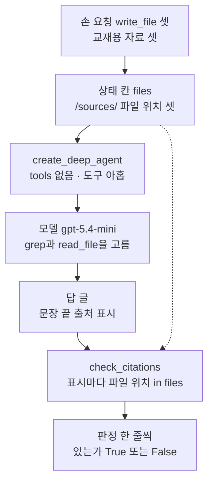
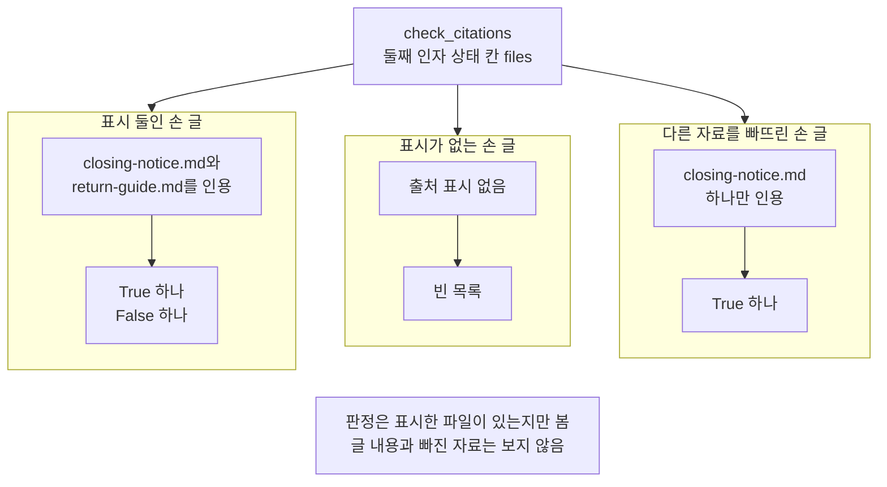
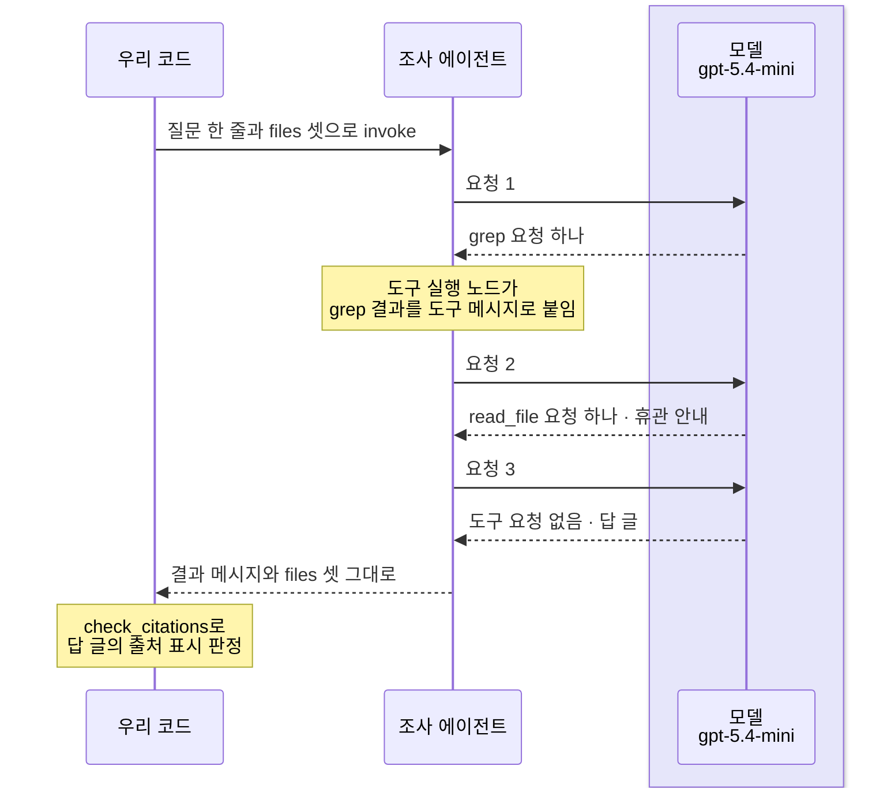
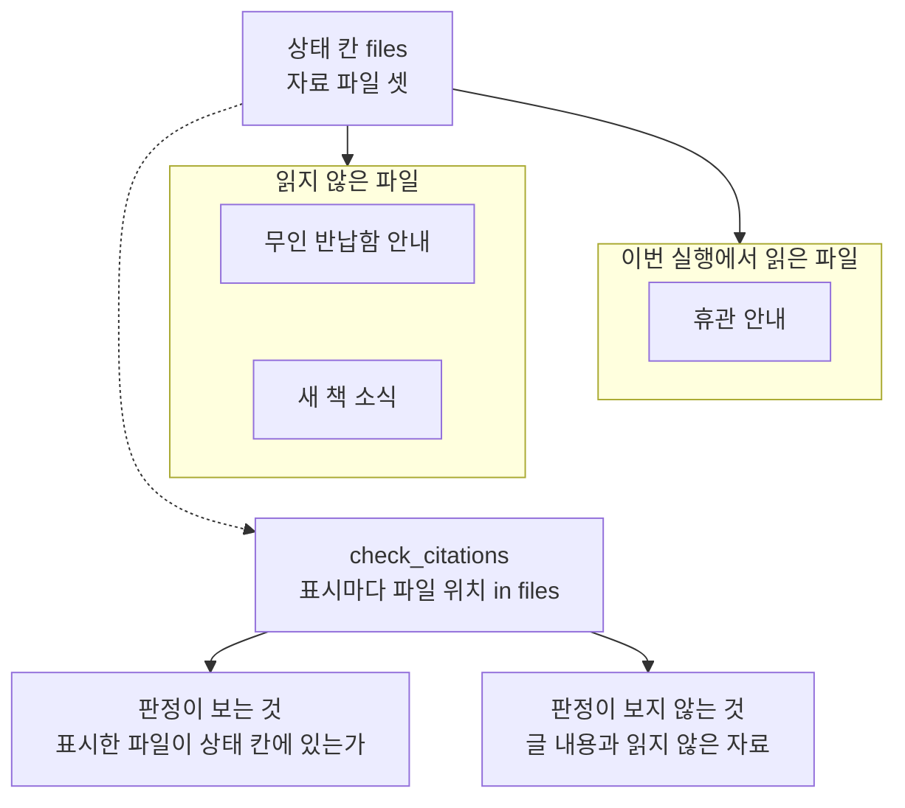

# 07-출처-검증형-deep-research

## _src 본문 (HTML 원본)

```html
<!--meta: 강의 1h | 실습 2h | 코드 notebooks/07-출처-검증형-deep-research.ipynb | 새 용어 2 -->
<style>html,body{overflow-x:hidden}.notebook,.nb-cell,.nb-main,.nb-input,.nb-result{min-width:0;max-width:100%}.nb-input pre,.nb-output{box-sizing:border-box;max-width:100%;overflow-x:auto}code.nb-source{display:block!important;width:100%!important;min-width:0!important;overflow-x:auto!important;padding:0!important}</style>
<h2 id="b1"><span class="no">1</span>학습 목표</h2><div class="goal"><ul>
<li>교재용 자료를 상태 칸 <code>files</code>에 넣고, 새 도구 없는 조사 에이전트가 기본 파일 도구로 찾게 조립할 수 있습니다.</li>
<li>답 글의 출처 표시가 상태 칸에 있는 파일을 가리키는지 코드로 판정할 수 있습니다.</li>
<li>출처 확인이 보는 것과 보지 않는 것을 출력으로 설명할 수 있습니다.</li>
</ul></div>
<h2 id="b2"><span class="no">2</span>이 내용을 배우는 이유</h2><p>06절까지의 실제 모델 실행에서 모델은 규정 도구가 내놓은 짧은 글로 답했습니다. 조사에서는 여러 자료 가운데 필요한 것을 찾아 읽고, 답에 근거를 밝혀야 합니다. 그런데 답에 근거를 적었다고 해서, 그 근거가 실제로 있는 자료라는 뜻은 아닙니다. 그래서 답에 붙은 출처 표시를 코드로 따로 살핍니다.</p><p>제목의 deep research는 여러 자료를 찾아 읽고, 근거를 붙여 답을 쓰는 조사를 뜻합니다. 공식 예는 웹 검색으로 자료를 모으지만, 이 절은 교재가 정한 자료 셋으로 좁혀 주어진 자료로 하는 조사로 봅니다. 제목 앞부분은 답에 붙인 출처가 실제로 있는 자료를 가리키는지 살핀다는 뜻이고, 본문에서는 이 일을 출처 확인이라고 부릅니다.</p>
<h2 id="b3"><span class="no">3</span>앞에서 배운 내용</h2><p><a href="../../part3/ch09-rag-first-run/04-생성과-출처-인용.html">Ch 9 04절</a>에서는 답에 문서와 쪽을 적은 출처 표시를 붙이고, 표시가 있는지 검사했습니다. <a href="../../part4/ch16-guardrails/01-입출력-출처-검증.html">Ch 16 01절</a>에서는 함수 <code>find_source_marks</code>로 답의 출처 표시를 뽑아, 이번 검색 결과로 만든 허용 목록과 대조했습니다. 이 절은 그 함수를 도구 파일로 옮겨 쓰고, 허용 목록 자리에 상태 칸 <code>files</code>를 둡니다. <a href="../../part4/ch15-evaluation-advanced/02-4대-RAG-평가자.html">Ch 15 02절</a>의 근거 충실도는 답이 근거 문서로 뒷받침되는지 모델로 판정했습니다. 이 절의 출처 확인은 그보다 좁아서, 인용한 파일이 있는지만 봅니다.</p><p><a href="../../part2/ch08-context-engineering/02-Write와-Select.html">Ch 8 02절</a>에서는 필요한 자료만 골라 모델에게 주는 일을 골라 넣기(Select)라고 불렀습니다. 이 절에서는 무엇을 골라 읽을지를 모델이 파일 도구로 정합니다. <a href="../../part5/ch19-model-tools/04-설명만으로-도구-선택하기.html">Ch 19 04절</a>에서 본 도구 요청의 칸과, <a href="../../part5/ch19-model-tools/05-bind_tools와-병렬-호출.html">05절</a>에서 본 한 응답 안의 여러 도구 요청을 손 요청에 씁니다. <a href="../../part4/ch16-guardrails/03-히스토리-트리밍과-요약.html">Ch 16 03절</a>의 음수 자르기도 판정 함수에서 씁니다.</p><p><a href="01-하네스와-일곱-기능.html">01절</a>에서는 기본 도구 아홉과 general-purpose 서브에이전트, 안전 규칙을 보았습니다. <a href="02-create-deep-agent와-도구.html">02절</a>의 명세, <a href="03-플래닝과-시스템-프롬프트.html">03절</a>의 바깥 호출 한도, <a href="04-파일시스템과-중간-결과.html">04절</a>의 작은 그래프 함수를 이 절이 그대로 씁니다. 04절에서는 기본 백엔드가 파일을 상태 칸 <code>files</code>에 두는 것을, <a href="05-컨텍스트-관리와-오프로딩.html">05절</a>에서는 <code>read_file</code>이 긴 파일을 스스로 자르는 것을 보았습니다. <a href="06-서브에이전트-위임.html">06절</a>에서는 일을 서브에이전트에게 맡겼고, 이 절은 요청을 줄이려고 맡기지 않습니다.</p>
<h2 id="b4"><span class="no">4</span>핵심 개념</h2><h3>비유로 시작하기</h3><p>01절부터 쓴 유리 온실 뒤쪽에, 꽃 색이 서로 다른 어미 화초 세 그루가 큰 화분에 서 있다고 합시다. 앞쪽 작은 화분 둘에는 어린 모종이 자라고, 화분마다 색 리본이 매여 있습니다. 리본 색은 그 모종이 어느 어미 화초에서 왔는지 적어 둔 표시입니다. 한 모종의 리본은 뒤쪽 화초의 꽃 색과 같지만, 다른 모종의 보라 리본과 같은 색 꽃은 온실 어디에도 없습니다.</p><p>어미 화초 셋이 상태 칸 <code>files</code>의 자료 셋이고, 모종이 답 글의 문장, 리본이 출처 표시입니다. 출처 확인은 리본 색마다 같은 색 꽃이 온실에 있는지 보는 일이고, 보라 리본은 없는 파일을 가리킨 표시입니다.</p><p>비유와 다른 점도 있습니다. 리본 색이 맞아도 그 모종이 정말 그 화초에서 왔는지는 리본만으로 가릴 수 없고, 판정 함수도 글 내용은 보지 않습니다. 화분·꽃·리본의 수는 어떤 값과도 짝짓지 않습니다.</p>
{{img:07-5-색-리본과-어미-화초|흰 바탕에 유리 온실 안을 앞에서 본 그림입니다. 뒤쪽에 큰 토분 셋이 한 줄로 서 있고, 왼쪽부터 주황 꽃·노란 꽃·파란 꽃이 핀 화초가 하나씩 심겨 있습니다. 앞쪽에는 새싹이 난 작은 토분 둘이 나란히 있습니다. 왼쪽 작은 화분에는 주황 리본이, 오른쪽 작은 화분에는 보라 리본이 매여 있습니다. 보라 꽃은 어디에도 없습니다. 사람·손·연장·글자·숫자·화살표는 없는 그림|주황 리본은 뒤쪽 주황 꽃과 짝이 맞지만, 보라 리본과 같은 색 꽃은 온실에 없습니다.}}
<p class="look"><b>그림 읽기</b> — 뒤쪽 큰 토분 셋에는 왼쪽부터 주황 꽃·노란 꽃·파란 꽃이 핀 어미 화초가 서 있습니다. 앞쪽 작은 토분 둘에는 새싹이 났고, 왼쪽 화분에는 주황 리본, 오른쪽 화분에는 보라 리본이 매여 있습니다. 어미 화초 셋이 상태 칸의 자료 셋, 새싹 화분이 답 글의 문장, 리본이 출처 표시입니다. 주황 리본은 같은 색 꽃이 있어 <code>True</code>, 보라 리본은 같은 색 꽃이 없어 <code>False</code>에 해당합니다. 오른쪽 파란 꽃은 보라와 다른 색으로 보고, 화분·꽃·리본의 수는 어떤 값과도 짝짓지 않습니다.</p>
<h3>주어진 자료로 하는 조사</h3><p>주어진 자료로 하는 조사는 정해 준 자료 안에서 필요한 것을 찾아 읽고, 근거를 붙여 답을 쓰는 일입니다. 선생님이 나눠 준 참고 자료 묶음만으로 보고서를 쓰는 숙제가 그런 예입니다. 이 절에서는 자료 셋을 상태 칸 <code>files</code>에 파일로 넣고, 모델이 기본 파일 도구로 찾아 읽습니다. 자료는 아래 표의 교재용 글 셋입니다.</p>
<table><thead><tr><th>파일 위치</th><th>제목</th><th>적힌 내용</th></tr></thead><tbody><tr><td><code>/sources/closing-notice.md</code></td><td>서가 정리 휴관 안내</td><td>10월 셋째 주 토요일은 자료실과 대출·연장·반납 창구를 열지 않음</td></tr><tr><td><code>/sources/return-box.md</code></td><td>무인 반납함 안내</td><td>정문 옆 무인 반납함은 휴관일에도 쓸 수 있고, 다음 운영일에 반납 처리</td></tr><tr><td><code>/sources/new-books.md</code></td><td>새로 들어온 책</td><td>이번 달 새 책 세 권, 일주일 동안 자료실 안에서만 봄</td></tr></tbody></table>
<p>자료는 06절처럼 손 요청 <code>write_file</code>로 넣었습니다. 작은 그래프에 요청 셋을 담은 응답 하나를 넣자, 도구 메시지 셋과 함께 상태 칸에 파일 위치 셋이 생겼습니다. 조사 에이전트에는 우리 도구를 주지 않아, 도구는 기본 아홉 그대로입니다.</p>
{{mermaid:07-1-주어진-자료로-하는-조사|위에서 아래로 읽는 흐름도입니다. 맨 위 초록 상자 손 요청 write_file 셋 교재용 자료 셋에서 노란 상자 상태 칸 files /sources/ 파일 위치 셋으로 화살표가 갑니다. 거기서 파란 상자 create_deep_agent tools 없음 도구 아홉, 보라 상자 모델 gpt-5.4-mini grep과 read_file을 고름, 회색 상자 답 글 문장 끝 출처 표시가 차례로 이어집니다. 답 글에서 파란 상자 check_citations 표시마다 파일 위치 in files로 화살표가 가고, 상태 칸 files에서도 이 상자로 점선이 갑니다. 맨 아래 노란 상자는 판정 한 줄씩 있는가 True 또는 False인 그림|자료는 상태 칸 files에 파일로 넣고, 새 도구 없는 조사 에이전트가 기본 파일 도구로 찾습니다. 답 글의 출처 표시는 우리 함수가 같은 상태 칸과 견줍니다.}}
<p class="look"><b>도식 읽기</b> — 위에서 아래로 읽습니다. 초록 상자는 모델 없이 손으로 만든 요청이고, 노란 상자는 노트북 출력으로 확인한 값입니다. 파란 상자는 우리가 부른 함수와 만든 함수이고, 보라 상자는 5절에서 실제로 부른 모델입니다. 점선은 판정 함수가 견주는 대상이 상태 칸 files라는 뜻입니다.</p>
<h3>파일 도구로 찾기</h3><p>도구 <code>grep</code>은 넣은 낱말이 든 파일을 찾고, 기본으로는 파일 위치 목록을 내놓습니다. 낱말은 정규식이 아니라 글자 그대로 찾습니다. 손 요청에 「휴관」을 넣자 휴관 안내와 무인 반납함 안내 둘이 나왔고, 새 책 소식은 나오지 않았습니다. 도구 <code>read_file</code>은 파일 하나의 글을 줄 번호와 함께 내놓습니다. 어떤 낱말로 찾고 어느 파일을 읽을지는 모델이 정합니다.</p>
<h3>출처 확인</h3><p>출처 확인은 답 글에 붙은 출처 표시가 실제로 있는 자료를 가리키는지 살피는 일입니다. 보고서 끝 참고 문헌에 적힌 책이 도서관 목록에 정말 있는지 찾아보는 일과 같습니다. 이 절에서는 함수 <code>check_citations</code>가 표시마다 대괄호를 뺀 파일 위치를 <code>in</code>으로 상태 칸 <code>files</code>와 견줍니다.</p><p>손 글 셋으로 판정해 보았습니다. 없는 파일을 가리킨 표시는 <code>False</code>였고, 표시가 없는 글은 빈 목록이었습니다. 무인 반납함 안내를 빠뜨리고 반납할 수 없다고 적은 글도, 인용한 파일이 있어 <code>True</code>였습니다. 출처 확인은 인용한 파일이 있는지만 보고, 글 내용과 빠진 자료는 보지 않습니다.</p>
{{mermaid:07-2-출처-판정-함수|위에서 아래로 읽는 흐름도입니다. 맨 위 파란 상자 check_citations 둘째 인자 상태 칸 files에서 나란한 세 칸으로 화살표가 갑니다. 첫 칸 표시 둘인 손 글에는 초록 상자 closing-notice.md와 return-guide.md를 인용에서 노란 상자 True 하나 False 하나로 화살표가 갑니다. 둘째 칸 표시가 없는 손 글에는 초록 상자 출처 표시 없음에서 노란 상자 빈 목록으로, 셋째 칸 다른 자료를 빠뜨린 손 글에는 초록 상자 closing-notice.md 하나만 인용에서 노란 상자 True 하나로 화살표가 갑니다. 맨 아래 회색 상자 판정은 표시한 파일이 있는지만 봄 글 내용과 빠진 자료는 보지 않음이 있는 그림|없는 파일을 가리킨 표시는 False로 드러났지만, 표시가 없으면 빈 목록이 나왔고 다른 자료를 빠뜨린 글도 True였습니다.}}
<p class="look"><b>도식 읽기</b> — 맨 위 파란 상자는 이 절에서 만든 판정 함수이고, 아래 세 칸은 서로 다른 손 글이라 나란히 두었습니다. 칸 안은 위에서 아래로 읽고, 초록 상자는 손으로 만든 글, 노란 상자는 노트북 4절 출력입니다. 맨 아래 회색 상자는 함수 정의에서 나오는 사실이고, 세 칸 모두에 해당합니다.</p>
<h2 id="b5"><span class="no">5</span>실행 예제</h2><p>노트북 2절은 조사 에이전트를 조립하고, 3절은 자료 셋을 상태 칸에 넣은 뒤 두 파일 도구를 손으로 불러 봅니다. 4절은 판정 함수를 만들어 손 글 셋을 판정합니다. 5절은 실제 모델로 한 번 조사하고, 답 글의 출처 표시를 판정합니다. 6절은 요청 수와 예상 비용을 셉니다.</p><p>모델 요청은 5절 실행 셀에서만 나갑니다. 노트북 밖에서 같은 질문을 다섯 번 보냈을 때, 요청은 다섯 번 모두 3번이었습니다. 요금표로 어림한 예상 비용은 한 번 실행에 0.01달러 아래이고, 청구 금액이 아닙니다. 디스크에는 파일을 쓰지 않고, 걸린 시간은 재지 않았습니다.</p>
{{notebook:07-출처-검증형-deep-research}}
<p class="look"><b>확인할 점</b> — 노트북 3절에서 도구 메시지 셋과 <code>상태 칸 files의 파일 위치:</code> 뒤의 셋을 봅니다. 4절에서 <code>True</code>·<code>False</code>·빈 목록이 각각 어느 손 글에서 나왔는지 짚습니다. 5절에서 <code>read_file로 읽은 파일 위치:</code>를 3절 자료 셋과 견주고, 6절에서 요청 수 셈이 맞는지 봅니다.</p>
{{mermaid:07-3-조사-실행의-차례|세로선 셋이 있는 차례 그림입니다. 왼쪽부터 우리 코드, 조사 에이전트, 연보라 띠 안의 모델 gpt-5.4-mini입니다. 우리 코드에서 질문 한 줄과 files 셋으로 invoke 화살표가 조사 에이전트로 갑니다. 요청 1 화살표가 모델로 가고 grep 요청 하나 점선이 돌아오며, 조사 에이전트에 노란 메모 도구 실행 노드가 grep 결과를 도구 메시지로 붙임이 붙습니다. 요청 2에는 read_file 요청 하나 휴관 안내 점선이, 요청 3에는 도구 요청 없음 답 글 점선이 돌아옵니다. 조사 에이전트에서 결과 메시지와 files 셋 그대로 점선이 우리 코드로 돌아오고, 우리 코드에 노란 메모 check_citations로 답 글의 출처 표시 판정이 붙은 그림|이번 실행에서 모델은 grep과 read_file을 한 번씩 요청한 뒤 답했고, 읽은 파일은 휴관 안내 하나였습니다.}}
<p class="look"><b>도식 읽기</b> — 위에서 아래로 실행 차례대로 읽습니다. 세로선은 왼쪽부터 우리 코드, 조사 에이전트, 모델입니다. 연보라 띠는 실제로 부른 모델 gpt-5.4-mini의 자리입니다. 노란 메모는 노트북 5절 출력으로 확인한 자리입니다. 도구 차례와 읽은 파일은 모델의 판단이라, 흔들림 확인 다섯 번과 두 커널에서 같았을 때만 그렸습니다.</p>
<h2 id="b6"><span class="no">6</span>실험 결과 해석</h2><p>앞 절반의 값은 모두 코드가 정하는 구조 값입니다. 조사 에이전트의 도구는 기본 아홉 그대로였고, 손 요청 셋으로 자료 셋이 상태 칸에 생겼습니다. 판정 함수는 손 글에서 있는 파일에 <code>True</code>, 없는 파일에 <code>False</code>, 표시가 없는 글에 빈 목록을 냈습니다. 다른 자료를 빠뜨린 글에도 <code>True</code>를 내, 판정이 보지 않는 것이 드러났습니다.</p><p>아래 표는 이 절이 확인한 값과 그 성격입니다. 구조 값은 코드가 정하는 값이고, 모델 판단 값은 모델이 고른 값입니다. 흔들리는 값은 실행마다 달라질 수 있어 결론에 쓰지 않습니다.</p>
<table><thead><tr><th>확인한 것</th><th>교재 출력</th><th>값의 성격</th></tr></thead><tbody><tr><td>조사 에이전트의 도구</td><td><code>조사 에이전트의 도구:</code> 기본 아홉 그대로(우리 도구 없음)</td><td>구조 값</td></tr><tr><td>손 요청 <code>write_file</code> 셋</td><td>도구 메시지 셋 <code>success</code> · 상태 칸 파일 위치 셋</td><td>구조 값</td></tr><tr><td>손 요청 <code>grep</code>·<code>read_file</code></td><td>「휴관」이 든 파일 위치 둘 · 줄 번호가 붙은 세 줄</td><td>구조 값</td></tr><tr><td>손 글 셋의 판정</td><td><code>True</code>·<code>False</code> 한 줄씩 · <code>[]</code> · 다른 자료를 빠뜨려도 <code>True</code></td><td>구조 값</td></tr><tr><td>5절 요청 수 셈</td><td><code>도구를 요청한 응답 수 + 1과 같은가: True</code></td><td>구조 값</td></tr><tr><td>5절 도구 차례와 읽은 파일</td><td><code>grep</code> → <code>read_file</code> → 답(요청 3) · <code>read_file로 읽은 파일 위치: ['/sources/closing-notice.md']</code> · <code>task 요청 수: 0</code> · <code>넣은 자료와 같은가: True</code></td><td>모델 판단 값</td></tr><tr><td>5절 답 글·판정 결과·토큰·예상 비용</td><td>교재 출력 답 글(문장마다 표시 하나, 판정 두 줄 모두 <code>True</code>) · <code>입력 토큰: 5917 | 출력 토큰: 139</code> · <code>예상 비용(달러): 0.005063</code>(새 커널 두 번째는 판정 한 줄, 입력 토큰 5867·출력 토큰 125)</td><td>흔들리는 값</td></tr></tbody></table>
<p>5절 실행에서도 요청 수는 도구를 요청한 응답 수에 1을 더한 값이었습니다. 서브에이전트를 부르지 않으면, 결과 메시지의 응답 수가 그 실행의 요청 수 전부입니다.</p>
{{mermaid:07-4-판정이-보는-것과-보지-않는-것|위에서 아래로 읽는 흐름도입니다. 맨 위 노란 상자 상태 칸 files 자료 파일 셋에서 두 칸으로 화살표가 갑니다. 가운데 칸 읽지 않은 파일에는 노란 상자 무인 반납함 안내와 새 책 소식이, 오른쪽 칸 이번 실행에서 읽은 파일에는 노란 상자 휴관 안내가 있습니다. 맨 위 상자에서 왼쪽으로 점선이 내려가 파란 상자 check_citations 표시마다 파일 위치 in files에 닿습니다. 파란 상자 아래 나란한 회색 상자 둘은 판정이 보는 것 표시한 파일이 상태 칸에 있는가와 판정이 보지 않는 것 글 내용과 읽지 않은 자료인 그림|이번 실행에서 모델이 읽은 파일은 휴관 안내 하나였습니다. 판정 함수는 표시한 파일이 있는지만 보므로, 읽지 않은 무인 반납함 안내는 판정에 나타나지 않습니다.}}
<p class="look"><b>도식 읽기</b> — 위에서 아래로 읽습니다. 두 칸은 같은 상태 칸의 파일을 이번 실행에서 읽었는지로 나눈 것이라 나란히 두었습니다. 노란 상자는 노트북 3·5절 출력이고, 파란 상자는 4절에서 만든 판정 함수입니다. 점선은 판정 함수가 견주는 대상이 상태 칸 files라는 뜻이고, 함수는 모델이 읽었는지를 보지 않습니다. 맨 아래 두 회색 상자는 함수 정의에서 나오는 사실이라 나란히 두었습니다.</p>
<p>흔들림 확인 다섯 번과 두 커널에서 모두, 모델은 <code>grep</code>과 <code>read_file</code>을 한 번씩 요청한 뒤 답했습니다. 읽은 파일은 휴관 안내 하나였고, 무인 반납함 안내는 읽지 않았습니다. 판정 함수는 인용한 파일이 있는지만 보므로, 읽지 않은 자료는 판정에 나타나지 않습니다. 그래서 출처 확인을 통과한 답에도 찾지 못한 자료가 남을 수 있습니다. 무엇을 찾을지는 모델이 정하는 값이라, 이 절은 판정 함수가 보는 범위를 결론의 중심에 둡니다.</p>
<p>새 커널로 두 번 실행해 견주자, 코드 셀 스물일곱 가운데 스물하나의 출력이 같았습니다. 달랐던 여섯 셀은 <code>grep</code> 도구 메시지 모양·답 글·판정 두 셀·토큰·예상 비용이 찍힌 셀입니다. 도구 차례·읽은 파일·요청 수는 두 번 모두 같았고, 두 번 모두 같았던 값만 결론과 그림에 썼습니다.</p>
<p class="look"><b>확인할 점</b> — 노트북 5절에서 <code>read_file로 읽은 파일 위치:</code> 뒤의 목록을 3절의 자료 셋과 견주고, 읽지 않은 파일을 찾아봅니다. 판정 두 셀의 줄 수가 답 글의 표시 수와 같은지 봅니다. 교재 출력에서는 같은 파일 위치를 두 번 인용해 판정이 두 줄이었습니다.</p>
<h2 id="b7"><span class="no">7</span>주의할 점과 실무 메모</h2><ul><li>공식 문서의 조사 에이전트 예는 Tavily 웹 검색으로 자료를 모읍니다. 할 일 목록과 연구 서브에이전트를 쓰고, 번호 인용과 출처 목록을 붙인 보고 파일을 씁니다. 이 과정의 루트 <code>.env</code>에는 검색 키가 없고, 웹 결과는 날마다 달라 두 커널 출력을 견줄 수 없습니다. 그래서 이 절은 웹 검색을 하지 않았고, 교재가 정한 자료 셋만 찾았습니다.</li><li>자료 셋·시스템 메시지 글·질문은 흐름을 보여 주려고 실행 전에 정한 교재용 예입니다. 실제 기관의 글이 아니고, 결과를 보고 바꾸지 않았습니다.</li><li>4절의 마지막 손 글 둘은 노트북 밖 흔들림 확인 결과를 본 뒤 더한 예입니다. 출처 표시가 없는 글과 다른 자료를 빠뜨린 글로, 판정 함수가 보지 않는 것을 모델 없이 보이려고 정했습니다.</li><li>노트북을 쓰기 전에 5절 실행을 노트북 밖에서 다섯 번 보냈습니다. 도구 차례·읽은 파일·요청 수는 다섯 번 모두 같았고, 다섯 번 모두 휴관 안내 하나만 읽었습니다. 시스템 메시지 글은 문장마다 출처 표시를 붙이라고 했지만, 네 번은 답 끝에 표시 하나만 붙였습니다. 같은 요청도 실행한 때에 따라 찾는 차례와 인용이 달라질 수 있습니다.</li><li>도구 <code>grep</code>은 낱말을 글자 그대로 찾아, 모델이 고른 낱말이 자료와 다르면 관계있는 파일도 나오지 않습니다. 여러 낱말로 찾으라고 시스템 메시지 글에 적거나, <code>ls</code>로 목록부터 보게 하는 방법이 있습니다. 이 노트북에서는 실행하지 않았습니다.</li><li>판정 함수는 실행 뒤 상태 칸 <code>files</code>와 견줍니다. 모델이 <code>write_file</code>로 새 파일을 적고 인용하면, 그 표시도 <code>True</code>가 됩니다. 넣은 자료만 인정하려면 3절의 <code>source_texts</code>와 견주면 되지만, 이 노트북에서는 실행하지 않았습니다.</li><li>설치판 <code>middleware/filesystem.py</code> 966~969행에서 <code>read_file</code>은 기본으로 앞 100줄까지 읽습니다. 이 절의 자료는 세 줄씩이라, 05절에서 본 긴 파일 자르기는 일어나지 않았습니다.</li><li>서브에이전트를 쓰지 않아, 결과 메시지의 응답 수로 요청을 셌습니다. 모델이 <code>task</code>를 부르면 그 안쪽 요청은 결과 메시지에 없어, 06절처럼 기록 훅으로 세야 합니다. 이번 실행에서는 <code>task</code> 요청이 0이었습니다.</li><li>걸린 시간은 재지 않았습니다. 교재 출력은 Linux의 Python 3.12.13으로 만들었고, 다른 판과 Windows·macOS에서는 실행하지 않았습니다.</li></ul>
<h2 id="b8"><span class="no">8</span>정리와 다음 절</h2><ul><li>교재용 자료를 손 요청 <code>write_file</code>로 상태 칸 <code>files</code>에 넣으면, 새 도구 없이 기본 파일 도구로 찾을 수 있습니다.</li><li>출처 표시가 상태 칸에 있는 파일을 가리키는지는 <code>in</code>으로 판정하고, 없는 파일은 <code>False</code>로 드러납니다.</li><li>이 판정은 파일이 있는지만 보므로, 빠뜨린 자료와 글의 내용은 따로 살펴야 합니다.</li></ul><p><strong>다음 학습과 이어지는 지점</strong> — <a href="08-통합-실행과-운영-한계.html">08절</a>에서는 앞 절들의 기능을 한 흐름에서 함께 실행하고, 운영에서 남는 한계를 봅니다.</p>
<h2 id="b9"><span class="no">9</span>복습 문제</h2><details class="quiz" open><summary>문제 4개 · 해설 포함</summary><p class="quiz-q">1. 조사 에이전트에는 <code>tools=</code>를 주지 않았습니다. 모델은 자료를 무엇으로 찾고, 자료는 어디에 있었나요?</p><p class="quiz-a">기본 파일 도구 <code>grep</code>과 <code>read_file</code>로 찾았고, 자료는 상태 칸 <code>files</code>에 파일로 있었습니다. 자료는 손 요청 <code>write_file</code>로 넣었습니다. 틀렸다면 노트북 2·3절을 다시 읽습니다.</p><p class="quiz-q">2. 판정 결과에 <code>'있는가': False</code>인 줄이 나왔습니다. 무엇을 뜻하나요?</p><p class="quiz-a">그 출처 표시가 상태 칸 <code>files</code>에 없는 파일 위치를 가리킨다는 뜻입니다. 이름이 그럴듯해도 없는 자료를 인용한 것입니다. 틀렸다면 노트북 4절을 다시 읽습니다.</p><p class="quiz-q">3. 동료가 「판정이 모두 <code>True</code>이니 답이 맞다」고 말합니다. 맞나요?</p><p class="quiz-a">맞지 않을 수 있습니다. 판정은 인용한 파일이 있는지만 보고, 글 내용이 자료와 맞는지나 빠뜨린 자료는 보지 않습니다. 4절에서 무인 반납함 안내를 빠뜨린 글도 <code>True</code>였습니다. 틀렸다면 노트북 4절 마지막 셀을 다시 읽습니다.</p><p class="quiz-q">4. 출처 표시가 하나도 없는 답을 판정하면 무엇이 나오고, 어떻게 읽어야 하나요?</p><p class="quiz-a">빈 목록이 나옵니다. 판정을 통과했다는 뜻이 아니라 인용이 하나도 없다는 뜻이라, 판정 줄의 수도 함께 봐야 합니다. 틀렸다면 노트북 4절을 다시 읽습니다.</p></details>
<h2 id="b10"><span class="no">10</span>참고 자료</h2><ul><li><div><a href="https://docs.langchain.com/oss/python/deepagents/deep-research">Deep Agents 문서의 조사 에이전트 예</a></div>확인 2026-09-28 · Tavily 웹 검색(키 <code>TAVILY_API_KEY</code>)과 할 일 목록, 연구 서브에이전트 하나를 씁니다. 보고 파일 <code>/final_report.md</code>에 번호 인용과 출처 목록을 붙입니다. 이 과정에서는 검색 키와 패키지가 없어 따라 하지 않았습니다.</li><li>설치판 deepagents 0.7.0 소스 <code>middleware/filesystem.py</code> 801~805행은 상태 칸 <code>files</code>를 가진 상태 형식입니다. 912~915행은 <code>grep</code>의 기본 출력이 파일 위치 목록이라는 자리입니다. 966~969행과 1012~1016행은 <code>read_file</code>의 앞 100줄과 <code>grep</code>의 글자 그대로 찾기를 적은 설명 글입니다.</li><li>Ch 16 도구 파일 <code>labs/part4/ch16-guardrails/notebooks/guardrails.py</code> 51~59행의 함수 <code>find_source_marks</code>를 이 절이 도구 파일에 글자 그대로 옮겼습니다.</li></ul>
```

## 노트북 셀 (순서대로)

### [0] markdown {'html': 'skip'}

# 출처 검증형 deep research

**이 노트북에서 할 일**

1. 교재용 자료 셋을 손 요청으로 상태 칸 `files`에 넣고, 파일 도구로 찾는 모양을 봅니다.
2. 답 글의 출처 표시가 실제로 있는 파일을 가리키는지 코드로 판정하는 함수를 만듭니다.
3. 실제 모델에게 자료를 찾아 답하게 하고, 그 답의 출처 표시를 판정합니다.

**준비물** — 프로젝트 폴더의 `.env` 파일에 `OPENAI_API_KEY`가 있어야 합니다.
모델은 `gpt-5.4-mini`이고, 5절에서 조사 에이전트를 한 번 실행합니다.
노트북 밖에서 같은 질문을 다섯 번 보냈을 때, 요청은 다섯 번 모두 3번이었습니다.
서브에이전트는 쓰지 않고, 호출 한도는 조사 에이전트 10, general-purpose 2로 줍니다.
요금표로 어림한 예상 비용은 한 번 실행에 0.01달러 아래이고, 청구 금액이 아닙니다.

파일은 상태 칸 `files`에만 두고, 디스크에는 쓰지 않습니다.
웹 검색은 하지 않고, 교재가 정한 자료 셋만 찾습니다.
모델의 답 글은 실행마다 달라질 수 있습니다.
걸린 시간은 재지 않았습니다.

앞에서 배운 함수 다섯은 도구 파일 `harness_tools.py`에서 가져옵니다.

**기준 버전** — 첫 셀에서 패키지 다섯을 설치합니다.
판은 deepagents 0.7.0, langchain 1.4.0, langgraph 1.2.11입니다.
나머지 둘은 `langchain-openai` 1.6.0과 `python-dotenv` 1.2.3입니다.
교재 출력은 Linux의 Python 3.12.13으로 만들었습니다.
다른 판과 Windows·macOS에서는 실행하지 않았습니다.

**강의와 실습 범위** — 강의 시간에는 2~4절을 읽습니다.
모델 없이 조사 에이전트를 조립하고, 자료를 넣고, 출처를 판정하는 자리입니다.
5·6절은 실제 모델로 한 번 실행하는 실습이고, 실습 시간에 실행합니다.

실습 폴더 `labs/part6/ch27-deepagents`에서 `uv sync --locked`를 실행합니다.
그다음 `notebooks/` 폴더의 이 노트북을 열고, 실습 폴더의 `.venv` 커널을 고릅니다.
첫 셀부터 순서대로 실행합니다.

### [1] markdown {'html': 'skip'}

## 오늘 볼 그림


위에서 아래로 읽습니다.
초록 상자는 모델 없이 손으로 만든 요청이고, 노란 상자는 노트북 출력으로 확인한 값입니다.
파란 상자는 우리가 부른 함수와 만든 함수이고, 보라 상자는 5절에서 실제로 부른 모델입니다.
점선은 판정 함수가 견주는 대상이 상태 칸 files라는 뜻입니다.

### [2] markdown {}

## 1. 준비

제목의 deep research는 여러 자료를 찾아 읽고, 근거를 붙여 답을 쓰는 조사를 뜻합니다.
이 절은 그 조사를 교재가 정한 자료 셋으로 좁혀, 주어진 자료로 하는 조사로 봅니다.
제목 앞부분은 답에 붙인 출처가 실제로 있는 자료를 가리키는지 살핀다는 뜻입니다.
본문에서는 이 일을 출처 확인이라고 부릅니다.
자료는 상태 칸 `files`에 파일로 넣고, 모델은 01절에서 본 기본 파일 도구로 찾습니다.

첫 셀은 패키지 다섯을 설치하고 설치된 판 번호를 출력합니다.
설치에는 몇십 초가 걸릴 수 있습니다.

### [3] code {'execution': {'iopub.execute_input': '2026-09-28T15:35:26.608743Z', 'iopub.status.busy': '2026-09-28T15:35:26.608408Z', 'iopub.status.idle': '2026-09-28T15:35:27.426066Z', 'shell.execute_reply': '2026-09-28T15:35:27.425677Z'}, 'lesson_role': 'setup'}

```python
# 이 절에서 쓰는 패키지를 설치하고 버전을 확인합니다
%pip install -q "deepagents==0.7.0" "langchain==1.4.0" "langchain-openai==1.6.0" "langgraph==1.2.11" "python-dotenv==1.2.3"
from importlib.metadata import version

print("deepagents:", version("deepagents"))
print("langchain:", version("langchain"))
print("langchain-openai:", version("langchain-openai"))
print("langgraph:", version("langgraph"))
print("python-dotenv:", version("python-dotenv"))
```

출력:
```
Note: you may need to restart the kernel to use updated packages.
deepagents: 0.7.0
langchain: 1.4.0
langchain-openai: 1.6.0
langgraph: 1.2.11
python-dotenv: 1.2.3

```

### [4] markdown {}

**결과 읽기** — 출력 줄 `deepagents: 0.7.0`과 `langgraph: 1.2.11`이 보입니다.
다섯 판 모두 실습 폴더 잠금과 같은 판입니다.
패키지 langgraph는 3절에서 04절의 작은 그래프를 다시 만들려고 설치 목록에 넣었습니다.

다음 셀은 이 절에서 쓸 이름을 가져옵니다.
마지막 가져오기 줄은 앞에서 배운 함수 다섯을 도구 파일 `harness_tools.py`에서 가져옵니다.

### [5] code {'execution': {'iopub.execute_input': '2026-09-28T15:35:27.427269Z', 'iopub.status.busy': '2026-09-28T15:35:27.427168Z', 'iopub.status.idle': '2026-09-28T15:35:29.027937Z', 'shell.execute_reply': '2026-09-28T15:35:29.027650Z'}, 'lesson_role': 'setup'}

```python
# Deep Agents(01절)·상태 형식(04절)·호출 한도(Ch 22)·모델·메시지·그래프 이름을 가져옵니다
from deepagents import create_deep_agent
from deepagents.middleware.filesystem import FilesystemState
from langchain.agents.middleware import ModelCallLimitMiddleware
from langchain.chat_models import init_chat_model
from langchain.messages import AIMessage, HumanMessage
from langgraph.graph import END, START, StateGraph
# 앞 챕터와 01절에서 배운 함수 다섯은 도구 파일에서 가져옵니다(find_source_marks는 이 절에서 도구 파일에 더함)
from harness_tools import estimate_cost, find_source_marks, show_messages, sum_usage, tool_names

print("도구 파일에서 가져온 함수:", "estimate_cost, find_source_marks, show_messages, sum_usage, tool_names")
```

출력:
```
도구 파일에서 가져온 함수: estimate_cost, find_source_marks, show_messages, sum_usage, tool_names

```

### [6] markdown {}

**결과 읽기** — 출력 줄 `도구 파일에서 가져온 함수: estimate_cost, find_source_marks, show_messages, sum_usage, tool_names`가 보입니다.
네 함수의 뜻은 02절 1절에 적었습니다.
나머지 함수 `find_source_marks`는 Ch 16 01절에서 답의 출처 표시를 뽑으려고 만든 함수입니다.
이 절에서 처음 쓰여, Ch 16 도구 파일의 같은 이름 함수를 글자 그대로 `harness_tools.py`에 더했습니다.

앞에서 배운 함수는 `harness_tools.py`에 모아 두었고, 파일을 열면 코드를 볼 수 있습니다.
커널이 `notebooks/` 폴더에서 시작해야 이 파일을 가져올 수 있습니다.

### [7] markdown {}

API 키가 있는지 확인합니다. `True` 값이 나오면 다음으로 넘어갑니다.

### [8] code {'execution': {'iopub.execute_input': '2026-09-28T15:35:29.028727Z', 'iopub.status.busy': '2026-09-28T15:35:29.028665Z', 'iopub.status.idle': '2026-09-28T15:35:29.033219Z', 'shell.execute_reply': '2026-09-28T15:35:29.032909Z'}, 'lesson_role': 'setup'}

```python
# .env 파일에서 OpenAI API 키를 읽습니다(키 값은 출력하지 않습니다)
import os
from dotenv import find_dotenv, load_dotenv

env_path = find_dotenv(usecwd=True)
load_dotenv(env_path)
has_key = os.getenv("OPENAI_API_KEY") is not None
print("OPENAI_API_KEY 설정 여부:", has_key)
assert has_key, "프로젝트 폴더의 .env 파일에 OPENAI_API_KEY를 적어 주세요."
```

출력:
```
OPENAI_API_KEY 설정 여부: True

```

### [9] markdown {}

실습에 쓸 모델을 준비합니다.
temperature 값을 0으로 두어 매번 비슷한 답을 고르게 합니다.

### [10] code {'execution': {'iopub.execute_input': '2026-09-28T15:35:29.033758Z', 'iopub.status.busy': '2026-09-28T15:35:29.033704Z', 'iopub.status.idle': '2026-09-28T15:35:30.098659Z', 'shell.execute_reply': '2026-09-28T15:35:30.098202Z'}}

```python
# 실습에 쓸 모델을 준비합니다
model = init_chat_model(
    "openai:gpt-5.4-mini",
    temperature=0,
    reasoning_effort="none",
)
print("모델 이름:", model.model_name)
print("temperature:", model.temperature)
```

출력:
```
모델 이름: gpt-5.4-mini
temperature: 0.0

```

### [11] markdown {}

**결과 읽기** — 모델 이름 `gpt-5.4-mini`, temperature `0.0`이 보이면 준비가 끝났습니다.
이 노트북의 출력은 2026-09-28에 이 모델로 실행한 결과입니다.
temperature 값을 0으로 두어도, 실행마다 답 문장이 달라질 수 있습니다.
이 셀은 모델 객체만 만들고, 모델 요청은 아직 보내지 않습니다.
모델 요청은 5절 실행 셀에서만 나갑니다.

2~4절은 이 객체로 Deep Agent를 만들기만 하고, 모델을 부르지 않습니다.
이 절은 파일을 디스크에 쓰지 않고, 상태 칸 `files`만 씁니다.

## 2. 조사 에이전트 조립하기

이 절의 조사 에이전트에는 우리 도구를 하나도 주지 않습니다.
그래도 01절 안전 규칙대로, 같은 이름 general-purpose 명세와 바깥 호출 한도는 넣습니다.
다음 셀은 02절 셀과 같은 글의 general-purpose 명세입니다.

### [12] code {'execution': {'iopub.execute_input': '2026-09-28T15:35:30.099664Z', 'iopub.status.busy': '2026-09-28T15:35:30.099591Z', 'iopub.status.idle': '2026-09-28T15:35:30.101683Z', 'shell.execute_reply': '2026-09-28T15:35:30.101406Z'}}

```python
# 기본 서브에이전트와 같은 이름의 명세를 만들고, 그 안에 자기 호출 한도 둘을 넣습니다(01절 6절 모양)
helper_limit = ModelCallLimitMiddleware(run_limit=2, exit_behavior="end")
helper_spec = {
    "name": "general-purpose",
    "description": "교재용 도우미입니다. 맡긴 일을 짧게 처리합니다.",
    "system_prompt": "맡긴 일을 두 문장의 한국어로 처리하세요.",
    "middleware": [helper_limit],
}
print("명세의 키:", list(helper_spec))
```

출력:
```
명세의 키: ['name', 'description', 'system_prompt', 'middleware']

```

### [13] markdown {}

**결과 읽기** — 출력 줄 `명세의 키: ['name', 'description', 'system_prompt', 'middleware']`가 보입니다.
이 명세는 따로 막지 않으면 늘 붙는 기본 general-purpose 서브에이전트의 자리를 바꿉니다.
자기 호출 한도 2가 들어 있어, 모델이 `task`를 부르면 한 번에 요청이 두 번까지만 나갑니다.
01절에서 본 것처럼, 바꾸지 않은 기본 서브에이전트에는 호출 한도가 없습니다.

다음 셀은 03절 셀과 같은 글의 바깥 호출 한도입니다.

### [14] code {'execution': {'iopub.execute_input': '2026-09-28T15:35:30.102324Z', 'iopub.status.busy': '2026-09-28T15:35:30.102265Z', 'iopub.status.idle': '2026-09-28T15:35:30.104017Z', 'shell.execute_reply': '2026-09-28T15:35:30.103641Z'}}

```python
# 바깥 에이전트의 모델 요청을 열 번까지로 막는 호출 한도를 만듭니다(02절 셀과 한도만 다름)
outer_limit = ModelCallLimitMiddleware(run_limit=10, exit_behavior="end")
print("바깥 호출 한도:", outer_limit.run_limit)
```

출력:
```
바깥 호출 한도: 10

```

### [15] markdown {}

**결과 읽기** — 출력 줄 `바깥 호출 한도: 10`이 보입니다.
주석의 「02절 셀과 한도만 다름」은 이 셀을 처음 쓴 03절에서 적은 말입니다.
모델이 `task`를 부르지 않으면, 한 번 실행의 요청 수는 10을 넘지 않습니다.
부르면 부른 횟수 × 2만큼 상한이 커집니다.

다음 셀은 조사 에이전트를 만듭니다.
인자 `tools=`는 넘기지 않고, 우리 시스템 메시지 글에 찾는 차례와 출처 표시 꼴을 적었습니다.

### [16] code {'execution': {'iopub.execute_input': '2026-09-28T15:35:30.104664Z', 'iopub.status.busy': '2026-09-28T15:35:30.104605Z', 'iopub.status.idle': '2026-09-28T15:35:30.165898Z', 'shell.execute_reply': '2026-09-28T15:35:30.165607Z'}}

```python
# 새 도구 없이, 우리 시스템 메시지 글·호출 한도·명세를 넘겨 조사 에이전트를 만듭니다(요청은 아직 보내지 않음)
research_text = "자료는 /sources/ 폴더의 파일에만 있습니다. 먼저 grep으로 관련 파일을 찾고, 찾은 파일을 read_file로 읽으세요. 그다음 파일에 적힌 내용만으로 두 문장의 한국어로 답하세요. 답의 문장마다 근거 파일 위치를 [/sources/파일 이름.md] 꼴로 붙이세요."
research_agent = create_deep_agent(
    model=model,
    system_prompt=research_text,
    middleware=[outer_limit],
    subagents=[helper_spec],
)
research_tools = tool_names(research_agent)
print("조사 에이전트의 도구:", research_tools)
```

출력:
```
조사 에이전트의 도구: ['delete', 'edit_file', 'execute', 'glob', 'grep', 'ls', 'read_file', 'task', 'write_file']

```

### [17] markdown {}

**결과 읽기** — 라벨 `조사 에이전트의 도구:` 뒤에 도구 이름 아홉이 보입니다.
01절에서 본 기본 도구 아홉 그대로이고, 우리가 더한 도구는 없습니다.
찾기에 쓸 `grep`과 읽기에 쓸 `read_file`도 기본 파일 도구 안에 있습니다.
이 에이전트는 파일 도구만으로 자료를 찾게 됩니다.

시스템 메시지 글은 먼저 `grep`으로 찾고 `read_file`로 읽은 뒤 답하라고 적었습니다.
답의 문장마다 파일 위치를 대괄호로 묶어 붙이라고도 적었습니다.
이 대괄호 표시를 4절에서 코드로 판정합니다.

## 3. 교재용 자료를 상태 칸에 넣기

조사할 자료는 웹이 아니라, 교재가 정한 짧은 글 셋입니다.
다음 셀은 자료 셋을 파일 위치마다 적은 딕셔너리입니다.
실제 기관의 글이 아니라, 흐름을 보여 주려고 실행 전에 정한 교재용 글입니다.

### [18] code {'execution': {'iopub.execute_input': '2026-09-28T15:35:30.166562Z', 'iopub.status.busy': '2026-09-28T15:35:30.166510Z', 'iopub.status.idle': '2026-09-28T15:35:30.168291Z', 'shell.execute_reply': '2026-09-28T15:35:30.168017Z'}}

```python
# 조사에 쓸 교재용 자료 셋을 파일 위치마다 정합니다(실제 기관의 글이 아님)
source_texts = {
    "/sources/closing-notice.md": "# 서가 정리 휴관 안내\n10월 셋째 주 토요일은 서가 정리로 자료실을 열지 않습니다.\n이날은 대출·연장·반납 창구를 열지 않습니다.",
    "/sources/return-box.md": "# 무인 반납함 안내\n자료실 정문 옆 무인 반납함은 휴관일에도 쓸 수 있습니다.\n반납함에 넣은 책은 다음 운영일에 반납 처리됩니다.",
    "/sources/new-books.md": "# 새로 들어온 책\n이번 달에는 데이터 분석 입문서 세 권이 들어왔습니다.\n새 책은 들어온 날부터 일주일 동안 자료실 안에서만 볼 수 있습니다.",
}
print("자료 파일 위치:", list(source_texts))
```

출력:
```
자료 파일 위치: ['/sources/closing-notice.md', '/sources/return-box.md', '/sources/new-books.md']

```

### [19] markdown {}

**결과 읽기** — 출력 줄 `자료 파일 위치: ['/sources/closing-notice.md', '/sources/return-box.md', '/sources/new-books.md']`가 보입니다.
첫째는 10월 셋째 주 토요일의 휴관 안내, 둘째는 무인 반납함 안내입니다.
셋째는 새로 들어온 책 소식이라, 반납 질문과는 관계가 적은 자료입니다.
파일 위치는 모두 `/sources/`로 시작하게 정했습니다.

모델이 파일 도구로 이 글을 찾으려면, 글이 상태 칸 `files`에 파일로 있어야 합니다.
04절에서 본 것처럼, 파일 항목에는 글 말고도 만든 시각 같은 칸이 있습니다.
그래서 항목을 손으로 만들지 않고, 06절처럼 손 요청 `write_file`로 적습니다.
다음 셀은 04절 3절 셀과 같은 글의 작은 그래프 함수입니다.

### [20] code {'execution': {'iopub.execute_input': '2026-09-28T15:35:30.168779Z', 'iopub.status.busy': '2026-09-28T15:35:30.168728Z', 'iopub.status.idle': '2026-09-28T15:35:30.170635Z', 'shell.execute_reply': '2026-09-28T15:35:30.170238Z'}}

```python
# Deep Agent 하나를 받아, 그 도구 실행 노드 하나만 든 작은 그래프를 만들어 내놓습니다(상태 형식은 files 칸이 있는 FilesystemState)
def tools_only_graph(agent):
    builder = StateGraph(FilesystemState)
    builder.add_node("tools", agent.nodes["tools"].bound)
    builder.add_edge(START, "tools")
    builder.add_edge("tools", END)
    return builder.compile()
```

출력:
```

```

### [21] markdown {}

**결과 읽기** — 정의 셀이라 출력이 없습니다.
작은 그래프에는 도구 실행 노드 하나뿐이라, 손 요청을 넣어도 모델을 부르지 않습니다.

다음 셀은 조사 에이전트의 도구 실행 노드로 작은 그래프를 만듭니다.

### [22] code {'execution': {'iopub.execute_input': '2026-09-28T15:35:30.171262Z', 'iopub.status.busy': '2026-09-28T15:35:30.171215Z', 'iopub.status.idle': '2026-09-28T15:35:30.173973Z', 'shell.execute_reply': '2026-09-28T15:35:30.173603Z'}}

```python
# 조사 에이전트의 도구 실행 노드만 든 작은 그래프를 만듭니다(요청은 보내지 않음)
small_graph = tools_only_graph(research_agent)
small_nodes = small_graph.get_graph().nodes
print("작은 그래프의 노드:", list(small_nodes))
```

출력:
```
작은 그래프의 노드: ['__start__', 'tools', '__end__']

```

### [23] markdown {}

**결과 읽기** — 출력 줄 `작은 그래프의 노드: ['__start__', 'tools', '__end__']`가 보입니다.
도구 실행 노드에는 조사 에이전트의 도구 아홉이 그대로 들어 있습니다.

다음 셀은 자료마다 `write_file` 요청을 하나씩 손으로 만들어, 한 응답에 셋을 담습니다.
Ch 19 05절에서 본 것처럼, 한 응답에 도구 요청이 여럿 들어갈 수 있습니다.
호출 ID는 `hand_` 뒤에 파일 위치를 붙여 우리가 정했습니다.

### [24] code {'execution': {'iopub.execute_input': '2026-09-28T15:35:30.174581Z', 'iopub.status.busy': '2026-09-28T15:35:30.174524Z', 'iopub.status.idle': '2026-09-28T15:35:30.180875Z', 'shell.execute_reply': '2026-09-28T15:35:30.180517Z'}}

```python
# 모델 없이, 자료마다 write_file 요청을 손으로 만들어 한 응답에 담고 작은 그래프에 넣습니다
write_calls = []
for path in source_texts:
    write_args = {"file_path": path, "content": source_texts[path]}
    write_calls.append({"name": "write_file", "args": write_args, "id": "hand_" + path, "type": "tool_call"})
write_request = AIMessage(content="", tool_calls=write_calls)
write_result = small_graph.invoke({"messages": [write_request]})
source_files = write_result["files"]
show_messages(write_result["messages"])
print("상태 칸 files의 파일 위치:", list(source_files))
```

출력:
```
AIMessage | 도구 호출 요청: ['write_file', 'write_file', 'write_file']
ToolMessage | 결과 상태: success | 내용: Updated file /sources/closing-notice.md
ToolMessage | 결과 상태: success | 내용: Updated file /sources/return-box.md
ToolMessage | 결과 상태: success | 내용: Updated file /sources/new-books.md
상태 칸 files의 파일 위치: ['/sources/closing-notice.md', '/sources/return-box.md', '/sources/new-books.md']

```

### [25] markdown {}

**결과 읽기** — `AIMessage` 줄 뒤에 `ToolMessage` 줄 셋이 보이고, 결과 상태는 모두 `success`입니다.
내용 `Updated file /sources/closing-notice.md`처럼, 파일마다 적었다는 글이 왔습니다.
라벨 `상태 칸 files의 파일 위치:` 뒤에 자료 셋의 위치가 있습니다.
이 셀까지 모델 요청은 0번입니다.

이 상태 칸을 `source_files`라는 이름으로 두고, 뒤에서 조사 에이전트의 입력에 넣습니다.
다음 셀은 모델이 쓸 두 도구를 먼저 손으로 불러 봅니다.
도구 `grep`은 글에 낱말이 든 파일을 찾고, `read_file`은 파일 하나의 글을 읽습니다.

### [26] code {'execution': {'iopub.execute_input': '2026-09-28T15:35:30.181422Z', 'iopub.status.busy': '2026-09-28T15:35:30.181359Z', 'iopub.status.idle': '2026-09-28T15:35:30.184720Z', 'shell.execute_reply': '2026-09-28T15:35:30.184510Z'}}

```python
# 모델 없이, grep 요청 하나와 read_file 요청 하나를 손으로 만들어 자료가 든 상태와 함께 넣습니다
grep_call = {"name": "grep", "args": {"pattern": "휴관"}, "id": "hand_grep_1", "type": "tool_call"}
read_args = {"file_path": "/sources/return-box.md"}
read_call = {"name": "read_file", "args": read_args, "id": "hand_read_1", "type": "tool_call"}
find_request = AIMessage(content="", tool_calls=[grep_call, read_call])
find_result = small_graph.invoke({"messages": [find_request], "files": source_files})
show_messages(find_result["messages"])
```

출력:
```
AIMessage | 도구 호출 요청: ['grep', 'read_file']
ToolMessage | 결과 상태: success | 내용: /sources/closing-notice.md
/sources/return-box.md
ToolMessage | 결과 상태: success | 내용: 1  # 무인 반납함 안내
2  자료실 정문 옆 무인 반납함은 휴관일에도 쓸 수 있습니다.
3  반납함에 넣은 책은 다음 운영일에 반납 처리됩니다.

```

### [27] markdown {}

**결과 읽기** — 첫 `ToolMessage` 줄의 내용은 파일 위치 둘 `/sources/closing-notice.md`와 `/sources/return-box.md`입니다.
낱말 「휴관」이 든 파일만 나왔고, 새 책 소식은 나오지 않았습니다.
둘째 `ToolMessage` 줄의 내용은 무인 반납함 안내의 세 줄이고, 줄마다 앞에 줄 번호가 붙었습니다.

설치판 `middleware/filesystem.py` 912~915행에서 `grep`의 기본 출력은 파일 위치 목록입니다.
1012~1016행의 설명 글대로, 넣은 낱말은 정규식이 아니라 글자 그대로 찾습니다.
그래서 모델이 고른 낱말이 자료의 글과 글자까지 맞아야 파일이 나옵니다.
이 두 도구를 쓸지, 무엇을 찾을지는 5절에서 모델이 정합니다.

## 4. 출처를 코드로 확인하기

답 글에 붙은 출처 표시가 실제로 있는 파일을 가리키는지, 코드로 판정해 봅니다.
Ch 16 01절에서는 답의 출처 표시를 뽑아, 검색 결과로 만든 허용 목록과 대조했습니다.
이 절에서는 허용 목록 자리에 상태 칸 `files`를 둡니다.
다음 셀은 출처 표시 둘을 붙인 답 글을 손으로 만들고, Ch 16 01절 함수로 표시를 뽑습니다.
둘째 표시의 파일 위치는 자료 셋에 없는 이름으로 일부러 적었습니다.

### [28] code {'execution': {'iopub.execute_input': '2026-09-28T15:35:30.185280Z', 'iopub.status.busy': '2026-09-28T15:35:30.185232Z', 'iopub.status.idle': '2026-09-28T15:35:30.186965Z', 'shell.execute_reply': '2026-09-28T15:35:30.186688Z'}}

```python
# 모델 없이, 출처 표시 둘을 붙인 답 글을 손으로 만들고 Ch 16 01절 함수 find_source_marks로 표시를 뽑습니다
sample_answer = "그날은 자료실 창구를 열지 않습니다[/sources/closing-notice.md]. 책은 정문 옆 무인 반납함에 넣으면 됩니다[/sources/return-guide.md]."
sample_marks = find_source_marks(sample_answer)
print("뽑은 출처 표시:", sample_marks)
```

출력:
```
뽑은 출처 표시: ['[/sources/closing-notice.md]', '[/sources/return-guide.md]']

```

### [29] markdown {}

**결과 읽기** — 출력 줄 `뽑은 출처 표시: ['[/sources/closing-notice.md]', '[/sources/return-guide.md]']`가 보입니다.
함수 `find_source_marks`는 글을 여는 대괄호로 나누고, 닫는 대괄호 앞까지를 표시로 모읍니다.
표시는 대괄호까지 붙은 글이라, 파일 위치와 견주려면 대괄호 둘을 빼야 합니다.

다음 셀은 이 절에서 새로 만드는 판정 함수입니다.
표시마다 대괄호를 뺀 파일 위치가 둘째 인자 안에 있는지 `in`으로 봅니다.
둘째 인자가 딕셔너리면 키에서 찾고, 목록이면 항목에서 찾습니다.

### [30] code {'execution': {'iopub.execute_input': '2026-09-28T15:35:30.187474Z', 'iopub.status.busy': '2026-09-28T15:35:30.187430Z', 'iopub.status.idle': '2026-09-28T15:35:30.188890Z', 'shell.execute_reply': '2026-09-28T15:35:30.188568Z'}}

```python
# 답 글의 출처 표시마다 대괄호를 뺀 파일 위치가 known 안에 있는지 판정해, 한 줄씩 모아 내놓습니다
def check_citations(answer, known):
    rows = []
    for mark in find_source_marks(answer):
        # 첫 글자와 마지막 글자(대괄호 둘)를 뺀 글이 인용한 파일 위치입니다
        cited = mark[1:-1]
        rows.append({"인용": cited, "있는가": cited in known})
    return rows
```

출력:
```

```

### [31] markdown {}

**결과 읽기** — 정의 셀이라 출력이 없습니다.
자르기 `mark[1:-1]`은 첫 글자와 마지막 글자를 뺀 글이고, 음수 자리는 Ch 16 03절에서 배웠습니다.
판정 한 줄은 인용한 파일 위치와 `있는가` 값을 담은 딕셔너리입니다.
이 함수는 파일이 있는지만 보고, 파일의 글은 읽지 않습니다.

다음 셀은 앞에서 만든 답 글을 3절의 상태 칸 `files`로 판정합니다.

### [32] code {'execution': {'iopub.execute_input': '2026-09-28T15:35:30.189406Z', 'iopub.status.busy': '2026-09-28T15:35:30.189349Z', 'iopub.status.idle': '2026-09-28T15:35:30.190985Z', 'shell.execute_reply': '2026-09-28T15:35:30.190644Z'}}

```python
# 손으로 만든 답 글을, 3절에서 자료를 넣은 상태 칸 files로 판정합니다
sample_rows = check_citations(sample_answer, source_files)
print("판정 결과:")
for row in sample_rows:
    print(row)
```

출력:
```
판정 결과:
{'인용': '/sources/closing-notice.md', '있는가': True}
{'인용': '/sources/return-guide.md', '있는가': False}

```

### [33] markdown {}

**결과 읽기** — 라벨 줄 아래 첫 줄은 `{'인용': '/sources/closing-notice.md', '있는가': True}`입니다.
둘째 줄은 `{'인용': '/sources/return-guide.md', '있는가': False}`입니다.
그럴듯한 이름이어도, 상태 칸에 없는 파일을 가리킨 표시는 `False`로 드러납니다.
모델 없이 손으로 만든 글이라, 이 판정은 몇 번 실행해도 같습니다.

다음 셀은 판정 함수에 두 가지 글을 더 넣어 봅니다.
하나는 출처 표시가 없는 글이고, 다른 하나는 있는 파일 하나만 인용한 글입니다.
실행 전에 예상해 봅니다.
출처 표시가 없으면 무엇이 나올까요?

### [34] code {'execution': {'iopub.execute_input': '2026-09-28T15:35:30.191594Z', 'iopub.status.busy': '2026-09-28T15:35:30.191547Z', 'iopub.status.idle': '2026-09-28T15:35:30.193237Z', 'shell.execute_reply': '2026-09-28T15:35:30.192894Z'}}

```python
# 값 바꿔 보기: 출처 표시가 없는 글과, 있는 파일 하나만 인용하고 다른 자료를 빠뜨린 글을 판정합니다
no_mark_answer = "그날은 정문 옆 무인 반납함에 넣으면 됩니다."
partial_answer = "그날은 빌린 책을 반납할 수 없습니다[/sources/closing-notice.md]."
print("출처 표시가 없는 글:", check_citations(no_mark_answer, source_files))
print("다른 자료를 빠뜨린 글:", check_citations(partial_answer, source_files))
```

출력:
```
출처 표시가 없는 글: []
다른 자료를 빠뜨린 글: [{'인용': '/sources/closing-notice.md', '있는가': True}]

```

### [35] markdown {}

**결과 읽기** — 출력 줄 `출처 표시가 없는 글: []`가 보입니다.
표시가 없으면 판정할 것이 없어 빈 목록이 나오고, `False`도 나오지 않습니다.
출력 줄 `다른 자료를 빠뜨린 글: [{'인용': '/sources/closing-notice.md', '있는가': True}]`도 보입니다.
이 글은 반납할 수 없다고 적었지만, 3절의 무인 반납함 안내는 휴관일에도 쓸 수 있다고 적습니다.
그래도 판정은 `True`입니다.

이 함수가 보는 것은 인용한 파일이 상태 칸에 있는가 하나뿐입니다.
빈 목록은 판정을 통과했다는 뜻이 아니라, 인용이 하나도 없다는 뜻입니다.
글이 파일 내용과 맞는지, 빠뜨린 자료가 있는지는 이 판정이 보지 않습니다.
그 일은 Ch 15 02절의 근거 충실도처럼 글을 견주는 평가가 맡습니다.

## 5. 실제 모델로 조사하기

이제 조사 에이전트에 3절의 상태 칸과 질문 한 줄을 넣어 한 번 실행합니다.
질문은 10월 셋째 주 토요일에 빌린 책을 반납할 수 있는지 묻습니다.
자료 셋 가운데 휴관 안내와 무인 반납함 안내가 이 질문과 관계가 있습니다.
실행 전에 예상해 봅니다.
모델은 `grep`으로 찾고 `read_file`로 읽은 뒤, 출처 표시를 붙여 답할 것입니다.

### [36] code {'execution': {'iopub.execute_input': '2026-09-28T15:35:30.193747Z', 'iopub.status.busy': '2026-09-28T15:35:30.193704Z', 'iopub.status.idle': '2026-09-28T15:35:33.282713Z', 'shell.execute_reply': '2026-09-28T15:35:33.281265Z'}}

```python
# 3절 자료가 든 상태 칸 files와 질문 한 줄을 함께 넣어 한 번 실행합니다
question = "10월 셋째 주 토요일에 빌린 책을 반납할 수 있나요?"
first_input = {"messages": [HumanMessage(content=question)], "files": source_files}
input_count = len(first_input["messages"])
run_result = research_agent.invoke(first_input)
run_messages = run_result["messages"]
print("결과 메시지 수:", len(run_messages))
```

출력:
```
결과 메시지 수: 6

```

### [37] markdown {}

**결과 읽기** — 라벨 `결과 메시지 수:` 뒤에 결과 메시지 수가 보입니다.
넣은 질문 하나 뒤에, 모델의 응답과 도구 메시지가 더해졌습니다.

이번 실행에서는 `결과 메시지 수: 6`이었습니다.
질문 하나 뒤에 `grep` 요청 응답, 도구 메시지, `read_file` 요청 응답, 도구 메시지, 마지막 답이 더해졌습니다.
노트북 밖 다섯 번과 새 커널 두 번에서도 모두 여섯이었습니다.

다음 셀은 Ch 19 06절 함수 `show_messages`로 결과 메시지를 차례로 봅니다.

### [38] code {'execution': {'iopub.execute_input': '2026-09-28T15:35:33.284606Z', 'iopub.status.busy': '2026-09-28T15:35:33.284439Z', 'iopub.status.idle': '2026-09-28T15:35:33.287466Z', 'shell.execute_reply': '2026-09-28T15:35:33.286822Z'}}

```python
# 결과 메시지를 차례로 봅니다(Ch 19 06절 함수 show_messages)
print("결과 메시지:")
show_messages(run_messages)
```

출력:
```
결과 메시지:
HumanMessage
AIMessage | 도구 호출 요청: ['grep']
ToolMessage | 결과 상태: success | 내용: /sources/closing-notice.md:
  2: 10월 셋째 주 토요일은 서가 정리로 자료실을 열지 않습니다.
AIMessage | 도구 호출 요청: ['read_file']
ToolMessage | 결과 상태: success | 내용: 1  # 서가 정리 휴관 안내
2  10월 셋째 주 토요일은 서가 정리로 자료실을 열지 않습니다.
3  이날은 대출·연장·반납 창구를 열지 않습니다.
AIMessage | 도구 호출 요청: []

```

### [39] markdown {}

**결과 읽기** — 라벨 줄 아래가 결과 메시지의 차례입니다.
`AIMessage` 줄에는 모델이 요청한 도구 이름이, `ToolMessage` 줄에는 도구가 낸 글이 보입니다.
마지막 `AIMessage` 줄은 도구 요청이 없는 응답이고, 모델이 쓴 답입니다.

이번 실행에서 모델은 `grep`과 `read_file`을 한 응답에 하나씩 요청한 뒤 답했습니다.
노트북 밖 다섯 번과 새 커널 두 번에서 모두 이 차례였습니다.
다만 `grep` 도구 메시지의 모양은 실행마다 달랐습니다.
교재 출력에서는 찾은 줄까지 보였고, 새 커널 두 번째에서는 파일 위치만 보였습니다.
설치판 912~915행에서 이 모양은 모델이 채우는 인자 `output_mode`로 정해집니다.

다음 셀은 응답에 담긴 도구 요청에서 인자 값을 모으는 함수입니다.

### [40] code {'execution': {'iopub.execute_input': '2026-09-28T15:35:33.288939Z', 'iopub.status.busy': '2026-09-28T15:35:33.288812Z', 'iopub.status.idle': '2026-09-28T15:35:33.291852Z', 'shell.execute_reply': '2026-09-28T15:35:33.291235Z'}}

```python
# 메시지 목록의 응답에서, 이름이 tool_name인 도구 요청마다 인자 arg_name의 값을 차례로 모아 내놓습니다
def call_args(messages, tool_name, arg_name):
    values = []
    for message in messages:
        if type(message).__name__ == "AIMessage":
            for call in message.tool_calls:
                if call["name"] == tool_name:
                    values.append(call["args"][arg_name])
    return values
```

출력:
```

```

### [41] markdown {}

**결과 읽기** — 정의 셀이라 출력이 없습니다.
도구 요청 하나는 Ch 19 04절에서 본 칸 `name`·`args`·`id`를 가진 딕셔너리입니다.
이 함수는 이름이 맞는 요청마다 인자 딕셔너리에서 값 하나를 꺼내 목록에 붙입니다.

다음 셀은 이 함수로 `grep`에 넣은 낱말과 `read_file`로 읽은 파일 위치를 모읍니다.

### [42] code {'execution': {'iopub.execute_input': '2026-09-28T15:35:33.293205Z', 'iopub.status.busy': '2026-09-28T15:35:33.293070Z', 'iopub.status.idle': '2026-09-28T15:35:33.296190Z', 'shell.execute_reply': '2026-09-28T15:35:33.295652Z'}}

```python
# 이번 실행이 더한 응답에서, grep에 넣은 낱말과 read_file로 읽은 파일 위치를 모읍니다
run_new = run_messages[input_count:]
grep_patterns = call_args(run_new, "grep", "pattern")
read_paths = call_args(run_new, "read_file", "file_path")
print("grep에 넣은 낱말:", grep_patterns)
print("read_file로 읽은 파일 위치:", read_paths)
```

출력:
```
grep에 넣은 낱말: ['10월 셋째 주 토요일']
read_file로 읽은 파일 위치: ['/sources/closing-notice.md']

```

### [43] markdown {}

**결과 읽기** — 라벨 `grep에 넣은 낱말:`과 `read_file로 읽은 파일 위치:` 뒤에 목록이 하나씩 보입니다.
모델이 무엇을 찾고 어느 파일을 읽을지 정한 값입니다.

이번 실행에서는 `grep에 넣은 낱말: ['10월 셋째 주 토요일']`, `read_file로 읽은 파일 위치: ['/sources/closing-notice.md']`였습니다.
노트북 밖 다섯 번과 새 커널 두 번에서 모두 휴관 안내 하나만 읽었습니다.
이 낱말은 무인 반납함 안내의 글에 없어, 그 파일은 `grep` 결과에 나오지 않았습니다.
무엇을 찾을지는 모델이 정하는 값이라, 실행마다 달라질 수 있습니다.

다음 셀은 모델이 쓴 마지막 답 글을 봅니다.

### [44] code {'execution': {'iopub.execute_input': '2026-09-28T15:35:33.297661Z', 'iopub.status.busy': '2026-09-28T15:35:33.297553Z', 'iopub.status.idle': '2026-09-28T15:35:33.300179Z', 'shell.execute_reply': '2026-09-28T15:35:33.299683Z'}}

```python
# 모델이 쓴 마지막 답 글을 봅니다(실행마다 달라질 수 있는 값)
answer_text = run_messages[-1].text
print("마지막 답 글:")
print(answer_text)
```

출력:
```
마지막 답 글:
아니요, 10월 셋째 주 토요일에는 자료실을 열지 않아서 대출·연장·반납 창구도 운영하지 않습니다. [/sources/closing-notice.md]  
따라서 그날은 빌린 책을 반납할 수 없습니다. [/sources/closing-notice.md]

```

### [45] markdown {}

**결과 읽기** — 라벨 `마지막 답 글:` 아래가 모델이 쓴 답입니다.
문장 끝에 대괄호로 묶은 파일 위치가 붙었는지 봅니다.

이번 실행의 답은 그날 자료실을 열지 않아 반납할 수 없다고 적었고, 휴관 안내의 파일 위치를 붙였습니다.
3절에서 본 무인 반납함 안내는 휴관일에도 반납함을 쓸 수 있다고 적습니다.
모델이 그 파일을 읽지 않아, 답에 그 내용이 들어가지 않았습니다.
교재 출력의 답은 두 문장에 표시를 하나씩, 새 커널 두 번째의 답은 끝에 표시 하나를 붙였습니다.
답 글은 실행마다 달라질 수 있어 결론에 쓰지 않습니다.

다음 셀은 실행 뒤 상태 칸 `files`를 봅니다.
판정 함수에 넣기 전에, 모델이 새 파일을 적지 않았는지 먼저 봅니다.

### [46] code {'execution': {'iopub.execute_input': '2026-09-28T15:35:33.301266Z', 'iopub.status.busy': '2026-09-28T15:35:33.301179Z', 'iopub.status.idle': '2026-09-28T15:35:33.303675Z', 'shell.execute_reply': '2026-09-28T15:35:33.303111Z'}}

```python
# 실행 뒤 상태 칸 files의 파일 위치가 3절에서 넣은 자료와 같은지 봅니다
after_paths = list(run_result["files"])
print("실행 뒤 상태 칸 files의 파일 위치:", after_paths)
print("넣은 자료와 같은가:", after_paths == list(source_files))
```

출력:
```
실행 뒤 상태 칸 files의 파일 위치: ['/sources/closing-notice.md', '/sources/return-box.md', '/sources/new-books.md']
넣은 자료와 같은가: True

```

### [47] markdown {}

**결과 읽기** — 라벨 `실행 뒤 상태 칸 files의 파일 위치:` 뒤에 파일 위치 목록이 보입니다.
라벨 `넣은 자료와 같은가:` 뒤의 값으로, 3절에서 넣은 셋과 같은지 봅니다.

이번 실행에서는 `넣은 자료와 같은가: True`였고, 모델은 `write_file`을 부르지 않았습니다.
노트북 밖 다섯 번과 새 커널 두 번에서도 같았습니다.
모델이 파일을 새로 적으면 그 파일도 상태 칸에 있어, 판정에서 `True`가 됩니다.

다음 셀은 답 글의 출처 표시를 실행 뒤 상태 칸 `files`로 판정합니다.

### [48] code {'execution': {'iopub.execute_input': '2026-09-28T15:35:33.304720Z', 'iopub.status.busy': '2026-09-28T15:35:33.304631Z', 'iopub.status.idle': '2026-09-28T15:35:33.307091Z', 'shell.execute_reply': '2026-09-28T15:35:33.306689Z'}}

```python
# 마지막 답 글의 출처 표시를, 실행 뒤 상태 칸 files로 판정합니다
answer_rows = check_citations(answer_text, run_result["files"])
print("상태 칸 files로 본 판정:")
for row in answer_rows:
    print(row)
```

출력:
```
상태 칸 files로 본 판정:
{'인용': '/sources/closing-notice.md', '있는가': True}
{'인용': '/sources/closing-notice.md', '있는가': True}

```

### [49] markdown {}

**결과 읽기** — 라벨 `상태 칸 files로 본 판정:` 아래에 출처 표시마다 판정 한 줄이 보입니다.
출처 표시가 없으면 라벨 줄만 나옵니다.

이번 실행의 판정은 모두 `True`였고, 줄 수는 실행마다 달랐습니다.
교재 출력은 같은 파일 위치를 두 번 인용해 두 줄, 새 커널 두 번째는 한 줄이었습니다.
노트북 밖 다섯 번에서는 네 번이 한 줄, 한 번이 두 줄이었습니다.
4절에서 본 것처럼, `True`는 인용한 파일이 상태 칸에 있다는 뜻일 뿐입니다.
판정 결과는 모델 글에서 나온 값이라 결론에 쓰지 않습니다.

다음 셀은 같은 답 글을, 모델이 `read_file`로 읽은 파일 위치 목록으로 판정합니다.
상태 칸에 있어도 모델이 읽지 않은 파일을 인용했다면, 그 문장은 따로 살펴야 합니다.

### [50] code {'execution': {'iopub.execute_input': '2026-09-28T15:35:33.308228Z', 'iopub.status.busy': '2026-09-28T15:35:33.308128Z', 'iopub.status.idle': '2026-09-28T15:35:33.310880Z', 'shell.execute_reply': '2026-09-28T15:35:33.310319Z'}}

```python
# 같은 답 글을, 모델이 read_file로 읽은 파일 위치 목록으로도 판정합니다
read_rows = check_citations(answer_text, read_paths)
print("읽은 파일 위치로 본 판정:")
for row in read_rows:
    print(row)
```

출력:
```
읽은 파일 위치로 본 판정:
{'인용': '/sources/closing-notice.md', '있는가': True}
{'인용': '/sources/closing-notice.md', '있는가': True}

```

### [51] markdown {}

**결과 읽기** — 라벨 `읽은 파일 위치로 본 판정:` 아래에 같은 모양의 판정이 보입니다.
여기서 `True`는 인용한 파일을 모델이 이번 실행에서 읽었다는 뜻입니다.
판정 함수는 그대로 두고, 둘째 인자만 딕셔너리에서 목록으로 바꿨습니다.

이번 실행에서도 판정은 모두 `True`였습니다.
인용한 파일은 모두 모델이 읽은 휴관 안내였다는 뜻입니다.
읽지 않은 무인 반납함 안내는 인용되지 않았으니, 이 판정에도 나타나지 않습니다.

## 6. 요청 수와 예상 비용

서브에이전트를 부르지 않았다면, 결과 메시지의 응답 수가 이번 실행의 요청 수 전부입니다.
다음 셀은 도구를 요청한 응답 수와 `task` 요청 수를 셉니다.

### [52] code {'execution': {'iopub.execute_input': '2026-09-28T15:35:33.312044Z', 'iopub.status.busy': '2026-09-28T15:35:33.311949Z', 'iopub.status.idle': '2026-09-28T15:35:33.314783Z', 'shell.execute_reply': '2026-09-28T15:35:33.314311Z'}}

```python
# 이번 실행이 더한 응답 가운데 도구를 요청한 응답 수와, task 요청 수를 셉니다
tool_replies = 0
for message in run_new:
    if type(message).__name__ == "AIMessage":
        if len(message.tool_calls) > 0:
            tool_replies = tool_replies + 1
task_types = call_args(run_new, "task", "subagent_type")
print("도구를 요청한 응답 수:", tool_replies)
print("task 요청 수:", len(task_types))
```

출력:
```
도구를 요청한 응답 수: 2
task 요청 수: 0

```

### [53] markdown {}

**결과 읽기** — 라벨 `도구를 요청한 응답 수:`와 `task 요청 수:` 뒤에 수가 하나씩 보입니다.
도구 `task` 요청이 0이면 서브에이전트 요청이 없으니, 결과 메시지만 세면 됩니다.

이번 실행에서는 `도구를 요청한 응답 수: 2`, `task 요청 수: 0`이었습니다.
노트북 밖 다섯 번과 새 커널 두 번에서도 같았고, 서브에이전트 요청은 없었습니다.

다음 셀은 Ch 19 05절 함수 `sum_usage`로 요청 수와 토큰을 셉니다.
02절에서 본 셈대로, 요청 수가 도구를 요청한 응답 수에 1을 더한 값인지도 봅니다.

### [54] code {'execution': {'iopub.execute_input': '2026-09-28T15:35:33.315860Z', 'iopub.status.busy': '2026-09-28T15:35:33.315779Z', 'iopub.status.idle': '2026-09-28T15:35:33.318157Z', 'shell.execute_reply': '2026-09-28T15:35:33.317609Z'}}

```python
# 이번 실행이 더한 메시지만 Ch 19 05절 함수 sum_usage로 세고, 도구를 요청한 응답 수 + 1과 견줍니다
run_usage = sum_usage(run_new)
print("요청 수:", run_usage["requests"])
print("도구를 요청한 응답 수 + 1과 같은가:", run_usage["requests"] == tool_replies + 1)
print("입력 토큰:", run_usage["input_tokens"], "| 출력 토큰:", run_usage["output_tokens"])
```

출력:
```
요청 수: 3
도구를 요청한 응답 수 + 1과 같은가: True
입력 토큰: 5917 | 출력 토큰: 139

```

### [55] markdown {}

**결과 읽기** — 출력 줄 `도구를 요청한 응답 수 + 1과 같은가: True`가 보입니다.
모델은 도구 결과를 받을 때마다 다시 요청을 받고, 도구 요청이 없는 응답에서 멈춥니다.
그래서 호출 한도에 닿지 않은 실행의 요청 수는 이 셈과 같습니다.

이번 실행에서는 `요청 수: 3`, `입력 토큰: 5917 | 출력 토큰: 139`였습니다.
새 커널 두 번째는 입력 5867·출력 125로, 토큰은 실행마다 조금씩 달랐습니다.
요청 수 3은 노트북 밖 다섯 번과 새 커널 두 번에서 모두 같았습니다.

다음 셀은 02절 셀과 같은 글로 예상 비용을 셉니다.

### [56] code {'execution': {'iopub.execute_input': '2026-09-28T15:35:33.319190Z', 'iopub.status.busy': '2026-09-28T15:35:33.319095Z', 'iopub.status.idle': '2026-09-28T15:35:33.321881Z', 'shell.execute_reply': '2026-09-28T15:35:33.321358Z'}}

```python
# 2026-09-17 요금표(100만 토큰당 달러)로 이번 실행의 예상 비용을 셉니다(Ch 6 06절 함수 estimate_cost)
input_rate = 0.75
cached_input_rate = 0.075
output_rate = 4.50
run_cost = estimate_cost(run_usage, input_rate, cached_input_rate, output_rate)
rounded_cost = round(run_cost, 6)
print("예상 비용(달러):", rounded_cost)
```

출력:
```
예상 비용(달러): 0.005063

```

### [57] markdown {}

**결과 읽기** — 라벨 `예상 비용(달러):` 뒤에 어림값이 보입니다.
입력 토큰을 모두 입력 요금으로 센 어림이고, 청구 금액이 아닙니다.

이번 실행에서는 `예상 비용(달러): 0.005063`이었습니다.
새 커널 두 번째는 0.004963달러였고, 노트북 밖 다섯 번은 0.004954에서 0.005063달러 사이였습니다.

## 정리

1. 교재용 자료를 손 요청 `write_file`로 상태 칸 `files`에 넣으면, 새 도구 없이 기본 파일 도구로 찾을 수 있습니다.
2. 출처 표시가 상태 칸에 있는 파일을 가리키는지는 `in`으로 판정하고, 없는 파일은 `False`로 드러납니다.
3. 이 판정은 파일이 있는지만 보므로, 빠뜨린 자료와 글의 내용은 따로 살펴야 합니다.

08절에서는 앞 절들의 기능을 한 흐름에서 함께 실행하고, 운영에서 남는 한계를 봅니다.

## 그림

### 07-1-주어진-자료로-하는-조사.mmd



자료는 상태 칸 files에 파일로 넣고, 새 도구 없는 조사 에이전트가 기본 파일 도구로 찾습니다. 답 글의 출처 표시는 우리 함수가 같은 상태 칸과 견줍니다.

### 07-2-출처-판정-함수.mmd



없는 파일을 가리킨 표시는 False로 드러났지만, 표시가 없으면 빈 목록이 나왔고 다른 자료를 빠뜨린 글도 True였습니다.

### 07-3-조사-실행의-차례.mmd



이번 실행에서 모델은 grep과 read_file을 한 번씩 요청한 뒤 답했고, 읽은 파일은 휴관 안내 하나였습니다.

### 07-4-판정이-보는-것과-보지-않는-것.mmd



이번 실행에서 모델이 읽은 파일은 휴관 안내 하나였습니다. 판정 함수는 표시한 파일이 있는지만 보므로, 읽지 않은 무인 반납함 안내는 판정에 나타나지 않습니다.

### 07-5-색-리본과-어미-화초.prompt.md

# 07-5-색-리본과-어미-화초 (Higgsfield 삽화)

설명 대상 문장(본문 b4 비유 단락): 01절부터 쓴 유리 온실 뒤쪽에, 꽃 색이 서로 다른 어미 화초 세 그루가 큰 화분에 서 있다고 합시다. 앞쪽 작은 화분 둘에는 어린 모종이 자라고, 화분마다 색 리본이 매여 있습니다. … 한 모종의 리본은 뒤쪽 화초의 꽃 색과 같지만, 다른 모종의 보라 리본과 같은 색 꽃은 온실 어디에도 없습니다. … 어미 화초 셋이 상태 칸 files의 자료 셋이고, 모종이 답 글의 문장, 리본이 출처 표시입니다.

구성 요소와 배치: 01~06절과 같은 **유리 온실**(비유 계열 「온실과 모종판」 — 챕터 리드 결정 「07은 모종마다 달린 이름표(글자 없이 — 색 끈 등)가 실제 원본과 짝이 맞는지 보는 장면」, 03절 **씨앗 봉투**를 되풀이하지 않으려고 원본을 **꽃 색이 다른 어미 화초**로, 05절 **빨간 꼬리표**와 겹치지 않게 표시를 **화분에 맨 리본**(빨강 없음)으로) · 뒤쪽 **큰 토분 셋**(주황·노랑·파랑 꽃 = 상태 칸 자료 셋 — 수는 짝짓지 않음) · 앞쪽 **새싹 작은 토분 둘**(= 답 글의 문장) · 왼쪽 작은 화분의 **주황 리본**(있는 파일을 가리킨 출처 표시 → `True`) · 오른쪽 작은 화분의 **보라 리본**(같은 색 꽃 없음 → 없는 파일 `False`). 01절(물뿌리개·호스·환풍기·작업대·빈 화분)·02절(연장 걸이·갈퀴·괭이·삽·쇠스랑·예초기·플러그)·03절(긴 나무 화단·막대 줄·씨앗 봉투)·04절(나무 헛간·벽 선반·모종판)·05절(퇴비 포대·초록 천 차양·빨간 꼬리표)·06절(곁 온실·유리병) 소품 없음. 챕터 금지 소품(쟁반·서랍·바구니·저울·울타리·발자국·공구판·승강 상자·세탁기·체스판·즉석사진·도미노·홈통·물방울·예인선·바지선·밧줄·가마·전표·나무 상자·구슬·모래시계·회전 레일·도장·컨베이어) 없음. 사람·손·동물·화살표·화면·글자·숫자·표지 없음.

시선 순서: 앞쪽 주황 리본 → 뒤쪽 주황 꽃(짝 맞음) → 앞쪽 보라 리본 → 뒤쪽 세 화초 어디에도 보라 꽃 없음.

검수 기준: 그림만 보고 「리본 하나는 뒤쪽 꽃과 색이 맞고, 다른 하나는 맞는 꽃이 없다」가 읽히는가. 큰 화분은 정확히 셋, 작은 화분은 정확히 둘이고 다 보이는가. 보라 꽃이 없는가. 01~06절 소품과 겹치지 않는가. 여백이 크게 남지 않는가.

## 프롬프트 1차 (채택 — 재생성 0회)

```text
Simple flat educational illustration, white background, limited soft palette, clean outlines, plain everyday objects, no text, no letters, no numbers, no logos. Inside a glass greenhouse seen from the front. At the back stand exactly three large terracotta pots in a row, each holding one flowering plant: the left plant has orange flowers, the middle plant has yellow flowers, the right plant has blue flowers; all three fully visible and not overlapping. In the front stand exactly two small terracotta pots with young green seedlings, side by side; a ribbon bow is tied around each small pot: the left small pot has an orange ribbon, the right small pot has a purple ribbon. No plant anywhere has purple flowers. The pots and plants are large and fill most of the frame. No people, no hands, no animals, no tools, no watering cans, no hoses, no shelves, no trays, no glass jars, no seed packets, no tags, no signs, no arrows, no screens.
```

## 상태

- 2026-09-28 · `nano_banana_pro`(`generate_image` 응답 모델 `nano_banana_pro`, `jobs_wait` 응답 모델 이름 `nano_banana_2` — 01~06절과 같은 표시, 거래 기록 표시 「Nano Banana Pro」) · 16:9 · 2k · `use_unlim: false` · count 1. 생성 전 바로 앞 거래 15:02:44.375913Z는 06절 몫.
- **1차 job `c63c899d-c92e-4103-af5a-5f5e494cbaaf` 채택**(재생성 0회) — 거래 **2026-09-28T15:39:26.118902Z 「Nano Banana Pro −2」**. 이 절 몫은 거래 한 줄, **2크레딧**(잔액 2327 → 2325 — 생성 뒤 `balance` 2325). 원본 `1d416954759294c4d07fe20471b324249a5d363c72dc16f4e9f3e87dd2672920`(2752 × 1536).
- **그림에서 확인한 것(그림 읽기·alt에 반영)**: 흰 바탕, 나무 틀 유리 온실 안을 앞에서 봄. **뒤쪽**: 큰 토분 **셋**이 한 줄(겹치지 않음) — 왼쪽 주황 꽃(둥근 덤불), 가운데 노란 꽃, 오른쪽 옅은 파란 꽃. **앞쪽**: 새싹(떡잎 넷쯤)이 난 작은 토분 **둘** — 왼쪽 주황 리본, 오른쪽 보라 리본(나비매듭). 보라 꽃 없음. 사람·손·동물·글자·숫자·화살표·연장·선반·쟁반·유리병·씨앗 봉투·꼬리표 없음. 여백 작음.
- **프롬프트와 다른 점**: 없음. 다만 오른쪽 파란 꽃이 옅은 청보라빛이라, 그림 읽기에 「오른쪽 파란 꽃은 보라와 다른 색으로 봅니다」를 적음(보라 리본과는 색이 뚜렷이 다름 — 저장 PNG를 보고 판단).
- 검수: 「주황 리본은 짝이 맞고, 보라 리본은 맞는 꽃이 없다」가 그림만으로 읽힘 → 채택(재생성 한도 1회는 쓰지 않음). 화분·꽃·리본의 수는 값과 짝짓지 않는다고 그림 읽기에 밝힘.
- 저장: 기기 셸에서 결과 URL을 `curl`로 받아(`/tmp/ch27-07/illu/orig1.png`) `UV_CACHE_DIR=/tmp/uv-cache uv run --no-project --with pillow`로 RGB·폭 1100px(LANCZOS)로 줄여 `figures/07-5-색-리본과-어미-화초.png`(1100 × 614, `298660741a21ad1ad29224b46f4df6575741961e96a508cfae74f3d96c11132f`)로 저장했습니다.
- 결과 URL을 한 번 더 받아(`orig1b.png`, 원본과 해시 같음) 같은 폭으로 줄인 그림과 저장 PNG를 픽셀 대조했습니다(`ImageChops.difference` bbox `None`, 최대 차이 0). 저장 PNG와 같은 사본(`.cache/ch27-07-view/view1.png`)을 직접 열어 보고 그림 읽기를 썼습니다.

