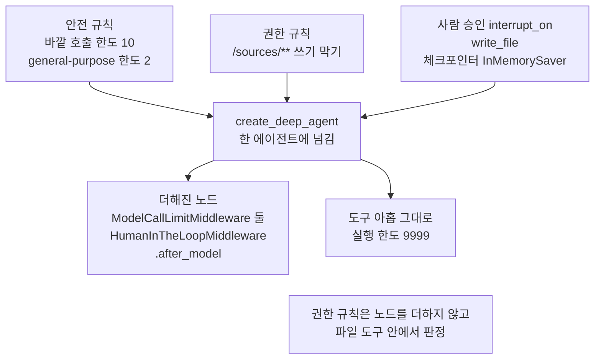
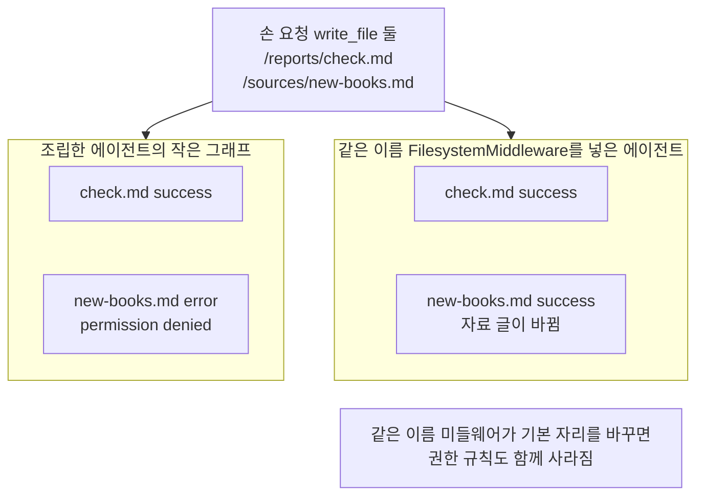
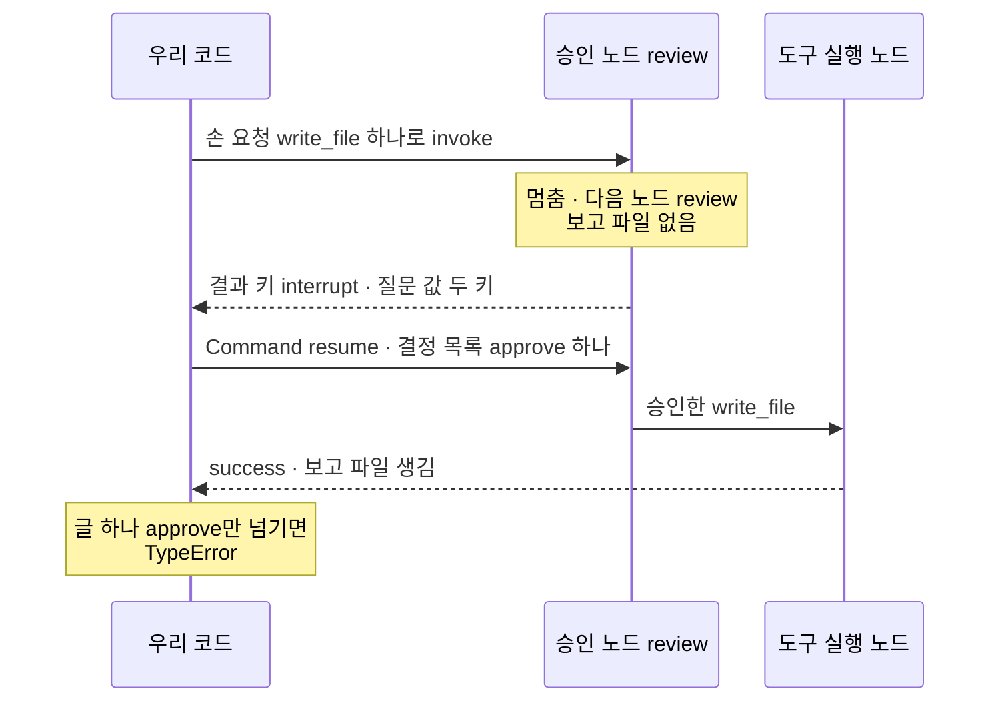
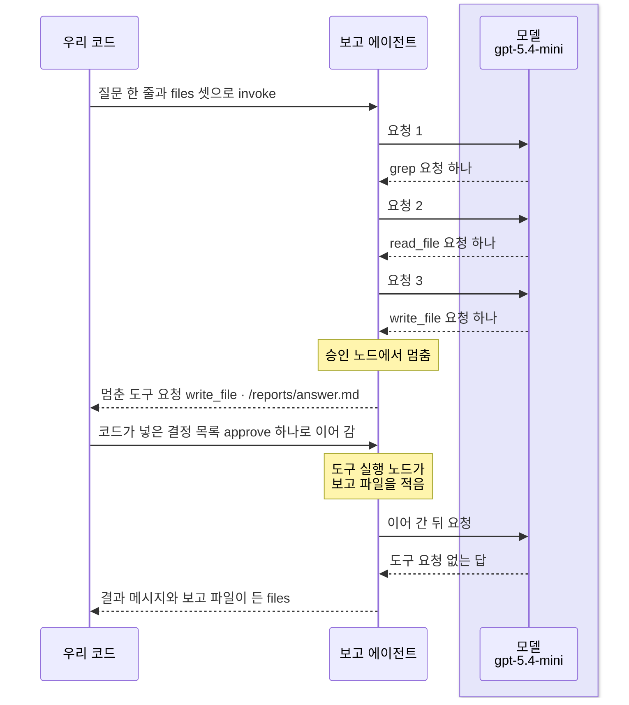
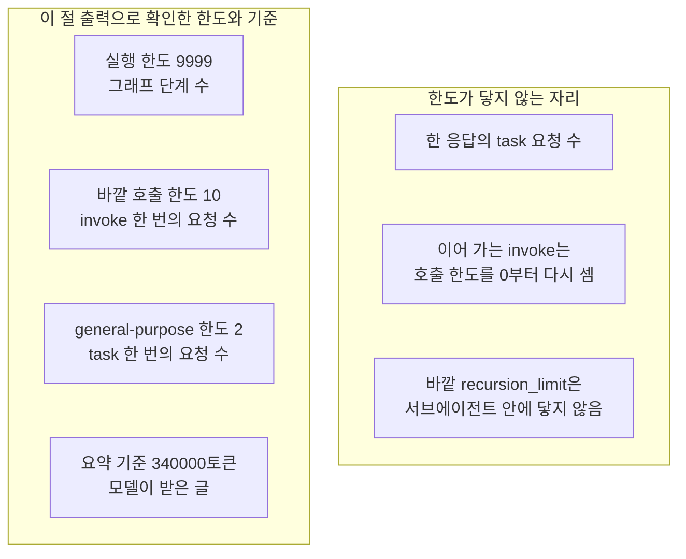

# 08-통합-실행과-운영-한계

## _src 본문 (HTML 원본)

```html
<!--meta: 강의 1h | 실습 2h | 코드 notebooks/08-통합-실행과-운영-한계.ipynb | 새 용어 2 -->
<style>html,body{overflow-x:hidden}.notebook,.nb-cell,.nb-main,.nb-input,.nb-result{min-width:0;max-width:100%}.nb-input pre,.nb-output{box-sizing:border-box;max-width:100%;overflow-x:auto}code.nb-source{display:block!important;width:100%!important;min-width:0!important;overflow-x:auto!important;padding:0!important}</style>
<h2 id="b1"><span class="no">1</span>학습 목표</h2><div class="goal"><ul>
<li>앞 절의 기능에 권한 규칙과 사람 승인을 더해 한 에이전트로 조립하고, 두 장치가 걸리는 자리를 출력으로 가를 수 있습니다.</li>
<li>사람 승인으로 멈춘 실행을 결정 목록으로 이어 가고, Ch 24의 이어 가기와 같은 점과 다른 점을 설명할 수 있습니다.</li>
<li>요청 수를 셈으로 세고, 한도와 기준을 무엇을 세는지와 닿지 않는 자리로 나눠 설명할 수 있습니다.</li>
</ul></div>
<h2 id="b2"><span class="no">2</span>이 내용을 배우는 이유</h2><p>01~07절에서는 Deep Agent의 기능을 하나씩 떼어 보았습니다. 실제로 쓸 때는 여러 기능이 한 에이전트에서 함께 돌고, 모델이 고른 도구 요청이 파일을 바꿉니다. 그래서 모델이 고른 쓰기를 실행 전에 막거나, 사람에게 묻고 멈추는 자리가 필요합니다. 또 한 번 실행에 요청이 몇 번 나가고, 어떤 한도가 어디까지 막는지 알아야 운영할 수 있습니다.</p><p>제목의 통합 실행은 앞 절들의 기능을 한 에이전트에 조립해, 한 흐름으로 실행한다는 뜻입니다. 운영 한계는 그렇게 실행할 때 한도와 판정이 막지 못하고 남는 자리를 가리킵니다.</p>
<h2 id="b3"><span class="no">3</span>앞에서 배운 내용</h2><p><a href="../ch24-human-in-the-loop/01-interrupt-승인-게이트.html">Ch 24 01절</a>에서는 쓰기 앞의 승인 지점에서 <code>interrupt</code>로 멈추고, <code>Command(resume=답)</code>으로 사람의 답을 넣어 이어 갔습니다. 그때 멈춘 자리는 쓰기까지 담은, 우리가 만든 노드 하나였고, 모델은 부르지 않았습니다. 이 절에서는 모델이 고른 도구 요청 앞에서 멈추는 사람 승인과, 파일 도구 안에서 요청을 막는 권한 규칙을 함께 봅니다. 두 장치 모두 도구가 실행되기 전의 경계를 다룹니다. 멈춘 자리를 저장하는 데에는 <a href="../ch23-persistence/01-체크포인터와-스레드.html">Ch 23 01절</a>의 체크포인터와 스레드를 씁니다.</p><p><a href="../../part5/ch20-tool-node/03-recursion-limit과-명시적-종료.html">Ch 20 03절</a>의 실행 한도는 그래프가 거친 단계 수를 셉니다. <a href="../../part4/ch16-guardrails/04-호출-한도와-비용-상한.html">Ch 16 04절</a>과 <a href="../ch22-middleware/04-호출-한도와-재시도-폴백.html">Ch 22 04절</a>의 호출 한도는 모델 요청 수를 셉니다. <a href="../../part5/ch17-agent-overview/03-모델-도구-루프와-정지-조건.html">Ch 17 03절</a>의 바퀴 한도는 루프가 돈 바퀴 수를 셉니다. <a href="../../part5/ch19-model-tools/06-오류와-읽기-쓰기-분리.html">Ch 19 06절</a>에서는 도구 메시지의 결과 상태 <code>status</code>로 성공과 오류를 갈랐습니다. 받은 오류는 <a href="../../part1/ch02-python/05-파일과-예외.html">Ch 2 05절</a>의 <code>try/except</code>로 출력합니다.</p><p><a href="01-하네스와-일곱-기능.html">01절</a>에서는 기본 도구 아홉과 안전 규칙, 권한 규칙과 사람 승인이 붙는 자리를 조립으로만 보았습니다. <a href="02-create-deep-agent와-도구.html">02절</a>의 명세와 <a href="03-플래닝과-시스템-프롬프트.html">03절</a>의 바깥 호출 한도, <a href="04-파일시스템과-중간-결과.html">04절</a>의 작은 그래프 함수를 그대로 씁니다. <a href="05-컨텍스트-관리와-오프로딩.html">05절</a>에서는 같은 이름 미들웨어가 기본 자리를 바꾸는 것과 요약 기준을 보았습니다. <a href="06-서브에이전트-위임.html">06절</a>에서는 서브에이전트 요청을 기록 훅으로 셌습니다. <a href="07-출처-검증형-deep-research.html">07절</a>에서는 교재용 자료를 상태 칸에 넣고, 출처 표시를 코드로 판정했습니다.</p>
<h2 id="b4"><span class="no">4</span>핵심 개념</h2><h3>비유로 시작하기</h3><p>01절부터 쓴 유리 온실을 이번에는 밖에서 본다고 합시다. 온실 안에는 여러 식물이 함께 자라고, 앞벽에는 유리문 둘이 나란히 있습니다. 한 문에는 자물쇠가 걸려 있고, 그 열쇠는 자물쇠 바로 옆 고리에 걸려 있습니다. 다른 문은 널빤지 두 장을 비스듬히 박아 막아 두었고, 자물쇠도 열쇠도 없습니다.</p><p>안에서 함께 자라는 식물이 한 에이전트에 조립한 기능들입니다. 자물쇠 문이 사람 승인이라, 누군가 열쇠를 써서 열어 주어야 지나갈 수 있습니다. 널빤지로 막은 문이 권한 규칙이라, 열쇠가 있어도 그쪽으로는 지나갈 수 없습니다.</p><p>비유와 다른 점도 있습니다. 이 절에서 열쇠를 쓴 쪽은 사람이 아니라 셀에 적은 코드입니다. 또 권한 규칙은 문이 아니라 파일 도구에 들어 있어서, 같은 이름 미들웨어로 파일 도구를 바꾸면 규칙도 함께 사라집니다. 문·열쇠·널빤지의 수는 어떤 값과도 짝짓지 않습니다.</p>
{{img:08-6-자물쇠-문과-막아-둔-문|흰 바탕에 유리 온실의 앞벽을 밖에서 본 그림입니다. 유리 너머 온실 안에는 초록 잎 식물이 가득 자랍니다. 앞벽에는 닫힌 유리문 둘이 나란히 있습니다. 왼쪽 문 손잡이에는 놋쇠 자물쇠가 걸려 있고, 그 바로 옆 두 문 사이에 놋쇠 열쇠 하나가 고리에 걸려 있습니다. 오른쪽 문에는 나무 널빤지 두 장이 비스듬히 박혀 있고, 자물쇠도 열쇠도 없습니다. 사람·손·글자·숫자·화살표는 없는 그림|왼쪽 문은 옆에 걸린 열쇠로 열 수 있지만, 널빤지로 막은 오른쪽 문은 열쇠가 있어도 열 수 없습니다.}}
<p class="look"><b>그림 읽기</b> — 유리 너머 온실 안에는 여러 초록 식물이 함께 자랍니다. 앞벽의 왼쪽 문에는 놋쇠 자물쇠가 걸려 있고, 열쇠 하나가 자물쇠 바로 옆 두 문 사이 고리에 걸려 있습니다. 오른쪽 문에는 널빤지 두 장이 비스듬히 박혀 있고, 자물쇠도 열쇠도 없습니다. 함께 자라는 식물이 한 에이전트에 조립한 기능들이고, 자물쇠 문이 사람 승인, 널빤지로 막은 문이 권한 규칙입니다. 문·열쇠·널빤지·식물의 수는 어떤 값과도 짝짓지 않습니다.</p>
<h3>도구 실행 경계</h3><p>도구 실행 경계는 모델이 고른 도구 요청이 실제로 실행되기 전에 거치는 자리입니다. 공연장 입구에서 표를 확인하고, 들고 들어갈 수 없는 물건을 막는 자리와 같습니다. 이 절의 에이전트에는 이런 자리가 둘 있습니다. 모델 응답 뒤에 멈춰 사람의 결정을 기다리는 승인 노드와, 쓰기 직전에 파일 위치를 보는 파일 도구 안의 권한 판정입니다.</p><p>조립에 넣은 기능은 아래 표와 같습니다. 할 일 목록(03절)과 사용자 서브에이전트(06절)는 요청 수를 늘려 넣지 않았습니다. 옮겨 두기(05절)는 큰 도구 결과가 없어 켜지지 않습니다.</p>
<table><thead><tr><th>조립한 기능</th><th>배운 곳</th><th>이 절에서 쓰는 곳</th></tr></thead><tbody><tr><td>안전 규칙(바깥 호출 한도·general-purpose 명세)</td><td>01·02·03절</td><td>한도 10·2를 그대로 넣음</td></tr><tr><td>파일 도구와 상태 칸 <code>files</code></td><td>04절</td><td>보고 파일 <code>/reports/answer.md</code></td></tr><tr><td>자료 넣기와 파일 도구로 찾기</td><td>07절</td><td>자료 셋 · <code>grep</code> · <code>read_file</code></td></tr><tr><td>출처 판정 <code>check_citations</code></td><td>07절</td><td>보고 파일의 출처 표시</td></tr><tr><td>권한 규칙 · 사람 승인</td><td>01절(조립만)</td><td>자료 폴더 쓰기 막기 · <code>write_file</code> 승인</td></tr><tr><td>체크포인터와 스레드</td><td>Ch 23 01절</td><td>멈춘 자리 저장 · 스레드 <code>report-run</code></td></tr></tbody></table>
{{mermaid:08-1-한-에이전트에-조립한-기능|위에서 아래로 읽는 흐름도입니다. 맨 위에 초록 상자 셋이 나란히 있습니다. 안전 규칙 바깥 호출 한도 10 general-purpose 한도 2, 권한 규칙 /sources/** 쓰기 막기, 사람 승인 interrupt_on write_file 체크포인터 InMemorySaver입니다. 세 상자에서 파란 상자 create_deep_agent 한 에이전트에 넘김으로 화살표가 갑니다. 거기서 노란 상자 둘로 화살표가 갑니다. 하나는 더해진 노드 ModelCallLimitMiddleware 둘 HumanInTheLoopMiddleware.after_model, 다른 하나는 도구 아홉 그대로 실행 한도 9999입니다. 맨 아래 회색 상자는 권한 규칙은 노드를 더하지 않고 파일 도구 안에서 판정인 그림|세 부품을 한 에이전트에 넘기자 사람 승인과 호출 한도는 노드로 붙었고, 권한 규칙은 노드를 더하지 않았습니다.}}
<p class="look"><b>도식 읽기</b> — 위에서 아래로 읽습니다. 초록 상자는 이 절에서 정한 값이고, 파란 상자는 우리가 부른 함수입니다. 노란 상자는 노트북 3절 출력으로 확인한 값입니다. 맨 아래 회색 상자는 설치판 소스와 4절 출력에서 나온 사실입니다.</p>
<h3>두 장치가 걸리는 자리</h3><p>권한 규칙은 노드를 더하지 않고, 파일 도구가 쓰기 직전에 파일 위치를 봅니다. 그래서 도구 실행 노드만 든 작은 그래프에서도 자료 폴더 쓰기가 결과 상태 <code>error</code>로 막혔습니다. 사람 승인은 노드 <code>HumanInTheLoopMiddleware.after_model</code>로 붙어, 모델 응답을 받은 직후에 돕니다. 같은 작은 그래프에는 이 노드가 없어서, 승인을 건 <code>write_file</code>도 멈추지 않고 실행되었습니다.</p><p>같은 이름 <code>FilesystemMiddleware</code>를 <code>middleware=</code>에 넣으면, 권한 규칙을 넘겼어도 쓰기 막기가 사라졌습니다. 권한 규칙은 기본 파일 미들웨어에 들어가는데, 같은 이름 미들웨어가 그 자리를 통째로 바꾸기 때문입니다.</p>
<h3>결정 목록</h3><p>결정 목록은 멈춘 도구 요청마다 사람이 내린 결정을 차례대로 담은 목록입니다. 회의에 올라온 안건마다 찬성이나 반대를 하나씩 적어 내는 표와 같습니다. 코드에서는 키 <code>decisions</code>에 <code>{"type": "approve"}</code> 같은 결정을 요청 수만큼 담아, <code>Command(resume=…)</code>의 답으로 넘깁니다. 결정은 승인 <code>approve</code>·고치기 <code>edit</code>·거절 <code>reject</code>·도구 대신 답하기 <code>respond</code> 넷입니다.</p>
<table><thead><tr><th></th><th>Ch 24 01절</th><th>이 절</th></tr></thead><tbody><tr><td>멈추는 자리</td><td>우리가 만든 쓰기 노드 안의 <code>interrupt</code></td><td>사람 승인 미들웨어의 승인 노드</td></tr><tr><td>무엇 앞에서 멈추나</td><td>코드가 정한 쓰기 앞</td><td>모델이 고른 <code>write_file</code> 요청 앞</td></tr><tr><td>질문 값</td><td>우리가 정한 딕셔너리</td><td><code>action_requests</code>·<code>review_configs</code></td></tr><tr><td>사람의 답</td><td>글 하나(<code>approve</code>·<code>reject</code>)</td><td>결정 목록 <code>{"decisions": [...]}</code></td></tr><tr><td>이어 가는 호출</td><td><code>invoke(Command(resume=답), config)</code></td><td>같음</td></tr><tr><td>이어 갈 때</td><td>멈춘 노드가 첫 줄부터 다시 실행</td><td>같음(설치판 소스로 확인)</td></tr></tbody></table>
<p>이어 가는 호출은 Ch 24와 같은 <code>Command(resume=…)</code>입니다. 달라진 것은 답의 모양이라, Ch 24처럼 글 하나만 넘기자 <code>TypeError</code>가 났습니다. 받는 쪽이 정한 모양으로 답을 넣어야 합니다.</p>
{{mermaid:08-3-승인-자리에서-멈추고-이어-가기|세로선 셋이 있는 차례 그림입니다. 우리 코드, 승인 노드 review, 도구 실행 노드입니다. 우리 코드에서 손 요청 write_file 하나로 invoke 화살표가 승인 노드로 갑니다. 승인 노드에 노란 메모 멈춤 다음 노드 review 보고 파일 없음이 붙고, 결과 키 interrupt와 질문 값 두 키 점선이 우리 코드로 돌아옵니다. 우리 코드에서 Command resume 결정 목록 approve 하나 화살표가 승인 노드로 가고, 승인 노드에서 승인한 write_file 화살표가 도구 실행 노드로 갑니다. 도구 실행 노드에서 success 보고 파일 생김 점선이 우리 코드로 돌아옵니다. 우리 코드에 노란 메모 글 하나 approve만 넘기면 TypeError가 붙은 그림|승인 노드에서 멈춘 요청은 결정 목록을 담은 답으로 이어 가야 실행되었고, 글 하나만 넘기면 TypeError가 났습니다.}}
<p class="look"><b>도식 읽기</b> — 위에서 아래로 실행 차례대로 읽습니다. 세로선은 우리 코드, 승인 노드, 도구 실행 노드이고, 모델은 없습니다. 실선은 부르거나 넘긴 것이고, 점선은 돌아온 결과입니다. 노란 메모는 노트북 5절 출력으로 확인한 자리입니다.</p>
<h2 id="b5"><span class="no">5</span>실행 예제</h2><p>노트북 2절은 안전 규칙과 자료를 준비하고, 3절은 권한 규칙·사람 승인·체크포인터를 한 에이전트에 조립합니다. 4절은 손 요청 둘로 권한 판정을, 5절은 승인 작은 그래프로 멈춤과 이어 가기를 모델 없이 봅니다. 6절은 실제 모델로 한 흐름을 실행하고, 7절은 요청 수와 한도를 셉니다.</p><p>모델 요청은 6절의 실행 셀과 이어 가기 셀에서만 나갑니다. 노트북 밖에서 같은 질문을 다섯 번 보냈을 때, 요청은 한 번은 4번, 네 번은 5번이었습니다. 요금표로 어림한 예상 비용은 한 번 실행에 0.01달러 아래이고, 청구 금액이 아닙니다. 디스크에는 파일을 쓰지 않고, 걸린 시간은 재지 않았습니다.</p>
{{notebook:08-통합-실행과-운영-한계}}
<p class="look"><b>확인할 점</b> — 노트북 4절에서 두 도구 메시지의 결과 상태를, 같은 이름 미들웨어를 넣은 뒤의 결과 상태와 견줍니다. 5절에서 멈춘 동안 보고 파일이 없는지와, 결정 목록을 넣은 뒤 생겼는지 봅니다. 6절에서 멈춘 도구 요청의 파일 위치를 보고, 7절에서 요청 수 셈이 맞는지 봅니다.</p>
{{mermaid:08-4-실제-모델-실행의-차례|세로선 셋이 있는 차례 그림입니다. 우리 코드, 보고 에이전트, 연보라 띠 안의 모델 gpt-5.4-mini입니다. 우리 코드에서 질문 한 줄과 files 셋으로 invoke 화살표가 보고 에이전트로 갑니다. 요청 1에 grep 요청 하나, 요청 2에 read_file 요청 하나, 요청 3에 write_file 요청 하나 점선이 돌아옵니다. 보고 에이전트에 노란 메모 승인 노드에서 멈춤이 붙고, 멈춘 도구 요청 write_file /reports/answer.md 점선이 우리 코드로 돌아옵니다. 우리 코드에서 코드가 넣은 결정 목록 approve 하나로 이어 감 화살표가 가고, 보고 에이전트에 노란 메모 도구 실행 노드가 보고 파일을 적음이 붙습니다. 이어 간 뒤 요청과 도구 요청 없는 답이 오가고, 결과 메시지와 보고 파일이 든 files 점선이 우리 코드로 돌아오는 그림|이번 실행에서 모델은 grep·read_file·write_file을 차례로 요청했고, write_file 앞에서 멈춘 뒤 코드가 넣은 승인으로 이어 갔습니다.}}
<p class="look"><b>도식 읽기</b> — 위에서 아래로 실행 차례대로 읽습니다. 세로선은 우리 코드, 보고 에이전트, 모델이고, 연보라 띠는 실제로 부른 모델 gpt-5.4-mini의 자리입니다. 노란 메모는 노트북 6절 출력으로 확인한 자리입니다. 멈출 때까지의 차례는 흔들림 확인 다섯 번과 두 커널에서 같았을 때만 그렸습니다. 이어 간 뒤의 요청 수는 실행마다 달라 그림에 수를 적지 않았습니다.</p>
<h2 id="b6"><span class="no">6</span>실험 결과 해석</h2><p>앞 절반의 값은 모두 코드가 정하는 구조 값입니다. 손 요청 둘은 조립한 에이전트에서 <code>success</code>와 <code>error</code>로 갈렸습니다. 같은 이름 <code>FilesystemMiddleware</code>를 넣은 에이전트에서는 둘 다 <code>success</code>였습니다. 승인 작은 그래프는 손 요청 하나에서 멈췄고, 결정 목록을 넣자 보고 파일이 생겼습니다. 글 하나를 답으로 넘기자 <code>TypeError</code>가 났습니다.</p>
{{mermaid:08-2-권한-규칙과-같은-이름-미들웨어|위에서 아래로 읽는 흐름도입니다. 맨 위 초록 상자 손 요청 write_file 둘 /reports/check.md /sources/new-books.md에서 나란한 두 칸으로 화살표가 갑니다. 조립한 에이전트의 작은 그래프 칸에는 노란 상자 check.md success와 new-books.md error permission denied가 위아래로 있습니다. 같은 이름 FilesystemMiddleware를 넣은 에이전트 칸에는 노란 상자 check.md success와 new-books.md success 자료 글이 바뀜이 위아래로 있습니다. 같은 이름 칸 아래 회색 상자는 같은 이름 미들웨어가 기본 자리를 바꾸면 권한 규칙도 함께 사라짐인 그림|같은 손 요청 둘에서, 규칙이 살아 있는 에이전트는 자료 폴더 쓰기를 error로 막았고 같은 이름 미들웨어를 넣은 에이전트는 막지 못했습니다.}}
<p class="look"><b>도식 읽기</b> — 맨 위 초록 상자는 모델 없이 손으로 만든 요청입니다. 두 칸은 같은 요청을 넣은 서로 다른 에이전트라 나란히 두었고, 칸 안은 위에서 아래로 요청 차례입니다. 노란 상자는 노트북 4절 출력이고, 결과 상태 error도 받아 출력한 도구 메시지라 노랑입니다. 같은 이름 칸 아래 회색 상자는 설치판 graph.py에서 확인한 까닭이고, 그 칸에만 해당합니다.</p>
<p>아래 표는 이 절이 확인한 값과 그 성격입니다. 구조 값은 코드가 정하는 값이고, 모델 판단 값은 모델이 고른 값입니다. 흔들리는 값은 실행마다 달라질 수 있어 결론에 쓰지 않습니다.</p>
<table><thead><tr><th>확인한 것</th><th>교재 출력</th><th>값의 성격</th></tr></thead><tbody><tr><td>조립한 에이전트</td><td>노드 여덟(승인 노드·호출 한도 노드 둘) · <code>도구 수: 9</code> · <code>실행 한도: 9999</code></td><td>구조 값</td></tr><tr><td>손 요청 둘</td><td><code>success</code> · <code>error</code>(permission denied) · 새 책 소식 그대로 <code>True</code></td><td>구조 값</td></tr><tr><td>같은 이름 <code>FilesystemMiddleware</code></td><td><code>success</code> · <code>success</code> · 새 책 소식 그대로 <code>False</code></td><td>구조 값</td></tr><tr><td>승인 작은 그래프</td><td>결과 키 <code>__interrupt__</code> · <code>다음 노드: ('review',)</code> · 결정 넷 · 이어 간 뒤 <code>success</code></td><td>구조 값</td></tr><tr><td>Ch 24 모양의 답</td><td><code>TypeError</code></td><td>구조 값</td></tr><tr><td>6·7절 요청 수 셈</td><td><code>도구를 요청한 응답 수 + 1과 같은가: True</code></td><td>구조 값</td></tr><tr><td>멈출 때까지의 차례와 멈춘 요청</td><td><code>grep</code> → <code>read_file</code> → <code>write_file</code>에서 멈춤(요청 3) · <code>멈춘 도구 요청: write_file | /reports/answer.md</code> · <code>task 요청 수: 0</code> · <code>자료 셋이 그대로인가: True</code></td><td>모델 판단 값</td></tr><tr><td>이어 간 뒤 요청 수·보고 파일 글·판정·토큰·예상 비용</td><td>교재 출력 <code>요청 수: 4</code>(이어 간 뒤 1 — 노트북 밖 다섯 번 가운데 네 번은 5) · 보고 파일 두 문장(판정 두 줄 모두 <code>True</code>) · <code>입력 토큰: 8104 | 출력 토큰: 160</code> · <code>예상 비용(달러): 0.006798</code>(새 커널 두 번째는 둘째 문장이 다르고 입력 8110·출력 164)</td><td>흔들리는 값</td></tr></tbody></table>
<p>흔들림 확인 다섯 번과 두 커널에서 모두, 모델은 <code>grep</code>·<code>read_file</code>·<code>write_file</code>을 차례로 요청했고 <code>write_file</code> 앞에서 멈췄습니다. 멈춘 요청의 파일 위치는 시스템 메시지 글이 정한 보고 파일이었고, 자료 폴더에 쓰려는 요청은 없었습니다. 이어 간 뒤의 차례는 달랐습니다. 두 커널은 바로 답했지만, 노트북 밖 다섯 번 가운데 네 번은 보고 파일을 다시 읽은 뒤 답했습니다. 그래서 이 절은 전체 요청 수가 아니라, 요청 수 = 도구를 요청한 응답 수 + 1이라는 셈을 결론으로 둡니다.</p>
<h3>운영 한계</h3><p>운영 한계는 한도와 판정을 모두 켜도 막지 못하고 남는 자리입니다. 아래 표는 이 챕터에서 본 한도·기준·판정을, 무엇을 세거나 보는지와 닿지 않는 자리로 나눈 것입니다. 반복 수 하나로 뭉뚱그리지 않고, 한도마다 이름을 나눠 적었습니다.</p>
<table><thead><tr><th>한계</th><th>세거나 보는 것</th><th>이 절의 값</th><th>닿지 않는 자리</th></tr></thead><tbody><tr><td>요청 수 셈</td><td>넣은 질문 뒤의 응답 수(서브에이전트가 없을 때)</td><td>도구를 요청한 응답 수 + 1</td><td><code>task</code>를 부르면 안쪽 요청은 결과 메시지에 없음 — 06절 기록 훅</td></tr><tr><td>실행 한도</td><td>그래프가 거친 단계 수(Ch 20 03절)</td><td><code>9999</code></td><td>바깥 <code>recursion_limit</code>은 서브에이전트 안에 닿지 않음(06절)</td></tr><tr><td>호출 한도</td><td>invoke 한 번 안의 모델 요청 수(Ch 16 04절·Ch 22 04절)</td><td>바깥 <code>10</code> · general-purpose <code>2</code>(<code>task</code> 한 번마다)</td><td>한 응답의 <code>task</code> 요청 수(06절) · 승인 뒤 이어 가는 invoke는 0부터 다시 셈</td></tr><tr><td>요약 기준</td><td>모델이 받은 글의 토큰(05절)</td><td><code>340000</code></td><td>수업 실행은 한참 못 미쳐 요약이 일어나지 않음</td></tr><tr><td>권한 규칙</td><td>파일 도구가 쓰기 전에 보는 파일 위치</td><td>자료 폴더 쓰기 <code>error</code></td><td>같은 이름 <code>FilesystemMiddleware</code>를 넣으면 사라짐 · 백엔드 직접 호출(04절)과 우리 도구에는 걸리지 않음</td></tr><tr><td>사람 승인</td><td>모델 응답 뒤, 실행 전의 도구 요청</td><td>결정 목록으로 이어 감</td><td>승인 노드가 없는 그래프에서는 멈추지 않음 · 답의 모양이 다르면 <code>TypeError</code></td></tr><tr><td>출처 판정</td><td>인용한 파일이 상태 칸에 있는가(07절)</td><td>보고 파일의 표시 판정</td><td>글 내용과 빠진 자료는 보지 않음(07절)</td></tr></tbody></table>
<p>이 챕터의 Deep Agent에는 Ch 17 03절의 바퀴 한도라는 설정이 따로 없습니다. 바퀴마다 모델 요청이 한 번 나가므로, 바퀴 수는 호출 한도가 막습니다. 호출 한도는 invoke 한 번마다 셉니다. 그래서 승인으로 멈췄다가 이어 가면, 이어 간 invoke에서 다시 0부터 셉니다.</p>
{{mermaid:08-5-한도가-세는-것과-닿지-않는-곳|나란한 두 칸이 있는 그림입니다. 이 절 출력으로 확인한 한도와 기준 칸에는 노란 상자 넷이 위아래로 있습니다. 실행 한도 9999 그래프 단계 수, 바깥 호출 한도 10 invoke 한 번의 요청 수, general-purpose 한도 2 task 한 번의 요청 수, 요약 기준 340000토큰 모델이 받은 글입니다. 한도가 닿지 않는 자리 칸에는 회색 상자 셋이 위아래로 있습니다. 한 응답의 task 요청 수, 이어 가는 invoke는 호출 한도를 0부터 다시 셈, 바깥 recursion_limit은 서브에이전트 안에 닿지 않음입니다. 화살표는 없는 그림|한도마다 세는 것이 다르고, 한 응답의 task 요청 수처럼 어느 한도도 세지 않는 자리가 남습니다.}}
<p class="look"><b>도식 읽기</b> — 두 칸은 서로 다른 성격의 목록이라 나란히 두었고, 칸 안은 위에서 아래로 읽습니다. 노란 상자는 노트북 7절 출력으로 확인한 값이고, 상자 둘째 줄에 그 한도가 세는 것을 적었습니다. 회색 상자는 설치판 소스와 노트북 밖 확인으로 본 사실이라, 노트북에서는 실행하지 않았습니다.</p>
<p>새 커널로 두 번 실행해 견주자, 코드 셀 서른하나 가운데 스물여덟의 출력이 같았습니다. 달랐던 세 셀은 보고 파일의 글·토큰·예상 비용이 찍힌 셀입니다. 멈출 때까지의 차례와 멈춘 요청은 두 번 모두 같았고, 두 번 모두 같았던 값만 결론과 그림에 썼습니다. 요청 수 4도 두 번 같았지만, 노트북 밖 다섯 번과 달라 결론에 쓰지 않았습니다.</p>
<p class="look"><b>확인할 점</b> — 노트북 6절 결과 메시지에서 <code>write_file</code> 도구 메시지가 결정 목록을 넣은 뒤에 나오는지 봅니다. 7절의 요청 수가 6절 결과 메시지의 <code>AIMessage</code> 줄 수와 같은지 셉니다. 교재 출력에서는 네 줄, 요청 수 4였습니다.</p>
<h2 id="b7"><span class="no">7</span>주의할 점과 실무 메모</h2><ul><li>자료 셋·시스템 메시지 글·질문·보고 파일 위치는 흐름을 보여 주려고 실행 전에 정한 교재용 예입니다. 실제 기관의 글이 아니고, 결과를 보고 바꾸지 않았습니다.</li><li>이 노트북에서 사람의 답은 사람이 고른 값이 아니라, 셀이 멈춘 요청마다 넣은 승인입니다. 실제 운영에서는 사람이 질문 값을 보고 결정을 고르는 화면이나 메시지가 필요하고, 이 과정에서는 만들지 않았습니다.</li><li>노트북을 쓰기 전에 6절 실행을 노트북 밖에서 다섯 번 보냈습니다. 멈출 때까지의 차례와 멈춘 요청은 다섯 번 모두 같았고, 네 번은 이어 간 뒤 적은 보고 파일을 다시 읽었습니다. 같은 요청도 실행한 때에 따라 도구 차례가 달라질 수 있습니다. 교재 출력은 다시 읽지 않은 실행이고, 다시 읽었다면 요청은 5번이 됩니다.</li><li>결정 <code>edit</code>·<code>reject</code>·<code>respond</code>는 노트북에서 실행하지 않았습니다. 노트북 밖에서 모델 없이 확인하니, <code>edit</code>으로 파일 위치를 자료 폴더로 바꾸자 권한 규칙이 막았습니다. 결정 수가 멈춘 요청 수와 다르면 <code>ValueError</code>가 났습니다.</li><li>이 절의 작은 그래프 <code>review_graph</code>는 승인 노드 뒤에 도구 실행 노드로 곧장 갑니다. 그래서 <code>reject</code>·<code>respond</code>를 넣어도 쓰기를 그대로 실행합니다. 노트북 밖에서 모델 없이 확인했습니다. 실제 에이전트는 설치판 <code>agents/factory.py</code> 1953~1964행에서 짝 도구 메시지가 있는 요청을 건너뜁니다. 그래서 이 그래프로는 승인만 봅니다.</li><li>설치판 <code>model_call_limit.py</code> 34행에서, 한 번 실행의 요청 수를 세는 칸은 체크포인트에 저장하지 않는 칸입니다. 그래서 멈췄다가 이어 가는 invoke에서는 그 수를 0부터 다시 셉니다. 노트북 밖의 작은 그래프로 모델 없이 확인했고, 노트북에서는 한도에 닿는 실행을 하지 않았습니다.</li><li>스레드 전체의 요청 수를 막는 인자 <code>thread_limit</code>도 있지만, 이 노트북에서는 쓰지 않았습니다.</li><li>06절에서 본 것처럼, general-purpose 명세도 바깥의 권한 규칙과 <code>interrupt_on</code>을 물려받습니다. 설치판 <code>graph.py</code> 664·720행이 그 자리이고, 이번 실행에서는 <code>task</code>가 불리지 않았습니다.</li><li>공식 권한 문서는 권한 규칙이 내장 파일 도구에만 걸린다고 적습니다. 우리 도구와 명령을 실행하는 백엔드에는 걸리지 않고, 04절에서 본 백엔드 직접 호출에도 걸리지 않습니다.</li><li>체크포인터 <code>InMemorySaver</code>는 멈춘 자리를 메모리에 두므로, 커널을 끄면 사라집니다. 오래 남기려면 Ch 23 02·03절의 PostgreSQL·SQLite 체크포인터가 있지만, 이 노트북에서는 쓰지 않았습니다.</li><li>걸린 시간은 재지 않았습니다. 교재 출력은 Linux의 Python 3.12.13으로 만들었고, 다른 판과 Windows·macOS에서는 실행하지 않았습니다.</li></ul>
<h2 id="b8"><span class="no">8</span>정리와 다음 절</h2><ul><li>권한 규칙은 파일 도구 안에서 판정해, 자료 폴더 쓰기를 결과 상태 <code>error</code>로 막습니다. 같은 이름 <code>FilesystemMiddleware</code>를 넣으면 이 규칙이 사라집니다.</li><li>사람 승인은 모델 응답 뒤 승인 노드에서 멈추고, 결정 목록을 담은 <code>Command(resume=…)</code>로 이어 갑니다.</li><li>요청 수는 도구를 요청한 응답 수 + 1입니다. 한도마다 세는 것이 달라, 어느 한도도 세지 않는 자리가 남습니다.</li></ul><p><strong>다음 학습과 이어지는 지점</strong> — 이 절로 Ch 27 본문이 끝납니다. <a href="09-DeepAgents-실습.html">09절</a>은 이 챕터의 실습입니다. 파일 도구와 사람 승인을 메모 에이전트 하나에 모으고, 승인을 켠 실행과 끈 실행을 견줍니다.</p>
<h2 id="b9"><span class="no">9</span>복습 문제</h2><details class="quiz" open><summary>문제 4개 · 해설 포함</summary><p class="quiz-q">1. 조립한 에이전트의 도구 실행 노드만 든 작은 그래프에 자료 폴더 쓰기 요청을 넣었습니다. 결과 상태는 무엇이고, 모델 없이도 막힌 까닭은 무엇인가요?</p><p class="quiz-a">결과 상태는 <code>error</code>입니다. 권한 규칙은 파일 도구가 쓰기 직전에 판정하므로, 도구 실행 노드만 있어도 걸립니다. 틀렸다면 노트북 4절을 다시 읽습니다.</p><p class="quiz-q">2. 같은 작은 그래프에서, 사람 승인을 건 <code>write_file</code>은 멈추지 않았습니다. 왜 그런가요?</p><p class="quiz-a">사람 승인은 모델 응답 뒤의 승인 노드에서 멈추는데, 그 작은 그래프에는 승인 노드가 없기 때문입니다. 5절처럼 승인 노드를 넣은 그래프에서는 멈췄습니다. 틀렸다면 노트북 4·5절을 다시 읽습니다.</p><p class="quiz-q">3. 동료가 Ch 24처럼 <code>Command(resume="approve")</code>로 이어 가려 합니다. 어떻게 되고, 무엇을 넘겨야 하나요?</p><p class="quiz-a">오류 <code>TypeError</code>가 납니다. 멈춘 요청마다 결정 하나를 담은 결정 목록을 <code>{"decisions": [{"type": "approve"}]}</code>처럼 넘겨야 합니다. 틀렸다면 노트북 5절 마지막 셀을 다시 읽습니다.</p><p class="quiz-q">4. 「바깥 호출 한도를 10으로 주었으니, 이 흐름의 요청은 10번을 넘지 않는다」는 말은 맞나요?</p><p class="quiz-a">맞지 않을 수 있습니다. 호출 한도는 invoke 한 번마다 세고, 멈췄다가 이어 가면 다시 셉니다. 도구 <code>task</code>를 부르면 서브에이전트 요청은 명세의 한도로 따로 세고, 한 응답의 <code>task</code> 요청 수는 막지 않습니다. 틀렸다면 본문 6절의 운영 한계 표를 다시 읽습니다.</p></details>
<h2 id="b10"><span class="no">10</span>참고 자료</h2><ul><li><div><a href="https://docs.langchain.com/oss/python/deepagents/human-in-the-loop">Deep Agents 문서의 사람 승인</a></div>확인 2026-09-28 · 사람 승인에는 체크포인터가 반드시 필요하다고 적습니다. 이어 가기를 <code>Command(resume={"decisions": [...]})</code>로 보이고, 결정 넷을 풉니다. 문서 예에도 이 과정에서 쓰지 않은 인자 <code>version</code>이 있습니다.</li><li><div><a href="https://docs.langchain.com/oss/python/deepagents/permissions">Deep Agents 문서의 권한 규칙</a></div>확인 2026-09-28 · 먼저 맞는 규칙이 이기고, <code>**</code>는 아래 모든 파일을 뜻합니다. 서브에이전트는 권한 규칙을 물려받고, 규칙은 내장 파일 도구에만 걸린다고 적습니다.</li><li><div><a href="https://docs.langchain.com/oss/python/langchain/human-in-the-loop">LangChain 문서의 사람 승인 미들웨어</a></div>확인 2026-09-28 · 승인 훅이 모델 응답 뒤, 도구 실행 전에 돈다고 적습니다. 결정의 차례는 질문 값의 요청 차례와 같아야 합니다. 문서 예의 호출에는 이 과정에서 쓰지 않은 인자 <code>version</code>이 있습니다.</li><li>설치판 deepagents 0.7.0 소스 <code>graph.py</code> 201~235행은 같은 이름 미들웨어가 자리를 바꾸는 규칙입니다. 664·720행은 서브에이전트가 권한 규칙과 <code>interrupt_on</code>을 물려받는 자리이고, 871~876행은 승인 미들웨어를 붙이는 자리입니다. 937행은 실행 한도 9999입니다.</li><li>설치판 deepagents 0.7.0 소스 <code>middleware/filesystem.py</code> 89행은 <code>**</code>를 여러 폴더로 읽는 설정입니다. 1727~1733행은 <code>write_file</code>의 권한 판정입니다.</li><li>설치판 langchain 1.4.0 소스 <code>human_in_the_loop.py</code> 405행은 승인 훅이고, 456행은 답에서 결정 목록을 꺼내는 자리입니다. 461행은 결정 수가 다를 때의 오류 글입니다. <code>model_call_limit.py</code> 34행은 한 번 실행의 요청 수를 세는 칸입니다.</li></ul>
```

## 노트북 셀 (순서대로)

### [0] markdown {'html': 'skip'}

# 통합 실행과 운영 한계

**이 노트북에서 할 일**

1. 앞 절들의 기능에 권한 규칙과 사람 승인을 더해 한 에이전트로 조립하고, 두 장치가 걸리는 자리를 모델 없이 봅니다.
2. 실제 모델이 보고 파일을 쓰려 할 때 승인 자리에서 멈추고, 코드가 넣은 결정으로 이어 가는 흐름을 봅니다.
3. 요청 수를 세고, 운영에서 남는 한도와 기준을 무엇을 세는지와 함께 모읍니다.

**준비물** — 프로젝트 폴더의 `.env` 파일에 `OPENAI_API_KEY`가 있어야 합니다.
모델은 `gpt-5.4-mini`이고, 6절에서 보고 에이전트를 한 번 실행합니다.
이 실행은 승인 자리에서 한 번 멈추고, 코드가 넣은 결정으로 이어 갑니다.
노트북 밖에서 같은 질문을 다섯 번 보냈을 때, 요청은 한 번은 4번, 네 번은 5번이었습니다.
호출 한도는 보고 에이전트 10, general-purpose 2로 줍니다.

요금표로 어림한 예상 비용은 한 번 실행에 0.01달러 아래이고, 청구 금액이 아닙니다.
파일은 상태 칸 `files`에만 두고, 디스크에는 쓰지 않습니다.
멈춘 자리는 메모리에 두는 체크포인터 `InMemorySaver`에 저장합니다.
모델의 답 글은 실행마다 달라질 수 있습니다.
걸린 시간은 재지 않았습니다.

앞에서 배운 함수 여섯은 도구 파일 `harness_tools.py`에서 가져옵니다.

**기준 버전** — 첫 셀에서 패키지 다섯을 설치합니다.
판은 deepagents 0.7.0, langchain 1.4.0, langgraph 1.2.11입니다.
나머지 둘은 `langchain-openai` 1.6.0과 `python-dotenv` 1.2.3입니다.
교재 출력은 Linux의 Python 3.12.13으로 만들었습니다.
다른 판과 Windows·macOS에서는 실행하지 않았습니다.

**강의와 실습 범위** — 강의 시간에는 2~5절을 읽습니다.
모델 없이 조립하고, 권한 규칙과 사람 승인이 걸리는 자리를 보는 곳입니다.
6·7절은 실제 모델로 한 번 실행하고 요청 수를 세는 실습이고, 실습 시간에 실행합니다.

실습 폴더 `labs/part6/ch27-deepagents`에서 `uv sync --locked`를 실행합니다.
그다음 `notebooks/` 폴더의 이 노트북을 열고, 실습 폴더의 `.venv` 커널을 고릅니다.
첫 셀부터 순서대로 실행합니다.

### [1] markdown {'html': 'skip'}

## 오늘 볼 그림


위에서 아래로 읽습니다.
초록 상자는 이 절에서 정한 값이고, 파란 상자는 우리가 부른 함수입니다.
노란 상자는 노트북 3절 출력으로 확인한 값입니다.
맨 아래 회색 상자는 설치판 소스와 4절 출력에서 나온 사실입니다.

### [2] markdown {}

## 1. 준비

이 절은 이 챕터 본문의 마지막 절입니다.
01~07절에서 하나씩 본 기능 가운데 몇 가지를 한 에이전트에 함께 조립하고, 한 번 실행합니다.
여기에 모델이 고른 도구 요청을 실행 전에 막거나 멈추는 장치 둘을 더합니다.
하나는 파일 도구 안의 권한 규칙이고, 다른 하나는 사람 승인입니다.
마지막에는 운영에서 남는 한도와 기준을 한곳에 모읍니다.

첫 셀은 패키지 다섯을 설치하고 설치된 판 번호를 출력합니다.
설치에는 몇십 초가 걸릴 수 있습니다.

### [3] code {'execution': {'iopub.execute_input': '2026-09-28T16:14:34.493739Z', 'iopub.status.busy': '2026-09-28T16:14:34.493579Z', 'iopub.status.idle': '2026-09-28T16:14:35.263222Z', 'shell.execute_reply': '2026-09-28T16:14:35.262652Z'}, 'lesson_role': 'setup'}

```python
# 이 절에서 쓰는 패키지를 설치하고 버전을 확인합니다
%pip install -q "deepagents==0.7.0" "langchain==1.4.0" "langchain-openai==1.6.0" "langgraph==1.2.11" "python-dotenv==1.2.3"
from importlib.metadata import version

print("deepagents:", version("deepagents"))
print("langchain:", version("langchain"))
print("langchain-openai:", version("langchain-openai"))
print("langgraph:", version("langgraph"))
print("python-dotenv:", version("python-dotenv"))
```

출력:
```
Note: you may need to restart the kernel to use updated packages.
deepagents: 0.7.0
langchain: 1.4.0
langchain-openai: 1.6.0
langgraph: 1.2.11
python-dotenv: 1.2.3

```

### [4] markdown {}

**결과 읽기** — 출력 줄 `deepagents: 0.7.0`과 `langgraph: 1.2.11`이 보입니다.
다섯 판 모두 실습 폴더 잠금과 같은 판입니다.
패키지 langgraph는 작은 그래프와 체크포인터, 이어 가기의 `Command`를 가져오려고 넣었습니다.

다음 셀은 이 절에서 쓸 이름을 가져옵니다.
마지막 가져오기 줄은 앞에서 배운 함수 여섯을 도구 파일 `harness_tools.py`에서 가져옵니다.

### [5] code {'execution': {'iopub.execute_input': '2026-09-28T16:14:35.264262Z', 'iopub.status.busy': '2026-09-28T16:14:35.264178Z', 'iopub.status.idle': '2026-09-28T16:14:36.710135Z', 'shell.execute_reply': '2026-09-28T16:14:36.709788Z'}, 'lesson_role': 'setup'}

```python
# Deep Agents(01절)·상태 형식(04절)·호출 한도(Ch 22)·모델·메시지·체크포인터(Ch 23)·그래프·Command(Ch 24) 이름을 가져옵니다
from deepagents import FilesystemMiddleware, FilesystemPermission, create_deep_agent
from deepagents.middleware.filesystem import FilesystemState
from langchain.agents.middleware import ModelCallLimitMiddleware
from langchain.chat_models import init_chat_model
from langchain.messages import AIMessage, HumanMessage
from langgraph.checkpoint.memory import InMemorySaver
from langgraph.graph import END, START, StateGraph
from langgraph.types import Command
# 앞 챕터와 01·07절에서 배운 함수 여섯은 도구 파일에서 가져옵니다(check_citations·call_args는 이 절에서 도구 파일에 더함)
from harness_tools import call_args, check_citations, estimate_cost, show_messages, sum_usage, tool_names

print("도구 파일에서 가져온 함수:", "call_args, check_citations, estimate_cost, show_messages, sum_usage, tool_names")
```

출력:
```
도구 파일에서 가져온 함수: call_args, check_citations, estimate_cost, show_messages, sum_usage, tool_names

```

### [6] markdown {}

**결과 읽기** — 출력 줄 `도구 파일에서 가져온 함수: call_args, check_citations, estimate_cost, show_messages, sum_usage, tool_names`가 보입니다.
네 함수 `estimate_cost`·`show_messages`·`sum_usage`·`tool_names`의 뜻은 02절 1절에 적었습니다.
나머지 둘은 07절 노트북에서 처음 만든 함수이고, 이 절에서 07절 셀 글 그대로 도구 파일에 더했습니다.
함수 `check_citations`는 출처 표시가 가리키는 파일이 있는지 판정하고, `call_args`는 도구 요청의 인자 값을 모읍니다.

앞에서 배운 함수는 `harness_tools.py`에 모아 두었고, 파일을 열면 코드를 볼 수 있습니다.
커널이 `notebooks/` 폴더에서 시작해야 이 파일을 가져올 수 있습니다.
가져온 이름 가운데 `InMemorySaver`는 Ch 23 01절의 체크포인터입니다.
이름 `Command`는 Ch 24 01절에서 사람의 답으로 이어 갈 때 쓴 이름입니다.

### [7] markdown {}

API 키가 있는지 확인합니다. `True` 값이 나오면 다음으로 넘어갑니다.

### [8] code {'execution': {'iopub.execute_input': '2026-09-28T16:14:36.710823Z', 'iopub.status.busy': '2026-09-28T16:14:36.710766Z', 'iopub.status.idle': '2026-09-28T16:14:36.715546Z', 'shell.execute_reply': '2026-09-28T16:14:36.715193Z'}, 'lesson_role': 'setup'}

```python
# .env 파일에서 OpenAI API 키를 읽습니다(키 값은 출력하지 않습니다)
import os
from dotenv import find_dotenv, load_dotenv

env_path = find_dotenv(usecwd=True)
load_dotenv(env_path)
has_key = os.getenv("OPENAI_API_KEY") is not None
print("OPENAI_API_KEY 설정 여부:", has_key)
assert has_key, "프로젝트 폴더의 .env 파일에 OPENAI_API_KEY를 적어 주세요."
```

출력:
```
OPENAI_API_KEY 설정 여부: True

```

### [9] markdown {}

실습에 쓸 모델을 준비합니다.
temperature 값을 0으로 두어 매번 비슷한 답을 고르게 합니다.

### [10] code {'execution': {'iopub.execute_input': '2026-09-28T16:14:36.716138Z', 'iopub.status.busy': '2026-09-28T16:14:36.716081Z', 'iopub.status.idle': '2026-09-28T16:14:37.690087Z', 'shell.execute_reply': '2026-09-28T16:14:37.689782Z'}}

```python
# 실습에 쓸 모델을 준비합니다
model = init_chat_model(
    "openai:gpt-5.4-mini",
    temperature=0,
    reasoning_effort="none",
)
print("모델 이름:", model.model_name)
print("temperature:", model.temperature)
```

출력:
```
모델 이름: gpt-5.4-mini
temperature: 0.0

```

### [11] markdown {}

**결과 읽기** — 모델 이름 `gpt-5.4-mini`, temperature `0.0`이 보이면 준비가 끝났습니다.
이 노트북의 출력은 2026-09-28에 이 모델로 실행한 결과입니다.
temperature 값을 0으로 두어도, 실행마다 답 문장이 달라질 수 있습니다.
이 셀은 모델 객체만 만들고, 모델 요청은 아직 보내지 않습니다.
모델 요청은 6절의 실행 셀과 이어 가기 셀에서만 나갑니다.

2~5절은 이 객체로 Deep Agent를 만들기만 하고, 모델을 부르지 않습니다.
이 절은 파일을 디스크에 쓰지 않고, 상태 칸 `files`만 씁니다.

## 2. 자료와 안전 규칙 준비하기

01절 안전 규칙대로, 모델을 부르는 에이전트에는 두 한도를 넣습니다.
다음 셀은 02절 셀과 같은 글의 general-purpose 명세입니다.

### [12] code {'execution': {'iopub.execute_input': '2026-09-28T16:14:37.690831Z', 'iopub.status.busy': '2026-09-28T16:14:37.690775Z', 'iopub.status.idle': '2026-09-28T16:14:37.692797Z', 'shell.execute_reply': '2026-09-28T16:14:37.692459Z'}}

```python
# 기본 서브에이전트와 같은 이름의 명세를 만들고, 그 안에 자기 호출 한도 둘을 넣습니다(01절 6절 모양)
helper_limit = ModelCallLimitMiddleware(run_limit=2, exit_behavior="end")
helper_spec = {
    "name": "general-purpose",
    "description": "교재용 도우미입니다. 맡긴 일을 짧게 처리합니다.",
    "system_prompt": "맡긴 일을 두 문장의 한국어로 처리하세요.",
    "middleware": [helper_limit],
}
print("명세의 키:", list(helper_spec))
```

출력:
```
명세의 키: ['name', 'description', 'system_prompt', 'middleware']

```

### [13] markdown {}

**결과 읽기** — 출력 줄 `명세의 키: ['name', 'description', 'system_prompt', 'middleware']`가 보입니다.
이 명세는 기본 general-purpose 서브에이전트의 자리를 바꾸고, 자기 호출 한도 2를 갖습니다.
모델이 `task`를 부르면, 한 번 부를 때마다 요청이 두 번까지만 나갑니다.

다음 셀은 03절 셀과 같은 글의 바깥 호출 한도입니다.

### [14] code {'execution': {'iopub.execute_input': '2026-09-28T16:14:37.693295Z', 'iopub.status.busy': '2026-09-28T16:14:37.693250Z', 'iopub.status.idle': '2026-09-28T16:14:37.694950Z', 'shell.execute_reply': '2026-09-28T16:14:37.694662Z'}}

```python
# 바깥 에이전트의 모델 요청을 열 번까지로 막는 호출 한도를 만듭니다(02절 셀과 한도만 다름)
outer_limit = ModelCallLimitMiddleware(run_limit=10, exit_behavior="end")
print("바깥 호출 한도:", outer_limit.run_limit)
```

출력:
```
바깥 호출 한도: 10

```

### [15] markdown {}

**결과 읽기** — 출력 줄 `바깥 호출 한도: 10`이 보입니다.
주석의 「02절 셀과 한도만 다름」은 이 셀을 처음 쓴 03절에서 적은 말입니다.
이 한도는 invoke 한 번 안의 모델 요청 수를 셉니다.
6절의 실행은 승인 자리에서 멈춘 뒤 이어 가므로, invoke 두 번으로 나뉩니다.
이 점이 한도에 주는 영향은 7절에서 봅니다.

다음 셀은 07절 셀과 같은 글의 교재용 자료 셋입니다.
실제 기관의 글이 아니라, 흐름을 보여 주려고 07절에서 정한 글입니다.

### [16] code {'execution': {'iopub.execute_input': '2026-09-28T16:14:37.695489Z', 'iopub.status.busy': '2026-09-28T16:14:37.695431Z', 'iopub.status.idle': '2026-09-28T16:14:37.697173Z', 'shell.execute_reply': '2026-09-28T16:14:37.696883Z'}}

```python
# 조사에 쓸 교재용 자료 셋을 파일 위치마다 정합니다(실제 기관의 글이 아님)
source_texts = {
    "/sources/closing-notice.md": "# 서가 정리 휴관 안내\n10월 셋째 주 토요일은 서가 정리로 자료실을 열지 않습니다.\n이날은 대출·연장·반납 창구를 열지 않습니다.",
    "/sources/return-box.md": "# 무인 반납함 안내\n자료실 정문 옆 무인 반납함은 휴관일에도 쓸 수 있습니다.\n반납함에 넣은 책은 다음 운영일에 반납 처리됩니다.",
    "/sources/new-books.md": "# 새로 들어온 책\n이번 달에는 데이터 분석 입문서 세 권이 들어왔습니다.\n새 책은 들어온 날부터 일주일 동안 자료실 안에서만 볼 수 있습니다.",
}
print("자료 파일 위치:", list(source_texts))
```

출력:
```
자료 파일 위치: ['/sources/closing-notice.md', '/sources/return-box.md', '/sources/new-books.md']

```

### [17] markdown {}

**결과 읽기** — 출력 줄 `자료 파일 위치: ['/sources/closing-notice.md', '/sources/return-box.md', '/sources/new-books.md']`가 보입니다.
휴관 안내·무인 반납함 안내·새 책 소식 셋이고, 파일 위치는 모두 `/sources/`로 시작합니다.
이 절에서는 이 폴더를 자료 폴더라고 부르고, 3절에서 자료 폴더에 쓰기를 막습니다.

다음 셀은 04절 3절 셀과 같은 글의 작은 그래프 함수입니다.

### [18] code {'execution': {'iopub.execute_input': '2026-09-28T16:14:37.697770Z', 'iopub.status.busy': '2026-09-28T16:14:37.697697Z', 'iopub.status.idle': '2026-09-28T16:14:37.699551Z', 'shell.execute_reply': '2026-09-28T16:14:37.699247Z'}}

```python
# Deep Agent 하나를 받아, 그 도구 실행 노드 하나만 든 작은 그래프를 만들어 내놓습니다(상태 형식은 files 칸이 있는 FilesystemState)
def tools_only_graph(agent):
    builder = StateGraph(FilesystemState)
    builder.add_node("tools", agent.nodes["tools"].bound)
    builder.add_edge(START, "tools")
    builder.add_edge("tools", END)
    return builder.compile()
```

출력:
```

```

### [19] markdown {}

**결과 읽기** — 정의 셀이라 출력이 없습니다.
작은 그래프에는 도구 실행 노드 하나뿐이라, 손 요청을 넣어도 모델을 부르지 않습니다.

다음 셀은 07절 3절처럼 손 요청 `write_file` 셋으로 자료를 상태 칸에 넣습니다.
이번에는 규칙을 하나도 넣지 않은 Deep Agent의 작은 그래프를 씁니다.
3절에서 만들 에이전트는 자료 폴더에 쓰기를 막아, 그 에이전트로는 자료를 넣을 수 없기 때문입니다.

### [20] code {'execution': {'iopub.execute_input': '2026-09-28T16:14:37.700154Z', 'iopub.status.busy': '2026-09-28T16:14:37.700097Z', 'iopub.status.idle': '2026-09-28T16:14:37.757489Z', 'shell.execute_reply': '2026-09-28T16:14:37.757151Z'}}

```python
# 모델 없이, 규칙이 없는 Deep Agent의 작은 그래프에 write_file 요청 셋을 손으로 넣어 자료를 상태 칸에 둡니다(07절 3절 모양)
seed_agent = create_deep_agent(model=model)
seed_graph = tools_only_graph(seed_agent)
write_calls = []
for path in source_texts:
    write_args = {"file_path": path, "content": source_texts[path]}
    write_calls.append({"name": "write_file", "args": write_args, "id": "hand_" + path, "type": "tool_call"})
write_request = AIMessage(content="", tool_calls=write_calls)
seed_result = seed_graph.invoke({"messages": [write_request]})
source_files = seed_result["files"]
print("상태 칸 files의 파일 위치:", list(source_files))
```

출력:
```
상태 칸 files의 파일 위치: ['/sources/closing-notice.md', '/sources/return-box.md', '/sources/new-books.md']

```

### [21] markdown {}

**결과 읽기** — 라벨 `상태 칸 files의 파일 위치:` 뒤에 자료 셋의 위치가 보입니다.
이 셀까지 모델 요청은 0번입니다.
이 상태 칸을 `source_files`라는 이름으로 두고, 4~6절에서 입력에 넣습니다.

## 3. 한 에이전트에 조립하기

먼저 권한 규칙을 하나 만듭니다.
01절 4절에서는 파일 하나 `/blocked.txt`에 쓰기를 막는 규칙을 조립만 했습니다.
이번에는 자료 폴더 아래 모든 파일에 쓰기를 막습니다.
파일 위치 끝의 `**`는 그 폴더 아래의 모든 파일과 폴더를 뜻합니다.

### [22] code {'execution': {'iopub.execute_input': '2026-09-28T16:14:37.758045Z', 'iopub.status.busy': '2026-09-28T16:14:37.757994Z', 'iopub.status.idle': '2026-09-28T16:14:37.759946Z', 'shell.execute_reply': '2026-09-28T16:14:37.759622Z'}}

```python
# 자료 폴더 /sources/ 아래 모든 파일에 쓰기를 막는 권한 규칙 하나를 만듭니다(01절 4절 모양 — 파일 위치만 다름)
source_rule = FilesystemPermission(operations=["write"], paths=["/sources/**"], mode="deny")
print("막는 일:", source_rule.operations)
print("막는 파일 위치:", source_rule.paths)
print("규칙의 효과:", source_rule.mode)
```

출력:
```
막는 일: ['write']
막는 파일 위치: ['/sources/**']
규칙의 효과: deny

```

### [23] markdown {}

**결과 읽기** — 출력 줄 `막는 일: ['write']`, `막는 파일 위치: ['/sources/**']`, `규칙의 효과: deny`가 보입니다.
효과 `deny`는 맞는 요청을 막고, 오류 글을 담은 도구 메시지를 내는 규칙입니다.
효과에는 `allow`와 `interrupt`도 있고, `interrupt`는 막는 대신 사람 승인에 넘깁니다.
이 절은 막는 규칙과 사람 승인을 따로 줍니다.

다음 셀은 앞의 부품을 한 에이전트에 모두 넘깁니다.
인자 `interrupt_on=`에 적은 도구는 실행 전에 사람 승인을 받습니다.
멈춘 뒤 이어 가려면 멈춘 자리가 저장돼 있어야 해서, Ch 23 01절의 체크포인터도 넘깁니다.
시스템 메시지 글에는 찾고 읽은 뒤 보고 파일 `/reports/answer.md`에 적는 차례를 적었습니다.

### [24] code {'execution': {'iopub.execute_input': '2026-09-28T16:14:37.760447Z', 'iopub.status.busy': '2026-09-28T16:14:37.760396Z', 'iopub.status.idle': '2026-09-28T16:14:37.774841Z', 'shell.execute_reply': '2026-09-28T16:14:37.774518Z'}}

```python
# 호출 한도·명세·권한 규칙·사람 승인·체크포인터를 한 에이전트에 함께 넘깁니다(요청은 아직 보내지 않음)
report_text = "자료는 /sources/ 폴더의 파일에만 있습니다. 먼저 grep으로 관련 파일을 찾고, 찾은 파일을 read_file로 읽으세요. 그다음 파일에 적힌 내용만으로 두 문장의 한국어 답을 써서 write_file로 /reports/answer.md에 적으세요. 답의 문장마다 근거 파일 위치를 [/sources/파일 이름.md] 꼴로 붙이세요. 파일에 적은 뒤에는 적은 파일 위치를 한 문장으로 알려 주세요."
report_agent = create_deep_agent(
    model=model,
    system_prompt=report_text,
    middleware=[outer_limit],
    subagents=[helper_spec],
    permissions=[source_rule],
    interrupt_on={"write_file": True},
    checkpointer=InMemorySaver(),
)
```

출력:
```

```

### [25] markdown {}

**결과 읽기** — 에이전트를 만들기만 하는 셀이라 출력이 없습니다.
07절 조사 에이전트와 견주면 부품 셋이 더해졌습니다.
권한 규칙 `permissions=`, 사람 승인 `interrupt_on=`, 체크포인터 `checkpointer=`입니다.
할 일 목록과 우리 도구, 사용자 서브에이전트 명세는 넣지 않았습니다.
모두 요청 수를 늘리는 기능이라, 이 흐름에서는 뺐습니다.

다음 셀은 조립된 에이전트의 노드와 도구 수, 실행 한도를 봅니다.

### [26] code {'execution': {'iopub.execute_input': '2026-09-28T16:14:37.775553Z', 'iopub.status.busy': '2026-09-28T16:14:37.775506Z', 'iopub.status.idle': '2026-09-28T16:14:37.778003Z', 'shell.execute_reply': '2026-09-28T16:14:37.777629Z'}}

```python
# 조립된 에이전트의 노드 이름과 도구 수, 묶여 있는 실행 한도를 봅니다
report_graph = report_agent.get_graph()
print("노드:", list(report_graph.nodes))
report_tools = tool_names(report_agent)
print("도구 수:", len(report_tools))
print("실행 한도:", report_agent.config["recursion_limit"])
```

출력:
```
노드: ['__start__', 'model', 'tools', 'PatchToolCallsMiddleware.before_agent', 'ModelCallLimitMiddleware.before_model', 'ModelCallLimitMiddleware.after_model', 'HumanInTheLoopMiddleware.after_model', '__end__']
도구 수: 9
실행 한도: 9999

```

### [27] markdown {}

**결과 읽기** — 라벨 `노드:` 뒤에 노드 이름 여덟이 보입니다.
01절 4절에서 본 것처럼, 사람 승인은 노드 `HumanInTheLoopMiddleware.after_model` 하나로 붙었습니다.
호출 한도는 이름이 `ModelCallLimitMiddleware`로 시작하는 노드 둘로 붙었습니다.
권한 규칙이 더한 노드는 없습니다.
출력 줄 `도구 수: 9`와 `실행 한도: 9999`는 01절에서 본 기본값 그대로입니다.

## 4. 권한 규칙은 도구 안에서 판정합니다

권한 규칙은 노드를 더하지 않으니, 도구 실행 노드만 든 작은 그래프로도 확인할 수 있습니다.
다음 셀은 `write_file` 요청 둘을 손으로 만들어 한 응답에 담습니다.
하나는 보고 폴더 `/reports/`에, 다른 하나는 자료 폴더에 씁니다.
실행 전에 예상해 봅니다.
둘째 요청은 어떤 결과 상태로 끝날까요?

### [28] code {'execution': {'iopub.execute_input': '2026-09-28T16:14:37.778603Z', 'iopub.status.busy': '2026-09-28T16:14:37.778556Z', 'iopub.status.idle': '2026-09-28T16:14:37.782740Z', 'shell.execute_reply': '2026-09-28T16:14:37.782317Z'}}

```python
# 모델 없이, 보고 폴더와 자료 폴더에 쓰는 write_file 요청 둘을 손으로 만들어 조립한 에이전트의 작은 그래프에 넣습니다
allow_args = {"file_path": "/reports/check.md", "content": "점검 메모"}
deny_args = {"file_path": "/sources/new-books.md", "content": "바꾼 글"}
allow_call = {"name": "write_file", "args": allow_args, "id": "hand_allow_1", "type": "tool_call"}
deny_call = {"name": "write_file", "args": deny_args, "id": "hand_deny_1", "type": "tool_call"}
two_request = AIMessage(content="", tool_calls=[allow_call, deny_call])
guard_graph = tools_only_graph(report_agent)
guard_result = guard_graph.invoke({"messages": [two_request], "files": source_files})
show_messages(guard_result["messages"])
```

출력:
```
AIMessage | 도구 호출 요청: ['write_file', 'write_file']
ToolMessage | 결과 상태: success | 내용: Updated file /reports/check.md
ToolMessage | 결과 상태: error | 내용: Error: permission denied for write on /sources/new-books.md

```

### [29] markdown {}

**결과 읽기** — `AIMessage` 줄 뒤에 `ToolMessage` 줄 둘이 보입니다.
첫째는 결과 상태 `success`, 내용 `Updated file /reports/check.md`입니다.
둘째는 결과 상태 `error`, 내용 `Error: permission denied for write on /sources/new-books.md`입니다.
결과 상태는 Ch 19 06절에서 본 도구 메시지의 칸 `status`입니다.
모델 없이 손으로 만든 요청이라, 이 결과는 몇 번 실행해도 같습니다.

설치판 `middleware/filesystem.py` 1727~1733행에서, 도구 `write_file`은 쓰기 전에 권한 규칙을 봅니다.
막히면 백엔드에 쓰지 않고, 오류 글을 담은 도구 메시지를 내놓습니다.
이 에이전트는 `write_file`에 사람 승인도 걸었지만, 이 작은 그래프에는 승인 노드가 없어 멈추지 않았습니다.

다음 셀은 실행 뒤 상태 칸을 봅니다.

### [30] code {'execution': {'iopub.execute_input': '2026-09-28T16:14:37.783258Z', 'iopub.status.busy': '2026-09-28T16:14:37.783208Z', 'iopub.status.idle': '2026-09-28T16:14:37.784978Z', 'shell.execute_reply': '2026-09-28T16:14:37.784623Z'}}

```python
# 실행 뒤 상태 칸 files의 파일 위치와, 새 책 소식 파일의 글이 2절에서 넣은 글 그대로인지 봅니다
print("상태 칸 files의 파일 위치:", list(guard_result["files"]))
guard_text = guard_result["files"]["/sources/new-books.md"]["content"]
print("새 책 소식이 그대로인가:", guard_text == source_texts["/sources/new-books.md"])
```

출력:
```
상태 칸 files의 파일 위치: ['/sources/closing-notice.md', '/sources/return-box.md', '/sources/new-books.md', '/reports/check.md']
새 책 소식이 그대로인가: True

```

### [31] markdown {}

**결과 읽기** — 라벨 `상태 칸 files의 파일 위치:` 뒤에 자료 셋과 `/reports/check.md`가 보입니다.
출력 줄 `새 책 소식이 그대로인가: True`도 보입니다.
막힌 요청의 글은 상태 칸에 들어가지 않았고, 자료는 2절에서 넣은 글 그대로입니다.

05절에서는 같은 이름 미들웨어를 `middleware=`에 넣으면 기본 자리를 바꾼다고 보았습니다.
다음 셀은 같은 규칙에 같은 이름 `FilesystemMiddleware`를 넣은 에이전트에, 같은 손 요청 둘을 넣습니다.
실행 전에 예상해 봅니다.
둘째 요청은 이번에도 막힐까요?

### [32] code {'execution': {'iopub.execute_input': '2026-09-28T16:14:37.785595Z', 'iopub.status.busy': '2026-09-28T16:14:37.785544Z', 'iopub.status.idle': '2026-09-28T16:14:37.795817Z', 'shell.execute_reply': '2026-09-28T16:14:37.795505Z'}}

```python
# 값 바꿔 보기: 같은 규칙에 같은 이름 FilesystemMiddleware를 middleware=에 넣고, 같은 손 요청 둘을 넣어 봅니다
same_agent = create_deep_agent(model=model, permissions=[source_rule], middleware=[FilesystemMiddleware()])
same_graph = tools_only_graph(same_agent)
same_result = same_graph.invoke({"messages": [two_request], "files": source_files})
show_messages(same_result["messages"])
same_text = same_result["files"]["/sources/new-books.md"]["content"]
print("새 책 소식이 그대로인가:", same_text == source_texts["/sources/new-books.md"])
```

출력:
```
AIMessage | 도구 호출 요청: ['write_file', 'write_file']
ToolMessage | 결과 상태: success | 내용: Updated file /reports/check.md
ToolMessage | 결과 상태: success | 내용: Updated file /sources/new-books.md
새 책 소식이 그대로인가: False

```

### [33] markdown {}

**결과 읽기** — 이번에는 `ToolMessage` 줄 둘 모두 결과 상태가 `success`입니다.
둘째 내용은 `Updated file /sources/new-books.md`이고, 출력 줄 `새 책 소식이 그대로인가: False`가 보입니다.
자료 폴더 쓰기가 막히지 않아, 새 책 소식의 글이 바뀌었습니다.

설치판 `graph.py` 201~235행에서, 같은 이름 미들웨어는 기본 미들웨어의 자리를 통째로 바꿉니다.
권한 규칙은 기본 `FilesystemMiddleware`에 넘겨지는데, 우리가 넣은 새 미들웨어에는 규칙이 없습니다.
그래서 규칙을 넘겼어도 쓰기 막기가 사라졌습니다.
권한 규칙과 파일 미들웨어 설정을 함께 쓸 때는, 이 셀처럼 손 요청으로 먼저 확인합니다.

## 5. 사람 승인으로 멈추고 이어 가기

사람 승인은 권한 규칙과 걸리는 자리가 다릅니다.
3절에서 본 승인 노드는 모델 응답을 받은 직후, 도구가 실행되기 전에 돕니다.
그래서 4절의 작은 그래프에서는 승인이 걸리지 않았습니다.
다음 셀은 승인 노드와 도구 실행 노드를 차례로 든 작은 그래프를 만드는 함수입니다.
Ch 24 01절처럼 멈춘 뒤 이어 가려면 체크포인터가 있어야 해서, 체크포인터도 인자로 받습니다.

### [34] code {'execution': {'iopub.execute_input': '2026-09-28T16:14:37.796324Z', 'iopub.status.busy': '2026-09-28T16:14:37.796276Z', 'iopub.status.idle': '2026-09-28T16:14:37.797873Z', 'shell.execute_reply': '2026-09-28T16:14:37.797572Z'}}

```python
# Deep Agent 하나와 체크포인터를 받아, 사람 승인 노드와 도구 실행 노드만 차례로 든 작은 그래프를 만들어 내놓습니다
def review_graph(agent, checkpointer):
    builder = StateGraph(FilesystemState)
    # 사람 승인 미들웨어의 노드 이름은 01절 4절에서 본 HumanInTheLoopMiddleware.after_model입니다
    builder.add_node("review", agent.nodes["HumanInTheLoopMiddleware.after_model"].bound)
    builder.add_node("tools", agent.nodes["tools"].bound)
    builder.add_edge(START, "review")
    builder.add_edge("review", "tools")
    builder.add_edge("tools", END)
    return builder.compile(checkpointer=checkpointer)
```

출력:
```

```

### [35] markdown {}

**결과 읽기** — 정의 셀이라 출력이 없습니다.
노드 이름 `review`는 이 작은 그래프 안에서만 쓰는 이름입니다.
그 노드에는 조립한 에이전트의 승인 노드가 그대로 들어갑니다.

이 작은 그래프는 승인 노드 뒤에 도구 실행 노드로 곧장 갑니다.
노트북 밖에서 모델 없이 확인해 보니, 거절이나 대신 답하기 결정을 넣어도 쓰기가 그대로 실행되었습니다.
실제 에이전트는 짝 도구 메시지가 있는 요청을 건너뛰어, 거절한 쓰기를 실행하지 않습니다.
설치판 `agents/factory.py` 1953~1964행이 그 자리입니다.
그래서 이 그래프로는 승인만 봅니다.

다음 셀은 새 체크포인터로 이 작은 그래프를 만들고, 스레드 하나의 설정을 정합니다.

### [36] code {'execution': {'iopub.execute_input': '2026-09-28T16:14:37.798472Z', 'iopub.status.busy': '2026-09-28T16:14:37.798418Z', 'iopub.status.idle': '2026-09-28T16:14:37.802059Z', 'shell.execute_reply': '2026-09-28T16:14:37.801733Z'}}

```python
# 새 체크포인터로 승인 작은 그래프를 만들고, 스레드 하나의 설정을 정합니다(Ch 23 01절 thread_id)
hand_graph = review_graph(report_agent, InMemorySaver())
hand_nodes = hand_graph.get_graph().nodes
print("작은 그래프의 노드:", list(hand_nodes))
hand_config = {"configurable": {"thread_id": "hand-approval"}}
```

출력:
```
작은 그래프의 노드: ['__start__', 'review', 'tools', '__end__']

```

### [37] markdown {}

**결과 읽기** — 출력 줄 `작은 그래프의 노드: ['__start__', 'review', 'tools', '__end__']`가 보입니다.
승인 노드 뒤에 도구 실행 노드가 이어지고, 모델 노드는 없습니다.
그래서 이 그래프에 손 요청을 넣어도 모델 요청은 나가지 않습니다.

다음 셀은 보고 폴더에 쓰는 `write_file` 요청 하나를 손으로 만들어 넣습니다.
4절에서는 이 요청이 바로 실행되었습니다.

### [38] code {'execution': {'iopub.execute_input': '2026-09-28T16:14:37.802620Z', 'iopub.status.busy': '2026-09-28T16:14:37.802574Z', 'iopub.status.idle': '2026-09-28T16:14:37.805803Z', 'shell.execute_reply': '2026-09-28T16:14:37.805433Z'}}

```python
# 모델 없이, 보고 폴더에 쓰는 write_file 요청 하나를 손으로 만들어 넣고 멈췄는지 봅니다
report_call = {"name": "write_file", "args": allow_args, "id": "hand_report_1", "type": "tool_call"}
report_request = AIMessage(content="", tool_calls=[report_call])
hand_result = hand_graph.invoke({"messages": [report_request], "files": source_files}, hand_config)
print("결과 키:", list(hand_result))
hand_state = hand_graph.get_state(hand_config)
print("다음 노드:", hand_state.next)
print("멈춘 동안 보고 파일이 있는가:", "/reports/check.md" in hand_state.values["files"])
```

출력:
```
결과 키: ['messages', 'files', '__interrupt__']
다음 노드: ('review',)
멈춘 동안 보고 파일이 있는가: False

```

### [39] markdown {}

**결과 읽기** — 출력 줄 `결과 키: ['messages', 'files', '__interrupt__']`가 보입니다.
Ch 24 01절에서 본 것처럼, 결과 키 `__interrupt__`는 그래프가 멈춤 표시에서 멈췄다는 뜻입니다.
출력 줄 `다음 노드: ('review',)`는 승인 노드에서 멈춰 있다는 뜻입니다.
출력 줄 `멈춘 동안 보고 파일이 있는가: False`도 보입니다.
도구가 아직 실행되지 않아, 상태 칸에 보고 파일이 없습니다.

다음 셀은 멈춤 표시에 담긴 질문 값을 봅니다.

### [40] code {'execution': {'iopub.execute_input': '2026-09-28T16:14:37.806321Z', 'iopub.status.busy': '2026-09-28T16:14:37.806276Z', 'iopub.status.idle': '2026-09-28T16:14:37.807907Z', 'shell.execute_reply': '2026-09-28T16:14:37.807595Z'}}

```python
# 멈춤 표시의 질문 값에서, 멈춘 도구 요청과 고를 수 있는 결정을 봅니다
hand_value = hand_result["__interrupt__"][0].value
print("질문 값의 키:", list(hand_value))
for action in hand_value["action_requests"]:
    print("멈춘 도구 요청:", action["name"], "|", action["args"]["file_path"])
for review in hand_value["review_configs"]:
    print("고를 수 있는 결정:", review["allowed_decisions"])
```

출력:
```
질문 값의 키: ['action_requests', 'review_configs']
멈춘 도구 요청: write_file | /reports/check.md
고를 수 있는 결정: ['approve', 'edit', 'reject', 'respond']

```

### [41] markdown {}

**결과 읽기** — 출력 줄 `질문 값의 키: ['action_requests', 'review_configs']`가 보입니다.
Ch 24 01절에서는 우리 노드가 질문 값을 정했지만, 여기서는 사람 승인 미들웨어가 정한 모양입니다.
키 `action_requests`에는 멈춘 도구 요청이, `review_configs`에는 고를 수 있는 결정이 들어 있습니다.
출력 줄 `멈춘 도구 요청: write_file | /reports/check.md`가 보입니다.
출력 줄 `고를 수 있는 결정: ['approve', 'edit', 'reject', 'respond']`는 승인·고치기·거절·도구 대신 답하기입니다.

이어 가는 호출은 Ch 24 01절과 같은 `Command(resume=…)`입니다.
다른 점은 답의 모양입니다.
Ch 24에서는 `interrupt`가 내놓은 답을 우리 노드가 그대로 썼지만, 사람 승인 미들웨어는 답에서 키 `decisions`를 꺼냅니다.
그래서 답은 멈춘 도구 요청마다 결정 하나를 차례대로 담은 목록을, 키 `decisions`에 넣은 딕셔너리여야 합니다.
이 절은 이 목록을 결정 목록이라고 부릅니다.

회의에 올라온 안건마다 찬성이나 반대를 하나씩 적어 내는 표와 같습니다.
다음 셀은 멈춘 요청 하나에 승인 `{"type": "approve"}` 하나를 담은 결정 목록으로 이어 갑니다.

### [42] code {'execution': {'iopub.execute_input': '2026-09-28T16:14:37.808508Z', 'iopub.status.busy': '2026-09-28T16:14:37.808446Z', 'iopub.status.idle': '2026-09-28T16:14:37.812061Z', 'shell.execute_reply': '2026-09-28T16:14:37.811689Z'}}

```python
# 멈춘 도구 요청 하나에 승인 결정 하나를 담은 답으로, 같은 스레드를 이어 갑니다(Ch 24 01절 Command(resume=…))
hand_answer = {"decisions": [{"type": "approve"}]}
hand_after = hand_graph.invoke(Command(resume=hand_answer), hand_config)
show_messages(hand_after["messages"])
print("보고 파일이 있는가:", "/reports/check.md" in hand_after["files"])
```

출력:
```
AIMessage | 도구 호출 요청: ['write_file']
ToolMessage | 결과 상태: success | 내용: Updated file /reports/check.md
보고 파일이 있는가: True

```

### [43] markdown {}

**결과 읽기** — `AIMessage` 줄 뒤에 결과 상태 `success`, 내용 `Updated file /reports/check.md`인 `ToolMessage` 줄이 보입니다.
출력 줄 `보고 파일이 있는가: True`도 보입니다.
승인 결정을 넣자 멈춰 있던 도구 요청이 실행되었습니다.
Ch 24 01절에서 본 것처럼, 이어 갈 때 멈춘 노드는 첫 줄부터 다시 실행됩니다.
설치판 `human_in_the_loop.py` 456행에서, 다시 실행된 승인 노드는 `interrupt`가 내놓은 우리 답에서 결정 목록을 꺼냅니다.

다음 셀은 Ch 24처럼 글 하나를 답으로 넘기면 어떻게 되는지, 새 스레드에서 봅니다.
실행 전에 예상해 봅니다.
글 `approve` 하나로도 이어 갈 수 있을까요?

### [44] code {'execution': {'iopub.execute_input': '2026-09-28T16:14:37.812671Z', 'iopub.status.busy': '2026-09-28T16:14:37.812622Z', 'iopub.status.idle': '2026-09-28T16:14:37.815888Z', 'shell.execute_reply': '2026-09-28T16:14:37.815520Z'}}

```python
# 값 바꿔 보기: 새 스레드에서 다시 멈춘 뒤, Ch 24 01절처럼 글 하나를 답으로 넘겨 봅니다(Ch 2 05절 try/except)
plain_config = {"configurable": {"thread_id": "hand-plain"}}
hand_graph.invoke({"messages": [report_request], "files": source_files}, plain_config)
try:
    hand_graph.invoke(Command(resume="approve"), plain_config)
except TypeError as error:
    print("받은 오류:", type(error).__name__, "|", error)
```

출력:
```
받은 오류: TypeError | string indices must be integers, not 'str'

```

### [45] markdown {}

**결과 읽기** — 출력 줄 `받은 오류: TypeError | string indices must be integers, not 'str'`가 보입니다.
글 `approve`가 그대로 `interrupt`의 답이 되고, 미들웨어가 그 글에서 키 `decisions`를 꺼내려다 오류가 났습니다.
같은 `Command(resume=…)`라도, 받는 쪽이 정한 모양으로 답을 넣어야 합니다.
이 셀은 오류를 받아 출력하고 끝까지 가지만, 실제 프로그램이었다면 여기서 멈춥니다.

## 6. 실제 모델로 한 흐름 실행하기

이제 조립한 에이전트에 2절의 자료와 질문 한 줄을 새 스레드로 넣어 실행합니다.
질문은 휴관일에 무인 반납함에 넣은 책이 언제 반납 처리되는지 묻습니다.
모델이 보고 파일에 쓰려고 `write_file`을 요청하면, 승인 노드에서 멈출 것입니다.
실행 전에 예상해 봅니다.
멈출 때까지 모델은 어떤 도구를 차례로 요청할까요?

### [46] code {'execution': {'iopub.execute_input': '2026-09-28T16:14:37.816410Z', 'iopub.status.busy': '2026-09-28T16:14:37.816352Z', 'iopub.status.idle': '2026-09-28T16:14:40.971701Z', 'shell.execute_reply': '2026-09-28T16:14:40.970510Z'}}

```python
# 2절 자료와 질문 한 줄을 새 스레드로 넣어 실행합니다(모델이 write_file을 요청하면 승인 자리에서 멈춤)
question = "휴관일에 무인 반납함에 넣은 책은 언제 반납 처리되나요?"
run_config = {"configurable": {"thread_id": "report-run"}}
first_input = {"messages": [HumanMessage(content=question)], "files": source_files}
input_count = len(first_input["messages"])
first_result = report_agent.invoke(first_input, run_config)
print("멈췄는가:", "__interrupt__" in first_result)
print("멈출 때까지의 결과 메시지 수:", len(first_result["messages"]))
```

출력:
```
멈췄는가: True
멈출 때까지의 결과 메시지 수: 6

```

### [47] markdown {}

**결과 읽기** — 라벨 `멈췄는가:` 뒤의 값으로, 첫 실행이 승인 자리에서 멈췄는지 봅니다.
라벨 `멈출 때까지의 결과 메시지 수:` 뒤에는 멈출 때까지 쌓인 메시지 수가 보입니다.

이번 실행에서는 `멈췄는가: True`, `멈출 때까지의 결과 메시지 수: 6`이었습니다.
질문 하나 뒤에 `grep`·`read_file`·`write_file`을 하나씩 요청한 응답과, 앞의 두 도구 메시지가 쌓였습니다.
노트북 밖 다섯 번과 새 커널 두 번에서도 모두 이 차례로 멈췄습니다.

다음 셀은 멈춘 도구 요청을 보고, 요청마다 승인 결정 하나를 만듭니다.

### [48] code {'execution': {'iopub.execute_input': '2026-09-28T16:14:40.973644Z', 'iopub.status.busy': '2026-09-28T16:14:40.973498Z', 'iopub.status.idle': '2026-09-28T16:14:40.977009Z', 'shell.execute_reply': '2026-09-28T16:14:40.976510Z'}}

```python
# 멈춘 도구 요청마다 승인 결정 하나를 목록에 붙입니다(사람의 답 자리에 코드가 넣는 값)
decisions = []
if "__interrupt__" in first_result:
    paused_value = first_result["__interrupt__"][0].value
    for action in paused_value["action_requests"]:
        print("멈춘 도구 요청:", action["name"], "|", action["args"]["file_path"])
        decisions.append({"type": "approve"})
print("넣을 결정 수:", len(decisions))
```

출력:
```
멈춘 도구 요청: write_file | /reports/answer.md
넣을 결정 수: 1

```

### [49] markdown {}

**결과 읽기** — 라벨 `멈춘 도구 요청:` 뒤에 도구 이름과 파일 위치가 보입니다.
라벨 `넣을 결정 수:` 뒤에는 결정 목록의 길이가 보이고, 멈춘 도구 요청 수와 같게 만들었습니다.
이 노트북에서 사람의 답은 사람이 고른 값이 아니라, 셀이 모든 요청에 넣는 승인입니다.
Ch 24에서도 사람의 답은 셀에 적은 값이었습니다.
실제로는 이 자리에서 사람이 질문 값을 보고 결정을 고릅니다.

이번 실행에서는 `멈춘 도구 요청: write_file | /reports/answer.md`, `넣을 결정 수: 1`이었습니다.
모델은 시스템 메시지 글이 정한 보고 파일 위치에 쓰려 했고, 그 요청 하나가 승인 자리에서 멈췄습니다.
노트북 밖 다섯 번과 새 커널 두 번에서도 같았습니다.

다음 셀은 결정 목록으로 같은 스레드를 이어 갑니다.

### [50] code {'execution': {'iopub.execute_input': '2026-09-28T16:14:40.978426Z', 'iopub.status.busy': '2026-09-28T16:14:40.978271Z', 'iopub.status.idle': '2026-09-28T16:14:42.492149Z', 'shell.execute_reply': '2026-09-28T16:14:42.491173Z'}}

```python
# 결정이 있으면 결정 목록으로 같은 스레드를 이어 가고, 없으면 첫 결과를 그대로 씁니다
run_result = first_result
if len(decisions) > 0:
    run_result = report_agent.invoke(Command(resume={"decisions": decisions}), run_config)
run_messages = run_result["messages"]
print("다시 멈췄는가:", "__interrupt__" in run_result)
print("결과 메시지 수:", len(run_messages))
```

출력:
```
다시 멈췄는가: False
결과 메시지 수: 8

```

### [51] markdown {}

**결과 읽기** — 라벨 `다시 멈췄는가:`와 `결과 메시지 수:` 뒤에 값이 하나씩 보입니다.
이어 간 뒤의 결과 메시지는 멈추기 전 메시지에 이어 붙은, 스레드 전체의 목록입니다.

이번 실행에서는 `다시 멈췄는가: False`, `결과 메시지 수: 8`이었습니다.
멈추기 전 여섯에, 보고 파일을 적은 도구 메시지와 마지막 답이 더해졌습니다.
새 커널 두 번째도 8이었지만, 노트북 밖 다섯 번 가운데 네 번은 10이었습니다.
그 네 번은 이어 간 뒤 방금 적은 보고 파일을 `read_file`로 다시 읽고 나서 답했습니다.
시스템 메시지 글이 시키지 않은 일이라, 이어 간 뒤의 차례는 실행마다 달라질 수 있습니다.

다음 셀은 Ch 19 06절 함수 `show_messages`로 결과 메시지를 차례로 봅니다.

### [52] code {'execution': {'iopub.execute_input': '2026-09-28T16:14:42.493967Z', 'iopub.status.busy': '2026-09-28T16:14:42.493825Z', 'iopub.status.idle': '2026-09-28T16:14:42.496950Z', 'shell.execute_reply': '2026-09-28T16:14:42.496336Z'}}

```python
# 결과 메시지를 차례로 봅니다(Ch 19 06절 함수 show_messages)
print("결과 메시지:")
show_messages(run_messages)
```

출력:
```
결과 메시지:
HumanMessage
AIMessage | 도구 호출 요청: ['grep']
ToolMessage | 결과 상태: success | 내용: /sources/return-box.md
AIMessage | 도구 호출 요청: ['read_file']
ToolMessage | 결과 상태: success | 내용: 1  # 무인 반납함 안내
2  자료실 정문 옆 무인 반납함은 휴관일에도 쓸 수 있습니다.
3  반납함에 넣은 책은 다음 운영일에 반납 처리됩니다.
AIMessage | 도구 호출 요청: ['write_file']
ToolMessage | 결과 상태: success | 내용: Updated file /reports/answer.md
AIMessage | 도구 호출 요청: []

```

### [53] markdown {}

**결과 읽기** — 라벨 줄 아래가 결과 메시지의 차례입니다.
`AIMessage` 줄에는 모델이 요청한 도구 이름이, `ToolMessage` 줄에는 결과 상태와 도구가 낸 글이 보입니다.
마지막 `AIMessage` 줄은 도구 요청이 없는 응답이고, 모델이 쓴 답입니다.

이번 실행에서 모델은 `grep`·`read_file`·`write_file`을 한 응답에 하나씩 요청했고, 이어 간 뒤 바로 답했습니다.
멈출 때까지의 차례는 노트북 밖 다섯 번과 새 커널 두 번에서 모두 같았습니다.
이번 `grep` 도구 메시지는 무인 반납함 안내 하나를 찾았고, 모델은 그 파일을 읽었습니다.
모델이 `grep`에 넣은 낱말은 노트북 밖 다섯 번에서 두 가지로 갈렸습니다.

다음 셀은 실행 뒤 상태 칸 `files`를 봅니다.

### [54] code {'execution': {'iopub.execute_input': '2026-09-28T16:14:42.498482Z', 'iopub.status.busy': '2026-09-28T16:14:42.498346Z', 'iopub.status.idle': '2026-09-28T16:14:42.501538Z', 'shell.execute_reply': '2026-09-28T16:14:42.500911Z'}}

```python
# 실행 뒤 상태 칸 files의 파일 위치와, 자료 셋의 글이 2절에서 넣은 글 그대로인지 봅니다
print("상태 칸 files의 파일 위치:", list(run_result["files"]))
sources_same = True
for path in source_texts:
    if run_result["files"][path]["content"] != source_texts[path]:
        sources_same = False
print("자료 셋이 그대로인가:", sources_same)
```

출력:
```
상태 칸 files의 파일 위치: ['/sources/closing-notice.md', '/sources/return-box.md', '/sources/new-books.md', '/reports/answer.md']
자료 셋이 그대로인가: True

```

### [55] markdown {}

**결과 읽기** — 라벨 `상태 칸 files의 파일 위치:` 뒤에 파일 위치 목록이 보입니다.
라벨 `자료 셋이 그대로인가:` 뒤의 값으로, 2절에서 넣은 자료의 글이 바뀌지 않았는지 봅니다.

이번 실행에서는 상태 칸에 `/reports/answer.md`가 더해졌고, `자료 셋이 그대로인가: True`였습니다.
승인한 `write_file`은 보고 폴더에 썼고, 모델은 자료 폴더에 쓰려 하지 않았습니다.
노트북 밖 다섯 번과 새 커널 두 번에서도 같았습니다.
그래서 이 실행에는 권한 규칙이 막을 요청이 없었고, 권한 판정은 4절의 손 요청으로만 보았습니다.

다음 셀은 보고 파일의 글을 보고, 07절 함수 `check_citations`로 출처 표시를 판정합니다.

### [56] code {'execution': {'iopub.execute_input': '2026-09-28T16:14:42.502805Z', 'iopub.status.busy': '2026-09-28T16:14:42.502698Z', 'iopub.status.idle': '2026-09-28T16:14:42.505393Z', 'shell.execute_reply': '2026-09-28T16:14:42.504782Z'}}

```python
# 보고 파일이 있으면 그 글을 보고, 출처 표시를 2절 자료가 든 상태 칸으로 판정합니다(07절 함수 check_citations)
report_path = "/reports/answer.md"
if report_path in run_result["files"]:
    report_body = run_result["files"][report_path]["content"]
    print("보고 파일의 글:")
    print(report_body)
    print("출처 판정:", check_citations(report_body, source_files))
```

출력:
```
보고 파일의 글:
휴관일에 무인 반납함에 넣은 책은 다음 운영일에 반납 처리됩니다. [/sources/return-box.md]
이 내용은 무인 반납함 안내에 적혀 있습니다. [/sources/return-box.md]
출처 판정: [{'인용': '/sources/return-box.md', '있는가': True}, {'인용': '/sources/return-box.md', '있는가': True}]

```

### [57] markdown {}

**결과 읽기** — 라벨 `보고 파일의 글:` 아래가 모델이 보고 파일에 적은 글입니다.
라벨 `출처 판정:` 뒤에는 출처 표시마다 판정 한 줄이 목록으로 보입니다.
보고 파일이 없으면 이 셀은 아무것도 출력하지 않습니다.

이번 실행의 보고 파일은 두 문장이고, 두 문장 모두 무인 반납함 안내의 파일 위치를 붙였습니다.
출처 판정은 두 줄 모두 `True`였습니다.
새 커널 두 번째는 둘째 문장의 글이 달랐고, 판정은 같았습니다.
07절에서 본 것처럼, `True`는 인용한 파일이 상태 칸에 있다는 뜻일 뿐입니다.
보고 파일의 글과 판정은 모델 글에서 나온 값이라 결론에 쓰지 않습니다.

## 7. 요청 수와 운영 한계

이 흐름은 멈췄다가 이어 가서 invoke 두 번으로 나뉘었습니다.
그래도 결과 메시지에는 같은 스레드의 메시지가 모두 쌓여 있습니다.
서브에이전트를 부르지 않았다면, 넣은 질문 뒤의 응답 수가 이 흐름의 요청 수 전부입니다.

다음 셀은 도구를 요청한 응답 수와 `task` 요청 수를 셉니다.
07절 6절 셀에 넣은 질문 뒤만 자르는 줄 하나를 더하고, 첫 줄 주석을 바꾼 글입니다.
더한 줄은 넣은 질문 뒤의 메시지만 잘라 `run_new`에 담는 줄입니다.

### [58] code {'execution': {'iopub.execute_input': '2026-09-28T16:14:42.506516Z', 'iopub.status.busy': '2026-09-28T16:14:42.506427Z', 'iopub.status.idle': '2026-09-28T16:14:42.509082Z', 'shell.execute_reply': '2026-09-28T16:14:42.508586Z'}}

```python
# 넣은 질문 뒤의 메시지만 잘라, 도구를 요청한 응답 수와 task 요청 수를 셉니다(07절 6절 셀에 첫 줄 run_new만 더함)
run_new = run_messages[input_count:]
tool_replies = 0
for message in run_new:
    if type(message).__name__ == "AIMessage":
        if len(message.tool_calls) > 0:
            tool_replies = tool_replies + 1
task_types = call_args(run_new, "task", "subagent_type")
print("도구를 요청한 응답 수:", tool_replies)
print("task 요청 수:", len(task_types))
```

출력:
```
도구를 요청한 응답 수: 3
task 요청 수: 0

```

### [59] markdown {}

**결과 읽기** — 라벨 `도구를 요청한 응답 수:`와 `task 요청 수:` 뒤에 수가 하나씩 보입니다.
도구 `task` 요청이 0이면 서브에이전트 요청이 없으니, 결과 메시지만 세면 됩니다.

이번 실행에서는 `도구를 요청한 응답 수: 3`, `task 요청 수: 0`이었습니다.
새 커널 두 번째도 같았고, `task` 요청은 노트북 밖 다섯 번에서도 모두 0이었습니다.
다만 노트북 밖 다섯 번 가운데 네 번은 이어 간 뒤 보고 파일을 다시 읽어, 도구를 요청한 응답이 4였습니다.

다음 셀은 07절 셀과 같은 글로 요청 수와 토큰을 세고, 도구를 요청한 응답 수 + 1과 견줍니다.

### [60] code {'execution': {'iopub.execute_input': '2026-09-28T16:14:42.510401Z', 'iopub.status.busy': '2026-09-28T16:14:42.510279Z', 'iopub.status.idle': '2026-09-28T16:14:42.513396Z', 'shell.execute_reply': '2026-09-28T16:14:42.512530Z'}}

```python
# 이번 실행이 더한 메시지만 Ch 19 05절 함수 sum_usage로 세고, 도구를 요청한 응답 수 + 1과 견줍니다
run_usage = sum_usage(run_new)
print("요청 수:", run_usage["requests"])
print("도구를 요청한 응답 수 + 1과 같은가:", run_usage["requests"] == tool_replies + 1)
print("입력 토큰:", run_usage["input_tokens"], "| 출력 토큰:", run_usage["output_tokens"])
```

출력:
```
요청 수: 4
도구를 요청한 응답 수 + 1과 같은가: True
입력 토큰: 8104 | 출력 토큰: 160

```

### [61] markdown {}

**결과 읽기** — 출력 줄 `도구를 요청한 응답 수 + 1과 같은가: True`가 보입니다.
모델은 도구 결과를 받을 때마다 다시 요청을 받고, 도구 요청이 없는 응답에서 멈춥니다.
승인 자리에서 멈춘 동안에는 요청이 나가지 않아, 이어 간 흐름에도 이 셈이 그대로 맞습니다.

이번 실행에서는 `요청 수: 4`, `입력 토큰: 8104 | 출력 토큰: 160`이었습니다.
6절 결과 메시지로 보면 멈출 때까지 3번, 이어 간 뒤 1번입니다.
새 커널 두 번째도 요청은 4번이었고, 입력 8110·출력 164로 토큰은 조금 달랐습니다.
노트북 밖 다섯 번 가운데 네 번처럼 이어 간 뒤 보고 파일을 다시 읽으면, 요청은 5번이 됩니다.

다음 셀은 02절 셀과 같은 글로 예상 비용을 셉니다.

### [62] code {'execution': {'iopub.execute_input': '2026-09-28T16:14:42.514416Z', 'iopub.status.busy': '2026-09-28T16:14:42.514319Z', 'iopub.status.idle': '2026-09-28T16:14:42.516957Z', 'shell.execute_reply': '2026-09-28T16:14:42.516447Z'}}

```python
# 2026-09-17 요금표(100만 토큰당 달러)로 이번 실행의 예상 비용을 셉니다(Ch 6 06절 함수 estimate_cost)
input_rate = 0.75
cached_input_rate = 0.075
output_rate = 4.50
run_cost = estimate_cost(run_usage, input_rate, cached_input_rate, output_rate)
rounded_cost = round(run_cost, 6)
print("예상 비용(달러):", rounded_cost)
```

출력:
```
예상 비용(달러): 0.006798

```

### [63] markdown {}

**결과 읽기** — 라벨 `예상 비용(달러):` 뒤에 어림값이 보입니다.
입력 토큰을 모두 입력 요금으로 센 어림이고, 청구 금액이 아닙니다.

이번 실행에서는 `예상 비용(달러): 0.006798`이었습니다.
새 커널 두 번째는 0.006821달러였고, 노트북 밖 다섯 번은 0.006776에서 0.008615달러 사이였습니다.

마지막 셀은 이 절의 에이전트에 걸린 한도와 기준을 한곳에 모읍니다.
반복 수 하나로 뭉뚱그려 부르지 않고, 무엇을 세는 한도인지 라벨에 함께 적었습니다.

### [64] code {'execution': {'iopub.execute_input': '2026-09-28T16:14:42.517865Z', 'iopub.status.busy': '2026-09-28T16:14:42.517793Z', 'iopub.status.idle': '2026-09-28T16:14:42.520093Z', 'shell.execute_reply': '2026-09-28T16:14:42.519736Z'}}

```python
# 이 절의 에이전트에 걸린 한도와 기준을 무엇을 세는지와 함께 모아 봅니다(요약 기준은 05절 셀과 같은 셈)
max_input_tokens = model.profile["max_input_tokens"]
summary_fraction = 0.85
summary_threshold = int(max_input_tokens * summary_fraction)
print("실행 한도(그래프 단계 수):", report_agent.config["recursion_limit"])
print("바깥 호출 한도(invoke 한 번의 요청 수):", outer_limit.run_limit)
print("general-purpose 호출 한도(task 한 번의 요청 수):", helper_limit.run_limit)
print("요약이 켜지는 기준(토큰):", summary_threshold)
```

출력:
```
실행 한도(그래프 단계 수): 9999
바깥 호출 한도(invoke 한 번의 요청 수): 10
general-purpose 호출 한도(task 한 번의 요청 수): 2
요약이 켜지는 기준(토큰): 340000

```

### [65] markdown {}

**결과 읽기** — 출력 줄 `실행 한도(그래프 단계 수): 9999`가 보입니다.
Ch 20 03절의 실행 한도이고, 01절에서 본 Deep Agent의 기본값입니다.
출력 줄 `바깥 호출 한도(invoke 한 번의 요청 수): 10`과 `general-purpose 호출 한도(task 한 번의 요청 수): 2`도 보입니다.
둘은 Ch 16 04절·Ch 22 04절의 호출 한도이고, Ch 17 03절의 바퀴 한도와는 다른 한도입니다.
출력 줄 `요약이 켜지는 기준(토큰): 340000`은 05절에서 본 셈 그대로입니다.

넷이 세는 것은 서로 다릅니다.
실행 한도는 그래프가 거친 단계 수를, 호출 한도는 invoke 한 번 안의 모델 요청 수를 셉니다.
요약 기준은 한도가 아니라, 모델이 받은 글의 토큰이 이만큼이면 요약을 시작하는 기준입니다.
이 노트북의 실행은 이 기준에 한참 못 미쳐, 요약이 일어나지 않았습니다.
한도가 닿지 않는 자리는 교재 본문의 운영 한계 표에 모았습니다.

## 정리

1. 권한 규칙은 파일 도구 안에서 판정해, 자료 폴더 쓰기를 결과 상태 `error`로 막습니다. 같은 이름 `FilesystemMiddleware`를 넣으면 이 규칙이 사라집니다.
2. 사람 승인은 모델 응답 뒤 승인 노드에서 멈추고, 결정 목록 `{"decisions": [...]}`을 담은 `Command(resume=…)`로 이어 갑니다.
3. 요청 수는 도구를 요청한 응답 수 + 1입니다. 한도마다 세는 것이 달라, 한 응답의 `task` 요청 수처럼 어느 한도도 세지 않는 자리가 남습니다.

이 절로 Ch 27 본문이 끝납니다.
09절은 이 챕터의 실습입니다.
파일 도구와 사람 승인을 메모 에이전트 하나에 모으고, 승인을 켠 실행과 끈 실행을 견줍니다.

## 그림

### 08-1-한-에이전트에-조립한-기능.mmd



세 부품을 한 에이전트에 넘기자 사람 승인과 호출 한도는 노드로 붙었고, 권한 규칙은 노드를 더하지 않았습니다.

### 08-2-권한-규칙과-같은-이름-미들웨어.mmd



같은 손 요청 둘에서, 규칙이 살아 있는 에이전트는 자료 폴더 쓰기를 error로 막았고 같은 이름 미들웨어를 넣은 에이전트는 막지 못했습니다.

### 08-3-승인-자리에서-멈추고-이어-가기.mmd



승인 노드에서 멈춘 요청은 결정 목록을 담은 답으로 이어 가야 실행되었고, 글 하나만 넘기면 TypeError가 났습니다.

### 08-4-실제-모델-실행의-차례.mmd



이번 실행에서 모델은 grep·read_file·write_file을 차례로 요청했고, write_file 앞에서 멈춘 뒤 코드가 넣은 승인으로 이어 갔습니다.

### 08-5-한도가-세는-것과-닿지-않는-곳.mmd



한도마다 세는 것이 다르고, 한 응답의 task 요청 수처럼 어느 한도도 세지 않는 자리가 남습니다.

### 08-6-자물쇠-문과-막아-둔-문.prompt.md

# 08-6-자물쇠-문과-막아-둔-문 (Higgsfield 삽화)

설명 대상 문장(본문 b4 비유 단락): 01절부터 쓴 유리 온실을 이번에는 밖에서 본다고 합시다. 온실 안에는 여러 식물이 함께 자라고, 앞벽에는 유리문 둘이 나란히 있습니다. 한 문에는 자물쇠가 걸려 있고, 그 열쇠는 자물쇠 바로 옆 고리에 걸려 있습니다. 다른 문은 널빤지 두 장을 비스듬히 박아 막아 두었고, 자물쇠도 열쇠도 없습니다. … 자물쇠 문이 사람 승인이라, 누군가 열쇠를 써서 열어 주어야 지나갈 수 있습니다. 널빤지로 막은 문이 권한 규칙이라, 열쇠가 있어도 그쪽으로는 지나갈 수 없습니다.

구성 요소와 배치: 01~07절과 같은 **유리 온실**(비유 계열 「온실과 모종판」 — 준비 노트 §10 08 후보 「잠긴 온실 문·닫힌 창(권한)」, 06절 「열린 작은 창」과 겹치지 않게 창 대신 **문 둘**) · 온실 안을 채운 **초록 잎 식물**(= 한 에이전트에 조립한 기능들, 수는 짝짓지 않음) · 왼쪽 문의 **놋쇠 자물쇠**와 그 옆 고리의 **열쇠 하나**(= 사람 승인 — 열쇠를 써야 열림, 멈춤과 결정) · 오른쪽 문의 **나무 널빤지 둘**(= 권한 규칙 deny — 열쇠가 있어도 열리지 않음). 01절(물뿌리개·호스·환풍기·작업대·빈 화분)·02절(연장 걸이·갈퀴·괭이·삽·쇠스랑·예초기·플러그)·03절(긴 나무 화단·막대 줄·씨앗 봉투)·04절(나무 헛간·벽 선반·모종판)·05절(퇴비 포대·초록 천 차양·빨간 꼬리표)·06절(곁 온실·유리병·열린 작은 창)·07절(큰 토분 셋·새싹 작은 토분 둘·주황/보라 리본) 소품 없음. 챕터 금지 소품(쟁반·서랍·바구니·저울·울타리·발자국·공구판·승강 상자·세탁기·체스판·즉석사진·도미노·홈통·물방울·예인선·바지선·밧줄·가마·전표·나무 상자·구슬·모래시계·회전 레일·도장·컨베이어) 없음. 사람·손·동물·화살표·화면·글자·숫자·표지 없음.

시선 순서: 온실 안 식물 → 왼쪽 문 자물쇠 → 바로 옆 열쇠(열 수 있음) → 오른쪽 문 널빤지(자물쇠·열쇠 없음 — 열 수 없음).

검수 기준: 그림만 보고 「왼쪽 문은 옆의 열쇠로 열 수 있고, 오른쪽 문은 널빤지로 막혀 열 수 없다」가 읽히는가. 문은 정확히 둘, 열쇠는 하나이고 다 보이는가. 01~07절 소품과 겹치지 않는가. 여백이 크게 남지 않는가.

## 프롬프트 1차 (채택 — 재생성 0회)

```text
Simple flat educational illustration, white background, limited soft palette, clean outlines, plain everyday objects, no text, no letters, no numbers, no logos. The front wall of a glass greenhouse seen from outside, large and filling most of the frame. Behind the glass, many leafy green plants grow together inside. The front wall has exactly two glass doors side by side, both closed and fully visible. The left door has one large brass padlock on its handle, and one brass key hangs on a small hook on the wall right next to the left door. The right door has exactly two wooden planks nailed diagonally across it, crossing each other, and has no lock and no key. No people, no hands, no animals, no tools, no watering cans, no hoses, no shelves, no trays, no pots outside, no boxes, no ropes, no chains, no signs, no arrows, no screens.
```

## 상태

- 2026-09-28 · `nano_banana_pro`(`generate_image` 응답 모델 `nano_banana_pro`, `jobs_wait` 응답 모델 이름 `nano_banana_2` — 01~07절과 같은 표시, 거래 기록 표시 「Nano Banana Pro」) · 16:9 · 2k · `use_unlim: false` · count 1. 생성 전 잔액 2325, 바로 앞 거래 15:39:26.118902Z는 07절 몫.
- **1차 job `dda8886f-345e-4ec6-854c-06fcaee23f15` 채택**(재생성 0회) — 거래 **2026-09-28T16:18:13.051335Z 「Nano Banana Pro −2」**. 이 절 몫은 거래 한 줄, **2크레딧**(잔액 2325 → 2323 — 생성 뒤 `balance` 2323). 원본 `949935eecac2331a78d5c5cfeb7c011bbfd659b52d6e4f9f7d99d8fa9caef143`(2752 × 1536).
- **그림에서 확인한 것(그림 읽기·alt에 반영)**: 흰 바탕, 나무색 틀의 유리 온실 앞벽을 밖에서 봄(지붕 일부 보임). 유리 너머 온실 안에 초록·청록 잎 식물이 가득. 앞벽에 닫힌 유리문 **둘** — 왼쪽 문 손잡이에 놋쇠 **자물쇠 하나**, 그 바로 오른쪽(두 문 사이 틀)에 작은 고리에 걸린 놋쇠 **열쇠 하나**. 오른쪽 문에 나무 **널빤지 둘**이 비스듬히 박힘(못 자국 보임), 자물쇠·열쇠 없음. 사람·손·동물·글자·숫자·화살표·연장·선반·쟁반·밧줄·사슬·표지 없음. 여백 작음.
- **프롬프트와 다른 점**: 널빤지 둘이 서로 엇갈리지 않고 같은 쪽으로 비스듬히 나란히 박힘(오른쪽 벽 틀까지 걸침) → 본문 비유·alt·그림 읽기를 「비스듬히 박아」로 맞춤. 열쇠는 벽이 아니라 두 문 사이 틀의 고리에 걸림(자물쇠 바로 옆) → 「자물쇠 바로 옆 고리」로 적음.
- 검수: 「왼쪽 문은 옆의 열쇠로 열 수 있고, 오른쪽 문은 널빤지로 막혔다」가 그림만으로 읽힘 → 채택(재생성 한도 1회는 쓰지 않음). 문·열쇠·널빤지·식물의 수는 값과 짝짓지 않는다고 그림 읽기에 밝힘.
- 저장: 기기 셸에서 결과 URL을 `curl`로 받아(`/tmp/ch27-08/illu/orig1.png`) `UV_CACHE_DIR=/tmp/uv-cache uv run --no-project --with pillow`로 RGB·폭 1100px(LANCZOS)로 줄여 `figures/08-6-자물쇠-문과-막아-둔-문.png`(1100 × 614, `5bac44510524aeb1cbb2dc53a61bf5a0ad71fdfc38b15bc453d45615207d9283`)로 저장했습니다.
- 결과 URL을 한 번 더 받아(`orig1b.png`, 원본과 해시 같음) 같은 폭으로 줄인 그림과 저장 PNG를 픽셀 대조했습니다(`ImageChops.difference` bbox `None`, 최대 차이 0). 저장 PNG와 같은 사본(`.cache/ch27-08-view/view1.png`)을 직접 열어 보고 그림 읽기를 썼습니다.

