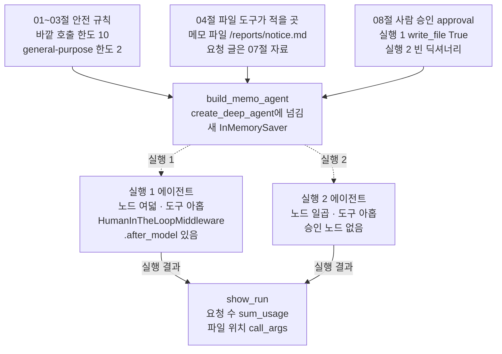
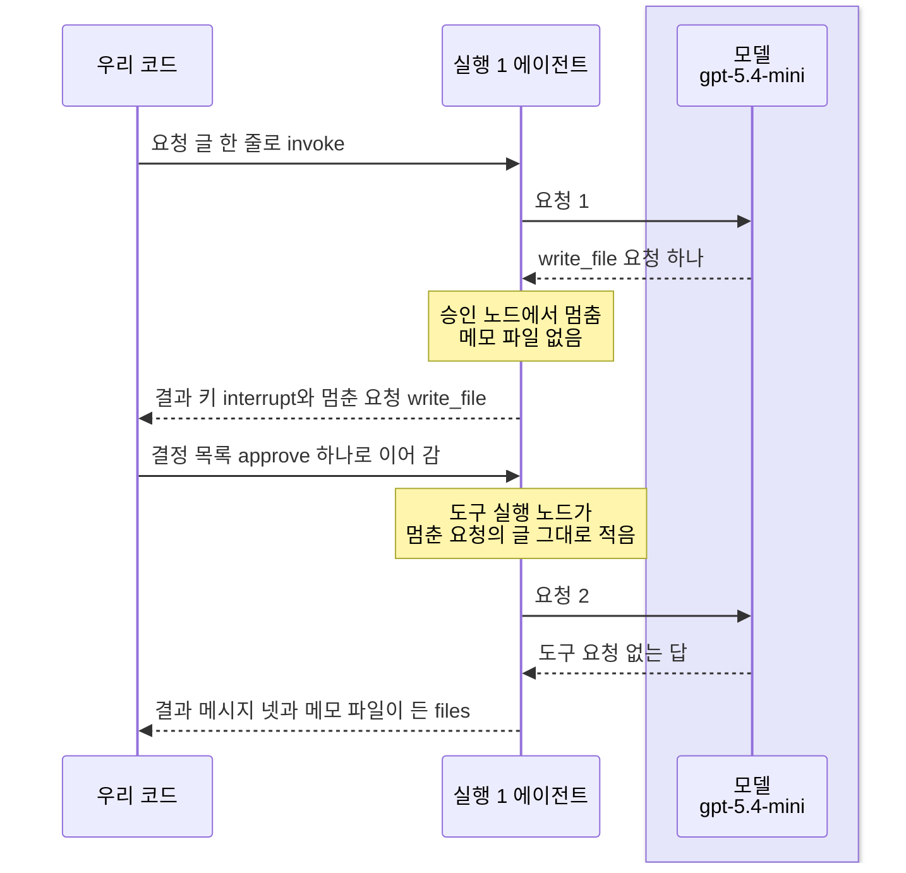
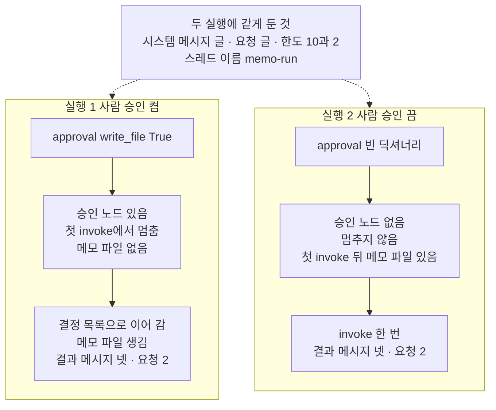

# 09-DeepAgents-실습

## _src 본문 (HTML 원본)

```html
<!--meta: 실습 30분 | 코드 notebooks/09-DeepAgents-실습.ipynb | 새 용어 0 -->
<style>html,body{overflow-x:hidden}.notebook,.nb-cell,.nb-main,.nb-input,.nb-result{min-width:0;max-width:100%}.nb-input pre,.nb-output{box-sizing:border-box;max-width:100%;overflow-x:auto}code.nb-source{display:block!important;width:100%!important;min-width:0!important;overflow-x:auto!important;padding:0!important}</style>
<h2 id="b1"><span class="no">1</span>학습 목표</h2><div class="goal"><ul>
<li>파일 도구·사람 승인·요청 수 셈을 한 흐름에 모아, 안내 메모를 파일에 적는 에이전트를 만들 수 있습니다.</li>
<li>사람 승인 설정 하나를 바꾼 두 실행을 견주어, 멈춘 자리와 메모 파일이 생긴 때를 출력으로 가를 수 있습니다.</li>
<li>사람 승인이 모델 요청 수와 invoke 수에 주는 영향을 요청 수 셈으로 설명할 수 있습니다.</li>
</ul></div>
<h2 id="b2"><span class="no">2</span>이 내용을 배우는 이유</h2><p>이 챕터에서는 Deep Agent의 기능을 절마다 따로 익혔습니다. <a href="04-파일시스템과-중간-결과.html">04절</a>은 파일 도구가 상태 칸 <code>files</code>에 파일을 적는 것을 보았습니다. <a href="08-통합-실행과-운영-한계.html">08절</a>은 그 쓰기 앞에 사람 승인을 걸고, 멈춘 실행을 결정 목록으로 이어 갔습니다. 실제로 쓸 때는 승인을 켤지 끌지 정해야 하고, 그 선택이 무엇을 바꾸는지 알아야 합니다.</p>
<p>이번 실습은 사용자가 보낸 공지 글을 한 문장으로 다듬어 메모 파일에 적는 에이전트를 조립합니다. 사람 승인을 켠 실행 1은 08절 6절과 같은 모양이고, 자료를 찾는 단계만 없습니다. 새로 볼 것은 승인을 끈 실행 2와의 비교입니다. 승인 노드가 붙는지, 메모 파일이 언제 생기는지, 요청 수가 달라지는지를 봅니다.</p>
<p>이번 절은 이 챕터의 실습입니다. 01~08절에서 쓴 이름과 Ch 2에서 배운 문법만 쓰고, 따로 내는 과제는 없습니다. 강사와 함께 노트북 셀을 차례로 실행합니다.</p>
<p><strong>이 절의 질문</strong> — 파일 쓰기 앞의 사람 승인을 끄면, 조립과 실행에서 무엇이 달라질까요? 모델 요청 수도 달라질까요?</p>
<h2 id="b3"><span class="no">3</span>앞에서 배운 내용</h2><p>이번 실습은 아래 절에서 배운 이름을 그대로 씁니다. 함수는 도구 파일 <code>harness_tools.py</code>에서 가져오고, 조립 함수와 두 실행을 견줄 함수는 노트북에 적습니다.</p>
<table><thead><tr><th>절</th><th>배운 것</th><th>실습에서 쓰는 곳</th></tr></thead><tbody><tr><td><a href="01-하네스와-일곱-기능.html">01절</a></td><td>안전 규칙 (가)·(나) · 사람 승인은 노드 <code>HumanInTheLoopMiddleware.after_model</code>로 붙음</td><td>두 한도를 조립 함수에 늘 넣음 · 두 에이전트의 노드 견주기</td></tr><tr><td><a href="02-create-deep-agent와-도구.html">02절</a></td><td>같은 이름 general-purpose 명세 · 요청 수 = 넣은 메시지 뒤 <code>AIMessage</code> 수</td><td>명세 <code>helper_spec</code> · 7절 요청 수</td></tr><tr><td><a href="03-플래닝과-시스템-프롬프트.html">03절</a></td><td>바깥 호출 한도 10</td><td><code>outer_limit</code></td></tr><tr><td><a href="04-파일시스템과-중간-결과.html">04절</a></td><td>파일 도구가 파일을 상태 칸 <code>files</code>에 적음</td><td>메모 파일 <code>/reports/notice.md</code></td></tr><tr><td><a href="07-출처-검증형-deep-research.html">07절</a></td><td>교재용 자료 · 함수 <code>call_args</code></td><td>요청 글 · <code>write_file</code>의 파일 위치</td></tr><tr><td><a href="08-통합-실행과-운영-한계.html">08절</a></td><td>사람 승인·체크포인터·결정 목록으로 이어 가기</td><td>실행 1의 멈춤과 이어 가기 · 실행 2에서 바꾼 값</td></tr><tr><td><a href="../ch23-persistence/01-체크포인터와-스레드.html">Ch 23 01절</a></td><td>체크포인터와 스레드</td><td><code>InMemorySaver</code> · 스레드 <code>memo-run</code></td></tr></tbody></table>
<p>붙인 기능은 04절 파일 도구와 상태 칸, 08절 사람 승인, 02절부터 쓴 요청 수 셈 셋입니다. 셋이 모두 흐름 안에서 일하도록 했습니다. 파일 도구는 두 실행 모두 메모를 적고, 사람 승인은 실행 1에서 멈추며 실행 2에서는 바꾼 값이 됩니다. 요청 수 셈은 두 실행을 견주는 함수에서 씁니다.</p>
<p><a href="07-출처-검증형-deep-research.html">07절</a>의 자료 찾기와 출처 판정은 붙이지 않았습니다. 찾기 단계가 들어가면 08절 6절처럼 실행마다 요청이 4번 이상이라, 두 실행이 이 실습의 요청 3~5번을 넘습니다. 읽은 자료가 없으면 출처 판정도 흐름에서 쓰이지 않습니다.</p>
<p>08절 권한 규칙도 붙이지 않았습니다. 이 흐름에는 자료 폴더에 쓰는 요청이 없어 규칙이 걸릴 일이 없고, 권한 판정은 08절 4절이 모델 없이 보였습니다. <a href="06-서브에이전트-위임.html">06절</a> 서브에이전트와 03절 할 일 목록은 요청 수를 늘려 뺐습니다.</p>
<h2 id="b4"><span class="no">4</span>핵심 개념</h2><h3>비유로 시작하기</h3><p>01절부터 쓴 유리 온실 안에, 같은 모양의 둥근 함석 통 둘이 나란히 놓였다고 합시다. 두 통에는 같은 흙과 같은 식물이 이미 자리 잡고 있습니다. 두 통 모두 새 모종 하나를 더 심을 차례입니다. 왼쪽 통은 심기 전에 누군가 돋보기로 살펴보기로 해서, 모종이 포트에 담긴 채 파 둔 구멍 옆에서 기다립니다. 오른쪽 통은 살펴보지 않기로 해서, 같은 모종을 바로 심었습니다.</p><p>같은 흙과 식물을 담은 두 통이, 같은 부품으로 조립한 두 에이전트입니다. 모종을 심는 일이 메모 파일을 적는 일이고, 돋보기로 살펴보는 일이 사람 승인입니다. 왼쪽 통이 승인을 켠 실행 1, 오른쪽 통이 승인을 끈 실행 2입니다.</p><p>비유와 다른 점도 있습니다. 이 절에서 살펴보고 승인한 쪽은 사람이 아니라 셀에 적은 코드입니다. 또 그림은 왼쪽 통이 기다리는 순간만 보여 주고, 실행 1도 승인 뒤에는 메모 파일을 적습니다. 식물의 수는 어떤 값과도 짝짓지 않습니다.</p>
{{img:09-4-심기-전-모종과-바로-심은-모종|흰 바탕에 유리 온실 안을 앞에서 본 그림입니다. 같은 모양의 둥근 함석 통 둘이 나란히 놓여 있고, 두 통 모두 흙이 담겨 있습니다. 두 통 뒤쪽에는 키 큰 초록 식물이 두 포기씩 자랍니다. 왼쪽 통 앞쪽에는 검은 포트에 담긴 작은 모종이 흙 위에 놓여 있고, 그 옆으로 파 둔 빈 구멍과 나무 손잡이 돋보기가 차례로 있습니다. 오른쪽 통 앞쪽 가운데에는 같은 작은 모종이 이미 흙에 심겨 있습니다. 사람·손·글자·숫자·화살표는 없는 그림|같은 통 둘 가운데 왼쪽은 모종이 포트에 담긴 채 빈 구멍 옆에서 기다리고, 오른쪽은 같은 모종이 이미 심겨 있습니다.}}
<p class="look"><b>그림 읽기</b> — 온실 안에 같은 모양의 함석 통 둘이 나란히 있고, 두 통 모두 뒤쪽에 같은 식물이 자랍니다. 왼쪽 통에서는 작은 모종이 검은 포트에 담긴 채 빈 구멍 옆에 놓여 있고, 구멍 너머에 돋보기가 있습니다. 오른쪽 통에서는 같은 모종이 이미 흙에 심겨 있습니다. 두 통이 같은 부품으로 조립한 두 에이전트이고, 모종을 심는 일이 메모 파일을 적는 일입니다. 왼쪽이 살펴본 뒤에 심을 실행 1, 오른쪽이 바로 심은 실행 2이며, 식물의 수는 어떤 값과도 짝짓지 않습니다.</p>
<h3>실습 조립의 구성</h3><p>조립 함수 <code>build_memo_agent</code>는 사람 승인 설정 하나만 인자로 받습니다. 모델·시스템 메시지 글·두 한도·명세는 두 실행에 같게 넘기고, 체크포인터는 부를 때마다 새로 만듭니다. 두 실행의 결과는 함수 <code>show_run</code>이 같은 칸으로 출력합니다.</p>
{{mermaid:09-1-메모-에이전트의-조립|위에서 아래로 읽는 흐름도입니다. 맨 위에 초록 상자 셋이 나란히 있습니다. 01~03절 안전 규칙 바깥 호출 한도 10 general-purpose 한도 2, 04절 파일 도구가 적을 곳 메모 파일 /reports/notice.md 요청 글은 07절 자료, 08절 사람 승인 approval 실행 1 write_file True 실행 2 빈 딕셔너리입니다. 세 상자에서 파란 상자 build_memo_agent create_deep_agent에 넘김 새 InMemorySaver로 화살표가 모입니다. 거기서 실행 1과 실행 2라고 적힌 점선이 노란 상자 둘로 갈립니다. 실행 1 에이전트 노드 여덟 도구 아홉 HumanInTheLoopMiddleware.after_model 있음과, 실행 2 에이전트 노드 일곱 도구 아홉 승인 노드 없음입니다. 두 노란 상자에서 실행 결과라고 적힌 화살표가 맨 아래 파란 상자 show_run 요청 수 sum_usage 파일 위치 call_args로 모이는 그림|승인 설정 하나만 다른 두 에이전트를 같은 조립 함수로 만들자, 실행 1에만 승인 노드가 붙었습니다.}}
<p class="look"><b>도식 읽기</b> — 위에서 아래로 읽습니다. 초록 상자는 이 절에서 정한 값이고, 파란 상자는 이 노트북에 적은 함수입니다. 노란 상자는 노트북 3절 둘째 셀과 6절 첫 셀 출력으로 확인한 값입니다. 점선은 승인 설정 값에 따라 갈리는 두 실행입니다.</p>
<h3>사람 승인을 켜고 끄는 값</h3><p>사람 승인 설정은 인자 <code>interrupt_on=</code>에 넘기는 딕셔너리입니다. 설치판 <code>graph.py</code> 193~194행에서, 이 딕셔너리가 비어 있고 권한 규칙도 없으면 승인 미들웨어를 붙이지 않습니다. 그래서 실행 2의 에이전트에는 승인 노드가 없습니다. 도구 아홉과 호출 한도 노드는 두 에이전트가 같습니다.</p><p>08절에서 본 것처럼 승인 노드는 모델 응답 뒤, 도구가 실행되기 전에 돕니다. 모델이 첫 응답에서 <code>write_file</code>을 요청한다면, 승인을 켠 실행은 그 자리에서 멈추고 메모 파일은 아직 없습니다. 승인을 끈 실행은 멈추지 않고 곧바로 도구를 실행합니다.</p><p>요청 수는 02절 셈대로 도구를 요청한 응답 수 + 1입니다. 멈춘 동안에는 모델에게 요청이 나가지 않습니다. 그래서 모델이 두 실행에서 같은 도구를 요청한다면, 승인은 요청 수를 바꾸지 않고 invoke를 둘로 나누기만 합니다. 이 예상이 실제 실행과 맞는지는 노트북 7절에서 봅니다.</p>
<h2 id="b5"><span class="no">5</span>실행 예제</h2><p>노트북 2절은 안전 규칙과 두 실행에 같게 쓸 글을 준비합니다. 3절은 조립 함수와 실행 1의 에이전트를, 4절은 두 실행을 견줄 함수를 적습니다. 5절은 사람 승인을 켠 실행 1을, 6절은 그 설정 하나만 끈 실행 2를 실행합니다. 7절에서 두 실행을 견줍니다.</p><p>실제 OpenAI 모델 <code>gpt-5.4-mini</code>를 temperature 0으로 부릅니다. 모델 요청은 5절에서 2번, 6절에서 2번, 모두 4번이었습니다. 이 수는 노트북 밖 열 번과 새 커널 두 번에서 같았습니다. 요금표로 어림한 예상 비용은 두 실행을 합쳐 0.01달러 아래이고, 청구 금액이 아닙니다. 파일은 상태 칸에만 두어 디스크에는 쓰지 않고, 걸린 시간은 재지 않았습니다.</p>
{{notebook:09-DeepAgents-실습}}
<p class="look"><b>확인할 점</b> — 노트북 3절과 6절 첫 셀에서 두 에이전트의 노드를 견주고, 승인 노드만 다른지 봅니다. 5절에서 멈춘 동안 메모 파일이 없는지와, 이어 간 뒤 적힌 글이 멈춘 요청의 글과 같은지 봅니다. 6절에서 첫 invoke 뒤 메모 파일이 있는지 봅니다.</p>
<h3>실행 1의 실제 순서</h3>
{{mermaid:09-2-실행-1의-실제-순서|세로선 셋이 있는 차례 그림입니다. 우리 코드, 실행 1 에이전트, 연보라 띠 안의 모델 gpt-5.4-mini입니다. 우리 코드에서 요청 글 한 줄로 invoke 화살표가 에이전트로 갑니다. 요청 1에 write_file 요청 하나 점선이 돌아오고, 에이전트에 노란 메모 승인 노드에서 멈춤 메모 파일 없음이 붙습니다. 결과 키 interrupt와 멈춘 요청 write_file 점선이 우리 코드로 돌아옵니다. 우리 코드에서 결정 목록 approve 하나로 이어 감 화살표가 가고, 노란 메모 도구 실행 노드가 멈춘 요청의 글 그대로 적음이 붙습니다. 요청 2에 도구 요청 없는 답 점선이 돌아오고, 결과 메시지 넷과 메모 파일이 든 files 점선이 우리 코드로 돌아오는 그림|이번 실행 1에서 모델은 write_file 하나를 요청했고, 승인 노드에서 멈춘 뒤 코드가 넣은 결정 목록으로 이어 가 요청 2에서 답했습니다.}}
<p class="look"><b>도식 읽기</b> — 위에서 아래로 실행 차례대로 읽습니다. 세로선은 우리 코드, 실행 1 에이전트, 모델이고, 연보라 띠는 실제로 부른 모델 gpt-5.4-mini의 자리입니다. 실선은 부르거나 넘긴 것이고, 점선은 돌아온 결과입니다. 노란 메모는 노트북 5절 출력으로 확인한 자리입니다. 요청의 차례와 수는 흔들림 확인 다섯 번과 두 커널에서 같았을 때만 그렸습니다.</p>
<h2 id="b6"><span class="no">6</span>실험 결과 해석</h2><p>두 실행은 시스템 메시지 글·요청 글·한도·명세·스레드 이름이 같고, 사람 승인 설정만 달랐습니다. 아래 표는 노트북 3·5·6·7절 출력에서 코드가 정하는 값과, 모델이 고른 값을 모은 것입니다.</p>
<table><thead><tr><th>확인한 것</th><th>실행 1(승인 켬)</th><th>실행 2(승인 끔)</th><th>값의 성격</th></tr></thead><tbody><tr><td>사람 승인 설정 <code>approval</code></td><td><code>{"write_file": True}</code></td><td><code>{}</code></td><td>바꾼 값</td></tr><tr><td>승인 노드 <code>HumanInTheLoopMiddleware.after_model</code></td><td>있음(노드 여덟)</td><td>없음(노드 일곱)</td><td>구조 값</td></tr><tr><td>도구 수 · 호출 한도</td><td><code>도구 수: 9</code> · 10 · 2</td><td>같음</td><td>구조 값</td></tr><tr><td>첫 invoke에서 멈췄는가</td><td><code>멈췄는가: True</code></td><td><code>멈췄는가: False</code></td><td>모델 판단 값</td></tr><tr><td>첫 invoke 뒤 메모 파일</td><td>없음(<code>False</code>) — 결정 목록을 넣은 뒤 생김</td><td>있음(<code>True</code>)</td><td>모델 판단 값</td></tr><tr><td>멈춘 요청의 글과 적힌 글</td><td><code>멈춘 요청의 글과 같은가: True</code></td><td>해당 없음(멈추지 않음)</td><td>구조 값</td></tr><tr><td>응답마다 도구 요청 · 요청 수</td><td><code>write_file</code> → 답 · 요청 2(멈추기 전 1 + 이어 간 뒤 1)</td><td><code>write_file</code> → 답 · 요청 2(invoke 한 번)</td><td>모델 판단 값</td></tr><tr><td>메모 글 · 답 글 · 토큰 · 예상 비용</td><td>아래 표와 본문 확인할 점</td><td>아래 표와 본문 확인할 점</td><td>흔들리는 값</td></tr></tbody></table>
<p>흔들림 확인 열 번과 두 커널에서 모두, 모델은 첫 응답에서 <code>write_file</code> 하나를 요청하고 둘째 응답에서 도구 요청 없이 답했습니다. 실행 1은 그 요청 앞 승인 노드에서 멈췄고, 결정 목록을 넣어 이어 가자 멈춘 요청의 글이 그대로 적혔습니다. 실행 2는 멈추지 않고 첫 invoke 안에서 메모 파일을 적었습니다. 두 실행의 결과 메시지는 종류와 수가 같았고, 요청은 2번씩이었습니다.</p>
{{mermaid:09-3-승인을-켠-실행과-끈-실행|맨 위 회색 상자 두 실행에 같게 둔 것 시스템 메시지 글 요청 글 한도 10과 2 스레드 이름 memo-run에서, 점선이 나란한 두 칸으로 갈립니다. 왼쪽 칸 실행 1 사람 승인 켬에는 초록 상자 approval write_file True, 노란 상자 승인 노드 있음 첫 invoke에서 멈춤 메모 파일 없음, 노란 상자 결정 목록으로 이어 감 메모 파일 생김 결과 메시지 넷 요청 2가 위에서 아래로 이어집니다. 오른쪽 칸 실행 2 사람 승인 끔에는 초록 상자 approval 빈 딕셔너리, 노란 상자 승인 노드 없음 멈추지 않음 첫 invoke 뒤 메모 파일 있음, 노란 상자 invoke 한 번 결과 메시지 넷 요청 2가 위에서 아래로 이어지는 그림|승인 설정 하나만 바꾸자 멈춘 자리와 메모 파일이 생긴 때가 달라졌고, 이번 실행에서 요청 수는 두 실행 모두 2였습니다.}}
<p class="look"><b>도식 읽기</b> — 맨 위 회색 상자는 두 실행에 같게 둔 조건입니다. 왼쪽 칸이 실행 1, 오른쪽 칸이 실행 2이고, 초록 상자가 바꾼 값인 사람 승인 설정입니다. 노란 상자는 노트북 3·5·6·7절 출력이고, 칸 안은 위에서 아래로 실행 차례입니다. 요청 수와 메모 파일이 생긴 때는 흔들림 확인 열 번과 두 커널에서 같았을 때만 넣었습니다.</p>
<p>승인을 켜고 끈 차이는 요청 수가 아니라, 쓰기가 실행되는 때에 있었습니다. 멈춘 동안에는 모델에게 요청이 나가지 않아, 실행 1의 요청 2번은 invoke 둘에 하나씩 나뉘었습니다. 실행 1은 쓰려는 글을 본 뒤에야 메모 파일이 생겼고, 실행 2는 누가 보기 전에 생겼습니다. </p><p>두 실행에서 모델이 같은 도구를 같은 차례로 요청했기 때문에, 요청 수 셈도 1 + 1로 같았습니다. 이 결과는 다른 도구를 쓰지 말고, 적은 파일을 다시 읽지 말라고 정한 시스템 메시지 글 아래에서 얻은 것입니다. 모델이 도구를 더 요청하는 흐름은 이번에 실행하지 않았습니다.</p>
<p>아래 표는 두 실행의 교재 출력 토큰과 예상 비용입니다. 토큰 수와 예상 비용은 다시 실행하면 달라질 수 있습니다.</p>
<table><thead><tr><th>실행</th><th>입력 토큰(교재 출력)</th><th>출력 토큰(교재 출력)</th><th>예상 비용(교재 출력, 달러)</th></tr></thead><tbody><tr><td>실행 1</td><td>3913</td><td>78</td><td>0.003286</td></tr><tr><td>실행 2</td><td>3913</td><td>75</td><td>0.003272</td></tr></tbody></table>
<p>새 커널로 두 번 실행해 견주자, 코드 셀 스물하나 가운데 스물의 출력이 같았습니다. 달랐던 한 셀은 토큰과 예상 비용이 찍힌 7절 마지막 셀이고, 두 실행의 출력 토큰이 서로 바뀌었습니다. 멈춘 자리·메모 파일·요청 수는 두 번 모두 같았고, 두 번 모두 같았던 값만 결론과 그림에 썼습니다.</p>
<p class="look"><b>확인할 점</b> — 노트북 7절 견주기 표에서 두 줄의 둘째·셋째 칸이 서로 반대인지 봅니다. 마지막 칸의 요청 수가 5절·6절 결과 메시지의 <code>AIMessage</code> 줄 수와 같은지 셉니다. 교재 출력에서는 두 실행 모두 두 줄, 요청 수 2였습니다.</p>
<h2 id="b7"><span class="no">7</span>주의할 점과 실무 메모</h2><ul><li>요청 글은 07절 교재용 자료 <code>/sources/return-box.md</code>의 두 문장에, 머리말 「안내 글:」만 붙인 글입니다. 이 머리말의 「안내 글」은 공지 글을 가리키고, 05절의 안내 글과 다른 뜻입니다. 시스템 메시지 글·메모 파일 위치와 함께 실행 전에 정했고, 결과를 보고 바꾸지 않았습니다. 실제 기관의 글이 아닙니다.</li><li>시스템 메시지 글의 「적은 뒤 파일을 다시 읽지 말고」는 첫 요청 전에 넣은 말입니다. 08절 노트북 밖 확인에서, 이어 간 뒤 보고 파일을 다시 읽은 실행이 있었기 때문입니다. 흐름을 보여 주려고 정한 예입니다.</li><li>이 노트북에서 사람의 답은 사람이 고른 값이 아니라, 셀이 멈춘 요청마다 넣은 승인입니다. 실제 운영에서는 사람이 쓰려는 글을 보고 결정을 고르는 화면이나 메시지가 필요하고, 이 과정에서는 만들지 않았습니다.</li><li>노트북을 쓰기 전에 두 실행을 노트북 밖에서 다섯 번씩 보냈습니다. 열 번 모두 모델은 <code>write_file</code> 하나를 요청한 뒤 답했고, 실행 1 조건은 다섯 번 모두 그 요청 앞에서 멈췄습니다. 메모 글은 실행 1 조건 다섯 번 가운데 한 번이 조금 달랐습니다. 같은 요청도 실행한 때에 따라 도구 차례나 글이 달라질 수 있습니다.</li><li>결정 <code>edit</code>·<code>reject</code>·<code>respond</code>는 실행하지 않았습니다. 사람 승인 설정에 값 <code>False</code>를 적는 모양도 실행하지 않았습니다. 노트북 밖에서 모델 없이 조립만 해 보니, 값이 <code>False</code>여도 승인 노드는 붙었습니다. 그 노드가 멈추는지는 실행하지 않았습니다.</li><li>실행 2처럼 승인을 끄면, 모델이 고른 쓰기가 사람이 보기 전에 실행됩니다. 이 절의 메모 파일은 상태 칸에만 있어 커널을 끄면 사라집니다. 04절의 디스크 백엔드였다면 디스크의 파일이 바로 바뀌었을 것이고, 이 모양은 실행하지 않았습니다.</li><li>호출 한도는 invoke 한 번마다 셉니다. 08절에서 본 것처럼 승인으로 멈췄다가 이어 가면, 이어 간 invoke에서 다시 0부터 셉니다. 이번 두 실행은 한도에 닿지 않았습니다.</li><li>체크포인터 <code>InMemorySaver</code>는 멈춘 자리를 메모리에 두므로, 커널을 끄면 사라집니다. 이 노트북의 <code>assert</code>는 키 확인 셀 하나뿐이고, 모델이 고른 값에는 걸지 않았습니다.</li><li>토큰 수와 예상 비용은 2026-09-17 과정 요금표로 어림했고, 청구 금액이 아닙니다. 걸린 시간은 재지 않았습니다. 교재 출력은 Linux의 Python 3.12.13으로 만들었고, 다른 판과 Windows·macOS에서는 실행하지 않았습니다.</li></ul>
<h2 id="b8"><span class="no">8</span>정리와 다음 절</h2><ul><li>04절 파일 도구, 08절 사람 승인, 02절부터 쓴 요청 수 셈을 안내 메모를 적는 에이전트 하나에 모았습니다.</li><li>사람 승인 설정을 빈 딕셔너리로 바꾸자 승인 노드가 붙지 않았습니다. 이번 실행에서는 첫 invoke 안에서 메모 파일이 적혔습니다.</li><li>승인을 켜면 멈춘 동안 메모 파일이 없고, 승인한 글이 그대로 적힙니다. 흔들림 확인 열 번과 두 커널에서 두 실행의 요청 수는 2번으로 같았습니다.</li></ul><p><strong>다음 학습과 이어지는 지점</strong> — 이 절로 Ch 27이 끝납니다. <a href="../ch28-mcp/01-MCP-구조와-capability-협상.html">Ch 28 01절</a>에서는 도구를 같은 프로그램 밖의 서버로 옮겨, 여러 클라이언트가 같은 방식으로 찾게 하는 MCP를 봅니다.</p>
<h2 id="b9"><span class="no">9</span>복습 문제</h2><details class="quiz" open><summary>문제 4개 · 해설 포함</summary><p class="quiz-q">1. [하] 실행 2에서 바꾼 값은 무엇이고, 그 값 때문에 조립에서 무엇이 빠졌나요?</p><p class="quiz-a">사람 승인 설정을 <code>{"write_file": True}</code>에서 빈 딕셔너리 <code>{}</code>로 바꿨습니다. 그래서 승인 노드 <code>HumanInTheLoopMiddleware.after_model</code>이 붙지 않았고, 노드가 여덟에서 일곱이 되었습니다. 틀렸다면 노트북 6절 첫 셀을 다시 읽습니다.</p><p class="quiz-q">2. [중] 실행 1에서 첫 invoke가 멈췄을 때, 메모 파일이 상태 칸에 없었던 까닭은 무엇인가요?</p><p class="quiz-a">승인 노드는 모델 응답 뒤, 도구가 실행되기 전에 멈춥니다. 모델이 요청한 <code>write_file</code>이 아직 실행되지 않아 메모 파일이 없었습니다. 틀렸다면 노트북 5절 첫 셀을 다시 읽습니다.</p><p class="quiz-q">3. [중] 동료가 「사람 승인을 켜면 이어 가는 invoke가 하나 더 생기니, 모델 요청도 하나 더 나간다」고 말합니다. 맞나요?</p><p class="quiz-a">이번 실행에서는 맞지 않았습니다. 멈춘 동안에는 모델에게 요청이 나가지 않고, 이어 간 invoke에서 남은 요청 하나가 나갔습니다. 두 실행 모두 <code>write_file</code>을 요청한 응답 1과 답 1로 요청이 2번이었고, 흔들림 확인 열 번에서도 같았습니다. 틀렸다면 노트북 7절을 다시 읽습니다.</p><p class="quiz-q">4. [상] 실행 1에서 모델이 한 응답에 <code>write_file</code> 요청 둘을 담았다면, 결정 목록에는 결정이 몇 개 있어야 하나요?</p><p class="quiz-a">멈춘 요청마다 하나씩, 두 개입니다. 이 노트북의 결정 셀은 멈춘 요청마다 결정을 하나씩 붙이므로 둘이 됩니다. 설치판 <code>human_in_the_loop.py</code> 459~464행은 결정 수가 멈춘 요청 수와 다르면 <code>ValueError</code>를 냅니다. 한 응답에 요청이 둘인 경우는 이번에 실행하지 않았습니다. 틀렸다면 노트북 5절 둘째 셀과 08절 본문의 주의할 점을 다시 읽습니다.</p></details>
<h2 id="b10"><span class="no">10</span>참고 자료</h2><ul><li>01절 — 안전 규칙과, 인자 <code>interrupt_on=</code>이 더하는 노드 <code>HumanInTheLoopMiddleware.after_model</code>.</li><li>04절 — 파일 도구와 상태 칸 <code>files</code>.</li><li>08절 — 사람 승인·체크포인터·결정 목록 <code>Command(resume={"decisions": [...]})</code>, 운영 한계 표.</li><li><a href="../ch24-human-in-the-loop/01-interrupt-승인-게이트.html">Ch 24 01절</a> — 멈춤 표시와 사람의 답으로 이어 가기.</li><li>설치판 deepagents 0.7.0 소스 <code>graph.py</code> 193~194행은 승인 설정과 권한 규칙이 모두 비면 설정 없음으로 봅니다. 871~876행은 승인 미들웨어를 붙이는 자리입니다.</li><li>설치판 langchain 1.4.0 소스 <code>human_in_the_loop.py</code> 456행은 답에서 결정 목록을 꺼내는 자리입니다. 461행은 결정 수가 다를 때의 오류 글입니다. <code>model_call_limit.py</code> 34행은 한 번 실행의 요청 수를 세는 칸입니다.</li><li>기준 버전은 노트북 1절 첫 셀에서 설치한 패키지 다섯의 판입니다.</li></ul>
```

## 노트북 셀 (순서대로)

### [0] markdown {'html': 'skip'}

# DeepAgents 실습: 메모 파일 쓰기에 사람 승인을 켜고 끄기

**이 노트북에서 할 일**

1. 앞 절에서 배운 파일 도구·사람 승인·요청 수 셈을, 안내 메모를 파일에 적는 에이전트 하나에 모읍니다.
2. 사람 승인을 켠 실행 1과, 그 설정 하나만 끈 실행 2를 차례로 실행합니다.
3. 멈춘 자리와 메모 파일이 생긴 때, 요청 수를 두 실행에서 견줍니다.

**준비물** — 프로젝트 폴더의 `.env` 파일에 `OPENAI_API_KEY`가 있어야 합니다.
모델은 `gpt-5.4-mini`이고, 실행 1과 실행 2에서 에이전트를 한 번씩 실행합니다.
노트북 밖에서 두 실행을 다섯 번씩 보냈을 때, 요청은 열 번 모두 실행마다 2번이었습니다.
그래서 이 노트북의 모델 요청은 모두 4번으로 어림합니다.
호출 한도는 메모 에이전트 10, general-purpose 2로 줍니다.

요금표로 어림한 예상 비용은 두 실행을 합쳐 0.01달러 아래이고, 청구 금액이 아닙니다.
파일은 상태 칸 `files`에만 두고, 디스크에는 쓰지 않습니다.
멈춘 자리는 메모리에 두는 체크포인터 `InMemorySaver`에 저장합니다.
모델이 쓴 메모 글과 답 글은 실행마다 달라질 수 있습니다.
걸린 시간은 재지 않았습니다.

앞에서 배운 함수 다섯은 도구 파일 `harness_tools.py`에서 가져옵니다.

**기준 버전** — 첫 셀에서 패키지 다섯을 설치합니다.
판은 deepagents 0.7.0, langchain 1.4.0, langgraph 1.2.11입니다.
나머지 둘은 `langchain-openai` 1.6.0과 `python-dotenv` 1.2.3입니다.
교재 출력은 Linux의 Python 3.12.13으로 만들었습니다.
다른 판과 Windows·macOS에서는 실행하지 않았습니다.

**실습 범위** — 이 절은 이 챕터의 실습이고, 30분 안팎입니다.
따로 내는 과제는 없고, 강사와 함께 첫 셀부터 차례로 실행합니다.

실습 폴더 `labs/part6/ch27-deepagents`에서 `uv sync --locked`를 실행합니다.
그다음 `notebooks/` 폴더의 이 노트북을 열고, 실습 폴더의 `.venv` 커널을 고릅니다.
첫 셀부터 순서대로 실행합니다.

### [1] markdown {'html': 'skip'}

## 오늘 볼 그림

![위에서 아래로 읽는 흐름도입니다. 맨 위에 초록 상자 셋이 나란히 있습니다. 01~03절 안전 규칙 바깥 호출 한도 10 general-purpose 한도 2, 04절 파일 도구가 적을 곳 메모 파일 /reports/notice.md 요청 글은 07절 자료, 08절 사람 승인 approval 실행 1 write_file True 실행 2 빈 딕셔너리입니다. 세 상자에서 파란 상자 build_memo_agent create_deep_agent에 넘김 새 InMemorySaver로 화살표가 모입니다. 거기서 실행 1과 실행 2라고 적힌 점선이 노란 상자 둘로 갈립니다. 실행 1 에이전트 노드 여덟 도구 아홉 HumanInTheLoopMiddleware.after_model 있음과, 실행 2 에이전트 노드 일곱 도구 아홉 승인 노드 없음입니다. 두 노란 상자에서 실행 결과라고 적힌 화살표가 맨 아래 파란 상자 show_run 요청 수 sum_usage 파일 위치 call_args로 모이는 그림](attachment:09-1-메모-에이전트의-조립.png)

위에서 아래로 읽습니다.
초록 상자는 이 절에서 정한 값이고, 파란 상자는 이 노트북에 적은 함수입니다.
노란 상자는 노트북 3절 둘째 셀과 6절 첫 셀 출력으로 확인한 값입니다.
점선은 승인 설정 값에 따라 갈리는 두 실행입니다.

### [2] markdown {}

## 1. 준비

이 절은 Ch 27의 실습입니다.
01~08절에서 하나씩 본 기능 가운데 셋을, 안내 메모를 파일에 적는 에이전트 하나에 모읍니다.
04절의 파일 도구와 상태 칸, 08절의 사람 승인, 02절부터 쓴 요청 수 셈입니다.
그다음 사람 승인 설정 하나만 바꿔 두 번 실행하고, 두 결과를 견줍니다.

첫 셀은 패키지 다섯을 설치하고 설치된 판 번호를 출력합니다.
설치에는 몇십 초가 걸릴 수 있습니다.

### [3] code {'execution': {'iopub.execute_input': '2026-09-28T16:48:12.091815Z', 'iopub.status.busy': '2026-09-28T16:48:12.091641Z', 'iopub.status.idle': '2026-09-28T16:48:12.823919Z', 'shell.execute_reply': '2026-09-28T16:48:12.823337Z'}, 'lesson_role': 'setup'}

```python
# 이 절에서 쓰는 패키지를 설치하고 버전을 확인합니다
%pip install -q "deepagents==0.7.0" "langchain==1.4.0" "langchain-openai==1.6.0" "langgraph==1.2.11" "python-dotenv==1.2.3"
from importlib.metadata import version

print("deepagents:", version("deepagents"))
print("langchain:", version("langchain"))
print("langchain-openai:", version("langchain-openai"))
print("langgraph:", version("langgraph"))
print("python-dotenv:", version("python-dotenv"))
```

출력:
```
Note: you may need to restart the kernel to use updated packages.
deepagents: 0.7.0
langchain: 1.4.0
langchain-openai: 1.6.0
langgraph: 1.2.11
python-dotenv: 1.2.3

```

### [4] markdown {}

**결과 읽기** — 출력 줄 `deepagents: 0.7.0`과 `langgraph: 1.2.11`이 보입니다.
다섯 판 모두 실습 폴더 잠금과 같은 판입니다.
패키지 langgraph는 체크포인터와 이어 가기의 `Command`를 가져오려고 넣었습니다.

다음 셀은 이 절에서 쓸 이름을 가져옵니다.
마지막 가져오기 줄은 앞에서 배운 함수 다섯을 도구 파일 `harness_tools.py`에서 가져옵니다.

### [5] code {'execution': {'iopub.execute_input': '2026-09-28T16:48:12.825069Z', 'iopub.status.busy': '2026-09-28T16:48:12.824984Z', 'iopub.status.idle': '2026-09-28T16:48:14.234461Z', 'shell.execute_reply': '2026-09-28T16:48:14.234052Z'}, 'lesson_role': 'setup'}

```python
# Deep Agents(01절)·호출 한도(Ch 22)·모델·메시지·체크포인터(Ch 23)·Command(Ch 24) 이름을 가져옵니다
from deepagents import create_deep_agent
from langchain.agents.middleware import ModelCallLimitMiddleware
from langchain.chat_models import init_chat_model
from langchain.messages import HumanMessage
from langgraph.checkpoint.memory import InMemorySaver
from langgraph.types import Command
# 앞 챕터와 01·07절에서 배운 함수 다섯은 도구 파일에서 가져옵니다
from harness_tools import call_args, estimate_cost, show_messages, sum_usage, tool_names

print("도구 파일에서 가져온 함수:", "call_args, estimate_cost, show_messages, sum_usage, tool_names")
```

출력:
```
도구 파일에서 가져온 함수: call_args, estimate_cost, show_messages, sum_usage, tool_names

```

### [6] markdown {}

**결과 읽기** — 출력 줄 `도구 파일에서 가져온 함수: call_args, estimate_cost, show_messages, sum_usage, tool_names`가 보입니다.
네 함수 `estimate_cost`·`show_messages`·`sum_usage`·`tool_names`의 뜻은 02절 1절에 적었습니다.
함수 `call_args`는 07절에서 처음 만든 함수이고, 도구 요청에서 인자 값 하나를 모읍니다.
08절에서 07절 셀 글 그대로 도구 파일에 옮겨 두었습니다.

앞에서 배운 함수는 `harness_tools.py`에 모아 두었고, 파일을 열면 코드를 볼 수 있습니다.
커널이 `notebooks/` 폴더에서 시작해야 이 파일을 가져올 수 있습니다.
가져온 이름은 모두 08절에서 쓴 이름이고, 이 절에서 새로 배우는 이름은 없습니다.

### [7] markdown {}

API 키가 있는지 확인합니다. `True` 값이 나오면 다음으로 넘어갑니다.

### [8] code {'execution': {'iopub.execute_input': '2026-09-28T16:48:14.235171Z', 'iopub.status.busy': '2026-09-28T16:48:14.235112Z', 'iopub.status.idle': '2026-09-28T16:48:14.240027Z', 'shell.execute_reply': '2026-09-28T16:48:14.239772Z'}, 'lesson_role': 'setup'}

```python
# .env 파일에서 OpenAI API 키를 읽습니다(키 값은 출력하지 않습니다)
import os
from dotenv import find_dotenv, load_dotenv

env_path = find_dotenv(usecwd=True)
load_dotenv(env_path)
has_key = os.getenv("OPENAI_API_KEY") is not None
print("OPENAI_API_KEY 설정 여부:", has_key)
assert has_key, "프로젝트 폴더의 .env 파일에 OPENAI_API_KEY를 적어 주세요."
```

출력:
```
OPENAI_API_KEY 설정 여부: True

```

### [9] markdown {}

실습에 쓸 모델을 준비합니다.
temperature 값을 0으로 두어 매번 비슷한 답을 고르게 합니다.

### [10] code {'execution': {'iopub.execute_input': '2026-09-28T16:48:14.240671Z', 'iopub.status.busy': '2026-09-28T16:48:14.240623Z', 'iopub.status.idle': '2026-09-28T16:48:15.217763Z', 'shell.execute_reply': '2026-09-28T16:48:15.217453Z'}}

```python
# 실습에 쓸 모델을 준비합니다
model = init_chat_model(
    "openai:gpt-5.4-mini",
    temperature=0,
    reasoning_effort="none",
)
print("모델 이름:", model.model_name)
print("temperature:", model.temperature)
```

출력:
```
모델 이름: gpt-5.4-mini
temperature: 0.0

```

### [11] markdown {}

**결과 읽기** — 모델 이름 `gpt-5.4-mini`, temperature `0.0`이 보이면 준비가 끝났습니다.
이 노트북의 출력은 2026-09-28에 이 모델로 실행한 결과입니다.
temperature 값을 0으로 두어도, 실행마다 답 문장이 달라질 수 있습니다.
이 셀은 모델 객체만 만들고, 모델 요청은 아직 보내지 않습니다.
모델 요청은 5절과 6절의 실행 셀, 5절의 이어 가기 셀에서만 나갑니다.

## 2. 재료와 안전 규칙

01절 안전 규칙대로, 모델을 부르는 에이전트에는 두 한도를 넣습니다.
다음 셀은 02절 셀과 같은 글의 general-purpose 명세입니다.

### [12] code {'execution': {'iopub.execute_input': '2026-09-28T16:48:15.218499Z', 'iopub.status.busy': '2026-09-28T16:48:15.218442Z', 'iopub.status.idle': '2026-09-28T16:48:15.220282Z', 'shell.execute_reply': '2026-09-28T16:48:15.220037Z'}}

```python
# 기본 서브에이전트와 같은 이름의 명세를 만들고, 그 안에 자기 호출 한도 둘을 넣습니다(01절 6절 모양)
helper_limit = ModelCallLimitMiddleware(run_limit=2, exit_behavior="end")
helper_spec = {
    "name": "general-purpose",
    "description": "교재용 도우미입니다. 맡긴 일을 짧게 처리합니다.",
    "system_prompt": "맡긴 일을 두 문장의 한국어로 처리하세요.",
    "middleware": [helper_limit],
}
print("명세의 키:", list(helper_spec))
```

출력:
```
명세의 키: ['name', 'description', 'system_prompt', 'middleware']

```

### [13] markdown {}

**결과 읽기** — 출력 줄 `명세의 키: ['name', 'description', 'system_prompt', 'middleware']`가 보입니다.
이 명세는 기본 general-purpose 서브에이전트의 자리를 바꾸고, 자기 호출 한도 2를 갖습니다.
모델이 `task`를 부르면, 한 번 부를 때마다 요청이 두 번까지만 나갑니다.

다음 셀은 03절 셀과 같은 글의 바깥 호출 한도입니다.

### [14] code {'execution': {'iopub.execute_input': '2026-09-28T16:48:15.220753Z', 'iopub.status.busy': '2026-09-28T16:48:15.220710Z', 'iopub.status.idle': '2026-09-28T16:48:15.222257Z', 'shell.execute_reply': '2026-09-28T16:48:15.221978Z'}}

```python
# 바깥 에이전트의 모델 요청을 열 번까지로 막는 호출 한도를 만듭니다(02절 셀과 한도만 다름)
outer_limit = ModelCallLimitMiddleware(run_limit=10, exit_behavior="end")
print("바깥 호출 한도:", outer_limit.run_limit)
```

출력:
```
바깥 호출 한도: 10

```

### [15] markdown {}

**결과 읽기** — 출력 줄 `바깥 호출 한도: 10`이 보입니다.
주석의 「02절 셀과 한도만 다름」은 이 셀을 처음 쓴 03절에서 적은 말입니다.
이 한도는 invoke 한 번 안의 모델 요청 수를 셉니다.
08절에서 본 것처럼, 승인으로 멈췄다가 이어 가면 이어 간 invoke에서 다시 0부터 셉니다.

다음 셀은 두 실행에 같게 쓸 글과 설정을 실행 전에 정합니다.
요청 글은 07절 교재용 자료 가운데 무인 반납함 안내의 두 문장에, 머리말 「안내 글:」만 붙인 글입니다.
실제 기관의 글이 아니라, 흐름을 보여 주려고 정한 예입니다.

### [16] code {'execution': {'iopub.execute_input': '2026-09-28T16:48:15.222799Z', 'iopub.status.busy': '2026-09-28T16:48:15.222750Z', 'iopub.status.idle': '2026-09-28T16:48:15.224821Z', 'shell.execute_reply': '2026-09-28T16:48:15.224453Z'}}

```python
# 두 실행에 같게 쓸 메모 파일 위치·시스템 메시지 글·요청 글·스레드 설정을 실행 전에 정하고 출처와 함께 출력합니다
memo_path = "/reports/notice.md"
memo_text = "사용자가 보낸 안내 글을 자료실 이용자에게 보낼 한국어 한 문장으로 다듬으세요. 다듬은 문장은 write_file로 /reports/notice.md에 적으세요. write_file 말고 다른 도구는 쓰지 마세요. 파일에 적은 뒤에는 파일을 다시 읽지 말고, 적은 파일 위치를 한 문장으로 알려 주세요."
request_text = "안내 글: 자료실 정문 옆 무인 반납함은 휴관일에도 쓸 수 있습니다. 반납함에 넣은 책은 다음 운영일에 반납 처리됩니다."
run_config = {"configurable": {"thread_id": "memo-run"}}
print("메모 파일 위치:", memo_path)
print("요청 글:", request_text)
print("요청 글의 출처: 07절 교재용 자료 /sources/return-box.md의 두 문장")
```

출력:
```
메모 파일 위치: /reports/notice.md
요청 글: 안내 글: 자료실 정문 옆 무인 반납함은 휴관일에도 쓸 수 있습니다. 반납함에 넣은 책은 다음 운영일에 반납 처리됩니다.
요청 글의 출처: 07절 교재용 자료 /sources/return-box.md의 두 문장

```

### [17] markdown {}

**결과 읽기** — 출력 줄 `메모 파일 위치: /reports/notice.md`가 보입니다.
라벨 `요청 글:` 뒤에는 모델에게 보낼 공지 글이, 라벨 `요청 글의 출처:` 뒤에는 그 글을 가져온 곳이 보입니다.
시스템 메시지 글은 공지 글을 한 문장으로 다듬어 이 파일에 적고, 다른 도구는 쓰지 말라고 정합니다.
머리말 「안내 글:」과 시스템 메시지 글 속 「안내 글」은 이 공지 글을 가리키고, 05절의 안내 글과 다릅니다.

적은 뒤 파일을 다시 읽지 말라는 말도 넣었습니다.
08절 노트북 밖 확인에서, 이어 간 뒤 방금 적은 보고 파일을 다시 읽은 실행이 있었기 때문입니다.
스레드 설정 `run_config`는 두 실행에 같게 씁니다.

## 3. 조립하기

조립에는 앞 절의 기능 셋을 씁니다.
04절의 파일 도구가 메모를 상태 칸 `files`에 적고, 08절의 사람 승인이 그 쓰기 앞에서 멈춥니다.
두 실행의 결과는 02절부터 쓴 요청 수 셈으로 셉니다.

다음 셀은 사람 승인 설정 하나를 인자로 받아 에이전트를 만드는 조립 함수입니다.
08절 3절 조립에서 권한 규칙을 빼고, 인자 `interrupt_on=`의 값을 바깥에서 받게 했습니다.

### [18] code {'execution': {'iopub.execute_input': '2026-09-28T16:48:15.225333Z', 'iopub.status.busy': '2026-09-28T16:48:15.225280Z', 'iopub.status.idle': '2026-09-28T16:48:15.226891Z', 'shell.execute_reply': '2026-09-28T16:48:15.226606Z'}}

```python
# 사람 승인 설정 하나를 받아, 메모 에이전트를 새 체크포인터와 함께 만들어 내놓습니다(08절 3절 조립에서 권한 규칙을 뺀 모양)
def build_memo_agent(approval):
    # 01절 안전 규칙: 바깥 호출 한도(가)와 같은 이름 general-purpose 명세(나)를 늘 함께 넘깁니다
    return create_deep_agent(
        model=model,
        system_prompt=memo_text,
        middleware=[outer_limit],
        subagents=[helper_spec],
        interrupt_on=approval,
        checkpointer=InMemorySaver(),
    )
```

출력:
```

```

### [19] markdown {}

**결과 읽기** — 정의 셀이라 출력이 없습니다.
함수는 부를 때마다 새 체크포인터 `InMemorySaver`를 만들어 넘깁니다.
그래서 두 실행이 같은 스레드 이름을 써도, 기록은 에이전트마다 따로 남습니다.
모델·시스템 메시지 글·두 한도는 앞 셀에서 만든 이름을 그대로 씁니다.

다음 셀은 실행 1의 에이전트를 만듭니다.
사람 승인 설정은 08절과 같은 `{"write_file": True}`입니다.

### [20] code {'execution': {'iopub.execute_input': '2026-09-28T16:48:15.227323Z', 'iopub.status.busy': '2026-09-28T16:48:15.227281Z', 'iopub.status.idle': '2026-09-28T16:48:15.282551Z', 'shell.execute_reply': '2026-09-28T16:48:15.282213Z'}}

```python
# 실행 1의 에이전트: 사람 승인을 켜서(write_file 앞에서 멈춤) 만들고, 노드 이름과 도구 수를 봅니다(요청은 아직 보내지 않음)
first_agent = build_memo_agent({"write_file": True})
first_graph = first_agent.get_graph()
print("노드:", list(first_graph.nodes))
print("승인 노드가 있는가:", "HumanInTheLoopMiddleware.after_model" in first_graph.nodes)
first_tools = tool_names(first_agent)
print("도구 수:", len(first_tools))
```

출력:
```
노드: ['__start__', 'model', 'tools', 'PatchToolCallsMiddleware.before_agent', 'ModelCallLimitMiddleware.before_model', 'ModelCallLimitMiddleware.after_model', 'HumanInTheLoopMiddleware.after_model', '__end__']
승인 노드가 있는가: True
도구 수: 9

```

### [21] markdown {}

**결과 읽기** — 출력 줄 `승인 노드가 있는가: True`와 `도구 수: 9`가 보입니다.
라벨 `노드:` 뒤에는 노드 이름 여덟이 있습니다.
08절 3절에서 본 것처럼, 사람 승인은 노드 `HumanInTheLoopMiddleware.after_model` 하나로 붙었습니다.
권한 규칙은 노드를 더하지 않으므로, 08절 보고 에이전트와 노드 이름이 같습니다.
이 셀까지 모델 요청은 0번입니다.

## 4. 두 실행을 견줄 함수

두 실행을 같은 잣대로 견주려고, 결과에서 볼 값을 한 줄로 출력하는 함수를 먼저 적습니다.
함수 `show_run`은 첫 invoke 결과와, 넣은 요청 글 뒤에 실행이 더한 메시지를 받습니다.
첫 invoke에서 멈췄는지와 그때 메모 파일이 있었는지는 첫 결과로 봅니다.
도구 `write_file`에 넣은 파일 위치와 요청 수는 더한 메시지로 셉니다.

### [22] code {'execution': {'iopub.execute_input': '2026-09-28T16:48:15.283298Z', 'iopub.status.busy': '2026-09-28T16:48:15.283243Z', 'iopub.status.idle': '2026-09-28T16:48:15.284872Z', 'shell.execute_reply': '2026-09-28T16:48:15.284562Z'}}

```python
# 실행 이름과 첫 invoke 결과, 실행이 더한 메시지를 받아 두 실행을 견줄 값을 한 줄로 출력하고 사용량을 내놓습니다
def show_run(label, first, new_messages):
    usage = sum_usage(new_messages)
    paused = "__interrupt__" in first
    memo_first = memo_path in first["files"]
    # 도구 write_file에 넣은 파일 위치를 모읍니다(07절 함수 call_args)
    writes = call_args(new_messages, "write_file", "file_path")
    print(label, "|", paused, "|", memo_first, "|", writes, "|", usage["requests"])
    return usage
```

출력:
```

```

### [23] markdown {}

**결과 읽기** — 정의 셀이라 출력이 없습니다.
요청 수는 02절에서 본 것처럼 더한 메시지의 `AIMessage` 수이고, Ch 19 05절 함수 `sum_usage`가 셉니다.
파일 위치는 07절 함수 `call_args`로 모읍니다.
이 함수는 사용량 딕셔너리를 내놓아, 7절에서 예상 비용을 셀 때 씁니다.

## 5. 실행 1: 사람 승인을 켠 실행

이제 실행 1을 합니다.
요청 글 한 줄을 실행 1의 에이전트에 넣습니다.
실행 전에 예상해 봅니다.
모델이 `write_file`을 요청하면 첫 invoke는 어디서 멈추고, 그때 메모 파일은 상태 칸에 있을까요?

### [24] code {'execution': {'iopub.execute_input': '2026-09-28T16:48:15.285371Z', 'iopub.status.busy': '2026-09-28T16:48:15.285326Z', 'iopub.status.idle': '2026-09-28T16:48:16.702122Z', 'shell.execute_reply': '2026-09-28T16:48:16.701734Z'}}

```python
# 실행 1: 요청 글 한 줄을 넣어 실행합니다(모델이 write_file을 요청하면 승인 자리에서 멈춤)
first_input = {"messages": [HumanMessage(content=request_text)]}
input_count = len(first_input["messages"])
first_result = first_agent.invoke(first_input, run_config)
print("멈췄는가:", "__interrupt__" in first_result)
print("첫 invoke 뒤 메모 파일이 있는가:", memo_path in first_result["files"])
```

출력:
```
멈췄는가: True
첫 invoke 뒤 메모 파일이 있는가: False

```

### [25] markdown {}

**결과 읽기** — 라벨 `멈췄는가:` 뒤의 값으로, 첫 invoke가 승인 자리에서 멈췄는지 봅니다.
라벨 `첫 invoke 뒤 메모 파일이 있는가:` 뒤의 값으로, 그때 상태 칸에 메모 파일이 있는지 봅니다.
승인 노드는 모델 응답 뒤, 도구가 실행되기 전에 돕니다.

이번 실행에서는 `멈췄는가: True`, `첫 invoke 뒤 메모 파일이 있는가: False`였습니다.
모델이 첫 응답에서 `write_file`을 요청했고, 그 도구가 실행되기 전에 승인 노드에서 멈췄습니다.
노트북 밖 다섯 번과 새 커널 두 번에서도 같았습니다.

다음 셀은 멈춘 도구 요청을 보고, 요청마다 승인 결정 하나를 목록에 붙입니다.
08절 6절 셀에 쓰려는 글을 담고 출력하는 줄 셋을 더하고, 첫 줄 주석을 바꾼 글입니다.
사람은 이 글을 보고 승인할지 고릅니다.

### [26] code {'execution': {'iopub.execute_input': '2026-09-28T16:48:16.702984Z', 'iopub.status.busy': '2026-09-28T16:48:16.702918Z', 'iopub.status.idle': '2026-09-28T16:48:16.704959Z', 'shell.execute_reply': '2026-09-28T16:48:16.704649Z'}}

```python
# 멈춘 도구 요청마다 파일 위치와 쓰려는 글을 보고, 승인 결정 하나를 목록에 붙입니다(사람의 답 자리에 코드가 넣는 값)
decisions = []
paused_text = ""
if "__interrupt__" in first_result:
    paused_value = first_result["__interrupt__"][0].value
    for action in paused_value["action_requests"]:
        print("멈춘 도구 요청:", action["name"], "|", action["args"]["file_path"])
        paused_text = action["args"]["content"]
        print("쓰려는 글:", paused_text)
        decisions.append({"type": "approve"})
print("넣을 결정 수:", len(decisions))
```

출력:
```
멈춘 도구 요청: write_file | /reports/notice.md
쓰려는 글: 자료실 정문 옆 무인 반납함은 휴관일에도 이용할 수 있으며, 반납함에 넣은 책은 다음 운영일에 반납 처리됩니다.
넣을 결정 수: 1

```

### [27] markdown {}

**결과 읽기** — 라벨 `멈춘 도구 요청:` 뒤에 도구 이름과 파일 위치가 보입니다.
라벨 `쓰려는 글:` 뒤에는 모델이 파일에 적으려는 글이 보입니다.
라벨 `넣을 결정 수:` 뒤에는 결정 목록의 길이가 보이고, 멈춘 도구 요청 수와 같게 만들었습니다.
08절처럼, 이 노트북에서 사람의 답은 셀이 모든 요청에 넣는 승인입니다.
실제로는 이 자리에서 사람이 쓰려는 글을 읽고 결정을 고릅니다.

이번 실행에서는 `멈춘 도구 요청: write_file | /reports/notice.md`, `넣을 결정 수: 1`이었습니다.
모델은 시스템 메시지 글이 정한 파일 위치에 쓰려 했고, 노트북 밖 다섯 번과 새 커널 두 번에서도 같았습니다.
쓰려는 글은 공지 글 두 문장을 한 문장으로 이은 글이었습니다.
노트북 밖 다섯 번 가운데 한 번은 이 글이 조금 달랐습니다.

다음 셀은 결정 목록으로 같은 스레드를 이어 갑니다.

### [28] code {'execution': {'iopub.execute_input': '2026-09-28T16:48:16.705686Z', 'iopub.status.busy': '2026-09-28T16:48:16.705620Z', 'iopub.status.idle': '2026-09-28T16:48:17.904477Z', 'shell.execute_reply': '2026-09-28T16:48:17.903680Z'}}

```python
# 결정이 있으면 결정 목록으로 같은 스레드를 이어 가고, 없으면 첫 결과를 그대로 씁니다(08절 6절 셀과 같은 모양)
first_final = first_result
if len(decisions) > 0:
    first_final = first_agent.invoke(Command(resume={"decisions": decisions}), run_config)
print("다시 멈췄는가:", "__interrupt__" in first_final)
print("결과 메시지 수:", len(first_final["messages"]))
```

출력:
```
다시 멈췄는가: False
결과 메시지 수: 4

```

### [29] markdown {}

**결과 읽기** — 라벨 `다시 멈췄는가:`와 `결과 메시지 수:` 뒤에 값이 하나씩 보입니다.
결과 메시지는 멈추기 전 메시지에 이어 붙은, 스레드 전체의 목록입니다.

이번 실행에서는 `다시 멈췄는가: False`, `결과 메시지 수: 4`였습니다.
멈추기 전의 요청 글과 `write_file` 요청 응답에, 도구 메시지와 마지막 답이 더해졌습니다.
노트북 밖 다섯 번과 새 커널 두 번에서도 같았고, 이어 간 뒤 메모 파일을 다시 읽은 실행은 없었습니다.

다음 셀은 Ch 19 06절 함수 `show_messages`로 실행 1의 결과 메시지를 차례로 봅니다.

### [30] code {'execution': {'iopub.execute_input': '2026-09-28T16:48:17.906355Z', 'iopub.status.busy': '2026-09-28T16:48:17.906228Z', 'iopub.status.idle': '2026-09-28T16:48:17.909450Z', 'shell.execute_reply': '2026-09-28T16:48:17.908680Z'}}

```python
# 실행 1의 결과 메시지를 차례로 봅니다(Ch 19 06절 함수 show_messages)
print("실행 1 결과 메시지:")
show_messages(first_final["messages"])
```

출력:
```
실행 1 결과 메시지:
HumanMessage
AIMessage | 도구 호출 요청: ['write_file']
ToolMessage | 결과 상태: success | 내용: Updated file /reports/notice.md
AIMessage | 도구 호출 요청: []

```

### [31] markdown {}

**결과 읽기** — 라벨 줄 아래가 실행 1 결과 메시지의 차례입니다.
`AIMessage` 줄에는 모델이 요청한 도구 이름이, `ToolMessage` 줄에는 결과 상태와 도구가 낸 글이 보입니다.
마지막 `AIMessage` 줄은 도구 요청이 없는 응답이고, 모델이 쓴 답입니다.

이번 실행에서 모델은 첫 응답에서 `write_file` 하나를 요청했고, 이어 간 뒤 도구 요청 없이 답했습니다.
도구 메시지의 결과 상태는 `success`였습니다.
이 차례는 노트북 밖 다섯 번과 새 커널 두 번에서 모두 같았습니다.

다음 셀은 실행 뒤 메모 파일의 글이, 멈췄을 때 요청에 실려 있던 글과 같은지 봅니다.

### [32] code {'execution': {'iopub.execute_input': '2026-09-28T16:48:17.910879Z', 'iopub.status.busy': '2026-09-28T16:48:17.910757Z', 'iopub.status.idle': '2026-09-28T16:48:17.913764Z', 'shell.execute_reply': '2026-09-28T16:48:17.913123Z'}}

```python
# 메모 파일이 있으면 그 글을 보고, 멈췄을 때 요청에 실려 있던 글과 같은지 봅니다
if memo_path in first_final["files"]:
    first_memo = first_final["files"][memo_path]["content"]
    print("메모 파일의 글:", first_memo)
    print("멈춘 요청의 글과 같은가:", first_memo == paused_text)
```

출력:
```
메모 파일의 글: 자료실 정문 옆 무인 반납함은 휴관일에도 이용할 수 있으며, 반납함에 넣은 책은 다음 운영일에 반납 처리됩니다.
멈춘 요청의 글과 같은가: True

```

### [33] markdown {}

**결과 읽기** — 라벨 `메모 파일의 글:` 뒤에 상태 칸에 적힌 글이 보입니다.
라벨 `멈춘 요청의 글과 같은가:` 뒤의 값으로, 승인한 글이 그대로 적혔는지 봅니다.
결정 `approve`는 멈춘 요청을 고치지 않고 그대로 실행합니다.
메모 파일이 없으면 이 셀은 아무것도 출력하지 않습니다.

이번 실행에서는 `멈춘 요청의 글과 같은가: True`였습니다.
노트북 밖 다섯 번과 새 커널 두 번에서도 모두 `True`였습니다.
메모 글 자체는 모델이 쓴 글이라 실행마다 달라질 수 있습니다.

## 6. 실행 2: 사람 승인을 끈 실행

실행 2는 값 하나만 바꿉니다.
조립 함수에 넘기는 사람 승인 설정을 빈 딕셔너리 `{}`로 줍니다.
시스템 메시지 글·요청 글·한도·명세·스레드 이름은 실행 1과 같습니다.
설치판 `graph.py` 193~194행에서, 이 설정이 비어 있고 권한 규칙도 없으면 사람 승인 미들웨어를 붙이지 않습니다.
다음 셀은 실행 2의 에이전트를 만들고 노드를 봅니다.

### [34] code {'execution': {'iopub.execute_input': '2026-09-28T16:48:17.915062Z', 'iopub.status.busy': '2026-09-28T16:48:17.914961Z', 'iopub.status.idle': '2026-09-28T16:48:17.939426Z', 'shell.execute_reply': '2026-09-28T16:48:17.938969Z'}}

```python
# 실행 2의 에이전트: 값 하나만 바꿉니다. 사람 승인 설정을 빈 딕셔너리로 주고, 노드 이름과 도구 수를 봅니다
second_agent = build_memo_agent({})
second_graph = second_agent.get_graph()
print("노드:", list(second_graph.nodes))
print("승인 노드가 있는가:", "HumanInTheLoopMiddleware.after_model" in second_graph.nodes)
second_tools = tool_names(second_agent)
print("도구 수:", len(second_tools))
```

출력:
```
노드: ['__start__', 'model', 'tools', 'PatchToolCallsMiddleware.before_agent', 'ModelCallLimitMiddleware.before_model', 'ModelCallLimitMiddleware.after_model', '__end__']
승인 노드가 있는가: False
도구 수: 9

```

### [35] markdown {}

**결과 읽기** — 출력 줄 `승인 노드가 있는가: False`와 `도구 수: 9`가 보입니다.
라벨 `노드:` 뒤에는 노드 이름 일곱이 있습니다.
실행 1과 견주면 `HumanInTheLoopMiddleware.after_model`만 빠졌고, 도구와 호출 한도 노드는 그대로입니다.
이 셀도 에이전트를 만들기만 해서, 모델 요청은 나가지 않았습니다.

다음 셀은 실행 1과 같은 요청 글을 실행 2의 에이전트에 넣습니다.
실행 전에 예상해 봅니다.
승인 노드가 없으면, 첫 invoke가 끝났을 때 메모 파일은 상태 칸에 있을까요?
요청 수는 실행 1과 같을까요?

### [36] code {'execution': {'iopub.execute_input': '2026-09-28T16:48:17.940356Z', 'iopub.status.busy': '2026-09-28T16:48:17.940284Z', 'iopub.status.idle': '2026-09-28T16:48:26.943232Z', 'shell.execute_reply': '2026-09-28T16:48:26.942283Z'}}

```python
# 실행 2: 실행 1과 같은 요청 글을 넣어 실행합니다(체크포인터가 새것이라, 같은 스레드 이름이어도 새 기록)
second_input = {"messages": [HumanMessage(content=request_text)]}
second_result = second_agent.invoke(second_input, run_config)
print("멈췄는가:", "__interrupt__" in second_result)
print("첫 invoke 뒤 메모 파일이 있는가:", memo_path in second_result["files"])
print("결과 메시지 수:", len(second_result["messages"]))
```

출력:
```
멈췄는가: False
첫 invoke 뒤 메모 파일이 있는가: True
결과 메시지 수: 4

```

### [37] markdown {}

**결과 읽기** — 라벨 `멈췄는가:`와 `첫 invoke 뒤 메모 파일이 있는가:`, `결과 메시지 수:` 뒤에 값이 하나씩 보입니다.
멈추지 않았다면 이어 가지 않으므로, 이 결과가 실행 2의 마지막 결과입니다.

이번 실행에서는 `멈췄는가: False`, `첫 invoke 뒤 메모 파일이 있는가: True`, `결과 메시지 수: 4`였습니다.
승인 노드가 없어, 모델이 요청한 `write_file`이 첫 invoke 안에서 바로 실행되었습니다.
노트북 밖 다섯 번과 새 커널 두 번에서도 같았습니다.

다음 셀은 실행 2의 결과 메시지를 차례로 봅니다.

### [38] code {'execution': {'iopub.execute_input': '2026-09-28T16:48:26.945298Z', 'iopub.status.busy': '2026-09-28T16:48:26.945138Z', 'iopub.status.idle': '2026-09-28T16:48:26.948266Z', 'shell.execute_reply': '2026-09-28T16:48:26.947578Z'}}

```python
# 실행 2의 결과 메시지를 차례로 봅니다(Ch 19 06절 함수 show_messages)
print("실행 2 결과 메시지:")
show_messages(second_result["messages"])
```

출력:
```
실행 2 결과 메시지:
HumanMessage
AIMessage | 도구 호출 요청: ['write_file']
ToolMessage | 결과 상태: success | 내용: Updated file /reports/notice.md
AIMessage | 도구 호출 요청: []

```

### [39] markdown {}

**결과 읽기** — 라벨 줄 아래가 실행 2 결과 메시지의 차례입니다.
실행 1의 차례와 줄마다 견주어 봅니다.

이번 실행의 차례는 실행 1과 줄마다 같았습니다.
차례는 `write_file`을 요청한 응답, 결과 상태 `success`인 도구 메시지, 도구 요청 없는 답입니다.
노트북 밖 다섯 번과 새 커널 두 번에서도 같았습니다.
실행 1과 다른 것은, 이 메시지들이 invoke 한 번 안에서 쌓였다는 점입니다.

다음 셀은 실행 2의 메모 파일 글을 봅니다.
이번에는 사람이 글을 보기 전에 파일에 적혔습니다.

### [40] code {'execution': {'iopub.execute_input': '2026-09-28T16:48:26.949588Z', 'iopub.status.busy': '2026-09-28T16:48:26.949475Z', 'iopub.status.idle': '2026-09-28T16:48:26.952516Z', 'shell.execute_reply': '2026-09-28T16:48:26.951800Z'}}

```python
# 메모 파일이 있으면, 사람의 승인 없이 적힌 그 글을 봅니다
if memo_path in second_result["files"]:
    second_memo = second_result["files"][memo_path]["content"]
    print("메모 파일의 글:", second_memo)
```

출력:
```
메모 파일의 글: 자료실 정문 옆 무인 반납함은 휴관일에도 이용할 수 있으며, 반납함에 넣은 책은 다음 운영일에 반납 처리됩니다.

```

### [41] markdown {}

**결과 읽기** — 라벨 `메모 파일의 글:` 뒤에 승인 없이 적힌 글이 보입니다.
메모 파일이 없으면 이 셀은 아무것도 출력하지 않습니다.

이번 실행의 메모 글은 실행 1의 글과 같았고, 새 커널 두 번째에서도 같았습니다.
다만 노트북 밖 다섯 번 가운데 한 번은 실행 1 조건의 글이 조금 달랐습니다.
그래서 두 실행의 글이 늘 같다고는 읽지 않습니다.

## 7. 두 실행 견주기

마지막으로 4절의 함수 `show_run`으로 두 실행을 한 줄씩 견줍니다.
두 실행 모두 넣은 요청 글 뒤, 실행이 더한 메시지만 잘라 넘깁니다.
실행 1은 멈추기 전과 이어 간 뒤의 메시지가 한 스레드에 쌓여 있어, 두 invoke를 함께 셉니다.

### [42] code {'execution': {'iopub.execute_input': '2026-09-28T16:48:26.953736Z', 'iopub.status.busy': '2026-09-28T16:48:26.953633Z', 'iopub.status.idle': '2026-09-28T16:48:26.956611Z', 'shell.execute_reply': '2026-09-28T16:48:26.956032Z'}}

```python
# 두 실행을 함수 show_run으로 한 줄씩 견줍니다(넣은 요청 글 뒤, 실행이 더한 메시지만 잘라 넘김)
first_new = first_final["messages"][input_count:]
second_new = second_result["messages"][input_count:]
print("실행 | 첫 invoke에서 멈췄는가 | 첫 invoke 뒤 메모 파일이 있는가 | write_file 파일 위치 | 요청 수")
first_usage = show_run("실행 1", first_result, first_new)
second_usage = show_run("실행 2", second_result, second_new)
```

출력:
```
실행 | 첫 invoke에서 멈췄는가 | 첫 invoke 뒤 메모 파일이 있는가 | write_file 파일 위치 | 요청 수
실행 1 | True | False | ['/reports/notice.md'] | 2
실행 2 | False | True | ['/reports/notice.md'] | 2

```

### [43] markdown {}

**결과 읽기** — 라벨 줄 아래 두 줄이 실행 1과 실행 2입니다.
칸은 왼쪽부터 첫 invoke에서 멈췄는가, 그때 메모 파일이 있었는가, 파일 위치, 요청 수입니다.

이번 실행에서는 `실행 1 | True | False | ['/reports/notice.md'] | 2`와 `실행 2 | False | True | ['/reports/notice.md'] | 2`였습니다.
두 실행 모두 같은 파일 위치에 썼고, 요청은 2번씩이었습니다.
요청 2번은 02절 셈대로, `write_file`을 요청한 응답 1과 답 1입니다.
노트북 밖 열 번과 새 커널 두 번에서 모두 같았습니다.

흔들림 확인 열 번과 두 커널에서 모두, 사람 승인은 요청 수를 늘리지 않았습니다.
이 결과는 다른 도구를 쓰지 말고, 적은 파일을 다시 읽지 말라고 정한 시스템 메시지 글 아래에서 얻은 것입니다.
실행 1의 요청 2번은 멈추기 전 하나, 이어 간 뒤 하나로 invoke 둘에 나뉘었습니다.
달라진 것은 메모 파일이 생긴 때입니다.
실행 1은 결정 목록을 넣은 뒤에, 실행 2는 첫 invoke 안에서 메모 파일이 생겼습니다.

마지막 셀은 두 실행의 토큰과 예상 비용을 봅니다.

### [44] code {'execution': {'iopub.execute_input': '2026-09-28T16:48:26.957628Z', 'iopub.status.busy': '2026-09-28T16:48:26.957541Z', 'iopub.status.idle': '2026-09-28T16:48:26.960191Z', 'shell.execute_reply': '2026-09-28T16:48:26.959805Z'}}

```python
# 두 실행의 토큰과 예상 비용을 봅니다(2026-09-17 요금표, 100만 토큰당 달러 — Ch 6 06절 함수 estimate_cost)
input_rate = 0.75
cached_input_rate = 0.075
output_rate = 4.50
first_cost = round(estimate_cost(first_usage, input_rate, cached_input_rate, output_rate), 6)
second_cost = round(estimate_cost(second_usage, input_rate, cached_input_rate, output_rate), 6)
print("실행 1 | 입력 토큰:", first_usage["input_tokens"], "| 출력 토큰:", first_usage["output_tokens"], "| 예상 비용(달러):", first_cost)
print("실행 2 | 입력 토큰:", second_usage["input_tokens"], "| 출력 토큰:", second_usage["output_tokens"], "| 예상 비용(달러):", second_cost)
```

출력:
```
실행 1 | 입력 토큰: 3913 | 출력 토큰: 78 | 예상 비용(달러): 0.003286
실행 2 | 입력 토큰: 3913 | 출력 토큰: 75 | 예상 비용(달러): 0.003272

```

### [45] markdown {}

**결과 읽기** — 줄마다 한 실행의 입력 토큰·출력 토큰과, 라벨 `예상 비용(달러):` 뒤의 어림값이 보입니다.
입력 토큰을 모두 입력 요금으로 센 어림이고, 청구 금액이 아닙니다.

이번 실행에서는 실행 1이 입력 3913·출력 78토큰으로 0.003286달러였습니다.
실행 2는 입력 3913·출력 75토큰으로 0.003272달러였습니다.
새 커널 두 번째는 출력 토큰이 서로 바뀌어, 실행 1이 75, 실행 2가 78이었습니다.
노트북 밖 열 번의 출력 토큰은 75 또는 76이었습니다.
출력 토큰의 차이는 모델이 쓴 글에서 나온 것이라, 두 실행의 비용 차이로 읽지 않습니다.

## 정리

1. 04절 파일 도구, 08절 사람 승인, 02절부터 쓴 요청 수 셈을 메모를 적는 에이전트 하나에 모았습니다.
2. 사람 승인 설정을 빈 딕셔너리로 바꾸자 승인 노드가 붙지 않았습니다. 이번 실행에서는 첫 invoke 안에서 메모 파일이 적혔습니다.
3. 승인을 켜면 멈춘 동안 메모 파일이 없고, 승인한 글이 그대로 적힙니다. 흔들림 확인 열 번과 두 커널에서 두 실행의 요청 수는 모두 2번이었습니다.

이 절로 Ch 27이 끝납니다.
Ch 28 01절에서는 도구를 같은 프로그램 밖의 서버로 옮겨, 여러 클라이언트가 같은 방식으로 찾게 하는 MCP를 봅니다.

## 그림

### 09-1-메모-에이전트의-조립.mmd



승인 설정 하나만 다른 두 에이전트를 같은 조립 함수로 만들자, 실행 1에만 승인 노드가 붙었습니다.

### 09-2-실행-1의-실제-순서.mmd



이번 실행 1에서 모델은 write_file 하나를 요청했고, 승인 노드에서 멈춘 뒤 코드가 넣은 결정 목록으로 이어 가 요청 2에서 답했습니다.

### 09-3-승인을-켠-실행과-끈-실행.mmd



승인 설정 하나만 바꾸자 멈춘 자리와 메모 파일이 생긴 때가 달라졌고, 이번 실행에서 요청 수는 두 실행 모두 2였습니다.

### 09-4-심기-전-모종과-바로-심은-모종.prompt.md

# 09-4 심기 전 모종과 바로 심은 모종 (삽화)

- 상태: **채택** — 2026-09-28 · `nano_banana_pro`(작업 조회 표시 `nano_banana_2` — 01~08과 같은 표시 차이) · 16:9 · 2k · `use_unlim: false` · count 1 · **1차 job `8546fd20-306f-4843-b537-892a89ccb882` 채택(재생성 0회)** · 거래 2026-09-28T16:51:59.113179Z 「Nano Banana Pro −2」 = 2크레딧(잔액 2323 → 2321, 바로 앞 거래 16:18:13Z는 08절 몫).
- 원본 2752 × 1536 `4a2c8492a9c08ffd29dea637ba49f4438450f1dab8857b50412c265a40148675` → 저장 1100 × 614 `c7b5bafe6ad7cad498291ac73a77c648190ab5b6c327617ea76ee122f6069db3`. 같은 job URL에서 다시 받은 원본(해시 같음)을 같은 폭으로 줄여 저장 PNG와 픽셀 대조: bbox `None`·최대 차이 0.
- 설명 대상 문장: b4 비유 「왼쪽 통은 심기 전에 누군가 돋보기로 살펴보기로 해서, 모종이 포트에 담긴 채 파 둔 구멍 옆에서 기다립니다. 오른쪽 통은 살펴보지 않기로 해서, 같은 모종을 바로 심었습니다.」 — 같은 부품으로 조립한 두 에이전트(두 통) · 메모 파일을 적는 일(모종 심기) · 사람 승인(돋보기로 살펴봄) · 실행 1 멈춘 순간(포트에 담긴 채 기다림) ↔ 실행 2(바로 심음).
- 계열 「온실과 모종판」(01절이 엶). 되풀이하지 않은 소품: 01 물뿌리개·호스·환풍기·작업대·빈 화분 넷 · 02 연장 걸이·예초기·플러그 · 03 긴 나무 화단·씨앗 봉투 · 04 헛간·선반·모종판 · 05 퇴비 포대·차양·꼬리표 · 06 곁 온실·유리병·작은 창 · 07 큰 토분 셋·리본 · 08 앞벽·유리문·자물쇠·열쇠·널빤지 + 챕터 금지 소품(쟁반·바구니·나무 상자·종·깃발 등). 새 소품: 둥근 함석 통 둘·검은 모종 포트·빈 구멍·돋보기.
- 구성·시선 순서: 왼쪽 통(포트에 담긴 모종 → 빈 구멍 → 돋보기) → 오른쪽 통(심긴 모종). 두 통의 뒤쪽 식물 두 포기씩은 「같은 조립」을 보이는 배경.
- 검수(저장 PNG를 열어 봄): 통 둘 모두 온전히 보이고 겹치지 않음 · 두 통 뒤쪽에 키 큰 초록 식물 두 포기씩 · 왼쪽 통 앞쪽 왼편에 검은 포트에 담긴 작은 모종, 가운데 빈 구멍, 오른편에 나무 손잡이 돋보기 · 오른쪽 통 앞쪽 가운데에 작은 모종이 흙에 심김 · 사람·손·동물·글자·숫자·화살표·표지·화면 없음. **프롬프트와 다른 점**: 돋보기가 포트 바로 옆이 아니라 빈 구멍 너머(오른편)에 놓임 · 포트의 모종 잎이 뒤쪽 식물 줄기와 조금 겹쳐 보임 → alt·그림 읽기를 그림대로 적음(「구멍 너머에 돋보기」). 판정: 그림만 보고 「같은 두 통 · 한쪽은 심기 전에 살펴볼 차례를 기다리고 한쪽은 이미 심음」이 읽힘 → 채택.

## 프롬프트

```text
Simple flat educational illustration, white background, limited soft palette, clean outlines, plain everyday objects, no text, no letters, no numbers, no logos. Inside a simple glass greenhouse seen from the front, two identical large round galvanized metal tubs stand side by side on a plain floor, both filled with dark soil. In each tub the same two leafy green plants are already growing at the back of the tub. In the LEFT tub, at the front, a small young seedling still sits inside its small black plastic nursery pot on top of the soil, right next to a freshly dug empty planting hole, and a round magnifying glass with a wooden handle lies on the soil beside the pot. In the RIGHT tub, at the front, the same kind of young seedling is already planted directly in the soil, with no nursery pot, no hole and no magnifying glass. Exactly two tubs, both fully visible and not overlapping; the tubs are large and fill most of the image. No people, no hands, no animals, no arrows, no signs, no labels, no screens, no clocks, no watering cans, no hoses, no shelves, no seed packets, no seedling trays, no doors, no locks, no keys, no wooden boards, no bells, no flags, no wooden boxes, no baskets.
```

