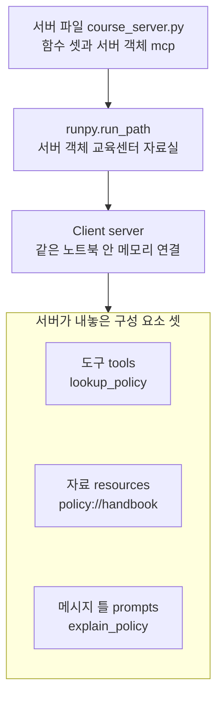
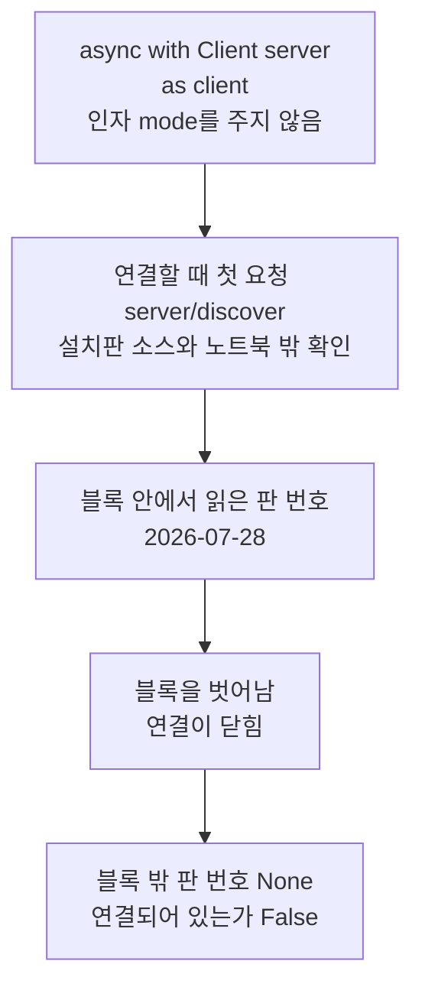
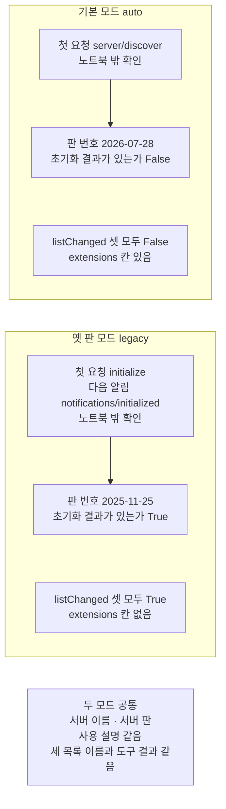
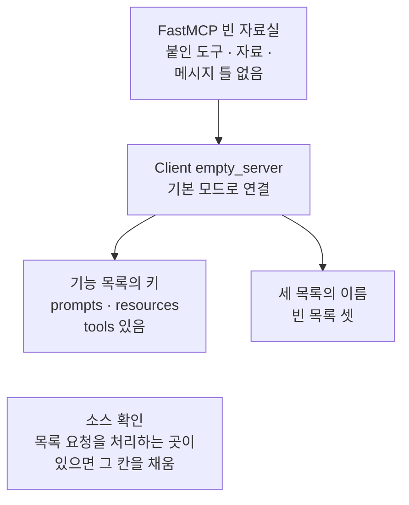

# 01-MCP-구조와-capability-협상

## _src 본문 (HTML 원본)

```html
<!--meta: 강의 1h | 실습 2h | 코드 notebooks/01-MCP-구조와-capability-협상.ipynb | 새 용어 6 -->
<style>html,body{overflow-x:hidden}.notebook,.nb-cell,.nb-main,.nb-input,.nb-result{min-width:0;max-width:100%}.nb-input pre,.nb-output{box-sizing:border-box;max-width:100%;overflow-x:auto}code.nb-source{display:block!important;width:100%!important;min-width:0!important;overflow-x:auto!important;padding:0!important}</style>
<h2 id="b1"><span class="no">1</span>학습 목표</h2><div class="goal"><ul>
<li>서버 파일을 읽어 MCP 서버에 메모리로 붙고, 서버가 내놓는 도구·자료·메시지 틀을 출력으로 읽을 수 있습니다.</li>
<li>인자 <code>mode</code>만 다른 두 연결에서 판 번호·초기화 결과·기능 목록 값을 견주어 설명할 수 있습니다.</li>
<li>기능 목록은 받는 요청의 종류를 알리는 값이고, 등록된 항목이나 부를 권한이 아님을 말할 수 있습니다.</li>
</ul></div>
<h2 id="b2"><span class="no">2</span>이 내용을 배우는 이유</h2><p>Ch 19부터 Ch 27까지 쓴 도구는 모두 에이전트와 같은 프로그램 안에서 돌았습니다. 그래서 도구를 다른 프로그램에서 쓰려면 함수를 옮겨 적어야 했습니다. <a href="../ch27-deepagents/09-DeepAgents-실습.html">Ch 27 09절</a> 끝에서 예고한 것처럼, 이 챕터는 도구를 같은 프로그램 밖의 서버로 옮깁니다. 그리고 여러 클라이언트가 같은 방식으로 그 도구를 찾게 하는 MCP를 봅니다.</p><p>처음 붙을 때 두 쪽은 어느 판의 약속으로 말할지, 서버가 무엇을 받는지를 먼저 맞춥니다. 이 절은 모델을 부르지 않고, 서버에 붙어 그 값을 출력으로 봅니다. 절 제목의 capability는 서버가 알리는 기능 목록이라는 뜻이고, 「핵심 개념」에서 풉니다. 설치판은 현재 판 2026-07-28로 연결하므로, 본문도 그 판을 기준으로 씁니다. 옛 판 2025-11-25는 인자 하나만 바꾼 비교로 봅니다.</p>
<h2 id="b3"><span class="no">3</span>앞에서 배운 내용</h2><p><a href="../../part5/ch19-model-tools/01-tool과-Ch4-함수-재사용.html">Ch 19 01절</a>에서는 함수를 <code>@tool</code> 줄로 감싸 도구로 만들었습니다. 도구는 이름·설명·입력 형식을 가졌고, 매개변수 힌트 <code>: str</code>가 입력 형식이 되었습니다. <a href="../../part5/ch19-model-tools/04-설명만으로-도구-선택하기.html">04절</a>에서는 설명만 바꾼 두 판을 모델에게 알려, 고른 도구와 입력 토큰을 견주었습니다. 이 절의 서버도 같은 세 가지 정보로 도구를 알립니다.</p><p><a href="../ch27-deepagents/01-하네스와-일곱-기능.html">Ch 27 01절</a>에서는 파일 도구와 서브에이전트 위임을 미리 조립해 둔 Deep Agent(하네스)를 썼습니다. <a href="../ch27-deepagents/06-서브에이전트-위임.html">06절</a>의 서브에이전트도 같은 프로그램 안에서 도구 <code>task</code>로 불렸습니다. <a href="../../part2/ch06-langchain-start/01-계층-지도와-첫-호출.html">Ch 6 01절</a>의 계층 지도는 모델 호출을 둘러싼 네 칸(프롬프트·컨텍스트·하네스·루프)이었습니다. 이 절은 그 지도에 칸을 더하지 않고, 하네스가 쓸 도구와 자료를 어디서 받아 오는지를 봅니다.</p><p><a href="../../part1/ch02-python/12-async와-await.html">Ch 2 12절</a>에서는 <code>async def</code>와 await로 기다리는 일을 적었습니다. <a href="../../part5/ch18-workflow-patterns/03-병렬-섹셔닝과-투표.html">Ch 18 03절</a>은 셀 맨 위에 await 줄을 바로 쓰는 것이 노트북 도구(IPython)의 기능이라고 풀었습니다. <a href="../../part1/ch02-python/05-파일과-예외.html">Ch 2 05절</a>의 <code>with open(...)</code>은 블록을 벗어날 때 파일을 닫았습니다. 이 절의 <code>async with</code>는 이 둘을 합친 모양입니다.</p>
<h2 id="b4"><span class="no">4</span>핵심 개념</h2><h3>비유로 시작하기</h3><p>우주 정거장에 작은 우주선 두 척이 다가오는 장면을 떠올려 봅니다. 정거장 앞면에는 도킹 고리 셋이 있고, 두 우주선의 앞머리에도 같은 규격의 고리가 달려 있습니다. 규격이 같아서, 어느 우주선이든 이 정거장에 붙을 수 있습니다. 붙기 전에 두 쪽은 어느 규격으로 말할지, 정거장이 어떤 종류의 짐을 받는지를 먼저 주고받습니다.</p><p>정거장이 MCP 서버이고, 고리 셋이 서버가 내놓는 구성 요소 셋(도구·자료·메시지 틀)입니다. 다가오는 우주선 두 척은 서버에 붙는 클라이언트 둘입니다. 이 절에서는 인자 <code>mode</code>만 다른 두 클라이언트가 같은 서버에 붙습니다. 붙기 전에 주고받는 것이 판 번호와 기능 목록입니다.</p><p>비유와 다른 점이 있습니다. 이 절의 클라이언트는 같은 노트북 안에서 메모리로 붙어, 떨어진 곳에서 오지 않습니다. 다른 프로그램이나 멀리 있는 서버에 붙는 장면은 <a href="03-stdio와-원격-전송-권한-경계.html">03절</a>에서 봅니다. 또 기능 목록은 고리가 있다는 알림일 뿐이라, 고리 뒤에 무엇이 있는지는 목록 요청으로 따로 받습니다.</p>
{{img:01-5-도킹-고리-셋과-우주선-둘|흰 바탕 오른쪽에 옆으로 누운 큰 흰 원통 모양 정거장 모듈이 있고, 왼쪽 둥근 면에 파랑·초록·노랑 도킹 고리 셋이 위아래로 놓여 있습니다. 왼쪽에는 작은 흰 우주선 둘이 위아래에 떠 있고, 둘 다 앞머리의 똑같은 회색 고리를 정거장 쪽으로 향하고 있습니다. 사람·글자·숫자·화살표·별은 없는 그림|정거장 앞면의 고리 셋을 향해, 똑같은 회색 고리를 단 우주선 둘이 다가옵니다.}}
<p class="look"><b>그림 읽기</b> — 흰 바탕 오른쪽에 큰 원통 모양 정거장 모듈이 옆으로 놓여 있습니다. 왼쪽 둥근 면에는 파랑·초록·노랑 도킹 고리 셋이 위아래로 붙어 있습니다. 왼쪽에는 작은 우주선 둘이 위아래에 떠 있고, 둘 다 앞머리에 똑같은 회색 고리를 달고 정거장을 향합니다. 정거장이 MCP 서버, 고리 셋이 구성 요소 셋, 우주선 둘이 인자 <code>mode</code>만 다른 클라이언트 둘입니다. 고리의 색과 크기, 우주선과 정거장 사이의 거리는 어떤 값과도 짝짓지 않습니다.</p>
<h3>MCP와 통신 규약</h3><p>통신 규약(protocol)은 두 프로그램이 어떤 모양의 메시지를 어떤 차례로 주고받을지 정한 약속입니다. 모델이 쓸 도구와 자료를 다른 프로그램에서 가져오는 통신 규약이 MCP(Model Context Protocol)입니다. 메시지는 JSON 글로 요청과 응답을 주고받는 약속(JSON-RPC 2.0)을 따릅니다. 이 챕터 제목의 영어 이름이 이 통신 규약의 이름입니다.</p><p>MCP 규격 문서는 역할을 셋으로 나눕니다. 모델을 쓰는 응용 프로그램이 호스트이고, 그 안에서 서버 하나와의 연결을 맡는 쪽이 클라이언트입니다. 도구와 자료를 내놓는 쪽이 서버입니다. 이 절에서는 모델이 없어, 노트북이 호스트 자리를 대신합니다.</p>
<table><thead><tr><th>말</th><th>뜻</th></tr></thead><tbody><tr><td>MCP(Model Context Protocol)</td><td>모델이 쓸 도구와 자료를 다른 프로그램에서 가져오는 통신 규약입니다. 회사가 다른 휴대전화끼리도 같은 문자 메시지 규칙으로 문자를 주고받는 것과 같습니다. 이 절에서는 서버 파일 <code>course_server.py</code>의 서버와 클래스 <code>Client</code>가 이 약속으로 요청과 응답을 주고받습니다.</td></tr><tr><td>통신 규약(protocol)</td><td>두 프로그램이 주고받을 메시지의 모양과 차례를 정한 약속입니다. 전화를 걸면 먼저 「여보세요」로 서로 확인하고 용건을 말하는 차례와 같습니다. 이 절에서는 기본 모드의 첫 요청이 <code>server/discover</code>, 옛 판 모드의 첫 요청이 <code>initialize</code>입니다(노트북 밖 확인).</td></tr><tr><td>MCP 서버 · 클라이언트</td><td>도구·자료·메시지 틀을 내놓는 쪽이 서버이고, 서버에 요청을 보내는 쪽이 클라이언트입니다. 물건을 내주는 자판기와, 버튼을 눌러 물건을 받는 사람과 같습니다. 이 절에서는 서버 객체 <code>server</code>와, 그것을 넘겨 만든 <code>Client(server)</code>입니다.</td></tr><tr><td>판 번호(protocol version)</td><td>두 쪽이 어느 판의 규격 문서로 말할지 정한 값이고, 규격 문서의 날짜로 부릅니다. 같은 책의 몇 판을 보며 이야기할지 먼저 맞추는 것과 같습니다. 이 절에서는 속성 <code>protocol_version</code>의 값 <code>2026-07-28</code>과 <code>2025-11-25</code>입니다.</td></tr><tr><td>기능 목록(capability)</td><td>서버가 어떤 종류의 요청을 받는지 알리는 딕셔너리입니다. 가게 문에 붙은 「카드 결제 가능」 표시처럼, 무엇을 할 수 있는지만 알리고 물건이 있는지는 따로 물어야 합니다. 이 절에서는 속성 <code>server_capabilities</code>이고, 키 <code>tools</code>·<code>resources</code>·<code>prompts</code> 등을 가집니다.</td></tr><tr><td>자료(resources) · 메시지 틀(prompts)</td><td>서버가 내놓는 구성 요소 셋 가운데 둘입니다. 자료는 주소(URI)로 읽는 글이고, 메시지 틀은 빈자리에 값을 넣어 받는 메시지입니다. 서가 번호로 찾아 읽는 책과, 칸을 채워 내는 신청서 양식과 같습니다. 이 절에서는 자료 <code>policy://handbook</code>과 메시지 틀 <code>explain_policy</code>입니다.</td></tr></tbody></table>
<p>새 말을 이 절 코드에서 보면 이렇습니다. 판 번호는 <code>정해진 판 번호: 2026-07-28</code>으로 출력됩니다. 기능 목록은 키 <code>"tools"</code>·<code>"resources"</code>·<code>"prompts"</code>를 가진 JSON 글입니다. 구성 요소 셋은 <code>도구 이름: ['lookup_policy']</code>, <code>자료 주소: policy://handbook</code>, <code>메시지 틀 이름: ['explain_policy']</code>입니다.</p>
{{mermaid:01-1-서버와-구성-요소-셋|위에서 아래로 읽는 흐름도입니다. 맨 위 초록 상자 서버 파일 course_server.py 함수 셋과 서버 객체 mcp에서 파란 상자 runpy.run_path 서버 객체 교육센터 자료실로, 다시 파란 상자 Client server 같은 노트북 안 메모리 연결로 화살표가 갑니다. 그 아래에 서버가 내놓은 구성 요소 셋이라는 칸이 있고, 칸 안에 노란 상자 셋 도구 tools lookup_policy, 자료 resources policy://handbook, 메시지 틀 prompts explain_policy가 위에서 아래로 나란히 놓인 그림|노트북은 서버 파일을 읽어 서버 객체를 얻고, 클라이언트로 붙어 구성 요소 셋을 하나씩 받았습니다.}}
<p class="look"><b>도식 읽기</b> — 위에서 아래로 읽습니다. 초록 상자는 실습 폴더의 서버 파일이고, 파란 상자 둘은 노트북 2·3절에서 우리가 부른 코드입니다. 칸 안 노란 상자 셋은 4절 출력으로 확인한 이름이고, 서로 다른 종류라 화살표 없이 나란히 두었습니다. 서버는 다른 프로그램으로 띄우지 않고, 같은 노트북 안에서 메모리로 연결했습니다.</p>
<h3>두 판의 협상</h3><p>판 2025-11-25까지는 연결하자마자 클라이언트가 <code>initialize</code> 요청을 보냈습니다. 이 요청에 자기 판 번호와 기능 목록을 싣고, 서버는 고른 판 번호와 서버의 기능 목록으로 답했습니다. 클라이언트가 알림 <code>notifications/initialized</code>를 보낸 뒤에야 목록 요청 같은 보통 요청을 보냈습니다. 옛 판 규격 문서는 두 쪽 모두 협상된 기능만 쓰라고 적습니다.</p><p>현재 판 2026-07-28은 이 첫 요청을 없앴습니다. 요청마다 판 번호와 클라이언트의 기능 목록을 싣고, 서버는 요청마다 받거나 거절합니다. 서버는 판 목록·기능 목록·서버 정보를 알려 주는 <code>server/discover</code> 요청을 꼭 받아야 합니다. 클라이언트가 이 요청을 먼저 보낼지는 고를 수 있습니다.</p><p>설치판 fastmcp 4.0.3의 클라이언트는 인자 <code>mode</code>로 두 방식을 고릅니다. 기본값 <code>auto</code>는 <code>server/discover</code>로 먼저 물어보고, 서버가 현재 판을 쓰면 현재 판으로 연결합니다. 현재 판을 쓰지 않는 서버에는 옛 판 방식으로 물러섭니다. 값 <code>legacy</code>는 처음부터 옛 판 방식으로 연결합니다.</p><p>기능 목록은 「이 종류의 요청을 받는다」는 알림입니다. 누가 그 도구를 불러도 되는지 정하는 권한과는 다른 일이고, 권한은 03절에서 봅니다.</p>
<h2 id="b5"><span class="no">5</span>실행 예제</h2><p>노트북 2절은 서버 파일의 위치를 찾아 실행하고, 서버 객체를 얻습니다. 3절은 기본 모드로 연결해 판 번호·협상 결과·기능 목록을 받습니다. 4절은 세 목록을 받고, 도구·자료·메시지 틀을 한 번씩 씁니다. 5절은 인자 <code>mode</code>만 <code>"legacy"</code>로 바꿔 두 모드를 견주고, 6절은 빈 서버의 기능 목록을 봅니다.</p><p>모델 요청은 0번이고, API 키 없이 실행합니다. 서버는 같은 노트북 안에서 메모리로 연결해, 네트워크·포트·다른 프로그램을 쓰지 않습니다. 읽는 파일은 서버 파일 하나이고 쓰는 파일은 없습니다. 걸린 시간은 재지 않았습니다.</p>
{{notebook:01-MCP-구조와-capability-협상}}
<p class="look"><b>확인할 점</b> — 노트북 3절에서 <code>정해진 판 번호: 2026-07-28</code>과 <code>블록 밖에서 본 판 번호: None</code>을 봅니다. 4절에서 <code>받은 도구 수: 1</code>과 <code>도구 이름: ['lookup_policy']</code>를 확인합니다. 5절에서는 딕셔너리의 <code>'판 번호': '2025-11-25'</code>와 줄 <code>판 번호 | 2026-07-28 | 2025-11-25 | False</code>를 찾습니다. 6절에서 빈 서버의 <code>세 목록의 이름: [] [] []</code>를 확인합니다.</p>
{{mermaid:01-2-연결-블록-안과-밖|위에서 아래로 읽는 흐름도입니다. 파란 상자 async with Client server as client 인자 mode를 주지 않음에서 회색 상자 연결할 때 첫 요청 server/discover 설치판 소스와 노트북 밖 확인으로, 다시 노란 상자 블록 안에서 읽은 판 번호 2026-07-28로 화살표가 갑니다. 이어서 파란 상자 블록을 벗어남 연결이 닫힘을 지나 노란 상자 블록 밖 판 번호 None 연결되어 있는가 False로 화살표가 가는 그림|기본 모드로 연결한 블록 안에서는 판 번호 2026-07-28이 보였고, 블록을 벗어나자 판 번호가 None이 되었습니다.}}
<p class="look"><b>도식 읽기</b> — 위에서 아래로 읽습니다. 파란 상자는 노트북 3절 첫 셀의 코드이고, 노란 상자 둘은 그 셀 출력입니다. 회색 상자의 첫 요청 이름은 노트북에 출력하지 않았고, 설치판 소스와 노트북 밖 확인으로 본 것입니다. 블록을 벗어나면 연결이 닫히므로, 협상 결과는 블록 안에서 변수에 담아 둡니다.</p>
<h2 id="b6"><span class="no">6</span>실험 결과 해석</h2><p>기본 모드는 판 2026-07-28로 연결했고, 초기화 결과가 없었습니다. 인자 <code>mode</code> 하나만 <code>"legacy"</code>로 바꾸자 판이 2025-11-25로 바뀌고 초기화 결과가 생겼습니다. 서버 이름·서버 판·사용 설명은 두 모드에서 같았습니다. 세 목록의 이름과 도구 결과 글도 두 모드에서 같았습니다.</p>
<p>아래 표는 두 모드의 값을 모은 것입니다. 첫 요청 줄만 노트북 밖에서 확인했고, 나머지는 노트북 3~5절 출력입니다.</p>
<table><thead><tr><th>항목</th><th>기본 모드(<code>auto</code>)</th><th>옛 판 모드(<code>legacy</code>)</th></tr></thead><tbody><tr><td>판 번호</td><td><code>2026-07-28</code></td><td><code>2025-11-25</code></td></tr><tr><td>초기화 결과가 있는가</td><td><code>False</code></td><td><code>True</code></td></tr><tr><td>첫 요청(노트북 밖 확인)</td><td><code>server/discover</code></td><td><code>initialize</code> 다음 알림 <code>notifications/initialized</code></td></tr><tr><td>서버 이름 · 서버 판 · 사용 설명</td><td>교육센터 자료실 · 4.0.3 · 같은 글</td><td>기본 모드와 같음</td></tr><tr><td>기능 목록의 <code>listChanged</code>(셋 모두)</td><td><code>false</code></td><td><code>true</code></td></tr><tr><td>기능 목록의 <code>extensions</code> 칸</td><td>있음</td><td>없음</td></tr><tr><td>세 목록의 이름 · 도구 결과 글</td><td><code>['lookup_policy']</code> 등</td><td>기본 모드와 같음(<code>True</code> 넷)</td></tr></tbody></table>
<p>기능 목록의 세 칸은 두 모드 모두에 있었고, 안쪽 <code>listChanged</code> 값만 달랐습니다. 현재 판에서는 목록이 바뀐 알림을 따로 여는 알림 연결로만 보냅니다. 설치판 mcp 2.2.0은 서버가 그 연결 요청을 받을 때만 이 값을 <code>true</code>로 채웁니다. fastmcp 4.0.3 서버는 그 요청을 받지 않아 <code>false</code>였습니다. 옛 판에서는 fastmcp가 세 구성 요소 모두 알린다고 정해 두어 <code>true</code>였습니다.</p>
{{mermaid:01-3-두-모드의-협상-결과|칸 둘과 상자 하나가 위에서 아래로 놓인 그림입니다. 첫째 칸 기본 모드 auto에는 회색 상자 첫 요청 server/discover 노트북 밖 확인에서 노란 상자 판 번호 2026-07-28 초기화 결과가 있는가 False로 화살표가 가고, 그 아래에 노란 상자 listChanged 셋 모두 False extensions 칸 있음이 있습니다. 둘째 칸 옛 판 모드 legacy에는 회색 상자 첫 요청 initialize 다음 알림 notifications/initialized 노트북 밖 확인에서 노란 상자 판 번호 2025-11-25 초기화 결과가 있는가 True로 화살표가 가고, 그 아래에 노란 상자 listChanged 셋 모두 True extensions 칸 없음이 있습니다. 맨 아래 회색 상자에는 두 모드 공통 서버 이름 서버 판 사용 설명 같음, 세 목록 이름과 도구 결과 같음이 적힌 그림|인자 mode 하나만 바꾸자 판 번호와 초기화 결과, listChanged 값이 바뀌었고, 서버 정보와 세 목록은 그대로였습니다.}}
<p class="look"><b>도식 읽기</b> — 칸 둘을 위에서 아래로 읽고, 칸 안에서는 화살표를 따라 읽습니다. 노란 상자는 노트북 3·5절 출력이고, 회색 첫 요청 상자는 노트북 밖에서 확인한 이름입니다. 맨 아래 회색 상자는 두 모드에서 모두 같았던 값입니다. 두 칸은 서로 다른 설정이라 화살표 없이 위아래로 두었습니다.</p>
<p>6절의 빈 서버는 붙인 것이 하나도 없었지만, 기능 목록에 세 칸을 모두 알렸습니다. 세 목록은 모두 빈 목록이었습니다. 기능 목록은 서버가 받는 요청의 종류이고, 서버에 무엇이 등록되었는지는 목록 요청으로만 보입니다.</p>
{{mermaid:01-4-빈-서버의-기능-목록|위에서 아래로 읽는 흐름도입니다. 초록 상자 FastMCP 빈 자료실 붙인 도구 자료 메시지 틀 없음에서 파란 상자 Client empty_server 기본 모드로 연결로 화살표가 갑니다. 파란 상자에서 노란 상자 둘로 화살표가 갈라져 갑니다. 하나는 기능 목록의 키 prompts resources tools 있음, 다른 하나는 세 목록의 이름 빈 목록 셋입니다. 맨 아래 회색 상자에는 소스 확인 목록 요청을 처리하는 곳이 있으면 그 칸을 채움이 적힌 그림|아무것도 붙이지 않은 서버도 기능 목록에 도구·자료·메시지 틀 세 칸을 알렸고, 세 목록은 모두 비어 있었습니다.}}
<p class="look"><b>도식 읽기</b> — 위에서 아래로 읽습니다. 초록 상자는 6절에서 만든 빈 서버이고, 파란 상자는 우리가 연 연결입니다. 노란 상자 둘은 6절 출력이고, 한 연결에서 받은 두 값이라 화살표 둘로 나눴습니다. 맨 아래 회색 상자는 설치판 mcp 2.2.0 소스로만 확인한 규칙입니다.</p>
<p>새 커널로 두 번 실행해 견주자, 코드 셀 스물다섯의 출력이 셀마다 모두 같았습니다. 모델을 부르지 않아, 이 절의 출력은 서버와 클라이언트가 주고받은 값으로 정해집니다.</p>
<p class="look"><b>확인할 점</b> — 노트북 5절 마지막 셀의 네 줄이 모두 <code>True</code>인지 봅니다. 6절에서 라벨 <code>기능 목록의 키:</code> 뒤에 <code>'tools'</code>가 있는지 확인합니다. 모델을 부르지 않으므로, 다시 실행해도 같은 값이 나와야 합니다.</p>
<h2 id="b7"><span class="no">7</span>주의할 점과 실무 메모</h2><ul><li>MCP 규격 문서는 2026-09-28에 확인한 현재 판이 2026-07-28이라고 적습니다. 설치판 fastmcp 4.0.3의 기본 모드도 이 판을 골랐습니다. 옛 판 2025-11-25는 인자 <code>mode="legacy"</code>로 연결할 때의 판이고, 이 절은 비교로만 씁니다.</li><li>두 모드의 첫 요청 이름(<code>server/discover</code> ↔ <code>initialize</code>·<code>notifications/initialized</code>)은 노트북에 출력하지 않았습니다. 서버에 오간 요청을 적으려면 서버 쪽 기록 장치를 클래스로 새로 만들어야 해서, 이 절 범위 밖입니다. 노트북 밖에서 그렇게 적어 두 번 모두 같은 차례를 확인했고, 설치판 fastmcp <code>client/client.py</code> 837~889행과도 맞습니다.</li><li>옛 판 규격 문서는 협상된 기능만 쓰라고 적습니다. 그러나 6절 출력처럼, fastmcp 서버는 붙인 것이 없어도 기능 목록 세 칸을 늘 알립니다. 설치판 mcp 2.2.0 <code>server/lowlevel/server.py</code> 596~607행이 목록 요청을 처리하는 곳만 보고 칸을 채우기 때문입니다. 그래서 「알리지 않은 기능을 쓰는」 장면은 이 서버로 보일 수 없고, 이 절은 빈 서버의 기능 목록만 보였습니다.</li><li>기능 목록과 사용 설명은 서버가 스스로 밝힌 값입니다. 규격 문서도 서버 정보를 보안 판단에 쓰지 말라고 적습니다. 누가 어떤 도구를 부를 수 있는지는 03절의 인증·권한 몫입니다.</li><li>인터넷 예제에 많은 <code>from mcp.server.fastmcp import FastMCP</code> 줄은 설치판 mcp 2.2.0에서 멈춥니다. 그 판에서 옛 이름이 <code>MCPServer</code>로 바뀌었다는 오류가 납니다. 이 챕터는 별도 패키지 fastmcp 4.0.3의 <code>from fastmcp import FastMCP</code>를 씁니다.</li><li>노트북 셀에서 <code>asyncio.run()</code>을 부르면 <code>RuntimeError</code>가 납니다. 노트북은 이미 비동기 실행을 돌리고 있기 때문입니다. 이 오류는 따로 만든 작은 노트북에서 확인했고, 이 노트북에서는 실행하지 않았습니다.</li><li>서버 파일을 <code>import</code>나 모듈 <code>importlib</code>로 읽으면, 실습 폴더 <code>__pycache__</code>에 컴파일한 파일이 생깁니다. 이 절은 함수 <code>runpy.run_path</code>로 읽어 새 파일을 남기지 않았습니다.</li><li>서버 판 칸의 4.0.3은 fastmcp의 판 번호입니다. 서버 파일이 판을 정하지 않아, 설치판 fastmcp <code>server/server.py</code> 425행이 자기 판 번호를 채웠습니다.</li><li>걸린 시간은 재지 않았습니다. 교재 출력은 Linux의 Python 3.12.13으로 만들었고, 다른 판과 Windows·macOS에서는 실행하지 않았습니다.</li></ul>
<h2 id="b8"><span class="no">8</span>정리와 다음 절</h2><ul><li>기본 모드는 2026-07-28, 옛 판 모드는 2025-11-25로 연결했고, 초기화 결과는 옛 판에만 있었습니다.</li><li>두 모드 모두 서버 정보와 세 목록, 도구 결과가 같았고, <code>listChanged</code> 값과 추가 기능 칸만 달랐습니다.</li><li>기능 목록은 받는 요청의 종류를 알릴 뿐이고, 붙인 것이 없는 서버도 세 칸을 모두 알렸습니다.</li></ul><p><strong>다음 학습과 이어지는 지점</strong> — <a href="02-FastMCP-로컬-서버-제작.html">02절</a>에서는 서버에 도구를 붙이는 줄을 직접 씁니다. 붙이는 모양에 따라 입력 형식이 어떻게 바뀌는지 봅니다.</p>
<h2 id="b9"><span class="no">9</span>복습 문제</h2><details class="quiz" open><summary>문제 4개 · 해설 포함</summary><p class="quiz-q">1. 인자 <code>mode</code>를 주지 않고 연결했을 때 정해진 판 번호와, 키 「초기화 결과가 있는가」의 값은 무엇이었나요?</p><p class="quiz-a">판 번호는 2026-07-28이고, 초기화 결과가 있는가는 <code>False</code>였습니다. 현재 판에는 첫 요청 <code>initialize</code>가 없기 때문입니다. 틀렸다면 노트북 3절을 다시 읽습니다.</p><p class="quiz-q">2. 블록 <code>async with</code>를 벗어난 뒤에 속성 <code>protocol_version</code>을 읽으면 무엇이 나오고, 그 까닭은 무엇인가요?</p><p class="quiz-a">값 <code>None</code>이 나옵니다. 블록을 벗어나면서 연결이 닫혔기 때문입니다. 그래서 협상 결과는 블록 안에서 변수에 담아 둡니다. 틀렸다면 노트북 3절 첫 셀을 다시 읽습니다.</p><p class="quiz-q">3. 도구와 자료는 쓰는 방법이 어떻게 다른가요?</p><p class="quiz-a">도구는 메서드 <code>call_tool</code>에 이름과 인자를 넘겨 서버가 실행하게 합니다. 자료는 메서드 <code>read_resource</code>에 주소를 넘겨 글을 읽습니다. 틀렸다면 노트북 4절을 다시 읽습니다.</p><p class="quiz-q">4. 동료가 「기능 목록에 <code>tools</code>가 있으니, 이 서버에는 도구가 하나 이상 있다」고 말합니다. 맞나요?</p><p class="quiz-a">맞지 않습니다. 6절의 빈 서버도 기능 목록에 <code>tools</code> 칸을 알렸지만, 도구 목록은 빈 목록이었습니다. 무엇이 있는지는 목록 요청으로 확인합니다. 틀렸다면 노트북 6절을 다시 읽습니다.</p></details>
<h2 id="b10"><span class="no">10</span>참고 자료</h2><ul><li><div><a href="https://modelcontextprotocol.io/specification/versioning">MCP Versioning</a></div>확인 2026-09-28 · 현재 판을 2026-07-28로 적습니다. 판 이름은 뒤로 호환되지 않게 바뀐 마지막 날짜라고 설명합니다.</li><li><div><a href="https://modelcontextprotocol.io/specification/2026-07-28">MCP Specification 2026-07-28</a></div>확인 2026-09-28 · 역할 셋(호스트·클라이언트·서버)과 JSON-RPC 메시지, 서버 구성 요소 셋을 적습니다. 요청마다 기능을 협상한다고 적습니다.</li><li><div><a href="https://modelcontextprotocol.io/specification/2026-07-28/changelog">MCP 2026-07-28 Key Changes</a></div>확인 2026-09-28 · 옛 판의 <code>initialize</code> 요청과 알림을 없애고, 요청마다 판 번호와 기능 목록을 싣는다고 적습니다. 요청 <code>server/discover</code>를 서버가 꼭 받아야 한다는 것과, 목록 알림을 <code>subscriptions/listen</code>으로 옮긴 것도 적습니다.</li><li><div><a href="https://modelcontextprotocol.io/specification/2026-07-28/server/discover">MCP server/discover</a></div>확인 2026-09-28 · 응답에 판 목록·기능 목록·서버 정보·사용 설명이 들어간다고 적습니다. 서버 정보는 보안 판단에 쓰지 말라고 적습니다.</li><li><div><a href="https://modelcontextprotocol.io/specification/2025-11-25/basic/lifecycle">MCP 2025-11-25 Lifecycle</a></div>확인 2026-09-28 · 옛 판의 <code>initialize</code> 요청·응답과 알림 차례, 협상된 기능만 쓰라는 규칙을 적습니다.</li><li><div><a href="https://gofastmcp.com/clients/client">FastMCP Client</a></div>확인 2026-09-28 · fastmcp 4.0 문서입니다. 인자 <code>mode</code>의 값 <code>auto</code>·<code>legacy</code>와 판 고정을 설명하고, 서버 객체를 넘기면 같은 프로세스 안에서 연결한다고 적습니다.</li><li>설치판 fastmcp 4.0.3 소스 <code>client/client.py</code> 312~318행은 인자 <code>mode</code>의 설명이고, 837~889행은 연결할 때의 협상입니다. <code>server/low_level.py</code> 465~469행은 옛 판용 알림 값이고, <code>server/server.py</code> 425행은 서버 판 칸입니다.</li><li>설치판 mcp 2.2.0 소스 <code>server/lowlevel/server.py</code> 585~607행은 판마다 기능 목록을 채우는 규칙입니다. <code>mcp_types/version.py</code> 24~41행은 알려진 판 다섯과 현재 판입니다.</li></ul>
```

## 노트북 셀 (순서대로)

### [0] markdown {'html': 'skip'}

# MCP 구조와 capability 협상

**이 노트북에서 할 일**

1. 서버 파일을 읽어 MCP 서버에 메모리로 연결하고, 협상으로 정해진 판 번호와 기능 목록을 봅니다.
2. 서버가 내놓는 도구·자료·메시지 틀 목록을 받고, 셋을 한 번씩 써 봅니다.
3. 인자 `mode` 하나만 바꿔 옛 판 방식으로 다시 연결하고, 두 협상 결과를 견줍니다.

**준비물** — 이 노트북은 모델을 부르지 않습니다.
모델 요청은 0번이고, API 키 없이 실행합니다.
예상 비용도 0달러입니다.
출력은 모두 서버와 클라이언트가 주고받은 값이라, 다시 실행해도 같은 값이 나와야 합니다.

서버는 실습 폴더 맨 위의 `course_server.py` 파일에 있습니다.
노트북은 이 파일을 읽기만 하고, 쓰는 파일은 없습니다.
서버를 다른 프로그램으로 띄우지 않고, 같은 노트북 안에서 메모리로 연결합니다.
그래서 네트워크와 포트를 쓰지 않습니다.

걸린 시간은 재지 않았습니다.
이 절은 앞 챕터에서 배운 함수를 쓰지 않아, 가져오는 도구 파일도 없습니다.

**기준 버전** — 첫 셀에서 패키지 둘을 설치합니다.
판은 fastmcp 4.0.3과 mcp 2.2.0입니다.
교재 출력은 Linux의 Python 3.12.13으로 만들었습니다.
다른 판과 Windows·macOS에서는 실행하지 않았습니다.

**강의와 실습 범위** — 강의 시간에는 2~4절을 읽습니다.
서버에 붙어 판 번호와 기능 목록, 구성 요소 셋을 보는 자리입니다.
5·6절은 값 하나를 바꿔 견주는 실습이고, 실습 시간에 실행합니다.

실습 폴더 `labs/part6/ch28-mcp`에서 `uv sync --locked`를 실행합니다.
그다음 `notebooks/` 폴더의 이 노트북을 열고, 실습 폴더의 `.venv` 커널을 고릅니다.
첫 셀부터 순서대로 실행합니다.

### [1] markdown {'html': 'skip'}

## 오늘 볼 그림


위에서 아래로 읽습니다.
초록 상자는 실습 폴더의 서버 파일이고, 파란 상자 둘은 노트북 2·3절에서 우리가 부른 코드입니다.
칸 안 노란 상자 셋은 4절 출력으로 확인한 이름이고, 서로 다른 종류라 화살표 없이 나란히 두었습니다.
서버는 다른 프로그램으로 띄우지 않고, 같은 노트북 안에서 메모리로 연결했습니다.

### [2] markdown {}

## 1. 준비

모델이 쓸 도구와 자료를 다른 프로그램에서 가져오는 약속이 MCP(Model Context Protocol)입니다.
이 절은 MCP 서버에 처음 붙어 보고, 서버가 무엇을 알리는지 출력으로 봅니다.
뜻과 구성은 본문 「핵심 개념」에서 풉니다.

첫 셀은 패키지 둘을 설치하고 설치된 판 번호를 출력합니다.
설치에는 몇십 초가 걸릴 수 있습니다.

### [3] code {'execution': {'iopub.execute_input': '2026-09-28T19:32:13.896366Z', 'iopub.status.busy': '2026-09-28T19:32:13.896177Z', 'iopub.status.idle': '2026-09-28T19:32:14.719880Z', 'shell.execute_reply': '2026-09-28T19:32:14.719294Z'}, 'lesson_role': 'setup'}

```python
# 이 절에서 쓰는 패키지를 설치하고 버전을 확인합니다
%pip install -q "fastmcp==4.0.3" "mcp==2.2.0"
from importlib.metadata import version

print("fastmcp:", version("fastmcp"))
print("mcp:", version("mcp"))
```

출력:
```
Note: you may need to restart the kernel to use updated packages.
fastmcp: 4.0.3
mcp: 2.2.0

```

### [4] markdown {}

**결과 읽기** — 출력 줄 `fastmcp: 4.0.3`과 `mcp: 2.2.0`이 보입니다.
둘 다 실습 폴더 잠금과 같은 판입니다.
패키지 fastmcp는 MCP 서버와 클라이언트를 만드는 라이브러리입니다.
패키지 mcp는 MCP의 공식 파이썬 도구 모음이고, fastmcp가 안에서 씁니다.

다음 셀은 이 절에서 쓸 이름을 가져옵니다.
모듈 `json`·`os`·`runpy`는 Python에 들어 있는 모듈입니다.
클라이언트 `Client`와 서버 `FastMCP`는 패키지 fastmcp에서 가져옵니다.

### [5] code {'execution': {'iopub.execute_input': '2026-09-28T19:32:14.720967Z', 'iopub.status.busy': '2026-09-28T19:32:14.720875Z', 'iopub.status.idle': '2026-09-28T19:32:15.543040Z', 'shell.execute_reply': '2026-09-28T19:32:15.542668Z'}, 'lesson_role': 'setup'}

```python
# 이 절에서 쓸 이름을 가져옵니다(json·os·runpy는 Python에 들어 있는 모듈입니다)
import json
import os
import runpy
from fastmcp import Client, FastMCP

print("가져온 FastMCP 이름:", "Client, FastMCP")
```

출력:
```
가져온 FastMCP 이름: Client, FastMCP

```

### [6] markdown {}

**결과 읽기** — 출력 줄 `가져온 FastMCP 이름: Client, FastMCP`가 보입니다.
서버 클래스 `FastMCP`는 6절에서 빈 서버를 하나 만들 때 씁니다.
이 노트북에는 API 키를 확인하는 셀이 없습니다.
모델을 부르지 않기 때문입니다.

## 2. 서버 파일 읽기

이 챕터의 서버는 실습 폴더 맨 위 파일 `course_server.py`에 있습니다.
노트북을 어디서 열었는지에 따라 이 파일을 가리키는 글이 달라집니다.
다음 셀은 Ch 10 01절의 파일 위치 셀처럼 후보 셋을 차례로 보고, 처음 있는 것을 고릅니다.
함수 `os.path.exists`는 그 위치에 파일이 있으면 `True`를 내놓습니다.

### [7] code {'execution': {'iopub.execute_input': '2026-09-28T19:32:15.543806Z', 'iopub.status.busy': '2026-09-28T19:32:15.543698Z', 'iopub.status.idle': '2026-09-28T19:32:15.546732Z', 'shell.execute_reply': '2026-09-28T19:32:15.546375Z'}}

```python
# 작업 폴더에서 본 서버 파일의 위치를 후보 셋 가운데에서 고릅니다
candidates = ["../course_server.py", "course_server.py", "labs/part6/ch28-mcp/course_server.py"]
server_file = None
for candidate in candidates:
    if os.path.exists(candidate):
        server_file = candidate
        break
print("서버 파일을 찾았는가:", server_file is not None)
print("고른 파일 위치:", server_file)
assert server_file is not None, "notebooks 폴더나 실습 폴더 맨 위에서 노트북을 열어 주세요."
```

출력:
```
서버 파일을 찾았는가: True
고른 파일 위치: labs/part6/ch28-mcp/course_server.py

```

### [8] markdown {}

**결과 읽기** — 출력 줄 `서버 파일을 찾았는가: True`가 보입니다.
교재 출력은 프로젝트 맨 위에서 실행해 셋째 후보 `labs/part6/ch28-mcp/course_server.py`를 골랐습니다.
`notebooks/` 폴더에서 열면 첫 후보 `../course_server.py`가 골라집니다.

다음 셀은 이 파일을 실행해 서버 객체를 얻습니다.
함수 `runpy.run_path`는 파이썬 파일 하나를 실행하고, 그 파일이 만든 이름을 딕셔너리로 내놓습니다.
서버 파일 맨 끝의 `if __name__ == "__main__":` 아래 줄은 그 파일을 직접 실행할 때만 돕니다.
이 함수로 읽으면 그 줄이 돌지 않아, 서버가 따로 떠 있지 않습니다.

### [9] code {'execution': {'iopub.execute_input': '2026-09-28T19:32:15.547297Z', 'iopub.status.busy': '2026-09-28T19:32:15.547248Z', 'iopub.status.idle': '2026-09-28T19:32:15.582968Z', 'shell.execute_reply': '2026-09-28T19:32:15.582588Z'}}

```python
# 서버 파일을 실행해, 그 파일이 만든 이름을 딕셔너리로 받습니다
server_names = runpy.run_path(server_file)
# 서버 파일이 만든 서버 객체의 이름은 mcp입니다
server = server_names["mcp"]
print("서버 객체 종류:", type(server).__name__)
print("서버 이름:", server.name)
```

출력:
```
서버 객체 종류: FastMCP
서버 이름: 교육센터 자료실

```

### [10] markdown {}

**결과 읽기** — 출력 줄 `서버 객체 종류: FastMCP`와 `서버 이름: 교육센터 자료실`이 보입니다.
서버 이름은 서버 파일이 클래스 `FastMCP`에 처음 넘긴 글입니다.
함수 `runpy.run_path`는 파일을 읽을 때 컴파일한 파일(`.pyc`)을 실습 폴더에 남기지 않습니다.

다음 셀은 이 파일이 만든 이름을 봅니다.
밑줄 둘로 시작하는 이름(`__name__` 등)은 Python이 채운 것이라 뺍니다.

### [11] code {'execution': {'iopub.execute_input': '2026-09-28T19:32:15.583590Z', 'iopub.status.busy': '2026-09-28T19:32:15.583537Z', 'iopub.status.idle': '2026-09-28T19:32:15.585531Z', 'shell.execute_reply': '2026-09-28T19:32:15.585181Z'}}

```python
# 파일이 만든 이름 가운데 밑줄 둘로 시작하지 않는 것만 모읍니다
file_names = []
for name in server_names:
    if not name.startswith("__"):
        file_names.append(name)
print("파일이 만든 이름:", file_names)
print("lookup_policy의 종류:", type(server_names["lookup_policy"]).__name__)
```

출력:
```
파일이 만든 이름: ['FastMCP', 'POLICIES', 'mcp', 'lookup_policy', 'policy_handbook', 'explain_policy']
lookup_policy의 종류: function

```

### [12] markdown {}

**결과 읽기** — 라벨 `파일이 만든 이름:` 뒤에 `'lookup_policy'`·`'policy_handbook'`·`'explain_policy'`가 있습니다.
이 세 함수를 서버 파일이 서버에 붙였고, 붙이는 줄(`@mcp.tool` 등)은 02절에서 배웁니다.
출력 줄 `lookup_policy의 종류: function`처럼, 붙인 뒤에도 파일 안에서는 평범한 함수입니다.
이 절에서는 이 함수를 직접 부르지 않고, 클라이언트를 거쳐 서버에 요청합니다.

## 3. 기본 모드로 연결하기

MCP에서 서버에 요청을 보내는 쪽을 클라이언트라고 부릅니다.
클래스 `Client`에 서버 객체를 넘기면, 같은 노트북 안에서 메모리로 붙는 클라이언트가 됩니다.
MCP 클라이언트의 메서드는 모두 비동기이고, 결과가 올 때까지 기다리며 씁니다.

다음 셀의 첫 줄 `async with`는 Ch 2 05절의 `with open(...)`처럼, 블록을 벗어날 때 연결을 닫는 줄입니다.
연결을 열고 닫는 일도 기다려야 해서 앞에 `async`를 붙입니다.
Ch 18 03절에서 본 것처럼, 셀 맨 위에 `async with`나 await 줄을 바로 쓰는 것은 노트북 도구(IPython)의 기능입니다.
파이썬 파일에서는 Ch 2 12절처럼 `async def` 함수 안에 넣고 `asyncio.run()`으로 부릅니다.
노트북 셀에서는 `asyncio.run()`을 쓰지 않습니다.

노트북은 이미 비동기 실행을 돌리고 있어서, 셀에서 부르면 `RuntimeError`가 나기 때문입니다.
이 오류는 따로 만든 작은 노트북에서 확인했고, 이 노트북에서는 실행하지 않습니다.

### [13] code {'execution': {'iopub.execute_input': '2026-09-28T19:32:15.586138Z', 'iopub.status.busy': '2026-09-28T19:32:15.586094Z', 'iopub.status.idle': '2026-09-28T19:32:15.598851Z', 'shell.execute_reply': '2026-09-28T19:32:15.598498Z'}}

```python
# 클라이언트로 서버에 연결하고, 협상으로 정해진 판 번호를 봅니다
async with Client(server) as client:
    auto_version = client.protocol_version
print("인자 mode의 값:", client.mode)
print("정해진 판 번호:", auto_version)
# 블록을 벗어난 뒤에 같은 속성을 다시 읽어 봅니다
print("블록 밖에서 본 판 번호:", client.protocol_version)
print("블록 밖에서 연결되어 있는가:", client.is_connected())
```

출력:
```
인자 mode의 값: auto
정해진 판 번호: 2026-07-28
블록 밖에서 본 판 번호: None
블록 밖에서 연결되어 있는가: False

```

### [14] markdown {}

**결과 읽기** — 출력 줄 `인자 mode의 값: auto`와 `정해진 판 번호: 2026-07-28`이 보입니다.
인자 `mode`를 주지 않으면 기본값 `auto`가 쓰입니다.
판 번호는 두 쪽이 어느 판의 약속으로 말할지 정한 값이고, MCP 규격 문서의 날짜 이름입니다.
블록 밖에서는 판 번호가 `None`이고, 연결되어 있는가가 `False`입니다.
블록을 벗어나면서 연결이 닫혔기 때문입니다.

2026-09-28에 확인한 MCP 규격 문서는 2026-07-28을 현재 판으로 적습니다.
기본 모드는 연결하자마자 서버에 `server/discover` 요청을 먼저 보내, 서버가 이 판을 쓰는지 묻습니다.
이 요청 이름은 설치판 fastmcp 4.0.3 소스와 노트북 밖 확인으로 본 것이고, 노트북에는 출력하지 않습니다.

다음 셀은 협상 결과를 한국어 키 딕셔너리로 모으는 함수를 만듭니다.
속성 `initialize_result`는 옛 판 방식의 첫 요청 `initialize`에 서버가 준 응답입니다.
속성 `server_info`는 서버가 밝힌 이름과 판, 속성 `instructions`는 서버가 붙인 사용 설명 글입니다.

### [15] code {'execution': {'iopub.execute_input': '2026-09-28T19:32:15.599413Z', 'iopub.status.busy': '2026-09-28T19:32:15.599353Z', 'iopub.status.idle': '2026-09-28T19:32:15.601013Z', 'shell.execute_reply': '2026-09-28T19:32:15.600675Z'}}

```python
# 연결된 클라이언트에서 협상 결과를 읽어, 한국어 키 딕셔너리로 내놓습니다
def read_negotiation(client):
    row = {
        "판 번호": client.protocol_version,
        "초기화 결과가 있는가": client.initialize_result is not None,
        "서버 이름": client.server_info.name,
        "서버 판": client.server_info.version,
        "사용 설명": client.instructions,
    }
    return row
```

출력:
```

```

### [16] markdown {}

**결과 읽기** — 정의 셀이라 출력이 없습니다.
키 「초기화 결과가 있는가」는 속성 `initialize_result`가 `None`이 아니면 `True`입니다.
블록 안에서 불러야 값이 채워져 있습니다.

다음 셀은 기본 모드로 다시 연결해, 협상 결과와 서버가 알린 기능 목록(capabilities)을 함께 받아 둡니다.
연결마다 협상을 새로 하므로, 앞 셀의 연결은 다시 쓰지 않습니다.
메서드 `model_dump`는 라이브러리의 값 객체를 딕셔너리로 바꿉니다.
인자 `exclude_none=True`는 값이 없는 칸을 빼고, `by_alias=True`는 칸 이름을 규격 문서의 이름으로 씁니다.

### [17] code {'execution': {'iopub.execute_input': '2026-09-28T19:32:15.601620Z', 'iopub.status.busy': '2026-09-28T19:32:15.601569Z', 'iopub.status.idle': '2026-09-28T19:32:15.604720Z', 'shell.execute_reply': '2026-09-28T19:32:15.604290Z'}}

```python
# 기본 모드로 다시 연결해, 협상 결과와 서버가 알린 기능 목록을 받아 둡니다
async with Client(server) as client:
    auto_row = read_negotiation(client)
    # model_dump는 기능 목록 객체를 딕셔너리로 바꿉니다(값이 없는 칸은 빼고, 칸 이름은 규격 문서 이름으로)
    auto_caps = client.server_capabilities.model_dump(exclude_none=True, by_alias=True)
print("기본 모드 협상 결과:")
print(auto_row)
```

출력:
```
기본 모드 협상 결과:
{'판 번호': '2026-07-28', '초기화 결과가 있는가': False, '서버 이름': '교육센터 자료실', '서버 판': '4.0.3', '사용 설명': '공개된 자료실 규정을 읽기 전용으로 제공합니다.'}

```

### [18] markdown {}

**결과 읽기** — 라벨 줄 아래 딕셔너리에 `'판 번호': '2026-07-28'`과 `'초기화 결과가 있는가': False`가 보입니다.
서버 이름은 `'교육센터 자료실'`이고, 키 `'서버 판': '4.0.3'`도 있습니다.
키 「사용 설명」은 서버 파일이 인자 `instructions`에 적은 글입니다.

서버 판 4.0.3은 fastmcp 자신의 판 번호입니다.
서버 파일이 판을 정하지 않아, 설치판 fastmcp가 자기 판 번호를 채웠습니다.

다음 셀은 받아 둔 기능 목록을 JSON 글로 바꿔 봅니다.
함수 `json.dumps`의 인자 `sort_keys=True`는 키를 알파벳 차례로 늘어놓습니다.

### [19] code {'execution': {'iopub.execute_input': '2026-09-28T19:32:15.605341Z', 'iopub.status.busy': '2026-09-28T19:32:15.605283Z', 'iopub.status.idle': '2026-09-28T19:32:15.606987Z', 'shell.execute_reply': '2026-09-28T19:32:15.606575Z'}}

```python
# 기본 모드에서 받은 기능 목록을 JSON 글로 바꿔 출력합니다(키는 알파벳 차례)
auto_caps_text = json.dumps(auto_caps, ensure_ascii=False, sort_keys=True)
print("기본 모드 기능 목록:")
print(auto_caps_text)
```

출력:
```
기본 모드 기능 목록:
{"extensions": {"io.modelcontextprotocol/ui": {}}, "logging": {}, "prompts": {"listChanged": false}, "resources": {"listChanged": false, "subscribe": false}, "tools": {"listChanged": false}}

```

### [20] markdown {}

**결과 읽기** — 라벨 줄 아래 JSON 글에 키 `"tools"`·`"resources"`·`"prompts"`가 있습니다.
서버가 도구·자료·메시지 틀 요청을 받는다는 알림입니다.
셋 모두 안쪽 칸이 `"listChanged": false`입니다.

칸 `listChanged`는 목록이 바뀌면 알려 주겠다는 표시입니다.
현재 판에서 이 알림은 따로 여는 알림 연결(`subscriptions/listen`)로만 갑니다.
설치판 mcp 2.2.0은 서버가 그 요청을 받을 때만 이 값을 채우고, fastmcp 4.0.3 서버는 받지 않아 `false`입니다.

키 `"logging"`은 기록 기능, `"extensions"`는 핵심 규약 밖 추가 기능(확장)의 알림입니다.
칸 `extensions`는 현재 판에 새로 생긴 칸입니다.
안의 `io.modelcontextprotocol/ui`는 도구·자료에 화면 정보를 싣는 확장의 이름이고, 설치판 fastmcp가 늘 알립니다.
현재 판 변경 목록은 기록 기능을 더 쓰지 말라고 표시했지만, 설치판 서버는 칸 `logging`을 그대로 알립니다.
알림과 기록을 실제로 받는 장면은 이 절에서 실행하지 않았습니다.

## 4. 구성 요소 셋 받아 쓰기

기능 목록은 어떤 종류의 요청을 받는지만 알립니다.
서버에 실제로 무엇이 있는지는 목록 요청으로 받습니다.
도구 목록은 메서드 `list_tools`, 자료 목록은 `list_resources`, 메시지 틀 목록은 `list_prompts`로 받습니다.
세 메서드 모두 await로 기다립니다.

### [21] code {'execution': {'iopub.execute_input': '2026-09-28T19:32:15.607629Z', 'iopub.status.busy': '2026-09-28T19:32:15.607573Z', 'iopub.status.idle': '2026-09-28T19:32:15.614863Z', 'shell.execute_reply': '2026-09-28T19:32:15.614527Z'}}

```python
# 같은 서버에 연결해 도구·자료·메시지 틀 목록을 받습니다
async with Client(server) as client:
    tools = await client.list_tools()
    resources = await client.list_resources()
    prompts = await client.list_prompts()
print("받은 도구 수:", len(tools))
print("받은 자료 수:", len(resources))
print("받은 메시지 틀 수:", len(prompts))
```

출력:
```
받은 도구 수: 1
받은 자료 수: 1
받은 메시지 틀 수: 1

```

### [22] markdown {}

**결과 읽기** — 출력 줄 `받은 도구 수: 1`, `받은 자료 수: 1`, `받은 메시지 틀 수: 1`이 보입니다.
서버 파일의 함수 셋이 한 종류에 하나씩 붙어 있습니다.

다음 셀은 목록의 항목마다 이름 칸 `name`을 모으는 함수를 만듭니다.
세 목록의 항목은 모두 이름 칸을 가집니다.

### [23] code {'execution': {'iopub.execute_input': '2026-09-28T19:32:15.615399Z', 'iopub.status.busy': '2026-09-28T19:32:15.615340Z', 'iopub.status.idle': '2026-09-28T19:32:15.616907Z', 'shell.execute_reply': '2026-09-28T19:32:15.616652Z'}}

```python
# 목록의 항목마다 이름 칸 name을 모아 내놓습니다
def names_of(items):
    names = []
    for item in items:
        names.append(item.name)
    return names
```

출력:
```

```

### [24] markdown {}

**결과 읽기** — 정의 셀이라 출력이 없습니다.
빈 목록을 받으면 빈 목록을 내놓고, 이 모양은 6절에서 다시 봅니다.

다음 셀은 세 목록의 이름과, 자료를 읽을 때 쓰는 주소를 봅니다.
자료는 이름과 함께 주소(URI)를 가집니다.

### [25] code {'execution': {'iopub.execute_input': '2026-09-28T19:32:15.617454Z', 'iopub.status.busy': '2026-09-28T19:32:15.617407Z', 'iopub.status.idle': '2026-09-28T19:32:15.619164Z', 'shell.execute_reply': '2026-09-28T19:32:15.618830Z'}}

```python
# 세 목록의 이름과, 자료를 읽을 때 쓰는 주소를 봅니다
print("도구 이름:", names_of(tools))
print("자료 이름:", names_of(resources))
print("메시지 틀 이름:", names_of(prompts))
print("자료 주소:", str(resources[0].uri))
```

출력:
```
도구 이름: ['lookup_policy']
자료 이름: ['policy_handbook']
메시지 틀 이름: ['explain_policy']
자료 주소: policy://handbook

```

### [26] markdown {}

**결과 읽기** — 출력 줄 `도구 이름: ['lookup_policy']`와 `메시지 틀 이름: ['explain_policy']`가 보입니다.
자료 이름은 함수 이름 `policy_handbook`이고, 주소는 `policy://handbook`입니다.
주소는 서버 파일에서 자료 함수를 붙이는 줄에 적은 글입니다.

다음 셀은 도구 정의 하나를 들여다봅니다.
도구 정의에는 이름·설명과 함께 인자의 입력 형식(Ch 19 01절)이 들어 있습니다.
모델에게 도구를 알려 줄 때 쓰는 정보이고, 04·05절에서 다시 씁니다.

### [27] code {'execution': {'iopub.execute_input': '2026-09-28T19:32:15.619757Z', 'iopub.status.busy': '2026-09-28T19:32:15.619706Z', 'iopub.status.idle': '2026-09-28T19:32:15.621425Z', 'shell.execute_reply': '2026-09-28T19:32:15.621091Z'}}

```python
# 도구 정의 하나에서 설명과 입력 형식을 봅니다
tool = tools[0]
print("도구 설명:", tool.description)
print("입력 형식:", tool.input_schema)
```

출력:
```
도구 설명: 자료실 규정을 조회합니다. topic은 대출, 운영, 연체 중 하나입니다.
입력 형식: {'type': 'object', 'additionalProperties': False, 'properties': {'topic': {'type': 'string'}}, 'required': ['topic']}

```

### [28] markdown {}

**결과 읽기** — 라벨 `도구 설명:` 뒤에 서버 파일 함수의 독스트링 글이 보입니다.
라벨 `입력 형식:` 뒤에는 `'required': ['topic']`과 `'topic': {'type': 'string'}`이 있습니다.
인자 `topic`이 꼭 있어야 하고, 글이어야 한다는 뜻입니다.

이 입력 형식은 서버 파일 함수의 매개변수 힌트 `topic: str`에서 만들어졌고, 02절에서 자세히 봅니다.
칸 `'additionalProperties': False`는 정해 두지 않은 인자를 받지 않는다는 뜻입니다.

다음 셀부터는 구성 요소 셋을 한 번씩 씁니다.
먼저 도구를 부릅니다.
메서드 `call_tool`에 도구 이름과 인자 딕셔너리를 넘기면, 서버가 도구 함수를 실행한 결과를 내놓습니다.

### [29] code {'execution': {'iopub.execute_input': '2026-09-28T19:32:15.621945Z', 'iopub.status.busy': '2026-09-28T19:32:15.621896Z', 'iopub.status.idle': '2026-09-28T19:32:15.667022Z', 'shell.execute_reply': '2026-09-28T19:32:15.666680Z'}}

```python
# 도구 lookup_policy를 부르고, 서버가 내놓은 결과를 봅니다
async with Client(server) as client:
    tool_result = await client.call_tool("lookup_policy", {"topic": "대출"})
print("결과 종류:", type(tool_result).__name__)
print("오류인가:", tool_result.is_error)
# 결과의 칸 content는 내용 블록의 목록이고, 첫 블록의 칸 text가 글입니다
print("결과 글:", tool_result.content[0].text)
```

출력:
```
결과 종류: CallToolResult
오류인가: False
결과 글: 일반 도서는 1인 5권까지 14일 동안 대출할 수 있습니다.

```

### [30] markdown {}

**결과 읽기** — 출력 줄 `결과 종류: CallToolResult`와 `오류인가: False`가 보입니다.
라벨 `결과 글:` 뒤에는 서버 파일에 적힌 대출 규정 한 문장이 있습니다.
서버가 함수 `lookup_policy`를 실행하고, 그 결과를 내용 블록에 담아 보냈습니다.

다음 셀은 자료를 읽습니다.
메서드 `read_resource`에 자료의 주소를 넘기면, 서버가 자료 함수를 실행한 글을 내놓습니다.
결과는 읽은 내용의 목록입니다.

### [31] code {'execution': {'iopub.execute_input': '2026-09-28T19:32:15.667640Z', 'iopub.status.busy': '2026-09-28T19:32:15.667585Z', 'iopub.status.idle': '2026-09-28T19:32:15.672261Z', 'shell.execute_reply': '2026-09-28T19:32:15.671897Z'}}

```python
# 자료를 주소로 읽고, 읽은 글을 봅니다
async with Client(server) as client:
    contents = await client.read_resource("policy://handbook")
print("읽은 내용 수:", len(contents))
print("읽은 글:")
print(contents[0].text)
```

출력:
```
읽은 내용 수: 1
읽은 글:
대출: 일반 도서는 1인 5권까지 14일 동안 대출할 수 있습니다.
운영: 평일은 09:00~20:00, 토요일은 10:00~17:00에 운영합니다.
연체: 연체한 일수만큼 새 대출이 제한됩니다.

```

### [32] markdown {}

**결과 읽기** — 출력 줄 `읽은 내용 수: 1`이 보입니다.
라벨 `읽은 글:` 아래에 대출·운영·연체 규정 세 줄이 있습니다.
도구는 인자를 받아 실행하는 기능이고, 자료는 주소로 읽는 글입니다.

다음 셀은 메시지 틀을 받습니다.
메서드 `get_prompt`에 틀 이름과 빈자리에 넣을 값을 넘깁니다.
Ch 7 04절에서 쓴 틀과 빈자리와 같은 생각입니다.

### [33] code {'execution': {'iopub.execute_input': '2026-09-28T19:32:15.672870Z', 'iopub.status.busy': '2026-09-28T19:32:15.672815Z', 'iopub.status.idle': '2026-09-28T19:32:15.677054Z', 'shell.execute_reply': '2026-09-28T19:32:15.676721Z'}}

```python
# 메시지 틀 explain_policy의 빈자리에 주제를 넣어 받고, 만들어진 메시지를 봅니다
async with Client(server) as client:
    prompt_result = await client.get_prompt("explain_policy", {"topic": "대출"})
first_message = prompt_result.messages[0]
print("메시지 수:", len(prompt_result.messages))
print("메시지 역할:", first_message.role)
print("메시지 글:", first_message.content.text)
```

출력:
```
메시지 수: 1
메시지 역할: user
메시지 글: 대출 규정을 근거 문장과 함께 두 문장으로 설명해 주세요.

```

### [34] markdown {}

**결과 읽기** — 출력 줄 `메시지 수: 1`과 `메시지 역할: user`가 보입니다.
라벨 `메시지 글:` 뒤에 주제 「대출」이 빈자리에 들어간 요청 글이 있습니다.
서버는 메시지를 만들어 주기만 하고, 이 절은 그 메시지를 모델에게 보내지 않습니다.

## 5. 값 바꿔 보기: 옛 판 모드로 연결하기

값 하나만 바꿔 봅니다.
바꿀 값은 클래스 `Client`의 인자 `mode`이고, 값 `"legacy"`를 넣습니다.
이 모드는 2025-11-25 판까지 쓰던 방식으로, 연결하자마자 `initialize` 요청과 응답을 먼저 주고받습니다.
실행 전에 예상해 봅니다.
판 번호와 키 「초기화 결과가 있는가」는 바뀔까요, 세 목록도 바뀔까요?

### [35] code {'execution': {'iopub.execute_input': '2026-09-28T19:32:15.677601Z', 'iopub.status.busy': '2026-09-28T19:32:15.677555Z', 'iopub.status.idle': '2026-09-28T19:32:15.680093Z', 'shell.execute_reply': '2026-09-28T19:32:15.679761Z'}}

```python
# 인자 mode 하나만 "legacy"로 바꿔 연결하고, 협상 결과와 기능 목록을 받아 둡니다
async with Client(server, mode="legacy") as client:
    legacy_row = read_negotiation(client)
    legacy_caps = client.server_capabilities.model_dump(exclude_none=True, by_alias=True)
print("옛 판 모드 협상 결과:")
print(legacy_row)
```

출력:
```
옛 판 모드 협상 결과:
{'판 번호': '2025-11-25', '초기화 결과가 있는가': True, '서버 이름': '교육센터 자료실', '서버 판': '4.0.3', '사용 설명': '공개된 자료실 규정을 읽기 전용으로 제공합니다.'}

```

### [36] markdown {}

**결과 읽기** — 라벨 줄 아래 딕셔너리에 `'판 번호': '2025-11-25'`와 `'초기화 결과가 있는가': True`가 보입니다.
서버 이름·서버 판·사용 설명은 기본 모드와 같은 글입니다.
옛 판 모드에서는 서버가 `initialize` 요청에 준 응답이 속성 `initialize_result`에 남습니다.

다음 셀은 옛 판 모드의 기능 목록을 봅니다.

### [37] code {'execution': {'iopub.execute_input': '2026-09-28T19:32:15.680688Z', 'iopub.status.busy': '2026-09-28T19:32:15.680642Z', 'iopub.status.idle': '2026-09-28T19:32:15.682315Z', 'shell.execute_reply': '2026-09-28T19:32:15.682029Z'}}

```python
# 옛 판 모드에서 받은 기능 목록을 JSON 글로 바꿔 출력합니다(키는 알파벳 차례)
legacy_caps_text = json.dumps(legacy_caps, ensure_ascii=False, sort_keys=True)
print("옛 판 모드 기능 목록:")
print(legacy_caps_text)
```

출력:
```
옛 판 모드 기능 목록:
{"logging": {}, "prompts": {"listChanged": true}, "resources": {"listChanged": true, "subscribe": false}, "tools": {"listChanged": true}}

```

### [38] markdown {}

**결과 읽기** — 라벨 줄 아래 JSON 글에서 셋 모두 `"listChanged": true`로 바뀌었습니다.
키 `"extensions"`는 없고, `"logging"`은 그대로 있습니다.
칸 `extensions`는 현재 판에 새로 생긴 칸이라, 설치판 SDK가 옛 판 응답에서는 이 칸을 뺍니다.
설치판 fastmcp는 옛 판용으로 세 구성 요소 모두 목록이 바뀌면 알린다고 정해 둡니다.

다음 셀은 두 딕셔너리를 키마다 나란히 출력하는 함수를 만듭니다.

### [39] code {'execution': {'iopub.execute_input': '2026-09-28T19:32:15.682815Z', 'iopub.status.busy': '2026-09-28T19:32:15.682768Z', 'iopub.status.idle': '2026-09-28T19:32:15.684531Z', 'shell.execute_reply': '2026-09-28T19:32:15.684148Z'}}

```python
# 두 딕셔너리를 키마다 나란히 출력하고, 두 값이 같은지 적습니다
def compare_rows(first, second):
    for key in first:
        same = first[key] == second[key]
        print(key, "|", first[key], "|", second[key], "|", same)
```

출력:
```

```

### [40] markdown {}

**결과 읽기** — 정의 셀이라 출력이 없습니다.
첫째 딕셔너리의 키 차례대로, 두 값과 같은지 여부를 한 줄에 적습니다.

다음 셀은 두 모드의 협상 결과를 이 함수로 견줍니다.

### [41] code {'execution': {'iopub.execute_input': '2026-09-28T19:32:15.685114Z', 'iopub.status.busy': '2026-09-28T19:32:15.685064Z', 'iopub.status.idle': '2026-09-28T19:32:15.686971Z', 'shell.execute_reply': '2026-09-28T19:32:15.686601Z'}}

```python
# 기본 모드와 옛 판 모드의 협상 결과를 키마다 나란히 봅니다
print("항목 | 기본 모드 | 옛 판 모드 | 같은가")
compare_rows(auto_row, legacy_row)
```

출력:
```
항목 | 기본 모드 | 옛 판 모드 | 같은가
판 번호 | 2026-07-28 | 2025-11-25 | False
초기화 결과가 있는가 | False | True | False
서버 이름 | 교육센터 자료실 | 교육센터 자료실 | True
서버 판 | 4.0.3 | 4.0.3 | True
사용 설명 | 공개된 자료실 규정을 읽기 전용으로 제공합니다. | 공개된 자료실 규정을 읽기 전용으로 제공합니다. | True

```

### [42] markdown {}

**결과 읽기** — 줄 `판 번호 | 2026-07-28 | 2025-11-25 | False`와 `초기화 결과가 있는가 | False | True | False`가 보입니다.
서버 이름·서버 판·사용 설명의 세 줄은 끝 칸이 `True`입니다.
모드만 바꾸면 판 번호와 첫 요청의 모양이 바뀌고, 서버가 밝힌 정보는 그대로입니다.

다음 셀은 기능 목록에서 구성 요소 셋의 `listChanged` 값과, 추가 기능 칸이 있는지를 모으는 함수를 만듭니다.

### [43] code {'execution': {'iopub.execute_input': '2026-09-28T19:32:15.687502Z', 'iopub.status.busy': '2026-09-28T19:32:15.687450Z', 'iopub.status.idle': '2026-09-28T19:32:15.689027Z', 'shell.execute_reply': '2026-09-28T19:32:15.688700Z'}}

```python
# 기능 목록에서 구성 요소 셋의 listChanged 값과, 추가 기능 칸이 있는지를 모아 내놓습니다
def change_flags(caps):
    flags = {
        "tools의 listChanged": caps["tools"]["listChanged"],
        "resources의 listChanged": caps["resources"]["listChanged"],
        "prompts의 listChanged": caps["prompts"]["listChanged"],
        "extensions 칸이 있는가": "extensions" in caps,
    }
    return flags
```

출력:
```

```

### [44] markdown {}

**결과 읽기** — 정의 셀이라 출력이 없습니다.
기능 목록 딕셔너리에서 키를 두 번 찾아 안쪽 값을 꺼냅니다.

다음 셀은 두 모드의 기능 목록을 이 함수와 앞 함수로 견줍니다.

### [45] code {'execution': {'iopub.execute_input': '2026-09-28T19:32:15.689587Z', 'iopub.status.busy': '2026-09-28T19:32:15.689535Z', 'iopub.status.idle': '2026-09-28T19:32:15.691076Z', 'shell.execute_reply': '2026-09-28T19:32:15.690760Z'}}

```python
# 두 모드의 기능 목록에서 모은 값을 나란히 봅니다
auto_flags = change_flags(auto_caps)
legacy_flags = change_flags(legacy_caps)
print("항목 | 기본 모드 | 옛 판 모드 | 같은가")
compare_rows(auto_flags, legacy_flags)
```

출력:
```
항목 | 기본 모드 | 옛 판 모드 | 같은가
tools의 listChanged | False | True | False
resources의 listChanged | False | True | False
prompts의 listChanged | False | True | False
extensions 칸이 있는가 | True | False | False

```

### [46] markdown {}

**결과 읽기** — 줄 `tools의 listChanged | False | True | False`처럼 구성 요소 셋 모두 기본 모드가 `False`, 옛 판 모드가 `True`입니다.
줄 `extensions 칸이 있는가 | True | False | False`로, 추가 기능 알림은 기본 모드에만 있었습니다.
구성 요소 셋의 칸은 두 모드 모두에 있었습니다.

다음 셀은 옛 판 모드로도 같은 목록과 도구 결과를 받는지 봅니다.

### [47] code {'execution': {'iopub.execute_input': '2026-09-28T19:32:15.691570Z', 'iopub.status.busy': '2026-09-28T19:32:15.691529Z', 'iopub.status.idle': '2026-09-28T19:32:15.696211Z', 'shell.execute_reply': '2026-09-28T19:32:15.695891Z'}}

```python
# 옛 판 모드로 다시 연결해 세 목록과 도구 결과를 받습니다
async with Client(server, mode="legacy") as client:
    legacy_tools = await client.list_tools()
    legacy_resources = await client.list_resources()
    legacy_prompts = await client.list_prompts()
    legacy_result = await client.call_tool("lookup_policy", {"topic": "대출"})
print("옛 판 모드 도구 이름:", names_of(legacy_tools))
```

출력:
```
옛 판 모드 도구 이름: ['lookup_policy']

```

### [48] markdown {}

**결과 읽기** — 출력 줄 `옛 판 모드 도구 이름: ['lookup_policy']`가 보입니다.
다음 셀은 받아 둔 네 값이 기본 모드에서 받은 값과 같은지 견줍니다.

### [49] code {'execution': {'iopub.execute_input': '2026-09-28T19:32:15.696779Z', 'iopub.status.busy': '2026-09-28T19:32:15.696715Z', 'iopub.status.idle': '2026-09-28T19:32:15.698824Z', 'shell.execute_reply': '2026-09-28T19:32:15.698542Z'}}

```python
# 두 모드에서 받은 세 목록의 이름과 도구 결과 글이 같은지 봅니다
print("도구 이름이 같은가:", names_of(legacy_tools) == names_of(tools))
print("자료 이름이 같은가:", names_of(legacy_resources) == names_of(resources))
print("메시지 틀 이름이 같은가:", names_of(legacy_prompts) == names_of(prompts))
legacy_text = legacy_result.content[0].text
print("도구 결과 글이 같은가:", legacy_text == tool_result.content[0].text)
```

출력:
```
도구 이름이 같은가: True
자료 이름이 같은가: True
메시지 틀 이름이 같은가: True
도구 결과 글이 같은가: True

```

### [50] markdown {}

**결과 읽기** — 출력 네 줄이 모두 `True`입니다.
판 번호가 달라도 목록 요청과 도구 요청은 같은 메서드로 보내고, 같은 값을 받았습니다.
모드가 다른 두 클라이언트가 같은 서버를 같은 방법으로 찾은 것입니다.

## 6. 붙인 것이 없는 서버의 기능 목록

기능 목록에 키 `"tools"`가 있다고 도구가 있는 것은 아닙니다.
이것을 보려고, 아무것도 붙이지 않은 서버를 하나 만듭니다.
클래스 `FastMCP`에 서버 이름 하나만 넘기면 서버 객체가 생깁니다.
도구를 붙이는 방법은 02절에서 배웁니다.

실행 전에 예상해 봅니다.
붙인 것이 없으니 기능 목록도 비어 있을까요?

### [51] code {'execution': {'iopub.execute_input': '2026-09-28T19:32:15.699446Z', 'iopub.status.busy': '2026-09-28T19:32:15.699391Z', 'iopub.status.idle': '2026-09-28T19:32:15.703659Z', 'shell.execute_reply': '2026-09-28T19:32:15.703347Z'}}

```python
# 아무것도 붙이지 않은 서버를 만들고 기본 모드로 연결해, 기능 목록과 세 목록을 받습니다
empty_server = FastMCP("빈 자료실")
async with Client(empty_server) as client:
    empty_caps = client.server_capabilities.model_dump(exclude_none=True, by_alias=True)
    empty_tools = await client.list_tools()
    empty_resources = await client.list_resources()
    empty_prompts = await client.list_prompts()
print("기능 목록의 키:", sorted(empty_caps))
print("세 목록의 이름:", names_of(empty_tools), names_of(empty_resources), names_of(empty_prompts))
```

출력:
```
기능 목록의 키: ['extensions', 'logging', 'prompts', 'resources', 'tools']
세 목록의 이름: [] [] []

```

### [52] markdown {}

**결과 읽기** — 라벨 `기능 목록의 키:` 뒤에 `'prompts'`·`'resources'`·`'tools'`가 있습니다.
라벨 `세 목록의 이름:` 뒤는 빈 목록 셋 `[] [] []`입니다.
붙인 것이 없어도 서버는 구성 요소 셋의 요청을 받는다고 알렸습니다.

설치판 mcp 2.2.0 소스에서 서버는 목록 요청을 처리하는 곳이 있으면 그 칸을 채웁니다.
fastmcp 서버는 붙인 것과 상관없이 세 목록 요청을 늘 처리합니다.
그래서 이 서버로는 기능 목록에 없는 요청을 보내는 장면을 만들 수 없습니다.

## 정리

1. 기본 모드는 2026-07-28, 옛 판 모드는 2025-11-25로 연결했고, 초기화 결과는 옛 판에만 있었습니다.
2. 두 모드 모두 서버 정보와 세 목록, 도구 결과가 같았고, `listChanged` 값과 추가 기능 칸만 달랐습니다.
3. 기능 목록은 받는 요청의 종류를 알릴 뿐이고, 붙인 것이 없는 서버도 세 칸을 모두 알렸습니다.

02절에서는 서버에 도구를 붙이는 줄을 직접 쓰고, 붙이는 모양에 따라 입력 형식이 어떻게 달라지는지 봅니다.

## 그림

### 01-1-서버와-구성-요소-셋.mmd



노트북은 서버 파일을 읽어 서버 객체를 얻고, 클라이언트로 붙어 구성 요소 셋을 하나씩 받았습니다.

### 01-2-연결-블록-안과-밖.mmd



기본 모드로 연결한 블록 안에서는 판 번호 2026-07-28이 보였고, 블록을 벗어나자 판 번호가 None이 되었습니다.

### 01-3-두-모드의-협상-결과.mmd



인자 mode 하나만 바꾸자 판 번호와 초기화 결과, listChanged 값이 바뀌었고, 서버 정보와 세 목록은 그대로였습니다.

### 01-4-빈-서버의-기능-목록.mmd



아무것도 붙이지 않은 서버도 기능 목록에 도구·자료·메시지 틀 세 칸을 알렸고, 세 목록은 모두 비어 있었습니다.

### 01-5-도킹-고리-셋과-우주선-둘.prompt.md

# 01-5-도킹-고리-셋과-우주선-둘 (Higgsfield 삽화)

설명 대상 문장(본문 b4 비유 단락): 우주 정거장에 작은 우주선 두 척이 다가오는 장면을 떠올려 봅니다. 정거장 앞면에는 도킹 고리 셋이 있고, 두 우주선의 앞머리에도 같은 규격의 고리가 달려 있습니다. … 정거장이 MCP 서버이고, 고리 셋이 서버가 내놓는 구성 요소 셋(도구·자료·메시지 틀)입니다. 다가오는 우주선 두 척은 서버에 붙는 클라이언트 둘입니다.

구성 요소와 배치: **정거장 모듈 하나**(= MCP 서버) · 그 앞면의 **도킹 고리 정확히 셋**(= 구성 요소 셋 — 도구·자료·메시지 틀, 고리 하나하나를 특정 구성 요소와 짝짓지 않고 수만) · 다가오는 **작은 우주선 정확히 둘**(= 인자 `mode`만 다른 클라이언트 둘 — 기본 모드·옛 판 모드), 두 우주선 앞머리의 **똑같은 회색 고리**(= 같은 통신 규약). 비유 계열 **「우주 정거장 도킹 포트」**(챕터 리드 결정 13, 01절이 엶 — 준비 노트 후보 C). 금지 소품(플러그·온실·모종판·예인선·밧줄·홈통·물방울·도미노·체스판·즉석사진·세탁기·승강 상자·전표·가마·쟁반·서랍·바구니·저울) 없음. 사람·글자·숫자·화살표·별·행성·화면 없음.

시선 순서: 왼쪽 우주선 둘의 회색 고리 → 오른쪽 정거장 앞면의 고리 셋.

검수 기준: 그림만 보고 「같은 모양의 고리를 단 작은 우주선 둘이, 고리 셋이 달린 큰 정거장으로 다가간다」가 읽히는가. 정거장 고리가 정확히 셋인가, 우주선이 정확히 둘인가. 글자·숫자·사람·화살표·별·행성이 없는가.

## 프롬프트 (1차, 채택)

```text
Simple flat educational illustration, white background, limited soft palette, clean outlines, plain everyday objects, no text, no letters, no numbers, no logos. One large white space station module seen from the side, filling the right half of the frame, with exactly three round docking rings on its left face, stacked vertically, all three fully visible and not overlapping, colored soft blue, soft green and soft yellow. On the left side, exactly two small white capsules float toward the station, one upper and one lower, each with an identical gray docking ring on its nose facing the station. No stars, no planets, no people, no arrows, no screens, no flags, no plugs, no cables.
```

## 상태

- 2026-09-28 · `generate_image` 한 번, `params` = `{"model":"nano_banana_pro","prompt":…,"aspect_ratio":"16:9","resolution":"2k","use_unlim":false,"count":1}`. `generate_image` 응답 모델 `nano_banana_pro`, **`jobs_wait` 응답 모델 표시 `nano_banana_2`**(요청한 모델과 다름 — Ch 25~27 삽화와 같은 표시, 거래 기록 표시는 「Nano Banana Pro」, 기록만).
- 생성 전 잔액 **2321**, 바로 앞 거래 2026-09-28T16:51:59.113179Z 「Nano Banana Pro −2」는 다른 세션 몫(이 절이 요청하기 전).
- **1차 job `381d8fc4-4bc3-40bb-a8ad-70efbfbbd61c` 채택** — 거래 **2026-09-28T19:33:39.592199Z 「Nano Banana Pro −2」**(결과 파일 이름 `hf_20260928_193339_381d8fc4…`와 같은 시각). 이 절 몫은 거래 한 줄, **2크레딧**(잔액 2321 → 2319). 재생성 0회. 결과 원본 `0f96d678333bff30332f30a9f5a46494439d1c6924c5898efaaa39b2c103be75`(2752 × 1536).
- **그림에서 확인한 것(그림 읽기·alt에 반영)**: 흰 바탕 오른쪽에 옆으로 누운 큰 흰 원통 모듈 **하나**(오른쪽 끝은 화면 밖으로 이어짐), 왼쪽 둥근 면에 도킹 고리 **셋**(위에서부터 파랑·초록·노랑, 겹치지 않음). 왼쪽에 작은 흰 우주선 **둘**(위·아래), 둘 다 앞머리에 **똑같은 회색 고리**를 달고 정거장 쪽을 향함. 글자·숫자·사람·화살표·별·행성·화면·플러그·전선 없음.
- 검수: 「같은 고리를 단 우주선 둘이, 고리 셋이 달린 정거장으로 다가간다」가 그림만으로 읽힘 → 채택. 우주선 고리가 정거장 고리보다 작게 그려져, 「같은 규격」은 그림에서 크기로 보이지 않습니다 — 그림 읽기에서 고리의 색·크기·거리를 짝짓지 않는다고 밝힘. 우주선 몸체가 컵 모양에 가깝고 가운데 여백이 넓은 것은 관계 판독에 영향이 없어 두었습니다(강사 확인 대상에 한 줄).
- 저장: 기기 셸에서 결과 URL을 `curl`로 받아(`/tmp/ch28-01/illu/illu-1-orig.png`) `UV_CACHE_DIR=/tmp/uv-cache uv run --no-project --with pillow`로 RGB·폭 1100px(LANCZOS)로 줄여 `figures/01-5-도킹-고리-셋과-우주선-둘.png`(1100 × 614, `a8c6027507358d67f99b0c96f4ea7f768f1a37ac4ac7cb41a658b8321505fbad`)로 저장했습니다.
- 결과 URL을 한 번 더 받아(`illu-1-again.png`, 원본과 해시 같음) 같은 폭으로 줄인 그림과 저장 PNG를 픽셀 대조했습니다(`ImageChops.difference` bbox `None`, 최대 차이 0). 저장 PNG와 같은 사본(`.cache/ch28-01-view/illu-1-1100.png`)을 직접 열어 개수를 세고 그림 읽기를 썼습니다.

