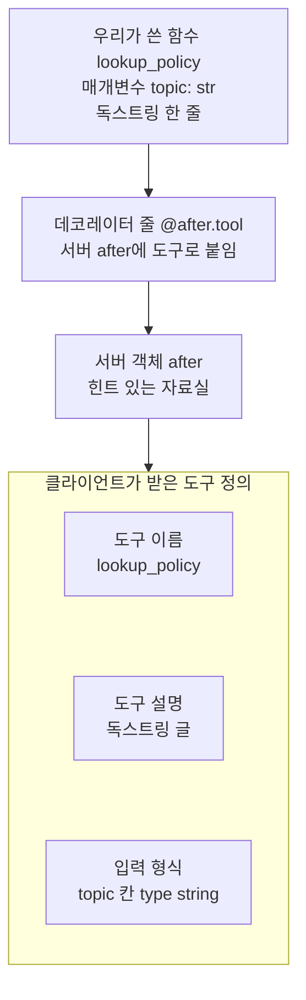
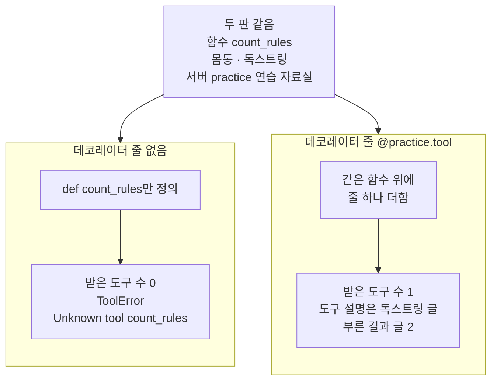
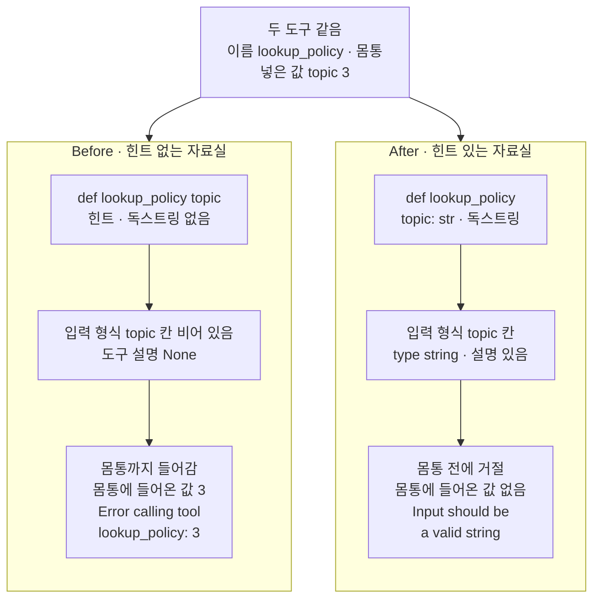
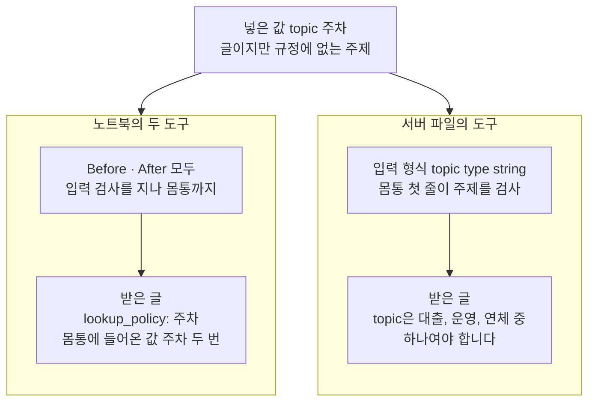

# 02-FastMCP-로컬-서버-제작

## _src 본문 (HTML 원본)

```html
<!--meta: 강의 1h | 실습 3h | 코드 notebooks/02-FastMCP-로컬-서버-제작.ipynb | 새 용어 4 -->
<style>html,body{overflow-x:hidden}.notebook,.nb-cell,.nb-main,.nb-input,.nb-result{min-width:0;max-width:100%}.nb-input pre,.nb-output{box-sizing:border-box;max-width:100%;overflow-x:auto}code.nb-source{display:block!important;width:100%!important;min-width:0!important;overflow-x:auto!important;padding:0!important}</style>
<h2 id="b1"><span class="no">1</span>학습 목표</h2><div class="goal"><ul>
<li>클래스 <code>FastMCP</code>로 서버 객체를 만들고, 데코레이터 줄로 함수를 도구로 붙일 수 있습니다.</li>
<li>함수 이름·독스트링·매개변수 힌트가 도구 이름·설명·입력 형식이 되는 것을 출력으로 읽을 수 있습니다.</li>
<li>같은 잘못된 값이 힌트 없는 도구에서는 몸통까지 가고, 힌트 있는 도구에서는 몸통 전에 멈추는 것을 견줄 수 있습니다.</li>
</ul></div>
<h2 id="b2"><span class="no">2</span>이 내용을 배우는 이유</h2><p><a href="01-MCP-구조와-capability-협상.html">01절</a>에서는 이미 만들어 둔 서버 파일의 서버에 붙어, 도구·자료·메시지 틀을 받았습니다. 이 절은 서버를 만드는 쪽으로 자리를 옮깁니다. 절 제목의 FastMCP는 이 챕터가 쓰는 패키지 fastmcp와, 그 안의 서버 클래스 이름입니다. 「로컬 서버」는 같은 컴퓨터에서 도는 서버이고, 이 절의 서버는 같은 노트북 안에서 돕니다.</p><p>클라이언트는 서버 안의 함수 코드를 보지 못하고, 목록 요청으로 받은 도구 정의만 봅니다. 모델에게 도구를 알릴 때 쓰는 것도 이 정의입니다. 그래서 도구를 붙이는 모양이, 클라이언트가 그 도구에 대해 아는 전부가 됩니다. 이 절은 매개변수 힌트와 독스트링을 빼고 붙인 도구가, 잘못된 값을 어디서 멈추는지 봅니다.</p>
<h2 id="b3"><span class="no">3</span>앞에서 배운 내용</h2><p><a href="../../part1/ch02-python/07-모듈과-타입힌트.html">Ch 2 07절</a>에서는 정의 줄에 타입힌트를 적었습니다. 그때 타입힌트는 기대하는 자료형을 적은 표시일 뿐, 문자열 단가를 막지 않았습니다. <a href="../../part5/ch19-model-tools/01-tool과-Ch4-함수-재사용.html">Ch 19 01절</a>에서는 함수 위에 <code>@tool</code> 데코레이터 줄을 붙여 도구를 만들었습니다. 함수 이름·독스트링·매개변수 힌트 <code>: str</code>이 도구 이름·설명·입력 형식이 되었습니다. <a href="../../part5/ch19-model-tools/02-Pydantic-인자와-반환-스키마.html">02절</a>에서는 도구가 몸통을 실행하기 전에 인자를 입력 형식에 맞춰 보는 입력 검사를 배웠습니다.</p><p>데코레이터 줄의 뜻은 <a href="../../part1/ch02-python/09-데코레이터와-컨텍스트-매니저.html">Ch 2 09절</a>에 있습니다. A 트랙은 그 절을 건너뛰므로, 이 절 본문에서 다시 풉니다. <a href="../../part5/ch19-model-tools/04-설명만으로-도구-선택하기.html">Ch 19 04절</a>에서는 설명만 바꾼 두 판을 모델에게 알려, 고른 도구와 입력 토큰을 견주었습니다. 도구 설명이 모델이 도구를 고를 때 읽는 글이라는 뜻입니다.</p><p><a href="01-MCP-구조와-capability-협상.html">01절</a>에서는 클래스 <code>Client</code>로 서버에 메모리로 연결하고, 도구 정의의 입력 형식을 보았습니다. 셀 맨 위의 <code>async with</code>와 await도 01절에서 풀었습니다. <a href="../../part1/ch02-python/12-async와-await.html">Ch 2 12절</a>의 <code>async def</code>는 이 절에서 도구를 부르는 함수 하나에만 씁니다. <a href="../../part1/ch02-python/05-파일과-예외.html">Ch 2 05절</a>의 오류 이름을 적은 <code>try</code>·<code>except</code>도 그 함수에서 오류 <code>ToolError</code>를 받을 때 씁니다.</p>
<h2 id="b4"><span class="no">4</span>핵심 개념</h2><h3>비유로 시작하기</h3><p>우주 정거장 벽에 도킹 해치 둘이 나란히 있다고 합시다. 왼쪽 해치는 두꺼운 테두리 없이 크게 뚫려 있어, 어떤 모양의 짐 모듈이든 안으로 밀려 들어옵니다. 오른쪽 해치에는 네모 테두리가 둘려 있어, 모양이 맞지 않는 공 모양 모듈은 해치 앞에서 멈춥니다. 같은 공 모양 모듈 둘이 두 해치에 다가간 장면입니다.</p><p>두 해치가 Before와 After의 도구이고, 해치 테두리가 매개변수 힌트로 만든 입력 형식입니다. 공 모양 모듈은 글이 아닌 값 3입니다. 테두리가 없는 해치는 값 3을 몸통 안까지 들였고, 테두리가 있는 해치는 몸통 전에 거절했습니다.</p><p>비유와 다른 점이 있습니다. 테두리는 모양, 곧 값의 자료형만 봅니다. 노트북 5절에서 글이지만 규정에 없는 주제 「주차」는 테두리를 지나 몸통까지 들어갔습니다. 허용하는 주제는 해치 안쪽, 곧 도구 몸통이 따로 검사합니다.</p>
{{img:02-5-테두리-없는-해치와-네모-테두리-해치|흰 바탕에 연한 회색 벽판이 있고, 해치 둘이 나란히 있는 그림입니다. 왼쪽은 가는 선으로만 둘린 크고 어두운 둥근 구멍이고, 주황 공 하나가 구멍 안쪽 오른쪽 아래에 들어가 있습니다. 오른쪽은 두꺼운 연파랑 네모 테두리 안의 작은 어두운 네모 구멍이고, 구멍보다 큰 주황 공 하나가 테두리 앞 오른쪽 아래에 걸려 있습니다. 사람·글자·숫자·화살표·별은 없는 그림|두꺼운 테두리가 없는 둥근 해치에는 공이 안쪽까지 들어갔고, 네모 테두리 해치 앞에서는 같은 색 공이 걸렸습니다.}}
<p class="look"><b>그림 읽기</b> — 벽판 왼쪽의 해치는 가는 선만 둘린 크고 어두운 둥근 구멍이고, 주황 공 하나가 안쪽까지 들어가 있습니다. 오른쪽 해치는 두꺼운 연파랑 네모 테두리 안의 작은 네모 구멍이고, 구멍보다 큰 주황 공이 테두리 앞에 걸려 있습니다. 왼쪽 해치가 힌트 없는 Before 도구이고, 오른쪽 해치가 힌트 <code>topic: str</code>이 있는 After 도구입니다. 두 공은 똑같이 넣은 값 3입니다. 왼쪽 공이 더 작게 그려졌지만, 공의 크기와 해치의 크기는 어떤 값과도 짝짓지 않습니다.</p>
<h3>서버를 만들고 도구를 붙이는 줄</h3><p>MCP 서버를 파이썬으로 만드는 패키지 fastmcp는 서버 클래스 <code>FastMCP</code>를 줍니다. 서버 이름을 넘겨 서버 객체를 만들고, 그 객체의 메서드 <code>tool</code>을 데코레이터 줄로 함수 위에 붙입니다. 데코레이터 줄은 아래 함수를 만든 뒤 곧바로 <code>@</code> 뒤의 것에 넘기는 표시입니다. 서버는 넘겨받은 함수를 도구 목록에 올리고, 노트북의 이름에는 함수를 그대로 둡니다.</p><p>함수의 세 부분은 도구 정의의 세 칸이 됩니다. 함수 이름은 도구 이름, 독스트링은 도구 설명, 매개변수와 힌트는 입력 형식이 됩니다. Ch 19 01절의 <code>@tool</code>과 같은 규칙입니다. 다른 점은 이 줄이 서버 객체의 메서드라서, 붙인 도구가 그 서버 하나에만 들어간다는 것입니다.</p>
<table><thead><tr><th>말</th><th>뜻</th></tr></thead><tbody><tr><td>FastMCP(서버 클래스)</td><td>파이썬 함수를 붙여 MCP 서버를 만드는 클래스이고, 패키지 fastmcp에 들어 있습니다. 가게를 열 때 간판을 걸고 빈 진열대를 놓는 일과 같습니다. 이 절에서는 <code>FastMCP("연습 자료실")</code>처럼 서버 이름 하나를 넘겨 서버 객체를 만듭니다.</td></tr><tr><td>도구 붙이기(등록)</td><td>서버 객체에 함수를 도구로 올려, 클라이언트가 목록 요청으로 찾게 하는 일입니다. 행사 명단에 이름을 올려야 입구에서 찾아지는 것과 같습니다. 이 절에서는 데코레이터 줄 <code>@practice.tool</code>이 함수 <code>count_rules</code>를 도구로 붙입니다.</td></tr><tr><td>기록기(logger) · 기록 수준</td><td>프로그램이 남기는 기록을 이름별로 모아 내보내는 객체와, 어느 정도 중요한 기록부터 남길지 정한 값입니다. 휴대전화 알림을 「긴급 알림만 받기」로 바꾸는 것과 같습니다. 이 절에서는 이름이 fastmcp인 기록기의 수준을 <code>CRITICAL</code>로 올려 서버 쪽 오류 기록을 막습니다.</td></tr><tr><td>출력 형식</td><td>도구가 내놓는 값의 모양을 알리는 정보이고, 함수의 내놓는 값 힌트에서 만들어집니다. 도시락 뚜껑에 「밥과 반찬 두 칸」이라고 적어 두는 것과 같습니다. 이 절에서는 서버 파일 도구의 <code>-&gt; str</code>이 만든 형식이고, 노트북에서 붙인 도구에는 없습니다(<code>None</code>).</td></tr></tbody></table>
<p>새 말을 이 절 코드에서 보면 이렇습니다. 서버 객체는 <code>서버 이름: 연습 자료실</code>로 출력됩니다. 도구 붙이기는 줄을 붙이기 전 <code>받은 도구 수: 0</code>이, 붙인 뒤 <code>받은 도구 수: 1</code>이 된 것입니다. 기록 수준은 <code>fastmcp 기록기의 수준: CRITICAL</code>이고, 출력 형식은 6절의 라벨 <code>출력 형식:</code> 뒤에 보입니다.</p>
{{mermaid:02-1-함수의-세-부분과-도구-정의|위에서 아래로 읽는 흐름도입니다. 파란 상자 우리가 쓴 함수 lookup_policy 매개변수 topic: str 독스트링 한 줄에서, 파란 상자 데코레이터 줄 @after.tool 서버 after에 도구로 붙임으로, 다시 초록 상자 서버 객체 after 힌트 있는 자료실로 화살표가 갑니다. 그 아래에 클라이언트가 받은 도구 정의라는 칸이 있고, 칸 안에 노란 상자 셋 도구 이름 lookup_policy, 도구 설명 독스트링 글, 입력 형식 topic 칸 type string이 위에서 아래로 놓인 그림|함수 이름·독스트링·매개변수 힌트가, 데코레이터 줄을 거쳐 도구 이름·설명·입력 형식이 되었습니다.}}
<p class="look"><b>도식 읽기</b> — 위에서 아래로 읽습니다. 파란 상자 둘은 노트북 4절에서 우리가 쓴 함수와 데코레이터 줄이고, 초록 상자는 그 줄이 도구를 올린 서버 객체입니다. 칸 안 노란 상자 셋은 4절 출력으로 확인한 도구 정의의 세 칸이고, 서로 다른 칸이라 화살표 없이 쌓았습니다. 클라이언트는 함수 코드를 보지 않고, 이 세 칸만 받습니다.</p>
<h3>입력 형식과 입력 검사</h3><p>Ch 19 02절에서처럼, 함수 안에서 실제로 일하는 줄들을 도구의 몸통이라고 부릅니다. FastMCP 서버는 도구를 부르는 요청을 받으면, 몸통을 실행하기 전에 인자를 입력 형식에 맞춰 봅니다. 맞지 않으면 몸통을 실행하지 않고 오류를 보냅니다. 입력 형식에 적힌 규칙만 검사하므로, 규칙이 비어 있는 인자는 아무 값이나 지납니다.</p><p>이 절의 입력 형식에서는 규칙 셋이 보였습니다. 꼭 있어야 하는 인자(<code>required</code>), 정해 두지 않은 인자를 받지 않음(<code>additionalProperties</code>), 인자의 자료형(<code>type</code>)입니다. 앞의 둘은 매개변수 이름만으로 생겨, 힌트가 없는 Before에도 있었습니다. 자료형 칸은 힌트 <code>: str</code>이 있을 때만 생겼습니다.</p><p>MCP 규격 문서도 입력 검사를 서버의 일로 적습니다. 보안 항목에서 서버는 모든 도구 입력을 검사해야 한다고 적습니다. 검사에 걸린 오류는 도구 결과에 오류 표시를 붙여 보내라고 적습니다. 모델이 그 글을 보고 인자를 고칠 수 있게 하려는 것입니다.</p>
<h2 id="b5"><span class="no">5</span>실행 예제</h2><p>노트북 1절은 설치와 가져오기, 그리고 서버 쪽 오류 기록을 막는 셀입니다. 2절은 연습 서버를 만들고, 같은 함수를 데코레이터 줄 없이 한 번, 줄을 붙여 한 번 정의합니다. 두 판에서 받은 도구 목록과 부른 결과를 견줍니다. 인자를 받는 도구의 Before와 After는 이 페이지 6블록에 있습니다.</p><p>모델 요청은 0번이고, API 키 없이 실행합니다. 서버는 같은 노트북 안에서 메모리로 연결해, 네트워크·포트·다른 프로그램을 쓰지 않습니다. 읽는 파일은 6절의 서버 파일 하나이고, 쓰는 파일은 없습니다. 걸린 시간은 재지 않았습니다.</p>
{{notebook:02-FastMCP-로컬-서버-제작|example}}
<p class="look"><b>확인할 점</b> — 노트북 1절에서 <code>fastmcp 기록기의 수준: CRITICAL</code>을 봅니다. 2절에서 줄을 붙이기 전 <code>받은 도구 수: 0</code>과 <code>Unknown tool: 'count_rules'</code>를 확인합니다. 줄을 붙인 뒤 <code>받은 도구 수: 1</code>과 <code>노트북의 count_rules 종류: function</code>을 찾습니다.</p>
{{mermaid:02-2-데코레이터-줄-하나의-차이|위에 회색 상자 하나가 있고 아래에 칸 둘이 나란히 놓인 그림입니다. 회색 상자에는 두 판 같음 함수 count_rules 몸통 독스트링 서버 practice 연습 자료실이 적혀 있고, 두 칸으로 화살표가 갑니다. 왼쪽 칸 데코레이터 줄 없음에는 파란 상자 def count_rules만 정의 아래에 노란 상자 받은 도구 수 0 ToolError Unknown tool count_rules가 있습니다. 오른쪽 칸 데코레이터 줄 @practice.tool에는 파란 상자 같은 함수 위에 줄 하나 더함 아래에 노란 상자 받은 도구 수 1 도구 설명은 독스트링 글 부른 결과 글 2가 있는 그림|함수와 몸통이 같아도 데코레이터 줄이 없으면 서버는 도구를 몰랐고, 줄 하나를 더하자 도구 하나가 생겼습니다.}}
<p class="look"><b>도식 읽기</b> — 맨 위 회색 상자는 두 판에서 같았던 것입니다. 왼쪽 칸은 데코레이터 줄이 없는 판, 오른쪽 칸은 줄이 있는 판이고, 칸 안은 위에서 아래로 우리가 적은 코드와 그 결과입니다. 노란 상자는 모두 노트북 2절 출력이고, 받은 오류도 받아 출력한 값이라 노랑입니다.</p>
<h2 id="b6"><span class="no">6</span>일부러 실패해 보기</h2><p>아래 Before 셀은 매개변수 <code>topic</code>에 힌트를 적지 않고, 독스트링도 없이 도구 <code>lookup_policy</code>를 붙입니다. After 셀은 몸통을 그대로 두고, 힌트 <code>: str</code>과 독스트링만 더합니다. 두 도구에 같은 값 3을 넣고, 몸통에 들어온 값을 목록 <code>body_inputs</code>로 봅니다. 노트북 5절은 글이지만 없는 주제를 넣어 보고, 6절은 서버 파일의 붙이는 줄을 읽습니다.</p>
{{notebook:02-FastMCP-로컬-서버-제작|failure}}
{{mermaid:02-3-같은-값-3에서-Before와-After|위에 회색 상자 하나가 있고 아래에 칸 둘이 나란히 놓인 그림입니다. 회색 상자에는 두 도구 같음 이름 lookup_policy 몸통 넣은 값 topic 3이 적혀 있고, 두 칸으로 화살표가 갑니다. 왼쪽 칸 Before 힌트 없는 자료실에는 파란 상자 def lookup_policy topic 힌트 독스트링 없음, 노란 상자 입력 형식 topic 칸 비어 있음 도구 설명 None, 빨간 상자 몸통까지 들어감 몸통에 들어온 값 3 Error calling tool lookup_policy: 3이 위에서 아래로 이어집니다. 오른쪽 칸 After 힌트 있는 자료실에는 파란 상자 def lookup_policy topic: str 독스트링, 노란 상자 입력 형식 topic 칸 type string 설명 있음, 노란 상자 몸통 전에 거절 몸통에 들어온 값 없음 Input should be a valid string이 이어지는 그림|같은 값 3을 넣자, 힌트가 없는 도구는 몸통까지 들였고 힌트가 있는 도구는 몸통 전에 거절했습니다.}}
<p class="look"><b>도식 읽기</b> — 맨 위 회색 상자는 두 도구에서 같았던 것입니다. 왼쪽 칸이 Before, 오른쪽 칸이 After입니다. 칸 안은 위에서 아래로 우리가 쓴 함수, 받은 입력 형식, 부른 결과입니다. 빨간 상자가 Before 결함 결과이고, 노란 상자는 노트북 3·4절 출력입니다. After 도구의 거절 글은 받아 출력한 오류라 노랑입니다.</p>
<table><thead><tr><th>견준 것</th><th>Before(힌트 없는 자료실)</th><th>After(힌트 있는 자료실)</th></tr></thead><tbody><tr><td>매개변수와 독스트링</td><td><code>topic</code> · 독스트링 없음</td><td><code>topic: str</code> · 독스트링 한 줄</td></tr><tr><td>도구 설명</td><td><code>None</code></td><td>독스트링 글</td></tr><tr><td>입력 형식의 <code>topic</code> 칸</td><td><code>{}</code>(아무 값)</td><td><code>{'type': 'string'}</code></td></tr><tr><td>값 <code>"대출"</code></td><td>규정 글 · 몸통에 <code>['대출']</code></td><td>Before와 같은 글(<code>True</code>) · 몸통에 <code>['대출']</code></td></tr><tr><td>값 <code>3</code>을 넣고 받은 글</td><td><code>Error calling tool 'lookup_policy': 3</code> 한 줄</td><td><code>Input should be a valid string</code> 등 네 줄</td></tr><tr><td>값 <code>3</code>일 때 몸통에 들어온 값</td><td><code>[3]</code></td><td><code>[]</code></td></tr><tr><td>값 바꿔 보기 <code>"주차"</code></td><td>몸통까지 · <code>'주차'</code> 한 단어</td><td>Before와 같음</td></tr></tbody></table>
<p>두 도구의 이름과 몸통은 같았고, 다른 것은 매개변수 힌트와 독스트링 한 묶음이었습니다. 이 가운데 값 3의 결과를 가른 것은 입력 형식의 <code>topic</code> 칸을 만든 힌트이고, 독스트링은 도구 설명만 바꿨습니다.</p><p>힌트가 없는 Before는 입력 형식의 <code>topic</code> 칸이 비어, 값 3이 검사를 지나 몸통까지 들어갔습니다. 몸통의 <code>rules[topic]</code>에서 키 3을 찾지 못해 파이썬 오류 <code>KeyError</code>가 났습니다. 서버는 그 오류를 글 한 줄로 보냈고, 글에는 찾지 못한 키 3만 있었습니다. 몸통 첫 줄인 목록에 적기도 잘못된 값으로 실행됐습니다.</p><p>After 도구는 같은 값을 몸통 전에 거절했고, 몸통에 들어온 값은 빈 목록이었습니다. 받은 글은 인자 <code>topic</code>이 글이어야 한다고 알려 주었습니다. 모델이 인자를 잘못 채운 요청이라면, 이 글이 다시 채울 단서가 됩니다. 모델이 이 글을 보고 실제로 인자를 고치는지는 이 절에서 실행하지 않았습니다.</p>
<p>노트북 5절에서 넣는 값만 <code>"주차"</code>로 바꾸자, 두 도구 모두 몸통까지 들어가 같은 글을 받았습니다. 힌트 <code>: str</code>은 값의 자료형만 정하고, 어느 주제를 받을지는 정하지 않기 때문입니다. 6절 서버 파일의 도구는 몸통 첫 줄에서 주제를 검사해, 무엇을 넣어야 하는지 알려 주는 글을 냈습니다. 자료형은 입력 형식이, 허용하는 값은 몸통이 맡았습니다.</p>
{{mermaid:02-4-주차를-넣은-세-도구|위에서 아래로 읽는 그림입니다. 맨 위 초록 상자 넣은 값 topic 주차 글이지만 규정에 없는 주제에서 나란히 놓인 칸 둘로 화살표가 갑니다. 왼쪽 칸 노트북의 두 도구에는 파란 상자 Before After 모두 입력 검사를 지나 몸통까지 아래에 노란 상자 받은 글 lookup_policy: 주차 몸통에 들어온 값 주차 두 번이 있습니다. 오른쪽 칸 서버 파일의 도구에는 파란 상자 입력 형식 topic type string 몸통 첫 줄이 주제를 검사 아래에 노란 상자 받은 글 topic은 대출, 운영, 연체 중 하나여야 합니다가 있는 그림|글이지만 없는 주제는 입력 형식을 지나 몸통까지 갔고, 서버 파일의 도구만 몸통 첫 줄에서 알아듣는 글로 막았습니다.}}
<p class="look"><b>도식 읽기</b> — 맨 위 초록 상자는 5·6절에서 넣은 값입니다. 왼쪽 칸은 노트북에서 붙인 두 도구, 오른쪽 칸은 서버 파일의 도구이고, 칸 안은 위에서 아래로 도구가 한 일과 받은 글입니다. 노란 상자는 5절과 6절 출력이고, 받아 출력한 오류라 노랑입니다. 값 바꿔 보기 장면이라 빨강은 쓰지 않았습니다.</p>
<p>새 커널로 두 번 실행해 견주자, 코드 셀 스물넷의 출력이 셀마다 모두 같았습니다. 모델을 부르지 않아, 이 절의 출력은 서버와 클라이언트가 주고받은 값으로 정해집니다.</p>
<p class="look"><b>확인할 점</b> — Before 마지막 셀에서 <code>몸통에 들어온 값: [3]</code>인지 봅니다. After에서 같은 값을 넣은 뒤 <code>받은 글의 줄 수: 4</code>와 <code>몸통에 들어온 값: []</code>를 확인합니다. 5절의 <code>몸통에 들어온 값: ['주차', '주차']</code>와 6절의 서버 파일 도구 글도 봅니다.</p>
<h2 id="b7"><span class="no">7</span>주의할 점과 실무 메모</h2><ul><li>이 절은 서버 쪽 오류 기록을 기록기 수준으로 막았습니다. 막지 않으면 Before의 잘못된 호출 하나에, 시각과 파일 위치가 든 기록 27줄이 표준 오류로 나왔습니다. After 도구의 거절에도 경고 기록 5줄이 나왔고, 둘 다 노트북 밖의 작은 스크립트로 화면 폭 80칸에서 확인했습니다. 실제 서버에서는 이 기록이 문제를 찾는 단서라서, 막지 않고 파일이나 기록 도구로 보냅니다.</li><li>클라이언트가 받은 오류는 모두 같은 종류 <code>ToolError</code>였습니다. 없는 도구, 입력 검사에 걸린 값, 몸통에서 난 오류가 모두 그랬고, 받은 글로 구별합니다. 설치판 fastmcp 4.0.3 <code>client/mixins/tools.py</code> 368~373행은 결과에 오류 표시가 있으면 이 오류를 일으킵니다.</li><li>MCP 규격 문서는 없는 도구를 통신 규약 오류로 보낸다고 적습니다. 그런데 설치판 서버는 없는 도구도 도구 결과의 오류 표시로 보냈습니다. 노트북 밖에서 결과를 그대로 받아 보는 메서드로 확인했고, 클라이언트 쪽에서는 둘 다 <code>ToolError</code>로 받습니다.</li><li>Before 도구에 인자를 넣지 않거나 정해 두지 않은 인자를 더하면, 힌트가 없어도 몸통 전에 거절됐습니다. 받은 글은 <code>Missing required argument</code>와 <code>Unexpected keyword argument</code>였습니다. 매개변수 이름이 입력 형식에 들어가기 때문이고, 이 장면은 노트북 밖에서만 확인했습니다.</li><li>허용하는 값을 입력 형식에 직접 적는 방법도 있습니다. Ch 19 02절은 양식 클래스로 고를 수 있는 값을 적었습니다. 이 챕터는 서버에 붙이는 도구에 단순한 힌트만 쓰고, 그 방법은 실행하지 않았습니다. 이 절에서는 서버 파일처럼 몸통 첫 줄에서 검사합니다.</li><li>목록 <code>body_inputs</code>는 값이 몸통까지 왔는지 보려고 이 절이 더한 줄이고, 실제 도구에는 필요 없습니다. 도구 몸통은 같은 노트북 안의 다른 스레드에서 돌지만, 노트북의 같은 목록에 적힙니다. 호출 셀마다 첫 줄에서 목록을 비웁니다.</li><li>데코레이터 줄은 함수에 표시 하나를 달고, 서버에 도구를 올린 뒤 같은 함수를 내놓습니다. 설치판 fastmcp 4.0.3 <code>server/providers/local_provider/decorators/tools.py</code> 317~321행에서 읽었습니다. 그래서 노트북의 <code>count_rules</code>를 함수처럼 부를 수 있었습니다.</li><li>서버 파일의 자료 줄과 메시지 틀 줄은 이 절에서 부르지 않았고, 01절에서 받은 결과로 대신합니다. 메시지 틀 함수의 힌트 <code>topic: str</code>이 메시지 틀의 인자 <code>topic</code>이 되는 것은 노트북 밖에서 확인했습니다. 서버 파일 맨 끝의 <code>mcp.run(transport="stdio")</code>는 이 절에서 실행하지 않았고, 다른 프로그램으로 띄우는 장면은 <a href="03-stdio와-원격-전송-권한-경계.html">03절</a>에서 봅니다.</li><li>걸린 시간은 재지 않았습니다. 교재 출력은 Linux의 Python 3.12.13으로 만들었고, 다른 판과 Windows·macOS에서는 실행하지 않았습니다.</li></ul>
<h2 id="b8"><span class="no">8</span>정리와 다음 절</h2><ul><li>데코레이터 줄 하나로 함수가 도구가 되었고, 함수 이름과 독스트링이 도구 이름과 설명이 되었습니다.</li><li>힌트 없이 붙인 도구는 입력 형식이 빈 칸이라, 값 3이 몸통까지 들어가 뜻 모를 오류를 냈습니다.</li><li>힌트를 적자 같은 값이 몸통 전에 거절되었고, 없는 주제는 서버 파일처럼 몸통이 검사해야 했습니다.</li></ul><p><strong>다음 학습과 이어지는 지점</strong> — <a href="03-stdio와-원격-전송-권한-경계.html">03절</a>에서는 서버를 다른 프로그램으로 띄워 연결합니다. 그 서버에 넘기는 값과 권한의 경계를 봅니다.</p>
<h2 id="b9"><span class="no">9</span>복습 문제</h2><details class="quiz" open><summary>문제 4개 · 해설 포함</summary><p class="quiz-q">1. 서버에 붙이지 않은 함수 이름으로 도구를 부르자 어떤 글을 받았고, 그 까닭은 무엇인가요?</p><p class="quiz-a">글 <code>Unknown tool: 'count_rules'</code>를 받았습니다. 노트북에 함수가 있어도 서버에 도구로 붙이지 않아, 서버가 그 이름을 몰랐기 때문입니다. 틀렸다면 노트북 2절을 다시 읽습니다.</p><p class="quiz-q">2. 힌트 없이 붙인 도구의 입력 형식에서 <code>topic</code> 칸은 어땠고, 값 3은 어디까지 갔나요?</p><p class="quiz-a">칸이 <code>{}</code>로 비어 있어 아무 값이나 받았습니다. 값 3은 몸통까지 들어가 <code>KeyError</code>를 냈고, 받은 글에는 키 3만 있었습니다. 틀렸다면 노트북 3절을 다시 읽습니다.</p><p class="quiz-q">3. 힌트 <code>topic: str</code>을 적은 도구에 같은 값 3을 넣었을 때, 몸통에 들어온 값은 무엇이었나요?</p><p class="quiz-a">빈 목록이었습니다. 서버가 입력 형식 <code>{'type': 'string'}</code>에 맞춰 값을 먼저 보고, 몸통 전에 거절했기 때문입니다. 틀렸다면 노트북 4절을 다시 읽습니다.</p><p class="quiz-q">4. 동료가 「힌트 <code>: str</code>을 적었으니 없는 주제 주차도 서버가 막아 준다」고 말합니다. 맞나요?</p><p class="quiz-a">맞지 않습니다. 5절에서 After 도구도 「주차」를 몸통까지 들였습니다. 힌트는 자료형만 정하므로, 허용하는 주제는 6절 서버 파일처럼 몸통이 검사합니다. 틀렸다면 노트북 5·6절을 다시 읽습니다.</p></details>
<h2 id="b10"><span class="no">10</span>참고 자료</h2><ul><li><div><a href="https://gofastmcp.com/servers/tools">FastMCP Tools</a></div>확인 2026-09-28 · 함수 이름이 도구 이름, 독스트링이 설명이 되고, 매개변수와 힌트로 입력 형식을 만든다고 적습니다. 매개변수를 함수의 정의 줄에 맞춰 검사한 뒤 함수를 실행한다고도 적습니다.</li><li>같은 문서는 내놓는 값 힌트를 적으면 출력 형식을 만들고, 글 같은 값은 칸 <code>result</code>에 담아 보낸다고 적습니다. 도구 인자에는 파이썬의 표준 타입힌트를 쓰라고 권합니다.</li><li><div><a href="https://modelcontextprotocol.io/specification/2026-07-28/server/tools">MCP 2026-07-28 Tools</a></div>확인 2026-09-28 · 도구 정의의 입력 형식(<code>inputSchema</code>)과 출력 형식(<code>outputSchema</code>)을 적습니다. 입력 검사 오류는 도구 결과의 오류 표시로 보내 모델이 고칠 수 있게 하고, 서버는 모든 도구 입력을 검사해야 한다고 적습니다.</li><li>설치판 fastmcp 4.0.3 소스 <code>server/server.py</code> 1488~1506행은 없는 도구와 입력 검사 오류를 다룹니다. 같은 파일 1541~1555행은 몸통 오류의 기록과 글을 다룹니다. <code>tools/function_parsing.py</code> 304행은 독스트링을 읽고, 338~340행은 입력 형식을, 377행부터는 내놓는 값 힌트로 출력 형식을 만듭니다.</li><li>같은 판 <code>server/providers/local_provider/decorators/tools.py</code> 317~321행은 데코레이터 줄이 도구를 올린 뒤 같은 함수를 내놓는 자리입니다. <code>client/mixins/tools.py</code> 368~373행은 오류 표시가 있는 결과를 <code>ToolError</code>로 바꾸는 자리입니다.</li><li>Ch 2 07절에서 타입힌트를, Ch 2 09절에서 데코레이터를, Ch 19 01·02절에서 <code>@tool</code>과 입력 검사를 보았습니다.</li></ul>
```

## 노트북 셀 (순서대로)

### [0] markdown {'html': 'skip'}

# FastMCP 로컬 서버 제작

**이 노트북에서 할 일**

1. 서버 객체를 만들고, 데코레이터 줄 하나로 함수를 도구로 붙입니다.
2. 힌트와 독스트링 없이 붙인 도구에 글이 아닌 값을 넣어, 그 값이 몸통까지 가는지 봅니다.
3. 힌트와 독스트링을 적어 붙인 도구에 같은 값을 넣어, 몸통 전에 거절되는지 봅니다.

**준비물** — 이 노트북은 모델을 부르지 않습니다.
모델 요청은 0번이고, API 키 없이 실행합니다.
예상 비용도 0달러입니다.
출력은 모두 서버와 클라이언트가 주고받은 값이라, 다시 실행해도 같은 값이 나와야 합니다.

서버는 노트북 안에서 클래스 `FastMCP`로 만들고, 01절처럼 같은 노트북 안에서 메모리로 연결합니다.
그래서 네트워크와 포트, 다른 프로그램을 쓰지 않습니다.
6절에서는 실습 폴더 맨 위의 `course_server.py` 파일을 읽기만 하고, 쓰는 파일은 없습니다.

걸린 시간은 재지 않았습니다.
이 절은 앞 챕터에서 배운 함수를 쓰지 않아, 가져오는 도구 파일도 없습니다.

**기준 버전** — 첫 셀에서 패키지 둘을 설치합니다.
판은 fastmcp 4.0.3과 mcp 2.2.0입니다.
교재 출력은 Linux의 Python 3.12.13으로 만들었습니다.
다른 판과 Windows·macOS에서는 실행하지 않았습니다.

**강의와 실습 범위** — 강의 시간에는 2~4절을 읽습니다.
도구를 붙이는 줄과, 힌트가 잘못된 값을 멈추는 자리를 Before·After로 보는 자리입니다.
5·6절은 넣는 값을 바꿔 보고 서버 파일의 줄을 읽는 실습이고, 실습 시간에 실행합니다.

실습 폴더 `labs/part6/ch28-mcp`에서 `uv sync --locked`를 실행합니다.
그다음 `notebooks/` 폴더의 이 노트북을 열고, 실습 폴더의 `.venv` 커널을 고릅니다.
첫 셀부터 순서대로 실행합니다.

### [1] markdown {'html': 'skip'}

## 오늘 볼 그림


위에서 아래로 읽습니다.
파란 상자 둘은 노트북 4절에서 우리가 쓴 함수와 데코레이터 줄이고, 초록 상자는 그 줄이 도구를 올린 서버 객체입니다.
칸 안 노란 상자 셋은 4절 출력으로 확인한 도구 정의의 세 칸이고, 서로 다른 칸이라 화살표 없이 쌓았습니다.
클라이언트는 함수 코드를 보지 않고, 이 세 칸만 받습니다.

### [2] markdown {}

## 1. 준비

이 절은 파이썬 함수로 MCP 서버를 만드는 쪽을 봅니다.
제목의 FastMCP는 이 챕터가 쓰는 패키지 fastmcp와, 그 안의 서버 클래스 이름입니다.
「로컬 서버」는 같은 컴퓨터에서 도는 서버이고, 이 절의 서버는 같은 노트북 안에서 돕니다.

첫 셀은 패키지 둘을 설치하고 설치된 판 번호를 출력합니다.
설치에는 몇십 초가 걸릴 수 있습니다.

### [3] code {'execution': {'iopub.execute_input': '2026-09-28T20:07:52.619851Z', 'iopub.status.busy': '2026-09-28T20:07:52.619724Z', 'iopub.status.idle': '2026-09-28T20:07:53.398184Z', 'shell.execute_reply': '2026-09-28T20:07:53.397687Z'}, 'lesson_role': 'setup'}

```python
# 이 절에서 쓰는 패키지를 설치하고 버전을 확인합니다
%pip install -q "fastmcp==4.0.3" "mcp==2.2.0"
from importlib.metadata import version

print("fastmcp:", version("fastmcp"))
print("mcp:", version("mcp"))
```

출력:
```
Note: you may need to restart the kernel to use updated packages.
fastmcp: 4.0.3
mcp: 2.2.0

```

### [4] markdown {}

**결과 읽기** — 출력 줄 `fastmcp: 4.0.3`과 `mcp: 2.2.0`이 보입니다.
01절과 같은 판이고, 실습 폴더 잠금과도 같습니다.

다음 셀은 이 절에서 쓸 이름을 가져옵니다.
모듈 `logging`·`os`·`runpy`는 Python에 들어 있는 모듈입니다.
오류 종류 `ToolError`는 도구를 부르다 오류가 나면 클라이언트가 받는 오류입니다.

### [5] code {'execution': {'iopub.execute_input': '2026-09-28T20:07:53.399221Z', 'iopub.status.busy': '2026-09-28T20:07:53.399134Z', 'iopub.status.idle': '2026-09-28T20:07:54.259808Z', 'shell.execute_reply': '2026-09-28T20:07:54.259591Z'}, 'lesson_role': 'setup'}

```python
# 이 절에서 쓸 이름을 가져옵니다(logging·os·runpy는 Python에 들어 있는 모듈입니다)
import logging
import os
import runpy
from fastmcp import Client, FastMCP
from fastmcp.exceptions import ToolError

print("가져온 fastmcp 이름:", "Client, FastMCP, ToolError")
```

출력:
```
가져온 fastmcp 이름: Client, FastMCP, ToolError

```

### [6] markdown {}

**결과 읽기** — 출력 줄 `가져온 fastmcp 이름: Client, FastMCP, ToolError`가 보입니다.
이 노트북에도 API 키를 확인하는 셀은 없습니다.

도구 몸통에서 오류가 나면, FastMCP 서버는 오류 기록을 여러 줄로 남깁니다.
기록에는 시각과 파일 위치가 들어 있고, 표준 오류로 나갑니다.
이 절은 서버와 클라이언트가 같은 노트북에 있어서, 그 기록이 셀 출력에 섞입니다.
다음 셀은 모듈 `logging`으로 서버 쪽 기록을 막습니다.

### [7] code {'execution': {'iopub.execute_input': '2026-09-28T20:07:54.260624Z', 'iopub.status.busy': '2026-09-28T20:07:54.260505Z', 'iopub.status.idle': '2026-09-28T20:07:54.262678Z', 'shell.execute_reply': '2026-09-28T20:07:54.262293Z'}}

```python
# 서버 쪽 오류 기록이 셀 출력에 섞이지 않게, 이름이 fastmcp인 기록기의 수준을 올립니다
fastmcp_logger = logging.getLogger("fastmcp")
fastmcp_logger.setLevel(logging.CRITICAL)
print("fastmcp 기록기의 수준:", logging.getLevelName(fastmcp_logger.level))
```

출력:
```
fastmcp 기록기의 수준: CRITICAL

```

### [8] markdown {}

**결과 읽기** — 출력 줄 `fastmcp 기록기의 수준: CRITICAL`이 보입니다.
함수 `logging.getLogger`는 이름으로 기록기(logger)를 찾아 내놓습니다.
기록기는 정한 수준보다 낮은 기록을 남기지 않고, 이제 가장 높은 수준의 기록만 남깁니다.
막은 것은 서버 쪽 기록뿐이고, 클라이언트는 오류를 그대로 `ToolError`로 받습니다.

막지 않으면 3절의 잘못된 호출 하나에 기록이 27줄, 4절의 호출 하나에 경고 기록이 5줄 나왔습니다.
줄 수는 화면 폭 80칸에서 센 값이고, 노트북 밖의 작은 스크립트로 확인했습니다.

## 2. 서버를 만들고 도구 붙이기

01절에서는 서버 파일이 만든 서버에 붙어, 구성 요소 셋을 받았습니다.
이 절은 서버를 만드는 쪽에서, 서버 파일에 있던 붙이는 줄을 노트북에 직접 씁니다.
먼저 도구가 찾아 줄 자료를 만듭니다.
서버 파일 `course_server.py`의 규정 셋 가운데 둘을 같은 글로 옮긴 딕셔너리입니다.

### [9] code {'execution': {'iopub.execute_input': '2026-09-28T20:07:54.263252Z', 'iopub.status.busy': '2026-09-28T20:07:54.263201Z', 'iopub.status.idle': '2026-09-28T20:07:54.265102Z', 'shell.execute_reply': '2026-09-28T20:07:54.264704Z'}}

```python
# 도구가 찾아 줄 자료실 규정 두 가지를 딕셔너리로 만듭니다(서버 파일의 규정과 같은 글)
rules = {
    "대출": "일반 도서는 1인 5권까지 14일 동안 대출할 수 있습니다.",
    "운영": "평일은 09:00~20:00, 토요일은 10:00~17:00에 운영합니다.",
}
print("규정 주제:", list(rules))
```

출력:
```
규정 주제: ['대출', '운영']

```

### [10] markdown {}

**결과 읽기** — 출력 줄 `규정 주제: ['대출', '운영']`이 보입니다.
딕셔너리를 `list`에 넣으면 키만 차례대로 모인 목록이 됩니다.

다음 셀은 연습용 서버 객체를 만듭니다.
01절 6절의 빈 서버처럼, 클래스 `FastMCP`에 서버 이름 하나만 넘깁니다.

### [11] code {'execution': {'iopub.execute_input': '2026-09-28T20:07:54.265653Z', 'iopub.status.busy': '2026-09-28T20:07:54.265603Z', 'iopub.status.idle': '2026-09-28T20:07:54.269639Z', 'shell.execute_reply': '2026-09-28T20:07:54.269286Z'}}

```python
# 연습용 서버 객체를 만듭니다(01절 6절의 빈 서버처럼 서버 이름 하나만 넘깁니다)
practice = FastMCP("연습 자료실")
print("서버 이름:", practice.name)
```

출력:
```
서버 이름: 연습 자료실

```

### [12] markdown {}

**결과 읽기** — 출력 줄 `서버 이름: 연습 자료실`이 보입니다.
01절 6절에서 본 것처럼, 이 서버에는 아직 붙인 것이 없습니다.

다음 셀은 규정 수를 알려 주는 평범한 함수를 만듭니다.
함수 이름 아래 줄의 글은 독스트링이고, Ch 19 01절에서 도구 설명이 되었던 글입니다.
이 함수는 아직 서버에 붙이지 않습니다.

### [13] code {'execution': {'iopub.execute_input': '2026-09-28T20:07:54.270192Z', 'iopub.status.busy': '2026-09-28T20:07:54.270144Z', 'iopub.status.idle': '2026-09-28T20:07:54.271832Z', 'shell.execute_reply': '2026-09-28T20:07:54.271471Z'}}

```python
# 규정 수를 알려 주는 평범한 함수를 만듭니다(서버에는 아직 붙이지 않습니다)
def count_rules():
    """자료실에 적힌 규정 수를 알려 줍니다."""
    return len(rules)
```

출력:
```

```

### [14] markdown {}

**결과 읽기** — 정의 셀이라 출력이 없습니다.
함수 `count_rules`는 노트북 안에만 있고, 서버 `practice`는 이 함수를 모릅니다.

다음 셀은 서버에 연결해 도구 하나를 부르는 함수를 만듭니다.
이 절은 도구를 여러 번 부르므로, 연결하고 부르고 결과를 담는 일을 함수 하나로 묶습니다.
함수 안에서 await를 쓰므로, 정의 줄을 Ch 2 12절처럼 `async def`로 씁니다.
오류가 나면 Ch 2 05절처럼 오류 이름 `ToolError`만 받아, 셀이 멈추지 않게 합니다.
받은 글은 메서드 `splitlines`로 줄마다 나눈 목록으로 담습니다.

### [15] code {'execution': {'iopub.execute_input': '2026-09-28T20:07:54.272346Z', 'iopub.status.busy': '2026-09-28T20:07:54.272301Z', 'iopub.status.idle': '2026-09-28T20:07:54.274210Z', 'shell.execute_reply': '2026-09-28T20:07:54.273987Z'}}

```python
# 서버에 연결해 도구 하나를 부르고, 받은 결과나 오류를 한국어 키 딕셔너리로 내놓습니다
async def call_tool_row(server, tool_name, arguments):
    async with Client(server) as client:
        try:
            result = await client.call_tool(tool_name, arguments)
            row = {"받은 것": "결과", "글 줄": result.content[0].text.splitlines()}
        except ToolError as error:
            # 받은 오류의 종류 이름과, 오류 글을 줄마다 나눈 목록을 담습니다
            row = {"받은 것": type(error).__name__, "글 줄": str(error).splitlines()}
    return row
```

출력:
```

```

### [16] markdown {}

**결과 읽기** — 정의 셀이라 출력이 없습니다.
결과를 받으면 키 「받은 것」의 값이 「결과」이고, 오류를 받으면 오류 종류 이름입니다.
연결은 함수 안의 `async with` 블록을 벗어날 때 닫힙니다.
이 함수를 부르는 줄도 셀 맨 위에 await를 붙여 씁니다.

다음 셀은 연습 서버의 도구 목록을 받고, 붙이지 않은 함수 이름으로 도구를 불러 봅니다.
실행 전에 예상해 봅니다.
노트북에 함수 `count_rules`가 있으니, 서버도 이 이름의 도구를 찾을까요?

### [17] code {'execution': {'iopub.execute_input': '2026-09-28T20:07:54.274773Z', 'iopub.status.busy': '2026-09-28T20:07:54.274729Z', 'iopub.status.idle': '2026-09-28T20:07:54.294753Z', 'shell.execute_reply': '2026-09-28T20:07:54.294367Z'}}

```python
# 연습 서버의 도구 목록을 받고, 붙이지 않은 함수 이름으로 도구를 불러 봅니다
async with Client(practice) as client:
    practice_tools = await client.list_tools()
print("받은 도구 수:", len(practice_tools))
plain_row = await call_tool_row(practice, "count_rules", {})
print("도구를 부른 결과:", plain_row)
```

출력:
```
받은 도구 수: 0
도구를 부른 결과: {'받은 것': 'ToolError', '글 줄': ["Unknown tool: 'count_rules'"]}

```

### [18] markdown {}

**결과 읽기** — 출력 줄 `받은 도구 수: 0`이 보입니다.
도구를 부른 결과는 `ToolError`이고, 받은 글은 `Unknown tool: 'count_rules'`입니다.
서버는 이름이 `count_rules`인 도구를 모른다고 답했습니다.
노트북에 함수가 있어도, 서버에 붙이지 않으면 클라이언트는 찾지 못합니다.

다음 셀은 같은 함수 위에 줄 하나 `@practice.tool`만 더해 다시 정의합니다.
함수 위의 `@` 줄은 데코레이터 줄이고, 아래 함수를 만든 뒤 곧바로 `@` 뒤의 것에 넘기는 표시입니다.
행사 명단에 이름을 올려야 입구에서 찾아지는 것과 비슷합니다.
이 줄은 아래 함수를 서버 `practice`의 도구로 등록합니다.
데코레이터 줄의 뜻은 Ch 2 09절에 있고, Ch 19 01절의 `@tool`도 같은 모양이었습니다.

### [19] code {'execution': {'iopub.execute_input': '2026-09-28T20:07:54.295508Z', 'iopub.status.busy': '2026-09-28T20:07:54.295442Z', 'iopub.status.idle': '2026-09-28T20:07:54.328408Z', 'shell.execute_reply': '2026-09-28T20:07:54.327994Z'}}

```python
# 데코레이터 줄 하나만 더해, 같은 함수를 연습 서버의 도구로 붙입니다
@practice.tool
def count_rules():
    """자료실에 적힌 규정 수를 알려 줍니다."""
    return len(rules)
```

출력:
```

```

### [20] markdown {}

**결과 읽기** — 정의 셀이라 출력이 없습니다.
함수 이름·독스트링·몸통은 앞 판과 같고, 다른 것은 데코레이터 줄 하나입니다.
줄 끝에 괄호가 없는 `@practice.tool`은 인자 없이 붙이는 모양입니다.

다음 셀은 다시 연결해 도구 목록을 받고, 도구 정의를 봅니다.

### [21] code {'execution': {'iopub.execute_input': '2026-09-28T20:07:54.329068Z', 'iopub.status.busy': '2026-09-28T20:07:54.329014Z', 'iopub.status.idle': '2026-09-28T20:07:54.332550Z', 'shell.execute_reply': '2026-09-28T20:07:54.332253Z'}}

```python
# 다시 연결해 도구 목록을 받고, 첫 도구 정의의 이름·설명·입력 형식을 봅니다
async with Client(practice) as client:
    practice_tools = await client.list_tools()
count_tool = practice_tools[0]
print("받은 도구 수:", len(practice_tools))
print("도구 이름:", count_tool.name)
print("도구 설명:", count_tool.description)
print("입력 형식:", count_tool.input_schema)
```

출력:
```
받은 도구 수: 1
도구 이름: count_rules
도구 설명: 자료실에 적힌 규정 수를 알려 줍니다.
입력 형식: {'type': 'object', 'additionalProperties': False, 'properties': {}}

```

### [22] markdown {}

**결과 읽기** — 출력 줄 `받은 도구 수: 1`과 `도구 이름: count_rules`가 보입니다.
도구 이름은 함수 이름이고, 도구 설명은 독스트링 글입니다.
입력 형식의 `'properties': {}`는 받는 인자가 하나도 없다는 뜻입니다.
함수에 매개변수가 없기 때문입니다.

다음 셀은 붙인 도구를 클라이언트로 부릅니다.
노트북의 이름 `count_rules`가 무엇으로 남았는지도 봅니다.

### [23] code {'execution': {'iopub.execute_input': '2026-09-28T20:07:54.333069Z', 'iopub.status.busy': '2026-09-28T20:07:54.333022Z', 'iopub.status.idle': '2026-09-28T20:07:54.338042Z', 'shell.execute_reply': '2026-09-28T20:07:54.337721Z'}}

```python
# 붙인 도구를 클라이언트로 부르고, 노트북의 이름 count_rules가 무엇으로 남았는지 봅니다
practice_row = await call_tool_row(practice, "count_rules", {})
print("도구를 부른 결과:", practice_row)
print("노트북의 count_rules 종류:", type(count_rules).__name__)
print("함수로 바로 부른 값:", count_rules())
```

출력:
```
도구를 부른 결과: {'받은 것': '결과', '글 줄': ['2']}
노트북의 count_rules 종류: function
함수로 바로 부른 값: 2

```

### [24] markdown {}

**결과 읽기** — 도구를 부른 결과의 키 「받은 것」이 `'결과'`이고, 글 줄은 `['2']`입니다.
서버가 함수 `count_rules`를 실행해, 규정 수 2를 글로 보냈습니다.
출력 줄 `노트북의 count_rules 종류: function`과 `함수로 바로 부른 값: 2`도 보입니다.

Ch 19 01절의 `@tool`은 이름에 도구 객체를 남겨, 함수처럼 부르면 멈췄습니다.
이 절의 데코레이터 줄은 서버에 도구를 올리고, 노트북의 이름에는 함수를 그대로 둡니다.
01절 2절에서 서버 파일의 `lookup_policy`가 `function`이었던 것과 같은 모습입니다.
또 이 줄은 서버 객체의 메서드라서, 붙인 도구는 그 서버 하나에만 들어갑니다.

### [25] markdown {'lesson_part': 'before'}

## 3. 힌트 없이 붙인 도구 (Before)

이제 인자를 받는 도구를 붙입니다.
Ch 2 07절에서 매개변수 힌트는 기대하는 자료형을 적은 표시일 뿐, 값을 검사하지 않았습니다.
그래서 힌트를 빼도 파이썬 함수는 잘 돕니다.

Ch 19 01절 7절은 힌트를 빼면 입력 형식에서 자료형이 빠지는 것까지 보고, 잘못된 값은 넣어 보지 않았습니다.
이 절 3·4절이 그 값을 넣어 봅니다.
다음 셀은 매개변수 `topic`에 힌트를 적지 않고, 독스트링도 없이 도구를 붙입니다.
몸통 첫 줄은 들어온 값을 목록 `body_inputs`에 적어, 값이 몸통까지 왔는지 나중에 보게 합니다.

### [26] code {'execution': {'iopub.execute_input': '2026-09-28T20:07:54.338608Z', 'iopub.status.busy': '2026-09-28T20:07:54.338564Z', 'iopub.status.idle': '2026-09-28T20:07:54.340845Z', 'shell.execute_reply': '2026-09-28T20:07:54.340412Z'}, 'lesson_part': 'before'}

```python
# Before: 매개변수 힌트와 독스트링 없이, 규정을 찾는 도구를 붙인 서버를 만듭니다
before = FastMCP("힌트 없는 자료실")
# 몸통에 들어온 값을 적어 둘 빈 목록입니다
body_inputs = []

@before.tool
def lookup_policy(topic):
    body_inputs.append(topic)
    return rules[topic]
```

출력:
```

```

### [27] markdown {'lesson_part': 'before'}

**결과 읽기** — 정의 셀이라 출력이 없습니다.
이 셀의 `@before.tool` 줄은 아래 함수를 서버 `before`의 도구로 등록합니다.
몸통은 딕셔너리 `rules`에서 주제 글을 찾아 내놓고, 없는 키면 파이썬 오류 `KeyError`가 납니다.

다음 셀은 이 도구의 정의에서 설명과 입력 형식을 봅니다.

### [28] code {'execution': {'iopub.execute_input': '2026-09-28T20:07:54.341346Z', 'iopub.status.busy': '2026-09-28T20:07:54.341300Z', 'iopub.status.idle': '2026-09-28T20:07:54.344753Z', 'shell.execute_reply': '2026-09-28T20:07:54.344417Z'}, 'lesson_part': 'before'}

```python
# Before 서버에 연결해 도구 정의의 이름·설명·입력 형식을 봅니다
async with Client(before) as client:
    before_tools = await client.list_tools()
before_tool = before_tools[0]
print("도구 이름:", before_tool.name)
print("도구 설명:", before_tool.description)
print("입력 형식:", before_tool.input_schema)
```

출력:
```
도구 이름: lookup_policy
도구 설명: None
입력 형식: {'type': 'object', 'additionalProperties': False, 'properties': {'topic': {}}, 'required': ['topic']}

```

### [29] markdown {'lesson_part': 'before'}

**결과 읽기** — 출력 줄 `도구 설명: None`이 보입니다.
라벨 `입력 형식:` 뒤에 `'topic': {}`와 `'required': ['topic']`이 있습니다.
인자 `topic`이 꼭 있어야 한다는 것은 적혔지만, 어떤 값이어야 하는지는 빈 칸입니다.
빈 칸 `{}`는 아무 값이나 받는다는 뜻입니다.

다음 셀은 맞는 값 `"대출"`을 넣어 부릅니다.
부르기 전에 목록 `body_inputs`를 비워, 이 호출에서 몸통에 들어온 값만 보이게 합니다.

### [30] code {'execution': {'iopub.execute_input': '2026-09-28T20:07:54.345280Z', 'iopub.status.busy': '2026-09-28T20:07:54.345228Z', 'iopub.status.idle': '2026-09-28T20:07:54.348952Z', 'shell.execute_reply': '2026-09-28T20:07:54.348588Z'}, 'lesson_part': 'before'}

```python
# 맞는 값 "대출"을 넣어 부르고, 몸통에 들어온 값을 봅니다(부르기 전에 목록을 비웁니다)
body_inputs = []
before_ok = await call_tool_row(before, "lookup_policy", {"topic": "대출"})
print("도구를 부른 결과:", before_ok)
print("몸통에 들어온 값:", body_inputs)
```

출력:
```
도구를 부른 결과: {'받은 것': '결과', '글 줄': ['일반 도서는 1인 5권까지 14일 동안 대출할 수 있습니다.']}
몸통에 들어온 값: ['대출']

```

### [31] markdown {'lesson_part': 'before'}

**결과 읽기** — 받은 것은 `'결과'`이고, 글 줄에 대출 규정 한 문장이 있습니다.
출력 줄 `몸통에 들어온 값: ['대출']`로, 값이 몸통까지 들어가 규정을 찾았습니다.
맞는 값을 넣으면 힌트가 없어도 도구는 잘 돕니다.

다음 셀은 글이 아닌 값 `3`을 넣어 부릅니다.
모델이 인자를 잘못 채운 요청과 같은 상황입니다.
실행 전에 예상해 봅니다.
입력 형식이 빈 칸이니, 값 3은 몸통까지 들어갈까요?

### [32] code {'execution': {'iopub.execute_input': '2026-09-28T20:07:54.349489Z', 'iopub.status.busy': '2026-09-28T20:07:54.349429Z', 'iopub.status.idle': '2026-09-28T20:07:54.352980Z', 'shell.execute_reply': '2026-09-28T20:07:54.352697Z'}, 'lesson_part': 'before'}

```python
# 글이 아닌 값 3을 넣어 부르고, 받은 오류와 몸통에 들어온 값을 봅니다
body_inputs = []
before_bad = await call_tool_row(before, "lookup_policy", {"topic": 3})
print("받은 것:", before_bad["받은 것"])
print("받은 글:", before_bad["글 줄"])
print("몸통에 들어온 값:", body_inputs)
```

출력:
```
받은 것: ToolError
받은 글: ["Error calling tool 'lookup_policy': 3"]
몸통에 들어온 값: [3]

```

### [33] markdown {'lesson_part': 'before'}

**결과 읽기** — 받은 것은 `ToolError`이고, 받은 글은 `Error calling tool 'lookup_policy': 3` 한 줄입니다.
출력 줄 `몸통에 들어온 값: [3]`으로, 값 3이 몸통까지 들어갔습니다.
몸통의 `rules[topic]`이 키 3을 찾지 못해 `KeyError`가 났고, 서버가 그 오류를 `ToolError`로 보냈습니다.

이것이 이 절의 Before 결함입니다.
받은 글에는 찾지 못한 키 3만 있어, 무엇을 넣어야 하는지 알려 주지 않습니다.
입력 형식이 빈 칸이라 서버가 값을 미리 보지 못하고, 몸통 첫 줄도 잘못된 값으로 실행됐습니다.
몸통 앞부분에 되돌리기 어려운 일이 있었다면, 그 일도 잘못된 값으로 실행됐을 것입니다.

### [34] markdown {'lesson_part': 'after'}

## 4. 힌트와 독스트링을 적어 붙인 도구 (After)

After 도구는 몸통을 그대로 두고, 매개변수 `topic`에 힌트 `: str`을 적습니다.
함수 이름 아래에는 무엇을 넣어야 하는지 적은 독스트링을 둡니다.
서버 이름만 「힌트 있는 자료실」로 다르고, 도구 이름은 Before와 같은 `lookup_policy`입니다.

이 챕터는 서버에 붙이는 도구 함수의 매개변수에만 `: str` 같은 단순한 힌트를 적습니다.
서버 클래스 FastMCP가 이 힌트로 입력 형식을 만들고, 그 입력 형식이 이 절에서 배울 내용이기 때문입니다.
Ch 19 01절의 `@tool` 함수에 `: str`을 적은 것과 같은 까닭이고, 내놓는 값 힌트(`-> str`)는 적지 않습니다.

### [35] code {'execution': {'iopub.execute_input': '2026-09-28T20:07:54.353489Z', 'iopub.status.busy': '2026-09-28T20:07:54.353433Z', 'iopub.status.idle': '2026-09-28T20:07:54.355436Z', 'shell.execute_reply': '2026-09-28T20:07:54.355105Z'}, 'lesson_part': 'after'}

```python
# After: 몸통은 그대로 두고, 매개변수 힌트 topic: str과 독스트링을 적어 붙인 서버를 만듭니다
after = FastMCP("힌트 있는 자료실")

@after.tool
def lookup_policy(topic: str):
    """자료실 규정 한 가지를 찾아 알려 줍니다. topic에는 대출이나 운영을 넣습니다."""
    body_inputs.append(topic)
    return rules[topic]
```

출력:
```

```

### [36] markdown {'lesson_part': 'after'}

**결과 읽기** — 정의 셀이라 출력이 없습니다.
이 셀의 `@after.tool` 줄은 아래 함수를 서버 `after`의 도구로 등록합니다.
노트북의 이름 `lookup_policy`는 이제 After 함수를 가리키고, 서버 `before`는 자기 도구를 그대로 가집니다.

다음 셀은 After 도구의 정의를 봅니다.

### [37] code {'execution': {'iopub.execute_input': '2026-09-28T20:07:54.355930Z', 'iopub.status.busy': '2026-09-28T20:07:54.355887Z', 'iopub.status.idle': '2026-09-28T20:07:54.358862Z', 'shell.execute_reply': '2026-09-28T20:07:54.358595Z'}, 'lesson_part': 'after'}

```python
# After 서버에 연결해 도구 정의의 이름·설명·입력 형식을 봅니다
async with Client(after) as client:
    after_tools = await client.list_tools()
after_tool = after_tools[0]
print("도구 이름:", after_tool.name)
print("도구 설명:", after_tool.description)
print("입력 형식:", after_tool.input_schema)
```

출력:
```
도구 이름: lookup_policy
도구 설명: 자료실 규정 한 가지를 찾아 알려 줍니다. topic에는 대출이나 운영을 넣습니다.
입력 형식: {'type': 'object', 'additionalProperties': False, 'properties': {'topic': {'type': 'string'}}, 'required': ['topic']}

```

### [38] markdown {'lesson_part': 'after'}

**결과 읽기** — 라벨 `도구 설명:` 뒤에 독스트링 글이 보입니다.
라벨 `입력 형식:` 뒤에는 `'topic': {'type': 'string'}`이 있습니다.
Before 도구의 빈 칸 `{}` 자리에, 인자 `topic`은 글이어야 한다는 규칙이 들어갔습니다.
칸 `'required': ['topic']`과 `'additionalProperties': False`는 Before와 같습니다.

다음 셀은 Before와 같은 값 `3`을 넣어 부릅니다.
실행 전에 예상해 봅니다.
이번에도 값 3이 몸통까지 들어갈까요?

### [39] code {'execution': {'iopub.execute_input': '2026-09-28T20:07:54.359412Z', 'iopub.status.busy': '2026-09-28T20:07:54.359353Z', 'iopub.status.idle': '2026-09-28T20:07:54.362970Z', 'shell.execute_reply': '2026-09-28T20:07:54.362648Z'}, 'lesson_part': 'after'}

```python
# Before와 같은 값 3을 넣어 부르고, 받은 오류와 몸통에 들어온 값을 봅니다
body_inputs = []
after_bad = await call_tool_row(after, "lookup_policy", {"topic": 3})
print("받은 것:", after_bad["받은 것"])
print("받은 글의 줄 수:", len(after_bad["글 줄"]))
print("받은 글의 앞 세 줄:")
for line in after_bad["글 줄"][:3]:
    print(line)
print("몸통에 들어온 값:", body_inputs)
```

출력:
```
받은 것: ToolError
받은 글의 줄 수: 4
받은 글의 앞 세 줄:
1 validation error for call[lookup_policy]
topic
  Input should be a valid string [type=string_type, input_value=3, input_type=int]
몸통에 들어온 값: []

```

### [40] markdown {'lesson_part': 'after'}

**결과 읽기** — 받은 것은 이번에도 `ToolError`이고, 출력 줄 `받은 글의 줄 수: 4`가 보입니다.
앞 세 줄은 `1 validation error for call[lookup_policy]`, `topic`, `Input should be a valid string`으로 시작합니다.
출력 줄 `몸통에 들어온 값: []`으로, 몸통은 실행되지 않았습니다.
서버가 입력 형식에 맞춰 값을 먼저 보고, 글이 아니라서 몸통 전에 거절했습니다.

이것이 Ch 19 02절의 입력 검사이고, 이 절에서는 FastMCP 서버가 검사합니다.
받은 글은 어느 인자가 무엇이어야 하는지 알려 줍니다.
두 판은 힌트와 독스트링이 함께 달랐지만, 거절을 가른 것은 입력 형식의 `topic` 칸입니다.
독스트링은 도구 설명만 바꿨습니다.
넷째 줄은 검사를 맡은 라이브러리 pydantic의 안내 주소라서 출력하지 않았습니다.

### [41] code {'execution': {'iopub.execute_input': '2026-09-28T20:07:54.363590Z', 'iopub.status.busy': '2026-09-28T20:07:54.363541Z', 'iopub.status.idle': '2026-09-28T20:07:54.367082Z', 'shell.execute_reply': '2026-09-28T20:07:54.366853Z'}, 'lesson_part': 'after'}

```python
# 맞는 값 "대출"을 넣어, After 도구도 Before와 같은 결과를 내는지 봅니다
body_inputs = []
after_ok = await call_tool_row(after, "lookup_policy", {"topic": "대출"})
print("받은 것:", after_ok["받은 것"])
print("결과 글이 Before와 같은가:", after_ok["글 줄"] == before_ok["글 줄"])
print("몸통에 들어온 값:", body_inputs)
```

출력:
```
받은 것: 결과
결과 글이 Before와 같은가: True
몸통에 들어온 값: ['대출']

```

### [42] markdown {'lesson_part': 'after'}

**결과 읽기** — 출력 줄 `결과 글이 Before와 같은가: True`와 `몸통에 들어온 값: ['대출']`이 보입니다.
힌트를 적어도 맞는 값은 그대로 몸통까지 가서, Before와 같은 규정을 찾았습니다.
힌트와 독스트링이 바꾼 것은 잘못된 값이 멈추는 자리와, 클라이언트가 받는 도구 정의입니다.

## 5. 값 바꿔 보기: 글이지만 없는 주제

넣는 값 하나만 바꿔 봅니다.
바꿀 값은 인자 `topic`이고, 글이지만 `rules`에 없는 주제 `"주차"`를 넣습니다.
두 도구를 차례로 부르고, 몸통에 들어온 값을 봅니다.
실행 전에 예상해 봅니다.
After 도구의 입력 형식은 이 값을 거절할까요?

### [43] code {'execution': {'iopub.execute_input': '2026-09-28T20:07:54.367664Z', 'iopub.status.busy': '2026-09-28T20:07:54.367622Z', 'iopub.status.idle': '2026-09-28T20:07:54.372077Z', 'shell.execute_reply': '2026-09-28T20:07:54.371777Z'}, 'lesson_part': 'after'}

```python
# 넣는 값만 "주차"로 바꿔, Before와 After 도구를 차례로 부릅니다
body_inputs = []
before_park = await call_tool_row(before, "lookup_policy", {"topic": "주차"})
after_park = await call_tool_row(after, "lookup_policy", {"topic": "주차"})
print("Before에서 받은 글:", before_park["글 줄"])
print("After에서 받은 글:", after_park["글 줄"])
print("몸통에 들어온 값:", body_inputs)
```

출력:
```
Before에서 받은 글: ["Error calling tool 'lookup_policy': '주차'"]
After에서 받은 글: ["Error calling tool 'lookup_policy': '주차'"]
몸통에 들어온 값: ['주차', '주차']

```

### [44] markdown {'lesson_part': 'after'}

**결과 읽기** — 두 도구 모두 받은 글이 `Error calling tool 'lookup_policy': '주차'`입니다.
출력 줄 `몸통에 들어온 값: ['주차', '주차']`로, 두 번 모두 몸통까지 들어갔습니다.
After 도구의 입력 형식은 글인지만 보므로, 글 `"주차"`는 검사를 지났습니다.

힌트 `: str`이 정하는 것은 값의 자료형입니다.
어느 주제를 받을지는 입력 형식에 적히지 않아, 몸통이 따로 검사해야 합니다.
Ch 19 02절에서도 입력 검사는 값이 규칙 안에 있는지만 보았습니다.
6절은 서버 파일의 도구가 이 검사를 어디서 하는지 봅니다.

## 6. 서버 파일의 붙이는 줄

01절에서 읽은 서버 파일 `course_server.py`에도 붙이는 줄이 셋 있습니다.
도구는 `@mcp.tool(tags={"public", "read"})` 줄, 자료는 `@mcp.resource("policy://handbook")` 줄로 붙입니다.
메시지 틀은 `@mcp.prompt` 줄로 붙이고, 이 줄은 괄호가 없는 모양입니다.
괄호 안의 인자는 붙이면서 함께 정하는 값이고, 자료 줄의 글은 01절에서 본 자료 주소가 되었습니다.
다음 셀은 01절 2절과 같은 셀로 서버 파일의 위치를 찾습니다.

### [45] code {'execution': {'iopub.execute_input': '2026-09-28T20:07:54.372605Z', 'iopub.status.busy': '2026-09-28T20:07:54.372561Z', 'iopub.status.idle': '2026-09-28T20:07:54.374762Z', 'shell.execute_reply': '2026-09-28T20:07:54.374413Z'}, 'lesson_part': 'after'}

```python
# 작업 폴더에서 본 서버 파일의 위치를 후보 셋 가운데에서 고릅니다
candidates = ["../course_server.py", "course_server.py", "labs/part6/ch28-mcp/course_server.py"]
server_file = None
for candidate in candidates:
    if os.path.exists(candidate):
        server_file = candidate
        break
print("서버 파일을 찾았는가:", server_file is not None)
print("고른 파일 위치:", server_file)
assert server_file is not None, "notebooks 폴더나 실습 폴더 맨 위에서 노트북을 열어 주세요."
```

출력:
```
서버 파일을 찾았는가: True
고른 파일 위치: labs/part6/ch28-mcp/course_server.py

```

### [46] markdown {'lesson_part': 'after'}

**결과 읽기** — 출력 줄 `서버 파일을 찾았는가: True`가 보입니다.
교재 출력은 프로젝트 맨 위에서 실행해 셋째 후보 `labs/part6/ch28-mcp/course_server.py`를 골랐습니다.
`notebooks/` 폴더에서 열면 첫 후보 `../course_server.py`가 골라집니다.

다음 셀은 01절 2절처럼 함수 `runpy.run_path`로 서버 파일을 실행해, 서버 객체를 받습니다.

### [47] code {'execution': {'iopub.execute_input': '2026-09-28T20:07:54.375260Z', 'iopub.status.busy': '2026-09-28T20:07:54.375217Z', 'iopub.status.idle': '2026-09-28T20:07:54.378947Z', 'shell.execute_reply': '2026-09-28T20:07:54.378682Z'}, 'lesson_part': 'after'}

```python
# 서버 파일을 실행해, 그 파일이 만든 서버 객체 mcp를 받습니다(01절 2절처럼 runpy.run_path로 읽습니다)
server_names = runpy.run_path(server_file)
server = server_names["mcp"]
print("서버 이름:", server.name)
```

출력:
```
서버 이름: 교육센터 자료실

```

### [48] markdown {'lesson_part': 'after'}

**결과 읽기** — 출력 줄 `서버 이름: 교육센터 자료실`이 보입니다.
01절에서 본 것처럼, 이 함수로 읽으면 서버 파일 맨 끝의 실행 줄은 돌지 않습니다.
그 줄 `mcp.run(transport="stdio")`는 파일을 다른 프로그램으로 띄울 때 쓰고, 이 절에서는 실행하지 않습니다.

다음 셀은 서버 파일 도구의 정의에서 입력 형식·출력 형식·꼬리표를 봅니다.

### [49] code {'execution': {'iopub.execute_input': '2026-09-28T20:07:54.379530Z', 'iopub.status.busy': '2026-09-28T20:07:54.379478Z', 'iopub.status.idle': '2026-09-28T20:07:54.382901Z', 'shell.execute_reply': '2026-09-28T20:07:54.382591Z'}, 'lesson_part': 'after'}

```python
# 서버 파일 도구의 정의에서 인자 topic의 입력 형식, 출력 형식, 꼬리표를 봅니다
async with Client(server) as client:
    server_tools = await client.list_tools()
file_tool = server_tools[0]
print("topic의 입력 형식:", file_tool.input_schema["properties"]["topic"])
print("출력 형식:", file_tool.output_schema)
print("After 도구의 출력 형식:", after_tool.output_schema)
print("꼬리표:", file_tool.meta)
```

출력:
```
topic의 입력 형식: {'type': 'string'}
출력 형식: {'properties': {'result': {'type': 'string'}}, 'required': ['result'], 'type': 'object', 'x-fastmcp-wrap-result': True}
After 도구의 출력 형식: None
꼬리표: {'fastmcp': {'tags': ['public', 'read']}}

```

### [50] markdown {'lesson_part': 'after'}

**결과 읽기** — 출력 줄 `topic의 입력 형식: {'type': 'string'}`이 보입니다.
서버 파일도 매개변수 힌트 `topic: str`로 After와 같은 입력 형식을 만들었습니다.
라벨 `출력 형식:` 뒤에는 칸 `result`에 글을 담는다는 형식이 있고, After 도구는 `None`입니다.
라벨 `꼬리표:` 뒤에는 `'tags': ['public', 'read']`가 있습니다.

출력 형식은 서버 파일 함수의 내놓는 값 힌트 `-> str`에서 만들어졌습니다.
도구가 내놓는 값의 모양을 알리는 정보이고, 이 챕터에서 붙이는 도구는 내놓는 값 힌트를 적지 않아 만들지 않습니다.
꼬리표는 데코레이터 줄의 인자 `tags`가 도구에 붙인 이름표이고, 이 절에서는 꼬리표로 아무것도 하지 않습니다.

다음 셀은 서버 파일의 도구에 5절의 값 `"주차"`를 넣어 부릅니다.

### [51] code {'execution': {'iopub.execute_input': '2026-09-28T20:07:54.383499Z', 'iopub.status.busy': '2026-09-28T20:07:54.383456Z', 'iopub.status.idle': '2026-09-28T20:07:54.386555Z', 'shell.execute_reply': '2026-09-28T20:07:54.386258Z'}, 'lesson_part': 'after'}

```python
# 서버 파일의 도구에도 "주차"를 넣어 부르고, 받은 글을 봅니다
file_park = await call_tool_row(server, "lookup_policy", {"topic": "주차"})
print("받은 것:", file_park["받은 것"])
print("받은 글:", file_park["글 줄"])
```

출력:
```
받은 것: ToolError
받은 글: ["Error calling tool 'lookup_policy': topic은 대출, 운영, 연체 중 하나여야 합니다."]

```

### [52] markdown {'lesson_part': 'after'}

**결과 읽기** — 받은 것은 `ToolError`이고, 받은 글에 `topic은 대출, 운영, 연체 중 하나여야 합니다.`가 있습니다.
서버 파일의 몸통 첫 줄이 주제가 규정에 있는지 보고, 없으면 이 글로 오류를 냅니다.
5절의 `'주차'` 한 단어보다, 무엇을 넣어야 하는지 알려 주는 글입니다.

자료형은 입력 형식이 몸통 전에 검사하고, 허용하는 주제는 몸통 첫 줄이 검사합니다.
몸통의 검사 줄은 파이썬 오류 `ValueError`를 내고, 서버는 그 글을 `ToolError`로 보냈습니다.

## 정리

1. 데코레이터 줄 하나로 함수가 도구가 되었고, 함수 이름과 독스트링이 도구 이름과 설명이 되었습니다.
2. 힌트 없이 붙인 도구는 입력 형식이 빈 칸이라, 값 3이 몸통까지 들어가 뜻 모를 오류를 냈습니다.
3. 힌트를 적자 같은 값이 몸통 전에 거절되었고, 없는 주제는 서버 파일처럼 몸통이 검사해야 했습니다.

03절에서는 서버를 다른 프로그램으로 띄워 연결하고, 서버에 넘기는 값과 권한의 경계를 봅니다.

## 그림

### 02-1-함수의-세-부분과-도구-정의.mmd



함수 이름·독스트링·매개변수 힌트가, 데코레이터 줄을 거쳐 도구 이름·설명·입력 형식이 되었습니다.

### 02-2-데코레이터-줄-하나의-차이.mmd



함수와 몸통이 같아도 데코레이터 줄이 없으면 서버는 도구를 몰랐고, 줄 하나를 더하자 도구 하나가 생겼습니다.

### 02-3-같은-값-3에서-Before와-After.mmd



같은 값 3을 넣자, 힌트가 없는 도구는 몸통까지 들였고 힌트가 있는 도구는 몸통 전에 거절했습니다.

### 02-4-주차를-넣은-세-도구.mmd



글이지만 없는 주제는 입력 형식을 지나 몸통까지 갔고, 서버 파일의 도구만 몸통 첫 줄에서 알아듣는 글로 막았습니다.

### 02-5-테두리-없는-해치와-네모-테두리-해치.prompt.md

# 02-5-테두리-없는-해치와-네모-테두리-해치 (Higgsfield 삽화)

설명 대상 문장(본문 b4 비유 단락): 우주 정거장 벽에 도킹 해치 둘이 나란히 있다고 합시다. 왼쪽 해치는 두꺼운 테두리 없이 크게 뚫려 있어, 어떤 모양의 짐 모듈이든 안으로 밀려 들어옵니다. 오른쪽 해치에는 네모 테두리가 둘려 있어, 모양이 맞지 않는 공 모양 모듈은 해치 앞에서 멈춥니다. … 두 해치가 Before와 After의 도구이고, 해치 테두리가 매개변수 힌트로 만든 입력 형식입니다. 공 모양 모듈은 글이 아닌 값 3입니다.

구성 요소와 배치: **벽판 하나** · **해치 정확히 둘**(= Before·After 도구 — 왼쪽 테두리 없는 큰 둥근 구멍, 오른쪽 두꺼운 연파랑 네모 테두리와 작은 네모 구멍) · **같은 공 모양 짐 모듈 둘**(= 똑같이 넣은 값 3 — 왼쪽은 구멍 안까지, 오른쪽은 테두리 앞에서 걸림). 비유 계열 **「우주 정거장 도킹 포트」**(챕터 리드 결정 13, 01절이 엶). 01절 소품(옆으로 누운 원통 정거장·색 고리 셋·작은 우주선 둘) 되풀이 없음. 금지 소품(플러그·온실·모종판·예인선·바지선·밧줄·홈통·물방울·도미노·체스판·즉석사진·세탁기·승강 상자·전표·가마·쟁반·서랍·바구니·저울·도장·개찰구·컨베이어) 없음. 사람·손·글자·숫자·화살표·별·행성·화면·전선 없음.

시선 순서: 왼쪽 둥근 구멍 속 공 → 오른쪽 네모 테두리 앞의 공.

검수 기준: 그림만 보고 「테두리 없는 구멍에는 공이 안쪽까지 들어갔고, 네모 테두리 구멍 앞에서는 같은 공이 걸렸다」가 읽히는가. 해치가 정확히 둘, 공이 정확히 둘인가. 글자·숫자·사람·화살표·별이 없는가.

## 프롬프트 (1차, 탈락)

```text
Simple flat educational illustration, white background, limited soft palette, clean outlines, plain everyday objects, no text, no letters, no numbers, no logos. A large flat light gray space station wall panel fills the whole frame, with exactly two docking hatches side by side, both dark inside. The left hatch is a large plain round opening with no frame; one orange ball-shaped cargo pod is clearly sticking halfway into it. The right hatch is a small square opening surrounded by a thick soft blue square frame; an identical orange ball-shaped cargo pod, too big to fit, rests just in front of the frame, outside the hatch. Both pods are the same size and fully visible. No stars, no planets, no people, no hands, no arrows, no screens, no cables, no plugs, no rings, no spaceships.
```

## 프롬프트 (2차, 채택 — 재생성 1회)

```text
Simple flat educational illustration, white background, limited soft palette, clean outlines, plain everyday objects, no text, no letters, no numbers, no logos. A large flat light gray space station wall panel fills the whole frame, with exactly two docking hatches side by side. Left hatch: a large dark round opening with no border at all. A smooth plain orange ball without seams is half inside it: its left half disappears into the darkness and only its right half is visible outside. Right hatch: a thick soft blue square frame around a small dark square opening that is clearly smaller than the ball. An identical smooth orange ball sits directly in front of the blue frame, pressed against it, blocked, not entering, completely outside the opening. No stars, no planets, no people, no hands, no arrows, no screens, no cables, no plugs, no rings, no spaceships.
```

## 상태

- 2026-09-28 · `generate_image` 두 번, `params` = `{"model":"nano_banana_pro","prompt":…,"aspect_ratio":"16:9","resolution":"2k","use_unlim":false,"count":1}`. `generate_image` 응답 모델 `nano_banana_pro`, **`jobs_wait` 응답 모델 표시 `nano_banana_2`**(01절·Ch 25~27과 같은 표시, 거래 표시는 「Nano Banana Pro」 — 기록만).
- 생성 전 잔액 **2319**, 바로 앞 거래 2026-09-28T19:33:39.592199Z는 01절 몫.
- **1차 job `79ce6b3a-9048-4f2b-b564-6a9413b2dd5d` 탈락** — 거래 2026-09-28T20:09:54.768060Z 「Nano Banana Pro −2」. 원본 `3c6f69226dcb78ebabcc387d5b3cf81e24e6d2f60e03f1d7cdaf9a60fdc1f4fd`(2752 × 1536). 탈락 사유: 두 공(농구공 같은 줄무늬)이 모두 구멍 가장자리에 반쯤 걸친 같은 자리에 그려져, 「왼쪽은 안까지 들어감 · 오른쪽은 앞에서 걸림」이 그림만으로 갈리지 않음. 오른쪽 공이 네모 구멍보다 크게 보이는 차이도 작음.
- **2차 job `32561605-9da5-48e2-81fe-fba7c96d2130` 채택** — 거래 2026-09-28T20:10:56.320706Z 「Nano Banana Pro −2」. 원본 `58ac1e2c6807d2431b02da0b190f3d96949220fbbcc7c3f9e416b740b1aee463`(2752 × 1536). **이 절 몫 거래 두 줄, 4크레딧**(잔액 2319 → 2315), 재생성 1회.
- **그림에서 확인한 것(그림 읽기·alt에 반영)**: 흰 바탕 가운데 연한 회색 벽판(좌우에 흰 여백) · 왼쪽에 가는 선 두 겹으로만 둘린 크고 어두운 둥근 구멍 **하나**, 주황 공 **하나**가 구멍 안쪽 오른쪽 아래에 들어가 있음(공 오른쪽이 구멍 가장자리에 가려짐) · 오른쪽에 두꺼운 연파랑 네모 테두리 **하나**와 그 안의 작은 어두운 네모 구멍, 구멍보다 큰 주황 공 **하나**가 테두리 오른쪽 아래 앞에 걸쳐 있음. 해치 둘·공 둘. 글자·숫자·사람·손·화살표·별·행성·화면·전선·고리·우주선 없음.
- 검수: 「테두리 없는 구멍에는 공이 안까지, 네모 테두리 앞에서는 공이 걸림」이 그림만으로 읽힘 → 채택. **그림과 비유의 차이**: 왼쪽 공이 오른쪽 공보다 작게 그려짐(프롬프트는 같은 크기) — 「작아서 들어갔다」로 읽힐 수 있어 그림 읽기에 「공의 크기와 해치의 크기는 어떤 값과도 짝짓지 않는다」를 적음(강사 확인 대상). 왼쪽 구멍 둘레의 가는 선은 두꺼운 테두리가 아니라서 본문을 「두꺼운 테두리 없이」로 씀. 벽판 좌우 흰 여백이 조금 남음.
- 저장: 기기 셸에서 결과 URL을 `curl`로 받아(`/tmp/ch28-02/illu/illu-2-orig.png`) `UV_CACHE_DIR=/tmp/uv-cache uv run --no-project --with pillow`로 RGB·폭 1100px(LANCZOS)로 줄여 `figures/02-5-테두리-없는-해치와-네모-테두리-해치.png`(1100 × 614, `c015d8b53fa02b09b7d08619d5ed95a3574cef5680d4814f378615e1ce5d1c0e`)로 저장했습니다.
- 결과 URL을 한 번 더 받아(`illu-2-again.png`, 원본과 해시 같음) 같은 폭으로 줄인 그림과 저장 PNG를 픽셀 대조했습니다(`ImageChops.difference` bbox `None`, 최대 차이 0). 저장 PNG와 같은 사본(`.cache/ch28-02-view/illu-2-1100.png`)을 직접 열어 개수를 세고 그림 읽기를 썼습니다.

