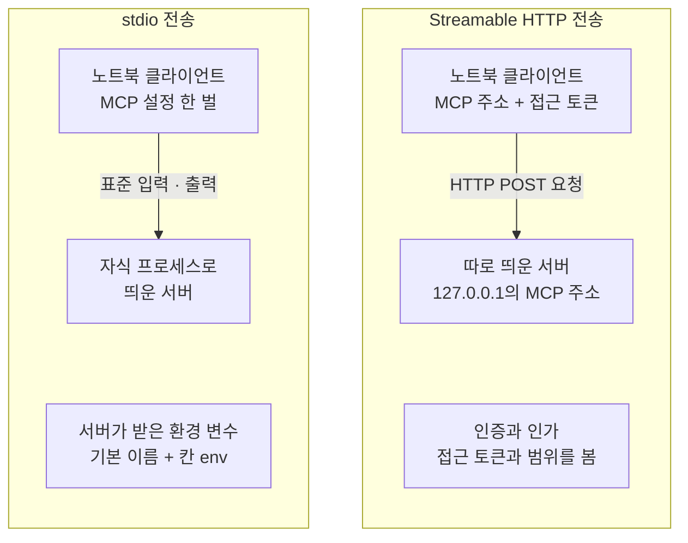
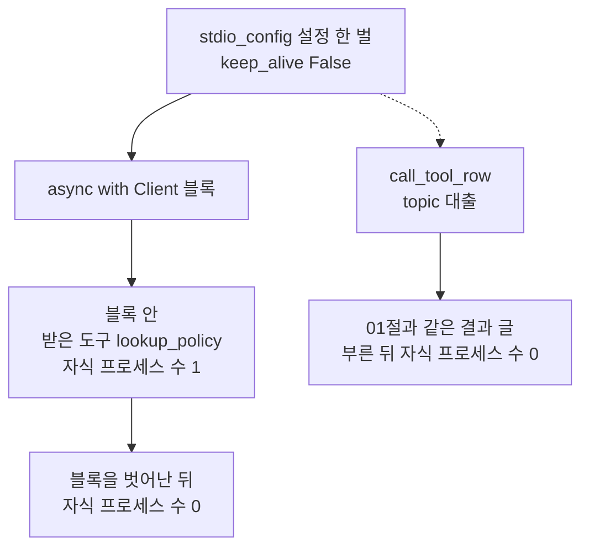
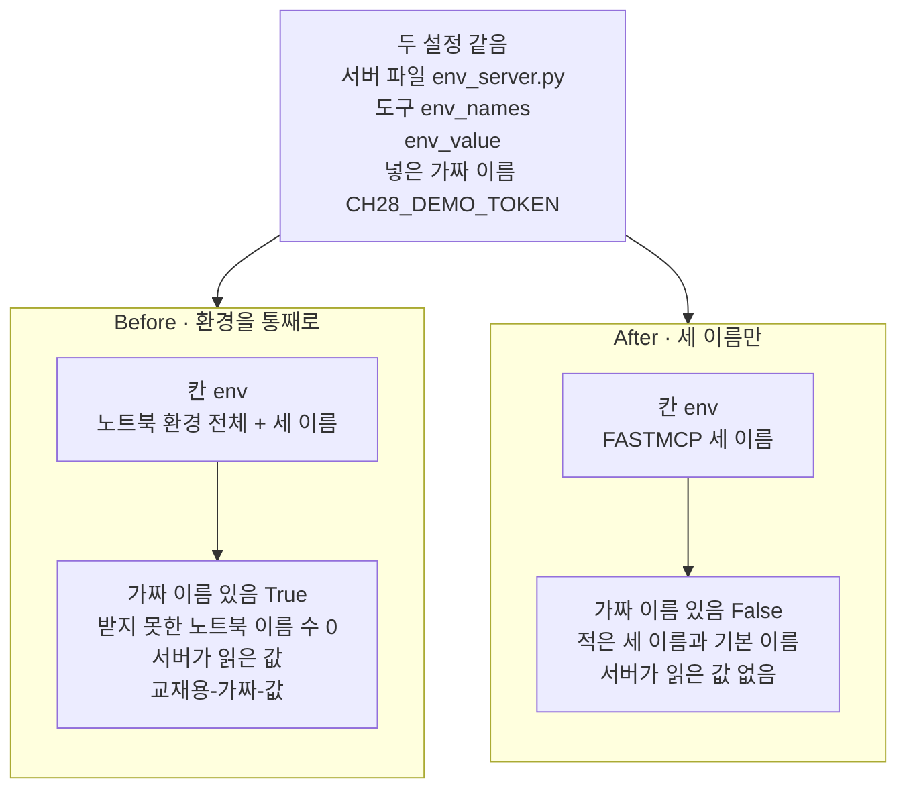
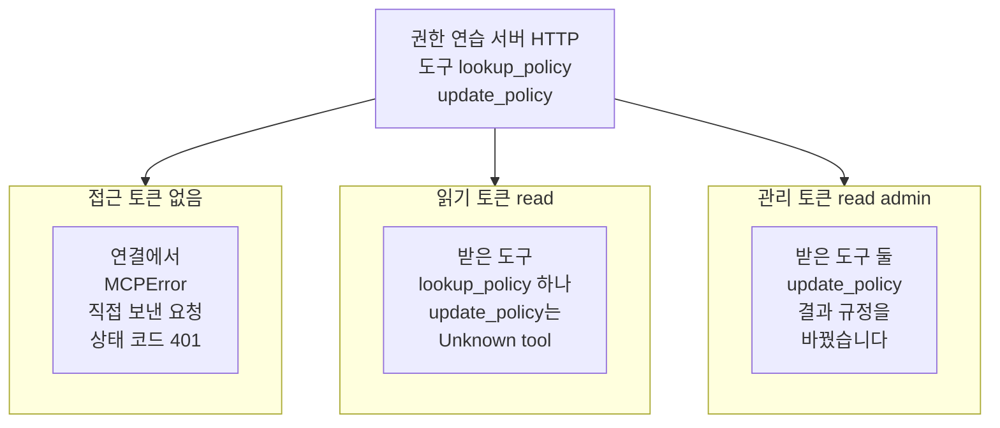

# 03-stdio와-원격-전송-권한-경계

## _src 본문 (HTML 원본)

```html
<!--meta: 강의 1h | 실습 2h | 코드 notebooks/03-stdio와-원격-전송-권한-경계.ipynb | 새 용어 6 -->
<style>html,body{overflow-x:hidden}.notebook,.nb-cell,.nb-main,.nb-input,.nb-result{min-width:0;max-width:100%}.nb-input pre,.nb-output{box-sizing:border-box;max-width:100%;overflow-x:auto}code.nb-source{display:block!important;width:100%!important;min-width:0!important;overflow-x:auto!important;padding:0!important}</style>
<h2 id="b1"><span class="no">1</span>학습 목표</h2><div class="goal"><ul>
<li>서버 파일을 자식 프로세스로 띄워 stdio로 연결하고, 연결을 닫으면 서버도 끝나는지 확인할 수 있습니다.</li>
<li>설정 칸 <code>env</code>에 적은 이름만 서버에 더해진다는 것을, 가짜 환경 변수로 Before·After를 견주어 설명할 수 있습니다.</li>
<li>서버를 HTTP로 띄웠을 때, 인증과 인가가 도구 목록과 호출을 어떻게 가르는지 출력으로 읽을 수 있습니다.</li>
</ul></div>
<h2 id="b2"><span class="no">2</span>이 내용을 배우는 이유</h2><p><a href="01-MCP-구조와-capability-협상.html">01절</a>과 <a href="02-FastMCP-로컬-서버-제작.html">02절</a>의 서버는 노트북 안의 객체였고, 클라이언트와 같은 프로세스에서 돌았습니다. 실제로 쓰는 MCP 서버는 따로 실행되는 프로그램입니다. 클라이언트가 서버 파일을 자식 프로세스로 띄우기도 하고, 이미 떠 있는 서버에 네트워크로 붙기도 합니다. 서버가 다른 프로그램이 되면, 무엇을 넘기고 누구에게 무엇을 허락할지 정해야 합니다.</p><p>제목의 stdio는 표준 입력·출력(standard input/output)을 줄인 말입니다. 프로그램이 글을 받는 통로와 내보내는 통로이고, 이 전송은 그 두 통로로 메시지를 주고받습니다. 원격 전송은 서버가 네트워크 주소를 여는 전송이고, 이 절에서는 Streamable HTTP를 씁니다. 권한 경계는 서버가 받는 값과 허락하는 일의 선입니다. 이 절은 stdio에서는 넘기는 환경 변수로, HTTP에서는 접근 토큰으로 그 선을 봅니다.</p>
<h2 id="b3"><span class="no">3</span>앞에서 배운 내용</h2><p><a href="01-MCP-구조와-capability-협상.html">01절</a>에서는 클래스 <code>Client</code>로 서버에 메모리로 연결하고, 도구 목록을 받아 함수 <code>names_of</code>로 이름을 모았습니다. <a href="02-FastMCP-로컬-서버-제작.html">02절</a>에서는 데코레이터 줄로 도구를 붙이고, 도구 하나를 부르는 함수 <code>call_tool_row</code>를 만들었습니다. 02절은 서버 파일 맨 끝의 <code>mcp.run(transport="stdio")</code>를 실행하지 않고 이 절로 넘겼습니다. 이 절은 그 줄을 실제로 실행합니다. 두 함수는 이 절부터 도구 파일 <code>connect_tools.py</code>에서 가져옵니다.</p><p><a href="../ch23-persistence/04-내구-실행-모드-비교.html">Ch 23 04절</a>에서는 함수 <code>subprocess.Popen</code>으로 스크립트를 자식 프로세스로 띄우고, <code>kill</code>과 <code>wait</code>로 끝냈습니다. <a href="../../part1/ch04-data-tools/04-REST와-페이지네이션.html">Ch 4 04절</a>에서는 이 컴퓨터 안에 켠 연습용 서비스에 <code>httpx.get</code>으로 요청을 보내고 상태 코드를 읽었습니다. 이 절의 HTTP 서버도 같은 방법으로 띄우고 요청합니다.</p><p><a href="../../part1/ch03-git-github/01-커밋과-gitignore.html">Ch 3 01절</a>과 <a href="../../part1/ch03-git-github/05-시크릿-이력-정리와-예방.html">05절</a>에서는 키를 적은 <code>.env</code> 파일을 무시 규칙으로 저장소 밖에 두었습니다. <a href="../../part2/ch06-langchain-start/01-계층-지도와-첫-호출.html">Ch 6 01절</a>의 키 셀은 함수 <code>load_dotenv()</code>로 그 키를 노트북의 환경 변수로 읽었습니다. 같은 절은 환경 변수 전체를 출력해 문제를 찾지 말라고 적었습니다. 이 절의 Before는 키가 새는 또 다른 길, 곧 자식 프로세스로 넘기는 환경을 봅니다.</p><p><a href="../../part4/ch16-guardrails/01-입출력-출처-검증.html">Ch 16 01절</a>에서는 이번 검색 결과로 허용 목록을 만들어, 목록에 있는 출처 표시만 통과시켰습니다. 이 절의 After도 넘길 이름을 적은 목록만 서버에 보냅니다. 다만 Ch 16의 목록은 답을 검사했고, 이 절의 목록은 서버에 넘길 값을 고릅니다. <a href="../../part5/ch19-model-tools/06-오류와-읽기-쓰기-분리.html">Ch 19 06절</a>의 함수 <code>pick_tools</code>는 사람 확인 전에는 쓰기 도구를 모델에게 가는 목록에 넣지 않았습니다. 그 거르기는 클라이언트 쪽 일이었고, 이 절의 인가는 서버가 합니다.</p><p><a href="../ch27-deepagents/08-통합-실행과-운영-한계.html">Ch 27 08절</a>의 권한 규칙은 Deep Agent의 파일 도구 안에서만 판정했고, 우리가 만든 도구에는 걸리지 않았습니다. 그래서 MCP 도구에도 걸린다고 보지 않고, 이 챕터에서는 그 조합을 실행하지 않았습니다. 이 절의 권한은 MCP 서버가 접근 토큰을 보고 정하는 서버 쪽 경계입니다. 02절의 입력 검사는 값의 모양을 봤고, 이 절의 인증·인가는 누가 부르는지를 봅니다.</p>
<h2 id="b4"><span class="no">4</span>핵심 개념</h2><h3>비유로 시작하기</h3><p>우주 정거장 가운데 몸체에 모듈 둘이 이어져 있다고 합시다. 한 모듈은 짧은 통로로 몸체에 바로 붙어 있어, 몸체가 통로로 밀어 넣은 짐을 그대로 받습니다. 다른 모듈은 멀리 떨어져 긴 통로 끝에 있고, 그 모듈의 해치는 닫혀 있습니다. 해치 옆 작은 판이 들어오려는 쪽을 먼저 확인합니다.</p><p>짧은 통로가 stdio 전송이고, 통로로 밀어 넣은 짐이 서버에 넘기는 환경 변수입니다. 몸체가 무엇을 밀어 넣느냐에 따라 모듈이 받는 짐이 정해집니다. 긴 통로 끝 모듈은 HTTP로 따로 띄운 서버이고, 해치 옆 판이 접근 토큰을 확인하는 인증입니다. 가운데 몸체는 서버를 띄우고 값을 넘기는 노트북(클라이언트) 자리라, 01절 비유에서 서버였던 정거장과는 자리가 다릅니다.</p><p>비유와 다른 점도 있습니다. 실제 인가는 들어온 뒤에도 범위에 따라 보이는 도구가 다릅니다. 노트북 7절에서 읽기 토큰에게는 쓰기 도구가 목록에 없었고, 이름을 알고 불러도 없는 도구처럼 거절되었습니다.</p>
{{img:03-5-짧은-통로와-긴-통로|흰 바탕 가운데 왼쪽에 회색 팔각형 정거장 몸체가 있고, 몸체 왼쪽에 흰 모듈 하나가 짧고 투명한 통로로 바로 붙어 있습니다. 짧은 통로 안에는 파란 상자 둘이 들어 있습니다. 몸체 오른쪽에서 길고 투명한 통로가 오른쪽 끝의 흰 모듈 하나까지 이어지고, 통로 끝의 둥근 해치는 닫혀 있으며 그 옆 모듈 몸에 초록으로 빛나는 작은 네모 판 하나가 있습니다. 사람·글자·숫자·화살표·별은 없는 그림|짧은 통로로 붙은 모듈은 몸체가 밀어 넣은 상자를 받고, 긴 통로 끝 모듈은 닫힌 해치 옆 판으로 먼저 확인합니다.}}
<p class="look"><b>그림 읽기</b> — 가운데 회색 몸체 왼쪽에 흰 모듈 하나가 짧은 통로로 바로 붙어 있고, 통로 안에 파란 상자 둘이 들어 있습니다. 몸체 오른쪽 긴 통로 끝의 흰 모듈은 둥근 해치가 닫혀 있고, 그 옆에 초록으로 빛나는 작은 네모 판이 있습니다. 짧은 통로 모듈은 stdio로 띄운 서버, 파란 상자는 넘긴 환경 변수, 가운데 몸체는 노트북 자리입니다. 긴 통로 끝 모듈은 HTTP로 띄운 서버이고, 초록 판은 접근 토큰을 보는 인증입니다. 상자 수와 통로 길이는 어떤 값과도 짝짓지 않습니다.</p>
<h3>두 전송</h3><p>전송(transport)은 클라이언트와 서버 사이에 MCP 메시지를 실어 나르는 방식입니다. 규격 문서의 현재 판 2026-07-28은 표준 전송으로 stdio와 Streamable HTTP 둘을 적습니다. 메시지의 뜻은 두 전송에서 같습니다. 달라지는 것은 서버를 누가 띄우는지, 서버가 무엇을 받는지입니다.</p>
<table><thead><tr><th>말</th><th>뜻</th></tr></thead><tbody><tr><td>전송(transport)</td><td>클라이언트와 서버 사이에 MCP 메시지를 실어 나르는 방식입니다. 같은 편지를 우편으로 보내느냐 직접 건네느냐와 같습니다. 이 절에서는 서버 파일을 자식 프로세스로 띄우는 stdio와, 따로 띄운 서버에 HTTP로 붙는 Streamable HTTP를 씁니다.</td></tr><tr><td>자식 프로세스(Ch 23 04절 말)</td><td>실행 중인 프로그램이 띄운 또 하나의 프로그램입니다. 이 절에서는 노트북 커널이 서버 파일을 자식 프로세스로 띄우고, 함수 <code>psutil.Process().children()</code>으로 그 수를 셉니다.</td></tr><tr><td>환경 변수(environment variable)</td><td>프로그램이 시작할 때 받는 이름과 값의 목록입니다. 여행 가방에 싸 준 짐처럼, 프로그램은 받은 것만 꺼내 쓸 수 있습니다. 이 절에서는 MCP 설정의 칸 <code>env</code>에 적은 이름이 서버의 환경 변수가 됩니다.</td></tr><tr><td>인증(authentication)</td><td>요청을 보낸 쪽이 누구인지 확인하는 일입니다. 건물 입구에서 출입증을 보여 주는 일과 같습니다. 이 절의 HTTP 서버는 접근 토큰이 없는 요청에 상태 코드 <code>401</code>로 답합니다.</td></tr><tr><td>인가(authorization)</td><td>인증을 지난 요청에게 무엇을 허락할지 정하는 일입니다. 건물에 들어온 뒤에도 층마다 들어갈 수 있는 사람이 정해진 것과 같습니다. 이 절에서는 읽기 토큰에게 쓰기 도구가 목록에서 빠집니다.</td></tr><tr><td>접근 토큰(access token)</td><td>요청에 실어 보내는, 누구인지 알리는 글입니다. 출입증 자체에 해당합니다. 이 절에서는 <code>reader-token-demo</code>와 <code>admin-token-demo</code> 두 가짜 토큰을 씁니다.</td></tr><tr><td>범위(scope)</td><td>접근 토큰이 허락받은 일의 이름입니다. 출입증에 찍힌 「3층 출입」 같은 표시와 같습니다. 이 절에서는 읽기 토큰에 <code>read</code>, 관리 토큰에 <code>read</code>와 <code>admin</code>이 적혀 있습니다.</td></tr></tbody></table>
<p>새 말을 이 절 코드에서 보면 이렇습니다. 전송은 함수 <code>stdio_config</code>가 만든 설정 한 벌과, 클래스 <code>StreamableHttpTransport</code>로 만든 객체입니다. 환경 변수는 설정의 칸 <code>env</code>에 적은 이름입니다. 인증은 <code>HTTP 상태 코드: 401</code>로, 인가는 <code>읽기 토큰으로 받은 도구: ['lookup_policy']</code>로 출력에 보입니다.</p>
{{mermaid:03-1-두-전송과-넘기는-것|칸 둘이 나란히 놓인 그림입니다. 왼쪽 칸 stdio 전송에는 파란 상자 노트북 클라이언트 MCP 설정 한 벌에서 표준 입력과 출력이라는 화살표가 초록 상자 자식 프로세스로 띄운 서버로 가고, 그 아래에 초록 상자 서버가 받은 환경 변수 기본 이름과 칸 env가 있습니다. 오른쪽 칸 Streamable HTTP 전송에는 파란 상자 노트북 클라이언트 MCP 주소와 접근 토큰에서 HTTP POST 요청이라는 화살표가 초록 상자 따로 띄운 서버 127.0.0.1의 MCP 주소로 가고, 그 아래에 회색 상자 인증과 인가 접근 토큰과 범위를 봄이 있는 그림|stdio 서버는 클라이언트가 띄워 환경 변수를 넘기고, HTTP 서버는 따로 떠서 요청마다 접근 토큰을 봅니다.}}
<p class="look"><b>도식 읽기</b> — 왼쪽 칸이 stdio 전송, 오른쪽 칸이 Streamable HTTP 전송이고, 칸 안은 위에서 아래로 읽습니다. 파란 상자는 우리가 쓴 클라이언트 쪽이고, 초록 상자는 서버 쪽 프로세스와 서버가 받은 값입니다. 칸 맨 아래 상자는 위의 서버에 딸린 것이라 화살표 없이 두었습니다. 왼쪽은 서버가 시작할 때 받은 환경 변수이고, 오른쪽은 서버가 요청마다 하는 일입니다. 회색 상자는 설치판 서버가 하는 일이라, 그 결과는 노트북 6·7절 출력으로 봅니다.</p>
<h3>stdio 전송과 넘기는 환경 변수</h3><p>stdio 전송에서는 클라이언트가 서버 파일을 자식 프로세스로 띄웁니다. 서버는 표준 입력으로 요청을 읽고, 표준 출력으로 응답을 씁니다. 규격 문서는 서버가 표준 출력에 MCP 메시지가 아닌 것을 쓰면 안 되고, 기록은 표준 오류에 써도 된다고 적습니다. 연결을 닫을 때는 클라이언트가 입력 통로를 닫고, 서버가 끝나기를 기다립니다.</p><p>자식 프로세스는 부모가 넘긴 환경 변수를 받아 시작합니다. 설치판 MCP 파이썬 SDK는 기본 이름 몇 개만 넘기고, 설정 칸 <code>env</code>에 적은 이름을 그 위에 더합니다. 그래서 칸 <code>env</code>에 노트북 환경을 통째로 넣으면, 노트북의 모든 이름이 서버로 갑니다. 규격 문서의 인가 문서는 stdio 서버가 자격 정보를 환경에서 가져온다고 적습니다. 무엇을 환경에 넣느냐가 곧 stdio 서버의 권한 경계입니다.</p>
<h3>HTTP 전송과 인증·인가</h3><p>Streamable HTTP 전송에서는 서버가 먼저 떠서 MCP 주소 하나를 엽니다. 클라이언트는 메시지마다 HTTP POST 요청을 그 주소로 보냅니다. 서버가 따로 떠 있어 여러 클라이언트가 붙을 수 있으므로, 서버는 요청마다 누가 보냈는지 확인합니다. 규격 문서는 이 컴퓨터 안에서 돌릴 때 주소 <code>127.0.0.1</code>에만 묶으라고 권합니다. 요청 헤더 <code>Origin</code>을 검사하고, 모든 연결에 인증을 두라고도 적습니다.</p><p>인증은 요청 헤더 <code>Authorization</code>에 실은 접근 토큰으로 합니다. 접근 토큰이 없거나 틀리면 서버는 상태 코드 401로 답합니다. 인가는 인증을 지난 요청에게 허락할 일을 정합니다. 설치판 FastMCP는 범위가 모자란 요청에게 그 도구를 목록에서 빼고, 불러도 없는 도구처럼 대했습니다.</p><p>현재 판 2026-07-28은 옛 판의 GET 요청 통로와 연결 번호 헤더 <code>Mcp-Session-Id</code>를 없앴습니다. 대신 요청마다 헤더 <code>MCP-Protocol-Version</code>·<code>Mcp-Method</code>·<code>Mcp-Name</code>에 판 번호와 부르는 일의 이름을 싣습니다. 이 절은 요청 헤더를 출력하지 않았습니다.</p>
<h2 id="b5"><span class="no">5</span>실행 예제</h2><p>노트북 1절은 설치와 가져오기이고, 2절은 서버 파일을 stdio로 띄워 연결합니다. 2절에서 MCP 설정 한 벌을 만드는 함수 <code>stdio_config</code>를 만들고, 01·02절 서버 파일에 연결합니다. 블록 안과 밖에서 자식 프로세스 수를 세고, 01절과 같은 도구를 불러 봅니다.</p><p>모델 요청은 0번이고, API 키 없이 실행합니다. 서버는 실습 폴더 맨 위의 서버 파일 셋을 자식 프로세스로 띄우고, 노트북이 쓰는 파일은 없습니다. 걸린 시간은 재지 않았습니다.</p>
{{notebook:03-stdio와-원격-전송-권한-경계|example}}
<p class="look"><b>확인할 점</b> — 노트북 2절에서 <code>받은 도구 이름: ['lookup_policy']</code>를 봅니다. 출력 줄 <code>블록 안에서 자식 프로세스 수: 1</code>과 <code>블록을 벗어난 뒤 자식 프로세스 수: 0</code>을 확인합니다. 도구를 부른 결과의 글 줄이 01절 4절 결과 글과 같은지도 봅니다.</p>
{{mermaid:03-2-stdio-연결-블록과-자식-프로세스|위에서 아래로 읽는 흐름도입니다. 파란 상자 stdio_config 설정 한 벌 keep_alive False에서 파란 상자 async with Client 블록으로 가고, 노란 상자 블록 안 받은 도구 lookup_policy 자식 프로세스 수 1, 노란 상자 블록을 벗어난 뒤 자식 프로세스 수 0이 이어집니다. 설정 한 벌에서 점선 화살표가 오른쪽 파란 상자 call_tool_row topic 대출로 가고, 노란 상자 01절과 같은 결과 글 부른 뒤 자식 프로세스 수 0으로 이어지는 그림|연결 블록 안에서만 서버 프로세스 하나가 돌았고, 블록을 벗어나자 자식 프로세스 수가 0이 되었습니다.}}
<p class="look"><b>도식 읽기</b> — 왼쪽 줄은 연결 블록 안과 밖을 위에서 아래로 차례로 읽습니다. 파란 상자는 노트북 2절에서 우리가 만든 설정과 코드이고, 노란 상자는 그 셀들의 출력입니다. 점선으로 갈라진 오른쪽 줄은 같은 설정을 함수 <code>call_tool_row</code>에 넘긴 셀입니다. 그 셀도 연결을 닫자 자식 프로세스가 남지 않았습니다.</p>
<h2 id="b6"><span class="no">6</span>일부러 실패해 보기</h2><p>아래 Before 셀은 노트북 환경을 통째로 복사해 칸 <code>env</code>에 넣고, 환경 확인 서버를 띄웁니다. After 셀은 칸 <code>env</code>에 조용히 하는 세 이름만 넣습니다. 두 설정에서 서버 파일·도구·부르는 셀은 같고, 다른 것은 칸 <code>env</code>의 딕셔너리 하나입니다. 노트북 5절은 넘길 이름 하나를 적어 넣어 보고, 6·7절은 서버를 HTTP로 띄워 접근 토큰을 다룹니다.</p>
{{notebook:03-stdio와-원격-전송-권한-경계|failure}}
{{mermaid:03-3-환경을-통째로와-세-이름만|위에 회색 상자 하나가 있고 아래에 칸 둘이 나란히 놓인 그림입니다. 회색 상자에는 두 설정 같음 서버 파일 env_server.py 도구 env_names와 env_value 넣은 가짜 이름 CH28_DEMO_TOKEN이 적혀 있고, 두 칸으로 화살표가 갑니다. 왼쪽 칸 Before 환경을 통째로에는 파란 상자 칸 env 노트북 환경 전체와 세 이름 아래 빨간 상자 가짜 이름 있음 True 받지 못한 노트북 이름 수 0 서버가 읽은 값 교재용-가짜-값이 있습니다. 오른쪽 칸 After 세 이름만에는 파란 상자 칸 env FASTMCP 세 이름 아래 노란 상자 가짜 이름 있음 False 적은 세 이름과 기본 이름 서버가 읽은 값 없음이 있는 그림|환경을 통째로 넘긴 서버는 가짜 값까지 읽었고, 세 이름만 넘긴 서버는 가짜 이름을 받지 않았습니다.}}
<p class="look"><b>도식 읽기</b> — 맨 위 회색 상자는 두 설정에서 같았던 것입니다. 왼쪽 칸이 Before, 오른쪽 칸이 After이고, 칸 안은 위에서 아래로 넘긴 딕셔너리와 서버가 받은 결과입니다. 빨간 상자가 Before 결함 결과이고, 노란 상자는 노트북 4절 출력입니다.</p>
<table><thead><tr><th>견준 것</th><th>Before(환경을 통째로)</th><th>After(세 이름만)</th></tr></thead><tbody><tr><td>칸 <code>env</code>에 넣은 것</td><td>노트북 환경 전체 + 조용히 하는 세 이름</td><td>조용히 하는 세 이름</td></tr><tr><td>서버가 받은 이름에 가짜 이름</td><td><code>True</code></td><td><code>False</code></td></tr><tr><td>서버가 받지 못한 노트북 이름 수</td><td><code>0</code></td><td>세지 않음(목록을 그대로 봄)</td></tr><tr><td>서버 프로세스의 환경 변수 이름</td><td>출력하지 않음(실제 키 이름이 섞일 수 있음)</td><td>적은 셋 · SDK 기본 이름 · 서버 쪽 Python이 만든 <code>LC_CTYPE</code>(교재 출력, 기기마다 다름)</td></tr><tr><td>도구 <code>env_value</code>로 읽은 값</td><td><code>['교재용-가짜-값']</code></td><td><code>['없음']</code></td></tr><tr><td>값 바꿔 보기(가짜 이름 하나 더 적음)</td><td>—</td><td>After보다 이름 <code>1</code>개 늘어남 · <code>['교재용-가짜-값']</code></td></tr></tbody></table>
<p>두 설정에서 다른 것은 칸 <code>env</code> 하나였습니다. Before 서버는 노트북에서 정한 가짜 이름을 받았고, 도구로 가짜 값까지 읽었습니다. 서버가 받지 못한 노트북 이름은 0개였으니, 노트북에 키가 있었다면 그 키도 넘어갔습니다. After 서버는 가짜 이름을 받지 않았고, 같은 도구는 「없음」을 알렸습니다.</p><p>교재 출력에서 After 서버의 이름은 적은 셋, SDK 기본 이름 여섯, <code>LC_CTYPE</code>이었습니다. 이름 <code>LC_CTYPE</code>은 받은 이름이 아니라 서버 쪽 Python이 만든 이름이고, 이 목록은 기기에 따라 다릅니다. 값 바꿔 보기에서 가짜 이름 하나를 적어 넣자, After보다 이름이 하나 늘고 가짜 값도 읽혔습니다. 칸 <code>env</code>에 적은 이름만 기본 이름에 더해진다는 뜻입니다. 서버에 정말 키가 필요하면, 그 이름 하나만 적어 넘깁니다.</p>
<p>노트북 6·7절은 권한 연습 서버를 HTTP 서버로 띄웠습니다. 접근 토큰 없이 연결하자 오류 <code>MCPError</code>를 받았고, 같은 주소에 직접 보낸 요청의 상태 코드는 401이었습니다. 읽기 토큰으로 받은 도구 목록에는 읽기 도구 하나만 있었고, 쓰기 도구를 부르자 <code>Unknown tool</code> 글을 받았습니다. 관리 토큰에게는 두 도구가 모두 보였고, 관리 토큰이 바꾼 규정 글을 읽기 토큰도 그대로 읽었습니다.</p>
{{mermaid:03-4-접근-토큰과-받은-도구|위에서 아래로 읽는 그림입니다. 맨 위 초록 상자 권한 연습 서버 HTTP 도구 lookup_policy와 update_policy에서 나란한 칸 셋으로 화살표가 갑니다. 왼쪽 칸 접근 토큰 없음에는 노란 상자 연결에서 MCPError 직접 보낸 요청 상태 코드 401이 있습니다. 가운데 칸 읽기 토큰 read에는 노란 상자 받은 도구 lookup_policy 하나 update_policy는 Unknown tool이 있습니다. 오른쪽 칸 관리 토큰 read admin에는 노란 상자 받은 도구 둘 update_policy 결과 규정을 바꿨습니다가 있는 그림|접근 토큰이 없으면 연결부터 거절되었고, 읽기 토큰에게는 쓰기 도구가 없는 도구처럼 숨었습니다.}}
<p class="look"><b>도식 읽기</b> — 맨 위 초록 상자는 노트북 6절에서 띄운 HTTP 서버입니다. 아래 칸 셋은 왼쪽 칸이 접근 토큰 없음, 가운데 칸이 읽기 토큰, 오른쪽 칸이 관리 토큰으로 붙은 경우입니다. 칸 제목의 read와 admin은 그 접근 토큰의 범위입니다. 노란 상자는 노트북 6·7절 출력이고, 받아 출력한 거절도 노랑으로 두었습니다. Before 장면이 아니라 빨강은 쓰지 않았습니다.</p>
<p>새 커널로 두 번 실행해 견주자, 코드 셀 스물여섯의 출력이 셀마다 모두 같았습니다. 모델을 부르지 않아, 이 절의 출력은 서버와 클라이언트가 주고받은 값으로 정해집니다.</p>
<p class="look"><b>확인할 점</b> — Before에서 <code>서버가 받은 이름에 가짜 이름이 있는가: True</code>와 <code>서버가 읽은 값: ['교재용-가짜-값']</code>을 봅니다. After에서 같은 줄이 <code>False</code>와 <code>['없음']</code>인지, 5절에서 <code>After보다 늘어난 이름 수: 1</code>인지 확인합니다. 7절에서는 <code>읽기 토큰으로 받은 도구: ['lookup_policy']</code>와 <code>Unknown tool: 'update_policy'</code>를 찾습니다.</p>
<h2 id="b7"><span class="no">7</span>주의할 점과 실무 메모</h2><ul><li>서버가 받은 기본 이름은 설치판 mcp 2.2.0 <code>client/stdio.py</code> 40~57행의 목록 여섯 가운데 노트북 환경에 있는 것입니다. 같은 파일 128행이 칸 <code>env</code>에 적은 이름을 그 위에 더합니다. 이름 <code>TERM</code>은 노트북 도구 ipykernel 7.3.0이 커널을 시작하며 넣는 이름이고, <code>zmqshell.py</code> 583~587행에 있습니다. 노트북 밖의 스크립트에서는 이 이름이 없어, 서버가 받은 이름이 하나 적었습니다. Windows에서는 기본 이름 목록이 <code>APPDATA</code>·<code>SYSTEMROOT</code> 등 다른 이름 열둘이고, 이 절은 Windows에서 실행하지 않았습니다.</li><li>이름 <code>LC_CTYPE</code>은 문자 인코딩을 정하는 이름입니다. 그런 이름이 하나도 없으면 서버 쪽 Python이 시작하며 이 이름을 스스로 만듭니다. 노트북 밖에서 환경을 비우고 Python을 띄워 확인했고, 이 동작을 끄는 설정을 주면 만들어지지 않았습니다.</li><li>칸 <code>keep_alive</code>를 빼면 기본값 <code>True</code>가 되어, 블록을 벗어난 뒤에도 자식 프로세스 하나가 남았습니다. 노트북 밖의 작은 스크립트로 확인했고, 이 노트북에서는 실행하지 않았습니다. 설치판 fastmcp 4.0.3 <code>client/transports/stdio.py</code> 64~66행이 기본값을 정하고, 92~95행이 연결을 닫을 때 서버를 끝낼지 정합니다.</li><li>설치판 FastMCP의 다른 전송 셋(<code>UvStdioTransport</code>·<code>UvxStdioTransport</code>·<code>NpxStdioTransport</code>)은 더할 이름을 주면 노트북 환경을 통째로 복사한 뒤 더합니다. 같은 파일 486~492·553~556·615~618행입니다. 이 절에서는 실행하지 않았고, 설정 모양을 바꿀 때는 서버가 받은 이름을 다시 봅니다.</li><li>함수 <code>subprocess.Popen</code>도 인자 <code>env</code>를 주지 않으면 노트북 환경을 통째로 넘깁니다. 이 절은 HTTP 서버에도 SDK 기본 이름과 조용히 하는 세 이름만 넘겼습니다. 기본 이름은 설치판 mcp 2.2.0 <code>client/stdio.py</code> 75~90행의 함수 <code>get_default_environment</code>가 모읍니다.</li><li>이 절의 서버 쪽 인증 도구 <code>StaticTokenVerifier</code>는 개발·시험용입니다. 설치판 소스 <code>server/auth/providers/jwt.py</code> 662행은 실제 서비스에 쓰지 말라고 적고, 접근 토큰이 파일에 글 그대로 적히기 때문입니다. MCP 인가 문서는 인증 서버가 발급한 접근 토큰을 쓰는 OAuth 2.1 절차를 적습니다. 이 절에서는 그 절차를 실행하지 않았습니다.</li><li>접근 토큰 없는 연결에서 클라이언트가 받은 글에는 상태 코드가 없었습니다. 설치판 mcp 2.2.0 <code>client/streamable_http.py</code> 383~412행은 상태 코드 400 이상을 받으면 이 글로 오류를 만듭니다. 서버 쪽은 fastmcp 4.0.3 <code>server/auth/middleware.py</code> 81~83행이 헤더 <code>Authorization</code>이 없는 요청에 401을 보냅니다.</li><li>접근 토큰의 범위에 따라 도구 목록을 다르게 내놓는 것은 규격 Tools 문서가 허용합니다. 숨긴 도구를 부를 때 MCP 인가 문서는 상태 코드 403을 권합니다. 설치판 FastMCP는 없는 도구와 같은 글을 보냈습니다. <code>server/server.py</code> 905~914행이 그 자리이고, FastMCP 권한 문서도 목록에서 숨기고 불러도 찾지 못한다고 적습니다.</li><li>HTTP 서버의 포트는 셀에 적어 둔 번호를 씁니다. 포트가 열렸는지만 보면, 다른 프로그램이 먼저 쥔 포트도 열렸다고 나와 그 프로그램과 이야기하게 됩니다. 그래서 띄우기 전에 포트가 비었는지 보고, 띄운 뒤에는 새 서버가 살아 있는지도 봅니다. 띄우는 셀을 두 번 실행해 앞 서버가 남았으면, 커널을 다시 시작하거나 포트 번호를 바꿉니다. 서버 기록을 보려면 <code>subprocess.DEVNULL</code> 두 인자를 빼고 실행합니다.</li><li>규격 문서가 권하는 요청 헤더 <code>Origin</code> 검사는 설치판 서버가 이 컴퓨터 안의 주소에서 알아서 켭니다. 이 절에서는 그 검사를 실행하지 않았습니다.</li><li>종료 코드 -15는 끝내라는 신호를 받아 끝났다는 Linux·macOS의 표시입니다. Windows에서는 종료 코드가 다르고, 이 절은 Windows·macOS에서 실행하지 않았습니다. 교재 출력은 Linux의 Python 3.12.13으로 만들었고, 걸린 시간은 재지 않았습니다.</li></ul>
<h2 id="b8"><span class="no">8</span>정리와 다음 절</h2><ul><li>서버 파일을 stdio로 띄워도 도구를 찾고 부르는 방법은 같았고, 연결을 닫자 서버도 끝났습니다.</li><li>환경을 통째로 넘긴 서버는 가짜 값까지 읽었고, 세 이름만 넘긴 서버는 가짜 이름을 받지 않았습니다.</li><li>HTTP 서버는 접근 토큰 없는 요청을 401로 거절했고, 읽기 토큰에게는 쓰기 도구를 숨겼습니다.</li></ul><p><strong>다음 학습과 이어지는 지점</strong> — <a href="04-LangChain-MCP-클라이언트-연동.html">04절</a>에서는 서버의 MCP 도구를 LangChain 도구로 바꿉니다. 바꾼 도구를 에이전트에 붙여 봅니다.</p>
<h2 id="b9"><span class="no">9</span>복습 문제</h2><details class="quiz" open><summary>문제 4개 · 해설 포함</summary><p class="quiz-q">1. 설정의 칸 <code>keep_alive</code>를 <code>False</code>로 둔 stdio 연결에서, 블록을 벗어난 뒤 자식 프로세스 수는 얼마였나요?</p><p class="quiz-a">0이었습니다. 블록 안에서는 서버 프로세스 하나가 돌았고, 연결을 닫자 서버도 끝났습니다. 틀렸다면 노트북 2절을 다시 읽습니다.</p><p class="quiz-q">2. 칸 <code>env</code>에 노트북 환경을 통째로 넣은 Before 서버는 가짜 이름으로 무엇을 읽었나요?</p><p class="quiz-a">가짜 값 <code>교재용-가짜-값</code>을 읽었습니다. 노트북 환경의 이름이 하나도 빠짐없이 넘어가, 서버 코드가 그 값을 읽을 수 있었습니다. 틀렸다면 노트북 3절을 다시 읽습니다.</p><p class="quiz-q">3. 칸 <code>env</code>에 이름 셋만 적은 After 서버의 이름 목록에는, 왜 적지 않은 이름도 있었나요?</p><p class="quiz-a">MCP 파이썬 SDK가 기본 이름 가운데 노트북 환경에 있는 것을 늘 넘기고, 우리가 적은 셋을 그 위에 더하기 때문입니다. 이 교재 출력(Linux 커널)에서는 기본 이름 여섯이 모두 넘어갔고, Windows는 기본 이름 목록이 다릅니다. 이름 <code>LC_CTYPE</code>은 받은 이름이 아니라 서버 쪽 Python이 시작하며 만든 이름입니다. 틀렸다면 노트북 4절을 다시 읽습니다.</p><p class="quiz-q">4. 동료가 「쓰기 도구가 목록에 안 보이니, 이름을 알면 읽기 토큰으로도 부를 수 있다」고 말합니다. 맞나요?</p><p class="quiz-a">맞지 않습니다. 7절에서 읽기 토큰으로 <code>update_policy</code>를 부르자 <code>Unknown tool</code> 글을 받았습니다. 서버가 범위를 보고 목록과 호출을 함께 막습니다. 틀렸다면 노트북 7절을 다시 읽습니다.</p></details>
<h2 id="b10"><span class="no">10</span>참고 자료</h2><ul><li><div><a href="https://modelcontextprotocol.io/specification/2026-07-28/basic/transports/stdio">MCP 2026-07-28 stdio</a></div>확인 2026-09-28 · 클라이언트가 서버를 자식 프로세스로 띄우고, 서버는 표준 출력에 MCP 메시지만 쓴다고 적습니다. 기록은 표준 오류에 쓸 수 있고, 연결을 닫을 때는 입력 통로를 닫고 기다린다고 적습니다.</li><li><div><a href="https://modelcontextprotocol.io/specification/2026-07-28/basic/transports/streamable-http">MCP 2026-07-28 Streamable HTTP</a></div>확인 2026-09-28 · 서버는 MCP 주소 하나에서 POST를 받고, 요청마다 판 번호 헤더를 싣는다고 적습니다. 헤더 <code>Origin</code> 검사, 주소 <code>127.0.0.1</code>에 묶기, 모든 연결의 인증을 적고, 옛 판의 GET 통로와 연결 번호는 없앴다고 적습니다.</li><li><div><a href="https://modelcontextprotocol.io/specification/2026-07-28/basic/authorization">MCP 2026-07-28 Authorization</a></div>확인 2026-09-28 · 인가는 선택이고, HTTP 전송은 이 문서를 따른다고 적습니다. stdio 전송은 이 문서 대신 자격 정보를 환경에서 가져온다고 적습니다. 요청마다 헤더 <code>Authorization</code>에 접근 토큰을 싣고, 틀린 접근 토큰에는 401을 보낸다고 적습니다.</li><li><div><a href="https://gofastmcp.com/clients/transports">FastMCP Client Transports</a></div>확인 2026-09-28 · stdio 서버는 작은 허용 목록의 환경 변수만 받는다고 적습니다. 칸 <code>env</code>의 값은 그 위에 더해진다고 적습니다. <code>keep_alive</code> 기본값이 참이라 같은 자식 프로세스를 다시 쓴다고도 적습니다.</li><li><div><a href="https://gofastmcp.com/servers/authorization">FastMCP Authorization</a></div>확인 2026-09-28 · 함수 <code>require_scopes</code>는 적은 범위가 모두 있어야 통과시킨다고 적습니다. 인가를 지나지 못한 도구는 목록에서 숨고, 불러도 찾지 못한다고 적습니다.</li><li><div><a href="https://gofastmcp.com/servers/auth/token-verification">FastMCP Token Verification</a></div>확인 2026-09-28 · <code>StaticTokenVerifier</code>는 접근 토큰을 글 그대로 담아 개발과 시험에만 쓰고 실제 서비스에는 쓰지 말라고 적습니다.</li><li>설치판 mcp 2.2.0 소스 <code>client/stdio.py</code> 40~57행은 기본으로 넘기는 이름 목록입니다. 75~90행은 그 값을 모으고, 128행은 칸 <code>env</code>를 그 위에 더합니다. <code>client/streamable_http.py</code> 383~412행은 400 이상 응답을 오류로 바꿉니다.</li><li>설치판 fastmcp 4.0.3 소스 <code>server/auth/middleware.py</code> 81~83행은 헤더 없는 요청에 401을 보냅니다. <code>server/server.py</code> 905~914행은 인가를 지나지 못한 도구를 없는 도구처럼 대합니다. <code>utilities/cli.py</code> 201~205행은 시작 안내를 낼 때만 새 판을 확인합니다.</li><li>Ch 4 04절에서 <code>httpx.get</code>과 상태 코드를, Ch 23 04절에서 <code>subprocess.Popen</code>·<code>kill</code>·<code>wait</code>를 보았습니다. Ch 19 06절에서는 읽기 도구와 쓰기 도구를 보았습니다.</li></ul>
```

## 노트북 셀 (순서대로)

### [0] markdown {'html': 'skip'}

# stdio와 원격 전송·권한 경계

**이 노트북에서 할 일**

1. 서버 파일을 자식 프로세스로 띄워 stdio로 연결하고, 연결을 닫을 때 서버도 끝나는지 봅니다.
2. 노트북 환경을 통째로 넘긴 서버와, 필요한 이름만 넘긴 서버가 받은 환경 변수를 견줍니다.
3. 서버를 HTTP로 띄우고, 접근 토큰이 없거나 범위가 다를 때 도구 목록과 호출이 어떻게 갈리는지 봅니다.

**준비물** — 이 노트북은 모델을 부르지 않습니다.
모델 요청은 0번이고, API 키 없이 실행합니다.
예상 비용도 0달러입니다.
환경 변수 장면에는 실제 키 대신, 노트북이 정한 가짜 이름과 가짜 값을 씁니다.
출력은 모두 서버와 클라이언트가 주고받은 값이라, 다시 실행해도 같은 값이 나와야 합니다.

서버는 실습 폴더 맨 위의 서버 파일 셋을 자식 프로세스로 띄웁니다.
서버 파일 `course_server.py`는 01·02절에서 쓴 파일이고, 나머지 둘은 이 절의 연습 서버 파일입니다.
HTTP 서버는 이 컴퓨터 안의 주소에서만 열고, 마지막 셀에서 끕니다.
노트북이 쓰는 파일은 없고, 걸린 시간은 재지 않았습니다.
앞에서 배운 함수 둘은 도구 파일 `connect_tools.py`에서 가져옵니다.

**기준 버전** — 첫 셀에서 패키지 다섯을 설치합니다.
판은 fastmcp 4.0.3, mcp 2.2.0, httpx 0.28.1, psutil 7.2.2입니다.
도구 파일이 가져오는 langchain-core는 1.6.2입니다.
교재 출력은 Linux의 Python 3.12.13으로 만들었습니다.
다른 판과 Windows·macOS에서는 실행하지 않았습니다.

**강의와 실습 범위** — 강의 시간에는 2~4절을 읽습니다.
서버 파일을 자식 프로세스로 띄우는 설정과, 넘기는 환경 변수의 Before·After를 보는 자리입니다.
5~7절은 넘길 값을 바꿔 보고 HTTP 서버와 접근 토큰을 다루는 실습이고, 실습 시간에 실행합니다.

실습 폴더 `labs/part6/ch28-mcp`에서 `uv sync --locked`를 실행합니다.
그다음 `notebooks/` 폴더의 이 노트북을 열고, 실습 폴더의 `.venv` 커널을 고릅니다.
첫 셀부터 순서대로 실행합니다.

### [1] markdown {'html': 'skip'}

## 오늘 볼 그림


왼쪽 칸이 stdio 전송, 오른쪽 칸이 Streamable HTTP 전송이고, 칸 안은 위에서 아래로 읽습니다.
파란 상자는 우리가 쓴 클라이언트 쪽이고, 초록 상자는 서버 쪽 프로세스와 서버가 받은 값입니다.
칸 맨 아래 상자는 위의 서버에 딸린 것이라 화살표 없이 두었습니다.
왼쪽은 서버가 시작할 때 받은 환경 변수이고, 오른쪽은 서버가 요청마다 하는 일입니다.
회색 상자는 설치판 서버가 하는 일이라, 그 결과는 노트북 6·7절 출력으로 봅니다.

### [2] markdown {}

## 1. 준비

이 절은 서버를 노트북 밖의 다른 프로그램으로 띄워 연결합니다.
제목의 stdio는 표준 입력·출력(standard input/output)을 줄인 말입니다.
프로그램이 글을 받는 통로와 내보내는 통로를 뜻하고, 이 전송은 그 두 통로로 메시지를 주고받습니다.
원격 전송은 서버가 네트워크 주소를 여는 방식이고, 이 절에서는 HTTP로 엽니다.
권한 경계는 서버가 받는 값과 허락하는 일의 선입니다.

첫 셀은 패키지 다섯을 설치하고 설치된 판 번호를 출력합니다.
패키지 httpx는 Ch 4 04절에서 HTTP 요청을 보낸 패키지입니다.
패키지 psutil은 실행 중인 프로세스를 살펴보는 패키지입니다.
노트북 도구 ipykernel이 쓰는 패키지라, 실습 폴더 잠금에 이미 들어 있습니다.

패키지 langchain-core는 이 절이 직접 쓰지 않습니다.
도구 파일 `connect_tools.py`가 가져오는 패키지라서 함께 설치합니다.

### [3] code {'execution': {'iopub.execute_input': '2026-09-28T23:43:17.370820Z', 'iopub.status.busy': '2026-09-28T23:43:17.370650Z', 'iopub.status.idle': '2026-09-28T23:43:18.134610Z', 'shell.execute_reply': '2026-09-28T23:43:18.134125Z'}, 'lesson_role': 'setup'}

```python
# 이 절에서 쓰는 패키지를 설치하고 버전을 확인합니다
%pip install -q "fastmcp==4.0.3" "mcp==2.2.0" "httpx==0.28.1" "psutil==7.2.2" "langchain-core==1.6.2"
from importlib.metadata import version

print("fastmcp:", version("fastmcp"))
print("mcp:", version("mcp"))
print("httpx:", version("httpx"))
print("psutil:", version("psutil"))
print("langchain-core:", version("langchain-core"))
```

출력:
```
Note: you may need to restart the kernel to use updated packages.
fastmcp: 4.0.3
mcp: 2.2.0
httpx: 0.28.1
psutil: 7.2.2
langchain-core: 1.6.2

```

### [4] markdown {}

**결과 읽기** — 출력 줄 `fastmcp: 4.0.3`, `mcp: 2.2.0`, `httpx: 0.28.1`, `psutil: 7.2.2`, `langchain-core: 1.6.2`가 보입니다.
다섯 판 모두 실습 폴더 잠금과 같습니다.

다음 셀은 이 절에서 쓸 이름을 가져옵니다.
모듈 `os`·`socket`·`subprocess`·`sys`·`time`은 Python에 들어 있는 모듈입니다.
오류 종류 `MCPError`는 연결 단계에서 거절되면 클라이언트가 받는 오류입니다.
클래스 `StreamableHttpTransport`는 HTTP 서버에 붙는 방법 하나를 담는 클래스이고, 7절에서 풉니다.

함수 `get_default_environment`는 MCP 파이썬 SDK가 stdio 서버에 늘 넘기는 기본 이름을 딕셔너리로 내놓고, 6절에서 씁니다.
마지막 가져오기 줄은 앞 절에서 배운 함수 둘을 도구 파일 `connect_tools.py`에서 가져옵니다.

### [5] code {'execution': {'iopub.execute_input': '2026-09-28T23:43:18.135732Z', 'iopub.status.busy': '2026-09-28T23:43:18.135645Z', 'iopub.status.idle': '2026-09-28T23:43:19.014690Z', 'shell.execute_reply': '2026-09-28T23:43:19.014279Z'}, 'lesson_role': 'setup'}

```python
# 이 절에서 쓸 이름을 가져옵니다(os·socket·subprocess·sys·time은 Python에 들어 있는 모듈입니다)
import os
import socket
import subprocess
import sys
import time
import httpx
import psutil
from fastmcp import Client
from fastmcp.client.transports import StreamableHttpTransport
from mcp import MCPError
from mcp.client.stdio import get_default_environment
from connect_tools import call_tool_row, names_of

print("가져온 도구 파일 함수:", "call_tool_row, names_of")
```

출력:
```
가져온 도구 파일 함수: call_tool_row, names_of

```

### [6] markdown {}

**결과 읽기** — 출력 줄 `가져온 도구 파일 함수: call_tool_row, names_of`가 보입니다.
함수 `names_of`는 01절 4절에서 만든 함수로, 목록의 항목마다 이름을 모읍니다.
함수 `call_tool_row`는 02절 2절에서 만든 함수로, 도구 하나를 부르고 결과나 오류를 딕셔너리로 담습니다.

앞에서 배운 함수는 `connect_tools.py`에 모아 두었습니다.
파일을 열면 코드를 볼 수 있습니다.
노트북과 같은 폴더(`notebooks/`)에 있는 파일입니다.
커널이 `notebooks/` 폴더에서 시작해야 이 파일을 가져올 수 있습니다.
교재 출력을 만든 실행 도구는 이 폴더를 따로 알려 주어, 다른 자리에서 시작해도 가져오기가 되었습니다.

## 2. 서버 파일을 자식 프로세스로 띄우기

01·02절은 서버 객체를 같은 노트북 안에서 메모리로 연결했습니다.
이 절은 서버 파일을 다른 프로그램으로 실행하고, 그 프로그램과 표준 입력·출력으로 메시지를 주고받습니다.
Ch 23 04절은 한 프로그램이 띄운 또 하나의 프로그램을 자식 프로세스라고 불렀습니다.
먼저 01절 2절과 같은 셀로 서버 파일의 위치를 찾습니다.

### [7] code {'execution': {'iopub.execute_input': '2026-09-28T23:43:19.015458Z', 'iopub.status.busy': '2026-09-28T23:43:19.015311Z', 'iopub.status.idle': '2026-09-28T23:43:19.017754Z', 'shell.execute_reply': '2026-09-28T23:43:19.017486Z'}}

```python
# 작업 폴더에서 본 서버 파일의 위치를 후보 셋 가운데에서 고릅니다
candidates = ["../course_server.py", "course_server.py", "labs/part6/ch28-mcp/course_server.py"]
server_file = None
for candidate in candidates:
    if os.path.exists(candidate):
        server_file = candidate
        break
print("서버 파일을 찾았는가:", server_file is not None)
print("고른 파일 위치:", server_file)
assert server_file is not None, "notebooks 폴더나 실습 폴더 맨 위에서 노트북을 열어 주세요."
```

출력:
```
서버 파일을 찾았는가: True
고른 파일 위치: labs/part6/ch28-mcp/course_server.py

```

### [8] markdown {}

**결과 읽기** — 출력 줄 `서버 파일을 찾았는가: True`가 보입니다.
교재 출력은 프로젝트 맨 위에서 실행해 셋째 후보 `labs/part6/ch28-mcp/course_server.py`를 골랐습니다.
`notebooks/` 폴더에서 열면 첫 후보 `../course_server.py`가 골라집니다.

다음 셀은 같은 폴더에 있는 연습 서버 파일 둘의 위치를 만듭니다.
함수 `os.path.dirname`은 파일 위치에서 폴더 부분만 꺼냅니다.
함수 `os.path.join`은 폴더와 파일 이름을 이어 붙입니다.

### [9] code {'execution': {'iopub.execute_input': '2026-09-28T23:43:19.018271Z', 'iopub.status.busy': '2026-09-28T23:43:19.018219Z', 'iopub.status.idle': '2026-09-28T23:43:19.020205Z', 'shell.execute_reply': '2026-09-28T23:43:19.019852Z'}}

```python
# 서버 파일이 있는 실습 폴더에서, 이 절이 띄울 연습 서버 파일 둘의 위치를 만듭니다
lab_folder = os.path.dirname(server_file)
env_server_file = os.path.join(lab_folder, "env_server.py")
auth_server_file = os.path.join(lab_folder, "auth_server.py")
print("환경 확인 서버 파일이 있는가:", os.path.exists(env_server_file))
print("권한 연습 서버 파일이 있는가:", os.path.exists(auth_server_file))
```

출력:
```
환경 확인 서버 파일이 있는가: True
권한 연습 서버 파일이 있는가: True

```

### [10] markdown {}

**결과 읽기** — 출력 줄 `환경 확인 서버 파일이 있는가: True`와 `권한 연습 서버 파일이 있는가: True`가 보입니다.
두 파일은 이 절을 위해 실습 폴더 맨 위에 둔 연습 서버입니다.
파일 `env_server.py`는 자기가 받은 환경 변수를 알려 주는 도구 둘을 가진 서버입니다.
파일 `auth_server.py`는 접근 토큰을 확인하는 HTTP 서버이고, 6·7절에서 씁니다.

세 서버 파일 모두 맨 끝에 `if __name__ == "__main__":` 줄이 있습니다.
파일을 직접 실행할 때만 그 아래 줄이 돌고, 그 줄이 서버를 엽니다.
02절에서 `runpy.run_path`로 읽었을 때는 이 줄 아래가 돌지 않았습니다.

자식 프로세스로 띄운 FastMCP 서버는 시작할 때 시작 안내를 표준 오류로 내보냅니다.
그때 인터넷에서 새 판이 있는지도 확인합니다.
다음 셀은 이 두 가지를 끄고 기록 수준을 올리는 환경 변수 셋을 딕셔너리로 만듭니다.
환경 변수(environment variable)는 프로그램이 시작할 때 받는 이름과 값의 목록입니다.

### [11] code {'execution': {'iopub.execute_input': '2026-09-28T23:43:19.020709Z', 'iopub.status.busy': '2026-09-28T23:43:19.020655Z', 'iopub.status.idle': '2026-09-28T23:43:19.022454Z', 'shell.execute_reply': '2026-09-28T23:43:19.022200Z'}}

```python
# 자식 프로세스로 띄운 FastMCP 서버가 시작 안내와 새 판 확인을 하지 않게 하는 환경 변수 셋입니다
quiet_env = {
    "FASTMCP_SHOW_SERVER_BANNER": "false",
    "FASTMCP_CHECK_FOR_UPDATES": "off",
    "FASTMCP_LOG_LEVEL": "WARNING",
}
print("조용히 하는 이름:", list(quiet_env))
```

출력:
```
조용히 하는 이름: ['FASTMCP_SHOW_SERVER_BANNER', 'FASTMCP_CHECK_FOR_UPDATES', 'FASTMCP_LOG_LEVEL']

```

### [12] markdown {}

**결과 읽기** — 라벨 `조용히 하는 이름:` 뒤에 이름 셋이 보입니다.
모두 `FASTMCP_`로 시작하고, 서버 쪽 FastMCP는 이 앞머리가 붙은 환경 변수를 설정으로 읽습니다.
값은 차례대로 시작 안내 끄기, 새 판 확인 끄기, 경고보다 낮은 기록 남기지 않기입니다.

다음 셀은 서버 파일 하나를 stdio로 띄우는 설정 한 벌을 만드는 함수입니다.
칸 `command`는 실행할 프로그램, 칸 `args`는 그 프로그램에 넘길 인자입니다.
칸 `env`는 서버에 넘길 환경 변수입니다.
칸 `keep_alive`를 `False`로 두면, 연결을 닫을 때 서버도 끝납니다.
바깥 칸 `mcpServers` 아래에 서버 이름 하나로 설정을 담는 것이 FastMCP 설정 딕셔너리의 모양입니다.

### [13] code {'execution': {'iopub.execute_input': '2026-09-28T23:43:19.023072Z', 'iopub.status.busy': '2026-09-28T23:43:19.023019Z', 'iopub.status.idle': '2026-09-28T23:43:19.024559Z', 'shell.execute_reply': '2026-09-28T23:43:19.024363Z'}}

```python
# 서버 파일 하나를 stdio로 띄우는 MCP 설정 한 벌을 만들어 내놓습니다
def stdio_config(server_path, env):
    settings = {
        "command": sys.executable,
        "args": [server_path],
        "env": env,
        "keep_alive": False,
    }
    return {"mcpServers": {"server": settings}}
```

출력:
```

```

### [14] markdown {}

**결과 읽기** — 정의 셀이라 출력이 없습니다.
칸 `command`의 `sys.executable`은 지금 커널을 실행하는 Python의 파일 위치입니다.
그래서 서버도 같은 가상환경의 Python으로 실행되고, 같은 패키지 판을 씁니다.
서버 이름 `server`는 이 설정 안에서 서버를 부르는 이름일 뿐입니다.

다음 셀은 01·02절 서버 파일을 이 설정으로 띄워 연결합니다.
01절에서 본 것처럼, 연결은 `async with` 블록을 벗어날 때 닫힙니다.
블록 안과 밖에서, 이 노트북이 띄운 자식 프로세스 수를 셉니다.
함수 `psutil.Process()`는 지금 커널 프로세스를 객체로 내놓습니다.
그 메서드 `children`은 이 프로세스의 자식 프로세스 목록을 내놓습니다.

실행 전에 예상해 봅니다.
블록을 벗어난 뒤에도 서버 프로세스가 남아 있을까요?

### [15] code {'execution': {'iopub.execute_input': '2026-09-28T23:43:19.025088Z', 'iopub.status.busy': '2026-09-28T23:43:19.025037Z', 'iopub.status.idle': '2026-09-28T23:43:19.952623Z', 'shell.execute_reply': '2026-09-28T23:43:19.952216Z'}}

```python
# 서버 파일을 자식 프로세스로 띄워 연결하고, 블록 안과 밖에서 자식 프로세스 수를 셉니다
kernel_process = psutil.Process()
course_config = stdio_config(server_file, quiet_env)
async with Client(course_config) as client:
    course_tools = await client.list_tools()
    children_inside = kernel_process.children()
children_after = kernel_process.children()
print("받은 도구 이름:", names_of(course_tools))
print("블록 안에서 자식 프로세스 수:", len(children_inside))
print("블록을 벗어난 뒤 자식 프로세스 수:", len(children_after))
```

출력:
```
받은 도구 이름: ['lookup_policy']
블록 안에서 자식 프로세스 수: 1
블록을 벗어난 뒤 자식 프로세스 수: 0

```

### [16] markdown {}

**결과 읽기** — 출력 줄 `받은 도구 이름: ['lookup_policy']`가 보입니다.
01절 메모리 연결에서 받은 도구와 같은 이름입니다.
출력 줄 `블록 안에서 자식 프로세스 수: 1`과 `블록을 벗어난 뒤 자식 프로세스 수: 0`도 보입니다.
연결하는 동안에만 서버 프로세스 하나가 돌았고, 블록을 벗어나자 끝났습니다.

칸 `keep_alive`의 기본값은 `True`입니다.
기본값으로 두면 블록을 벗어난 뒤에도 자식 프로세스 하나가 남았습니다.
이 장면은 노트북 밖의 작은 스크립트로만 확인했고, 이 노트북에서는 실행하지 않았습니다.

다음 셀은 같은 설정으로 도구 `lookup_policy`를 부릅니다.
02절에서 만든 함수 `call_tool_row`에 서버 객체 대신 설정 딕셔너리를 넘깁니다.
이 함수는 받은 값을 클래스 `Client`에 그대로 넘기므로, 설정 딕셔너리도 받습니다.
부를 때마다 연결을 새로 열고 닫아, 서버도 새로 떴다가 끝납니다.

### [17] code {'execution': {'iopub.execute_input': '2026-09-28T23:43:19.953326Z', 'iopub.status.busy': '2026-09-28T23:43:19.953272Z', 'iopub.status.idle': '2026-09-28T23:43:20.844798Z', 'shell.execute_reply': '2026-09-28T23:43:20.844382Z'}}

```python
# 같은 설정으로 도구 lookup_policy를 부르고, 부른 뒤 자식 프로세스 수를 셉니다
course_row = await call_tool_row(course_config, "lookup_policy", {"topic": "대출"})
children_now = kernel_process.children()
print("도구를 부른 결과:", course_row)
print("자식 프로세스 수:", len(children_now))
```

출력:
```
도구를 부른 결과: {'받은 것': '결과', '글 줄': ['일반 도서는 1인 5권까지 14일 동안 대출할 수 있습니다.']}
자식 프로세스 수: 0

```

### [18] markdown {}

**결과 읽기** — 받은 것은 `'결과'`이고, 글 줄에 `일반 도서는 1인 5권까지 14일 동안 대출할 수 있습니다.`가 있습니다.
01절 4절에서 메모리 연결로 받은 결과 글과 같은 글입니다.
출력 줄 `자식 프로세스 수: 0`으로, 이번 연결의 서버도 끝났습니다.
도구를 찾는 방법과 부르는 방법은 전송이 달라도 같았습니다.

### [19] markdown {'lesson_part': 'before'}

## 3. 환경을 통째로 넘긴 서버 (Before)

자식 프로세스는 부모 프로세스가 넘긴 환경 변수를 받아 시작합니다.
Ch 6 01절 이후 키 셀은 함수 `load_dotenv()`로 `.env` 파일의 키를 노트북 환경 변수로 읽어 들였습니다.
그런 노트북에서 환경을 통째로 서버에 넘기면, 그 키도 서버 프로세스에 들어갑니다.
이 절은 실제 키 대신, 노트북이 정한 가짜 이름과 가짜 값으로 이 장면을 봅니다.

다음 셀은 노트북 환경에 가짜 이름 `CH28_DEMO_TOKEN`과 가짜 값을 넣습니다.
모듈 os의 `os.environ`은 이 노트북 프로세스의 환경 변수를 이름과 값으로 담은 객체입니다.
딕셔너리처럼 키로 값을 넣고, `in`으로 이름이 있는지 봅니다.

### [20] code {'execution': {'iopub.execute_input': '2026-09-28T23:43:20.845519Z', 'iopub.status.busy': '2026-09-28T23:43:20.845451Z', 'iopub.status.idle': '2026-09-28T23:43:20.847396Z', 'shell.execute_reply': '2026-09-28T23:43:20.847108Z'}, 'lesson_part': 'before'}

```python
# 노트북 환경에 교재용 가짜 이름과 가짜 값을 넣습니다(실제 키가 아닙니다)
fake_name = "CH28_DEMO_TOKEN"
os.environ[fake_name] = "교재용-가짜-값"
print("노트북 환경에 가짜 이름이 있는가:", fake_name in os.environ)
```

출력:
```
노트북 환경에 가짜 이름이 있는가: True

```

### [21] markdown {'lesson_part': 'before'}

**결과 읽기** — 출력 줄 `노트북 환경에 가짜 이름이 있는가: True`가 보입니다.
이름과 값은 모두 이 셀에서 정한 교재용 글이고, 실제 서비스의 키가 아닙니다.

다음 셀은 Before 설정을 만들어 환경 확인 서버를 띄웁니다.
함수 `dict`로 노트북 환경 전체를 딕셔너리로 복사하고, 메서드 `update`로 조용히 하는 세 이름을 더합니다.
이 딕셔너리를 칸 `env`에 넣고, 서버의 도구 `env_names`를 부릅니다.
이 도구는 서버 프로세스가 받은 환경 변수 이름을 한 줄에 하나씩 알려 줍니다.
실제 키 이름이 섞일 수 있어, 이름 목록은 출력하지 않고 가짜 이름이 있는지만 봅니다.

### [22] code {'execution': {'iopub.execute_input': '2026-09-28T23:43:20.848017Z', 'iopub.status.busy': '2026-09-28T23:43:20.847969Z', 'iopub.status.idle': '2026-09-28T23:43:21.713185Z', 'shell.execute_reply': '2026-09-28T23:43:21.712778Z'}, 'lesson_part': 'before'}

```python
# Before: 노트북 환경을 통째로 복사해 넘기는 설정으로 환경 확인 서버를 띄우고, 받은 이름을 봅니다
before_env = dict(os.environ)
before_env.update(quiet_env)
before_config = stdio_config(env_server_file, before_env)
before_names = await call_tool_row(before_config, "env_names", {})
# 실제 키 이름이 섞일 수 있어, 이름 목록은 출력하지 않고 가짜 이름이 있는지만 봅니다
print("받은 것:", before_names["받은 것"])
print("서버가 받은 이름에 가짜 이름이 있는가:", fake_name in before_names["글 줄"])
```

출력:
```
받은 것: 결과
서버가 받은 이름에 가짜 이름이 있는가: True

```

### [23] markdown {'lesson_part': 'before'}

**결과 읽기** — 출력 줄 `서버가 받은 이름에 가짜 이름이 있는가: True`가 보입니다.
노트북에서 정한 가짜 이름이 서버 프로세스까지 넘어갔습니다.
이 서버는 가짜 이름을 쓸 일이 없는데도 받았습니다.

다음 셀은 노트북 환경의 이름 가운데 서버가 받지 못한 이름을 셉니다.
목록 `before_names["글 줄"]`에 없는 이름만 모읍니다.

### [24] code {'execution': {'iopub.execute_input': '2026-09-28T23:43:21.713880Z', 'iopub.status.busy': '2026-09-28T23:43:21.713824Z', 'iopub.status.idle': '2026-09-28T23:43:21.715614Z', 'shell.execute_reply': '2026-09-28T23:43:21.715271Z'}, 'lesson_part': 'before'}

```python
# 노트북 환경의 이름 가운데 서버가 받지 못한 이름을 모읍니다(이름은 출력하지 않고 수만 봅니다)
before_missing = []
for name in os.environ:
    if name not in before_names["글 줄"]:
        before_missing.append(name)
print("서버가 받지 못한 노트북 이름 수:", len(before_missing))
```

출력:
```
서버가 받지 못한 노트북 이름 수: 0

```

### [25] markdown {'lesson_part': 'before'}

**결과 읽기** — 출력 줄 `서버가 받지 못한 노트북 이름 수: 0`이 보입니다.
노트북 환경의 이름이 하나도 빠짐없이 서버로 넘어갔습니다.
이 노트북에 키가 들어 있었다면, 그 키도 함께 넘어갔을 것입니다.

다음 셀은 서버의 도구 `env_value`에 가짜 이름을 넣어 부릅니다.
이 도구는 서버 프로세스가 그 이름으로 받은 값을 알려 줍니다.
실행 전에 예상해 봅니다.
서버 쪽 코드가 가짜 값까지 읽을 수 있을까요?

### [26] code {'execution': {'iopub.execute_input': '2026-09-28T23:43:21.716289Z', 'iopub.status.busy': '2026-09-28T23:43:21.716245Z', 'iopub.status.idle': '2026-09-28T23:43:22.630282Z', 'shell.execute_reply': '2026-09-28T23:43:22.629891Z'}, 'lesson_part': 'before'}

```python
# 서버 도구 env_value에 가짜 이름을 넣어, 서버 프로세스가 그 값까지 읽는지 봅니다
before_value = await call_tool_row(before_config, "env_value", {"name": fake_name})
print("서버가 읽은 값:", before_value["글 줄"])
```

출력:
```
서버가 읽은 값: ['교재용-가짜-값']

```

### [27] markdown {'lesson_part': 'before'}

**결과 읽기** — 출력 줄 `서버가 읽은 값: ['교재용-가짜-값']`이 보입니다.
서버 쪽 코드가 노트북에서 넣은 값을 그대로 읽었습니다.
이것이 이 절의 Before 결함입니다.

연습 서버는 값을 보여 주려고 도구로 꺼냈지만, 도구가 없어도 서버 코드는 `os.environ`으로 값을 읽습니다.
실제 서버라면 그 값을 기록에 남기거나 다른 곳으로 보낼 수도 있고, 노트북은 그것을 막지 못합니다.
그래서 서버에 무엇을 넘길지는 서버를 띄우는 쪽이 정해야 합니다.

### [28] markdown {'lesson_part': 'after'}

## 4. 필요한 이름만 넘긴 서버 (After)

After 설정은 칸 `env`에 조용히 하는 세 이름만 넣습니다.
서버 파일과 도구, 부르는 셀은 Before와 같고, 다른 것은 칸 `env`의 딕셔너리 하나입니다.
After 서버가 받은 이름에는 실제 키가 섞일 자리가 없어, 목록을 그대로 출력합니다.

실행 전에 예상해 봅니다.
서버는 이름 셋만 받을까요?

### [29] code {'execution': {'iopub.execute_input': '2026-09-28T23:43:22.631038Z', 'iopub.status.busy': '2026-09-28T23:43:22.630984Z', 'iopub.status.idle': '2026-09-28T23:43:23.484685Z', 'shell.execute_reply': '2026-09-28T23:43:23.484269Z'}, 'lesson_part': 'after'}

```python
# After: 조용히 하는 세 이름만 넘기는 설정으로 같은 서버를 띄우고, 서버 프로세스의 환경 변수 이름을 봅니다
after_config = stdio_config(env_server_file, quiet_env)
after_names = await call_tool_row(after_config, "env_names", {})
print("서버가 받은 이름에 가짜 이름이 있는가:", fake_name in after_names["글 줄"])
# 이름의 수와 목록은 기기와 운영 체제에 따라 다릅니다
print("서버 프로세스의 환경 변수 이름:")
print(after_names["글 줄"])
```

출력:
```
서버가 받은 이름에 가짜 이름이 있는가: False
서버 프로세스의 환경 변수 이름:
['FASTMCP_CHECK_FOR_UPDATES', 'FASTMCP_LOG_LEVEL', 'FASTMCP_SHOW_SERVER_BANNER', 'HOME', 'LC_CTYPE', 'LOGNAME', 'PATH', 'SHELL', 'TERM', 'USER']

```

### [30] markdown {'lesson_part': 'after'}

**결과 읽기** — 출력 줄 `서버가 받은 이름에 가짜 이름이 있는가: False`가 보입니다.
라벨 `서버 프로세스의 환경 변수 이름:` 아래 목록에는 우리가 적은 `FASTMCP_` 이름 셋이 있고, 가짜 이름은 없습니다.

교재 출력의 목록에는 적지 않은 이름도 있습니다.
이름 여섯 `HOME`·`LOGNAME`·`PATH`·`SHELL`·`TERM`·`USER`는 MCP 파이썬 SDK가 늘 넘기는 기본 이름입니다.
이 SDK는 기본 이름 가운데 노트북 환경에 있는 것만 넘기고, 칸 `env`에 적은 이름을 그 위에 더합니다.
남은 `LC_CTYPE`은 받은 이름이 아니라, 서버 쪽 Python이 시작하며 스스로 만든 이름입니다.
그래서 이 목록과 이름의 수는 기기와 운영 체제에 따라 다르고, Windows는 기본 이름부터 다릅니다.

다음 셀은 After 서버의 도구 `env_value`에 같은 가짜 이름을 넣어 부릅니다.

### [31] code {'execution': {'iopub.execute_input': '2026-09-28T23:43:23.485434Z', 'iopub.status.busy': '2026-09-28T23:43:23.485380Z', 'iopub.status.idle': '2026-09-28T23:43:24.321449Z', 'shell.execute_reply': '2026-09-28T23:43:24.321117Z'}, 'lesson_part': 'after'}

```python
# After 서버의 도구 env_value에 같은 가짜 이름을 넣어 부릅니다
after_value = await call_tool_row(after_config, "env_value", {"name": fake_name})
print("서버가 읽은 값:", after_value["글 줄"])
```

출력:
```
서버가 읽은 값: ['없음']

```

### [32] markdown {'lesson_part': 'after'}

**결과 읽기** — 출력 줄 `서버가 읽은 값: ['없음']`이 보입니다.
서버 프로세스에 가짜 이름이 없어, 서버 코드가 그 값을 읽지 못했습니다.
두 도구는 Before와 같이 답했고, 서버가 볼 수 있는 값만 줄었습니다.

## 5. 값 바꿔 보기: 넘길 이름 하나 적어 넣기

서버에 정말 키가 필요할 때도 있습니다.
서버 도구가 다른 서비스를 부른다면 그 서비스의 키가 있어야 합니다.
MCP 규격 문서도 stdio 서버는 자격 정보(credentials)를 환경에서 가져온다고 적습니다.
바꿀 값은 칸 `env`의 딕셔너리이고, 조용히 하는 세 이름에 가짜 이름 하나만 더 적습니다.

실행 전에 예상해 봅니다.
After 서버와 견주어, 서버가 받은 이름은 몇 개 늘어날까요?

### [33] code {'execution': {'iopub.execute_input': '2026-09-28T23:43:24.322086Z', 'iopub.status.busy': '2026-09-28T23:43:24.322017Z', 'iopub.status.idle': '2026-09-28T23:43:26.081532Z', 'shell.execute_reply': '2026-09-28T23:43:26.081033Z'}, 'lesson_part': 'after'}

```python
# 넘길 딕셔너리만 바꿔, 조용히 하는 세 이름에 가짜 이름 하나를 더 적어 넘깁니다
vary_env = dict(quiet_env)
vary_env[fake_name] = os.environ[fake_name]
vary_config = stdio_config(env_server_file, vary_env)
vary_names = await call_tool_row(vary_config, "env_names", {})
vary_value = await call_tool_row(vary_config, "env_value", {"name": fake_name})
# 같은 기기에서 After 서버와 견주어, 이름이 몇 개 늘었는지만 봅니다
added_count = len(vary_names["글 줄"]) - len(after_names["글 줄"])
print("서버가 받은 이름에 가짜 이름이 있는가:", fake_name in vary_names["글 줄"])
print("After보다 늘어난 이름 수:", added_count)
print("서버가 읽은 값:", vary_value["글 줄"])
```

출력:
```
서버가 받은 이름에 가짜 이름이 있는가: True
After보다 늘어난 이름 수: 1
서버가 읽은 값: ['교재용-가짜-값']

```

### [34] markdown {'lesson_part': 'after'}

**결과 읽기** — 출력 줄 `서버가 받은 이름에 가짜 이름이 있는가: True`, `After보다 늘어난 이름 수: 1`, `서버가 읽은 값: ['교재용-가짜-값']`이 보입니다.
After 서버가 받은 이름에, 적어 넣은 가짜 이름 하나만 더해졌습니다.
늘어난 수는 같은 기기에서 두 설정을 견준 값이라, 기본 이름이 몇 개인지와 상관이 없습니다.
칸 `env`에 적은 이름은 넘어가고, 적지 않은 이름은 넘어가지 않습니다.
넘길 이름을 하나씩 적어 두면, 코드만 읽어도 서버가 받는 이름이 보입니다.

다음 셀은 노트북 환경에서 가짜 이름을 지우고, 자식 프로세스가 남았는지 봅니다.
문장 `del`은 딕셔너리에서 키 하나를 지우는 문장이고, 환경 변수에도 같게 씁니다.

### [35] code {'execution': {'iopub.execute_input': '2026-09-28T23:43:26.082333Z', 'iopub.status.busy': '2026-09-28T23:43:26.082271Z', 'iopub.status.idle': '2026-09-28T23:43:26.084638Z', 'shell.execute_reply': '2026-09-28T23:43:26.084266Z'}, 'lesson_part': 'after'}

```python
# 노트북 환경에서 가짜 이름을 지우고, 이 절에서 띄운 자식 프로세스가 남았는지 봅니다
del os.environ[fake_name]
children_now = kernel_process.children()
print("노트북 환경에 가짜 이름이 있는가:", fake_name in os.environ)
print("자식 프로세스 수:", len(children_now))
```

출력:
```
노트북 환경에 가짜 이름이 있는가: False
자식 프로세스 수: 0

```

### [36] markdown {'lesson_part': 'after'}

**결과 읽기** — 출력 줄 `노트북 환경에 가짜 이름이 있는가: False`와 `자식 프로세스 수: 0`이 보입니다.
이 절에서 stdio로 띄운 서버는 모두 연결을 닫을 때 끝났습니다.
가짜 이름은 3~5절에서만 쓰므로 여기서 지웠습니다.

## 6. HTTP로 띄운 서버와 인증

이번에는 서버를 HTTP 서버로 따로 띄웁니다.
전송 Streamable HTTP에서는 서버가 네트워크 주소 하나(MCP 주소)를 엽니다.
클라이언트는 메시지마다 HTTP POST 요청을 그 주소로 보냅니다.
전송 stdio와 달리 서버가 먼저 떠 있어, 여러 클라이언트가 같은 주소로 붙을 수 있습니다.

그래서 서버는 요청을 보낸 쪽이 누구인지 먼저 확인합니다.
이 확인을 인증(authentication)이라고 부릅니다.
건물 입구에서 출입증을 보여 주는 일과 같습니다.
이 절의 서버는 요청 헤더에 실린 접근 토큰(access token)으로 인증합니다.
헤더(header)는 HTTP 요청과 응답의 본문 앞에 붙는 이름과 값 줄입니다.

다음 셀은 서버가 포트를 열 때까지 기다리는 함수입니다.
Ch 23 04절의 함수 `wait_for_signal`은 신호 파일이 생길 때까지 짧게 쉬며 봤습니다.
이 함수는 파일 대신 포트에 연결해 보고, 연결되면 `True`를 내놓습니다.
함수 `socket.socket()`은 연결 하나를 만들고, 메서드 `connect_ex`는 연결에 성공하면 0을 내놓습니다.
블록 `with`는 Ch 2 05절의 `with open`처럼, 블록을 벗어날 때 연결을 닫습니다.

### [37] code {'execution': {'iopub.execute_input': '2026-09-28T23:43:26.085246Z', 'iopub.status.busy': '2026-09-28T23:43:26.085185Z', 'iopub.status.idle': '2026-09-28T23:43:26.086964Z', 'shell.execute_reply': '2026-09-28T23:43:26.086671Z'}, 'lesson_part': 'after'}

```python
# 서버가 포트를 열 때까지 짧게 쉬며 연결해 보고, 기한 안에 열렸는지를 True·False로 내놓습니다
def wait_for_port(port, limit_seconds):
    check_interval = 0.05
    deadline = time.perf_counter() + limit_seconds
    while time.perf_counter() < deadline:
        with socket.socket() as probe:
            if probe.connect_ex(("127.0.0.1", port)) == 0:
                return True
        time.sleep(check_interval)
    return False
```

출력:
```

```

### [38] markdown {'lesson_part': 'after'}

**결과 읽기** — 정의 셀이라 출력이 없습니다.
이 컴퓨터 자신을 가리키는 주소 `127.0.0.1`의 포트에만 연결해 봅니다.
기한 안에 열리지 않으면 `False`를 내놓아, 셀이 끝없이 기다리지 않습니다.
이 함수는 그 포트에서 누군가 듣고 있는지만 보고, 누가 듣는지는 가리지 않습니다.

다음 셀은 권한 연습 서버를 띄울 주소와 명령, 넘길 환경 변수를 정합니다.
넘길 환경 변수는 SDK 기본 이름에 조용히 하는 세 이름을 더한 딕셔너리입니다.
3~5절에서 본 것처럼 넘길 이름을 적어 두어, 노트북 환경을 통째로 넘기지 않습니다.
그리고 서버를 띄우기 전에, 그 포트에서 이미 듣는 프로그램이 있는지 봅니다.
다른 프로그램이 포트를 쥐고 있으면 새 서버는 포트를 열지 못하고, 앞 프로그램이 대신 답하게 됩니다.

### [39] code {'execution': {'iopub.execute_input': '2026-09-28T23:43:26.087541Z', 'iopub.status.busy': '2026-09-28T23:43:26.087490Z', 'iopub.status.idle': '2026-09-28T23:43:27.098590Z', 'shell.execute_reply': '2026-09-28T23:43:27.097710Z'}, 'lesson_part': 'after'}

```python
# 권한 연습 서버를 띄울 주소·명령·환경 변수를 정하고, 띄우기 전에 그 포트가 비어 있는지 봅니다
auth_port = 58028
auth_url = "http://127.0.0.1:" + str(auth_port) + "/mcp"
command = [sys.executable, auth_server_file, str(auth_port)]
# stdio 서버처럼, SDK 기본 이름과 조용히 하는 세 이름만 넘깁니다(노트북 환경을 통째로 넘기지 않음)
http_env = get_default_environment()
http_env.update(quiet_env)
check_limit = 1
port_in_use = wait_for_port(auth_port, check_limit)
print("띄우기 전에 이 포트에서 듣는 프로그램이 있는가:", port_in_use)
assert not port_in_use, "다른 프로그램이 이 포트를 쓰고 있습니다. 셀의 포트 번호를 바꿔 이 셀부터 다시 실행합니다."
```

출력:
```
띄우기 전에 이 포트에서 듣는 프로그램이 있는가: False

```

### [40] markdown {'lesson_part': 'after'}

**결과 읽기** — 출력 줄 `띄우기 전에 이 포트에서 듣는 프로그램이 있는가: False`가 보입니다.
포트가 비어 있어, 셀 끝의 `assert`를 지났습니다.
이 줄이 참으로 나오면 셀이 멈추니, 그때는 셀의 포트 번호를 바꿔 이 셀부터 다시 실행합니다.

다음 셀은 권한 연습 서버 파일을 HTTP 서버로 띄웁니다.
함수 `subprocess.Popen`은 Ch 23 04절처럼 프로그램을 켜 두고, 끝나기를 기다리지 않습니다.
인자 `env`에 앞 셀의 딕셔너리를 넘기고, 서버가 표준 출력과 표준 오류로 내보내는 기록은 버립니다.
인자로 넘긴 포트 번호는 서버 파일 맨 끝 줄이 읽어, 이 컴퓨터 안의 주소에서만 서버를 엽니다.
포트가 열린 뒤에는 메서드 `poll`로, 띄운 서버가 아직 돌고 있는지도 봅니다.

### [41] code {'execution': {'iopub.execute_input': '2026-09-28T23:43:27.101271Z', 'iopub.status.busy': '2026-09-28T23:43:27.101040Z', 'iopub.status.idle': '2026-09-28T23:43:27.820795Z', 'shell.execute_reply': '2026-09-28T23:43:27.820195Z'}, 'lesson_part': 'after'}

```python
# 권한 연습 서버 파일을 HTTP 서버로 띄우고, 포트가 열렸는지와 띄운 서버가 살아 있는지 봅니다(서버 기록은 버림)
auth_process = subprocess.Popen(command, env=http_env, stdout=subprocess.DEVNULL, stderr=subprocess.DEVNULL)
port_limit = 20
server_ready = wait_for_port(auth_port, port_limit)
# 메서드 poll은 프로그램이 아직 돌고 있으면 None을 내놓습니다
server_alive = auth_process.poll() is None
children_now = kernel_process.children()
print("서버가 준비되었는가:", server_ready)
print("띄운 서버가 살아 있는가:", server_alive)
print("자식 프로세스 수:", len(children_now))
assert server_ready, "기한 안에 서버가 포트를 열지 않았습니다. 커널을 다시 시작해 앞 셀부터 실행합니다."
assert server_alive, "띄운 서버가 끝났습니다. 앞 셀로 이 포트를 다른 프로그램이 쓰는지 다시 봅니다."
```

출력:
```
서버가 준비되었는가: True
띄운 서버가 살아 있는가: True
자식 프로세스 수: 1

```

### [42] markdown {'lesson_part': 'after'}

**결과 읽기** — 출력 줄 `서버가 준비되었는가: True`, `띄운 서버가 살아 있는가: True`, `자식 프로세스 수: 1`이 보입니다.
HTTP 서버 하나가 자식 프로세스로 떠서 포트를 열었고, 지금도 돌고 있습니다.
이 서버는 연결 블록과 상관없이 떠 있고, 우리가 끌 때까지 돕니다.

이 셀만 두 번 실행하면, 앞에서 띄운 서버가 포트를 쥔 채 남습니다.
새로 띄운 서버는 포트를 열지 못해 곧 끝나고, 이름 `auth_process`는 끝난 서버를 가리킵니다.
그래서 다시 실행할 때는 마지막 셀로 서버를 끈 뒤 앞 셀부터 실행하고, 끄지 못했으면 커널을 다시 시작합니다.

다음 셀은 접근 토큰 없이 연결해 봅니다.
연결에서 오류가 나면 이름 `MCPError`만 받아, 셀이 멈추지 않게 합니다.
실행 전에 예상해 봅니다.
도구 목록을 받을 수 있을까요?

### [43] code {'execution': {'iopub.execute_input': '2026-09-28T23:43:27.821694Z', 'iopub.status.busy': '2026-09-28T23:43:27.821614Z', 'iopub.status.idle': '2026-09-28T23:43:27.855355Z', 'shell.execute_reply': '2026-09-28T23:43:27.855017Z'}, 'lesson_part': 'after'}

```python
# 접근 토큰 없이 연결해 도구 목록을 받아 봅니다(연결 오류 MCPError만 받습니다)
try:
    async with Client(auth_url) as client:
        no_token_tools = await client.list_tools()
except MCPError as error:
    print("받은 것:", type(error).__name__)
    print("받은 글:", str(error))
```

출력:
```
받은 것: MCPError
받은 글: Server returned an error response

```

### [44] markdown {'lesson_part': 'after'}

**결과 읽기** — 받은 것은 `MCPError`이고, 받은 글은 `Server returned an error response`입니다.
도구 목록을 받기 전에 연결에서 거절되었습니다.
02절에서 본 `ToolError`는 도구를 부를 때의 오류였고, 이 오류는 연결 단계의 오류입니다.
받은 글만으로는 왜 거절됐는지 드러나지 않습니다.

다음 셀은 같은 MCP 주소에 접근 토큰 없는 HTTP 요청을 직접 한 번 보냅니다.
함수 `httpx.post`는 Ch 4 04절의 `httpx.get`과 같은 모양으로 POST 요청을 보냅니다.
응답의 상태 코드와, 응답 헤더 하나를 봅니다.

### [45] code {'execution': {'iopub.execute_input': '2026-09-28T23:43:27.856012Z', 'iopub.status.busy': '2026-09-28T23:43:27.855955Z', 'iopub.status.idle': '2026-09-28T23:43:27.877591Z', 'shell.execute_reply': '2026-09-28T23:43:27.877312Z'}, 'lesson_part': 'after'}

```python
# 같은 MCP 주소에 접근 토큰 없는 HTTP 요청을 직접 한 번 보내, 상태 코드와 응답 헤더 하나를 봅니다
raw_response = httpx.post(auth_url)
print("HTTP 상태 코드:", raw_response.status_code)
print("WWW-Authenticate 헤더:", raw_response.headers["www-authenticate"])
```

출력:
```
HTTP 상태 코드: 401
WWW-Authenticate 헤더: Bearer

```

### [46] markdown {'lesson_part': 'after'}

**결과 읽기** — 출력 줄 `HTTP 상태 코드: 401`과 `WWW-Authenticate 헤더: Bearer`가 보입니다.
상태 코드 401은 요청한 쪽이 누구인지 확인하지 못했다는 뜻입니다.
헤더 값 `Bearer`는 요청 헤더에 접근 토큰을 실어 보내라는 표시입니다.
서버는 요청 본문을 보기 전에 인증부터 했습니다.

앞 셀의 클라이언트가 받은 상태 코드는 노트북에서 출력하지 않았습니다.
설치판 MCP 파이썬 SDK는 상태 코드 400 이상을 받으면, 상태 코드를 적지 않은 앞 셀의 글로 오류를 만듭니다.
그래서 거절된 까닭을 볼 때는 이 셀처럼 상태 코드를 직접 봅니다.

## 7. 접근 토큰의 범위와 인가

인증을 지난 요청에게 무엇을 허락할지 정하는 일을 인가(authorization)라고 부릅니다.
출입증으로 건물에 들어온 뒤에도, 층마다 들어갈 수 있는 사람이 정해진 것과 같습니다.
이 절의 서버는 접근 토큰에 적힌 범위(scope)로 인가합니다.
범위는 접근 토큰이 허락받은 일의 이름입니다.
읽기 토큰 `reader-token-demo`에는 `read`, 관리 토큰 `admin-token-demo`에는 `read`와 `admin`이 적혀 있습니다.

서버 파일 `auth_server.py`에서 쓰기 도구를 붙이는 줄은 `@mcp.tool(auth=require_scopes("admin"))`입니다.
이 줄은 아래 함수를 도구로 등록하면서, 범위 `admin`이 있는 요청에게만 보이게 합니다.
읽기 도구 `lookup_policy`는 범위를 따지지 않고, 인증을 지난 요청이면 누구에게나 보입니다.

다음 셀은 두 접근 토큰으로 서버에 붙는 방법 둘을 만들고, 읽기 토큰으로 도구 목록을 받습니다.
클래스 `StreamableHttpTransport`는 MCP 주소와 접근 토큰을 함께 담습니다.
이 객체를 클래스 `Client`에 서버 대신 넘기면, 요청마다 헤더에 접근 토큰을 싣습니다.

### [47] code {'execution': {'iopub.execute_input': '2026-09-28T23:43:27.878203Z', 'iopub.status.busy': '2026-09-28T23:43:27.878148Z', 'iopub.status.idle': '2026-09-28T23:43:28.136629Z', 'shell.execute_reply': '2026-09-28T23:43:28.136350Z'}, 'lesson_part': 'after'}

```python
# 접근 토큰 둘로 서버에 붙는 방법 둘을 만들고, 읽기 토큰으로 도구 목록을 받습니다
reader_server = StreamableHttpTransport(auth_url, auth="reader-token-demo")
admin_server = StreamableHttpTransport(auth_url, auth="admin-token-demo")
async with Client(reader_server) as client:
    reader_tools = await client.list_tools()
print("읽기 토큰으로 받은 도구:", names_of(reader_tools))
```

출력:
```
읽기 토큰으로 받은 도구: ['lookup_policy']

```

### [48] markdown {'lesson_part': 'after'}

**결과 읽기** — 출력 줄 `읽기 토큰으로 받은 도구: ['lookup_policy']`가 보입니다.
서버에는 도구가 둘 있지만, 읽기 토큰에게는 쓰기 도구가 목록에서 빠졌습니다.
Ch 19 06절의 함수 `pick_tools`는 클라이언트 쪽에서 쓰기 도구를 목록에 넣지 않았습니다.
이 절은 서버가 접근 토큰의 범위를 보고 목록에서 뺐습니다.

목록에 없는 도구도 이름을 알면 부를 수 있을까요?
다음 셀은 읽기 토큰으로 쓰기 도구 `update_policy`를 불러 보고, 읽기 도구도 부릅니다.
바꿀 글은 평일 운영 시간의 끝을 한 시간 늦춘 교재용 글입니다.

### [49] code {'execution': {'iopub.execute_input': '2026-09-28T23:43:28.137397Z', 'iopub.status.busy': '2026-09-28T23:43:28.137340Z', 'iopub.status.idle': '2026-09-28T23:43:28.148549Z', 'shell.execute_reply': '2026-09-28T23:43:28.148195Z'}, 'lesson_part': 'after'}

```python
# 읽기 토큰으로 목록에 없던 쓰기 도구를 불러 보고, 읽기 도구도 불러 봅니다
update_args = {"topic": "운영", "text": "평일은 09:00~21:00, 토요일은 10:00~17:00에 운영합니다."}
reader_update = await call_tool_row(reader_server, "update_policy", update_args)
reader_lookup = await call_tool_row(reader_server, "lookup_policy", {"topic": "운영"})
print("쓰기 도구를 부른 결과:", reader_update)
print("읽기 도구를 부른 결과:", reader_lookup)
```

출력:
```
쓰기 도구를 부른 결과: {'받은 것': 'ToolError', '글 줄': ["Unknown tool: 'update_policy'"]}
읽기 도구를 부른 결과: {'받은 것': '결과', '글 줄': ['평일은 09:00~20:00, 토요일은 10:00~17:00에 운영합니다.']}

```

### [50] markdown {'lesson_part': 'after'}

**결과 읽기** — 쓰기 도구를 부른 결과는 `ToolError`이고, 글은 `Unknown tool: 'update_policy'`입니다.
02절 2절에서 붙이지 않은 함수를 불렀을 때와 같은 모양의 글입니다.
서버는 범위가 모자란 요청에게 이 도구를 없는 도구처럼 대했습니다.
읽기 도구는 결과를 냈고, 글 줄에 `평일은 09:00~20:00, 토요일은 10:00~17:00에 운영합니다.`가 있습니다.

다음 셀은 관리 토큰으로 도구 목록을 받고, 같은 쓰기 도구를 같은 인자로 부릅니다.

### [51] code {'execution': {'iopub.execute_input': '2026-09-28T23:43:28.149124Z', 'iopub.status.busy': '2026-09-28T23:43:28.149067Z', 'iopub.status.idle': '2026-09-28T23:43:28.156663Z', 'shell.execute_reply': '2026-09-28T23:43:28.156361Z'}, 'lesson_part': 'after'}

```python
# 관리 토큰으로 도구 목록을 받고, 같은 쓰기 도구를 같은 인자로 부릅니다
async with Client(admin_server) as client:
    admin_tools = await client.list_tools()
admin_update = await call_tool_row(admin_server, "update_policy", update_args)
print("관리 토큰으로 받은 도구:", names_of(admin_tools))
print("쓰기 도구를 부른 결과:", admin_update)
```

출력:
```
관리 토큰으로 받은 도구: ['lookup_policy', 'update_policy']
쓰기 도구를 부른 결과: {'받은 것': '결과', '글 줄': ['규정을 바꿨습니다: 운영']}

```

### [52] markdown {'lesson_part': 'after'}

**결과 읽기** — 출력 줄 `관리 토큰으로 받은 도구: ['lookup_policy', 'update_policy']`가 보입니다.
범위 `admin`이 있는 접근 토큰에게는 쓰기 도구도 보였습니다.
쓰기 도구를 부른 결과는 `'결과'`이고, 글 줄은 `['규정을 바꿨습니다: 운영']`입니다.

다음 셀은 읽기 토큰으로 운영 규정을 다시 읽습니다.
실행 전에 예상해 봅니다.
읽기 토큰이 받는 글도 바뀌었을까요?

### [53] code {'execution': {'iopub.execute_input': '2026-09-28T23:43:28.157308Z', 'iopub.status.busy': '2026-09-28T23:43:28.157253Z', 'iopub.status.idle': '2026-09-28T23:43:28.162335Z', 'shell.execute_reply': '2026-09-28T23:43:28.162041Z'}, 'lesson_part': 'after'}

```python
# 읽기 토큰으로 운영 규정을 다시 읽어, 관리 토큰이 바꾼 글이 보이는지 봅니다
reader_again = await call_tool_row(reader_server, "lookup_policy", {"topic": "운영"})
print("읽기 도구를 부른 결과:", reader_again)
```

출력:
```
읽기 도구를 부른 결과: {'받은 것': '결과', '글 줄': ['평일은 09:00~21:00, 토요일은 10:00~17:00에 운영합니다.']}

```

### [54] markdown {'lesson_part': 'after'}

**결과 읽기** — 받은 글 줄은 `['평일은 09:00~21:00, 토요일은 10:00~17:00에 운영합니다.']`입니다.
관리 토큰이 바꾼 글을 읽기 토큰도 그대로 받았습니다.
규정은 서버 한 곳에 있고, 인가는 누가 그 규정을 바꿀 수 있는지를 정했습니다.

마지막 셀은 HTTP 서버를 끕니다.
메서드 `terminate`는 프로그램에 끝내라는 신호를 보냅니다.
Ch 23 04절의 `kill`은 곧바로 끊었고, 이 신호는 서버가 하던 일을 정리하고 끝날 기회를 줍니다.
메서드 `wait`는 프로그램이 끝날 때까지 기다려 종료 코드를 내놓습니다.

### [55] code {'execution': {'iopub.execute_input': '2026-09-28T23:43:28.162893Z', 'iopub.status.busy': '2026-09-28T23:43:28.162845Z', 'iopub.status.idle': '2026-09-28T23:43:29.431503Z', 'shell.execute_reply': '2026-09-28T23:43:29.430389Z'}, 'lesson_part': 'after'}

```python
# HTTP 서버에 끝내라는 신호를 보내고, 끝날 때까지 기다려 종료 코드를 봅니다
auth_process.terminate()
stop_limit = 10
return_code = auth_process.wait(timeout=stop_limit)
children_now = kernel_process.children()
print("종료 코드:", return_code)
print("자식 프로세스 수:", len(children_now))
print("포트가 아직 열려 있는가:", wait_for_port(auth_port, check_limit))
```

출력:
```
종료 코드: -15
자식 프로세스 수: 0
포트가 아직 열려 있는가: False

```

### [56] markdown {'lesson_part': 'after'}

**결과 읽기** — 출력 줄 `종료 코드: -15`와 `자식 프로세스 수: 0`이 보입니다.
음수 종료 코드는 신호를 받아 끝났다는 표시이고, 15는 끝내라는 신호의 번호입니다.
출력 줄 `포트가 아직 열려 있는가: False`로, 서버가 연 포트도 닫혔습니다.

## 정리

1. 서버 파일을 stdio로 띄워도 도구를 찾고 부르는 방법은 같았고, 연결을 닫자 서버도 끝났습니다.
2. 환경을 통째로 넘긴 서버는 가짜 값까지 읽었고, 세 이름만 넘긴 서버는 가짜 이름을 받지 않았습니다.
3. HTTP 서버는 접근 토큰 없는 요청을 401로 거절했고, 읽기 토큰에게는 쓰기 도구를 숨겼습니다.

04절에서는 서버의 MCP 도구를 LangChain 도구로 바꾸고, 에이전트에 붙여 봅니다.

## 그림

### 03-1-두-전송과-넘기는-것.mmd



stdio 서버는 클라이언트가 띄워 환경 변수를 넘기고, HTTP 서버는 따로 떠서 요청마다 접근 토큰을 봅니다.

### 03-2-stdio-연결-블록과-자식-프로세스.mmd



연결 블록 안에서만 서버 프로세스 하나가 돌았고, 블록을 벗어나자 자식 프로세스 수가 0이 되었습니다.

### 03-3-환경을-통째로와-세-이름만.mmd



환경을 통째로 넘긴 서버는 가짜 값까지 읽었고, 세 이름만 넘긴 서버는 가짜 이름을 받지 않았습니다.

### 03-4-접근-토큰과-받은-도구.mmd



접근 토큰이 없으면 연결부터 거절되었고, 읽기 토큰에게는 쓰기 도구가 없는 도구처럼 숨었습니다.

### 03-5-짧은-통로와-긴-통로.prompt.md

# 03-5-짧은-통로와-긴-통로 (Higgsfield 삽화)

설명 대상 문장(본문 b4 비유 단락): 우주 정거장 가운데 몸체에 모듈 둘이 이어져 있다고 합시다. 한 모듈은 짧은 통로로 몸체에 바로 붙어 있어, 몸체가 통로로 밀어 넣은 짐을 그대로 받습니다. 다른 모듈은 멀리 떨어져 긴 통로 끝에 있고, 그 모듈의 해치는 닫혀 있습니다. 해치 옆 작은 판이 들어오려는 쪽을 먼저 확인합니다. … 짧은 통로가 stdio 전송이고, 통로로 밀어 넣은 짐이 서버에 넘기는 환경 변수입니다. … 긴 통로 끝 모듈은 HTTP로 따로 띄운 서버이고, 해치 옆 판이 접근 토큰을 확인하는 인증입니다.

구성 요소와 배치: **정거장 몸체 하나**(가운데 왼쪽, 회색 다각형 — 01의 옆으로 누운 원통과 다른 모양) · **짧고 넓은 투명 통로로 바로 붙은 모듈 하나**(= stdio로 띄운 서버) · **짧은 통로 안의 파란 상자 정확히 둘**(= 칸 env로 넘긴 환경 변수 — 수는 짝짓지 않음) · **길고 가는 투명 통로 끝의 모듈 하나**(= HTTP로 띄운 서버) · **그 모듈의 닫힌 둥근 해치 하나와 옆의 초록 네모 판 하나**(= 인증). 비유 계열 **「우주 정거장 도킹 포트」**(챕터 리드 결정 13). 01 소품(원통 정거장·색 고리 셋·작은 우주선 둘)·02 소품(벽판·해치 쌍·네모 테두리·주황 공)·Ch 27 08-6 자물쇠 문·열쇠·널빤지 되풀이 없음. 금지 소품(플러그·온실·모종판·예인선·바지선·밧줄·홈통·물방울·도미노·체스판·즉석사진·세탁기·승강 상자·전표·가마·쟁반·서랍·바구니·저울·도장·개찰구·컨베이어) 없음. 사람·손·글자·숫자·화살표·별·행성·화면·전선 없음.

시선 순서: 몸체 → 왼쪽 짧은 통로 속 파란 상자 → 오른쪽 긴 통로 → 닫힌 해치와 초록 판.

검수 기준: 그림만 보고 「가까운 모듈은 짧은 통로로 짐을 바로 받고, 먼 모듈은 긴 통로 끝 닫힌 해치 옆 판에서 먼저 확인한다」가 읽히는가. 몸체 하나·모듈 둘·파란 상자 둘·초록 판 하나인가. 글자·숫자·사람·화살표·별·자물쇠·열쇠가 없는가.

## 프롬프트 (1차, 채택 — 재생성 0회)

```text
Simple flat educational illustration, white background, limited soft palette, clean outlines, plain everyday objects, no text, no letters, no numbers, no logos. The objects are large and fill most of the frame. A flat light gray hexagon-shaped space station hub sits left of center. On the left side of the hub, one small white module is docked directly by a very short, wide, transparent tube; inside that short tube exactly two small blue boxes are sliding from the hub toward the module. From the right side of the hub, one long, thin, straight transparent corridor stretches across the frame to one white module at the far right. That far module's round hatch at the corridor end is closed, and right next to the closed hatch there is one small square panel glowing green. Both modules are fully visible. No stars, no planets, no people, no hands, no arrows, no screens, no cables, no plugs, no rings, no spaceships, no locks, no keys, no balls.
```

## 상태

- 2026-09-28 · `generate_image` 한 번, `params` = `{"model":"nano_banana_pro","prompt":…,"aspect_ratio":"16:9","resolution":"2k","use_unlim":false,"count":1}`. `generate_image` 응답 모델 `nano_banana_pro`, **`jobs_wait` 응답 모델 표시 `nano_banana_2`**(01·02절과 같은 표시, 거래 표시는 「Nano Banana Pro」 — 기록만).
- 생성 전 바로 앞 거래 2026-09-28T20:10:56.320706Z는 02절 몫(02 기록 잔액 2315).
- **1차 job `fbf5ee68-4c2e-4961-a1dd-765567c3483f` 채택** — 거래 2026-09-28T20:52:26.477598Z 「Nano Banana Pro −2」. 원본 `134bd0166b644f3fbb5f0fc45a2b3bc59fa879d19c403958ef35c18f23b4be66`(2752 × 1536). **이 절 몫 거래 한 줄, 2크레딧**(잔액 조회 2313), 재생성 0회.
- **그림에서 확인한 것(그림 읽기·alt에 반영)**: 흰 바탕 · 가운데 왼쪽에 두께가 있는 회색 **팔각형** 몸체 하나(프롬프트는 육각형 — 모양은 짝짓지 않음) · 몸체 왼쪽에 짧고 넓은 투명 통로로 붙은 흰 원통 모듈 **하나**, 통로 안 파란 상자 **둘** · 몸체 오른쪽에서 오른쪽 끝 흰 원통 모듈 **하나**까지 이어진 길고 투명한 통로 · 통로 끝(모듈 왼쪽 면)의 닫힌 둥근 해치 **하나**(가운데에 작은 홈) · 해치 오른쪽 모듈 몸에 초록으로 빛나는 작은 네모 판 **하나**. 글자·숫자·사람·손·화살표·별·행성·화면·전선·자물쇠·열쇠·고리·우주선 없음.
- 검수: 「짧은 통로로 붙은 모듈은 상자를 바로 받고, 긴 통로 끝 모듈은 닫힌 해치 옆 판에서 먼저 확인」이 그림만으로 읽힘 → 채택. **그림과 비유의 차이**: 닫힌 해치가 통로 끝 안쪽에 작게 그려져 눈에 덜 띔 · 몸체가 팔각형이고 두께가 있어 굵은 너트처럼 보일 수 있음 · 위아래 흰 여백이 조금 남음(강사 확인). 상자 수(둘)·통로 길이는 어떤 값과도 짝짓지 않는다고 그림 읽기에 적음.
- 저장: 기기 셸에서 결과 URL을 `curl`로 받아(`/tmp/ch28-03/illu/illu-1-orig.png`) `UV_CACHE_DIR=/tmp/uv-cache uv run --no-project --with pillow`로 RGB·폭 1100px(LANCZOS)로 줄여 `figures/03-5-짧은-통로와-긴-통로.png`(1100 × 614, `5f1cb86be91dd464afd1ae64dc69f7233995b806997070a8c57b406e0d4f7845`)로 저장했습니다.
- 결과 URL을 한 번 더 받아(`illu-1-again.png`, 원본과 해시 같음) 같은 폭으로 줄인 그림과 저장 PNG를 픽셀 대조했습니다(`ImageChops.difference` bbox `None`, 최대 차이 0). 저장 PNG와 같은 사본(`.cache/ch28-03-view/illu-1-1100.png`)을 직접 열어 개수를 세고 그림 읽기를 썼습니다.

