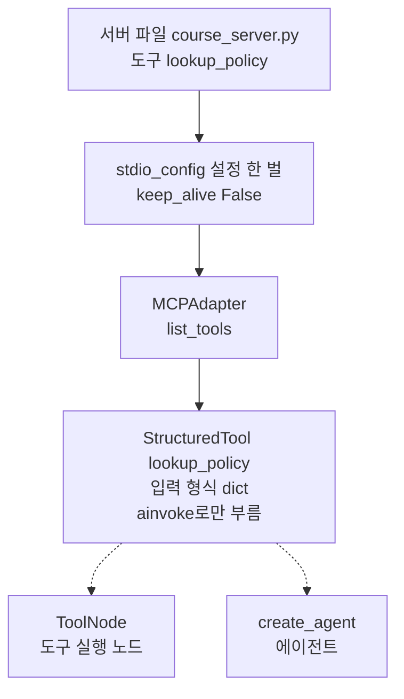
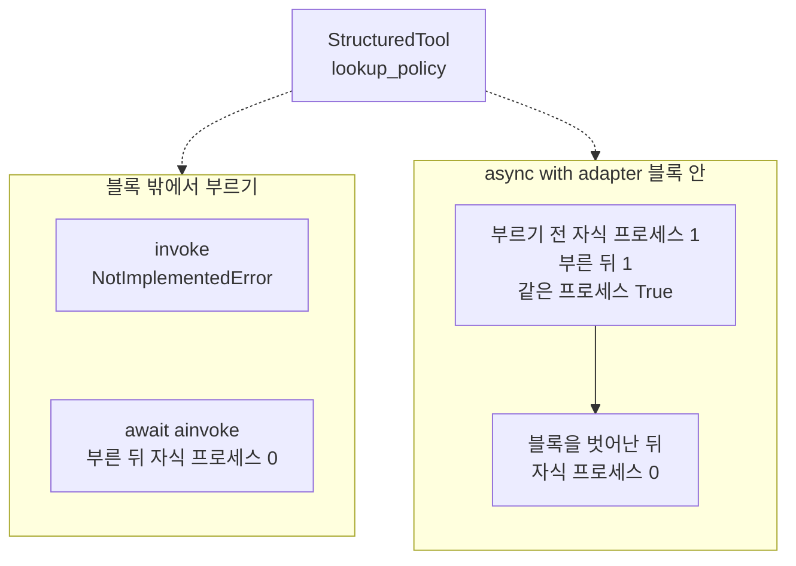
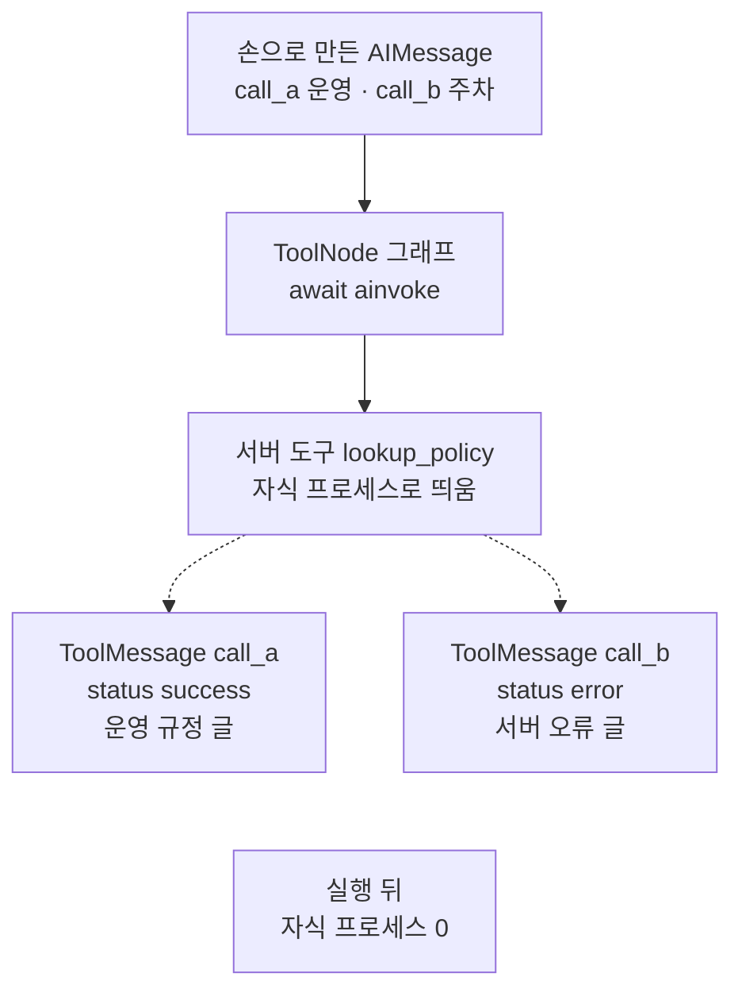
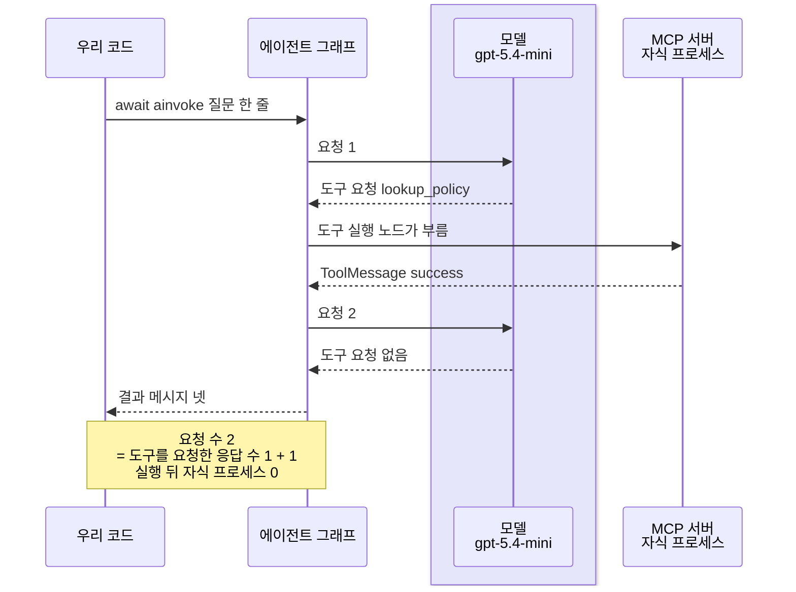

# 04-LangChain-MCP-클라이언트-연동

## _src 본문 (HTML 원본)

```html
<!--meta: 강의 1h | 실습 2h | 코드 notebooks/04-LangChain-MCP-클라이언트-연동.ipynb | 새 용어 4 -->
<style>html,body{overflow-x:hidden}.notebook,.nb-cell,.nb-main,.nb-input,.nb-result{min-width:0;max-width:100%}.nb-input pre,.nb-output{box-sizing:border-box;max-width:100%;overflow-x:auto}code.nb-source{display:block!important;width:100%!important;min-width:0!important;overflow-x:auto!important;padding:0!important}</style>
<h2 id="b1"><span class="no">1</span>학습 목표</h2><div class="goal"><ul>
<li>클래스 <code>MCPAdapter</code>로 MCP 도구를 LangChain 도구로 바꾸고, 바뀐 도구의 모양을 읽을 수 있습니다.</li>
<li>MCP 도구를 <code>ainvoke</code>로만 부르는 까닭과, 부를 때 서버 프로세스가 떴다가 끝나는 것을 설명할 수 있습니다.</li>
<li>바꾼 도구를 도구 실행 노드와 에이전트에 붙이고, 결과 상태와 모델 요청 수를 셀 수 있습니다.</li>
</ul></div>
<h2 id="b2"><span class="no">2</span>이 내용을 배우는 이유</h2><p><a href="03-stdio와-원격-전송-권한-경계.html">03절</a>까지는 FastMCP의 클래스 <code>Client</code>로 서버의 도구를 직접 불렀습니다. 모델이 도구를 고르게 하려면, 그 도구를 Ch 19~21에서 쓴 LangChain 도구로 알려야 합니다. 서버의 도구를 손으로 다시 적지 않고, 서버가 알린 목록을 그대로 LangChain 도구로 바꾸면 됩니다. 이 절은 그 바꾸는 일과, 바꾼 도구를 에이전트에 붙이는 일을 봅니다.</p><p>제목의 LangChain MCP는 langchain 1.4.0에 든 모듈 <code>langchain.mcp</code>입니다. 그 안의 클래스 <code>MCPAdapter</code>가 MCP 서버에 붙어 도구를 바꿉니다. 바꾼 도구는 서버와 메시지를 주고받아야 해서, 부르는 방법이 직접 만든 도구와 다릅니다. 도구를 부를 때 서버 프로세스가 언제 뜨고 끝나는지도 함께 봅니다.</p>
<h2 id="b3"><span class="no">3</span>앞에서 배운 내용</h2><p><a href="../../part5/ch19-model-tools/01-tool과-Ch4-함수-재사용.html">Ch 19 01절</a>에서는 <code>@tool</code> 줄로 도구를 만들었고, 그 종류는 <code>StructuredTool</code>이었습니다. 도구는 메서드 <code>invoke</code>에 인자 딕셔너리를 넣어 불렀습니다. <a href="../../part5/ch19-model-tools/02-Pydantic-인자와-반환-스키마.html">02절</a>은 입력 형식을 양식 클래스 <code>BaseModel</code>로 적었습니다. <a href="../../part5/ch19-model-tools/05-bind_tools와-병렬-호출.html">05절</a>은 도구 호출 요청으로 도구를 불러 <code>ToolMessage</code>를 받았습니다. <a href="../../part5/ch19-model-tools/06-오류와-읽기-쓰기-분리.html">06절</a>은 도구 속성 <code>handle_tool_error</code>로 오류를 결과 상태 <code>error</code>의 도구 메시지로 받았습니다.</p><p><a href="../../part5/ch20-tool-node/01-ToolNode와-tools-condition.html">Ch 20 01절</a>에서는 모델 대신 도구 호출 요청을 담은 응답을 손으로 만들어 도구 실행 노드 <code>ToolNode</code>를 살폈습니다. <a href="../ch21-create-agent/01-create-agent와-ReAct-루프.html">Ch 21 01절</a>에서는 함수 <code>create_agent</code>에 모델 객체와 도구 목록을 넘겨 에이전트를 만들었습니다. <a href="../ch22-middleware/04-호출-한도와-재시도-폴백.html">Ch 22 04절</a>의 호출 한도는 Ch 26·27에서 모델을 부르는 에이전트마다 붙였습니다. <a href="../ch27-deepagents/02-create-deep-agent와-도구.html">Ch 27 02절</a>은 모델 요청 수를 「도구를 요청한 응답 수 + 1」로 셌습니다.</p><p><a href="../../part1/ch02-python/12-async와-await.html">Ch 2 12절</a>에서는 <code>async def</code>와 <code>await</code>로 기다리는 일을 적었습니다. <a href="01-MCP-구조와-capability-협상.html">01절</a>은 셀 맨 위의 <code>async with</code>와 <code>await</code>, 함수 <code>names_of</code>, 서버의 입력 형식을 보였습니다. <a href="02-FastMCP-로컬-서버-제작.html">02절</a> 6절은 서버 파일 도구의 꼬리표·출력 형식·오류 글을 보였습니다. <a href="03-stdio와-원격-전송-권한-경계.html">03절</a>은 함수 <code>stdio_config</code>로 서버 파일을 자식 프로세스로 띄우고, 연결을 닫으면 서버도 끝나는 것을 셌습니다. 이 절은 03절의 <code>Client</code>로 부르던 도구를 LangChain 도구로 바꿔, 모델에게 알립니다.</p>
<h2 id="b4"><span class="no">4</span>핵심 개념</h2><h3>비유로 시작하기</h3><p>우주 정거장의 짐 모듈 하나를 우주선 조종석에서 쓰려 한다고 합시다. 조종석 캡슐의 도킹 구멍은 둥글고, 짐 모듈의 도킹 자리는 네모라서 그대로는 맞지 않습니다. 한쪽 끝은 둥글고 다른 쪽 끝은 네모인 이음 부품을 끼우면, 두 쪽이 한 줄로 이어집니다.</p><p>네모 자리의 짐 모듈이 MCP 서버의 도구이고, 둥근 구멍의 조종석이 LangChain 에이전트입니다. 이음 부품이 클래스 <code>MCPAdapter</code>이고, 부품을 끼운 모듈이 LangChain 도구로 바뀐 MCP 도구입니다.</p><p>비유와 다른 점도 있습니다. 실제 MCP 도구는 한 번 끼워 두면 계속 붙어 있는 모듈이 아닙니다. 이 절의 설정에서는 도구를 부를 때마다 서버를 띄워 연결하고, 답을 받으면 연결과 서버를 닫았습니다.</p>
{{img:04-5-이음-부품으로-이은-모듈|흰 바탕에 세 물건이 가로 한 줄로 이어진 그림입니다. 왼쪽은 작은 둥근 창 하나가 있는 흰 캡슐로, 둥근 끝이 왼쪽을 향하고 오른쪽 끝에 넓고 둥근 구멍이 열려 있습니다. 가운데 청록 이음 부품 하나는 왼쪽 절반이 끝이 둥근 원통이고 오른쪽 절반이 네모 덩어리이며, 둥근 쪽이 캡슐 구멍에 들어가 있습니다. 네모 쪽은 오른쪽의 크고 모서리를 깎은 연노랑 짐 모듈 왼쪽 끝에 꽂혀 있습니다. 사람·글자·숫자·화살표·별은 없는 그림|둥근 구멍의 캡슐과 네모 자리의 짐 모듈이, 한쪽은 둥글고 한쪽은 네모인 이음 부품으로 한 줄이 되었습니다.}}
<p class="look"><b>그림 읽기</b> — 왼쪽 흰 캡슐의 오른쪽 끝에 넓고 둥근 구멍이 있고, 가운데 청록 부품의 둥근 쪽이 그 구멍에 들어가 있습니다. 청록 부품의 오른쪽 절반은 네모 덩어리이고, 오른쪽 연노랑 짐 모듈의 왼쪽 끝에 꽂혀 있습니다. 캡슐이 LangChain 에이전트, 청록 부품이 클래스 <code>MCPAdapter</code>, 짐 모듈이 MCP 서버의 도구입니다. 그림은 부품을 한 번 끼워 둔 모습이지만, 이 절의 설정에서는 도구를 부를 때마다 서버를 띄웠다가 닫았습니다. 모듈 옆면의 칸 둘과 모서리 모양은 어떤 값과도 짝짓지 않습니다.</p>
<h3>LangChain 도구로 바꾸기</h3><p>클래스 <code>MCPAdapter</code>는 안에 FastMCP의 <code>Client</code>를 만들어 서버에 붙습니다. 메서드 <code>list_tools</code>는 서버의 도구 목록을 받아, 도구마다 LangChain 도구 하나로 바꿉니다. 이름과 설명은 서버가 알린 글 그대로이고, 입력 형식은 서버가 보낸 딕셔너리 그대로입니다. 도구의 몸통은 서버에 도구를 부르는 요청을 보내는 비동기 함수입니다.</p>
<table><thead><tr><th>말</th><th>뜻</th></tr></thead><tbody><tr><td>LangChain 도구로 바꾸기(변환)</td><td>서버가 알린 MCP 도구 정의를 LangChain 도구 객체로 옮겨 담는 일입니다. 모양이 다른 두 도킹 자리 사이에 이음 부품을 끼우는 일과 같습니다. 이 절에서는 메서드 <code>list_tools</code>가 서버의 <code>lookup_policy</code>를 종류 <code>StructuredTool</code>의 도구로 바꿉니다.</td></tr><tr><td>비동기로 부르기(<code>ainvoke</code>)</td><td>메서드 <code>invoke</code>의 비동기 판으로, 끝날 때까지 <code>await</code>로 기다리며 부르는 메서드입니다. 주문한 뒤 진동벨이 울릴 때 음식을 받으러 가는 것과 같습니다. 이 절에서는 MCP 도구·도구 실행 그래프·에이전트를 모두 <code>await</code>와 <code>ainvoke</code>로 부릅니다.</td></tr><tr><td>내용 블록(content block)</td><td>메시지 내용을 종류와 값으로 나눠 담은 딕셔너리 하나입니다. 상자 안을 나눈 칸 하나에 물건 하나를 넣는 것과 같습니다. 이 절의 도구 메시지 내용은 종류 <code>text</code>의 블록 하나를 담은 목록입니다.</td></tr><tr><td>아티팩트(artifact)</td><td>도구 메시지에 붙여 두되 모델에게는 보내지 않는 값입니다. 책을 빌릴 때 책과 따로 남겨 두는 대출 기록과 같습니다. 이 절에서는 칸 <code>structured_content</code>에 서버가 낸 구조화된 결과가 들어 있습니다.</td></tr></tbody></table>
<p>새 말을 이 절 코드에서 보면 이렇습니다. 바꾸기는 <code>도구 종류: StructuredTool</code>로, 비동기로 부르기는 <code>await policy_tool.ainvoke(…)</code>로 보입니다. 내용 블록은 <code>내용 블록 수: 1</code>로, 아티팩트는 칸 <code>structured_content</code>로 출력에 보입니다.</p>
{{mermaid:04-1-MCP-도구가-LangChain-도구가-되기까지|위에서 아래로 읽는 흐름도입니다. 초록 상자 서버 파일 course_server.py 도구 lookup_policy에서 파란 상자 stdio_config 설정 한 벌 keep_alive False로, 거기서 파란 상자 MCPAdapter list_tools로 화살표가 갑니다. 그 아래 노란 상자 StructuredTool lookup_policy 입력 형식 dict ainvoke로만 부름으로 화살표가 가고, 그 상자에서 점선 화살표 둘이 나란히 놓인 파란 상자 ToolNode 도구 실행 노드와 파란 상자 create_agent 에이전트로 가는 그림|서버의 MCP 도구는 MCPAdapter를 지나 StructuredTool이 되었고, 같은 도구를 도구 실행 노드와 에이전트에 붙였습니다.}}
<p class="look"><b>도식 읽기</b> — 위에서 아래로 읽습니다. 초록 상자는 서버 파일이고, 파란 상자는 우리가 부른 함수와 클래스입니다. 노란 상자는 노트북 2·3절 출력으로 확인한 바뀐 도구의 모양입니다. 맨 아래 점선 둘은 같은 도구를 붙인 두 곳이고, 4절과 5절에서 차례로 씁니다. 모델은 5절에서만 부르고, 이 그림에는 모델 상자를 두지 않았습니다.</p>
<h3>비동기로만 부르는 도구</h3><p>바뀐 MCP 도구는 비동기 함수 하나만 몸통으로 들고 있습니다. 그래서 메서드 <code>invoke</code>로 부르면 오류 <code>NotImplementedError</code>가 납니다. 도구 실행 그래프와 에이전트도 이 도구를 품으면 <code>ainvoke</code>로 실행해야 합니다. 메서드 <code>ainvoke</code>는 <code>invoke</code>의 비동기 판이고, 노트북 셀 맨 위에서는 <code>await</code>를 붙여 기다립니다.</p><p>도구가 내놓는 값의 모양은 <code>content_and_artifact</code>입니다. 모델에게 보낼 내용은 내용 블록의 목록이고, 서버의 구조화된 결과는 아티팩트로 따로 붙습니다. 내용 블록에는 LangChain이 붙인 <code>id</code>가 있어 실행마다 바뀌므로, 이 절은 글만 출력합니다.</p>
<h3>부를 때마다 여는 연결</h3><p>바뀐 도구는 서버에 붙는 클라이언트를 쥐고 있어, 연결 블록 밖에서도 부를 수 있습니다. 부를 때마다 연결을 열고, 도구를 부르는 요청 하나를 보낸 뒤 연결을 닫습니다. 03절 설정처럼 칸 <code>keep_alive</code>가 <code>False</code>면, 연결을 닫을 때 서버 프로세스도 끝납니다. 연결 블록 <code>async with adapter:</code> 안에서 부르면, 블록이 띄운 서버 하나를 이어 씁니다.</p>
<h2 id="b5"><span class="no">5</span>실행 예제</h2><p>노트북 2절은 03절 설정을 <code>MCPAdapter</code>에 넘겨 도구를 바꾸고, 바뀐 도구의 모양을 봅니다. 3절은 <code>invoke</code>와 <code>ainvoke</code>로 불러 보고, 연결 블록 밖과 안에서 자식 프로세스를 셉니다. 4절은 손으로 만든 도구 호출 요청으로 도구 실행 노드를 실행합니다. 5절은 에이전트를 실제 모델로 한 번 실행하고, 모델 요청 수를 셉니다.</p><p>모델 요청은 5절에서만 나가고, 에이전트가 도구를 한 번 부르면 2번입니다. 호출 한도 3을 붙였고, 요금표로 어림한 예상 비용은 0.001달러 아래입니다. 노트북이 쓰는 파일은 없고, 걸린 시간은 재지 않았습니다.</p>
{{notebook:04-LangChain-MCP-클라이언트-연동}}
<p class="look"><b>확인할 점</b> — 노트북 2절에서 <code>도구 종류: StructuredTool</code>과 <code>입력 형식의 종류: dict</code>를 봅니다. 3절에서 <code>받은 것: NotImplementedError</code>와 <code>부른 뒤 자식 프로세스 수: 0</code>을 확인합니다. 블록 안에서는 <code>같은 프로세스인가: True</code>인지, 블록 뒤에는 0인지 봅니다.</p>
{{mermaid:04-2-부르는-방법과-자식-프로세스|위에 노란 상자 StructuredTool lookup_policy가 있고, 거기서 점선 화살표 둘이 아래에 나란한 칸 둘로 갑니다. 왼쪽 칸 블록 밖에서 부르기에는 노란 상자 invoke NotImplementedError와 노란 상자 await ainvoke 부른 뒤 자식 프로세스 0이 위아래로 있습니다. 오른쪽 칸 async with adapter 블록 안에는 노란 상자 부르기 전 자식 프로세스 1 부른 뒤 1 같은 프로세스 True에서 노란 상자 블록을 벗어난 뒤 0으로 화살표가 가는 그림|블록 밖에서는 부른 뒤 서버가 남지 않았고, 블록 안에서는 블록이 띄운 서버 하나가 호출을 받았습니다.}}
<p class="look"><b>도식 읽기</b> — 위의 노란 상자는 2절에서 받은 도구이고, 아래 두 칸은 3절에서 부른 두 자리입니다. 왼쪽 칸은 연결 블록 밖, 오른쪽 칸은 <code>async with adapter:</code> 블록 안입니다. 노란 상자는 모두 노트북 3절 출력이고, 받아 출력한 오류도 노랑으로 두었습니다. 오른쪽 칸 안의 화살표는 블록 안에서 밖으로 나간 차례입니다.</p>
<h2 id="b6"><span class="no">6</span>실험 결과 해석</h2><p>노트북 4절은 모델 없이 손으로 만든 요청 둘을 도구 실행 노드에 넣었습니다. 주제어 운영을 넣은 요청은 결과 상태 <code>success</code>의 도구 메시지가 되었습니다. 서버 규정에 없는 주차를 넣은 요청은 셀을 멈추지 않고, 서버 오류 글을 담은 <code>error</code> 도구 메시지가 되었습니다. 두 요청을 처리한 서버는 실행이 끝났을 때 남아 있지 않았습니다.</p>
{{mermaid:04-3-손으로-만든-요청과-도구-메시지|위에서 아래로 읽는 흐름도입니다. 파란 상자 손으로 만든 AIMessage call_a 운영 call_b 주차에서 파란 상자 ToolNode 그래프 await ainvoke로, 거기서 초록 상자 서버 도구 lookup_policy 자식 프로세스로 띄움으로 화살표가 갑니다. 초록 상자에서 점선 화살표 둘이 나란한 노란 상자 ToolMessage call_a status success 운영 규정 글과 노란 상자 ToolMessage call_b status error 서버 오류 글로 갑니다. 맨 아래에 노란 상자 실행 뒤 자식 프로세스 0이 따로 있는 그림|주제어 운영 요청은 success, 서버 규정에 없는 주차 요청은 서버 오류 글을 담은 error 도구 메시지가 되었습니다.}}
<p class="look"><b>도식 읽기</b> — 위에서 아래로 읽습니다. 파란 상자는 4절에서 우리가 만든 응답과 그래프이고, 초록 상자는 도구를 실행한 서버입니다. 노란 상자는 노트북 4절 출력이고, 서버가 낸 오류를 담은 메시지도 노랑입니다. 점선 둘은 한 응답에 담긴 요청 둘이 각각 도구 메시지 하나가 된 갈래입니다. 모델을 부르지 않은 그래프라 보라 상자는 없습니다.</p>
<p>노트북 5절은 같은 도구를 에이전트에 붙여 실제 모델로 한 번 실행했습니다. 모델은 첫 응답에서 도구 <code>lookup_policy</code>를 한 번 요청했고, 도구 메시지를 받은 뒤 답을 썼습니다. 그래서 모델 요청 수는 도구를 요청한 응답 수 1에 1을 더한 2였습니다. 어느 도구를 몇 번 부를지는 모델이 고르는 값이라, 결론은 요청 수 셈에 둡니다.</p>
{{mermaid:04-4-에이전트가-MCP-도구를-부른-차례|세로선 넷이 있는 차례 그림입니다. 왼쪽부터 우리 코드, 에이전트 그래프, 연보라 띠 안의 모델 gpt-5.4-mini, MCP 서버 자식 프로세스입니다. 우리 코드에서 await ainvoke 질문 한 줄 화살표가 그래프로 가고, 요청 1 화살표가 모델로 가고 도구 요청 lookup_policy 점선이 돌아옵니다. 그래프에서 도구 실행 노드가 부름 화살표가 서버로 가고 ToolMessage success 점선이 돌아옵니다. 요청 2 화살표가 모델로 가고 도구 요청 없음 점선이 돌아온 뒤, 결과 메시지 넷 점선이 우리 코드로 돌아옵니다. 맨 아래 우리 코드와 그래프에 걸친 노란 메모에 요청 수 2는 도구를 요청한 응답 수 1 더하기 1, 실행 뒤 자식 프로세스 0이 적힌 그림|에이전트가 MCP 도구를 한 번 부른 실행에서 모델 요청은 2번이었고, 도구를 요청한 응답 수 1에 1을 더한 값과 같았습니다.}}
<p class="look"><b>도식 읽기</b> — 위에서 아래로 실행 차례대로 읽고, 세로선은 왼쪽부터 우리 코드, 그래프, 모델, 서버입니다. 연보라 띠는 실제로 부른 모델 gpt-5.4-mini의 자리입니다. 실선 화살표는 부르는 쪽, 점선 화살표는 내놓은 값이 돌아오는 쪽입니다. 맨 아래 노란 메모는 노트북 5절 출력입니다. 도구를 몇 번 부를지는 모델이 고르며, 이 그림은 한 번 부른 실행입니다.</p>
<table><thead><tr><th>본 것</th><th>이번 출력</th><th>무엇이 정했나</th></tr></thead><tbody><tr><td>도구 종류 · 입력 형식</td><td><code>StructuredTool</code> · <code>dict</code></td><td>설치판 <code>MCPAdapter</code>가 정함</td></tr><tr><td><code>invoke</code>로 부르기</td><td><code>NotImplementedError</code></td><td>비동기 함수만 둔 도구</td></tr><tr><td>블록 밖에서 부른 뒤 자식 프로세스</td><td><code>0</code></td><td>칸 <code>keep_alive</code>가 <code>False</code></td></tr><tr><td>손으로 만든 요청 둘의 결과 상태</td><td><code>success</code> · <code>error</code></td><td>서버 규정에 있는 주제어인가</td></tr><tr><td>에이전트가 요청한 도구</td><td><code>lookup_policy</code> 한 번</td><td>모델이 고름(노트북 밖 다섯 번·두 커널 같음)</td></tr><tr><td>모델 요청 수</td><td><code>2</code> = 도구를 요청한 응답 수 <code>1</code> + 1</td><td>셈(한도에 닿지 않은 실행)</td></tr><tr><td>입력 토큰(실행 합)</td><td><code>430</code></td><td>서비스가 센 값 — 노트북 밖 다섯 번·두 커널 같음, 이 절의 주제가 아니라 결론에 쓰지 않고 05절에서 조건을 바꿔 셈</td></tr><tr><td>도구 인자 · 답 글 · 출력 토큰 · 예상 비용</td><td>이번 실행에서는 <code>{'topic': '운영'}</code> · 17:00이 든 답 한 문장 · 출력 32 토큰 · 0.000467달러</td><td>모델·서비스 쪽 값이라 결론에 쓰지 않음</td></tr></tbody></table>
<p>표의 위 넷은 코드와 서버가 정하는 값이라, 다시 실행해도 같아야 합니다. 에이전트가 요청한 도구는 모델이 고른 값이고, 노트북 밖에서 다섯 번 보냈을 때도 같았습니다. 입력 토큰은 서비스가 센 값이지만, 노트북 밖 다섯 번과 두 커널에서 모두 430이었습니다. 이 절의 주제가 아니라 결론에는 쓰지 않고, 05절에서 조건을 바꿔 가며 셉니다. 맨 아래 줄은 모델이 쓴 글과 서비스가 센 값이고, 실행마다 달라질 수 있어 결론에 쓰지 않습니다.</p><p>새 커널로 두 번 실행해 견주자, 코드 셀 스물다섯의 출력이 셀마다 모두 같았습니다. 모델이 쓴 인자·답 글·토큰·예상 비용이 찍힌 셀도 이번 두 번에서는 같았지만, 모델 출력이라 결론에는 쓰지 않습니다.</p>
<p class="look"><b>확인할 점</b> — 4절에서 <code>호출 ID: call_b | 결과 상태: error</code>와 서버 오류 글을 찾습니다. 5절에서 <code>AIMessage | 도구 호출 요청: ['lookup_policy']</code>와 <code>ToolMessage | 결과 상태: success</code>를 봅니다. 마지막으로 <code>모델 요청 수 = 도구를 요청한 응답 수 + 1: True</code>와 <code>실행 뒤 자식 프로세스 수: 0</code>을 확인합니다.</p>
<h2 id="b7"><span class="no">7</span>주의할 점과 실무 메모</h2><ul><li>모듈 <code>langchain.mcp</code>는 langchain 1.4.0에서 베타이고, 가져올 때 경고 <code>LangChainBetaWarning</code>을 한 번 냅니다. 설치판 소스 <code>langchain/mcp/__init__.py</code> 26~30행이 그 자리입니다. 노트북 셀에 찍히는 경고 줄에는 커널 임시 파일 이름이 들어가, 이 절은 그 경고 한 종류만 껐습니다. 같은 파일 9~12행의 설명도 이 가져오기 줄과 같은 줄로 끄는 방법을 적습니다.</li><li>LangChain MCP 문서의 예는 <code>Path("weather_server.py")</code>처럼 서버 파일을 <code>Path</code>로 넘기고, 어댑터 하나에 자식 프로세스 하나라고 적습니다. 그렇게 넘기면 칸 <code>keep_alive</code>가 기본값 <code>True</code>가 되어, 목록을 받은 뒤에도 자식 프로세스 하나가 남았습니다. 시작 안내와 새 판 확인 글도 표준 오류에 찍혔습니다. 노트북 밖의 작은 스크립트로 확인했고, 이 노트북에서는 실행하지 않았습니다. 이 절은 03절 규칙대로 설정 딕셔너리를 넘겼습니다.</li><li>LangChain 문서의 연결 안내는 바꾼 도구가 부를 때마다 연결을 열고 닫는다고 적습니다. 에이전트를 부르는 동안 연결 블록을 열어 두면 같은 연결을 이어 쓴다고도 적습니다. 노트북 밖에서 블록 밖 호출 두 번의 자식 프로세스 번호를 모아 보니 서로 다른 둘이었습니다.</li><li>설치판 <code>MCPAdapter</code>는 글자 대상을 <code>http</code>·<code>https</code> 주소로만 받습니다. 서버 파일 이름을 글자로 넘기면 오류 <code>ValueError</code>를 냅니다. 설치판 소스 <code>langchain/mcp/adapter.py</code> 84~122행으로만 확인했고, 이 노트북에서는 실행하지 않았습니다.</li><li>도구 실행 그래프를 <code>ainvoke</code> 대신 <code>invoke</code>로 실행해도 같은 오류 <code>NotImplementedError</code>가 났습니다. 노트북 밖에서 확인했습니다.</li><li>서버는 도구 오류를 기록 수준 ERROR로 표준 오류에 씁니다. 03절의 기록 수준 <code>WARNING</code>보다 높아 이 기록은 막히지 않습니다. 교재 실행에서는 이 기록이 셀 출력이 아니라 커널을 띄운 쪽의 표준 오류로 갔습니다. 설치판 fastmcp 4.0.3 <code>server/server.py</code> 1541행이 그 자리입니다.</li><li>설치판 <code>as_langchain_tool</code>은 도구를 만들 때 도구 속성 <code>handle_tool_error</code>를 채웁니다. 소스 <code>langchain/mcp/tools.py</code> 104~117행과 274~282행입니다. 서버와의 연결이 끊기는 오류는 도구 메시지가 되지 않고 셀을 멈춥니다. 이 절에서는 그런 오류를 실행하지 않았습니다.</li><li>인터넷 예제에 많은 패키지 <code>langchain-mcp-adapters</code>는 이 실습 폴더 잠금에 없습니다. 그 패키지를 가져오면 오류 <code>ModuleNotFoundError</code>가 납니다. LangChain 옮기기 안내는 <code>MultiServerMCPClient</code>를 <code>MCPAdapter</code>로, <code>load_mcp_tools()</code>를 <code>list_tools()</code>로 바꾸라고 적습니다. 도구를 가로채던 기능은 Ch 22의 <code>@wrap_tool_call</code> 훅으로 옮기라고 적고, 이 절에서는 실행하지 않았습니다.</li><li>클래스 <code>MCPAdapter</code>는 서버가 사람에게 되묻는 요청을 LangGraph의 멈춤 표시로 받게 준비합니다. 설치판 소스 <code>langchain/mcp/adapter.py</code> 146~151행과 174~200행입니다. 이 절의 서버는 되묻지 않아, 이 동작은 실행하지 않았습니다.</li><li>노트북 밖에서 5절과 같은 실행을 다섯 번 보냈습니다. 요청한 도구·결과 메시지 차례·요청 수는 다섯 번 모두 같았습니다. 마지막 답 글은 다섯 번 가운데 한 번 달랐고, 출력 토큰도 그 한 번만 달랐습니다. 같은 요청도 실행한 때에 따라 모델이 쓰는 글과 토큰이 달라질 수 있습니다.</li><li>이 에이전트는 서브에이전트가 없어, 실행 한 번의 모델 요청은 호출 한도 3을 넘지 않습니다. 예상 비용은 2026-09-17 요금표로 어림한 값이고, 청구 금액이 아닙니다. 교재 출력은 Linux의 Python 3.12.13으로 만들었고, 걸린 시간은 재지 않았습니다.</li></ul>
<h2 id="b8"><span class="no">8</span>정리와 다음 절</h2><ul><li>클래스 <code>MCPAdapter</code>가 바꾼 도구는 <code>StructuredTool</code>이고, 입력 형식은 서버가 보낸 딕셔너리였습니다.</li><li>이 도구는 <code>ainvoke</code>로만 불렸고, 칸 <code>keep_alive</code>가 <code>False</code>면 부른 뒤 서버가 남지 않았습니다.</li><li>서버 오류는 결과 상태 <code>error</code>의 도구 메시지가 되었고, 모델 요청 수는 「도구를 요청한 응답 수 + 1」이었습니다.</li></ul><p><strong>다음 학습과 이어지는 지점</strong> — <a href="05-도구-정의와-첫-호출-토큰.html">05절</a>에서는 도구 정의가 모델의 첫 요청 입력 토큰에 얼마나 더해지는지 셉니다.</p>
<h2 id="b9"><span class="no">9</span>복습 문제</h2><details class="quiz" open><summary>문제 4개 · 해설 포함</summary><p class="quiz-q">1. 클래스 <code>MCPAdapter</code>가 바꾼 도구를 메서드 <code>invoke</code>로 부르면 어떻게 되었나요?</p><p class="quiz-a">오류 <code>NotImplementedError</code>가 났습니다. 이 도구는 서버와 메시지를 주고받는 비동기 함수만 몸통으로 들고 있어, <code>ainvoke</code>로 불러야 합니다. 틀렸다면 노트북 3절을 다시 읽습니다.</p><p class="quiz-q">2. 칸 <code>keep_alive</code>가 <code>False</code>인 설정에서, 연결 블록 밖에서 도구를 부른 뒤 자식 프로세스 수는 얼마였나요?</p><p class="quiz-a">0이었습니다. 부를 때 서버가 떠서 답하고, 연결을 닫을 때 끝났습니다. 연결 블록 안에서는 블록이 띄운 서버 하나를 이어 썼습니다. 틀렸다면 노트북 3절을 다시 읽습니다.</p><p class="quiz-q">3. 도구 실행 노드에 서버 규정에 없는 주제어를 넣은 요청은 어떻게 되었나요?</p><p class="quiz-a">셀이 멈추지 않고, 결과 상태 <code>error</code>의 도구 메시지가 되었습니다. 그 글은 서버가 낸 오류 글이었습니다. 바꾼 도구에 도구 속성 <code>handle_tool_error</code>가 채워져 있기 때문입니다. 틀렸다면 노트북 4절을 다시 읽습니다.</p><p class="quiz-q">4. 에이전트가 MCP 도구를 두 번 요청한 뒤 답했다면, 모델 요청 수는 몇 번일까요?</p><p class="quiz-a">3번입니다. 도구를 요청한 응답 둘에 답을 쓴 응답 하나가 더해집니다. 호출 한도 3 안이라 실행이 끝까지 갑니다. 틀렸다면 노트북 5절의 셈을 다시 읽습니다.</p></details>
<h2 id="b10"><span class="no">10</span>참고 자료</h2><ul><li><div><a href="https://docs.langchain.com/oss/python/langchain/mcp">LangChain MCP</a></div>확인 2026-09-28 · 패키지 <code>langchain[mcp]</code> 1.4.0 이상과 클래스 <code>MCPAdapter</code>를 적습니다. 서버 파일은 <code>Path</code>로 넘기면 stdio로 띄우고, 글자 대상은 주소여야 한다고 적습니다. 모듈이 베타라 가져올 때 경고를 한 번 낸다고도 적습니다.</li><li><div><a href="https://docs.langchain.com/oss/python/langchain/mcp/connections">LangChain MCP Connections</a></div>확인 2026-09-28 · 바꾼 도구는 부를 때마다 연결을 열고 닫는다고 적습니다. 연결 블록을 열어 두면 같은 연결을 이어 쓰고, 설정 딕셔너리로 여러 서버를 붙인다고 적습니다.</li><li><div><a href="https://docs.langchain.com/oss/python/migrate/langchain-mcp-adapters">Migrate from langchain-mcp-adapters</a></div>확인 2026-09-28 · <code>MultiServerMCPClient</code>는 <code>MCPAdapter</code>로 합쳐졌다고 적습니다. 오류를 알린 MCP 도구는 결과 상태 <code>error</code>의 도구 메시지가 되고, 도구 가로채기는 <code>@wrap_tool_call</code>로 옮긴다고 적습니다.</li><li><div><a href="https://gofastmcp.com/clients/transports">FastMCP Client Transports</a></div>확인 2026-09-28 · stdio 설정의 칸 <code>keep_alive</code> 기본값이 참이라 같은 자식 프로세스를 다시 쓴다고 적습니다.</li><li>설치판 langchain 1.4.0 소스 <code>langchain/mcp/adapter.py</code> 84~122행은 글자 대상을 주소로만 받습니다. 174~200행은 클라이언트를 만들고, 221~242행 <code>list_tools</code>는 도구를 바꿉니다. <code>langchain/mcp/tools.py</code> 104~117행은 오류를 도구 메시지로 바꾸고, 261~282행은 비동기 몸통만 둔 <code>StructuredTool</code>을 만듭니다.</li><li>설치판 langchain-core 1.6.2 소스 <code>messages/tool.py</code> 73~79행은 아티팩트를 모델에게 보내지 않는 값이라고 적습니다. langchain 1.4.0 <code>agents/middleware/model_call_limit.py</code> 213행과 253행은 호출 한도의 비동기 훅입니다.</li><li>Ch 19 01·05·06절에서 도구와 도구 메시지를, Ch 20 01절에서 손으로 만든 요청과 도구 실행 노드를 보았습니다. Ch 21 01절에서 에이전트를, Ch 22 04절에서 호출 한도를 보았습니다.</li></ul>
```

## 노트북 셀 (순서대로)

### [0] markdown {'html': 'skip'}

# LangChain MCP 클라이언트 연동

**이 노트북에서 할 일**

1. 서버의 MCP 도구를 `MCPAdapter`로 LangChain 도구로 바꾸고, 바뀐 도구의 모양을 모델 없이 봅니다.
2. 바뀐 도구를 부르는 방법과, 부를 때마다 서버 프로세스가 떴다가 끝나는지를 봅니다.
3. 도구 실행 노드와 에이전트에 MCP 도구를 붙이고, 에이전트를 실제 모델로 한 번 실행합니다.

**준비물** — 프로젝트 폴더의 `.env` 파일에 `OPENAI_API_KEY`가 있어야 합니다.
모델은 `gpt-5.4-mini`이고, 5절에서 에이전트를 한 번 실행합니다.
에이전트가 MCP 도구를 한 번 부르고 답하면, 모델 요청은 2번입니다.
호출 한도 3을 붙여, 요청이 끝없이 늘지 않게 막습니다.
요금표로 어림한 예상 비용은 0.001달러 아래이고, 청구 금액이 아닙니다.

2~4절은 모델을 부르지 않고, 출력은 서버와 도구가 주고받은 값입니다.
모델이 쓰는 도구 인자와 답 글은 실행마다 달라질 수 있습니다.
서버는 실습 폴더 맨 위의 서버 파일 `course_server.py`를 자식 프로세스로 띄웁니다.
노트북이 쓰는 파일은 없고, 걸린 시간은 재지 않았습니다.
앞에서 배운 함수 다섯은 도구 파일 `connect_tools.py`에서 가져옵니다.

**기준 버전** — 첫 셀에서 패키지 여덟을 설치합니다.
판은 langchain 1.4.0, langchain-core 1.6.2, langgraph 1.2.11입니다.
패키지 langchain-openai 1.6.0, fastmcp 4.0.3, mcp 2.2.0도 설치합니다.
나머지 둘은 psutil 7.2.2와 python-dotenv 1.2.3입니다.
교재 출력은 Linux의 Python 3.12.13으로 만들었고, 다른 판과 Windows·macOS에서는 실행하지 않았습니다.

**강의와 실습 범위** — 강의 시간에는 2~3절을 읽습니다.
MCP 도구가 LangChain 도구로 바뀐 모양과, 비동기로만 부를 수 있는 까닭을 보는 자리입니다.
4~5절은 도구 실행 노드와 에이전트에 붙여 실행하는 실습이고, 실습 시간에 실행합니다.

실습 폴더 `labs/part6/ch28-mcp`에서 `uv sync --locked`를 실행합니다.
그다음 `notebooks/` 폴더의 이 노트북을 열고, 실습 폴더의 `.venv` 커널을 고릅니다.
첫 셀부터 순서대로 실행합니다.

### [1] markdown {'html': 'skip'}

## 오늘 볼 그림


위에서 아래로 읽습니다.
초록 상자는 서버 파일이고, 파란 상자는 우리가 부른 함수와 클래스입니다.
노란 상자는 노트북 2·3절 출력으로 확인한 바뀐 도구의 모양입니다.
맨 아래 점선 둘은 같은 도구를 붙인 두 곳이고, 4절과 5절에서 차례로 씁니다.
모델은 5절에서만 부르고, 이 그림에는 모델 상자를 두지 않았습니다.

### [2] markdown {}

## 1. 준비

제목의 LangChain MCP는 langchain 1.4.0에 든 모듈 `langchain.mcp`를 가리킵니다.
그 안의 클래스 `MCPAdapter`가 MCP 서버에 붙어, 서버의 도구를 LangChain 도구로 바꿉니다.
바꾼 도구는 Ch 20의 도구 실행 노드와 Ch 21의 에이전트에 넘길 수 있습니다.

첫 셀은 패키지 여덟을 설치하고 설치된 판 번호를 출력합니다.
패키지 psutil은 03절에서 자식 프로세스 수를 센 패키지입니다.
패키지 langgraph는 Ch 20에서 도구 실행 노드를 가져온 패키지입니다.

### [3] code {'execution': {'iopub.execute_input': '2026-09-28T21:25:37.300921Z', 'iopub.status.busy': '2026-09-28T21:25:37.300762Z', 'iopub.status.idle': '2026-09-28T21:25:38.119346Z', 'shell.execute_reply': '2026-09-28T21:25:38.118723Z'}, 'lesson_role': 'setup'}

```python
# 이 절에서 쓰는 패키지를 설치하고 버전을 확인합니다
%pip install -q "langchain[mcp]==1.4.0" "langchain-core==1.6.2" "langchain-openai==1.6.0" "langgraph==1.2.11" "fastmcp==4.0.3" "mcp==2.2.0" "psutil==7.2.2" "python-dotenv==1.2.3"
from importlib.metadata import version

print("langchain:", version("langchain"))
print("langchain-core:", version("langchain-core"))
print("langchain-openai:", version("langchain-openai"))
print("langgraph:", version("langgraph"))
print("fastmcp:", version("fastmcp"))
print("mcp:", version("mcp"))
print("psutil:", version("psutil"))
print("python-dotenv:", version("python-dotenv"))
```

출력:
```
Note: you may need to restart the kernel to use updated packages.
langchain: 1.4.0
langchain-core: 1.6.2
langchain-openai: 1.6.0
langgraph: 1.2.11
fastmcp: 4.0.3
mcp: 2.2.0
psutil: 7.2.2
python-dotenv: 1.2.3

```

### [4] markdown {}

**결과 읽기** — 출력 줄 `langchain: 1.4.0`, `langgraph: 1.2.11`, `fastmcp: 4.0.3`, `psutil: 7.2.2`가 보입니다.
여덟 판 모두 실습 폴더 잠금과 같습니다.

다음 셀은 이 절에서 쓸 이름을 가져옵니다.
모듈 `langchain.mcp`는 아직 베타라서, 가져올 때 경고 `LangChainBetaWarning`을 한 번 냅니다.
그 경고 줄에는 실행마다 바뀌는 임시 파일 이름이 들어 있습니다.
그래서 모듈 `warnings`의 함수 `filterwarnings`로 이 경고 한 종류만 끄고 가져옵니다.
상태 형식 `MessagesState`는 LangGraph가 미리 만들어 둔 형식이고, 4절에서 풉니다.

### [5] code {'execution': {'iopub.execute_input': '2026-09-28T21:25:38.120358Z', 'iopub.status.busy': '2026-09-28T21:25:38.120269Z', 'iopub.status.idle': '2026-09-28T21:25:39.589512Z', 'shell.execute_reply': '2026-09-28T21:25:39.589255Z'}, 'lesson_role': 'setup'}

```python
# 이 절에서 쓸 이름을 가져옵니다(langchain.mcp는 베타 경고 한 종류만 끄고 가져옵니다)
import warnings
import psutil
from langchain_core._api import LangChainBetaWarning
warnings.filterwarnings("ignore", category=LangChainBetaWarning)
from langchain.mcp import MCPAdapter
from langchain.agents import create_agent
from langchain.agents.middleware import ModelCallLimitMiddleware
from langchain.chat_models import init_chat_model
from langchain.messages import AIMessage, HumanMessage
from langgraph.graph import END, START, MessagesState, StateGraph
from langgraph.prebuilt import ToolNode
# 01·03절과 앞 챕터에서 배운 함수 다섯은 도구 파일에서 가져옵니다
from connect_tools import estimate_cost, names_of, stdio_config, sum_usage, tool_call_names

print("도구 파일에서 가져온 함수:", "estimate_cost, names_of, stdio_config, sum_usage, tool_call_names")
```

출력:
```
도구 파일에서 가져온 함수: estimate_cost, names_of, stdio_config, sum_usage, tool_call_names

```

### [6] markdown {}

**결과 읽기** — 출력 줄 `도구 파일에서 가져온 함수: estimate_cost, names_of, stdio_config, sum_usage, tool_call_names`가 보입니다.
함수 `names_of`는 01절 4절에서 만든 함수로, 목록의 항목마다 이름을 모읍니다.
함수 `stdio_config`는 03절 2절에서 만든 함수로, 서버 파일 하나를 stdio로 띄우는 설정 한 벌을 만듭니다.
나머지 셋은 Ch 19 04·05절과 Ch 6 06절에서 배운 함수이고, 4·5절에서 씁니다.

함수 `stdio_config`와 앞 챕터 함수 셋은 이 절부터 도구 파일에서 가져옵니다.
앞 챕터 함수 셋은 Ch 21 도구 파일 `runner_tools.py`의 함수와 설명 주석·본문이 같습니다.
그 파일은 이 실습 폴더에 없는 패키지를 가져와서, 파일째 가져오지 않고 함수만 옮겼습니다.

### [7] markdown {}

API 키가 있는지 확인합니다. `True` 값이 나오면 다음으로 넘어갑니다.

### [8] code {'execution': {'iopub.execute_input': '2026-09-28T21:25:39.590414Z', 'iopub.status.busy': '2026-09-28T21:25:39.590288Z', 'iopub.status.idle': '2026-09-28T21:25:39.592642Z', 'shell.execute_reply': '2026-09-28T21:25:39.592317Z'}, 'lesson_role': 'setup'}

```python
# .env 파일에서 OpenAI API 키를 읽습니다(키 값은 출력하지 않습니다)
import os
from dotenv import find_dotenv, load_dotenv

env_path = find_dotenv(usecwd=True)
load_dotenv(env_path)
has_key = os.getenv("OPENAI_API_KEY") is not None
print("OPENAI_API_KEY 설정 여부:", has_key)
assert has_key, "프로젝트 폴더의 .env 파일에 OPENAI_API_KEY를 적어 주세요."
```

출력:
```
OPENAI_API_KEY 설정 여부: True

```

### [9] markdown {}

실습에 쓸 모델을 준비합니다.
temperature 값을 0으로 두어 매번 비슷한 답을 고르게 합니다.

### [10] code {'execution': {'iopub.execute_input': '2026-09-28T21:25:39.593201Z', 'iopub.status.busy': '2026-09-28T21:25:39.593140Z', 'iopub.status.idle': '2026-09-28T21:25:40.590288Z', 'shell.execute_reply': '2026-09-28T21:25:40.589911Z'}}

```python
# 실습에 쓸 모델을 준비합니다
model = init_chat_model(
    "openai:gpt-5.4-mini",
    temperature=0,
    reasoning_effort="none",
)
print("모델 이름:", model.model_name)
print("temperature:", model.temperature)
```

출력:
```
모델 이름: gpt-5.4-mini
temperature: 0.0

```

### [11] markdown {}

**결과 읽기** — 모델 이름 `gpt-5.4-mini`, temperature `0.0`이 보이면 준비가 끝났습니다.
이 노트북의 출력은 2026-09-28에 이 모델로 실행한 결과입니다.
temperature 값을 0으로 두어도, 실행마다 답 문장이 달라질 수 있습니다.
이 셀은 모델 객체만 만들고, 모델 요청은 아직 보내지 않습니다.
모델 요청은 5절 실행 셀에서만 나갑니다.

## 2. MCP 도구를 LangChain 도구로 바꾸기

03절까지는 FastMCP의 클래스 `Client`로 서버의 도구를 직접 불렀습니다.
이 절은 같은 서버의 도구를 LangChain 도구로 바꿔, Ch 20·21의 그래프와 에이전트에 붙입니다.
먼저 01절 2절과 같은 셀로 서버 파일의 위치를 찾습니다.

### [12] code {'execution': {'iopub.execute_input': '2026-09-28T21:25:40.590956Z', 'iopub.status.busy': '2026-09-28T21:25:40.590898Z', 'iopub.status.idle': '2026-09-28T21:25:40.593086Z', 'shell.execute_reply': '2026-09-28T21:25:40.592781Z'}}

```python
# 작업 폴더에서 본 서버 파일의 위치를 후보 셋 가운데에서 고릅니다
candidates = ["../course_server.py", "course_server.py", "labs/part6/ch28-mcp/course_server.py"]
server_file = None
for candidate in candidates:
    if os.path.exists(candidate):
        server_file = candidate
        break
print("서버 파일을 찾았는가:", server_file is not None)
print("고른 파일 위치:", server_file)
assert server_file is not None, "notebooks 폴더나 실습 폴더 맨 위에서 노트북을 열어 주세요."
```

출력:
```
서버 파일을 찾았는가: True
고른 파일 위치: labs/part6/ch28-mcp/course_server.py

```

### [13] markdown {}

**결과 읽기** — 출력 줄 `서버 파일을 찾았는가: True`가 보입니다.
교재 출력은 프로젝트 맨 위에서 실행해 셋째 후보 `labs/part6/ch28-mcp/course_server.py`를 골랐습니다.
`notebooks/` 폴더에서 열면 첫 후보 `../course_server.py`가 골라집니다.

다음 셀은 03절 2절과 같은 셀로, 서버를 조용히 띄우는 환경 변수 셋을 딕셔너리로 만듭니다.

### [14] code {'execution': {'iopub.execute_input': '2026-09-28T21:25:40.593683Z', 'iopub.status.busy': '2026-09-28T21:25:40.593624Z', 'iopub.status.idle': '2026-09-28T21:25:40.595355Z', 'shell.execute_reply': '2026-09-28T21:25:40.595089Z'}}

```python
# 자식 프로세스로 띄운 FastMCP 서버가 시작 안내와 새 판 확인을 하지 않게 하는 환경 변수 셋입니다
quiet_env = {
    "FASTMCP_SHOW_SERVER_BANNER": "false",
    "FASTMCP_CHECK_FOR_UPDATES": "off",
    "FASTMCP_LOG_LEVEL": "WARNING",
}
print("조용히 하는 이름:", list(quiet_env))
```

출력:
```
조용히 하는 이름: ['FASTMCP_SHOW_SERVER_BANNER', 'FASTMCP_CHECK_FOR_UPDATES', 'FASTMCP_LOG_LEVEL']

```

### [15] markdown {}

**결과 읽기** — 라벨 `조용히 하는 이름:` 뒤에 이름 셋이 보입니다.
03절에서 본 것처럼, 시작 안내와 새 판 확인을 끄고 기록 수준을 올리는 이름입니다.

다음 셀은 03절 함수 `stdio_config`로 설정 한 벌을 만들어, 클래스 `MCPAdapter`에 넘깁니다.
칸 `keep_alive`가 `False`인 설정이라, 연결을 닫으면 서버도 끝납니다.
메서드 `list_tools`는 서버에 연결해 도구 목록을 받습니다.
받은 도구를 하나씩 LangChain 도구로 바꿔, 그 목록을 내놓습니다.
연결은 이 메서드 안에서 열고 닫으므로, `async with` 블록 없이 `await`만 붙여 부릅니다.

### [16] code {'execution': {'iopub.execute_input': '2026-09-28T21:25:40.595841Z', 'iopub.status.busy': '2026-09-28T21:25:40.595792Z', 'iopub.status.idle': '2026-09-28T21:25:41.517523Z', 'shell.execute_reply': '2026-09-28T21:25:41.517244Z'}}

```python
# 03절 함수 stdio_config로 만든 설정 한 벌을 MCPAdapter에 넘기고, 도구 목록을 LangChain 도구로 받습니다
kernel_process = psutil.Process()
course_config = stdio_config(server_file, quiet_env)
adapter = MCPAdapter(course_config)
mcp_tools = await adapter.list_tools()
children_after = kernel_process.children()
print("받은 도구 이름:", names_of(mcp_tools))
print("목록을 받은 뒤 자식 프로세스 수:", len(children_after))
```

출력:
```
받은 도구 이름: ['lookup_policy']
목록을 받은 뒤 자식 프로세스 수: 0

```

### [17] markdown {}

**결과 읽기** — 출력 줄 `받은 도구 이름: ['lookup_policy']`가 보입니다.
03절에서 클래스 `Client`로 받은 도구와 같은 이름입니다.
출력 줄 `목록을 받은 뒤 자식 프로세스 수: 0`으로, 목록을 받는 동안 띄운 서버도 끝났습니다.

다음 셀은 바뀐 도구 하나의 종류·설명·입력 형식을 봅니다.
속성 `args_schema`는 도구의 입력 형식을 담는 칸입니다.

### [18] code {'execution': {'iopub.execute_input': '2026-09-28T21:25:41.518317Z', 'iopub.status.busy': '2026-09-28T21:25:41.518257Z', 'iopub.status.idle': '2026-09-28T21:25:41.520454Z', 'shell.execute_reply': '2026-09-28T21:25:41.519998Z'}}

```python
# 바뀐 도구 하나의 종류·설명·입력 형식을 봅니다
policy_tool = mcp_tools[0]
print("도구 종류:", type(policy_tool).__name__)
print("설명:", policy_tool.description)
print("입력 형식의 종류:", type(policy_tool.args_schema).__name__)
print("입력 형식:", policy_tool.args_schema)
```

출력:
```
도구 종류: StructuredTool
설명: 자료실 규정을 조회합니다. topic은 대출, 운영, 연체 중 하나입니다.
입력 형식의 종류: dict
입력 형식: {'type': 'object', 'additionalProperties': False, 'properties': {'topic': {'type': 'string'}}, 'required': ['topic']}

```

### [19] markdown {}

**결과 읽기** — 출력 줄 `도구 종류: StructuredTool`이 보입니다.
Ch 19 01절에서 `@tool` 줄로 만든 도구와 같은 종류입니다.
설명은 서버 파일 도구의 독스트링 글 그대로입니다.
출력 줄 `입력 형식의 종류: dict`로, 입력 형식은 딕셔너리입니다.
라벨 `입력 형식:` 뒤의 글은 01절 4절에서 본 서버의 입력 형식과 글자까지 같습니다.

Ch 19 02절은 입력 형식을 양식 클래스 `BaseModel`로 적었습니다.
바뀐 MCP 도구는 서버가 보낸 입력 형식을 딕셔너리 그대로 들고 있습니다.
모델에게 보내는 도구 정의에 이 딕셔너리가 어떻게 실리는지는 05절에서 봅니다.

다음 셀은 도구가 내놓는 값의 모양과, 도구에 붙은 서버 정보를 봅니다.
속성 `response_format`은 도구가 내놓는 값을 어떤 모양으로 나눌지 정합니다.
속성 `metadata`는 도구에 붙여 둔 정보를 담는 딕셔너리입니다.

### [20] code {'execution': {'iopub.execute_input': '2026-09-28T21:25:41.521047Z', 'iopub.status.busy': '2026-09-28T21:25:41.520984Z', 'iopub.status.idle': '2026-09-28T21:25:41.522830Z', 'shell.execute_reply': '2026-09-28T21:25:41.522458Z'}}

```python
# 도구가 내놓는 값의 모양과, 도구에 붙은 서버 정보·꼬리표를 봅니다
print("내놓는 값의 모양:", policy_tool.response_format)
mcp_info = policy_tool.metadata["mcp"]
tool_meta = mcp_info["tool"]["_meta"]
print("서버 정보:", mcp_info["server"])
print("꼬리표:", tool_meta["fastmcp"]["tags"])
```

출력:
```
내놓는 값의 모양: content_and_artifact
서버 정보: {'name': '교육센터 자료실', 'version': '4.0.3'}
꼬리표: ['public', 'read']

```

### [21] markdown {}

**결과 읽기** — 출력 줄 `내놓는 값의 모양: content_and_artifact`가 보입니다.
도구가 내놓는 값을 모델에게 보낼 내용과, 메시지에만 붙여 둘 아티팩트로 나눈다는 뜻입니다.
라벨 `서버 정보:` 뒤에 서버 이름 `교육센터 자료실`과 판 `4.0.3`이 보입니다.
출력 줄 `꼬리표: ['public', 'read']`는 서버 파일이 도구를 붙이며 적은 꼬리표입니다.
02절 6절에서 본 꼬리표와 같습니다.

## 3. 비동기로만 부르는 도구

Ch 19 01절에서는 도구의 메서드 `invoke`에 인자 딕셔너리를 넣어 불렀습니다.
바뀐 MCP 도구도 같은 방법으로 불러 봅니다.
오류가 나면 이름 `NotImplementedError`만 받아, 셀이 멈추지 않게 합니다.
실행 전에 예상해 봅니다.
이 도구도 `invoke`로 부를 수 있을까요?

### [22] code {'execution': {'iopub.execute_input': '2026-09-28T21:25:41.523385Z', 'iopub.status.busy': '2026-09-28T21:25:41.523337Z', 'iopub.status.idle': '2026-09-28T21:25:41.528561Z', 'shell.execute_reply': '2026-09-28T21:25:41.528233Z'}}

```python
# Ch 19 01절처럼 .invoke로 불러 봅니다(오류 NotImplementedError만 받습니다)
try:
    policy_tool.invoke({"topic": "운영"})
except NotImplementedError as error:
    print("받은 것:", type(error).__name__)
    print("받은 글:", str(error))
```

출력:
```
받은 것: NotImplementedError
받은 글: StructuredTool does not support sync invocation.

```

### [23] markdown {}

**결과 읽기** — 받은 것은 `NotImplementedError`이고, 받은 글은 `StructuredTool does not support sync invocation.`입니다.
받은 글의 sync invocation은 비동기가 아닌 보통 부르기를 뜻합니다.
이 도구는 보통 부르기로는 쓸 수 없다는 뜻입니다.

바뀐 MCP 도구는 서버와 메시지를 주고받는 비동기 함수 하나만 몸통으로 들고 있습니다.
그래서 메서드 `ainvoke`로 불러야 하고, `ainvoke`는 `invoke`의 비동기 판입니다.
01절에서 본 것처럼, 노트북 셀 맨 위에서는 `await`를 붙여 끝날 때까지 기다립니다.
다음 셀은 같은 인자를 `ainvoke`에 넘겨 부르고, 부른 뒤 자식 프로세스 수를 셉니다.

### [24] code {'execution': {'iopub.execute_input': '2026-09-28T21:25:41.529140Z', 'iopub.status.busy': '2026-09-28T21:25:41.529080Z', 'iopub.status.idle': '2026-09-28T21:25:42.411628Z', 'shell.execute_reply': '2026-09-28T21:25:42.411173Z'}}

```python
# 비동기 판 ainvoke로 같은 인자를 넘겨 부르고, 부른 뒤 자식 프로세스 수를 셉니다
operation_blocks = await policy_tool.ainvoke({"topic": "운영"})
children_now = kernel_process.children()
first_block = operation_blocks[0]
print("받은 값의 종류:", type(operation_blocks).__name__)
print("내용 블록 수:", len(operation_blocks))
print("첫 블록의 키:", list(first_block))
print("첫 블록의 종류:", first_block["type"])
print("첫 블록의 글:", first_block["text"])
print("부른 뒤 자식 프로세스 수:", len(children_now))
```

출력:
```
받은 값의 종류: list
내용 블록 수: 1
첫 블록의 키: ['type', 'text', 'id']
첫 블록의 종류: text
첫 블록의 글: 평일은 09:00~20:00, 토요일은 10:00~17:00에 운영합니다.
부른 뒤 자식 프로세스 수: 0

```

### [25] markdown {}

**결과 읽기** — 출력 줄 `받은 값의 종류: list`와 `내용 블록 수: 1`이 보입니다.
라벨 `첫 블록의 글:` 뒤의 글은 서버 파일의 운영 규정 글 그대로입니다.
출력 줄 `부른 뒤 자식 프로세스 수: 0`으로, 이번 호출이 띄운 서버도 끝났습니다.
앞 셀까지 0이었으니, 부를 때 서버가 새로 떠서 답하고 끝났습니다.

인자 딕셔너리로 부르면, 도구는 모델에게 보낼 내용만 내놓습니다.
그 내용은 내용 블록의 목록이고, 블록 하나는 종류와 글을 담은 딕셔너리입니다.
라벨 `첫 블록의 키:` 뒤의 `id`는 LangChain이 블록마다 새로 붙이는 번호라, 실행마다 값이 바뀝니다.
그래서 이 절은 블록 전체 대신 글 `text`만 출력합니다.

LangChain 문서는 바꾼 도구가 부를 때마다 연결을 열고 닫는다고 적습니다.
연결 블록 `async with adapter:` 안에서 부르면, 블록이 연 연결을 그대로 씁니다.
다음 셀은 블록 안에서 같은 도구를 부르고, 부르기 전과 뒤의 자식 프로세스를 견줍니다.
속성 `pid`는 운영체제가 프로세스마다 붙인 번호입니다.
번호는 실행마다 달라 출력하지 않고, 두 번호가 같은지만 봅니다.

### [26] code {'execution': {'iopub.execute_input': '2026-09-28T21:25:42.412445Z', 'iopub.status.busy': '2026-09-28T21:25:42.412369Z', 'iopub.status.idle': '2026-09-28T21:25:43.365717Z', 'shell.execute_reply': '2026-09-28T21:25:43.365277Z'}}

```python
# 연결 블록 안에서 같은 도구를 부르고, 부르기 전과 뒤의 자식 프로세스를 견줍니다
async with adapter:
    children_before_call = kernel_process.children()
    overdue_blocks = await policy_tool.ainvoke({"topic": "연체"})
    children_after_call = kernel_process.children()
children_now = kernel_process.children()
print("블록 안, 부르기 전 자식 프로세스 수:", len(children_before_call))
print("블록 안, 부른 뒤 자식 프로세스 수:", len(children_after_call))
print("같은 프로세스인가:", children_before_call[0].pid == children_after_call[0].pid)
print("블록을 벗어난 뒤 자식 프로세스 수:", len(children_now))
```

출력:
```
블록 안, 부르기 전 자식 프로세스 수: 1
블록 안, 부른 뒤 자식 프로세스 수: 1
같은 프로세스인가: True
블록을 벗어난 뒤 자식 프로세스 수: 0

```

### [27] markdown {}

**결과 읽기** — 출력 줄 `블록 안, 부르기 전 자식 프로세스 수: 1`과 `블록 안, 부른 뒤 자식 프로세스 수: 1`이 보입니다.
출력 줄 `같은 프로세스인가: True`로, 블록이 띄운 서버 하나가 도구 호출을 받았습니다.
출력 줄 `블록을 벗어난 뒤 자식 프로세스 수: 0`으로, 블록을 벗어나자 그 서버도 끝났습니다.

블록 밖에서는 부를 때마다 서버가 떴다가 끝났고, 블록 안에서는 서버 하나를 이어 썼습니다.
어느 쪽이든 칸 `keep_alive`가 `False`라, 연결이 모두 닫히면 남는 서버가 없습니다.

## 4. 도구 실행 노드에 손으로 만든 요청 넣기

Ch 20 01절은 모델 대신 도구 호출 요청을 담은 응답을 손으로 만들어 그래프를 살폈습니다.
이 절도 같은 방법으로, 바뀐 MCP 도구를 도구 실행 노드 `ToolNode`에 넣어 봅니다.
그래프의 상태 형식은 LangGraph가 미리 만들어 둔 `MessagesState`를 씁니다.
Ch 21 03절의 `AgentState`보다 칸이 적어, 칸 `messages` 하나만 둔 형식입니다.
그 칸에는 Ch 13 04절의 `add_messages` 규칙이 붙어 있습니다.

다음 셀은 도구 실행 노드 하나만 둔 그래프를 만듭니다.

### [28] code {'execution': {'iopub.execute_input': '2026-09-28T21:25:43.366476Z', 'iopub.status.busy': '2026-09-28T21:25:43.366422Z', 'iopub.status.idle': '2026-09-28T21:25:43.371718Z', 'shell.execute_reply': '2026-09-28T21:25:43.371385Z'}}

```python
# MCP 도구 목록으로 도구 실행 노드 하나만 둔 그래프를 만듭니다(Ch 20 01절 ToolNode)
builder = StateGraph(MessagesState)
builder.add_node("tools", ToolNode(mcp_tools))
builder.add_edge(START, "tools")
builder.add_edge("tools", END)
tool_graph = builder.compile()
print("등록한 노드:", list(builder.nodes))
```

출력:
```
등록한 노드: ['tools']

```

### [29] markdown {}

**결과 읽기** — 출력 줄 `등록한 노드: ['tools']`가 보입니다.
Ch 20 01절과 달리 모델 노드가 없고, 시작 엣지와 끝 엣지 사이에 도구 실행 노드만 있습니다.

다음 셀은 모델 대신 도구 호출 요청 둘을 담은 응답 하나를 손으로 만듭니다.
첫 요청에는 주제어 운영을, 둘째 요청에는 서버 규정에 없는 주제어 주차를 넣습니다.
호출 ID `call_a`·`call_b`는 이 셀에서 정한 글입니다.

### [30] code {'execution': {'iopub.execute_input': '2026-09-28T21:25:43.372309Z', 'iopub.status.busy': '2026-09-28T21:25:43.372247Z', 'iopub.status.idle': '2026-09-28T21:25:43.374247Z', 'shell.execute_reply': '2026-09-28T21:25:43.373865Z'}}

```python
# 모델 대신, 도구 호출 요청 둘을 담은 응답 하나를 손으로 만듭니다(Ch 20 01절 모양)
good_call = {"name": "lookup_policy", "args": {"topic": "운영"}, "id": "call_a", "type": "tool_call"}
# 둘째 요청의 주제어 주차는 서버 파일의 규정에 없는 주제어입니다
bad_call = {"name": "lookup_policy", "args": {"topic": "주차"}, "id": "call_b", "type": "tool_call"}
hand_request = AIMessage(content="", tool_calls=[good_call, bad_call])
print("도구 호출 요청:", tool_call_names(hand_request))
```

출력:
```
도구 호출 요청: ['lookup_policy', 'lookup_policy']

```

### [31] markdown {}

**결과 읽기** — 출력 줄 `도구 호출 요청: ['lookup_policy', 'lookup_policy']`가 보입니다.
Ch 19 04절 함수 `tool_call_names`로 이름만 모았고, 같은 도구를 두 번 부르는 응답입니다.

다음 셀은 이 응답 하나를 메시지 칸에 넣어 그래프를 실행합니다.
도구가 비동기로만 불리므로, 그래프도 `invoke` 대신 `ainvoke`로 실행합니다.
실행 전에 예상해 봅니다.
서버 규정에 없는 주제어를 넣은 요청은 어떻게 될까요?

### [32] code {'execution': {'iopub.execute_input': '2026-09-28T21:25:43.374928Z', 'iopub.status.busy': '2026-09-28T21:25:43.374874Z', 'iopub.status.idle': '2026-09-28T21:25:44.364766Z', 'shell.execute_reply': '2026-09-28T21:25:44.364360Z'}}

```python
# 손으로 만든 응답을 넣어 그래프를 비동기 판 ainvoke로 실행하고, 메시지 종류를 차례로 봅니다
graph_result = await tool_graph.ainvoke({"messages": [hand_request]})
graph_messages = graph_result["messages"]
children_now = kernel_process.children()
print("메시지 종류:")
for message in graph_messages:
    print(type(message).__name__)
print("실행 뒤 자식 프로세스 수:", len(children_now))
```

출력:
```
메시지 종류:
AIMessage
ToolMessage
ToolMessage
실행 뒤 자식 프로세스 수: 0

```

### [33] markdown {}

**결과 읽기** — 라벨 `메시지 종류:` 줄 아래에 `AIMessage` 하나와 `ToolMessage` 둘이 차례로 보입니다.
도구 실행 노드가 요청마다 도구 메시지 하나를 이어 붙였습니다.
출력 줄 `실행 뒤 자식 프로세스 수: 0`으로, 두 요청을 처리한 서버도 모두 끝났습니다.

다음 셀은 도구 메시지마다 호출 ID·결과 상태·글을 봅니다.
속성 `text`는 메시지 내용 가운데 글만 이어 붙여 내놓습니다.
내용 블록의 `id`는 실행마다 바뀌므로, 내용 전체 대신 이 속성을 출력합니다.

### [34] code {'execution': {'iopub.execute_input': '2026-09-28T21:25:44.365434Z', 'iopub.status.busy': '2026-09-28T21:25:44.365381Z', 'iopub.status.idle': '2026-09-28T21:25:44.367392Z', 'shell.execute_reply': '2026-09-28T21:25:44.366992Z'}}

```python
# 도구 메시지마다 호출 ID·결과 상태·글을 봅니다(내용 블록의 id는 실행마다 달라 출력하지 않습니다)
for message in graph_messages[1:]:
    print("호출 ID:", message.tool_call_id, "| 결과 상태:", message.status)
    print("글:", message.text)
```

출력:
```
호출 ID: call_a | 결과 상태: success
글: 평일은 09:00~20:00, 토요일은 10:00~17:00에 운영합니다.
호출 ID: call_b | 결과 상태: error
글: Error calling tool 'lookup_policy': topic은 대출, 운영, 연체 중 하나여야 합니다.

```

### [35] markdown {}

**결과 읽기** — 출력 줄 `호출 ID: call_a | 결과 상태: success`와 `호출 ID: call_b | 결과 상태: error`가 보입니다.
첫 메시지의 글은 운영 규정 글이고, 둘째 메시지의 글은 서버가 낸 오류 글입니다.
오류 글 `Error calling tool 'lookup_policy': topic은 대출, 운영, 연체 중 하나여야 합니다.`는 02절 6절에서 본 글과 같습니다.

서버 쪽 도구가 오류를 냈어도 셀은 멈추지 않았습니다.
Ch 19 06절에서는 도구 속성 `handle_tool_error`를 두어 오류를 결과 상태 `error`의 도구 메시지로 받았습니다.
클래스 `MCPAdapter`가 바꾼 도구에는 이 속성이 미리 채워져 있습니다.
그래서 서버의 오류 글이 도구 메시지에 담겨, 에이전트라면 다음 모델 요청에 실립니다.

도구 메시지에는 내용 말고도 아티팩트(artifact)라는 칸이 있습니다.
다음 셀은 두 도구 메시지의 아티팩트를 봅니다.

### [36] code {'execution': {'iopub.execute_input': '2026-09-28T21:25:44.368074Z', 'iopub.status.busy': '2026-09-28T21:25:44.368013Z', 'iopub.status.idle': '2026-09-28T21:25:44.369482Z', 'shell.execute_reply': '2026-09-28T21:25:44.369238Z'}}

```python
# 두 도구 메시지의 아티팩트(모델에게 보내지 않고 메시지에 붙여 두는 값)를 봅니다
success_message = graph_messages[1]
error_message = graph_messages[2]
print("성공한 메시지의 아티팩트:", success_message.artifact)
print("오류 메시지의 아티팩트:", error_message.artifact)
```

출력:
```
성공한 메시지의 아티팩트: {'structured_content': {'result': '평일은 09:00~20:00, 토요일은 10:00~17:00에 운영합니다.'}}
오류 메시지의 아티팩트: None

```

### [37] markdown {}

**결과 읽기** — 라벨 `성공한 메시지의 아티팩트:` 뒤에 딕셔너리 하나가 보입니다.
칸 `structured_content` 안의 칸 `result`에 운영 규정 글이 들어 있습니다.
출력 줄 `오류 메시지의 아티팩트: None`으로, 오류 메시지에는 아티팩트가 없습니다.

02절 6절에서 본 서버 파일 도구의 출력 형식이 바로 이 칸 `result`입니다.
패키지 langchain-core의 `ToolMessage` 설명은 아티팩트를 모델에게 보내지 않는 값이라고 적습니다.

## 5. 에이전트에 MCP 도구 붙이기

이제 바꾼 도구를 에이전트에 붙이고, 실제 모델로 한 번 실행합니다.
Ch 21 01절처럼 함수 `create_agent`에 모델 객체와 도구 목록을 넘깁니다.
Ch 26·27처럼 모델을 부르는 에이전트에는 Ch 22 04절의 호출 한도를 함께 붙입니다.
다음 셀은 invoke 한 번에 모델 요청을 3번까지만 허락하는 호출 한도를 만듭니다.

### [38] code {'execution': {'iopub.execute_input': '2026-09-28T21:25:44.370200Z', 'iopub.status.busy': '2026-09-28T21:25:44.370148Z', 'iopub.status.idle': '2026-09-28T21:25:44.371666Z', 'shell.execute_reply': '2026-09-28T21:25:44.371438Z'}}

```python
# invoke 한 번에 모델 요청을 3번까지만 허락하는 호출 한도를 만듭니다(Ch 22 04절)
call_limit = ModelCallLimitMiddleware(run_limit=3, exit_behavior="end")
print("한 번 실행의 요청 한도:", call_limit.run_limit)
print("한도에 닿으면:", call_limit.exit_behavior)
```

출력:
```
한 번 실행의 요청 한도: 3
한도에 닿으면: end

```

### [39] markdown {}

**결과 읽기** — 출력 줄 `한 번 실행의 요청 한도: 3`과 `한도에 닿으면: end`가 보입니다.
한도에 닿으면 모델을 더 부르지 않고 실행을 끝낸다는 뜻입니다.
이 한도는 `ainvoke`로 실행해도 실행 한 번마다 셉니다.

다음 셀은 모델 객체·MCP 도구·시스템 메시지 글·호출 한도로 에이전트를 만듭니다.
시스템 메시지 글에는 규정 질문에 도구로 규정을 찾으라는 규칙을 적습니다.
이 셀은 에이전트를 만들기만 하고, 모델 요청은 보내지 않습니다.

### [40] code {'execution': {'iopub.execute_input': '2026-09-28T21:25:44.372160Z', 'iopub.status.busy': '2026-09-28T21:25:44.372113Z', 'iopub.status.idle': '2026-09-28T21:25:44.378805Z', 'shell.execute_reply': '2026-09-28T21:25:44.378493Z'}}

```python
# 모델 객체·MCP 도구·시스템 메시지 글·호출 한도로 에이전트를 만듭니다(Ch 21 01절, 요청은 아직 없음)
agent_rule = "교육센터 자료실 규정 질문에는 도구로 규정을 찾아, 찾은 글만 근거로 한국어 한 문장으로 답하세요."
mcp_agent = create_agent(model, tools=mcp_tools, system_prompt=agent_rule, middleware=[call_limit])
agent_graph = mcp_agent.get_graph()
print("노드:", list(agent_graph.nodes))
```

출력:
```
노드: ['__start__', 'model', 'tools', 'ModelCallLimitMiddleware.before_model', 'ModelCallLimitMiddleware.after_model', '__end__']

```

### [41] markdown {}

**결과 읽기** — 라벨 `노드:` 뒤에 노드 여섯의 이름이 보입니다.
모델 노드 `model`과 도구 실행 노드 `tools` 옆에, 호출 한도의 훅 노드 둘이 들어 있습니다.

다음 셀은 질문 한 줄을 넣어 에이전트를 한 번 실행합니다.
에이전트의 도구가 비동기로만 불리므로, 에이전트도 `ainvoke`로 실행합니다.
실행 전에 예상해 봅니다.
모델은 MCP 도구를 부를까요, 그리고 모델 요청은 몇 번일까요?

### [42] code {'execution': {'iopub.execute_input': '2026-09-28T21:25:44.379452Z', 'iopub.status.busy': '2026-09-28T21:25:44.379405Z', 'iopub.status.idle': '2026-09-28T21:25:47.108677Z', 'shell.execute_reply': '2026-09-28T21:25:47.107700Z'}}

```python
# 질문 한 줄을 넣어 에이전트를 비동기 판 ainvoke로 한 번 실행합니다(도구를 한 번 부르면 모델 요청 2번)
question = "교육센터 자료실은 토요일에 몇 시까지 운영하나요?"
first_input = {"messages": [HumanMessage(content=question)]}
agent_result = await mcp_agent.ainvoke(first_input)
agent_messages = agent_result["messages"]
children_now = kernel_process.children()
print("결과 메시지 수:", len(agent_messages))
print("실행 뒤 자식 프로세스 수:", len(children_now))
```

출력:
```
결과 메시지 수: 4
실행 뒤 자식 프로세스 수: 0

```

### [43] markdown {}

**결과 읽기** — 출력 줄 `결과 메시지 수: 4`와 `실행 뒤 자식 프로세스 수: 0`이 보입니다.
에이전트가 도구를 부르는 동안 띄운 서버도, 실행이 끝났을 때 남아 있지 않았습니다.

결과 메시지 수는 모델이 도구를 몇 번 부르느냐에 따라 달라질 수 있는 값입니다.
노트북 밖에서 같은 실행을 다섯 번 보냈을 때도 결과 메시지는 넷이었습니다.

다음 셀은 결과 메시지를 차례로 보며 종류와 도구 호출 요청 이름, 결과 상태를 출력합니다.
Ch 19 06절 함수 `show_messages`는 도구 메시지의 내용을 통째로 출력합니다.
MCP 도구 메시지의 내용에는 실행마다 바뀌는 `id`가 들어 있어, 이 셀은 내용을 빼고 출력합니다.

### [44] code {'execution': {'iopub.execute_input': '2026-09-28T21:25:47.110158Z', 'iopub.status.busy': '2026-09-28T21:25:47.110010Z', 'iopub.status.idle': '2026-09-28T21:25:47.113321Z', 'shell.execute_reply': '2026-09-28T21:25:47.112666Z'}}

```python
# 결과 메시지를 차례로 보며, 응답이면 도구 호출 요청 이름을, 도구 메시지면 결과 상태를 출력합니다
for message in agent_messages:
    kind = type(message).__name__
    if kind == "HumanMessage":
        print(kind)
    if kind == "AIMessage":
        print(kind, "| 도구 호출 요청:", tool_call_names(message))
    if kind == "ToolMessage":
        print(kind, "| 결과 상태:", message.status)
```

출력:
```
HumanMessage
AIMessage | 도구 호출 요청: ['lookup_policy']
ToolMessage | 결과 상태: success
AIMessage | 도구 호출 요청: []

```

### [45] markdown {}

**결과 읽기** — 출력 줄 `AIMessage | 도구 호출 요청: ['lookup_policy']` 다음에 `ToolMessage | 결과 상태: success`가 보입니다.
마지막 줄은 `AIMessage | 도구 호출 요청: []`입니다.
모델이 첫 응답에서 MCP 도구를 한 번 요청했고, 도구 실행 노드가 그 도구를 불렀습니다.
도구 메시지를 받은 모델은 둘째 응답에서 도구를 더 요청하지 않았습니다.

어느 도구를 몇 번 부를지는 모델이 고르는 값입니다.
노트북 밖에서 같은 실행을 다섯 번 보냈을 때 다섯 번 모두 이 차례였습니다.

다음 셀은 모델이 쓴 도구 인자와, 도구 메시지의 글을 봅니다.
인자는 모델이 쓴 값이라 실행마다 달라질 수 있습니다.

### [46] code {'execution': {'iopub.execute_input': '2026-09-28T21:25:47.114519Z', 'iopub.status.busy': '2026-09-28T21:25:47.114414Z', 'iopub.status.idle': '2026-09-28T21:25:47.117158Z', 'shell.execute_reply': '2026-09-28T21:25:47.116583Z'}}

```python
# 모델이 쓴 도구 인자와, 도구 메시지의 글을 봅니다(모델이 고른 값이라 실행마다 달라질 수 있음)
for message in agent_messages:
    if type(message).__name__ == "AIMessage":
        for call in message.tool_calls:
            print("도구 인자:", call["args"])
    if type(message).__name__ == "ToolMessage":
        print("도구 메시지 글:", message.text)
```

출력:
```
도구 인자: {'topic': '운영'}
도구 메시지 글: 평일은 09:00~20:00, 토요일은 10:00~17:00에 운영합니다.

```

### [47] markdown {}

**결과 읽기** — 라벨 `도구 인자:` 줄과 `도구 메시지 글:` 줄이 차례로 보입니다.
도구 메시지 글은 서버가 인자로 받은 주제어의 규정 글입니다.

이번 실행에서는 인자가 `{'topic': '운영'}`이었고, 받은 글은 운영 규정 글이었습니다.
노트북 밖 다섯 번과 두 커널 실행에서도 인자는 같았지만, 모델이 쓴 값이라 결론에는 쓰지 않습니다.

Ch 26·27에서는 모델 요청 수를 「도구를 요청한 응답 수 + 1」로 셌습니다.
모델은 도구를 요청할 때마다 응답을 하나 쓰고, 마지막에 답을 쓰는 응답이 하나 더 있기 때문입니다.
다음 셀은 도구를 요청한 응답 수를 세고, Ch 19 05절 함수 `sum_usage`로 센 요청 수와 견줍니다.

### [48] code {'execution': {'iopub.execute_input': '2026-09-28T21:25:47.118373Z', 'iopub.status.busy': '2026-09-28T21:25:47.118275Z', 'iopub.status.idle': '2026-09-28T21:25:47.121422Z', 'shell.execute_reply': '2026-09-28T21:25:47.120858Z'}}

```python
# 도구를 요청한 응답 수를 세고, Ch 19 05절 함수 sum_usage로 센 모델 요청 수와 견줍니다
asked_responses = 0
for message in agent_messages:
    if type(message).__name__ == "AIMessage":
        if len(tool_call_names(message)) > 0:
            asked_responses = asked_responses + 1
run_usage = sum_usage(agent_messages)
print("도구를 요청한 응답 수:", asked_responses)
print("모델 요청 수:", run_usage["requests"])
print("모델 요청 수 = 도구를 요청한 응답 수 + 1:", run_usage["requests"] == asked_responses + 1)
```

출력:
```
도구를 요청한 응답 수: 1
모델 요청 수: 2
모델 요청 수 = 도구를 요청한 응답 수 + 1: True

```

### [49] markdown {}

**결과 읽기** — 출력 줄 `도구를 요청한 응답 수: 1`과 `모델 요청 수: 2`가 보입니다.
출력 줄 `모델 요청 수 = 도구를 요청한 응답 수 + 1: True`로, 셈이 맞았습니다.
요청 수 2는 호출 한도 3 안에 들었습니다.

도구를 요청한 응답 수는 모델이 고르는 값이라 실행마다 달라질 수 있습니다.
셈은 호출 한도에 닿지 않고 답으로 끝난 실행에서 맞습니다.

다음 셀은 모델이 쓴 마지막 답 글을 봅니다.
답 글은 실행마다 달라질 수 있는 값입니다.

### [50] code {'execution': {'iopub.execute_input': '2026-09-28T21:25:47.122743Z', 'iopub.status.busy': '2026-09-28T21:25:47.122634Z', 'iopub.status.idle': '2026-09-28T21:25:47.124957Z', 'shell.execute_reply': '2026-09-28T21:25:47.124420Z'}}

```python
# 모델이 쓴 마지막 답 글을 봅니다(실행마다 달라질 수 있는 값)
final_answer = agent_messages[-1].text
print("마지막 답 글:")
print(final_answer)
```

출력:
```
마지막 답 글:
토요일은 17:00까지 운영합니다.

```

### [51] markdown {}

**결과 읽기** — 라벨 `마지막 답 글:` 줄 아래에 모델이 쓴 답이 보입니다.
시스템 메시지 글은 찾은 글만 근거로 한국어 한 문장으로 답하라고 적었습니다.

이번 실행에서는 답 글이 「토요일은 17:00까지 운영합니다」였습니다.
도구 메시지 글에 적힌 토요일의 끝 시각 17:00과 같은 시각입니다.
노트북 밖 다섯 번 가운데 한 번은 「교육센터 자료실은」으로 시작하는 다른 문장이었습니다.

다음 셀은 이번 실행의 입력·출력 토큰과 예상 비용을 봅니다.
요금은 Ch 6 06절처럼 2026-09-17 요금표의 100만 토큰당 달러입니다.
예상 비용은 요금표로 어림한 값이고, 청구 금액이 아닙니다.

### [52] code {'execution': {'iopub.execute_input': '2026-09-28T21:25:47.125995Z', 'iopub.status.busy': '2026-09-28T21:25:47.125906Z', 'iopub.status.idle': '2026-09-28T21:25:47.128698Z', 'shell.execute_reply': '2026-09-28T21:25:47.128237Z'}}

```python
# 입력·출력 토큰과, 2026-09-17 요금표(100만 토큰당 달러)로 어림한 예상 비용을 봅니다(Ch 6 06절 함수 estimate_cost)
input_rate = 0.75
cached_input_rate = 0.075
output_rate = 4.50
run_cost = estimate_cost(run_usage, input_rate, cached_input_rate, output_rate)
rounded_cost = round(run_cost, 6)
print("입력 토큰:", run_usage["input_tokens"], "| 출력 토큰:", run_usage["output_tokens"])
print("예상 비용(달러):", rounded_cost)
```

출력:
```
입력 토큰: 430 | 출력 토큰: 32
예상 비용(달러): 0.000467

```

### [53] markdown {}

**결과 읽기** — 라벨 `입력 토큰:`과 `출력 토큰:` 뒤에 이번 실행의 토큰 수가 보입니다.
라벨 `예상 비용(달러):` 뒤에는 요금표로 어림한 비용이 보입니다.
함수 `sum_usage`가 낸 딕셔너리에는 할인되는 입력 토큰 칸이 없어, 입력 토큰을 모두 입력 요금으로 셌습니다.

이번 실행에서는 입력 토큰 430, 출력 토큰 32, 예상 비용 0.000467달러였습니다.
노트북 밖 다섯 번에서 입력 토큰은 모두 430이었고, 출력 토큰은 32와 37로 갈렸습니다.
출력 토큰과 비용은 실행마다 달라질 수 있고, 입력 토큰은 이 절의 주제가 아니라 결론에 쓰지 않습니다.
첫 요청의 입력 토큰은 05절에서 조건을 바꿔 가며 셉니다.

## 정리

1. 클래스 `MCPAdapter`가 바꾼 도구는 `StructuredTool`이고, 입력 형식은 서버가 보낸 딕셔너리였습니다.
2. 이 도구는 `ainvoke`로만 불렸고, 칸 `keep_alive`가 `False`면 부른 뒤 서버가 남지 않았습니다.
3. 서버 오류는 결과 상태 `error`의 도구 메시지가 되었고, 모델 요청 수는 「도구를 요청한 응답 수 + 1」이었습니다.

05절에서는 도구 정의가 모델의 첫 요청 입력 토큰에 얼마나 더해지는지 셉니다.

## 그림

### 04-1-MCP-도구가-LangChain-도구가-되기까지.mmd



서버의 MCP 도구는 MCPAdapter를 지나 StructuredTool이 되었고, 같은 도구를 도구 실행 노드와 에이전트에 붙였습니다.

### 04-2-부르는-방법과-자식-프로세스.mmd



블록 밖에서는 부른 뒤 서버가 남지 않았고, 블록 안에서는 블록이 띄운 서버 하나가 호출을 받았습니다.

### 04-3-손으로-만든-요청과-도구-메시지.mmd



주제어 운영 요청은 success, 서버 규정에 없는 주차 요청은 서버 오류 글을 담은 error 도구 메시지가 되었습니다.

### 04-4-에이전트가-MCP-도구를-부른-차례.mmd



에이전트가 MCP 도구를 한 번 부른 실행에서 모델 요청은 2번이었고, 도구를 요청한 응답 수 1에 1을 더한 값과 같았습니다.

### 04-5-이음-부품으로-이은-모듈.prompt.md

# 04-5-이음-부품으로-이은-모듈 (Higgsfield 삽화)

설명 대상 문장(본문 b4 비유 단락): 우주 정거장의 짐 모듈 하나를 우주선 조종석에서 쓰려 한다고 합시다. 조종석 캡슐의 도킹 구멍은 둥글고, 짐 모듈의 도킹 자리는 네모라서 그대로는 맞지 않습니다. 한쪽 끝은 둥글고 다른 쪽 끝은 네모인 이음 부품을 끼우면, 두 쪽이 한 줄로 이어집니다. … 이음 부품이 클래스 `MCPAdapter`이고, 부품을 끼운 모듈이 LangChain 도구로 바뀐 MCP 도구입니다.

구성 요소와 배치: **흰 조종석 캡슐 하나**(왼쪽, 둥근 도킹 구멍 — LangChain 에이전트) · **청록 이음 부품 하나**(가운데, 한쪽 끝 둥글고 다른 쪽 끝 네모 — `MCPAdapter`) · **연노랑 상자 모양 짐 모듈 하나**(오른쪽, 네모 도킹 자리 — MCP 서버의 도구). 비유 계열 **「우주 정거장 도킹 포트」**(챕터 리드 결정 13). 01 소품(원통 정거장·색 고리 셋·작은 우주선 둘)·02 소품(벽판·해치 쌍·네모 테두리·주황 공)·03 소품(팔각형 몸체·짧은/긴 통로·파란 상자 둘·닫힌 둥근 해치·초록 네모 판) 되풀이 없음. 금지 소품(플러그·온실·모종판·예인선·바지선·밧줄·홈통·물방울·도미노·체스판·즉석사진·세탁기·승강 상자·전표·가마·쟁반·서랍·바구니·저울·도장·개찰구·컨베이어) 없음. 사람·손·글자·숫자·화살표·별·행성·화면·전선 없음.

시선 순서: 왼쪽 캡슐의 둥근 구멍 → 가운데 부품의 둥근 끝과 네모 끝 → 오른쪽 모듈의 네모 자리.

검수 기준: 그림만 보고 「둥근 구멍과 네모 자리처럼 모양이 다른 두 쪽을, 한쪽은 둥글고 한쪽은 네모인 부품 하나가 잇는다」가 읽히는가. 캡슐 하나·부품 하나·모듈 하나이고 셋이 이어져 있는가. 글자·숫자·사람·화살표·별·플러그·전선이 없는가.

## 프롬프트 1차 (탈락)

```text
Simple flat educational illustration, white background, limited soft palette, clean outlines, plain everyday objects, no text, no letters, no numbers, no logos. Side view of three large space hardware pieces joined in one straight horizontal row that fills the width of the frame. On the left, exactly one big white rounded crew capsule with one small round window, its rounded nose pointing right and ending in a round docking opening. In the middle, exactly one short thick teal connector collar: its left face is a circle that fits the capsule's round opening, and its right face is a square. On the right, exactly one big pale yellow box-shaped cargo module whose left end is a square docking face that fits the square face of the collar. All three pieces touch each other, are fully visible, and do not overlap. No people, no hands, no arrows, no stars, no planets, no screens, no cables, no plugs, no colored rings, no station hub, no tunnels.
```

## 프롬프트 2차 (채택 — 재생성 1회)

```text
Simple flat educational illustration, white background, limited soft palette, clean outlines, plain everyday objects, no text, no letters, no numbers, no logos. Side view of three large space hardware pieces locked together in one straight horizontal line across the whole frame, with no gaps between them. On the left, exactly one big white rounded crew capsule with one small round window; its nose on the right has a wide round opening. In the middle, exactly one short teal connector piece whose left half is a round cylinder and whose right half is a square block, so one end is clearly round and the other end is clearly square. The round end is inserted into the capsule's round opening, and the square end is inserted into a square opening on the left end of exactly one big pale yellow box-shaped cargo module on the right. All three pieces are fully visible. No people, no hands, no arrows, no stars, no planets, no screens, no cables, no plugs, no colored rings, no station hub, no tunnels.
```

## 상태

- 2026-09-28 · `generate_image` 두 번, `params` = `{"model":"nano_banana_pro","prompt":…,"aspect_ratio":"16:9","resolution":"2k","use_unlim":false,"count":1}`. `generate_image` 응답 모델 `nano_banana_pro`, **`jobs_wait` 응답 모델 표시 `nano_banana_2`**(01~03절과 같은 표시, 거래 표시는 「Nano Banana Pro」 — 기록만).
- 생성 전 바로 앞 거래 2026-09-28T20:52:26.477598Z는 03절 몫(잔액 조회 2313).
- **1차 job `c08dddec-daf8-4af3-9e32-dbf61c45b3af` 탈락** — 거래 2026-09-28T21:29:23.737805Z 「Nano Banana Pro −2」, 원본 `02f3d61f…`(2752 × 1536). 가운데 청록 부품의 오른쪽 끝도 둥글게 그려져 「둥근 쪽 ↔ 네모 쪽」이 읽히지 않았고, 네모 자리는 모듈 쪽에만 있었으며, 세 물건 사이가 떨어져 있었습니다.
- **2차 job `f18b3bd2-fb5a-462f-b93b-dbb7ed6f9834` 채택** — 거래 2026-09-28T21:30:25.941493Z 「Nano Banana Pro −2」. 원본 `7ed2c5c5f7a803b69c0e7c4cea27c0e435b6d351609cf7697096b19cfd53f04f`(2752 × 1536). **이 절 몫 거래 두 줄, 4크레딧**(잔액 조회 2309).
- **그림에서 확인한 것(그림 읽기·alt에 반영)**: 흰 바탕 · 왼쪽 흰 캡슐 **하나**(작은 둥근 창 **하나**, 둥근 끝이 **왼쪽**을 향하고 오른쪽 끝에 넓고 둥근 구멍 — 프롬프트는 「코가 오른쪽」이었으나 그림은 둥근 끝이 왼쪽, 구멍이 오른쪽) · 가운데 청록 부품 **하나**(왼쪽 절반 끝이 둥근 원통, 오른쪽 절반 네모 덩어리, 둥근 쪽이 캡슐 구멍 안에 들어감) · 오른쪽 연노랑 짐 모듈 **하나**(모서리를 깎은 긴 상자, 옆면에 네모 칸 둘, 왼쪽 끝에 부품의 네모 쪽이 꽂힘). 글자·숫자·사람·손·화살표·별·행성·화면·전선·플러그 없음.
- 검수: 「모양이 다른 두 쪽을, 한쪽은 둥글고 한쪽은 네모인 부품 하나가 잇는다」가 그림만으로 읽힘 → 채택. **그림과 비유의 차이**: 모듈 왼쪽 끝의 네모 자리가 부품에 가려 테두리 일부만 보이고, 그 테두리는 둥글게 보임 · 모듈 모서리를 깎아 팔각 기둥처럼 보일 수 있음(03의 회색 팔각형 몸체와는 색·쓰임이 다름) · 부품이 「고리」가 아니라 덩어리 모양이라 본문은 「이음 부품」으로 부름 · 위아래 흰 여백이 조금 남음(강사 확인). 모듈 옆면의 칸 둘과 모서리 모양은 어떤 값과도 짝짓지 않는다고 그림 읽기에 적음.
- 저장: 기기 셸에서 결과 URL을 `curl`로 받아(`/tmp/ch28-04/illu/illu-2-orig.png`) `UV_CACHE_DIR=/tmp/uv-cache uv run --no-project --with pillow`로 RGB·폭 1100px(LANCZOS)로 줄여 저장했습니다. 처음 이름 `04-5-이음-고리로-이은-모듈.png`로 저장한 뒤, 본문 말을 「이음 부품」으로 바꾸며 `mv -n`으로 `figures/04-5-이음-부품으로-이은-모듈.png`(1100 × 614, `57631b9e6ff0c60495a1ee4dad9ecd4e184d4ef832d9fb93b07cf24eb270c9c8`)로 이름만 바꿨습니다(삭제 0).
- 결과 URL을 한 번 더 받아(`illu-2-again.png`, 원본과 해시 같음) 같은 폭으로 줄인 그림과 저장 PNG를 픽셀 대조했습니다(`ImageChops.difference` bbox `None`, 최대 차이 0). 저장 PNG와 같은 사본(`.cache/ch28-04-view/illu-2-1100.png`, `cmp` 같음)을 직접 열어 개수를 세고 그림 읽기를 썼습니다.

