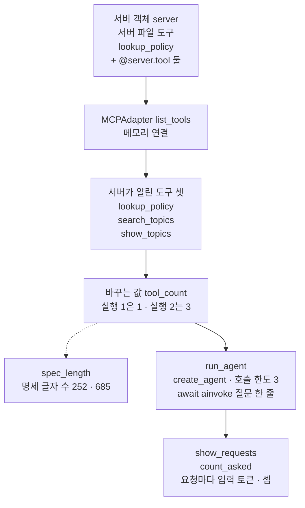
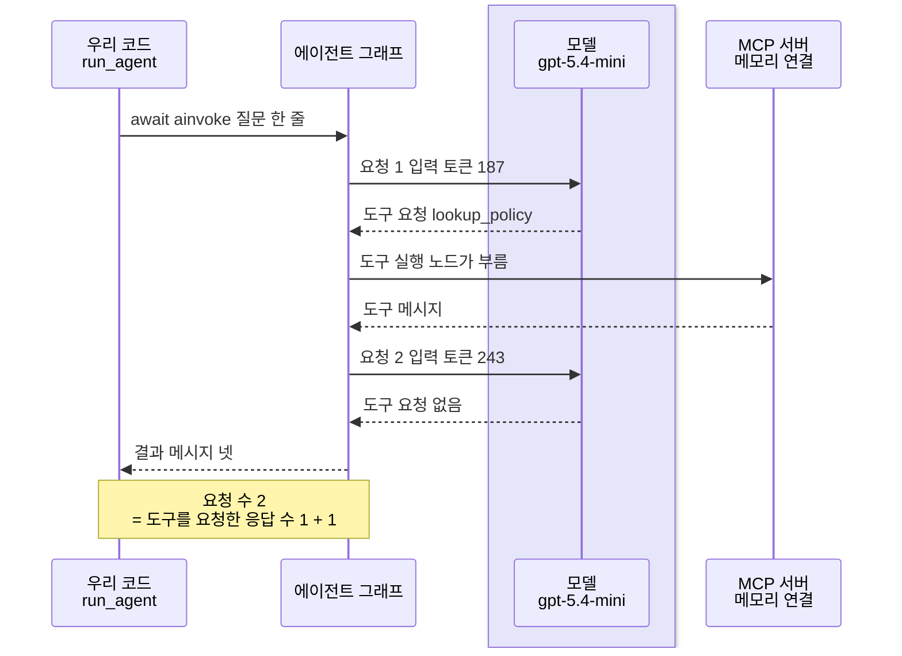
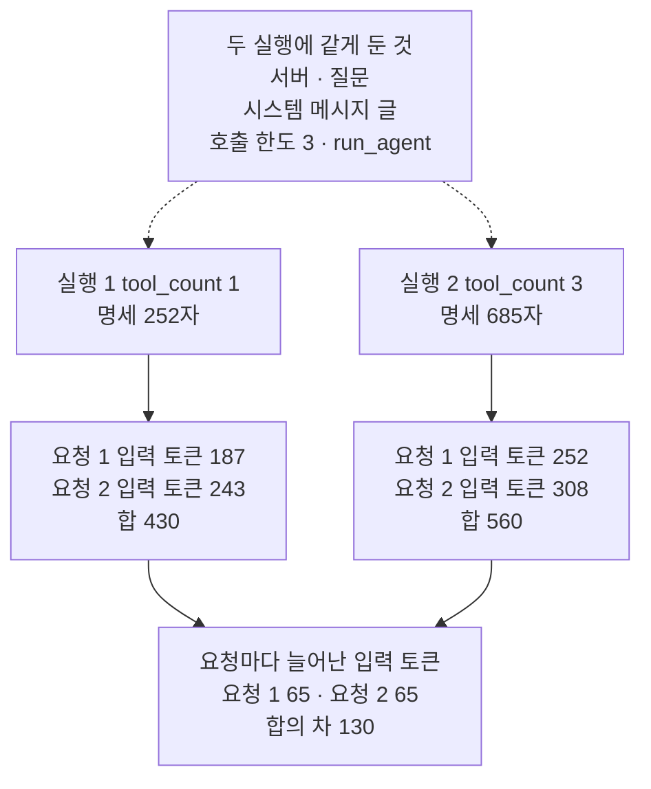

# 06-MCP-실습

## _src 본문 (HTML 원본)

```html
<!--meta: 실습 30분 | 코드 notebooks/06-MCP-실습.ipynb | 새 용어 0 -->
<style>html,body{overflow-x:hidden}.notebook,.nb-cell,.nb-main,.nb-input,.nb-result{min-width:0;max-width:100%}.nb-input pre,.nb-output{box-sizing:border-box;max-width:100%;overflow-x:auto}code.nb-source{display:block!important;width:100%!important;min-width:0!important;overflow-x:auto!important;padding:0!important}</style>
<h2 id="b1"><span class="no">1</span>학습 목표</h2><div class="goal"><ul>
<li>서버에 도구 붙이기·에이전트 연결·입력 토큰 세기를 한 흐름에 모아, MCP 도구를 붙인 에이전트를 실행할 수 있습니다.</li>
<li>에이전트에 붙이는 도구 수 하나만 바꾼 두 실행을, 요청마다 입력 토큰으로 견줄 수 있습니다.</li>
<li>붙인 도구의 명세가 도구를 부른 뒤의 요청에도 실리는지 출력으로 설명할 수 있습니다.</li>
</ul></div>
<h2 id="b2"><span class="no">2</span>이 내용을 배우는 이유</h2><p>이 챕터에서는 MCP의 기능을 절마다 따로 익혔습니다. <a href="02-FastMCP-로컬-서버-제작.html">02절</a>은 서버 객체에 도구를 붙였고, <a href="04-LangChain-MCP-클라이언트-연동.html">04절</a>은 MCP 도구를 에이전트에 붙였습니다. <a href="05-도구-정의와-첫-호출-토큰.html">05절</a>은 도구를 알린 첫 요청이 입력 토큰을 얼마나 더 쓰는지 셌습니다. MCP 서버를 실제로 쓸 때는, 서버가 알린 도구를 모두 붙일지 몇 개만 고를지 정해야 합니다.</p>
<p>이번 실습은 도구 셋을 알리는 자료실 서버에서, 에이전트에 붙이는 도구 수만 바꿔 두 번 실행합니다. 실행 1은 도구 하나를 붙여 04절 5절과 같은 질문으로 실행하고, 실행 2는 도구 셋을 붙입니다. 두 조건의 첫 요청은 05절 5절에서 이미 셌습니다. 새로 볼 것은 에이전트가 도구를 부른 뒤 모델을 다시 부르는 둘째 요청과, 실행 전체의 입력 토큰 합입니다.</p>
<p>이번 절은 이 챕터의 실습입니다. 01~05절에서 쓴 이름과 Ch 2에서 배운 문법만 쓰고, 따로 내는 과제는 없습니다. 강사와 함께 노트북 셀을 차례로 실행합니다.</p>
<p><strong>이 절의 질문</strong> — 에이전트에 붙인 MCP 도구를 하나에서 셋으로 늘리면, 도구를 부른 뒤의 요청에서도 입력 토큰이 늘어날까요? 늘어난다면 실행 전체로는 얼마나 늘까요?</p>
<h2 id="b3"><span class="no">3</span>앞에서 배운 내용</h2><p>이번 실습은 아래 절에서 배운 이름을 그대로 씁니다. 함수는 도구 파일 <code>connect_tools.py</code>에서 가져오고, 조립 함수와 결과를 볼 함수 둘은 노트북에 적습니다.</p>
<table><thead><tr><th>절</th><th>배운 것</th><th>실습에서 쓰는 곳</th></tr></thead><tbody><tr><td><a href="01-MCP-구조와-capability-협상.html">01절</a></td><td>서버 객체를 넘기면 같은 커널 안에서 붙는 메모리 연결 · 함수 <code>names_of</code></td><td>도구 셋을 받는 연결 · 서버가 알린 도구와 붙일 도구의 이름</td></tr><tr><td><a href="02-FastMCP-로컬-서버-제작.html">02절</a></td><td>데코레이터 줄로 서버 객체에 도구 붙이기 · <code>runpy.run_path</code>로 서버 파일 읽기</td><td><code>@server.tool</code> 둘로 도구 셋 서버 만들기</td></tr><tr><td><a href="04-LangChain-MCP-클라이언트-연동.html">04절</a></td><td>클래스 <code>MCPAdapter</code>로 MCP 도구 받기 · <code>create_agent</code>와 호출 한도 3 · <code>ainvoke</code> · 셈 「요청 수 = 도구를 요청한 응답 수 + 1」</td><td>조립 함수 <code>run_agent</code> · 두 실행의 셈</td></tr><tr><td><a href="05-도구-정의와-첫-호출-토큰.html">05절</a></td><td>명세 글자 수 · 첫 요청 입력 토큰 · 서버 객체에 도구 둘을 더 붙인 셀</td><td>붙일 도구의 명세 글자 수 · 요청마다 입력 토큰</td></tr><tr><td><a href="../../part5/ch19-model-tools/03-좋은-도구-이름과-설명.html">Ch 19 03절</a></td><td>함수 <code>spec_length</code>로 명세 글자 수 세기</td><td>5절·6절 첫 셀</td></tr><tr><td><a href="../../part5/ch19-model-tools/04-설명만으로-도구-선택하기.html">Ch 19 04</a>·<a href="../../part5/ch19-model-tools/05-bind_tools와-병렬-호출.html">05절</a></td><td>함수 <code>tool_call_names</code>·<code>sum_usage</code></td><td>응답마다 도구 호출 요청 · 모델 요청 수</td></tr><tr><td><a href="../ch22-middleware/04-호출-한도와-재시도-폴백.html">Ch 22 04절</a></td><td>호출 한도 <code>ModelCallLimitMiddleware</code></td><td><code>call_limit</code>(한 번 실행에 요청 3번까지)</td></tr><tr><td><a href="../../part2/ch06-langchain-start/06-토큰-비용-지연-비교.html">Ch 6 06절</a></td><td>요금표와 함수 <code>estimate_cost</code></td><td>두 실행의 예상 비용</td></tr></tbody></table>
<p>붙인 기능은 02절 서버에 도구 붙이기, 04절 에이전트 연결, 05절 명세 글자 수와 입력 토큰 세기 셋입니다. 셋이 모두 흐름 안에서 일하도록 했습니다. 02절 모양으로 붙인 도구 둘은 실행 2의 에이전트에 실립니다. 04절의 조립과 셈은 두 실행 모두에 쓰고, 05절의 두 값은 두 실행을 견주는 잣대입니다.</p>
<p>바꿀 값으로는 에이전트에 붙이는 도구 수를 골랐습니다. 05절은 첫 요청만 셌고, 도구를 부른 뒤의 요청은 재지 않았다고 적었기 때문입니다. <a href="03-stdio와-원격-전송-권한-경계.html">03절</a>의 전송과 접근 토큰은 붙이지 않았습니다. 도구 수를 바꾸는 데 전송이 필요 없고, 서버를 띄우고 끄는 셀이 늘기 때문입니다. 05절의 직접 도구와 설명을 늘린 도구는 바꿀 값의 다른 후보라, 이번에는 도구 수 하나만 바꿨습니다.</p>
<h2 id="b4"><span class="no">4</span>핵심 개념</h2><h3>비유로 시작하기</h3><p>01절부터 쓴 우주 정거장 비유를 이어 갑니다. 정거장의 네모난 격납고 앞에 받침대가 있고, 받침대 위에는 통을 꽂는 자리가 셋 있습니다. 격납고 지붕의 로봇 팔이 통을 집어 받침대에 꽂습니다. 관제실은 보급선과 교신할 때마다, 받침대에 꽂힌 통의 설명을 모두 함께 읽어 줍니다.</p><p>격납고가 MCP 서버이고, 격납고가 내줄 수 있는 통 셋이 서버가 알린 도구 셋입니다. 로봇 팔이 조립 함수 <code>run_agent</code>이고, 받침대에 꽂힌 통이 에이전트에 붙인 도구입니다. 교신 한 번이 모델 요청 한 번이고, 읽어 주는 설명이 도구 명세입니다. 통을 셋 꽂으면 교신할 때마다 설명 셋을 읽으니, 교신이 두 번이면 두 번 모두 길어집니다.</p><p>비유와 다른 점도 있습니다. 설명이 셋이라고 입력 토큰이 세 배가 되지는 않는다는 것을 05절에서 보았습니다. 또 그림에는 교신하는 장면이 없고, 통을 꽂는 모습만 있습니다.</p>
{{img:06-4-받침대에-꽂은-통-하나와-셋|흰 바탕에 오른쪽의 연회색 네모 격납고와, 왼쪽의 흰 네모 받침대 둘이 있는 그림입니다. 격납고 앞면은 크게 열려 있고 안은 어둡게 비어 있으며, 지붕에는 마디가 있는 회색 로봇 팔 하나가 있습니다. 두 받침대는 같은 모양이고, 윗면에 동그란 자리가 셋씩 한 줄로 파여 있습니다. 왼쪽 받침대에는 구리색 육각 통 하나가 맨 왼쪽 자리에 꽂혀 있고, 나머지 두 자리는 비어 있습니다. 오른쪽 받침대에는 같은 통 둘이 왼쪽과 가운데 자리에 꽂혀 있고, 로봇 팔 끝의 집게가 셋째 통을 집어 빈 오른쪽 자리 위에 들고 있습니다. 사람·글자·숫자·화살표·별은 없는 그림|같은 받침대 둘 가운데 왼쪽에는 통이 하나 꽂혔고, 오른쪽에는 로봇 팔이 셋째 통을 꽂는 중입니다.}}
<p class="look"><b>그림 읽기</b> — 오른쪽 격납고 지붕의 로봇 팔이 집게로 통 하나를 집어, 오른쪽 받침대의 빈 오른쪽 자리 위에 들고 있습니다. 오른쪽 받침대에는 통 둘이 이미 꽂혀 있고, 왼쪽 받침대에는 통이 하나만 꽂혀 두 자리가 비어 있습니다. 격납고가 MCP 서버, 로봇 팔이 조립 함수 <code>run_agent</code>, 받침대에 꽂힌 통이 에이전트에 붙인 도구입니다. 왼쪽 받침대가 도구 하나를 붙인 실행 1, 오른쪽 받침대가 도구 셋을 붙이는 실행 2입니다. 그림에는 교신하는 장면이 없고, 격납고의 문 모양과 통의 색은 어떤 값과도 짝짓지 않습니다.</p>
<h3>실습 조립의 구성</h3><p>조립 함수 <code>run_agent</code>는 에이전트에 붙일 도구 목록 하나만 인자로 받습니다. 모델·시스템 메시지 글·호출 한도·질문은 앞 셀에서 만든 이름을 두 실행이 그대로 씁니다. 도구 목록은 서버가 알린 도구 셋에서 앞의 <code>tool_count</code>개를 골라 만듭니다. 결과는 함수 <code>show_requests</code>와 <code>count_asked</code>가 두 실행 모두 같은 모양으로 출력합니다.</p>
{{mermaid:06-1-도구-셋-서버와-에이전트-조립|위에서 아래로 읽는 흐름도입니다. 초록 상자 서버 객체 server 서버 파일 도구 lookup_policy + @server.tool 둘에서 파란 상자 MCPAdapter list_tools 메모리 연결, 노란 상자 서버가 알린 도구 셋 lookup_policy · search_topics · show_topics, 파란 상자 바꾸는 값 tool_count 실행 1은 1 · 실행 2는 3으로 화살표가 이어집니다. 그 파란 상자에서 점선이 노란 상자 spec_length 명세 글자 수 252 · 685로 가고, 화살표는 파란 상자 run_agent create_agent · 호출 한도 3 await ainvoke 질문 한 줄을 지나 파란 상자 show_requests · count_asked 요청마다 입력 토큰 · 셈으로 가는 그림|서버 객체에 붙인 도구 셋을 MCPAdapter로 받고, 에이전트에 붙일 도구 수 하나만 1과 3으로 바꿔 두 실행을 조립했습니다.}}
<p class="look"><b>도식 읽기</b> — 위에서 아래로 읽습니다. 초록 상자는 서버 객체이고, 파란 상자는 우리가 부른 클래스 MCPAdapter와 바꾸는 값, 이 노트북에 적은 함수입니다. 노란 상자는 노트북 2·5·6절 출력으로 확인한 값입니다. 점선은 바꾸는 값에 따라 달라지는 명세 글자 수로 가는 갈래입니다. 모델은 함수 run_agent 안에서만 부르고, 이 그림에는 모델 상자를 두지 않았습니다.</p>
<h3>요청마다 실리는 도구 명세</h3><p>04절에서 본 것처럼, 에이전트는 도구를 부르고 나면 모델을 한 번 더 부릅니다. 설치판 langchain 1.4.0 소스 <code>langchain/agents/factory.py</code> 1431~1438행은 도구가 있으면 모델에게 도구 목록을 알립니다. 1500~1505행은 비동기로 모델을 부를 때마다 이 일을 하고, 시스템 메시지를 맨 앞에 둡니다. 소스대로라면 둘째 요청에도 붙인 도구의 명세가 모두 실립니다.</p><p>그래서 도구를 셋 붙이면, 첫 요청뿐 아니라 도구를 부른 뒤의 요청에도 입력 토큰이 늘 것으로 예상합니다. 모델이 두 실행에서 같은 도구를 같은 차례로 부른다면, 요청마다 늘어나는 입력 토큰도 같을 것입니다. 이 예상이 맞는지는 노트북 7절에서 봅니다.</p>
<h2 id="b5"><span class="no">5</span>실행 예제</h2><p>노트북 2절은 서버 객체에 도구 둘을 더 붙이고, 메모리 연결로 도구 셋을 받습니다. 3절은 호출 한도·글·조립 함수를, 4절은 결과를 볼 함수 둘을 적습니다. 5절은 도구 하나를 붙인 실행 1을, 6절은 도구 수만 셋으로 바꾼 실행 2를 실행합니다. 7절에서 두 실행의 입력 토큰을 요청마다 견줍니다.</p><p>실제 OpenAI 모델 <code>gpt-5.4-mini</code>를 temperature 0으로 부릅니다. 모델 요청은 5절에서 2번, 6절에서 2번, 모두 4번이었고, 노트북 밖 열 번과 새 커널 두 번에서 같았습니다. 요금표로 어림한 예상 비용은 두 실행을 합쳐 0.002달러 아래이고, 청구 금액이 아닙니다. 메모리 연결이라 자식 프로세스를 띄우지 않고, 노트북이 쓰는 파일도 없습니다. 걸린 시간은 재지 않았습니다.</p>
{{notebook:06-MCP-실습}}
<p class="look"><b>확인할 점</b> — 노트북 5절과 6절 첫 셀에서 붙일 도구와 명세 글자 수가 252와 685로 다른지 봅니다. 두 실행의 넷째 셀에서 셈이 맞는지 봅니다. 7절 첫 셀에서 요청 번호마다 늘어난 입력 토큰을 봅니다.</p>
<h3>실행 1의 실제 순서</h3>
{{mermaid:06-2-실행-1의-실제-순서|세로선 넷이 있는 차례 그림입니다. 왼쪽부터 우리 코드 run_agent, 에이전트 그래프, 연보라 띠 안의 모델 gpt-5.4-mini, MCP 서버 메모리 연결입니다. 우리 코드에서 await ainvoke 질문 한 줄 화살표가 그래프로 가고, 요청 1 입력 토큰 187 화살표가 모델로 가고 도구 요청 lookup_policy 점선이 돌아옵니다. 그래프에서 도구 실행 노드가 부름 화살표가 서버로 가고 도구 메시지 점선이 돌아옵니다. 요청 2 입력 토큰 243 화살표가 모델로 가고 도구 요청 없음 점선이 돌아온 뒤, 결과 메시지 넷 점선이 우리 코드로 돌아옵니다. 맨 아래 우리 코드와 그래프에 걸친 노란 메모에 요청 수 2 = 도구를 요청한 응답 수 1 + 1이 적힌 그림|흔들림 확인 다섯 번과 두 커널에서 모두, 도구를 한 번 부른 실행 1의 요청은 2번이었고 입력 토큰은 187과 243이었습니다.}}
<p class="look"><b>도식 읽기</b> — 위에서 아래로 실행 차례대로 읽고, 세로선은 왼쪽부터 우리 코드, 그래프, 모델, 서버입니다. 연보라 띠는 실제로 부른 모델 gpt-5.4-mini의 자리이고, 실선은 부르는 쪽, 점선은 돌아오는 쪽입니다. 요청 옆의 입력 토큰과 맨 아래 노란 메모는 노트북 5절 출력입니다. 도구 메시지의 결과 상태는 이 노트북에서 출력하지 않았고, 서버는 같은 커널 안의 메모리 연결입니다. 요청의 차례와 입력 토큰은 흔들림 확인 다섯 번과 두 커널에서 같았을 때만 그렸습니다.</p>
<h2 id="b6"><span class="no">6</span>실험 결과 해석</h2><p>두 실행은 서버·질문·시스템 메시지 글·호출 한도·조립 함수가 같고, 에이전트에 붙인 도구 수만 달랐습니다. 아래 표는 노트북 5·6·7절 출력에서 코드가 정하는 값과, 모델과 서비스가 정한 값을 모은 것입니다.</p>
<table><thead><tr><th>확인한 것</th><th>실행 1(도구 하나)</th><th>실행 2(도구 셋)</th><th>값의 성격</th></tr></thead><tbody><tr><td>붙인 도구 수 <code>tool_count</code></td><td>1(<code>lookup_policy</code>)</td><td>3(도구 셋)</td><td>바꾼 값</td></tr><tr><td>붙인 도구의 명세 글자 수</td><td><code>명세 글자 수: 252</code></td><td><code>명세 글자 수: 685</code></td><td>구조 값</td></tr><tr><td>응답마다 도구 호출 요청 · 요청 수</td><td><code>['lookup_policy']</code> → <code>[]</code> · 요청 2</td><td><code>['lookup_policy']</code> → <code>[]</code> · 요청 2</td><td>모델 판단 값</td></tr><tr><td>셈 「요청 수 = 도구를 요청한 응답 수 + 1」</td><td><code>True</code>(도구를 요청한 응답 1 + 1)</td><td><code>True</code>(도구를 요청한 응답 1 + 1)</td><td>구조 값</td></tr><tr><td>요청마다 입력 토큰</td><td>요청 1 187 · 요청 2 243</td><td>요청 1 252 · 요청 2 308</td><td>서비스가 센 값</td></tr><tr><td>요청마다 늘어난 입력 토큰(실행 2 − 실행 1)</td><td>기준</td><td>65 · 65(합의 차 130)</td><td>서비스가 센 값의 차</td></tr><tr><td>출력 토큰 · 예상 비용 · 답 글</td><td>출력 토큰·예상 비용은 아래 표, 답 글은 5절 둘째 셀 출력</td><td>출력 토큰·예상 비용은 아래 표, 답 글은 6절 둘째 셀 출력</td><td>흔들리는 값</td></tr><tr><td>도구 인자</td><td>출력하지 않음</td><td>출력하지 않음</td><td>노트북 밖 열 번 같음 — 결론에 쓰지 않음</td></tr></tbody></table>
<p>흔들림 확인 다섯 번과 두 커널에서 모두, 두 실행의 차례는 같았습니다. 모델은 첫 응답에서 <code>lookup_policy</code> 하나를 요청하고, 둘째 응답에서 도구 요청 없이 답했습니다. 그래서 두 실행 모두 모델 요청은 2번이었고, 셈 「요청 수 = 도구를 요청한 응답 수 + 1」이 맞았습니다. 도구를 셋 붙여도, 이번 질문에서 모델은 운영 규정 도구 하나만 불렀습니다.</p>
{{mermaid:06-3-도구-하나와-셋의-요청마다-입력-토큰|위에서 아래로 읽는 흐름도입니다. 맨 위 회색 상자 두 실행에 같게 둔 것 서버 · 질문 시스템 메시지 글 호출 한도 3 · run_agent에서 점선 둘이 나란한 파란 상자 둘로 갑니다. 왼쪽 실행 1 tool_count 1 명세 252자 아래에 노란 상자 요청 1 입력 토큰 187 요청 2 입력 토큰 243 합 430이 있습니다. 오른쪽 실행 2 tool_count 3 명세 685자 아래에 노란 상자 요청 1 입력 토큰 252 요청 2 입력 토큰 308 합 560이 있습니다. 두 노란 상자는 맨 아래 노란 상자 요청마다 늘어난 입력 토큰 요청 1 65 · 요청 2 65 합의 차 130으로 모이는 그림|흔들림 확인 다섯 번과 두 커널에서 모두, 도구를 셋 붙인 실행은 첫 요청과 둘째 요청에서 입력 토큰이 65씩 많았습니다.}}
<p class="look"><b>도식 읽기</b> — 맨 위 회색 상자는 두 실행에 같게 둔 조건입니다. 왼쪽 칸이 실행 1, 오른쪽 칸이 실행 2이고, 파란 상자가 바꾼 값 tool_count입니다. 노란 상자는 노트북 5·6·7절 출력이고, 칸 안은 위에서 아래로 실행 차례입니다. 맨 아래 상자는 같은 번호의 요청끼리 뺀 차와, 두 실행의 입력 토큰 합의 차입니다. 입력 토큰은 흔들림 확인 다섯 번과 두 커널에서 같았을 때만 넣었습니다.</p>
<p>같은 확인에서 요청마다 입력 토큰은 실행 1이 187·243, 실행 2가 252·308이었습니다. 요청 1과 요청 2 모두 65씩 늘어, 입력 토큰 합은 130 많았습니다. 첫 요청의 65는 05절 5절에서 도구 하나와 셋의 첫 요청 차로 본 값과 같습니다. 새로 본 것은 도구를 부른 뒤의 둘째 요청에도 같은 65가 더해졌다는 점입니다.</p><p>불리지 않은 두 도구도 붙어 있는 동안 두 요청 모두에 명세가 실린 셈입니다. 이번 두 실행에서는 늘어난 입력 토큰이 요청마다 되풀이되어, 합의 차가 요청마다의 차의 두 배였습니다. 요청이 셋 이상인 실행에서도 그런지는 이번에 재지 않았습니다.</p>
<p>아래 표는 두 실행의 교재 출력 토큰 합과 예상 비용입니다. 출력 토큰과 예상 비용은 다시 실행하면 달라질 수 있습니다.</p>
<table><thead><tr><th>실행</th><th>입력 토큰 합(교재 출력)</th><th>출력 토큰 합(교재 출력)</th><th>예상 비용(교재 출력, 달러)</th></tr></thead><tbody><tr><td>실행 1(도구 하나)</td><td>430</td><td>32</td><td>0.000467</td></tr><tr><td>실행 2(도구 셋)</td><td>560</td><td>32</td><td>0.000564</td></tr></tbody></table>
<p>새 커널로 두 번 실행해 견주자, 코드 셀 스물넷의 출력이 셀마다 모두 같았습니다. 답 글과 출력 토큰도 두 번 같았지만, 노트북 밖 다섯 번에서는 실행 1의 답 글과 출력 토큰이 달랐습니다. 그래서 답 글·출력 토큰·예상 비용은 결론에 쓰지 않았고, 명세 글자 수·셈·요청마다 입력 토큰만 결론과 그림에 썼습니다.</p>
<p class="look"><b>확인할 점</b> — 노트북 7절 첫 셀에서 두 줄의 늘어난 입력 토큰이 같은지 봅니다. 마지막 셀의 입력 토큰 합의 차가 그 두 값의 합인지 셉니다. 교재 출력에서는 65·65와 130이었습니다.</p>
<h2 id="b7"><span class="no">7</span>주의할 점과 실무 메모</h2><ul><li>질문과 시스템 메시지 글은 04절 5절과 같은 글로 실행 전에 정했고, 결과를 보고 바꾸지 않았습니다. 바꿀 값 <code>tool_count</code>의 1과 3도 실행 전에 정했습니다. 서버가 알린 도구 셋 가운데 하나와 셋 전부이고, 흐름을 보여 주려고 정한 예입니다.</li><li>노트북을 쓰기 전에 두 실행을 노트북 밖에서 다섯 번씩 보냈습니다. 열 번 모두 모델은 <code>lookup_policy</code>를 한 번 부른 뒤 답했고, 요청마다 입력 토큰도 다섯 번 모두 같았습니다. 답 글은 실행 1 조건 다섯 번이 모두 이 노트북과 다른 문장이었습니다. 같은 요청도 실행한 때에 따라 모델이 쓰는 글이 달라질 수 있습니다.</li><li>두 실행을 요청 번호마다 견줄 수 있는 것은, 두 실행이 같은 도구를 같은 차례로 불렀을 때입니다. 노트북 밖 기록에서는 열 번 모두 도구 인자와 도구 메시지 글도 같았습니다. 모델이 다른 도구를 부르거나 여러 번 부르면 요청에 실린 메시지가 달라져, 이렇게 견줄 수 없습니다.</li><li>실행 2에서 붙인 <code>search_topics</code>·<code>show_topics</code>는 이번 실행에서 불리지 않았습니다. 불리지 않은 도구도 붙어 있으면 요청마다 명세가 실립니다. 이 절은 그만큼을 요청 번호마다 늘어난 입력 토큰으로 보았습니다.</li><li>실무에서는 MCP 서버가 알린 도구를 모두 붙이지 않고, 쓸 도구만 골라 붙이는 방법을 생각할 수 있습니다. 05절 참고 자료의 OpenAI 함수 호출 문서도 토큰 한도에 닿으면 처음에 싣는 함수 수를 줄이라고 제안합니다. 이 절은 목록 앞에서 고르기만 했고, 이름이나 꼬리표로 고르는 방법은 실행하지 않았습니다.</li><li>도구를 덜 붙이면 모델이 부를 수 있는 도구도 줄어듭니다. 이 절의 질문은 운영 규정 도구 하나로 답할 수 있는 질문이라, 도구 하나로도 답했습니다. 질문에 필요한 도구를 빼면 모델이 규정을 찾지 못할 수 있고, 그 경우는 실행하지 않았습니다.</li><li>메모리 연결로 붙여 자식 프로세스를 띄우지 않았습니다. 04절처럼 stdio로 붙여도 같은 도구는 같은 명세라는 것을 05절 4절에서 보았습니다. 04절 5절은 stdio로 붙인 도구 하나와 같은 질문으로 에이전트를 실행해, 입력 토큰 합만 출력했습니다. 그 절의 이번 실행에서는 실행 1의 합과 같은 430이었고, 요청마다 나눈 값은 보지 않았습니다.</li><li>서버 객체에 붙인 도구 둘은 이 커널 안에서만 붙었고, 서버 파일은 그대로입니다. 호출 한도 객체 하나를 두 에이전트가 함께 썼고, 한도는 invoke 한 번마다 셉니다. 03절처럼 접근 토큰의 범위에 따라 서버가 알리는 도구가 달라지는 조건은 이번에도 실행하지 않았습니다.</li><li>캐시 입력은 노트북 밖 스무 요청 모두 0이었습니다. 예상 비용은 2026-09-17 요금표로 어림한 값이고, 청구 금액이 아닙니다. 이 노트북의 <code>assert</code>는 파일 찾기 셀과 키 확인 셀뿐이고, 모델이 고른 값에는 걸지 않았습니다.</li><li>교재 출력은 Linux의 Python 3.12.13으로 만들었고, 다른 판과 Windows·macOS에서는 실행하지 않았습니다. 걸린 시간은 재지 않았습니다.</li></ul>
<h2 id="b8"><span class="no">8</span>정리와 다음 절</h2><ul><li>02절 서버에 도구 붙이기, 04절 에이전트 연결, 05절 명세 글자 수와 입력 토큰 세기를 에이전트 하나에 모았습니다.</li><li>붙인 도구를 하나에서 셋으로 바꾸자 명세 글자 수가 252에서 685가 되었고, 두 실행 모두 셈대로 요청이 끝났습니다.</li><li>흔들림 확인 다섯 번과 두 커널에서 모두, 도구 셋을 붙인 실행은 첫 요청과 둘째 요청에서 입력 토큰이 65씩 많았습니다.</li></ul><p><strong>다음 학습과 이어지는 지점</strong> — 이 절로 Ch 28이 끝납니다. Ch 29에서는 에이전트를 평가하는 방법을 배웁니다. <a href="../ch29-agent-evaluation/01-에이전트-평가-세-전략.html">Ch 29 01절</a>은 평가 방법 세 가지를 견줍니다.</p>
<h2 id="b9"><span class="no">9</span>복습 문제</h2><details class="quiz" open><summary>문제 4개 · 해설 포함</summary><p class="quiz-q">1. [하] 실행 2에서 바꾼 값은 무엇이고, 그 값으로 붙인 도구의 명세 글자 수는 어떻게 달라졌나요?</p><p class="quiz-a">에이전트에 붙이는 도구 수 <code>tool_count</code>를 1에서 3으로 바꿨습니다. 붙인 도구의 명세 글자 수는 252에서 685가 되었습니다. 명세 글자 수는 코드가 정하는 값이라 다시 실행해도 같습니다. 틀렸다면 노트북 5절과 6절 첫 셀을 다시 읽습니다.</p><p class="quiz-q">2. [중] 두 실행에서 모델 요청은 몇 번이었고, 그 수를 셈으로 어떻게 설명하나요?</p><p class="quiz-a">두 실행 모두 2번이었습니다. 모델이 도구를 요청한 응답이 하나였고, 마지막에 답을 쓴 응답이 하나 더 있어 1 + 1입니다. 흔들림 확인 다섯 번과 두 커널에서도 같았습니다. 틀렸다면 노트북 5절과 6절의 넷째 셀을 다시 읽습니다.</p><p class="quiz-q">3. [중] 도구를 셋 붙인 실행 2에서, 도구를 부른 뒤의 둘째 요청도 입력 토큰이 늘었나요?</p><p class="quiz-a">늘었습니다. 요청 2의 입력 토큰은 실행 1이 243, 실행 2가 308로 65 많았고, 요청 1과 같은 만큼이었습니다. 붙인 도구의 명세가 도구를 부른 뒤의 요청에도 실린 셈입니다. 흔들림 확인 다섯 번과 두 커널에서 같은 값이었습니다. 틀렸다면 노트북 7절 첫 셀을 다시 읽습니다.</p><p class="quiz-q">4. [상] 도구를 셋 붙인 에이전트가 도구를 두 번 부르고 답해, 요청이 3번이었다고 합시다. 입력 토큰 합은 도구 하나일 때보다 얼마나 늘 것으로 어림하나요?</p><p class="quiz-a">요청마다 65씩 늘어난다면, 세 요청이라 65의 세 배인 195쯤 늘 것으로 어림합니다. 다만 두 실행이 같은 도구를 같은 차례로 부르고, 명세 말고는 같은 메시지를 실을 때의 어림입니다. 도구를 두 번 부르는 실행은 이번에 하지 않았습니다. 틀렸다면 노트북 7절과 본문의 주의할 점을 다시 읽습니다.</p></details>
<h2 id="b10"><span class="no">10</span>참고 자료</h2><ul><li>04절 — 클래스 <code>MCPAdapter</code>로 받은 MCP 도구, <code>create_agent</code>와 호출 한도, 셈 「요청 수 = 도구를 요청한 응답 수 + 1」.</li><li>05절 — 도구 명세와 명세 글자 수, 첫 요청 입력 토큰을 보았습니다. OpenAI 함수 호출 문서의 권고도 그 절의 참고 자료에 있습니다.</li><li>설치판 langchain 1.4.0 소스 <code>langchain/agents/factory.py</code> 1431~1438행은 도구가 있으면 모델에게 도구 목록을 알리는 자리입니다. 1500~1505행은 비동기로 모델을 부를 때마다 그 자리를 거치고, 시스템 메시지를 맨 앞에 둡니다.</li><li><a href="../ch22-middleware/04-호출-한도와-재시도-폴백.html">Ch 22 04절</a> — 호출 한도 <code>ModelCallLimitMiddleware</code>.</li><li>기준 버전은 노트북 1절 첫 셀에서 설치한 패키지 여섯의 판입니다.</li></ul>
```

## 노트북 셀 (순서대로)

### [0] markdown {'html': 'skip'}

# MCP 실습: 에이전트에 붙이는 MCP 도구를 하나에서 셋으로 늘리기

**이 노트북에서 할 일**

1. 앞 절에서 배운 서버에 도구 붙이기·에이전트 연결·입력 토큰 세기를 한 흐름에 모읍니다.
2. 서버가 알린 도구 셋 가운데 하나를 붙인 실행 1과, 셋을 모두 붙인 실행 2를 차례로 실행합니다.
3. 두 실행의 입력 토큰을 요청마다 견주어, 붙인 도구의 명세가 어느 요청에 실리는지 봅니다.

**준비물** — 프로젝트 폴더의 `.env` 파일에 `OPENAI_API_KEY`가 있어야 합니다.
모델은 `gpt-5.4-mini`이고, 실행 1과 실행 2에서 에이전트를 한 번씩 실행합니다.
노트북 밖에서 두 실행을 다섯 번씩 보냈을 때, 요청은 열 번 모두 실행마다 2번이었습니다.
그래서 이 노트북의 모델 요청은 모두 4번으로 어림합니다.
호출 한도 3을 붙여, 한 실행의 요청이 3번을 넘지 않게 막습니다.

요금표로 어림한 예상 비용은 두 실행을 합쳐 0.002달러 아래이고, 청구 금액이 아닙니다.
서버는 서버 파일 `course_server.py`를 이 커널에서 읽어 메모리 연결로 붙입니다.
자식 프로세스는 띄우지 않고, 노트북이 쓰는 파일도 없습니다.
모델이 쓰는 도구 인자와 답 글은 실행마다 달라질 수 있고, 걸린 시간은 재지 않았습니다.
앞에서 배운 함수 다섯은 도구 파일 `connect_tools.py`에서 가져옵니다.

**기준 버전** — 첫 셀에서 패키지 여섯을 설치합니다.
판은 langchain 1.4.0, langchain-core 1.6.2, langchain-openai 1.6.0입니다.
패키지 fastmcp 4.0.3, mcp 2.2.0, python-dotenv 1.2.3도 설치합니다.
교재 출력은 Linux의 Python 3.12.13으로 만들었고, 다른 판과 Windows·macOS에서는 실행하지 않았습니다.

**실습 범위** — 이 절은 이 챕터의 실습이고, 30분 안팎입니다.
따로 내는 과제는 없고, 강사와 함께 첫 셀부터 차례로 실행합니다.

실습 폴더 `labs/part6/ch28-mcp`에서 `uv sync --locked`를 실행합니다.
그다음 `notebooks/` 폴더의 이 노트북을 열고, 실습 폴더의 `.venv` 커널을 고릅니다.
첫 셀부터 순서대로 실행합니다.

### [1] markdown {'html': 'skip'}

## 오늘 볼 그림


위에서 아래로 읽습니다.
초록 상자는 서버 객체이고, 파란 상자는 우리가 부른 클래스 MCPAdapter와 바꾸는 값, 이 노트북에 적은 함수입니다.
노란 상자는 노트북 2·5·6절 출력으로 확인한 값입니다.
점선은 바꾸는 값에 따라 달라지는 명세 글자 수로 가는 갈래입니다.
모델은 함수 run_agent 안에서만 부르고, 이 그림에는 모델 상자를 두지 않았습니다.

### [2] markdown {}

## 1. 준비

이 절은 Ch 28의 실습입니다.
01~05절에서 하나씩 본 기능 가운데 셋을, 자료실 규정에 답하는 에이전트 하나에 모읍니다.
02절의 서버에 도구 붙이기, 04절의 에이전트 연결, 05절의 명세 글자 수와 입력 토큰 세기입니다.
그다음 에이전트에 붙이는 도구 수 하나만 바꿔 두 번 실행하고, 두 결과를 견줍니다.

첫 셀은 패키지 여섯을 설치하고 설치된 판 번호를 출력합니다.
05절과 같은 여섯이고, 04절의 langgraph와 psutil은 쓰지 않아 설치하지 않습니다.

### [3] code {'execution': {'iopub.execute_input': '2026-09-28T22:42:51.596164Z', 'iopub.status.busy': '2026-09-28T22:42:51.595840Z', 'iopub.status.idle': '2026-09-28T22:42:52.446876Z', 'shell.execute_reply': '2026-09-28T22:42:52.446258Z'}, 'lesson_role': 'setup'}

```python
# 이 절에서 쓰는 패키지를 설치하고 버전을 확인합니다
%pip install -q "langchain[mcp]==1.4.0" "langchain-core==1.6.2" "langchain-openai==1.6.0" "fastmcp==4.0.3" "mcp==2.2.0" "python-dotenv==1.2.3"
from importlib.metadata import version

print("langchain:", version("langchain"))
print("langchain-core:", version("langchain-core"))
print("langchain-openai:", version("langchain-openai"))
print("fastmcp:", version("fastmcp"))
print("mcp:", version("mcp"))
print("python-dotenv:", version("python-dotenv"))
```

출력:
```
Note: you may need to restart the kernel to use updated packages.
langchain: 1.4.0
langchain-core: 1.6.2
langchain-openai: 1.6.0
fastmcp: 4.0.3
mcp: 2.2.0
python-dotenv: 1.2.3

```

### [4] markdown {}

**결과 읽기** — 출력 줄 `langchain: 1.4.0`, `langchain-core: 1.6.2`, `fastmcp: 4.0.3`이 보입니다.
여섯 판 모두 실습 폴더 잠금과 같습니다.

다음 셀은 이 절에서 쓸 이름을 가져옵니다.
04절처럼 모듈 `langchain.mcp`는 베타 경고 한 종류만 끄고 가져옵니다.
마지막 가져오기 줄은 앞에서 배운 함수 다섯을 도구 파일 `connect_tools.py`에서 가져옵니다.

### [5] code {'execution': {'iopub.execute_input': '2026-09-28T22:42:52.447950Z', 'iopub.status.busy': '2026-09-28T22:42:52.447859Z', 'iopub.status.idle': '2026-09-28T22:42:53.837443Z', 'shell.execute_reply': '2026-09-28T22:42:53.837091Z'}, 'lesson_role': 'setup'}

```python
# 이 절에서 쓸 이름을 가져옵니다(langchain.mcp는 베타 경고 한 종류만 끄고 가져옵니다)
import runpy
import warnings
from langchain_core._api import LangChainBetaWarning
warnings.filterwarnings("ignore", category=LangChainBetaWarning)
from langchain.mcp import MCPAdapter
from langchain.agents import create_agent
from langchain.agents.middleware import ModelCallLimitMiddleware
from langchain.chat_models import init_chat_model
from langchain.messages import HumanMessage
# 01절과 앞 챕터에서 배운 함수 다섯은 도구 파일에서 가져옵니다
from connect_tools import estimate_cost, names_of, spec_length, sum_usage, tool_call_names

print("도구 파일에서 가져온 함수:", "estimate_cost, names_of, spec_length, sum_usage, tool_call_names")
```

출력:
```
도구 파일에서 가져온 함수: estimate_cost, names_of, spec_length, sum_usage, tool_call_names

```

### [6] markdown {}

**결과 읽기** — 출력 줄 `도구 파일에서 가져온 함수: estimate_cost, names_of, spec_length, sum_usage, tool_call_names`가 보입니다.
함수 `names_of`는 01절 4절에서, 함수 `spec_length`는 Ch 19 03절에서 배웠습니다.
함수 `tool_call_names`와 `sum_usage`는 Ch 19 04·05절, `estimate_cost`는 Ch 6 06절에서 배웠습니다.
다섯 모두 04·05절에서 가져온 이름이고, 이 절에서 새로 배우는 이름은 없습니다.

앞에서 배운 함수는 `connect_tools.py`에 모아 두었습니다.
파일을 열면 코드를 볼 수 있습니다.
노트북과 같은 폴더(`notebooks/`)에 있는 파일입니다.
커널이 `notebooks/` 폴더에서 시작해야 이 파일을 가져올 수 있습니다.
교재 출력을 만든 실행 도구는 이 폴더를 따로 알려 주어, 다른 자리에서 시작해도 가져오기가 되었습니다.

### [7] markdown {}

API 키가 있는지 확인합니다. `True` 값이 나오면 다음으로 넘어갑니다.

### [8] code {'execution': {'iopub.execute_input': '2026-09-28T22:42:53.838337Z', 'iopub.status.busy': '2026-09-28T22:42:53.838124Z', 'iopub.status.idle': '2026-09-28T22:42:53.840615Z', 'shell.execute_reply': '2026-09-28T22:42:53.840299Z'}, 'lesson_role': 'setup'}

```python
# .env 파일에서 OpenAI API 키를 읽습니다(키 값은 출력하지 않습니다)
import os
from dotenv import find_dotenv, load_dotenv

env_path = find_dotenv(usecwd=True)
load_dotenv(env_path)
has_key = os.getenv("OPENAI_API_KEY") is not None
print("OPENAI_API_KEY 설정 여부:", has_key)
assert has_key, "프로젝트 폴더의 .env 파일에 OPENAI_API_KEY를 적어 주세요."
```

출력:
```
OPENAI_API_KEY 설정 여부: True

```

### [9] markdown {}

실습에 쓸 모델을 준비합니다.
temperature 값을 0으로 두어 매번 비슷한 답을 고르게 합니다.

### [10] code {'execution': {'iopub.execute_input': '2026-09-28T22:42:53.841303Z', 'iopub.status.busy': '2026-09-28T22:42:53.841246Z', 'iopub.status.idle': '2026-09-28T22:42:54.877659Z', 'shell.execute_reply': '2026-09-28T22:42:54.877270Z'}}

```python
# 실습에 쓸 모델을 준비합니다
model = init_chat_model(
    "openai:gpt-5.4-mini",
    temperature=0,
    reasoning_effort="none",
)
print("모델 이름:", model.model_name)
print("temperature:", model.temperature)
```

출력:
```
모델 이름: gpt-5.4-mini
temperature: 0.0

```

### [11] markdown {}

**결과 읽기** — 모델 이름 `gpt-5.4-mini`, temperature `0.0`이 보이면 준비가 끝났습니다.
이 노트북의 출력은 2026-09-28에 이 모델로 실행한 결과입니다.
temperature 값을 0으로 두어도, 실행마다 답 문장이 달라질 수 있습니다.
이 셀은 모델 객체만 만들고, 모델 요청은 아직 보내지 않습니다.
모델 요청은 5절과 6절의 실행 셀에서만 나갑니다.

## 2. 재료: 도구 셋을 알리는 서버

실습에 쓸 서버는 05절 4절에서 만든 도구 셋 서버와 같습니다.
서버 파일을 이 커널에서 읽고, 그 서버 객체에 도구 둘을 더 붙입니다.
먼저 01절 2절과 같은 셀로 서버 파일의 위치를 찾습니다.

### [12] code {'execution': {'iopub.execute_input': '2026-09-28T22:42:54.878316Z', 'iopub.status.busy': '2026-09-28T22:42:54.878258Z', 'iopub.status.idle': '2026-09-28T22:42:54.880695Z', 'shell.execute_reply': '2026-09-28T22:42:54.880325Z'}}

```python
# 작업 폴더에서 본 서버 파일의 위치를 후보 셋 가운데에서 고릅니다
candidates = ["../course_server.py", "course_server.py", "labs/part6/ch28-mcp/course_server.py"]
server_file = None
for candidate in candidates:
    if os.path.exists(candidate):
        server_file = candidate
        break
print("서버 파일을 찾았는가:", server_file is not None)
print("고른 파일 위치:", server_file)
assert server_file is not None, "notebooks 폴더나 실습 폴더 맨 위에서 노트북을 열어 주세요."
```

출력:
```
서버 파일을 찾았는가: True
고른 파일 위치: labs/part6/ch28-mcp/course_server.py

```

### [13] markdown {}

**결과 읽기** — 출력 줄 `서버 파일을 찾았는가: True`가 보입니다.
교재 출력은 프로젝트 맨 위에서 실행해 셋째 후보 `labs/part6/ch28-mcp/course_server.py`를 골랐습니다.
`notebooks/` 폴더에서 열면 첫 후보 `../course_server.py`가 골라집니다.

다음 셀은 05절 3절과 같은 셀로, 서버 파일을 실행해 서버 객체와 규정 딕셔너리를 받습니다.

### [14] code {'execution': {'iopub.execute_input': '2026-09-28T22:42:54.881300Z', 'iopub.status.busy': '2026-09-28T22:42:54.881254Z', 'iopub.status.idle': '2026-09-28T22:42:54.916663Z', 'shell.execute_reply': '2026-09-28T22:42:54.916295Z'}}

```python
# 서버 파일을 실행해 서버 객체와 규정 딕셔너리를 받습니다(02절 6절처럼 runpy.run_path로 읽고, 파일은 고치지 않습니다)
server_names = runpy.run_path(server_file)
server = server_names["mcp"]
policies = server_names["POLICIES"]
print("서버 이름:", server.name)
print("규정 주제:", list(policies))
```

출력:
```
서버 이름: 교육센터 자료실
규정 주제: ['대출', '운영', '연체']

```

### [15] markdown {}

**결과 읽기** — 출력 줄 `서버 이름: 교육센터 자료실`과 `규정 주제: ['대출', '운영', '연체']`가 보입니다.
변수 `server`는 서버 파일이 만든 서버 객체이고, 변수 `policies`는 규정 딕셔너리입니다.
파일을 실행해 이름을 받았을 뿐이라, 서버 파일은 그대로입니다.

다음 셀은 05절 4절과 같은 셀로, 규정 글에서 낱말이 든 주제어를 찾는 도구를 서버 객체에 붙입니다.
셀의 `@server.tool` 줄은 02절처럼 아래 함수를 서버 객체 `server`의 도구로 등록합니다.

### [16] code {'execution': {'iopub.execute_input': '2026-09-28T22:42:54.917324Z', 'iopub.status.busy': '2026-09-28T22:42:54.917255Z', 'iopub.status.idle': '2026-09-28T22:42:54.919484Z', 'shell.execute_reply': '2026-09-28T22:42:54.919130Z'}}

```python
# 서버 객체에 규정 글에서 낱말이 든 주제어를 찾는 도구를 더 붙입니다(서버 파일은 그대로입니다)
@server.tool
def search_topics(word: str):
    """규정 글에 낱말이 든 주제어를 찾습니다. word에는 찾을 낱말을 넣습니다."""
    found = []
    for topic in policies:
        if word in policies[topic]:
            found.append(topic)
    return found
```

출력:
```

```

### [17] markdown {}

**결과 읽기** — 정의 셀이라 출력이 없습니다.
몸통은 규정 딕셔너리의 주제어를 차례로 보며, 규정 글에 낱말이 든 주제어를 모읍니다.
이 도구는 커널 안의 서버 객체에만 붙고, 서버 파일은 고치지 않습니다.

다음 셀도 05절 4절과 같은 셀로, 인자가 없는 도구 하나를 같은 서버 객체에 더 붙입니다.

### [18] code {'execution': {'iopub.execute_input': '2026-09-28T22:42:54.920096Z', 'iopub.status.busy': '2026-09-28T22:42:54.920026Z', 'iopub.status.idle': '2026-09-28T22:42:54.921742Z', 'shell.execute_reply': '2026-09-28T22:42:54.921416Z'}}

```python
# 같은 서버 객체에 규정 주제어 목록을 알려 주는, 인자 없는 도구를 더 붙입니다
@server.tool
def show_topics():
    """자료실 규정의 주제어 목록을 알려 줍니다."""
    return list(policies)
```

출력:
```

```

### [19] markdown {}

**결과 읽기** — 정의 셀이라 출력이 없습니다.
몸통은 규정 딕셔너리의 주제어를 목록으로 내놓습니다.
이제 서버 객체에는 서버 파일의 `lookup_policy`까지 도구 셋이 붙었습니다.

다음 셀은 이 서버 객체를 05절 4절처럼 메모리 연결로 클래스 `MCPAdapter`에 넘겨 도구를 받습니다.

### [20] code {'execution': {'iopub.execute_input': '2026-09-28T22:42:54.922268Z', 'iopub.status.busy': '2026-09-28T22:42:54.922225Z', 'iopub.status.idle': '2026-09-28T22:42:54.934801Z', 'shell.execute_reply': '2026-09-28T22:42:54.934556Z'}}

```python
# 도구 셋이 붙은 서버 객체를 메모리 연결로 MCPAdapter에 넘겨, LangChain 도구 목록으로 받습니다(05절 4절)
practice_adapter = MCPAdapter(server)
served_tools = await practice_adapter.list_tools()
print("서버가 알린 도구:", names_of(served_tools))
print("받은 도구 수:", len(served_tools))
```

출력:
```
서버가 알린 도구: ['lookup_policy', 'search_topics', 'show_topics']
받은 도구 수: 3

```

### [21] markdown {}

**결과 읽기** — 출력 줄 `서버가 알린 도구: ['lookup_policy', 'search_topics', 'show_topics']`와 `받은 도구 수: 3`이 보입니다.
목록 맨 앞이 `lookup_policy`라서, 실행 1은 목록 앞에서 하나만 골라 이 도구를 붙입니다.
메모리 연결이라 자식 프로세스는 띄우지 않았습니다.
도구를 부를 때에도 이 커널 안의 서버 객체가 도구를 실행합니다.

## 3. 조립하기

조립에는 04절의 에이전트 연결을 씁니다.
Ch 26·27처럼 모델을 부르는 에이전트에는 Ch 22 04절의 호출 한도를 함께 붙입니다.
다음 셀은 04절 5절과 같은 셀로, invoke 한 번에 모델 요청을 3번까지만 허락하는 호출 한도를 만듭니다.

### [22] code {'execution': {'iopub.execute_input': '2026-09-28T22:42:54.935480Z', 'iopub.status.busy': '2026-09-28T22:42:54.935425Z', 'iopub.status.idle': '2026-09-28T22:42:54.937249Z', 'shell.execute_reply': '2026-09-28T22:42:54.936943Z'}}

```python
# invoke 한 번에 모델 요청을 3번까지만 허락하는 호출 한도를 만듭니다(Ch 22 04절)
call_limit = ModelCallLimitMiddleware(run_limit=3, exit_behavior="end")
print("한 번 실행의 요청 한도:", call_limit.run_limit)
print("한도에 닿으면:", call_limit.exit_behavior)
```

출력:
```
한 번 실행의 요청 한도: 3
한도에 닿으면: end

```

### [23] markdown {}

**결과 읽기** — 출력 줄 `한 번 실행의 요청 한도: 3`과 `한도에 닿으면: end`가 보입니다.
04절에서 본 것처럼, 이 한도는 `ainvoke`로 실행해도 실행 한 번마다 셉니다.
두 실행의 에이전트가 이 객체 하나를 함께 씁니다.

다음 셀은 두 실행에 같게 쓸 시스템 메시지 글과 질문을 정합니다.
04절 5절의 에이전트에 준 글과 같은 글입니다.

### [24] code {'execution': {'iopub.execute_input': '2026-09-28T22:42:54.937847Z', 'iopub.status.busy': '2026-09-28T22:42:54.937800Z', 'iopub.status.idle': '2026-09-28T22:42:54.939781Z', 'shell.execute_reply': '2026-09-28T22:42:54.939404Z'}}

```python
# 두 실행에 같게 쓸 시스템 메시지 글과 질문을 정합니다(04절 5절과 같은 글)
agent_rule = "교육센터 자료실 규정 질문에는 도구로 규정을 찾아, 찾은 글만 근거로 한국어 한 문장으로 답하세요."
question = "교육센터 자료실은 토요일에 몇 시까지 운영하나요?"
print("시스템 메시지 글:", agent_rule)
print("질문:", question)
print("두 글의 출처: 04절 5절 에이전트에 준 글(실행 전에 정함)")
```

출력:
```
시스템 메시지 글: 교육센터 자료실 규정 질문에는 도구로 규정을 찾아, 찾은 글만 근거로 한국어 한 문장으로 답하세요.
질문: 교육센터 자료실은 토요일에 몇 시까지 운영하나요?
두 글의 출처: 04절 5절 에이전트에 준 글(실행 전에 정함)

```

### [25] markdown {}

**결과 읽기** — 라벨 `시스템 메시지 글:`과 `질문:` 뒤에 두 글이 보입니다.
라벨 `두 글의 출처:` 뒤에는 두 글을 가져온 곳이 보입니다.
시스템 메시지 글은 규정 질문에 도구로 규정을 찾고, 찾은 글만 근거로 답하라고 정합니다.
질문은 서버 파일의 운영 규정으로 답할 수 있는 질문입니다.
두 글은 실행 전에 정했고, 결과를 보고 바꾸지 않았습니다.

다음 셀은 에이전트에 붙일 도구 목록 하나를 받아, 에이전트를 만들고 한 번 실행하는 조립 함수입니다.
04절 5절의 에이전트 셀과 실행 셀을 한 함수로 모았습니다.
함수 안에서 `await`를 쓰므로, 02절 2절처럼 정의 줄을 `async def`로 씁니다.

### [26] code {'execution': {'iopub.execute_input': '2026-09-28T22:42:54.940308Z', 'iopub.status.busy': '2026-09-28T22:42:54.940260Z', 'iopub.status.idle': '2026-09-28T22:42:54.941823Z', 'shell.execute_reply': '2026-09-28T22:42:54.941594Z'}}

```python
# 에이전트에 붙일 도구 목록을 받아 에이전트를 만들고, 질문 한 줄로 한 번 실행해 결과 메시지를 내놓습니다(04절 5절)
async def run_agent(chosen_tools):
    agent = create_agent(model, tools=chosen_tools, system_prompt=agent_rule, middleware=[call_limit])
    first_input = {"messages": [HumanMessage(content=question)]}
    result = await agent.ainvoke(first_input)
    return result["messages"]
```

출력:
```

```

### [27] markdown {}

**결과 읽기** — 정의 셀이라 출력이 없습니다.
모델·시스템 메시지 글·호출 한도·질문은 앞 셀에서 만든 이름을 그대로 씁니다.
그래서 두 실행 사이에 달라지는 것은 인자로 넘기는 도구 목록 하나뿐입니다.
에이전트의 도구가 비동기로만 불리므로, 04절처럼 `ainvoke`로 실행합니다.

## 4. 결과를 볼 함수

두 실행을 같은 잣대로 보려고, 결과 메시지에서 볼 값을 출력하는 함수 둘을 먼저 적습니다.
첫째 함수 `show_requests`는 모델 응답(`AIMessage`)마다 한 줄씩 출력합니다.
한 줄에는 요청 번호, 그 응답의 도구 호출 요청, 그 요청의 입력 토큰이 들어갑니다.
입력 토큰은 05절처럼 응답의 속성 `usage_metadata`에서 읽습니다.

### [28] code {'execution': {'iopub.execute_input': '2026-09-28T22:42:54.942476Z', 'iopub.status.busy': '2026-09-28T22:42:54.942426Z', 'iopub.status.idle': '2026-09-28T22:42:54.944282Z', 'shell.execute_reply': '2026-09-28T22:42:54.943998Z'}}

```python
# 결과 메시지에서 모델 응답마다 도구 호출 요청과 입력 토큰을 한 줄씩 출력하고, 입력 토큰 목록을 내놓습니다
def show_requests(messages):
    input_list = []
    for message in messages:
        if type(message).__name__ == "AIMessage":
            tokens = message.usage_metadata["input_tokens"]
            input_list.append(tokens)
            print("요청", len(input_list), "| 도구 호출 요청:", tool_call_names(message), "| 입력 토큰:", tokens)
    return input_list
```

출력:
```

```

### [29] markdown {}

**결과 읽기** — 정의 셀이라 출력이 없습니다.
모델 응답 하나는 모델 요청 하나의 결과라, 응답마다 한 줄이 요청마다 한 줄입니다.
요청 번호는 지금까지 모은 입력 토큰의 개수라, 첫 응답이 요청 1, 둘째 응답이 요청 2가 됩니다.
함수가 내놓는 입력 토큰 목록은 7절에서 두 실행을 요청마다 견줄 때 씁니다.

둘째 함수 `count_asked`는 도구를 요청한 응답 수를 셉니다.
04절 5절에서 셈 「요청 수 = 도구를 요청한 응답 수 + 1」을 확인한 셀의 반복문을 함수로 옮긴 모양입니다.

### [30] code {'execution': {'iopub.execute_input': '2026-09-28T22:42:54.944835Z', 'iopub.status.busy': '2026-09-28T22:42:54.944790Z', 'iopub.status.idle': '2026-09-28T22:42:54.946667Z', 'shell.execute_reply': '2026-09-28T22:42:54.946282Z'}}

```python
# 결과 메시지에서 도구 호출 요청이 하나라도 있는 모델 응답의 수를 세어 내놓습니다
def count_asked(messages):
    asked = 0
    for message in messages:
        if type(message).__name__ == "AIMessage":
            if len(tool_call_names(message)) > 0:
                asked = asked + 1
    return asked
```

출력:
```

```

### [31] markdown {}

**결과 읽기** — 정의 셀이라 출력이 없습니다.
모델 요청 수는 Ch 19 05절 함수 `sum_usage`가 모델 응답 수로 셉니다.
두 수를 견주면, 한 실행이 셈대로 끝났는지 볼 수 있습니다.

## 5. 실행 1: 도구 하나를 붙인 에이전트

이제 실행 1을 합니다.
서버가 알린 도구 셋 가운데, 목록 앞에서 하나만 골라 에이전트에 붙입니다.
05절 4절처럼 슬라이싱 `[:tool_count]`로 목록 앞에서부터 고릅니다.
붙인 도구의 명세 글자 수도 Ch 19 03절 함수 `spec_length`로 셉니다.

### [32] code {'execution': {'iopub.execute_input': '2026-09-28T22:42:54.947228Z', 'iopub.status.busy': '2026-09-28T22:42:54.947179Z', 'iopub.status.idle': '2026-09-28T22:42:54.948830Z', 'shell.execute_reply': '2026-09-28T22:42:54.948488Z'}}

```python
# 실행 1: 서버가 알린 도구 셋 가운데 목록 앞에서 하나만 골라, 이름과 명세 글자 수를 봅니다
tool_count = 1
first_tools = served_tools[:tool_count]
print("붙일 도구:", names_of(first_tools))
print("명세 글자 수:", spec_length(first_tools))
```

출력:
```
붙일 도구: ['lookup_policy']
명세 글자 수: 252

```

### [33] markdown {}

**결과 읽기** — 출력 줄 `붙일 도구: ['lookup_policy']`와 `명세 글자 수: 252`가 보입니다.
05절 2절에서 센 서버 파일 도구의 명세 글자 수와 같습니다.
메모리 연결로 받아도 같은 도구는 같은 명세라는 것을 05절 4절에서 보았습니다.

다음 셀은 이 도구 하나로 실행 1의 에이전트를 만들어 한 번 실행합니다.
실행 전에 예상해 봅니다.
04절 5절과 같은 질문이라면, 모델은 도구를 몇 번 부르고 요청은 몇 번일까요?

### [34] code {'execution': {'iopub.execute_input': '2026-09-28T22:42:54.949390Z', 'iopub.status.busy': '2026-09-28T22:42:54.949348Z', 'iopub.status.idle': '2026-09-28T22:42:57.018039Z', 'shell.execute_reply': '2026-09-28T22:42:57.016909Z'}}

```python
# 실행 1의 에이전트를 만들어 한 번 실행하고, 결과 메시지 수와 마지막 답 글을 봅니다
first_messages = await run_agent(first_tools)
print("결과 메시지 수:", len(first_messages))
print("마지막 답 글:")
print(first_messages[-1].text)
```

출력:
```
결과 메시지 수: 4
마지막 답 글:
토요일은 17:00까지 운영합니다.

```

### [35] markdown {}

**결과 읽기** — 라벨 `결과 메시지 수:` 뒤에 결과 메시지의 수가 보입니다.
라벨 줄 `마지막 답 글:` 아래는 모델이 쓴 답입니다.
결과 메시지 수는 모델이 도구를 몇 번 부르느냐에 따라 달라질 수 있습니다.

이번 실행에서는 `결과 메시지 수: 4`였고, 답 글은 `토요일은 17:00까지 운영합니다.`였습니다.
새 커널 두 번과 노트북 밖 다섯 번에서도 결과 메시지는 넷이었습니다.
노트북 밖 다섯 번의 답 글은 모두 「교육센터 자료실은」으로 시작하는 다른 문장이었습니다.
답 글은 모델이 쓴 글이라 실행마다 달라질 수 있어, 결론에 쓰지 않습니다.

다음 셀은 함수 `show_requests`로 실행 1의 모델 응답을 요청마다 봅니다.

### [36] code {'execution': {'iopub.execute_input': '2026-09-28T22:42:57.019721Z', 'iopub.status.busy': '2026-09-28T22:42:57.019551Z', 'iopub.status.idle': '2026-09-28T22:42:57.022773Z', 'shell.execute_reply': '2026-09-28T22:42:57.022081Z'}}

```python
# 실행 1의 모델 응답마다 도구 호출 요청과 입력 토큰을 보고, 입력 토큰 목록을 받습니다
print("실행 1의 요청:")
first_inputs = show_requests(first_messages)
```

출력:
```
실행 1의 요청:
요청 1 | 도구 호출 요청: ['lookup_policy'] | 입력 토큰: 187
요청 2 | 도구 호출 요청: [] | 입력 토큰: 243

```

### [37] markdown {}

**결과 읽기** — 라벨 줄 `실행 1의 요청:` 아래가 실행 1의 요청마다 한 줄입니다.
줄마다 요청 번호, 그 응답의 도구 호출 요청, 그 요청의 입력 토큰이 차례로 보입니다.

이번 실행에서는 요청 1의 응답이 `lookup_policy`를 요청했고, 요청 2의 응답은 도구 요청 없이 답했습니다.
입력 토큰은 요청 1이 187, 요청 2가 243이었습니다.
요청 1의 187은 05절 5절에서 MCP 도구 하나를 알린 첫 요청과 같은 값입니다.
요청 2에는 모델의 도구 호출 요청과 도구 메시지가 더 실려, 입력 토큰이 늘었습니다.
도구 차례와 입력 토큰은 노트북 밖 다섯 번과 새 커널 두 번에서 모두 같았습니다.

다음 셀은 도구를 요청한 응답 수와 모델 요청 수를 견줍니다.

### [38] code {'execution': {'iopub.execute_input': '2026-09-28T22:42:57.024362Z', 'iopub.status.busy': '2026-09-28T22:42:57.024240Z', 'iopub.status.idle': '2026-09-28T22:42:57.027418Z', 'shell.execute_reply': '2026-09-28T22:42:57.026795Z'}}

```python
# 실행 1에서 도구를 요청한 응답 수와 모델 요청 수(Ch 19 05절 함수 sum_usage)를 견줍니다
first_usage = sum_usage(first_messages)
first_asked = count_asked(first_messages)
print("도구를 요청한 응답 수:", first_asked)
print("모델 요청 수:", first_usage["requests"])
print("모델 요청 수 = 도구를 요청한 응답 수 + 1:", first_usage["requests"] == first_asked + 1)
```

출력:
```
도구를 요청한 응답 수: 1
모델 요청 수: 2
모델 요청 수 = 도구를 요청한 응답 수 + 1: True

```

### [39] markdown {}

**결과 읽기** — 라벨 `도구를 요청한 응답 수:`와 `모델 요청 수:` 뒤에 두 수가 보입니다.
마지막 줄은 04절에서 확인한 셈이 이번 실행에서도 맞는지 보여 줍니다.
셈은 호출 한도에 닿지 않고 답으로 끝난 실행에서 맞습니다.

이번 실행에서는 `도구를 요청한 응답 수: 1`, `모델 요청 수: 2`였고, 셈이 `True`였습니다.
요청 2번은 호출 한도 3 안에 들었습니다.
노트북 밖 다섯 번과 새 커널 두 번에서도 같았습니다.

## 6. 실행 2: 도구 셋을 붙인 에이전트

실행 2는 값 하나만 바꿉니다.
에이전트에 붙이는 도구 수 `tool_count`를 1에서 3으로 바꿔, 서버가 알린 도구 셋을 모두 붙입니다.
서버·질문·시스템 메시지 글·호출 한도·조립 함수는 실행 1과 같습니다.

### [40] code {'execution': {'iopub.execute_input': '2026-09-28T22:42:57.028649Z', 'iopub.status.busy': '2026-09-28T22:42:57.028520Z', 'iopub.status.idle': '2026-09-28T22:42:57.031229Z', 'shell.execute_reply': '2026-09-28T22:42:57.030766Z'}}

```python
# 실행 2: 값 하나만 바꿉니다. 붙이는 도구 수를 3으로 해 도구 셋을 모두 고르고, 이름과 명세 글자 수를 봅니다
tool_count = 3
second_tools = served_tools[:tool_count]
print("붙일 도구:", names_of(second_tools))
print("명세 글자 수:", spec_length(second_tools))
```

출력:
```
붙일 도구: ['lookup_policy', 'search_topics', 'show_topics']
명세 글자 수: 685

```

### [41] markdown {}

**결과 읽기** — 출력 줄 `붙일 도구: ['lookup_policy', 'search_topics', 'show_topics']`와 `명세 글자 수: 685`가 보입니다.
05절 4절에서 도구 셋의 명세 글자 수를 셀 때와 같은 값입니다.
명세 글자 수는 코드가 정하는 값이라, 다시 실행해도 같습니다.

다음 셀은 이 도구 셋으로 실행 2의 에이전트를 만들어 한 번 실행합니다.
실행 전에 예상해 봅니다.
질문은 운영 규정으로 답할 수 있으니, 모델은 여전히 `lookup_policy`를 부를까요?
도구를 부른 뒤의 둘째 요청은 실행 1과 같은 입력 토큰일까요, 아니면 늘어날까요?

### [42] code {'execution': {'iopub.execute_input': '2026-09-28T22:42:57.032476Z', 'iopub.status.busy': '2026-09-28T22:42:57.032384Z', 'iopub.status.idle': '2026-09-28T22:42:58.633113Z', 'shell.execute_reply': '2026-09-28T22:42:58.632118Z'}}

```python
# 실행 2의 에이전트를 만들어 한 번 실행하고, 결과 메시지 수와 마지막 답 글을 봅니다
second_messages = await run_agent(second_tools)
print("결과 메시지 수:", len(second_messages))
print("마지막 답 글:")
print(second_messages[-1].text)
```

출력:
```
결과 메시지 수: 4
마지막 답 글:
토요일은 17:00까지 운영합니다.

```

### [43] markdown {}

**결과 읽기** — 라벨 `결과 메시지 수:` 뒤에 결과 메시지의 수가 보입니다.
라벨 줄 `마지막 답 글:` 아래는 모델이 쓴 답입니다.

이번 실행에서도 `결과 메시지 수: 4`였고, 답 글은 실행 1과 같은 `토요일은 17:00까지 운영합니다.`였습니다.
결과 메시지 수는 노트북 밖 다섯 번과 새 커널 두 번에서도 넷이었습니다.
답 글은 모델이 쓴 글이라, 두 실행의 답 글이 늘 같다고는 읽지 않습니다.

다음 셀은 함수 `show_requests`로 실행 2의 모델 응답을 요청마다 봅니다.

### [44] code {'execution': {'iopub.execute_input': '2026-09-28T22:42:58.634586Z', 'iopub.status.busy': '2026-09-28T22:42:58.634468Z', 'iopub.status.idle': '2026-09-28T22:42:58.637206Z', 'shell.execute_reply': '2026-09-28T22:42:58.636587Z'}}

```python
# 실행 2의 모델 응답마다 도구 호출 요청과 입력 토큰을 보고, 입력 토큰 목록을 받습니다
print("실행 2의 요청:")
second_inputs = show_requests(second_messages)
```

출력:
```
실행 2의 요청:
요청 1 | 도구 호출 요청: ['lookup_policy'] | 입력 토큰: 252
요청 2 | 도구 호출 요청: [] | 입력 토큰: 308

```

### [45] markdown {}

**결과 읽기** — 라벨 줄 `실행 2의 요청:` 아래가 실행 2의 요청마다 한 줄입니다.
실행 1의 줄과 요청 번호마다 견주어 봅니다.

이번 실행에서도 요청 1의 응답이 `lookup_policy`를 요청했고, 요청 2의 응답은 도구 요청 없이 답했습니다.
붙인 도구가 셋이어도, 모델은 운영 규정 도구 하나만 불렀습니다.
입력 토큰은 요청 1이 252, 요청 2가 308이었습니다.
요청 1의 252는 05절 5절에서 MCP 도구 셋을 알린 첫 요청과 같은 값입니다.
도구 차례와 입력 토큰은 노트북 밖 다섯 번과 새 커널 두 번에서 모두 같았습니다.

다음 셀은 실행 2에서도 셈이 맞는지 봅니다.

### [46] code {'execution': {'iopub.execute_input': '2026-09-28T22:42:58.638473Z', 'iopub.status.busy': '2026-09-28T22:42:58.638348Z', 'iopub.status.idle': '2026-09-28T22:42:58.641369Z', 'shell.execute_reply': '2026-09-28T22:42:58.640729Z'}}

```python
# 실행 2에서 도구를 요청한 응답 수와 모델 요청 수를 견줍니다
second_usage = sum_usage(second_messages)
second_asked = count_asked(second_messages)
print("도구를 요청한 응답 수:", second_asked)
print("모델 요청 수:", second_usage["requests"])
print("모델 요청 수 = 도구를 요청한 응답 수 + 1:", second_usage["requests"] == second_asked + 1)
```

출력:
```
도구를 요청한 응답 수: 1
모델 요청 수: 2
모델 요청 수 = 도구를 요청한 응답 수 + 1: True

```

### [47] markdown {}

**결과 읽기** — 라벨 `도구를 요청한 응답 수:`와 `모델 요청 수:` 뒤에 두 수가 보입니다.
마지막 줄로 실행 2도 셈대로 끝났는지 봅니다.

이번 실행에서도 `도구를 요청한 응답 수: 1`, `모델 요청 수: 2`였고, 셈이 `True`였습니다.
도구를 셋 붙여도 요청 수는 실행 1과 같았습니다.
노트북 밖 다섯 번과 새 커널 두 번에서도 같았습니다.

## 7. 두 실행 견주기

마지막으로 두 실행의 입력 토큰을 요청마다 견줍니다.
두 실행의 요청 수가 같을 때만, 같은 번호의 요청끼리 입력 토큰의 차를 셉니다.
요청 수가 다르면 같은 번호라도 실린 메시지가 달라, 이 셀은 차를 출력하지 않습니다.

### [48] code {'execution': {'iopub.execute_input': '2026-09-28T22:42:58.642495Z', 'iopub.status.busy': '2026-09-28T22:42:58.642399Z', 'iopub.status.idle': '2026-09-28T22:42:58.645021Z', 'shell.execute_reply': '2026-09-28T22:42:58.644578Z'}}

```python
# 두 실행의 요청 수가 같으면, 같은 번호의 요청끼리 입력 토큰이 얼마나 늘었는지 봅니다
same_count = len(first_inputs) == len(second_inputs)
print("두 실행의 요청 수가 같은가:", same_count)
if same_count:
    position = 0
    for tokens in first_inputs:
        later = second_inputs[position]
        position = position + 1
        print("요청", position, "| 도구 하나:", tokens, "| 도구 셋:", later, "| 늘어난 입력 토큰:", later - tokens)
```

출력:
```
두 실행의 요청 수가 같은가: True
요청 1 | 도구 하나: 187 | 도구 셋: 252 | 늘어난 입력 토큰: 65
요청 2 | 도구 하나: 243 | 도구 셋: 308 | 늘어난 입력 토큰: 65

```

### [49] markdown {}

**결과 읽기** — 라벨 `두 실행의 요청 수가 같은가:` 뒤의 값을 먼저 봅니다.
그 값이 참이면, 아래 줄마다 요청 번호와 두 실행의 입력 토큰, 그 차가 보입니다.

이번 실행에서는 `두 실행의 요청 수가 같은가: True`였고, 두 요청 모두 `늘어난 입력 토큰: 65`였습니다.
요청 1은 187에서 252로, 요청 2는 243에서 308로 늘었습니다.
흔들림 확인 다섯 번과 두 커널에서 모두, 두 요청의 늘어난 입력 토큰은 65로 같았습니다.
도구를 부른 뒤의 둘째 요청에도, 붙인 도구 셋의 명세가 첫 요청과 같은 만큼 실린 셈입니다.
노트북 밖 기록에서는 두 실행의 도구 인자와 도구 메시지 글도 같았습니다.

마지막 셀은 두 실행의 토큰 합과 예상 비용을 봅니다.
요금은 Ch 6 06절처럼 2026-09-17 요금표의 100만 토큰당 달러입니다.

### [50] code {'execution': {'iopub.execute_input': '2026-09-28T22:42:58.646067Z', 'iopub.status.busy': '2026-09-28T22:42:58.645966Z', 'iopub.status.idle': '2026-09-28T22:42:58.648794Z', 'shell.execute_reply': '2026-09-28T22:42:58.648347Z'}}

```python
# 두 실행의 입력·출력 토큰 합과, 2026-09-17 요금표(100만 토큰당 달러)로 어림한 예상 비용을 봅니다(Ch 6 06절 함수 estimate_cost)
input_rate = 0.75
cached_input_rate = 0.075
output_rate = 4.50
first_cost = round(estimate_cost(first_usage, input_rate, cached_input_rate, output_rate), 6)
second_cost = round(estimate_cost(second_usage, input_rate, cached_input_rate, output_rate), 6)
print("실행 1 | 입력 토큰 합:", first_usage["input_tokens"], "| 출력 토큰 합:", first_usage["output_tokens"], "| 예상 비용(달러):", first_cost)
print("실행 2 | 입력 토큰 합:", second_usage["input_tokens"], "| 출력 토큰 합:", second_usage["output_tokens"], "| 예상 비용(달러):", second_cost)
print("입력 토큰 합의 차:", second_usage["input_tokens"] - first_usage["input_tokens"])
```

출력:
```
실행 1 | 입력 토큰 합: 430 | 출력 토큰 합: 32 | 예상 비용(달러): 0.000467
실행 2 | 입력 토큰 합: 560 | 출력 토큰 합: 32 | 예상 비용(달러): 0.000564
입력 토큰 합의 차: 130

```

### [51] markdown {}

**결과 읽기** — 줄마다 한 실행의 입력·출력 토큰 합과, 라벨 `예상 비용(달러):` 뒤의 어림값이 보입니다.
마지막 줄은 두 실행의 입력 토큰 합의 차입니다.
함수 `sum_usage`가 낸 딕셔너리에는 할인되는 입력 토큰 칸이 없어, 입력 토큰을 모두 입력 요금으로 셌습니다.
예상 비용은 요금표로 어림한 값이고, 청구 금액이 아닙니다.

이번 실행에서는 입력 토큰 합이 실행 1 430, 실행 2 560이라, 차가 `입력 토큰 합의 차: 130`이었습니다.
130은 요청마다 늘어난 65가 요청 수 2만큼 더해진 값입니다.
출력 토큰 합은 두 실행 모두 32였고, 예상 비용은 0.000467달러와 0.000564달러였습니다.
노트북 밖 다섯 번에서 실행 1의 출력 토큰 합은 37로, 이 노트북과 달랐습니다.
출력 토큰과 비용은 모델이 쓴 글에 따라 달라지는 값이라 결론에 쓰지 않습니다.

## 정리

1. 02절 서버에 도구 붙이기, 04절 에이전트 연결, 05절 명세 글자 수와 입력 토큰 세기를 에이전트 하나에 모았습니다.
2. 붙인 도구를 하나에서 셋으로 바꾸자 명세 글자 수가 252에서 685가 되었고, 두 실행 모두 셈대로 요청이 끝났습니다.
3. 흔들림 확인 다섯 번과 두 커널에서 모두, 도구 셋을 붙인 실행은 첫 요청과 둘째 요청에서 입력 토큰이 65씩 많았습니다.

이 절로 Ch 28이 끝납니다.
Ch 29에서는 에이전트를 평가하는 방법을 배웁니다.

## 그림

### 06-1-도구-셋-서버와-에이전트-조립.mmd



서버 객체에 붙인 도구 셋을 MCPAdapter로 받고, 에이전트에 붙일 도구 수 하나만 1과 3으로 바꿔 두 실행을 조립했습니다.

### 06-2-실행-1의-실제-순서.mmd



흔들림 확인 다섯 번과 두 커널에서 모두, 도구를 한 번 부른 실행 1의 요청은 2번이었고 입력 토큰은 187과 243이었습니다.

### 06-3-도구-하나와-셋의-요청마다-입력-토큰.mmd



흔들림 확인 다섯 번과 두 커널에서 모두, 도구를 셋 붙인 실행은 첫 요청과 둘째 요청에서 입력 토큰이 65씩 많았습니다.

### 06-4-받침대에-꽂은-통-하나와-셋.prompt.md

# 06-4-받침대에-꽂은-통-하나와-셋 (Higgsfield 삽화)

설명 대상 문장(본문 b4 비유 단락): 정거장의 네모난 격납고 앞에 받침대가 있고, 받침대 위에는 통을 꽂는 자리가 셋 있습니다. 격납고 지붕의 로봇 팔이 통을 집어 받침대에 꽂습니다. … 통을 셋 꽂으면 교신할 때마다 설명 셋을 읽으니, 교신이 두 번이면 두 번 모두 길어집니다.

구성 요소와 배치: **오른쪽** 연회색 네모 격납고 하나(앞면이 열려 비어 있음) + 지붕의 마디 있는 회색 로봇 팔 하나(끝에 기계 집게) / **왼쪽·가운데** 같은 흰 네모 받침대 둘(윗면에 동그란 자리 셋씩) — 왼쪽 받침대: 구리색 육각 통 하나(맨 왼쪽 자리) + 빈 자리 둘 / 오른쪽 받침대(격납고 쪽): 통 둘(왼쪽·가운데) + 로봇 팔이 셋째 통을 집어 빈 오른쪽 자리 위에 듦. 비유 계열 **「우주 정거장 도킹 포트」** — 인계 06 후보(도킹 팔·태양 전지판 없는 사각 격납고)에서 「조립」이 읽히는 장면. 01 소품(흰 원통 정거장·색 고리 셋·작은 우주선 둘)·02(벽판·해치 쌍·네모 테두리·주황 공)·03(팔각형 몸체·통로 둘·파란 상자 둘·닫힌 둥근 해치·초록 네모 판)·04(흰 조종석 캡슐·둥근 창·청록 이음 부품·연노랑 짐 모듈)·05(회색 격자 트러스·산호·민트·연보라 모듈·같은 색 책 더미·가운데 세로선으로 나눈 두 장면) 되풀이 없음. 챕터 금지 소품(플러그·온실·모종판·예인선·바지선·밧줄·홈통·물방울·도미노·체스판·즉석사진·세탁기·승강 상자·전표·가마·쟁반·서랍·바구니·저울·도장·개찰구·컨베이어) 없음. 사람·손·글자·숫자·화살표·별·행성·화면·전선 없음.

시선 순서: 오른쪽 격납고와 로봇 팔 → 팔이 든 셋째 통과 오른쪽 받침대(통 셋이 되는 중) → 왼쪽 받침대(통 하나, 빈 자리 둘).

검수 기준: 그림만 보고 「같은 받침대 둘 가운데 한쪽에는 통 하나, 다른 쪽에는 팔이 통을 꽂아 셋이 된다」가 읽히는가. 통은 모두 네 개(1 + 2 + 팔이 든 1)인가. 집게가 사람 손처럼 보이지 않는가. 글자·숫자·사람·화살표·별·원통 정거장·고리·우주선·트러스·책이 없는가.

## 프롬프트 1차 (채택 — 재생성 0)

```text
Simple flat educational illustration, white background, limited soft palette, clean outlines, plain everyday objects, no text, no letters, no numbers, no logos. On the right side, one large plain light gray square hangar block with a wide open front bay that is empty inside. On the flat roof of the hangar, exactly one gray jointed robotic arm with a simple two-prong mechanical clamp at its tip (clearly a machine part, not a hand). In front of the hangar, toward the left and center of the picture, exactly two identical white rectangular stands placed side by side on the same level with a clear gap between them; each stand has exactly three round sockets in a row on its top surface. The left stand, farther from the hangar, holds exactly one copper-colored hexagonal canister standing upright in its leftmost socket, and its other two sockets are clearly empty dark holes. The right stand, closer to the hangar and under the robotic arm, holds three copper-colored hexagonal canisters: two already standing in its left and middle sockets, and the third one gripped by the arm's clamp just above the rightmost socket, being lowered into it. All four canisters are identical in size and shape, fully visible and not overlapping. Objects are large and fill the frame. No people, no hands, no text, no numbers, no arrows, no stars, no planets, no screens, no wires, no cables, no windows, no rings, no spaceships, no trusses, no books, no solar panels.
```

## 상태

- 2026-09-28 · `generate_image` 한 번, `params` = `{"model":"nano_banana_pro","prompt":…,"aspect_ratio":"16:9","resolution":"2k","use_unlim":false,"count":1}`. `generate_image` 응답 모델 `nano_banana_pro`, **`jobs_wait` 응답 모델 표시 `nano_banana_2`**(01~05절과 같은 표시, 거래 표시는 「Nano Banana Pro」 — 기록만).
- 생성 전 바로 앞 거래 2026-09-28T22:11:53.752923Z는 05절 몫(생성 전 잔액 조회 2307).
- **1차 job `47e88373-708f-4496-802e-1335d6cc0377` 채택** — 거래 2026-09-28T22:48:17.936657Z 「Nano Banana Pro −2」. 원본 `d0cd846065ead111c560782744e517f3cc0efed6e653dd1174eb6cffc4de0892`(2752 × 1536, RGBA). **이 절 몫 거래 한 줄, 2크레딧**(잔액 2305, 계산).
- **그림에서 확인한 것(그림 읽기·alt에 반영)**: 흰 바탕 · 오른쪽 연회색 네모 격납고 **하나**(앞면이 크게 열려 안이 어둡게 비어 있음, 두루마리 문 같은 윗단) · 지붕에 마디 있는 회색 로봇 팔 **하나**, 끝에 기계 집게 · 흰 네모 받침대 **둘**(같은 모양, 윗면 동그란 자리 **셋씩**) · 왼쪽 받침대: 구리색 육각 통 **하나**(맨 왼쪽 자리), 빈 자리 **둘** · 오른쪽 받침대: 통 **둘**(왼쪽·가운데 자리), 빈 오른쪽 자리 위에 집게가 든 통 **하나** → 통 모두 **넷**, 크기·모양 같음, 겹침 없음. 글자·숫자·사람·손·화살표·별·행성·화면·전선·창·고리·우주선·트러스·책·태양 전지판 없음. 집게는 기계 모양(사람 손처럼 보이지 않음).
- 검수: 「같은 받침대 둘 가운데 한쪽은 통 하나, 다른 쪽은 팔이 꽂아 셋이 된다」가 그림만으로 읽힘 → 채택. **그림과 비유의 차이**: 교신·보급선 장면 없음(통을 꽂는 모습만 — 비유 단락과 그림 읽기에 밝힘) · 격납고가 우주 정거장보다 창고처럼 보임(별·행성 금지라 배경 없음 — 강사 확인) · 집게가 든 통이 빈 자리보다 조금 오른쪽 위에 있음 · 격납고 문 모양·통의 색은 어떤 값과도 짝짓지 않는다고 그림 읽기에 적음.
- 저장: 기기 셸에서 결과 URL을 `curl`로 받아(`/tmp/ch28-06/illu/illu-1-orig.png`) `UV_CACHE_DIR=/tmp/uv-cache uv run --no-project --with pillow`로 RGB·폭 1100px(LANCZOS)로 줄여 `figures/06-4-받침대에-꽂은-통-하나와-셋.png`(1100 × 614, `a7bf9002bd466391019d36e6da5ece221a869c4464211e357e498166b2505f53`)로 저장.
- 결과 URL을 한 번 더 받아(`illu-1-again.png`, 원본과 해시 같음) 같은 폭으로 줄인 그림과 저장 PNG를 픽셀 대조했습니다(`ImageChops.difference` bbox `None`, 최대 차이 0). 저장 PNG와 같은 사본(`.cache/ch28-06-view/illu-1-1100.png`, `cmp` 같음)을 직접 열어 개수를 세고 그림 읽기를 썼습니다.

