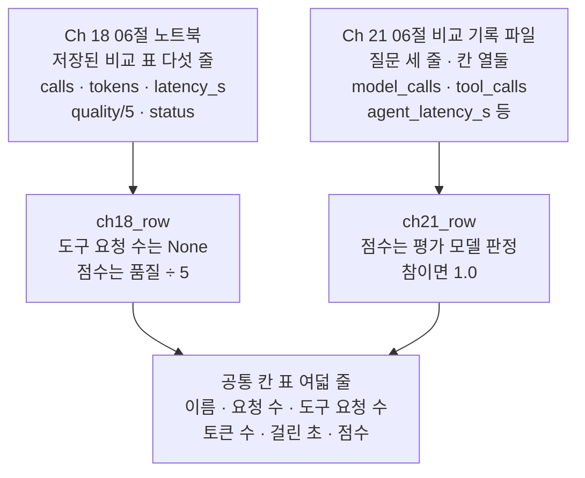
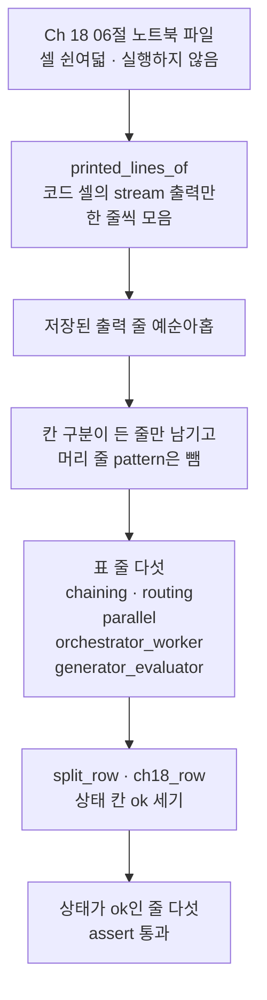
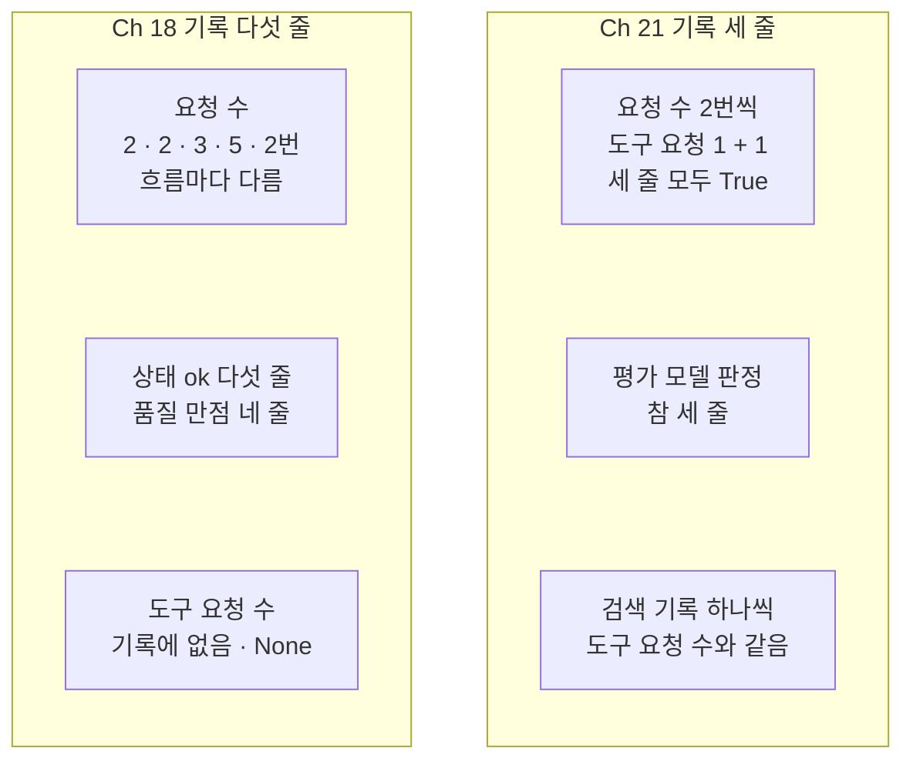
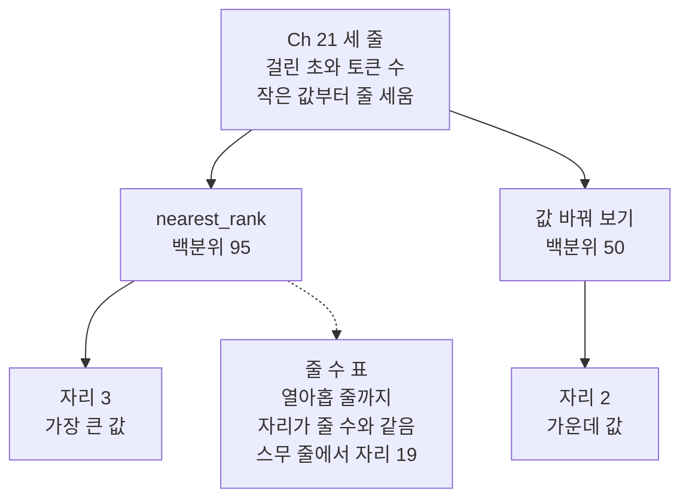

# 04-운영-지표와-Ch18-궤적-비교

## _src 본문 (HTML 원본)

```html
<!--meta: 강의 0.75h | 실습 1.25h | 코드 notebooks/04-운영-지표와-Ch18-궤적-비교.ipynb | 새 용어 2 -->
<style>html,body{overflow-x:hidden}.notebook,.nb-cell,.nb-main,.nb-input,.nb-result{min-width:0;max-width:100%}.nb-input pre,.nb-output{box-sizing:border-box;max-width:100%;overflow-x:auto}code.nb-source{display:block!important;width:100%!important;min-width:0!important;overflow-x:auto!important;padding:0!important}</style>
<h2 id="b1"><span class="no">1</span>학습 목표</h2><div class="goal"><ul>
<li>앞 챕터가 저장한 실행 기록 두 개를 찾아 읽고, 같은 칸 이름의 딕셔너리로 옮겨 담을 수 있습니다.</li>
<li>요청 수·도구 요청 수·성공 여부 같은 세는 값으로 두 기록을 읽고, 그 값도 한 번 실행한 값임을 말할 수 있습니다.</li>
<li>걸린 초와 토큰 수의 평균과 95 백분위수를 셈하고, 줄이 적을 때의 한계를 설명할 수 있습니다.</li>
</ul></div>
<h2 id="b2"><span class="no">2</span>이 내용을 배우는 이유</h2><p><a href="01-에이전트-평가-세-전략.html">01절</a>~<a href="03-LLM-judge로-궤적-평가.html">03절</a>은 궤적 하나를 놓고, 에이전트가 제대로 움직였는지를 판정했습니다. 서비스로 내놓은 에이전트는 실행할 때마다 요청 수·걸린 초·토큰 수 같은 값을 남깁니다. 이런 값을 모아 두어야 요청이 늘었는지, 오래 걸린 실행이 있었는지 볼 수 있습니다. 그런데 기록마다 칸 이름과 담긴 뜻이 달라, 그대로는 한 표에 모을 수 없습니다.</p><p>이 절은 모델을 부르지 않고, 앞 챕터가 남긴 기록 두 개를 읽습니다. <a href="../../part5/ch18-workflow-patterns/06-같은-과제로-다섯-패턴-비교.html">Ch 18 06절</a> 노트북에 저장된 비교 표와, <a href="../ch21-create-agent/06-같은-평가셋으로-RAG-비교.html">Ch 21 06절</a>이 쓴 비교 기록 파일입니다. 두 기록을 같은 칸 이름으로 옮겨 담고, 세는 값부터 읽습니다. 제목에는 「Ch18 궤적」이라고 적었지만, Ch 18 기록에는 도구를 부른 차례가 없습니다. Ch 18 기록은 흐름 하나의 요청 수·토큰 수·걸린 초·품질·상태 칸뿐입니다.</p>
<h2 id="b3"><span class="no">3</span>앞에서 배운 내용</h2><p><a href="01-에이전트-평가-세-전략.html">01절</a>에서는 최종 답 평가·한 단계 평가·궤적 평가를, <a href="02-궤적-매칭-네-모드.html">02절</a>에서는 네 모드를 봤습니다. <a href="03-LLM-judge로-궤적-평가.html">03절</a>에서는 평가받는 에이전트를 실제로 한 번 실행하고, 그 궤적을 모드와 평가 모델로 판정했습니다. 같은 절에서 모델 요청 수를 「도구를 요청한 응답 수 + 1」로 셌습니다. 이 절은 그 셈을 Ch 21 기록에 그대로 씁니다.</p><p><a href="../../part5/ch18-workflow-patterns/06-같은-과제로-다섯-패턴-비교.html">Ch 18 06절</a>에서는 같은 과제를 다섯 흐름으로 실행해, 흐름마다 비교 표 한 줄을 만들었습니다. 표의 품질 칸은 안내문을 코드로 검사해 센 0~5이고, 평가 모델의 점수가 아닙니다. 그 절은 이 표를 Ch 29 04절이 저장된 출력에서 읽는다고 적었습니다. 그래서 이 절은 Ch 18 06절 노트북을 실행하지 않고, 파일에 저장된 출력만 읽습니다.</p><p><a href="../ch21-create-agent/06-같은-평가셋으로-RAG-비교.html">Ch 21 06절</a>에서는 고정 흐름과 에이전트 흐름을 질문 세 개로 견주고, 비교 기록 파일을 썼습니다. 에이전트 흐름의 요청 수·도구 요청 수·토큰 수·걸린 초와 평가 모델 판정이 질문마다 한 줄씩 담겼습니다. 이 절은 그 파일을 읽기만 하고, 줄 수와 줄마다 도구 요청 수가 1 이상인지를 <code>assert</code>로 확인합니다. 파일 자리를 찾는 셀은 그 절의 자리 찾기 셀과 모양이 같습니다.</p><p><a href="../../part4/ch15-evaluation-advanced/06-대화당-비용-백분위수.html">Ch 15 06절</a>에서는 평균을 내는 함수 <code>average</code>와, 가장 가까운 자리 방식으로 백분위수를 찾는 함수 <code>nearest_rank</code>를 배웠습니다. 두 함수는 이 절부터 도구 파일에서 가져옵니다. 값을 줄 세우는 <code>sorted</code>와 올림 함수 <code>math.ceil</code>도 그 절에서 썼습니다. 글 메서드 <code>join</code>은 <a href="../../part4/ch16-guardrails/01-입출력-출처-검증.html">Ch 16 01절</a>, 음수 슬라이스는 <a href="../../part4/ch16-guardrails/03-히스토리-트리밍과-요약.html">Ch 16 03절</a>에서 봤습니다.</p>
<h2 id="b4"><span class="no">4</span>핵심 개념</h2><h3>비유로 시작하기</h3><p>오르골 가게 두 곳이 한 주 동안 울린 곡을 모아 본다고 해 봅니다. 두 가게는 곡마다 쓴 종이띠를 서로 다른 막대에 걸어 두었습니다. 띠를 나무 막대 하나에 옮겨 걸면, 띠가 몇 개인지와 어느 가게에서 왔는지가 한눈에 보입니다.</p><p>막대 하나가 공통 칸으로 모은 표이고, 띠 하나가 실행 한 번의 기록 한 줄입니다. 걸어 둔 띠는 몇 번을 다시 세어도 같지만, 가게가 곡을 다시 울리면 새 띠의 구멍은 달라질 수 있습니다. 이 절은 걸어 둔 띠를 세기만 하고, 곡을 다시 울리지는 않습니다. 그래서 결론은 이 띠들에 대한 사실로만 적습니다.</p><p>비유와 다른 점도 있습니다. 오르골 띠에는 구멍만 있지만, 기록 한 줄에는 요청 수·토큰 수·걸린 초 같은 값이 칸마다 들어 있습니다.</p>
{{img:04-5-받침대에-걸린-종이띠|흰 바탕 위쪽에 가로로 긴 나무 막대 하나가 있고, 막대 아래 작은 고리들에 크림색 종이띠 여덟 개가 곧게 걸려 있습니다. 왼쪽에 띠 다섯이 한 무리로, 오른쪽에 띠 셋이 한 무리로 걸렸고, 두 무리 사이에는 띠가 걸리지 않은 고리 둘이 있는 빈틈이 있습니다. 오른쪽 끝에도 빈 고리가 하나 있습니다. 띠마다 둥근 구멍이 세로로 한 줄 뚫려 있고, 왼쪽 무리의 다섯째 띠는 조금 짧습니다. 사람·손·글자·숫자·음표·화살표는 없는 그림|나무 막대 하나에 종이띠 여덟 개가 왼쪽 다섯, 오른쪽 셋의 두 무리로 걸려 있습니다.}}
<p class="look"><b>그림 읽기</b> — 흰 바탕 위쪽의 나무 막대 하나에 종이띠 여덟 개가 왼쪽 다섯, 오른쪽 셋의 두 무리로 걸려 있습니다. 막대가 공통 칸으로 모은 표 하나이고, 띠 하나가 실행 한 번의 기록 한 줄입니다. 왼쪽 다섯은 Ch 18 다섯 흐름이고, 오른쪽 셋은 Ch 21 세 질문입니다. 두 무리 사이의 빈틈은 과제가 다른 두 기록을 한 무리로 섞지 않는다는 뜻입니다. 구멍의 수, 띠의 길이, 빈 고리는 어떤 값과도 짝짓지 않습니다.</p>
<h3>운영 지표와 공통 칸</h3><p>운영 지표는 에이전트를 실행할 때마다 모으는 값입니다. 요청 수·도구 요청 수·토큰 수·걸린 초·성공 여부가 여기에 듭니다. 앞 챕터의 두 기록에도 이런 값이 있지만, 칸 이름이 서로 다릅니다. Ch 18 표의 <code>calls</code>와 Ch 21 기록의 <code>model_calls</code>는 이름이 다르지만, 둘 다 모델 요청 수입니다.</p><p>그래서 두 값을 같은 칸 「요청 수」로 옮겨 담습니다. 이렇게 맞춘 칸을 이 절에서는 공통 칸이라고 부릅니다. 기록에 없는 칸은 지어내지 않고 <code>None</code>으로 둡니다. Ch 18 기록에는 도구 요청 수 칸이 없어, 그 칸은 <code>None</code>입니다.</p><p>같은 이름의 칸에 담아도 뜻까지 같아지지는 않습니다. 칸 「점수」에는 Ch 18 품질을 만점 5로 나눈 값과, Ch 21 평가 모델 판정(참이면 1.0)을 담았습니다. 앞은 코드 검사, 뒤는 평가 모델 판정이라 잣대가 다릅니다. 이 절은 두 점수를 서로 견주지 않고, 기록마다 따로 읽습니다.</p>
<table><thead><tr><th>말</th><th>뜻</th></tr></thead><tbody><tr><td>운영 지표</td><td>에이전트를 실행할 때마다 모으는 값입니다. 요청 수·도구 요청 수·토큰 수·걸린 초·성공 여부가 여기에 듭니다. 가게가 날마다 손님 수와 매출을 적어 두는 장부와 같습니다. 이 절에서는 두 기록의 줄마다 이 값을 딕셔너리 한 개로 옮겨 담았습니다.</td></tr><tr><td>공통 칸</td><td>서로 다른 기록의 값을 같은 이름의 칸으로 옮겨 담은 것입니다. 기록에 없는 칸은 지어내지 않고 <code>None</code>으로 둡니다. 두 가게의 장부를 같은 양식에 옮겨 적는 것과 같습니다. 이 절의 공통 칸은 이름·요청 수·도구 요청 수·토큰 수·걸린 초·점수 여섯입니다.</td></tr></tbody></table>
<p>새 말을 이 절 코드에서 보면 이렇습니다. 공통 칸은 함수 <code>ch18_row</code>와 <code>ch21_row</code>가 내놓는 딕셔너리의 키 여섯입니다. 운영 지표는 그 딕셔너리에 담긴 값이고, 노트북 4절의 표 여덟 줄이 그 모습입니다.</p>
{{mermaid:04-1-두-기록을-같은-칸으로|위에서 아래로 읽는 흐름도입니다. 맨 위 초록 상자 둘은 앞 챕터가 남긴 기록입니다. 왼쪽 상자는 Ch 18 06절 노트북에 저장된 비교 표 다섯 줄로, 칸 calls·tokens·latency_s·quality/5·status가 있습니다. 오른쪽 상자는 Ch 21 06절 비교 기록 파일로, 질문 세 줄에 칸 열둘이 있고 model_calls·tool_calls·agent_latency_s 등이 적혀 있습니다. 왼쪽 상자는 파란 상자 ch18_row, 도구 요청 수는 None, 점수는 품질 ÷ 5로 이어집니다. 오른쪽 상자는 파란 상자 ch21_row, 점수는 평가 모델 판정, 참이면 1.0으로 이어집니다. 두 파란 상자는 맨 아래 노란 상자 공통 칸 표 여덟 줄로 모이고, 칸은 이름·요청 수·도구 요청 수·토큰 수·걸린 초·점수인 그림|칸 이름이 다른 두 기록을 함수 둘로 옮겨 담자, 공통 칸 여섯의 표 여덟 줄이 되었습니다.}}
<p class="look"><b>도식 읽기</b> — 위에서 아래로 읽습니다. 초록 상자 둘은 앞 챕터가 남긴 기록이고, 파란 상자 둘은 이 노트북 4절에서 정의한 함수입니다. 노란 상자는 4절에서 출력한 공통 칸 표입니다. Ch 18 쪽 도구 요청 수는 기록에 칸이 없어 None으로 두었습니다. 칸 점수는 두 기록의 잣대가 서로 달라, 두 쪽을 견주지 않습니다.</p>
<h3>세는 값도 한 번 실행한 값입니다</h3><p>두 기록의 값은 모두 앞 챕터를 한 번 실행해 남긴 값입니다. 이 노트북은 기록을 읽기만 해서, 몇 번을 실행해도 같은 값이 나옵니다. 그러나 앞 챕터를 다시 실행하면 기록의 값이 바뀔 수 있습니다.</p><p>요청 수처럼 세는 값에도 그 실행에서 모델이 정한 몫이 있습니다. <a href="../../part5/ch18-workflow-patterns/06-같은-과제로-다섯-패턴-비교.html">Ch 18 06절</a>의 요청 수 가운데 2·2·3은 코드가 정했고, 5와 2는 모델 답이 정한 작업 수와 바퀴 수에서 나왔습니다. Ch 21 기록의 도구 요청 수 1은 모델이 검색을 한 번 고른 결과이고, 판정은 평가 모델이 한 번 내린 값입니다. 걸린 초와 토큰 수는 네트워크 상태와 모델이 쓴 글에 따라 실행마다 달라집니다.</p><p>다시 실행해도 그대로인 것은 「요청 수 = 도구를 요청한 응답 수 + 1」처럼 흐름의 짜임새가 정한 셈입니다. Ch 18 06절이 노트북 밖 다섯 번에서 본 요청 수도 모두 2·2·3·5·2였지만, 그 다섯 번의 값일 뿐입니다. 그래서 이 절은 이 기록에서 센 값과, 그 셈이 기록과 맞는지를 결론으로 삼습니다. 이 기록만으로 두 짜임새의 일반 성질을 정하지 않고, 걸린 초와 토큰 수는 표와 결과 읽기 둘째 단락에만 둡니다.</p><p>95 백분위수는 <a href="../../part4/ch15-evaluation-advanced/06-대화당-비용-백분위수.html">Ch 15 06절</a>의 가장 가까운 자리 방식으로 셉니다. 자리는 95 × 줄 수 ÷ 100을 올린 정수이고, 줄 세운 값에서 그 자리의 값을 고릅니다. 줄이 셋이면 95 × 3 ÷ 100 = 2.85를 올려 자리 3, 곧 가장 큰 값입니다. 줄이 열아홉 이하이면 자리가 늘 줄 수와 같아, 95 백분위수는 가장 큰 값이 됩니다.</p>
<h2 id="b5"><span class="no">5</span>실행 예제</h2><p>노트북 2절은 프로젝트 맨 위를 찾고, 두 기록 파일이 있는지 봅니다. 3절은 Ch 18 06절 노트북 파일에서 저장된 출력 줄을 모아, 비교 표 다섯 줄을 찾습니다. 4절은 두 기록의 줄을 공통 칸 딕셔너리로 옮겨 담아 표 하나로 출력합니다. 5절은 요청 수 셈과 성공 여부를 세고, 6절은 칸마다 평균을 냅니다. 7절은 95 백분위수를 찾고, 8절은 백분위 하나만 바꿔 봅니다.</p><p>모델 요청은 0번이고, API 키도 필요 없습니다. 읽는 파일은 앞 챕터 파일 둘과 도구 파일 <code>eval_tools.py</code>이고, 쓰는 파일은 없습니다. 이 노트북은 걸린 시간을 재지 않고, 기록에 적힌 걸린 초를 읽기만 합니다.</p>
{{notebook:04-운영-지표와-Ch18-궤적-비교}}
<p class="look"><b>확인할 점</b> — 노트북 3절에서 <code>표 줄 수: 5</code>와 <code>옮겨 담은 줄 수: 5 | 상태가 ok인 줄 수: 5</code>를 봅니다. 4절에서 <code>줄 수: 3 | 한 줄의 칸 수: 12</code>와 공통 칸 표 여덟 줄을 찾습니다. 5절에서는 세 줄 모두 <code>True</code>인 요청 수 셈을 확인합니다.</p>
{{mermaid:04-2-저장된-출력에서-표-줄-찾기|위에서 아래로 한 줄로 이어지는 흐름도입니다. 맨 위 초록 상자 Ch 18 06절 노트북 파일, 셀 쉰여덟, 실행하지 않음에서 파란 상자 printed_lines_of, 코드 셀의 stream 출력만 한 줄씩 모음으로 갑니다. 이어서 노란 상자 저장된 출력 줄 예순아홉, 파란 상자 칸 구분이 든 줄만 남기고 머리 줄 pattern은 뺌, 노란 상자 표 줄 다섯으로 이어집니다. 표 줄 다섯 상자에는 chaining·routing·parallel·orchestrator_worker·generator_evaluator가 적혀 있습니다. 다시 파란 상자 split_row와 ch18_row, 상태 칸 ok 세기를 지나 노란 상자 상태가 ok인 줄 다섯, assert 통과로 끝나는 그림|저장된 출력 줄 예순아홉에서 표 줄 다섯을 찾았고, 다섯 줄 모두 상태가 ok였습니다.}}
<p class="look"><b>도식 읽기</b> — 위에서 아래로 읽습니다. 초록 상자는 읽기만 하는 Ch 18 06절 노트북 파일이고, 파란 상자 셋은 이 노트북 3·4절의 코드입니다. 노란 상자 셋은 3·4절 셀 출력입니다. 표 줄은 그 노트북이 비교 표를 찍은 셀의 저장된 출력에서 나왔습니다. 그 노트북을 실행하지 않아, 모델 요청은 한 번도 나가지 않습니다.</p>
<h2 id="b6"><span class="no">6</span>실험 결과 해석</h2><p>이 기록에서 Ch 18 다섯 흐름은 요청 수가 2·2·3·5·2번으로 흐름마다 달랐고, 다섯 줄 모두 상태가 ok였습니다. Ch 21 세 질문은 모두 요청 2번·도구 요청 1번이었습니다. 03절의 셈대로, 요청 수는 도구를 요청한 응답 수 1에 1을 더한 값과 같았습니다. 줄마다 검색 기록도 하나씩이라, 도구 요청 수와 맞았습니다.</p><p>잘됐다고 적은 줄은 기록마다 제 잣대로 셌습니다. 이 기록에서는 Ch 18 다섯 줄 가운데 넷이 품질 만점이었고, Ch 21은 세 줄 모두 평가 모델 판정이 참이었습니다. 평가 모델 판정은 Ch 21 06절을 한 번 실행한 값입니다. 칸 「점수」의 평균은 Ch 18이 0.96, Ch 21이 1.0이지만, 잣대가 달라 서로 견주지 않습니다.</p>
{{mermaid:04-3-세는-값으로-읽기|두 칸을 왼쪽과 오른쪽에 나란히 둔 그림입니다. 왼쪽 칸 Ch 18 기록 다섯 줄에는 위에서부터 노란 상자 요청 수 2·2·3·5·2번 흐름마다 다름, 노란 상자 상태 ok 다섯 줄 품질 만점 네 줄, 회색 상자 도구 요청 수 기록에 없음 None이 있습니다. 오른쪽 칸 Ch 21 기록 세 줄에는 위에서부터 노란 상자 요청 수 2번씩 도구 요청 1 + 1 세 줄 모두 True, 노란 상자 평가 모델 판정 참 세 줄, 노란 상자 검색 기록 하나씩 도구 요청 수와 같음이 있습니다. 두 칸 사이에는 화살표가 없는 그림|이 기록에서 Ch 21 세 줄은 모두 요청 2번 = 도구 요청 1 + 1이었고, Ch 18 다섯 흐름은 요청 수가 흐름마다 달랐습니다.}}
<p class="look"><b>도식 읽기</b> — 두 칸을 나란히 읽습니다. 왼쪽 칸은 Ch 18 기록 다섯 줄, 오른쪽 칸은 Ch 21 기록 세 줄의 세는 값입니다. 노란 상자는 노트북 4·5절 셀 출력이고, 회색 상자는 기록에 없어 None으로 둔 칸입니다. 두 칸은 과제가 다르고 저마다 한 번 실행한 기록이라, 화살표 없이 나란히 두었습니다. 상태 칸과 평가 모델 판정은 잣대가 달라, 줄 수를 서로 견주지 않습니다.</p>
<p>줄이 셋인 Ch 21 기록에서 95 백분위수의 자리는 3, 곧 가장 큰 값의 자리였습니다. 줄 수 표를 보면 줄이 열아홉일 때까지 자리가 줄 수와 같고, 스무 줄부터 가장 큰 값에서 떨어집니다. 백분위를 50으로 바꾸자 자리가 2가 되어, 줄 세운 세 값의 가운데 값이 나왔습니다. 줄이 적은 기록의 95 백분위수는 가장 큰 값 하나를 다시 읽는 것과 같습니다.</p>
{{mermaid:04-4-95-백분위수의-자리|위에서 아래로 읽는 흐름도입니다. 맨 위 초록 상자 Ch 21 세 줄, 걸린 초와 토큰 수, 작은 값부터 줄 세움에서 파란 상자 둘로 화살표가 갈라집니다. 왼쪽 파란 상자 nearest_rank 백분위 95에서는 아래 노란 상자 자리 3 가장 큰 값으로 화살표가 가고, 점선이 가운데 노란 상자 줄 수 표, 열아홉 줄까지 자리가 줄 수와 같음, 스무 줄에서 자리 19로 이어집니다. 오른쪽 파란 상자 값 바꿔 보기 백분위 50에서는 아래 노란 상자 자리 2 가운데 값으로 화살표가 가는 그림|줄이 셋이면 95 백분위수는 자리 3의 가장 큰 값이고, 백분위를 50으로 바꾸자 자리 2의 가운데 값이 나왔습니다.}}
<p class="look"><b>도식 읽기</b> — 위에서 아래로 읽습니다. 초록 상자는 Ch 21 세 줄의 값이고, 파란 상자 둘은 노트북 7절의 함수 부르기와 8절에서 바꾼 백분위입니다. 노란 상자는 7·8절 셀 출력입니다. 점선 아래 상자는 같은 셈을 줄 수만 바꿔 센 7절의 표입니다. 걸린 초와 토큰 수의 값은 한 번 실행한 값이라 그림에 넣지 않았습니다.</p>
<p>아래 표는 노트북 6·7절의 평균과 95 백분위수입니다. 표의 값은 모두 각 기록이 한 번 실행해 남긴 값이고, 걸린 초와 토큰 수는 특히 실행마다 달라집니다. 두 기록은 과제·질문·요청을 보낸 방법이 달라, 이 표의 값으로 어느 쪽이 낫다고 정하지 않습니다.</p>
<table><thead><tr><th>값</th><th>Ch 18 다섯 줄</th><th>Ch 21 세 줄</th><th>성격</th></tr></thead><tbody><tr><td>요청 수 평균</td><td><code>2.8</code></td><td><code>2.0</code></td><td>세는 값(모델이 정한 몫 있음)</td></tr><tr><td>도구 요청 수 평균</td><td>기록에 없음</td><td><code>1.0</code></td><td>세는 값(모델이 고른 횟수)</td></tr><tr><td>점수 평균</td><td><code>0.96</code>(품질 ÷ 5)</td><td><code>1.0</code>(평가 모델 판정)</td><td>잣대가 달라 견주지 않음</td></tr><tr><td>토큰 수 평균</td><td><code>862.2</code></td><td><code>688.0</code></td><td>실행마다 달라지는 값</td></tr><tr><td>걸린 초 평균</td><td><code>4.206</code></td><td><code>1.731</code></td><td>실행마다 달라지는 값</td></tr><tr><td>95 백분위수 걸린 초</td><td>셈하지 않음</td><td><code>2.003</code>(자리 3, 가장 큰 값)</td><td>실행마다 달라지는 값</td></tr><tr><td>95 백분위수 토큰 수</td><td>셈하지 않음</td><td><code>699</code>(자리 3, 가장 큰 값)</td><td>실행마다 달라지는 값</td></tr></tbody></table>
<p>새 커널로 두 번 실행해 견주자, 코드 셀 스물다섯의 출력이 셀마다 모두 같았습니다. 이 절은 모델을 부르지 않고 저장된 기록만 읽어, 앞 챕터를 다시 실행하지 않는 한 같은 값이 나옵니다.</p>
<p class="look"><b>확인할 점</b> — 노트북 6절에서 <code>요청 수 | 2.8</code>과 <code>요청 수 | 2.0</code>을, 7절에서 <code>95 백분위수 자리: 3 | 줄 수: 3</code>을 확인합니다. 8절에서 <code>50 백분위수 자리: 2</code>를 봅니다. 앞 챕터를 다시 실행하면 표의 값이 모두 달라질 수 있습니다.</p>
<h2 id="b7"><span class="no">7</span>주의할 점과 실무 메모</h2><ul><li>이 절은 Ch 18 06절 노트북과 Ch 21 06절 비교 기록 파일을 읽기만 합니다. 두 절을 다시 실행하면 두 파일이 바뀌어, 이 절의 표와 평균도 따라 바뀝니다. 교재 출력을 그대로 두려면 두 절은 다시 실행하지 않습니다.</li><li>Ch 18 표는 Ch 18 06절 노트북을 한 번 실행해 저장한 출력입니다. Ch 21 기록도 Ch 21 06절을 한 번 실행해 쓴 파일입니다. Ch 21 도구 요청 수는 모델이 고른 값이고, 평가 모델 판정은 그 한 번의 실행에서 나온 값입니다. 걸린 초는 네트워크와 서비스 상태에 따라, 토큰 수는 모델이 쓴 답에 따라 달라집니다. 그래서 두 값은 결론·그림·정리에 쓰지 않았습니다.</li><li>두 기록은 과제가 다릅니다. Ch 18은 안내문 하나를 쓰는 과제를 OpenAI 요청으로 바로 보냈습니다. Ch 21은 도서관 질문 셋을 검색 도구가 붙은 에이전트로 보냈습니다. 같은 칸에 담았어도, 두 기록의 값으로 어느 짜임새가 빠르거나 싸다고 정하지 않습니다.</li><li>Ch 18 기록에는 도구 요청 수 칸이 없어 <code>None</code>으로 두었습니다. Ch 18의 다섯 흐름은 도구 호출 요청을 쓰지 않았지만, 이 사실은 Ch 18 절에서 온 것이고 기록에서 읽은 값이 아닙니다.</li><li>Ch 21 기록의 도구 요청 수는 도구 메시지를 센 값입니다. 세 줄 모두 1이라, 도구를 요청한 응답도 하나씩입니다. 한 응답이 도구를 여럿 요청하면 도구 메시지 수와 응답 수가 달라지니, 03절의 셈에는 응답 수를 넣습니다.</li><li>이 절의 <code>assert</code>는 기록의 모양에만 걸었습니다. Ch 18 표 줄 수·상태 칸, Ch 21 줄 수·도구 요청 수입니다. 걸린 초와 토큰 수에는 걸지 않았습니다.</li><li>Ch 18 표는 저장된 출력에서 칸 구분 「 | 」가 든 줄을 찾아 읽습니다. 그래서 Ch 18 06절은 표의 칸 이름을 영어로 두고, 표 뒤에 칸을 나눈 줄을 더 찍지 않았습니다. 그 절의 흐름 하나라도 상태가 ok가 아니면 이 절의 확인 줄이 멈춥니다.</li><li>줄 셋의 95 백분위수는 가장 큰 값과 같아, 오래 걸린 실행이 얼마나 드문지는 말해 주지 않습니다. 이 절의 기록만으로 서비스의 기준값을 정하지 않습니다. 기준값을 정하려면 같은 서비스의 실행을 훨씬 많이 모아야 합니다.</li><li>파일 자리 찾기는 프로젝트 맨 위·실습 폴더 맨 위·<code>notebooks</code> 폴더 세 자리에서 봅니다. 학생 묶음과 같은 폴더 구성에서 <code>notebooks</code> 폴더를 열어 실행해 보니, 키 없이 끝까지 실행되었습니다.</li><li>교재 출력은 Linux의 Python 3.12.13으로 만들었습니다. 다른 판과 Windows·macOS에서는 실행하지 않았습니다.</li></ul>
<h2 id="b8"><span class="no">8</span>정리와 다음 절</h2><ul><li>Ch 18 06절의 저장된 출력과 Ch 21 06절의 비교 기록을 읽어, 여덟 줄을 공통 칸 여섯의 딕셔너리로 옮겨 담았습니다. 기록에 없는 Ch 18 도구 요청 수는 <code>None</code>으로 두었습니다.</li><li>이 기록에서 Ch 18 다섯 흐름은 요청 수가 흐름마다 달랐고, Ch 21 세 질문은 모두 요청 2번·도구 요청 1번이었습니다. 두 기록 모두 앞 챕터를 한 번 실행한 값이고, Ch 21의 요청 수는 03절의 셈과 맞았습니다.</li><li>줄이 셋이면 95 백분위수의 자리가 3이라, 가장 큰 값이 그대로 나옵니다. 줄이 스무 개는 되어야 95 백분위수가 가장 큰 값에서 떨어집니다.</li></ul><p><strong>다음 학습과 이어지는 지점</strong> — <a href="05-Agent-평가-실습.html">05절</a>은 이 챕터의 실습입니다. 03절의 평가받는 에이전트를 호출 한도만 바꿔 두 번 실행하고, 네 모드와 공통 칸으로 두 실행을 견줍니다.</p>
<h2 id="b9"><span class="no">9</span>복습 문제</h2><details class="quiz" open><summary>문제 4개 · 해설 포함</summary><p class="quiz-q">1. Ch 18 표를 공통 칸으로 옮겨 담을 때, 도구 요청 수 칸을 0이 아니라 <code>None</code>으로 둔 까닭은 무엇인가요?</p><p class="quiz-a">Ch 18 기록에는 도구 요청 수 칸이 없기 때문입니다. 0을 적으면 기록에서 읽지 않은 값을 지어낸 것이 됩니다. 기록에 없는 값은 모르는 값 <code>None</code>으로 둡니다. 틀렸다면 노트북 4절을 다시 읽습니다.</p><p class="quiz-q">2. Ch 21 기록의 한 줄이 요청 수 2, 도구 요청 수 1이었습니다. 03절의 셈과 맞는지 어떻게 확인하나요?</p><p class="quiz-a">도구 메시지가 하나이면 도구를 요청한 응답도 하나입니다. 그 응답 하나에 답을 쓴 응답 하나를 더하면 2라 셈과 맞습니다. 다만 도구를 한 번 부른 것은 Ch 21 06절을 한 번 실행했을 때 모델이 고른 일이고, 셈만 짜임새가 정한 규칙입니다. 틀렸다면 노트북 5절을 다시 읽습니다.</p><p class="quiz-q">3. 칸 「점수」의 평균이 Ch 18은 0.96, Ch 21은 1.0이었습니다. 이 값으로 Ch 21 쪽이 더 잘했다고 말할 수 있나요?</p><p class="quiz-a">말할 수 없습니다. Ch 18 점수는 코드 검사 품질을 5로 나눈 값이고, Ch 21 점수는 평가 모델 판정입니다. 잣대와 과제가 달라, 기록마다 따로 읽습니다. 틀렸다면 본문 「운영 지표와 공통 칸」을 다시 읽습니다.</p><p class="quiz-q">4. 걸린 초가 기록된 실행이 스무 줄이면, 가장 가까운 자리 방식의 95 백분위수는 몇 번째 자리의 값인가요? 그 값은 가장 큰 값인가요?</p><p class="quiz-a">95 × 20 ÷ 100 = 19라 열아홉 번째 자리의 값입니다. 스무 줄 가운데 가장 큰 값은 스무 번째라, 95 백분위수는 가장 큰 값이 아닙니다. 줄이 열아홉 이하이면 95 백분위수는 늘 가장 큰 값입니다. 틀렸다면 노트북 7절을 다시 읽습니다.</p></details>
<h2 id="b10"><span class="no">10</span>참고 자료</h2><ul><li><div><a href="https://docs.langchain.com/langsmith/dashboards">LangSmith Dashboards</a></div>확인 2026-09-29 · 기본 대시보드가 추적 수·걸린 시간·오류 비율, 토큰 수와 비용을 보여 준다고 적습니다. 도구 실행도 도구 이름별 실행 수·오류 비율·걸린 시간으로 나눠 보여 준다고 적습니다.</li><li><div><a href="https://en.wikipedia.org/wiki/Percentile">Percentile (Wikipedia)</a></div>확인 2026-09-29 · 백분위수를 세는 여러 방식 가운데 가장 가까운 자리 방식(nearest-rank)을 적습니다. 100 백분위수는 줄 세운 목록의 가장 큰 값으로 정의한다고 적습니다.</li><li><div><a href="https://docs.python.org/3/library/math.html#math.ceil">Python math.ceil</a></div>확인 2026-09-29 · 값보다 크거나 같은 정수 가운데 가장 작은 정수를 내놓는다고 적습니다.</li><li>Ch 15 06절 노트북 <code>06-대화당-비용-백분위수.ipynb</code>의 함수 <code>average</code>·<code>nearest_rank</code> 셀을 도구 파일에 글자 그대로 옮겼습니다.</li><li>Ch 18 06절 노트북 <code>06-같은-과제로-다섯-패턴-비교.ipynb</code>의 비교 표 출력(머리 줄과 다섯 줄)을 읽었습니다.</li><li>Ch 21 06절 비교 기록 파일 <code>data/rag-comparison.json</code>(줄 셋, 칸 열둘)에서 칸 여섯을 읽었습니다.</li></ul>
```

## 노트북 셀 (순서대로)

### [0] markdown {'html': 'skip'}

# 운영 지표와 Ch18 궤적 비교

**이 노트북에서 할 일**

1. Ch 18 06절 노트북에 저장된 출력과 Ch 21 06절의 비교 기록 파일을 읽기만 합니다.
2. 두 기록의 줄을 같은 칸 이름의 딕셔너리로 옮겨 담고, 요청 수와 성공 여부를 셉니다.
3. 칸마다 평균과 95 백분위수를 보고, 줄이 셋이면 95 백분위수가 가장 큰 값이 되는 까닭을 셉니다.

**준비물** — 이 노트북은 모델을 부르지 않아 API 키가 필요 없습니다.
모델 요청은 0번이고, 요금도 들지 않습니다.
읽는 파일은 앞 챕터 파일 둘과 같은 폴더의 도구 파일 `eval_tools.py`이고, 쓰는 파일은 없습니다.
두 파일은 Ch 18 06절과 Ch 21 06절을 한 번 실행해 남긴 기록이고, 이 노트북은 두 절을 다시 실행하지 않습니다.
이 노트북은 걸린 시간을 재지 않고, 기록에 적힌 걸린 초를 읽기만 합니다.

**기준 버전** — 첫 셀에서 패키지 하나를 설치합니다.
판은 langchain 1.4.0이고, 도구 파일이 메시지 클래스를 가져올 때 씁니다.
교재 출력은 Linux의 Python 3.12.13으로 만들었습니다.
다른 판과 Windows·macOS에서는 실행하지 않았습니다.

**강의와 실습 범위** — 강의 시간에는 2~5절을 읽습니다.
두 기록을 찾아 읽고, 같은 칸 이름으로 옮겨 담아 세는 자리입니다.
6~8절은 평균과 95 백분위수를 보고 백분위 하나를 바꿔 보는 실습이고, 실습 시간에 실행합니다.

실습 폴더 `labs/part6/ch29-agent-evaluation`에서 `uv sync --locked`를 실행합니다.
그다음 `notebooks/` 폴더의 이 노트북을 열고, 실습 폴더의 `.venv` 커널을 고릅니다.
첫 셀부터 순서대로 실행합니다.

### [1] markdown {'html': 'skip'}

## 오늘 볼 그림


위에서 아래로 읽습니다.
초록 상자 둘은 앞 챕터가 남긴 기록이고, 파란 상자 둘은 이 노트북 4절에서 정의한 함수입니다.
노란 상자는 4절에서 출력한 공통 칸 표입니다.
Ch 18 쪽 도구 요청 수는 기록에 칸이 없어 None으로 두었습니다.
칸 점수는 두 기록의 잣대가 서로 달라, 두 쪽을 견주지 않습니다.

### [2] markdown {}

## 1. 준비

01~03절은 궤적 하나를 코드 규칙과 평가 모델로 판정했습니다.
이 절은 모델을 부르지 않고, 앞 챕터가 남긴 실행 기록 두 개를 읽어 운영 지표를 견줍니다.
뜻과 구성은 본문 「핵심 개념」에서 풉니다.

첫 셀은 패키지 하나를 설치하고 설치된 판 번호를 출력합니다.
설치에는 몇십 초가 걸릴 수 있습니다.

### [3] code {'execution': {'iopub.execute_input': '2026-09-29T04:46:53.415495Z', 'iopub.status.busy': '2026-09-29T04:46:53.415323Z', 'iopub.status.idle': '2026-09-29T04:46:54.101692Z', 'shell.execute_reply': '2026-09-29T04:46:54.101085Z'}, 'lesson_role': 'setup'}

```python
# 이 절에서 쓰는 패키지를 설치하고 버전을 확인합니다
%pip install -q "langchain==1.4.0"
from importlib.metadata import version

print("langchain:", version("langchain"))
```

출력:
```
Note: you may need to restart the kernel to use updated packages.
langchain: 1.4.0

```

### [4] markdown {}

**결과 읽기** — 출력 줄 `langchain: 1.4.0`이 보입니다.
실습 폴더 잠금과 같은 판입니다.
이 노트북의 셀은 langchain을 직접 쓰지 않습니다.
도구 파일 `eval_tools.py`가 맨 위에서 메시지 클래스를 가져오기 때문에 설치합니다.

다음 셀은 이 절에서 쓸 모듈과 함수를 가져옵니다.
모듈 `json`과 `os`는 Ch 21 06절처럼 파일을 찾고 읽을 때 씁니다.
모듈 `math`의 함수 `math.ceil`은 Ch 15 06절에서 본 올림 함수입니다.

### [5] code {'execution': {'iopub.execute_input': '2026-09-29T04:46:54.102990Z', 'iopub.status.busy': '2026-09-29T04:46:54.102891Z', 'iopub.status.idle': '2026-09-29T04:46:54.279365Z', 'shell.execute_reply': '2026-09-29T04:46:54.279057Z'}, 'lesson_role': 'setup'}

```python
# 기록 파일을 찾고 읽는 모듈 둘과, 올림 함수 ceil이 든 모듈 math(Ch 15 06절)를 가져옵니다
import json
import math
import os
# 앞에서 배운 함수는 도구 파일에서 가져옵니다
from eval_tools import average, nearest_rank

print("도구 파일에서 가져온 함수:", "average, nearest_rank")
```

출력:
```
도구 파일에서 가져온 함수: average, nearest_rank

```

### [6] markdown {}

**결과 읽기** — 라벨 `도구 파일에서 가져온 함수:` 뒤에 `average`와 `nearest_rank`가 보입니다.
앞에서 배운 함수는 `eval_tools.py`에 모아 두었습니다.
파일을 열면 코드를 볼 수 있습니다.

노트북과 같은 폴더(`notebooks/`)에 있는 파일입니다.
커널이 `notebooks/` 폴더에서 시작해야 이 파일을 가져올 수 있습니다.
교재 출력을 만든 실행 도구는 이 폴더를 따로 알려 주어, 다른 자리에서 시작해도 가져오기가 되었습니다.

두 함수는 Ch 15 06절 노트북에서 배웠고, 이 절부터 도구 파일에서 가져옵니다.
도구 파일에는 그 노트북 셀의 주석과 본문을 글자 그대로 옮겼고, 인자도 같습니다.
함수 `average(values)`는 값 목록의 평균을 소수 여섯째 자리까지 냅니다.
함수 `nearest_rank(values, percent)`는 가장 가까운 자리 방식으로 백분위수 하나를 냅니다.

## 2. 두 기록 파일 찾기

이 절이 읽는 기록은 둘입니다.
하나는 Ch 18 06절 노트북에 저장된 비교 표 출력이고, 다른 하나는 Ch 21 06절이 쓴 비교 기록 파일입니다.
두 파일은 다른 챕터 폴더에 있어, 다음 셀은 먼저 프로젝트 맨 위 폴더를 찾습니다.
셀 모양은 Ch 21 06절의 자리 찾기 셀과 같고, 확인하는 폴더만 다릅니다.

### [7] code {'execution': {'iopub.execute_input': '2026-09-29T04:46:54.280048Z', 'iopub.status.busy': '2026-09-29T04:46:54.279994Z', 'iopub.status.idle': '2026-09-29T04:46:54.281971Z', 'shell.execute_reply': '2026-09-29T04:46:54.281768Z'}}

```python
# 노트북을 어느 폴더에서 열어도 프로젝트 맨 위를 찾게 후보 세 개를 차례로 봅니다
candidates = [".", "../../..", "../../../.."]
root_path = None
for candidate in candidates:
    if os.path.exists(candidate + "/labs/part6/ch21-create-agent/data"):
        root_path = candidate
        break
print("고른 자리:", root_path)
assert root_path is not None, "notebooks 폴더나 실습 폴더 맨 위에서 노트북을 열어 주세요."
```

출력:
```
고른 자리: .

```

### [8] markdown {}

**결과 읽기** — 출력 줄 `고른 자리: .`은 교재 출력을 프로젝트 맨 위에서 실행했다는 뜻입니다.
교재 출력은 실행 도구가 프로젝트 맨 위 폴더에서 커널을 띄운 실행이라 `.`이 찍혔습니다.
노트북을 `notebooks/` 폴더에서 열면 이 줄에 `../../../..`가 찍힙니다.
학생 묶음을 풀어 `notebooks/` 폴더에서 열어도 같은 자리를 찾습니다.

다음 셀은 두 기록 파일의 자리를 만들고, 파일이 있는지 봅니다.

### [9] code {'execution': {'iopub.execute_input': '2026-09-29T04:46:54.282532Z', 'iopub.status.busy': '2026-09-29T04:46:54.282476Z', 'iopub.status.idle': '2026-09-29T04:46:54.284641Z', 'shell.execute_reply': '2026-09-29T04:46:54.284340Z'}}

```python
# 두 기록 파일의 자리를 만들고, 둘 다 있는지 봅니다(두 파일은 읽기만 하고 고치지 않습니다)
ch18_path = root_path + "/labs/part5/ch18-workflow-patterns/notebooks/06-같은-과제로-다섯-패턴-비교.ipynb"
ch21_path = root_path + "/labs/part6/ch21-create-agent/data/rag-comparison.json"
print("Ch 18 06절 노트북이 있는가:", os.path.exists(ch18_path))
print("Ch 21 06절 비교 기록이 있는가:", os.path.exists(ch21_path))
```

출력:
```
Ch 18 06절 노트북이 있는가: True
Ch 21 06절 비교 기록이 있는가: True

```

### [10] markdown {}

**결과 읽기** — 출력 줄 `Ch 18 06절 노트북이 있는가: True`와 `Ch 21 06절 비교 기록이 있는가: True`가 보입니다.
두 파일 모두 이 자리에 있습니다.

## 3. Ch 18 기록: 저장된 출력에서 표 줄 찾기

Ch 18 06절은 같은 과제를 다섯 흐름으로 실행하고, 비교 표를 출력했습니다.
표의 칸은 패턴·요청 수·토큰 수·걸린 초·품질·상태 여섯입니다.
이 표에는 도구를 부른 차례가 없습니다.
Ch 18의 다섯 흐름은 도구 호출 요청을 쓰지 않았기 때문입니다.
그래서 Ch 18 줄은 궤적이 아니라, 흐름 하나를 실행한 기록 한 줄로 읽습니다.

노트북 파일(`.ipynb`)은 셀의 글과 저장된 출력을 담은 JSON 파일입니다.
다음 셀은 Ch 18 06절 노트북 파일을 JSON으로 읽고, 셀 수를 봅니다.
그 노트북은 실행하지 않습니다.

### [11] code {'execution': {'iopub.execute_input': '2026-09-29T04:46:54.285202Z', 'iopub.status.busy': '2026-09-29T04:46:54.285145Z', 'iopub.status.idle': '2026-09-29T04:46:54.288088Z', 'shell.execute_reply': '2026-09-29T04:46:54.287821Z'}}

```python
# Ch 18 06절 노트북 파일을 JSON으로 읽습니다(그 노트북은 실행하지 않고, 저장된 출력만 씁니다)
with open(ch18_path, encoding="utf-8") as file:
    ch18_notebook = json.loads(file.read())
print("셀 수:", len(ch18_notebook["cells"]))
```

출력:
```
셀 수: 58

```

### [12] markdown {}

**결과 읽기** — 출력 줄 `셀 수: 58`이 보입니다.
비교 표는 그 가운데 한 코드 셀의 저장된 출력에 있습니다.
이 절이 읽는 비교 표는 Ch 18 06절을 한 번 실행해 저장한 출력입니다.

셀마다 저장된 출력은 칸 `outputs`의 목록에 있습니다.
출력 가운데 `print`로 찍힌 글은 칸 `output_type`이 `stream`이고, 글은 칸 `text`에 줄 목록으로 들어 있습니다.
다음 셀은 코드 셀 하나에서 이 글만 모아 한 줄씩 내놓는 함수를 정의합니다.
글 메서드 `join`(Ch 16 01절)으로 줄 목록을 한 글로 잇고, `splitlines`(03절)로 다시 줄마다 나눕니다.

### [13] code {'execution': {'iopub.execute_input': '2026-09-29T04:46:54.288618Z', 'iopub.status.busy': '2026-09-29T04:46:54.288565Z', 'iopub.status.idle': '2026-09-29T04:46:54.290427Z', 'shell.execute_reply': '2026-09-29T04:46:54.290135Z'}}

```python
# 코드 셀 하나의 저장된 출력 가운데 print로 찍힌 글(stream)만 한 줄씩 나눠 목록으로 내놓습니다
def printed_lines_of(cell):
    lines = []
    for output in cell["outputs"]:
        if output["output_type"] == "stream":
            printed_text = "".join(output["text"])
            for line in printed_text.splitlines():
                lines.append(line)
    return lines
```

출력:
```

```

### [14] markdown {}

**결과 읽기** — 정의 셀이라 출력이 없습니다.
함수 `printed_lines_of(cell)`는 코드 셀 하나를 받아, `print`로 찍힌 줄의 목록을 내놓습니다.

다음 셀은 이 함수로 노트북의 모든 코드 셀에서 저장된 출력 줄을 모읍니다.
마크다운 셀에는 칸 `outputs`가 없어, 칸 `cell_type`이 `code`인 셀만 봅니다.

### [15] code {'execution': {'iopub.execute_input': '2026-09-29T04:46:54.291032Z', 'iopub.status.busy': '2026-09-29T04:46:54.290976Z', 'iopub.status.idle': '2026-09-29T04:46:54.292921Z', 'shell.execute_reply': '2026-09-29T04:46:54.292480Z'}}

```python
# 코드 셀마다 저장된 출력 줄을 모두 모읍니다(마크다운 셀에는 출력이 없어 건너뜁니다)
printed_lines = []
for cell in ch18_notebook["cells"]:
    if cell["cell_type"] == "code":
        for line in printed_lines_of(cell):
            printed_lines.append(line)
print("저장된 출력 줄 수:", len(printed_lines))
```

출력:
```
저장된 출력 줄 수: 69

```

### [16] markdown {}

**결과 읽기** — 출력 줄 `저장된 출력 줄 수: 69`가 보입니다.
Ch 18 06절 노트북의 코드 셀들이 찍은 줄을 모두 모은 수입니다.

비교 표 줄은 칸을 「 | 」로 나눠 찍었습니다.
표 맨 위의 머리 줄은 `pattern`으로 시작해, 표 줄에서 뺍니다.
다음 셀은 「 | 」가 든 줄 가운데 머리 줄이 아닌 줄만 모읍니다.
03절에서 쓴 글 메서드 `startswith`로 머리 줄을 가립니다.

### [17] code {'execution': {'iopub.execute_input': '2026-09-29T04:46:54.293530Z', 'iopub.status.busy': '2026-09-29T04:46:54.293474Z', 'iopub.status.idle': '2026-09-29T04:46:54.295415Z', 'shell.execute_reply': '2026-09-29T04:46:54.295087Z'}}

```python
# 칸 구분 「 | 」가 든 줄 가운데 머리 줄(pattern으로 시작)을 뺀 표 줄만 모읍니다
table_lines = []
for line in printed_lines:
    if " | " in line:
        if not line.startswith("pattern"):
            table_lines.append(line)
print("표 줄 수:", len(table_lines))
assert len(table_lines) >= 5, "Ch 18 06절 노트북에 저장된 비교 표가 다섯 줄보다 적습니다."
```

출력:
```
표 줄 수: 5

```

### [18] markdown {}

**결과 읽기** — 출력 줄 `표 줄 수: 5`가 보이고, `assert`도 오류 없이 지나갔습니다.
Ch 18 06절 표의 다섯 흐름이 한 줄씩입니다.

다음 셀은 표 줄 가운데 마지막 다섯 줄을 Ch 18 기록으로 씁니다.
비교 표는 Ch 18 06절 노트북의 뒤쪽에서 한 번 찍히므로, 마지막 다섯 줄이 그 표입니다.
번호 `[-5:]`는 Ch 16 03절에서 본 음수 슬라이스로, 끝에서 다섯 개를 자릅니다.

### [19] code {'execution': {'iopub.execute_input': '2026-09-29T04:46:54.295897Z', 'iopub.status.busy': '2026-09-29T04:46:54.295851Z', 'iopub.status.idle': '2026-09-29T04:46:54.297635Z', 'shell.execute_reply': '2026-09-29T04:46:54.297315Z'}}

```python
# 표 줄 가운데 마지막 다섯 줄을 Ch 18 다섯 흐름의 기록으로 씁니다(칸: 패턴·요청 수·토큰 수·걸린 초·품질·상태)
ch18_lines = table_lines[-5:]
print("Ch 18 표 다섯 줄:")
for line in ch18_lines:
    print(line)
```

출력:
```
Ch 18 표 다섯 줄:
chaining | 2 | 712 | 3.756 | 5 | ok
routing | 2 | 503 | 2.746 | 5 | ok
parallel | 3 | 676 | 1.043 | 4 | ok
orchestrator_worker | 5 | 1790 | 6.519 | 5 | ok
generator_evaluator | 2 | 630 | 6.966 | 5 | ok

```

### [20] markdown {}

**결과 읽기** — 라벨 줄 `Ch 18 표 다섯 줄:` 아래 다섯 줄이 보입니다.
첫 줄은 `chaining | 2 | 712 | 3.756 | 5 | ok`이고, 마지막 줄은 `generator_evaluator`로 시작합니다.

줄마다 차례대로 패턴 이름·요청 수·토큰 수·걸린 초·품질·상태입니다.
요청 수는 모델 요청 수이고, 토큰 수는 입력 토큰과 출력 토큰을 더한 값입니다.
품질은 안내문을 코드로 검사해 센 0~5이고, 평가 모델의 점수가 아닙니다.

## 4. 공통 칸으로 옮겨 담기

두 기록은 칸 이름이 다릅니다.
Ch 18 표의 `calls`와 Ch 21 기록의 `model_calls`는 이름이 다르지만, 둘 다 모델 요청 수입니다.
이런 값을 같은 이름의 칸으로 옮겨 담으면, 두 기록을 한 표에 모을 수 있습니다.
이렇게 맞춘 칸을 이 절에서는 공통 칸이라고 부릅니다.
공통 칸은 이름·요청 수·도구 요청 수·토큰 수·걸린 초·점수 여섯입니다.

다음 셀은 표 줄 하나를 칸 여섯으로 나누는 함수를 정의합니다.
글 메서드 `split`으로 「|」에서 나누고, `strip`으로 칸마다 앞뒤 빈칸을 뺍니다.

### [21] code {'execution': {'iopub.execute_input': '2026-09-29T04:46:54.298194Z', 'iopub.status.busy': '2026-09-29T04:46:54.298145Z', 'iopub.status.idle': '2026-09-29T04:46:54.299580Z', 'shell.execute_reply': '2026-09-29T04:46:54.299374Z'}}

```python
# 표 줄 하나를 「|」로 나누고, 칸마다 앞뒤 빈칸을 뺀 글을 목록으로 내놓습니다
def split_row(line):
    parts = []
    for part in line.split("|"):
        parts.append(part.strip())
    return parts
```

출력:
```

```

### [22] markdown {}

**결과 읽기** — 정의 셀이라 출력이 없습니다.
함수 `split_row(line)`는 표 줄 하나를 받아, 글 여섯 개의 목록을 내놓습니다.

다음 셀은 나눈 칸 여섯을 공통 칸 딕셔너리로 옮겨 담는 함수를 정의합니다.
Ch 18 기록에는 도구 요청 수 칸이 없어, 그 칸은 모르는 값 `None`으로 둡니다.
점수는 품질을 만점으로 나눠 0~1로 맞추고, 만점은 인자 `full_quality`로 받습니다.

### [23] code {'execution': {'iopub.execute_input': '2026-09-29T04:46:54.300108Z', 'iopub.status.busy': '2026-09-29T04:46:54.300046Z', 'iopub.status.idle': '2026-09-29T04:46:54.301638Z', 'shell.execute_reply': '2026-09-29T04:46:54.301351Z'}}

```python
# 나눈 Ch 18 표 줄 하나를 공통 칸 딕셔너리로 옮겨 담아 내놓습니다(도구 요청 수는 기록에 없어 None)
def ch18_row(parts, full_quality):
    return {
        "이름": "Ch 18 " + parts[0],
        "요청 수": int(parts[1]),
        "도구 요청 수": None,
        "토큰 수": int(parts[2]),
        "걸린 초": float(parts[3]),
        "점수": int(parts[4]) / full_quality,
    }
```

출력:
```

```

### [24] markdown {}

**결과 읽기** — 정의 셀이라 출력이 없습니다.
함수 `ch18_row(parts, full_quality)`는 나눈 칸 목록과 품질 만점을 받아, 공통 칸 딕셔너리 하나를 내놓습니다.
요청 수·토큰 수·품질은 `int`로, 걸린 초는 `float`로 바꿔 숫자로 담습니다.

다음 셀은 Ch 18 다섯 줄을 모두 옮겨 담고, 상태 칸이 `ok`인 줄을 셉니다.
품질 만점은 코드 검사 항목 수 5입니다.
다섯 흐름이 모두 끝까지 갔는지는 기록의 모양이라 `assert`로 확인합니다.

### [25] code {'execution': {'iopub.execute_input': '2026-09-29T04:46:54.302156Z', 'iopub.status.busy': '2026-09-29T04:46:54.302109Z', 'iopub.status.idle': '2026-09-29T04:46:54.304037Z', 'shell.execute_reply': '2026-09-29T04:46:54.303702Z'}}

```python
# Ch 18 다섯 줄을 공통 칸으로 옮겨 담고, 상태 칸이 ok인 줄을 셉니다(품질 칸의 만점은 코드 검사 다섯 항목)
full_quality = 5
ch18_rows = []
ok_count = 0
for line in ch18_lines:
    parts = split_row(line)
    ch18_rows.append(ch18_row(parts, full_quality))
    if parts[5] == "ok":
        ok_count = ok_count + 1
print("옮겨 담은 줄 수:", len(ch18_rows), "| 상태가 ok인 줄 수:", ok_count)
assert ok_count == len(ch18_rows), "Ch 18 표에 상태가 ok가 아닌 줄이 있습니다."
```

출력:
```
옮겨 담은 줄 수: 5 | 상태가 ok인 줄 수: 5

```

### [26] markdown {}

**결과 읽기** — 출력 줄 `옮겨 담은 줄 수: 5 | 상태가 ok인 줄 수: 5`가 보이고, `assert`도 지나갔습니다.
다섯 흐름 모두 상태가 `ok`였습니다.

이제 Ch 21 기록을 읽습니다.
Ch 21 06절은 질문 세 개를 고정 흐름과 에이전트 흐름으로 견주고, 질문마다 비교 기록 한 줄을 파일에 썼습니다.
이 절은 그 가운데 에이전트 흐름의 칸만 읽습니다.
다음 셀은 파일을 읽고, 줄 수와 질문 번호를 봅니다.

### [27] code {'execution': {'iopub.execute_input': '2026-09-29T04:46:54.304606Z', 'iopub.status.busy': '2026-09-29T04:46:54.304562Z', 'iopub.status.idle': '2026-09-29T04:46:54.306572Z', 'shell.execute_reply': '2026-09-29T04:46:54.306277Z'}}

```python
# Ch 21 06절이 쓴 비교 기록 파일을 읽고, 줄 수·한 줄의 칸 수·질문 번호를 봅니다
with open(ch21_path, encoding="utf-8") as file:
    ch21_records = json.loads(file.read())
qids = []
for record in ch21_records:
    qids.append(record["qid"])
print("줄 수:", len(ch21_records), "| 한 줄의 칸 수:", len(ch21_records[0]))
print("질문 번호:", qids)
assert len(ch21_records) == 3, "Ch 21 비교 기록은 질문 세 줄이어야 합니다."
```

출력:
```
줄 수: 3 | 한 줄의 칸 수: 12
질문 번호: ['C01', 'C05', 'C07']

```

### [28] markdown {}

**결과 읽기** — 출력 줄 `줄 수: 3 | 한 줄의 칸 수: 12`와 `질문 번호: ['C01', 'C05', 'C07']`이 보입니다.
줄이 셋이라 `assert`도 지나갔습니다.

한 줄의 칸 열둘 가운데 이 절은 여섯을 읽습니다.
질문 번호 `qid`, 사용량 `agent_usage`, 도구 요청 수 `tool_calls`, 걸린 초 `agent_latency_s`가 그 가운데 넷입니다.
나머지 둘은 평가 모델 판정 `agent_supported`와 검색 기록 `agent_trace`입니다.
다음 셀은 한 줄을 공통 칸 딕셔너리로 옮겨 담는 함수를 정의합니다.
참·거짓 값에 `float`를 쓰면, 참은 `1.0`이 되고 거짓은 `0.0`이 됩니다.

### [29] code {'execution': {'iopub.execute_input': '2026-09-29T04:46:54.307147Z', 'iopub.status.busy': '2026-09-29T04:46:54.307097Z', 'iopub.status.idle': '2026-09-29T04:46:54.308554Z', 'shell.execute_reply': '2026-09-29T04:46:54.308387Z'}}

```python
# Ch 21 비교 기록 한 줄을 공통 칸 딕셔너리로 옮겨 담아 내놓습니다(점수는 평가 모델 판정 — 참이면 1.0)
def ch21_row(record):
    return {
        "이름": "Ch 21 " + record["qid"],
        "요청 수": record["agent_usage"]["model_calls"],
        "도구 요청 수": record["tool_calls"],
        "토큰 수": record["agent_usage"]["input_tokens"] + record["agent_usage"]["output_tokens"],
        "걸린 초": record["agent_latency_s"],
        "점수": float(record["agent_supported"]),
    }
```

출력:
```

```

### [30] markdown {}

**결과 읽기** — 정의 셀이라 출력이 없습니다.
함수 `ch21_row(record)`는 비교 기록 한 줄을 받아, 공통 칸 딕셔너리 하나를 내놓습니다.
토큰 수는 입력 토큰과 출력 토큰을 더해, Ch 18 표의 토큰 수와 같은 뜻으로 맞춥니다.

다음 셀은 세 줄을 모두 옮겨 담습니다.
Ch 21 06절은 이 파일의 줄마다 도구 요청 수가 1 이상이라고 적어 두었습니다.
그래서 줄마다 이 값을 `assert`로 확인합니다.

### [31] code {'execution': {'iopub.execute_input': '2026-09-29T04:46:54.309094Z', 'iopub.status.busy': '2026-09-29T04:46:54.309035Z', 'iopub.status.idle': '2026-09-29T04:46:54.310523Z', 'shell.execute_reply': '2026-09-29T04:46:54.310333Z'}}

```python
# Ch 21 세 줄을 공통 칸으로 옮겨 담고, 줄마다 도구 요청 수가 1 이상인지 확인합니다
ch21_rows = []
for record in ch21_records:
    ch21_rows.append(ch21_row(record))
    assert record["tool_calls"] >= 1, "도구를 부르지 않은 줄이 있습니다."
print("옮겨 담은 줄 수:", len(ch21_rows))
print("첫 줄:", ch21_rows[0])
```

출력:
```
옮겨 담은 줄 수: 3
첫 줄: {'이름': 'Ch 21 C01', '요청 수': 2, '도구 요청 수': 1, '토큰 수': 684, '걸린 초': 1.829, '점수': 1.0}

```

### [32] markdown {}

**결과 읽기** — 출력 줄 `옮겨 담은 줄 수: 3`이 보이고, `assert`도 세 줄 모두 지나갔습니다.
라벨 `첫 줄:` 뒤 딕셔너리의 칸 `'요청 수': 2`와 `'도구 요청 수': 1`이 보입니다.

다음 셀은 공통 칸 딕셔너리 한 줄을 표 한 줄로 출력하는 함수를 정의합니다.
Ch 18 줄과 Ch 21 줄에 같은 함수를 씁니다.

### [33] code {'execution': {'iopub.execute_input': '2026-09-29T04:46:54.311041Z', 'iopub.status.busy': '2026-09-29T04:46:54.310996Z', 'iopub.status.idle': '2026-09-29T04:46:54.312596Z', 'shell.execute_reply': '2026-09-29T04:46:54.312341Z'}}

```python
# 공통 칸 딕셔너리 한 줄을 「|」로 이은 표 한 줄로 출력합니다(내놓는 값 없음)
def show_row(row):
    print(row["이름"], "|", row["요청 수"], "|", row["도구 요청 수"], "|", row["토큰 수"], "|", row["걸린 초"], "|", row["점수"])
```

출력:
```

```

### [34] markdown {}

**결과 읽기** — 정의 셀이라 출력이 없습니다.
함수 `show_row(row)`는 칸 여섯을 「|」로 이어 한 줄로 출력하고, 내놓는 값은 없습니다.

다음 셀은 두 기록의 여덟 줄을 공통 칸 표 하나로 출력합니다.
표 하나에 모아도, 두 기록의 과제와 조건은 서로 다릅니다.

### [35] code {'execution': {'iopub.execute_input': '2026-09-29T04:46:54.313081Z', 'iopub.status.busy': '2026-09-29T04:46:54.313026Z', 'iopub.status.idle': '2026-09-29T04:46:54.314846Z', 'shell.execute_reply': '2026-09-29T04:46:54.314588Z'}}

```python
# 두 기록의 여덟 줄을 공통 칸 표 하나로 출력합니다(걸린 초와 토큰 수는 각 기록이 한 번 실행한 값)
print("이름 | 요청 수 | 도구 요청 수 | 토큰 수 | 걸린 초 | 점수")
for row in ch18_rows:
    show_row(row)
for row in ch21_rows:
    show_row(row)
```

출력:
```
이름 | 요청 수 | 도구 요청 수 | 토큰 수 | 걸린 초 | 점수
Ch 18 chaining | 2 | None | 712 | 3.756 | 1.0
Ch 18 routing | 2 | None | 503 | 2.746 | 1.0
Ch 18 parallel | 3 | None | 676 | 1.043 | 0.8
Ch 18 orchestrator_worker | 5 | None | 1790 | 6.519 | 1.0
Ch 18 generator_evaluator | 2 | None | 630 | 6.966 | 1.0
Ch 21 C01 | 2 | 1 | 684 | 1.829 | 1.0
Ch 21 C05 | 2 | 1 | 681 | 1.36 | 1.0
Ch 21 C07 | 2 | 1 | 699 | 2.003 | 1.0

```

### [36] markdown {}

**결과 읽기** — 라벨 줄 `이름 | 요청 수 | 도구 요청 수 | 토큰 수 | 걸린 초 | 점수` 아래 여덟 줄이 보입니다.
Ch 18 다섯 줄은 `Ch 18 chaining | 2 | None`처럼 도구 요청 수가 `None`입니다.
Ch 21 세 줄은 `Ch 21 C01 | 2 | 1`처럼 요청 수 2, 도구 요청 수 1입니다.

토큰 수와 걸린 초는 각 기록이 한 번 실행한 값입니다.
교재 출력에서는 Ch 18 걸린 초가 `1.043`부터 `6.966`까지, Ch 21 걸린 초가 `1.36`부터 `2.003`까지였습니다.
두 기록은 과제·질문·요청을 보낸 방법이 달라, 이 값으로 어느 쪽이 낫다고 정하지 않습니다.
점수 칸도 Ch 18은 코드 검사, Ch 21은 평가 모델 판정이라 잣대가 다릅니다.

## 5. 세는 값으로 읽기

03절에서 본 것처럼, 에이전트의 모델 요청 수는 「도구를 요청한 응답 수 + 1」입니다.
Ch 21 기록의 칸 `tool_calls`는 도구 메시지 수입니다.
도구 메시지가 하나이면, 도구를 요청한 응답도 하나입니다.
다음 셀은 이 셈이 세 줄에 맞는지 보고, 칸 `agent_trace`에 든 검색 기록 수도 셉니다.

### [37] code {'execution': {'iopub.execute_input': '2026-09-29T04:46:54.315355Z', 'iopub.status.busy': '2026-09-29T04:46:54.315309Z', 'iopub.status.idle': '2026-09-29T04:46:54.317104Z', 'shell.execute_reply': '2026-09-29T04:46:54.316819Z'}}

```python
# 03절의 요청 수 셈(도구를 요청한 응답 수 + 1)이 Ch 21 세 줄에 맞는지, 검색 기록 수도 함께 봅니다
print("질문 | 요청 수 | 도구 요청 수 | 요청 수 = 도구 요청 수 + 1 | 검색 기록 수")
for record in ch21_records:
    calls = record["agent_usage"]["model_calls"]
    tools = record["tool_calls"]
    searches = len(record["agent_trace"])
    print(record["qid"], "|", calls, "|", tools, "|", calls == tools + 1, "|", searches)
```

출력:
```
질문 | 요청 수 | 도구 요청 수 | 요청 수 = 도구 요청 수 + 1 | 검색 기록 수
C01 | 2 | 1 | True | 1
C05 | 2 | 1 | True | 1
C07 | 2 | 1 | True | 1

```

### [38] markdown {}

**결과 읽기** — 라벨 줄 아래 세 줄 `C01 | 2 | 1 | True | 1`, `C05 | 2 | 1 | True | 1`, `C07 | 2 | 1 | True | 1`이 보입니다.
세 줄 모두 요청 수가 도구 요청 수에 1을 더한 값과 같았습니다.
검색 기록 수도 줄마다 1로, 도구 요청 수와 같았습니다.

요청 수는 도구를 요청한 응답 하나와 답을 쓴 응답 하나를 더한 2입니다.
03절의 에이전트는 도구 둘을 차례로 불러 요청이 3번이었고, 이 기록은 도구 하나라 2번입니다.
도구를 한 번 부른 것은 Ch 21 06절의 실행에서 모델이 고른 일이라, 그 절을 다시 실행하면 달라질 수 있습니다.

다음 셀은 두 기록이 잘됐다고 적은 줄을 셉니다.
Ch 18은 상태 칸과 품질 칸, Ch 21은 평가 모델 판정으로 셉니다.

### [39] code {'execution': {'iopub.execute_input': '2026-09-29T04:46:54.317668Z', 'iopub.status.busy': '2026-09-29T04:46:54.317619Z', 'iopub.status.idle': '2026-09-29T04:46:54.319642Z', 'shell.execute_reply': '2026-09-29T04:46:54.319343Z'}}

```python
# 두 기록이 잘됐다고 적은 줄을 기록마다 제 잣대로 셉니다(Ch 18은 상태·품질 칸, Ch 21은 평가 모델 판정)
full_count = 0
for row in ch18_rows:
    if row["점수"] == 1.0:
        full_count = full_count + 1
supported_count = 0
for record in ch21_records:
    if record["agent_supported"]:
        supported_count = supported_count + 1
print("Ch 18 상태가 ok인 줄:", ok_count, "| 품질이 만점인 줄:", full_count, "| 전체:", len(ch18_rows))
print("Ch 21 평가 모델 판정이 참인 줄:", supported_count, "| 전체:", len(ch21_rows))
```

출력:
```
Ch 18 상태가 ok인 줄: 5 | 품질이 만점인 줄: 4 | 전체: 5
Ch 21 평가 모델 판정이 참인 줄: 3 | 전체: 3

```

### [40] markdown {}

**결과 읽기** — 출력 줄 `Ch 18 상태가 ok인 줄: 5 | 품질이 만점인 줄: 4 | 전체: 5`가 보입니다.
출력 줄 `Ch 21 평가 모델 판정이 참인 줄: 3 | 전체: 3`도 보입니다.

Ch 18 상태 칸은 흐름이 끝까지 갔는지, 품질 칸은 안내문이 코드 검사를 몇 항목 지났는지입니다.
Ch 21 판정은 답이 준 문서로 뒷받침되는지를 평가 모델이 Ch 21 06절에서 한 번 본 값입니다.
세 값 모두 「잘됐다」를 세지만 잣대가 서로 달라, 줄 수를 두 기록 사이에서 견주지 않습니다.

## 6. 칸마다 평균

다음 셀은 공통 칸 딕셔너리 목록에서 칸 하나의 값만 모으는 함수를 정의합니다.
이 목록을 Ch 15 06절 함수 `average`와 `nearest_rank`에 넘깁니다.

### [41] code {'execution': {'iopub.execute_input': '2026-09-29T04:46:54.320142Z', 'iopub.status.busy': '2026-09-29T04:46:54.320098Z', 'iopub.status.idle': '2026-09-29T04:46:54.321647Z', 'shell.execute_reply': '2026-09-29T04:46:54.321304Z'}}

```python
# 공통 칸 딕셔너리 목록에서 칸 이름 하나의 값만 차례대로 모아 목록으로 내놓습니다
def column_values(rows, key):
    values = []
    for row in rows:
        values.append(row[key])
    return values
```

출력:
```

```

### [42] markdown {}

**결과 읽기** — 정의 셀이라 출력이 없습니다.
함수 `column_values(rows, key)`는 딕셔너리 목록과 칸 이름을 받아, 그 칸의 값 목록을 내놓습니다.

다음 셀은 Ch 18 다섯 줄에서 칸마다 평균을 냅니다.
도구 요청 수 칸은 `None`이라 평균을 내지 않습니다.
기록의 걸린 초가 소수 셋째 자리까지라, `round`로 평균도 셋째 자리까지 남깁니다.

### [43] code {'execution': {'iopub.execute_input': '2026-09-29T04:46:54.322169Z', 'iopub.status.busy': '2026-09-29T04:46:54.322117Z', 'iopub.status.idle': '2026-09-29T04:46:54.323756Z', 'shell.execute_reply': '2026-09-29T04:46:54.323444Z'}}

```python
# Ch 18 다섯 줄에서 칸마다 값을 모아 평균을 냅니다(Ch 15 06절 함수 average, 소수 셋째 자리까지)
print("Ch 18 다섯 줄의 평균:")
for key in ["요청 수", "점수", "토큰 수", "걸린 초"]:
    values = column_values(ch18_rows, key)
    mean_value = round(average(values), 3)
    print(key, "|", mean_value)
```

출력:
```
Ch 18 다섯 줄의 평균:
요청 수 | 2.8
점수 | 0.96
토큰 수 | 862.2
걸린 초 | 4.206

```

### [44] markdown {}

**결과 읽기** — 라벨 줄 `Ch 18 다섯 줄의 평균:` 아래 네 줄이 보입니다.
출력 줄 `요청 수 | 2.8`과 `점수 | 0.96`이 보입니다.
요청 수 합 14를 다섯 흐름으로 나눈 값이고, 점수는 다섯 줄 가운데 넷이 만점이라 0.96입니다.

교재 출력에서는 `토큰 수 | 862.2`, `걸린 초 | 4.206`이었습니다.
두 값은 Ch 18 06절을 한 번 실행한 값이라, 그 절을 다시 실행하면 달라집니다.

다음 셀은 Ch 21 세 줄에서 같은 칸마다 평균을 냅니다.
도구 요청 수 칸도 함께 봅니다.

### [45] code {'execution': {'iopub.execute_input': '2026-09-29T04:46:54.324413Z', 'iopub.status.busy': '2026-09-29T04:46:54.324365Z', 'iopub.status.idle': '2026-09-29T04:46:54.326211Z', 'shell.execute_reply': '2026-09-29T04:46:54.325980Z'}}

```python
# Ch 21 세 줄에서도 칸마다 평균을 냅니다(도구 요청 수 칸은 이 기록에만 있습니다)
print("Ch 21 세 줄의 평균:")
for key in ["요청 수", "도구 요청 수", "점수", "토큰 수", "걸린 초"]:
    values = column_values(ch21_rows, key)
    mean_value = round(average(values), 3)
    print(key, "|", mean_value)
```

출력:
```
Ch 21 세 줄의 평균:
요청 수 | 2.0
도구 요청 수 | 1.0
점수 | 1.0
토큰 수 | 688.0
걸린 초 | 1.731

```

### [46] markdown {}

**결과 읽기** — 라벨 줄 `Ch 21 세 줄의 평균:` 아래 다섯 줄이 보입니다.
출력 줄 `요청 수 | 2.0`과 `도구 요청 수 | 1.0`, `점수 | 1.0`이 보입니다.
세 줄의 값이 모두 같아, 평균도 그 값입니다.

교재 출력에서는 `토큰 수 | 688.0`, `걸린 초 | 1.731`이었습니다.
두 값도 Ch 21 06절을 한 번 실행한 값입니다.
Ch 18 평균과 나란히 놓아도, 과제가 달라 어느 쪽이 빠르거나 적다고 읽지 않습니다.

## 7. 95 백분위수

평균만으로는 오래 걸린 실행이 있었는지 알기 어렵습니다.
Ch 15 06절에서는 값을 줄 세워 95번째 백분위수를 봤습니다.
가장 가까운 자리 방식에서 자리는 95 × 줄 수 ÷ 100을 올린 정수이고, 줄 세운 값에서 그 자리의 값을 고릅니다.

다음 셀은 Ch 21 세 줄의 걸린 초와 토큰 수로 이 자리와 값을 봅니다.
실행 전에 예상해 봅니다. 줄이 셋이면 95 백분위수는 몇 번째 자리일까요?

### [47] code {'execution': {'iopub.execute_input': '2026-09-29T04:46:54.326793Z', 'iopub.status.busy': '2026-09-29T04:46:54.326736Z', 'iopub.status.idle': '2026-09-29T04:46:54.328574Z', 'shell.execute_reply': '2026-09-29T04:46:54.328313Z'}}

```python
# Ch 21 세 줄의 걸린 초와 토큰 수를 줄 세워 보고, 95 백분위수를 찾습니다(Ch 15 06절 함수 nearest_rank)
percent = 95
ch21_seconds = column_values(ch21_rows, "걸린 초")
ch21_tokens = column_values(ch21_rows, "토큰 수")
rank = math.ceil(percent * len(ch21_seconds) / 100)
print("95 백분위수 자리:", rank, "| 줄 수:", len(ch21_seconds))
print("줄 세운 걸린 초:", sorted(ch21_seconds))
print("95 백분위수 걸린 초:", nearest_rank(ch21_seconds, percent))
print("줄 세운 토큰 수:", sorted(ch21_tokens))
print("95 백분위수 토큰 수:", nearest_rank(ch21_tokens, percent))
```

출력:
```
95 백분위수 자리: 3 | 줄 수: 3
줄 세운 걸린 초: [1.36, 1.829, 2.003]
95 백분위수 걸린 초: 2.003
줄 세운 토큰 수: [681, 684, 699]
95 백분위수 토큰 수: 699

```

### [48] markdown {}

**결과 읽기** — 출력 줄 `95 백분위수 자리: 3 | 줄 수: 3`이 보입니다.
95 × 3 ÷ 100 = 2.85를 올리면 3이라, 줄 세운 세 값 가운데 세 번째, 곧 가장 큰 값입니다.

교재 출력에서는 라벨 `줄 세운 걸린 초:` 뒤가 `[1.36, 1.829, 2.003]`이었습니다.
그래서 `95 백분위수 걸린 초: 2.003`이었고, 토큰 수도 가장 큰 값 `699`였습니다.
두 값은 Ch 21 06절을 한 번 실행한 값입니다.

줄이 셋일 때만 이런지 궁금합니다.
다음 셀은 같은 셈을 줄 수만 바꿔, 95 백분위수가 가장 큰 값의 자리인지 봅니다.

### [49] code {'execution': {'iopub.execute_input': '2026-09-29T04:46:54.329113Z', 'iopub.status.busy': '2026-09-29T04:46:54.329070Z', 'iopub.status.idle': '2026-09-29T04:46:54.330694Z', 'shell.execute_reply': '2026-09-29T04:46:54.330364Z'}}

```python
# 줄 수마다 95 백분위수가 몇 번째 자리인지 셉니다(자리 = 95 × 줄 수 ÷ 100을 올린 정수)
print("줄 수 | 95 백분위수 자리 | 가장 큰 값의 자리인가")
for row_count in [3, 5, 19, 20, 100]:
    rank = math.ceil(percent * row_count / 100)
    print(row_count, "|", rank, "|", rank == row_count)
```

출력:
```
줄 수 | 95 백분위수 자리 | 가장 큰 값의 자리인가
3 | 3 | True
5 | 5 | True
19 | 19 | True
20 | 19 | False
100 | 95 | False

```

### [50] markdown {}

**결과 읽기** — 라벨 줄 아래 다섯 줄이 보입니다.
줄 `3 | 3 | True`, `5 | 5 | True`, `19 | 19 | True`는 자리가 줄 수와 같았습니다.
줄 `20 | 19 | False`부터는 가장 큰 값이 아닌 자리를 골랐습니다.

줄이 열아홉 이하이면 95 백분위수는 늘 가장 큰 값입니다.
그래서 줄이 적은 기록의 95 백분위수는 가장 큰 값 하나를 다시 읽는 것과 같습니다.
오래 걸린 실행이 얼마나 드문지 보려면, 같은 서비스의 실행을 훨씬 많이 모아야 합니다.

## 8. 값 바꿔 보기: 백분위 하나만 바꾸기

이제 값 하나만 바꿔 봅니다.
바꿀 값은 백분위이고, 95를 50으로 바꿉니다.
줄 수와 값 목록은 그대로 둡니다.
실행 전에 예상해 봅니다. 줄 셋에서 50 백분위수는 몇 번째 자리일까요?

### [51] code {'execution': {'iopub.execute_input': '2026-09-29T04:46:54.331193Z', 'iopub.status.busy': '2026-09-29T04:46:54.331147Z', 'iopub.status.idle': '2026-09-29T04:46:54.332663Z', 'shell.execute_reply': '2026-09-29T04:46:54.332376Z'}}

```python
# 값 바꿔 보기: 백분위 하나만 95에서 50으로 바꿔, 같은 세 줄에서 자리와 값을 봅니다
changed_percent = 50
changed_rank = math.ceil(changed_percent * len(ch21_seconds) / 100)
print("50 백분위수 자리:", changed_rank)
print("50 백분위수 걸린 초:", nearest_rank(ch21_seconds, changed_percent))
print("50 백분위수 토큰 수:", nearest_rank(ch21_tokens, changed_percent))
```

출력:
```
50 백분위수 자리: 2
50 백분위수 걸린 초: 1.829
50 백분위수 토큰 수: 684

```

### [52] markdown {}

**결과 읽기** — 출력 줄 `50 백분위수 자리: 2`가 보입니다.
50 × 3 ÷ 100 = 1.5를 올린 2라, 줄 세운 세 값의 가운데 값입니다.

교재 출력에서는 `50 백분위수 걸린 초: 1.829`, `50 백분위수 토큰 수: 684`였습니다.
95 백분위수와 달리 가장 큰 값이 아닌 가운데 값이 나왔습니다.
백분위를 바꾸면 자리가 바뀌고, 자리가 바뀌면 고르는 값이 바뀝니다.

## 정리

1. 두 기록의 여덟 줄을 공통 칸 여섯의 딕셔너리로 옮겨 담았습니다. 기록에 없는 Ch 18 도구 요청 수는 `None`으로 두었습니다.
2. 이 기록에서 Ch 21 세 줄은 모두 요청 2번·도구 요청 1번으로, 03절의 요청 수 셈과 맞았습니다. Ch 18 다섯 흐름은 요청 수가 흐름마다 달랐고, 다섯 줄 모두 상태가 ok였습니다. 두 기록의 값은 모두 앞 챕터를 한 번 실행한 값입니다.
3. 줄이 셋이면 95 백분위수의 자리가 3이라 가장 큰 값이 나옵니다. 줄이 스무 개는 되어야 가장 큰 값에서 떨어집니다.

다음 학습은 05절 실습입니다. 그 절에서는 03절의 평가받는 에이전트를 호출 한도만 바꿔 두 번 실행하고, 네 모드와 공통 칸으로 두 실행을 견줍니다.

## 그림

### 04-1-두-기록을-같은-칸으로.mmd



칸 이름이 다른 두 기록을 함수 둘로 옮겨 담자, 공통 칸 여섯의 표 여덟 줄이 되었습니다.

### 04-2-저장된-출력에서-표-줄-찾기.mmd



저장된 출력 줄 예순아홉에서 표 줄 다섯을 찾았고, 다섯 줄 모두 상태가 ok였습니다.

### 04-3-세는-값으로-읽기.mmd



이 기록에서 Ch 21 세 줄은 모두 요청 2번 = 도구 요청 1 + 1이었고, Ch 18 다섯 흐름은 요청 수가 흐름마다 달랐습니다.

### 04-4-95-백분위수의-자리.mmd



줄이 셋이면 95 백분위수는 자리 3의 가장 큰 값이고, 백분위를 50으로 바꾸자 자리 2의 가운데 값이 나왔습니다.

### 04-5-받침대에-걸린-종이띠.prompt.md

# 04-5-받침대에-걸린-종이띠 (Higgsfield 삽화)

설명 대상 문장(본문 b4 비유 단락): 오르골 가게 두 곳이 한 주 동안 울린 곡을 모아 본다고 해 봅니다. 곡마다 쓴 종이띠를 나무 막대 하나에 걸어 두면, 띠가 몇 개인지와 어느 가게에서 왔는지가 한눈에 보입니다. … 막대 하나가 공통 칸으로 모은 표이고, 띠 하나가 실행 한 번의 기록 한 줄입니다. … 이 절은 띠의 수처럼 세는 값으로 결론을 내고, 걸린 초와 토큰 수는 표에만 둡니다.

구성 요소와 배치: 흰 바탕 위쪽에 **가로로 긴 나무 막대 하나**(작은 고리들이 달림, = 공통 칸으로 모은 표 하나) · 막대에서 곧게 늘어진 **크림색 종이띠 여덟**(= 실행 한 번의 기록 한 줄씩) · **왼쪽 무리 다섯**(= Ch 18 다섯 흐름)·**오른쪽 무리 셋**(= Ch 21 세 질문)·**두 무리 사이 빈틈**(= 과제가 다른 두 기록 — 한 무리로 섞지 않음) · 띠마다 둥근 구멍 한 줄(세로), 띠 길이는 조금씩 다름(짝짓지 않음). 비유 계열 **「오르골 종이띠」**(챕터 리드 결정 9 — 04 후보 「길이가 다른 띠 여러 줄이 한 받침대에 걸림」). **01 소품(닫힌 나무 오르골 상자·돋보기)·02 소품(띠 다섯을 가로로 쌓음·둥근/네모/세모 구멍)·03 소품(겹친 띠 둘·상자 없는 오르골 기계 둘·손잡이) 되풀이 없음.** 금지 소품(밧줄·말뚝·쟁반·서랍·바구니·저울·도장·세탁기·빨래집게 등) 없음. 사람·손·글자·숫자·음표·화살표·화면 없음.

시선 순서: 위쪽 막대 하나 → 왼쪽 무리 다섯 → 빈틈 → 오른쪽 무리 셋.

검수 기준: 그림만 보고 「막대 하나에 띠가 두 무리로 걸려 있고, 왼쪽이 다섯·오른쪽이 셋」이 읽히는가. 띠 여덟(5 + 3)·막대 하나가 정확한가. 글자·숫자·음표·사람·손·화살표·오르골 상자·기계·돋보기·밧줄·빨래집게가 없는가.

## 프롬프트 (1차, 채택)

```text
Simple flat educational illustration, white background, limited soft palette, clean outlines, plain everyday objects, no text, no letters, no numbers, no logos. One long horizontal wooden bar with small metal hooks spans the width of the image near the top. Exactly eight long cream paper strips hang straight down from the hooks: a group of exactly five strips on the left and a group of exactly three strips on the right, with a clear empty gap between the two groups. Each strip has one vertical row of small round punched holes. The strips have slightly different lengths. Objects are large and fill the frame. No music box, no magnifying glass, no people, no hands, no musical notes, no arrows, no screens, no rope, no clothespins.
```

## 상태

- 생성 전 잔액 **2299**, 바로 앞 거래 2026-09-29T02:29:22.794779Z 「Nano Banana Pro −2」는 03절 몫(이 절이 요청하기 전).
- 2026-09-29 · `generate_image` 한 번, `params` = `{"model":"nano_banana_pro","prompt":…,"aspect_ratio":"16:9","resolution":"2k","use_unlim":false,"count":1}`. `generate_image` 응답 모델 `nano_banana_pro`, **`jobs_wait` 응답 모델 표시 `nano_banana_2`**(요청한 모델과 다름 — 01~03·Ch 25~28 삽화와 같은 표시, 거래 기록 표시는 「Nano Banana Pro」, 기록만).
- **1차 job `5a0cd2ed-c08b-4bba-9f90-f15c616eb798` 채택** — 거래 **2026-09-29T03:05:57.943700Z 「Nano Banana Pro −2」**(결과 파일 이름 `hf_20260929_030557_5a0cd2ed…`와 같은 시각). 이 절 몫은 거래 한 줄, **2크레딧**(잔액 2299 → 2297). 재생성 0회. 결과 원본 `27b07ed9382bef0f465c8fc64f32113bb11ef1053276a96375a4acb3631e70b9`(2752 × 1536).
- **그림에서 확인한 것(그림 읽기·alt에 반영)**: 흰 바탕 위쪽에 가로로 긴 나무 막대 **하나**, 막대 아래 작은 금속 고리 **열하나**. 크림색 종이띠 **여덟**이 고리에 곧게 걸림 — 왼쪽 무리 **다섯**, 오른쪽 무리 **셋**, 두 무리 사이에 띠가 없는 고리 **둘**(빈틈), 오른쪽 끝에 빈 고리 **하나**. 띠마다 둥근 구멍 한 줄(세로). 왼쪽 무리 다섯째 띠만 조금 짧고 아래로 처짐. 글자·숫자·음표·사람·손·화살표·화면·오르골 상자·기계·돋보기·밧줄·빨래집게 없음.
- 검수: 「막대 하나에 띠가 두 무리로 걸려 있고, 왼쪽 다섯·오른쪽 셋」이 그림만으로 읽힘 → 채택. 오르골 띠라는 것은 그림만으로는 드러나지 않음(본문 비유 단락이 알려 줌) · 빈 고리 셋·다섯째 띠 길이·구멍 수는 그림 읽기에서 짝짓지 않는다고 밝힘(강사 확인 대상에 한 줄).
- 저장: 기기 셸에서 결과 URL을 `curl`로 받아(`/tmp/ch29-04/illu/illu-1-orig.png`) `UV_CACHE_DIR=/tmp/uv-cache uv run --no-project --with pillow`로 RGB·폭 1100px(LANCZOS)로 줄여 `figures/04-5-받침대에-걸린-종이띠.png`(1100 × 614, `5e8f91ea5e70c31f13d0ca43786199cecae933499b256082e5f65a17d4546ded`)로 저장했습니다.
- 결과 URL을 한 번 더 받아(`illu-1-again.png`, 원본과 해시 같음) 같은 폭으로 줄인 그림과 저장 PNG를 픽셀 대조했습니다(`ImageChops.difference` bbox `None`, 최대 차이 0). 저장 PNG와 같은 사본(`.cache/ch29-04-view/illu-1-1100.png`, 해시 같음)을 직접 열어 개수를 세고 그림 읽기를 썼습니다.

