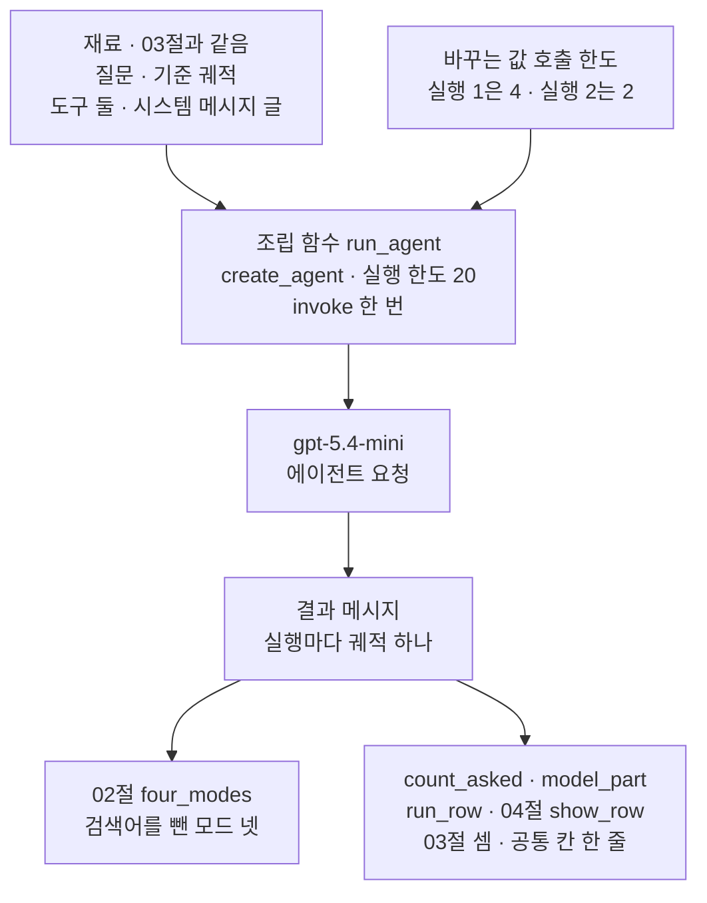
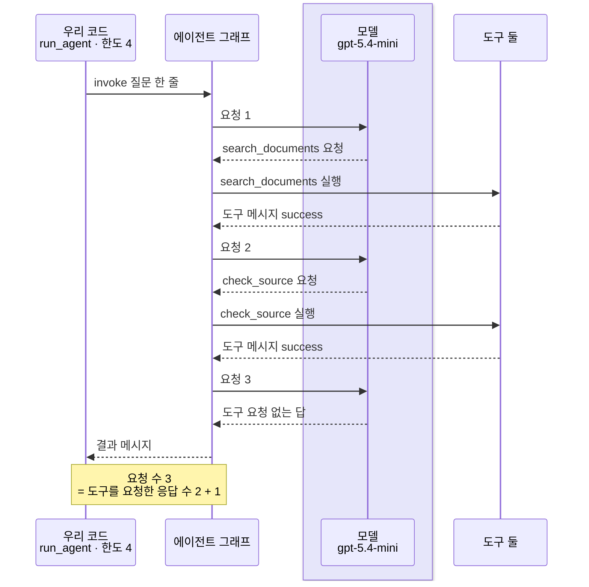
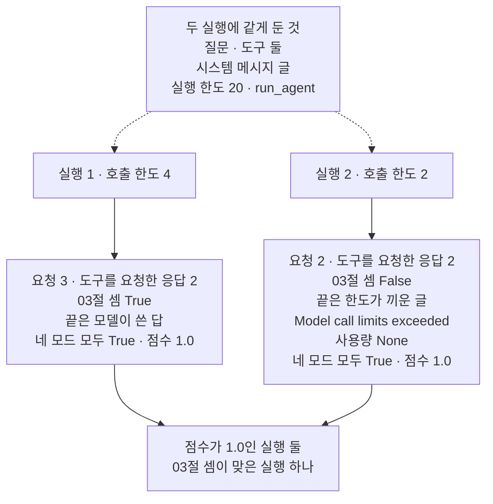

# 05-Agent-평가-실습

## _src 본문 (HTML 원본)

```html
<!--meta: 실습 30분 | 코드 notebooks/05-Agent-평가-실습.ipynb | 새 용어 0 -->
<style>html,body{overflow-x:hidden}.notebook,.nb-cell,.nb-main,.nb-input,.nb-result{min-width:0;max-width:100%}.nb-input pre,.nb-output{box-sizing:border-box;max-width:100%;overflow-x:auto}code.nb-source{display:block!important;width:100%!important;min-width:0!important;overflow-x:auto!important;padding:0!important}</style>
<h2 id="b1"><span class="no">1</span>학습 목표</h2><div class="goal"><ul>
<li>평가받는 에이전트·네 모드·공통 칸을 한 흐름에 모아, 에이전트를 실행하고 두 방법으로 평가할 수 있습니다.</li>
<li>호출 한도 하나만 바꾼 두 실행을 네 모드와 공통 칸 두 줄로 견줄 수 있습니다.</li>
<li>네 모드가 가려내지 못한, 한도에 닿은 실행을 요청 수 셈과 끝 메시지로 가려낼 수 있습니다.</li>
</ul></div>
<h2 id="b2"><span class="no">2</span>이 내용을 배우는 이유</h2><p>이 챕터에서는 에이전트를 평가하는 방법을 절마다 따로 익혔습니다. <a href="01-에이전트-평가-세-전략.html">01절</a>·<a href="02-궤적-매칭-네-모드.html">02절</a>은 궤적 맞춰 보기, <a href="03-LLM-judge로-궤적-평가.html">03절</a>은 실제 에이전트와 평가 모델, <a href="04-운영-지표와-Ch18-궤적-비교.html">04절</a>은 운영 지표를 봤습니다. 서비스에서는 에이전트가 늘 답까지 가지는 않습니다. 요금을 막으려고 붙인 호출 한도에 닿아, 답을 쓰기 전에 멈추는 실행도 생깁니다.</p>
<p>이번 실습은 03절의 평가받는 에이전트를 호출 한도 4와 2로 한 번씩 실행하고, 두 실행을 평가합니다. 한도에 닿은 실행은 <a href="../ch22-middleware/04-호출-한도와-재시도-폴백.html">Ch 22 04절</a>에서 본 안내 메시지로 끝납니다. <a href="../ch26-delegation/04-호출-수-비용-종료-조건-비교.html">Ch 26 04절</a>은 이 메시지를 「호출 한도가 적어 넣은 글」이라고 불렀고, 이 절에서는 한도가 끼운 끝 메시지라고 부릅니다.</p>
<p>그 끝 메시지의 사용량 기록이 <code>None</code>이라는 것은 Ch 26 04절에서 봤습니다. <a href="../ch26-delegation/05-위임-구조-실습.html">Ch 26 05절</a>도 호출 한도를 하나 줄여 완료 조건이 <code>False</code>가 되는 것을 봤습니다. 새로 볼 것은 이 챕터의 평가 방법, 곧 네 모드와 공통 칸·요청 수 셈이 그런 실행을 어떻게 판정하는지입니다.</p>
<p>이번 절은 이 챕터의 실습입니다. 01~04절과 앞 챕터에서 쓴 이름만 쓰고, 따로 내는 과제는 없습니다. 강사와 함께 노트북 셀을 차례로 실행합니다.</p>
<p><strong>이 절의 질문</strong> — 호출 한도에 닿아 답을 쓰지 못한 실행을, 궤적 맞춰 보기의 네 모드는 거짓으로 판정할까요? 판정하지 못한다면 무엇으로 가려낼 수 있을까요?</p>
<h2 id="b3"><span class="no">3</span>앞에서 배운 내용</h2><p>이번 실습은 아래 절에서 배운 이름을 그대로 씁니다. 함수는 도구 파일 <code>eval_tools.py</code>에서 가져오고, 조립 함수와 결과를 볼 함수 셋은 노트북에 적습니다.</p>
<table><thead><tr><th>절</th><th>배운 것</th><th>실습에서 쓰는 곳</th></tr></thead><tbody><tr><td><a href="01-에이전트-평가-세-전략.html">01절</a></td><td>기준 궤적을 만드는 함수 <code>make_trajectory</code> · 도구 차례를 모으는 함수 <code>called_tool_names</code> · 모드 <code>strict</code>는 메시지 글을 견주지 않음</td><td>기준 궤적 · 공통 칸의 도구 요청 수 · 실행 2의 모드 판정 읽기</td></tr><tr><td><a href="02-궤적-매칭-네-모드.html">02절</a></td><td>네 모드 · 도구별 덮어쓰기 · 함수 <code>four_modes</code></td><td>검색어를 뺀 네 모드로 두 궤적 판정</td></tr><tr><td><a href="03-LLM-judge로-궤적-평가.html">03절</a></td><td>평가받는 에이전트(<code>@tool</code> 둘 · <code>create_agent</code> · 호출 한도 4 · 실행 한도 20) · 셈 「요청 수 = 도구를 요청한 응답 수 + 1」</td><td>조립 함수 <code>run_agent</code> · 함수 <code>count_asked</code> · 두 실행의 셈</td></tr><tr><td><a href="04-운영-지표와-Ch18-궤적-비교.html">04절</a></td><td>운영 지표 · 공통 칸 여섯 · 함수 <code>show_row</code> · 세는 값으로 읽기</td><td>함수 <code>run_row</code> · 공통 칸 두 줄 표 · 점수와 셈으로 센 실행 수</td></tr><tr><td><a href="../../part5/ch19-model-tools/04-설명만으로-도구-선택하기.html">Ch 19 04</a>~<a href="../../part5/ch19-model-tools/06-오류와-읽기-쓰기-분리.html">06절</a></td><td>함수 <code>tool_call_names</code>·<code>sum_usage</code>·<code>show_messages</code></td><td>도구를 요청한 응답 세기 · 모델 요청 수 · 두 실행의 메시지 보기</td></tr><tr><td><a href="../ch22-middleware/04-호출-한도와-재시도-폴백.html">Ch 22 04절</a></td><td>호출 한도 <code>ModelCallLimitMiddleware</code> · 한도에 닿으면 한도가 끼운 글로 끝남</td><td>실행 2의 호출 한도 2</td></tr><tr><td><a href="../ch26-delegation/04-호출-수-비용-종료-조건-비교.html">Ch 26 04</a>·<a href="../ch26-delegation/05-위임-구조-실습.html">05절</a></td><td>한도가 끼운 끝 메시지는 사용량이 <code>None</code> · 자르기 <code>[:-1]</code> · 한도를 하나 줄인 실행과 완료 조건(05)</td><td>함수 <code>model_part</code></td></tr></tbody></table>
<p>붙인 기능은 03절의 평가받는 에이전트, 02절의 네 모드와 도구별 덮어쓰기, 04절의 공통 칸 셋입니다. 셋이 모두 흐름 안에서 일하도록 했습니다. 03절의 조립과 셈은 두 실행 모두에 쓰고, 02절의 네 모드는 두 궤적을 판정합니다. 04절의 공통 칸은 두 실행을 한 표에 모으고, 점수와 셈으로 실행 수를 셉니다.</p>
<p>03절의 평가 모델은 붙이지 않았습니다. 두 실행에 한 번씩 부르면 요청이 7번이 되어, 실습의 요청 수 3~5번을 넘기 때문입니다. 01절의 최종 답 평가도 붙이지 않았습니다. 실행 1의 답 글은 모델이 쓴 글이라, 기준 답과 글자까지 같다고 늘 말할 수 없기 때문입니다. 04절의 95 백분위수는 줄이 둘이면 늘 가장 큰 값이라 쓰지 않았습니다.</p>
<h2 id="b4"><span class="no">4</span>핵심 개념</h2><h3>비유로 시작하기</h3><p>01절부터 쓴 오르골 종이띠 비유를 이어 갑니다. 이번에는 곡 하나를 울린 띠를 나무판에 펴 붙이고, 판 왼쪽에 카드를 한 장 둡니다. 카드에는 기계를 몇 번 돌렸는지를 점으로 찍습니다. 기계에 멈춤쇠를 걸어 두면, 정해 둔 만큼 돌린 뒤 기계가 서고 띠 끝에 구멍 없는 회색 종이가 붙어 나온다고 해 봅니다. 띠와 카드를 한 판에 붙여 함께 보는 것이 이 절의 조립입니다.</p><p>두 띠를 구멍 자리만 대 보면, 앞부분 구멍은 같고 길이도 같습니다. 끝을 보면 위 띠는 구멍 무리로 끝나고, 아래 띠는 회색 종이로 끝납니다. 카드의 점도 위는 셋, 아래는 둘입니다. 띠가 궤적, 앞부분 구멍이 도구 요청, 회색 종이가 호출 한도가 끼운 끝 메시지입니다. 멈춤쇠가 호출 한도이고, 카드가 공통 칸 한 줄입니다.</p><p>비유와 다른 점도 있습니다. 오르골 띠는 기계에 넣기 전에 구멍을 뚫어 두지만, 궤적은 에이전트를 실행하면서 만들어집니다. 또 그림에는 멈춤쇠와 오르골 기계가 없고, 판에 붙인 띠와 카드만 있습니다.</p>
{{img:05-4-끝이-다른-두-띠|흰 바탕에 밝은 나무판 둘이 위아래로 가로놓여 있습니다. 판마다 크림색 종이띠 하나가 핀 여섯 개로 길게 고정되어 있고, 띠마다 둥근 구멍이 한 줄로 뚫려 있습니다. 두 띠는 길이가 같고, 앞부분은 같은 자리에 구멍이 이어집니다. 위 띠는 오른쪽 끝까지 구멍이 이어지고, 맨 끝에 구멍 세 개가 모여 있습니다. 아래 띠는 오른쪽 끝 부분이 구멍 없는 회색 종이입니다. 판마다 왼쪽 위에 흰 카드가 한 장씩 있고, 위 카드에는 검은 점 셋, 아래 카드에는 검은 점 둘이 찍혀 있습니다. 사람·손·글자·숫자·음표·화살표·오르골 기계는 없는 그림|같은 길이의 종이띠 둘 가운데 위 띠는 구멍 무리로, 아래 띠는 구멍 없는 회색 종이로 끝나고, 카드의 점은 셋과 둘입니다.}}
<p class="look"><b>그림 읽기</b> — 나무판 둘에 같은 길이의 종이띠가 하나씩 붙어 있고, 앞부분은 같은 자리에 구멍이 뚫려 있습니다. 끝 부분은 위 띠에서 구멍 무리로 끝나고, 아래 띠에서는 구멍 없는 회색 종이입니다. 띠가 궤적, 앞부분 구멍이 도구 요청이고, 끝 부분은 위 띠에서 모델이 쓴 답, 아래 띠에서 한도가 끼운 끝 메시지입니다. 판 왼쪽 카드는 공통 칸 한 줄이고, 점 셋과 둘은 모델 요청 수 3과 2입니다. 구멍의 수, 핀, 판의 나뭇결은 어떤 값과도 짝짓지 않습니다.</p>
<h3>실습 조립의 구성</h3><p>조립 함수 <code>run_agent</code>는 호출 한도 하나만 인자로 받습니다. 모델·도구 둘·시스템 메시지 글·질문·실행 한도는 앞 셀에서 만든 이름을 두 실행이 그대로 씁니다. 결과 메시지는 함수 <code>four_modes</code>와 <code>count_asked</code>·<code>model_part</code>·<code>run_row</code>가 두 실행 모두 같은 모양으로 봅니다. 공통 칸 한 줄은 04절 함수 <code>show_row</code>로 출력합니다.</p>
{{mermaid:05-1-평가받는-에이전트와-두-평가의-조립|위에서 아래로 읽는 흐름도입니다. 맨 위 왼쪽 초록 상자 재료 03절과 같음, 질문 · 기준 궤적 · 도구 둘 · 시스템 메시지 글과, 오른쪽 파란 상자 바꾸는 값 호출 한도, 실행 1은 4 · 실행 2는 2에서 화살표가 파란 상자 조립 함수 run_agent, create_agent · 실행 한도 20 · invoke 한 번으로 모입니다. 이어서 보라 상자 gpt-5.4-mini 에이전트 요청, 노란 상자 결과 메시지 실행마다 궤적 하나로 화살표가 갑니다. 결과 메시지 상자에서 화살표 둘이 아래 파란 상자 둘로 갈라집니다. 왼쪽은 02절 four_modes 검색어를 뺀 모드 넷, 오른쪽은 count_asked · model_part · run_row · 04절 show_row, 03절 셈 · 공통 칸 한 줄인 그림|03절의 평가받는 에이전트에 호출 한도 하나만 바꿔 넣고, 두 실행의 결과를 02절의 네 모드와 04절의 공통 칸으로 함께 봅니다.}}
<p class="look"><b>도식 읽기</b> — 위에서 아래로 읽습니다. 초록 상자는 03절과 같은 재료이고, 파란 상자는 바꾸는 값과 우리가 적거나 가져온 함수입니다. 보라 상자는 이 노트북이 실제로 부른 모델이고, 평가 모델은 부르지 않아 그리지 않았습니다. 노란 상자는 5절과 6절에서 함수 show_messages로 출력한 결과 메시지입니다. 아래 두 파란 상자는 같은 결과 메시지를 서로 다른 방법으로 보는 갈래이고, 서로의 차례가 아닙니다.</p>
<h3>한도에 닿은 실행의 끝</h3><p><a href="../ch22-middleware/04-호출-한도와-재시도-폴백.html">Ch 22 04절</a>에서 본 것처럼, 호출 한도는 모델 요청 전에 그때까지 센 요청 수를 봅니다. 센 수가 한도에 닿았으면 모델을 부르지 않고, 한도가 적은 글 하나를 응답으로 끼운 뒤 실행을 끝냅니다. 설치판 langchain 1.4.0 <code>agents/middleware/model_call_limit.py</code> 37~60행이 그 글을 만들고, 168~208행이 끝으로 보냅니다. <a href="../ch26-delegation/04-호출-수-비용-종료-조건-비교.html">Ch 26 04절</a>에서 본 것처럼, 이 끝 메시지는 모델 요청으로 받은 응답이 아니라 사용량 기록이 <code>None</code>입니다.</p><p>이 절의 궤적에는 요청이 3번 듭니다. 호출 한도가 2면 셋째 요청 전에 센 수가 2라, 셋째 요청이 나가지 않습니다. 그러면 궤적은 도구 요청 둘과 도구 메시지 둘 뒤에 끝 메시지가 붙은 모양이 됩니다. 이 모양을 네 모드와 공통 칸이 어떻게 판정하는지는 노트북 6·7절에서 봅니다.</p>
<h2 id="b5"><span class="no">5</span>실행 예제</h2><p>노트북 2절은 03절과 같은 질문·기준 궤적·도구 둘과, 검색어를 뺀 평가 함수 넷을 만듭니다. 3절은 시스템 메시지 글·실행 한도와 조립 함수를, 4절은 결과를 볼 함수 셋을 적습니다. 5절은 호출 한도 4인 실행 1을, 6절은 호출 한도만 2로 바꾼 실행 2를 실행하고 판정합니다. 7절에서 두 실행을 공통 칸 두 줄로 모아 셉니다.</p><p>실제 OpenAI 모델 <code>gpt-5.4-mini</code>를 temperature 0으로 부르고, 평가 모델은 부르지 않습니다. 모델 요청은 5절에서 3번, 6절에서 2번, 모두 5번이었고, 노트북 밖 다섯 번과 새 커널 두 번에서 같았습니다. 요금표로 어림한 예상 비용은 두 실행을 합쳐 0.002달러 아래이고, 청구 금액이 아닙니다. 읽는 파일은 <code>.env</code>와 도구 파일 <code>eval_tools.py</code>이고, 쓰는 파일은 없습니다. 걸린 시간은 재지 않았습니다.</p>
{{notebook:05-Agent-평가-실습}}
<p class="look"><b>확인할 점</b> — 노트북 5절과 6절 첫 셀에서 메시지를 차례대로 본 출력이 호출 한도 줄 말고는 같은지 봅니다. 두 실행의 둘째 셀에서 <code>사용량 기록이 없는가:</code> 뒤의 값을 견줍니다. 셋째 셀에서 03절 셈이 <code>True</code>와 <code>False</code>로 갈리는지 확인합니다.</p>
<h3>실행 1의 실제 순서</h3>
{{mermaid:05-2-실행-1의-실제-순서|세로선 넷이 있는 차례 그림입니다. 왼쪽부터 우리 코드 run_agent · 한도 4, 에이전트 그래프, 연보라 띠 안의 모델 gpt-5.4-mini, 도구 둘입니다. 우리 코드에서 invoke 질문 한 줄 화살표가 그래프로 갑니다. 그래프에서 요청 1 화살표가 모델로 가고 search_documents 요청 점선이 돌아오며, search_documents 실행 화살표가 도구로 가고 도구 메시지 success 점선이 돌아옵니다. 요청 2와 check_source도 같은 모양으로 이어집니다. 요청 3 화살표가 모델로 가고 도구 요청 없는 답 점선이 돌아온 뒤, 결과 메시지 점선이 우리 코드로 돌아옵니다. 맨 아래 우리 코드와 그래프에 걸친 노란 메모에 요청 수 3 = 도구를 요청한 응답 수 2 + 1이 적힌 그림|노트북 밖 다섯 번과 두 커널에서 모두, 실행 1은 도구 둘을 차례로 부른 뒤 답해 모델 요청이 3번이었습니다.}}
<p class="look"><b>도식 읽기</b> — 위에서 아래로 실행 차례대로 읽고, 세로선은 왼쪽부터 우리 코드, 그래프, 모델, 도구 둘입니다. 연보라 띠는 실제로 부른 모델 gpt-5.4-mini의 자리이고, 실선은 부르는 쪽, 점선은 돌아오는 쪽입니다. 도구 이름과 결과 상태는 노트북 5절 첫 셀 출력이고, 맨 아래 노란 메모는 셋째 셀 출력입니다. 요청마다 수를 세는 호출 한도는 이 그림에 따로 그리지 않았습니다. 요청의 차례는 노트북 밖 다섯 번과 새 커널 두 번에서 같았을 때만 그렸습니다.</p>
<h2 id="b6"><span class="no">6</span>실험 결과 해석</h2><p>두 실행은 질문·도구·시스템 메시지 글·실행 한도·조립 함수가 같고, 호출 한도만 달랐습니다. 아래 표는 노트북 5·6·7절 출력에서 코드가 정하는 값과, 모델이 정한 값을 모은 것입니다.</p>
<table><thead><tr><th>확인한 것</th><th>실행 1(호출 한도 4)</th><th>실행 2(호출 한도 2)</th><th>값의 성격</th></tr></thead><tbody><tr><td>호출 한도</td><td>4</td><td>2</td><td>바꾼 값</td></tr><tr><td>메시지를 차례대로 본 출력</td><td>도구 요청 <code>search_documents</code> → <code>check_source</code> · 마지막 응답은 도구 요청 없음</td><td>실행 1과 한 줄도 다르지 않음</td><td>모델 판단 값(다섯 번·두 커널 같음)</td></tr><tr><td>마지막 메시지</td><td>모델이 쓴 답 · 사용량 기록 있음</td><td><code>Model call limits exceeded: run limit (2/2)</code> · 사용량 기록 <code>None</code></td><td>한도에 닿으면 라이브러리가 정하는 값</td></tr><tr><td>요청 수 · 도구를 요청한 응답 수 · 03절 셈</td><td><code>3</code> · <code>2</code> · <code>True</code></td><td><code>2</code> · <code>2</code> · <code>False</code></td><td>모델 판단 값(다섯 번·두 커널 같음)</td></tr><tr><td>네 모드(검색어 뺌)</td><td>모두 <code>True</code></td><td>모두 <code>True</code></td><td>같은 궤적이면 늘 같은 판정</td></tr><tr><td>공통 칸 도구 요청 수 · 걸린 초 · 점수</td><td><code>2</code> · <code>None</code> · <code>1.0</code></td><td><code>2</code> · <code>None</code> · <code>1.0</code></td><td>세는 값 · 재지 않음 · 모드 <code>strict</code> 판정</td></tr><tr><td>답 글 · 토큰 수</td><td>5절 둘째 셀 · 7절 첫 셀 출력</td><td>7절 첫 셀 출력</td><td>흔들리는 값 — 아래 표</td></tr></tbody></table>
<p>노트북 밖 다섯 번과 두 커널에서 모두, 두 실행은 도구 둘을 같은 차례로 불렀습니다. 실행 1은 셋째 요청에서 답을 썼고, 요청 수 3은 도구를 요청한 응답 수 2에 1을 더한 값과 같았습니다. 실행 2는 셋째 요청 전에 호출 한도에 닿아, 한도가 끼운 끝 메시지로 끝났습니다. 요청 수 2는 도구를 요청한 응답 수와 같았고, 03절 셈은 맞지 않았습니다.</p>
<p>그런데 두 실행 모두 네 모드가 참이었습니다. 네 모드는 도구 요청을 견주고, 메시지 글은 견주지 않습니다. 모드 <code>strict</code>는 메시지 수·역할·차례까지 봅니다. 실행 2의 끝 메시지는 도구를 요청하지 않는 응답이라, 기준 궤적의 답과 같은 자리로 보였습니다. 그래서 공통 칸의 점수 칸은 두 줄 모두 1.0이었고, 요청 수 칸만 두 줄을 갈랐습니다.</p>
{{mermaid:05-3-호출-한도-4와-2의-두-실행|위에서 아래로 읽는 흐름도입니다. 맨 위 회색 상자 두 실행에 같게 둔 것, 질문 · 도구 둘 · 시스템 메시지 글 · 실행 한도 20 · run_agent에서 점선 둘이 나란한 파란 상자 둘로 갑니다. 왼쪽 파란 상자 실행 1 · 호출 한도 4 아래 노란 상자에는 요청 3 · 도구를 요청한 응답 2, 03절 셈 True, 끝은 모델이 쓴 답, 네 모드 모두 True · 점수 1.0이 있습니다. 오른쪽 파란 상자 실행 2 · 호출 한도 2 아래 노란 상자에는 요청 2 · 도구를 요청한 응답 2, 03절 셈 False, 끝은 한도가 끼운 글 Model call limits exceeded, 사용량 None, 네 모드 모두 True · 점수 1.0이 있습니다. 두 노란 상자는 맨 아래 노란 상자 점수가 1.0인 실행 둘, 03절 셈이 맞은 실행 하나로 모이는 그림|노트북 밖 다섯 번과 두 커널에서 모두, 두 실행은 네 모드가 참이었고 03절 셈은 한도 4 실행에서만 맞았습니다.}}
<p class="look"><b>도식 읽기</b> — 위에서 아래로 읽습니다. 맨 위 회색 상자는 두 실행에 같게 둔 조건이고, 파란 상자가 바꾼 값 호출 한도입니다. 왼쪽 칸이 실행 1, 오른쪽 칸이 실행 2이고, 노란 상자는 노트북 5·6·7절 출력입니다. 두 칸의 마지막 줄은 같고, 요청 수와 03절 셈, 끝 메시지만 다릅니다. 두 칸의 값은 노트북 밖 다섯 번과 새 커널 두 번에서 모두 같았습니다.</p>
<p>도구를 모두 부른 뒤 한도에 닿은 실행은, 답을 쓰지 못했어도 네 모드로는 통과했습니다. Ch 26 05절의 완료 조건처럼, 그 실행을 가려낸 것은 요청 수 셈과 끝 메시지의 사용량 기록이었습니다. 궤적 맞춰 보기는 도구를 기준대로 불렀는지를, 운영 지표는 실행이 어떻게 끝났는지를 봅니다. 두 방법을 함께 봐야 두 실행의 차이가 드러납니다.</p>
<p>아래 표는 두 실행의 교재 출력 토큰 수입니다. 실행 2에는 셋째 요청이 없어 토큰 수가 적었지만, 토큰 수는 다시 실행하면 달라질 수 있어 결론에 쓰지 않았습니다.</p>
<table><thead><tr><th>실행</th><th>공통 칸 토큰 수(교재 출력)</th></tr></thead><tbody><tr><td>실행 1(호출 한도 4)</td><td>996</td></tr><tr><td>실행 2(호출 한도 2)</td><td>615</td></tr></tbody></table>
<p>새 커널로 두 번 실행해 견주자, 코드 셀 스물넷의 출력이 셀마다 모두 같았습니다. 답 글과 토큰 수도 두 번 같았고, 노트북 밖 다섯 번의 값과도 같았습니다. 그래도 둘은 모델과 서비스가 정한 값이라, 셈·모드 판정·세는 칸만 결론과 그림에 썼습니다.</p>
<p class="look"><b>확인할 점</b> — 노트북 7절 첫 셀에서 두 줄의 요청 수 칸과 점수 칸을 봅니다. 둘째 셀에서 <code>점수가 1.0인 실행: 2 | 셈이 맞은 실행: 1 | 전체 실행: 2</code>를 확인합니다. 교재 출력의 토큰 수는 다시 실행하면 달라질 수 있습니다.</p>
<h2 id="b7"><span class="no">7</span>주의할 점과 실무 메모</h2><ul><li>질문·기준 궤적·도구 둘·시스템 메시지 글·실행 한도는 03절과 같은 값으로 실행 전에 정했습니다. 호출 한도 4와 2도 실행 전에 정했습니다. 4는 03절과 같은 값이고, 2는 03절 셈으로 드는 요청 3보다 하나 모자란 값입니다. 흐름을 보여 주려고 정한 예이고, 결과를 보고 바꾸지 않았습니다.</li><li>노트북을 쓰기 전에 두 실행을 노트북 밖에서 다섯 번씩 보냈습니다. 두 실행 모두 다섯 번 다 모델은 도구 둘을 같은 차례로 불렀고, 실행 2는 다섯 번 모두 한도에 닿았습니다. 그래도 같은 요청이 늘 같은 도구를 고른다고 할 수는 없습니다. 같은 요청도 실행한 때에 따라 모델이 고르는 도구가 달라질 수 있습니다.</li><li>실행 2는 도구 둘을 모두 부른 뒤 한도에 닿아, 궤적의 메시지 수가 기준과 같았습니다. 한도를 1로 두고 모델이 먼저 검색을 요청하면, 검색 뒤에 멈춰 궤적이 짧아집니다. 02절 4절의 검색만 한 궤적과 같은 모양이라, 네 모드의 뜻대로라면 모드 <code>subset</code>만 참이 될 것입니다. 이 장면은 이번에 실행하지 않았습니다.</li><li>03절의 평가 모델과 01절의 최종 답 평가는 붙이지 않았습니다. 두 실행에 평가 모델을 한 번씩 부르면 요청이 7번이 됩니다. 최종 답 평가는 실행 1의 답 글이 기준 답과 글자까지 같아야 참이라, 모델이 쓴 글에 따라 흔들립니다. 최종 답 평가는 마지막 글을 기준 답과 글자로 견주므로, 실행 2의 끝 메시지 글이면 거짓이 될 것입니다. 두 방법이 실행 2를 어떻게 판정하는지는 이번에 실행하지 않았습니다.</li><li>공통 칸의 도구 요청 수는 도구 이름의 수이고, 03절 셈에는 도구를 요청한 응답 수를 넣었습니다. 이번 두 실행은 응답마다 도구를 하나씩 요청해 두 수가 같았습니다. 한 응답이 도구를 여럿 요청하면 두 수가 달라지니, 04절에서 본 것처럼 셈에는 응답 수를 넣습니다.</li><li>함수 <code>model_part</code>는 마지막 메시지의 사용량 기록이 <code>None</code>인지로 끝 메시지를 가려냅니다. 끝 메시지의 글은 설치판 langchain 1.4.0이 정한 영어 글이라, 판이 바뀌면 달라질 수 있습니다. 도구 파일 88~96행의 함수 <code>sum_usage</code>는 응답마다 사용량 칸을 바로 읽어, 사용량이 <code>None</code>인 끝 메시지를 넘기면 <code>TypeError</code>로 멈춥니다. 그래서 함수 <code>model_part</code>로 끝 메시지를 뺐습니다.</li><li>점수 칸에는 두 실행 모두 모드 <code>strict</code>(검색어 뺌)의 판정을 담았습니다. 04절의 두 기록은 점수 칸의 잣대가 달랐지만, 이 절의 두 줄은 같은 잣대입니다. 이번에는 네 모드가 모두 참이라, 다른 모드를 담았어도 두 줄 모두 1.0입니다.</li><li>호출 한도는 조립 함수 안에서 실행마다 새로 만들었고, 03절처럼 invoke 한 번마다 셉니다. 실행 한도 20에는 두 실행 모두 닿지 않았습니다. 이 노트북의 <code>assert</code>는 키 확인 셀뿐이고, 모델이 고른 값에는 걸지 않았습니다.</li><li>교재 출력의 토큰 수는 실행 1 996, 실행 2 615였습니다. 노트북 밖 다섯 번의 토큰으로 요금표를 어림하면, 두 실행을 합쳐 약 0.0016달러입니다. 요금표는 2026-09-17 mini 값이고, 청구 금액이 아닙니다.</li><li>교재 출력은 Linux의 Python 3.12.13으로 만들었고, 다른 판과 Windows·macOS에서는 실행하지 않았습니다. 걸린 시간은 재지 않았습니다.</li></ul>
<h2 id="b8"><span class="no">8</span>정리와 다음 절</h2><ul><li>03절의 평가받는 에이전트, 02절의 네 모드와 도구별 덮어쓰기, 04절의 공통 칸을 한 흐름에 모았습니다.</li><li>호출 한도를 4에서 2로 줄이자, 실행 2는 도구 둘을 부른 뒤 한도가 끼운 글로 끝났고 03절 셈이 <code>False</code>였습니다.</li><li>두 실행 모두 네 모드가 참이었고, 한도에 닿은 실행은 요청 수 셈과 끝 메시지로 가려냈습니다. 둘째·셋째 줄의 값은 노트북 밖 다섯 번과 새 커널 두 번에서 모두 같았습니다.</li></ul><p><strong>다음 학습과 이어지는 지점</strong> — 이 절로 Ch 29와 Part 6이 끝납니다. <a href="../../part7/ch30-fastapi-serving/01-비동기-라우팅과-스키마.html">Part 7 Ch 30 01절</a>에서는 웹 서비스가 받을 요청과 내놓을 응답의 모양을 정합니다.</p>
<h2 id="b9"><span class="no">9</span>복습 문제</h2><details class="quiz" open><summary>문제 4개 · 해설 포함</summary><p class="quiz-q">1. [하] 실행 2에서 바꾼 값은 무엇이고, 메시지를 차례대로 본 출력은 실행 1과 어떻게 달랐나요?</p><p class="quiz-a">호출 한도를 4에서 2로 바꿨습니다. 메시지를 차례대로 본 출력은 호출 한도 줄 말고는 실행 1과 한 줄도 다르지 않았습니다. 차이는 마지막 메시지의 글과 사용량 기록에서 보였습니다. 틀렸다면 노트북 6절 첫 셀과 둘째 셀을 다시 읽습니다.</p><p class="quiz-q">2. [중] 실행 2의 모델 요청 수와 도구를 요청한 응답 수는 몇이었고, 03절 셈은 어떻게 되었나요?</p><p class="quiz-a">둘 다 2였고, 셈 「요청 수 = 도구를 요청한 응답 수 + 1」은 <code>False</code>였습니다. 셋째 요청 전에 호출 한도에 닿아, 답을 쓴 응답이 없었기 때문입니다. 노트북 밖 다섯 번과 새 커널 두 번에서 같은 값이었습니다. 틀렸다면 노트북 6절 셋째 셀을 다시 읽습니다.</p><p class="quiz-q">3. [중] 답을 쓰지 못한 실행 2를, 검색어를 뺀 네 모드가 모두 참으로 본 까닭은 무엇인가요?</p><p class="quiz-a">네 모드는 도구 요청을 견주고, 메시지 글은 견주지 않습니다. 실행 2는 도구 요청 둘이 기준과 같았습니다. 모드 <code>strict</code>가 보는 메시지 수·역할·차례도, 끝 메시지가 도구를 요청하지 않는 응답이라 기준과 같았습니다. 틀렸다면 노트북 6절 넷째 셀을 다시 읽습니다.</p><p class="quiz-q">4. [상] 같은 에이전트에 호출 한도 3을 주면, 모델 요청 수와 03절 셈, 네 모드는 어떻게 될 것으로 어림하나요?</p><p class="quiz-a">호출 한도는 모델 요청 전에 센 수를 봅니다. 셋째 요청 전에 센 수는 2라 한도 3 안이어서, 셋째 요청이 나가 답까지 갈 것입니다. 그러면 실행 1처럼 요청 3·셈 <code>True</code>·네 모드 <code>True</code>로 어림합니다. 다만 모델이 도구 둘을 같은 차례로 부를 때의 어림이고, 한도 3은 이번에 실행하지 않았습니다. 틀렸다면 노트북 6절 첫 설명과 본문 「한도에 닿은 실행의 끝」을 다시 읽습니다.</p></details>
<h2 id="b10"><span class="no">10</span>참고 자료</h2><ul><li><a href="03-LLM-judge로-궤적-평가.html">03절</a> — 평가받는 에이전트, 호출 한도 4와 실행 한도 20, 셈 「요청 수 = 도구를 요청한 응답 수 + 1」.</li><li><a href="02-궤적-매칭-네-모드.html">02절</a>과 <a href="04-운영-지표와-Ch18-궤적-비교.html">04절</a> — 네 모드와 도구별 덮어쓰기, 운영 지표와 공통 칸.</li><li>설치판 langchain 1.4.0 <code>agents/middleware/model_call_limit.py</code> 37~60행은 한도가 끼우는 끝 메시지의 글을 만듭니다. 168~208행은 모델 요청 전에 센 수를 보고 끝으로 보내고, 236~251행은 요청 뒤에 수를 더합니다.</li><li><a href="../ch22-middleware/04-호출-한도와-재시도-폴백.html">Ch 22 04절</a> — 호출 한도 <code>ModelCallLimitMiddleware</code>와 한도에 닿은 실행의 끝.</li><li><a href="../ch26-delegation/04-호출-수-비용-종료-조건-비교.html">Ch 26 04</a>·<a href="../ch26-delegation/05-위임-구조-실습.html">05절</a> — 한도가 끼운 끝 메시지의 사용량 기록과, 그 메시지를 빼고 세는 자르기.</li><li>기준 버전은 노트북 1절 첫 셀에서 설치한 패키지 넷의 판입니다.</li></ul>
```

## 노트북 셀 (순서대로)

### [0] markdown {'html': 'skip'}

# Agent 평가 실습: 호출 한도를 줄인 실행을 궤적과 운영 지표로 견주기

**이 노트북에서 할 일**

1. 03절의 평가받는 에이전트, 02절의 네 모드, 04절의 공통 칸을 한 흐름에 모읍니다.
2. 호출 한도 4인 실행 1과, 그 값 하나만 2로 줄인 실행 2를 차례로 실행합니다.
3. 두 실행을 네 모드와 공통 칸 두 줄로 견주어, 한도에 닿은 실행을 무엇이 가려내는지 봅니다.

**준비물** — 프로젝트 폴더의 `.env` 파일에 `OPENAI_API_KEY`가 있어야 합니다.
모델은 `gpt-5.4-mini`이고, 실행 1과 실행 2에서 에이전트를 한 번씩 실행합니다.
노트북 밖에서 두 실행을 다섯 번씩 보냈을 때, 요청은 실행 1이 3번, 실행 2가 2번이었습니다.
그래서 이 노트북의 모델 요청은 모두 5번으로 어림하고, 평가 모델은 부르지 않습니다.
호출 한도를 붙여, 한 실행의 요청이 한도를 넘지 않게 막습니다.

요금표로 어림한 예상 비용은 두 실행을 합쳐 0.002달러 아래이고, 청구 금액이 아닙니다.
읽는 파일은 `.env`와 같은 폴더의 도구 파일 `eval_tools.py`이고, 쓰는 파일은 없습니다.
모델이 쓰는 답 글과 토큰 수는 실행마다 달라질 수 있고, 걸린 시간은 재지 않았습니다.
앞에서 배운 함수 일곱은 도구 파일에서 가져옵니다.

**기준 버전** — 첫 셀에서 패키지 넷을 설치합니다.
판은 agentevals 0.0.9와 langchain 1.4.0입니다.
모델을 부르는 langchain-openai는 1.6.0, 키를 읽는 python-dotenv는 1.2.3입니다.
교재 출력은 Linux의 Python 3.12.13으로 만들었고, 다른 판과 Windows·macOS에서는 실행하지 않았습니다.

**실습 범위** — 이 절은 이 챕터의 실습이고, 30분 안팎입니다.
따로 내는 과제는 없고, 강사와 함께 첫 셀부터 차례로 실행합니다.

실습 폴더 `labs/part6/ch29-agent-evaluation`에서 `uv sync --locked`를 실행합니다.
그다음 `notebooks/` 폴더의 이 노트북을 열고, 실습 폴더의 `.venv` 커널을 고릅니다.
첫 셀부터 순서대로 실행합니다.

### [1] markdown {'html': 'skip'}

## 오늘 볼 그림


위에서 아래로 읽습니다.
초록 상자는 03절과 같은 재료이고, 파란 상자는 바꾸는 값과 우리가 적거나 가져온 함수입니다.
보라 상자는 이 노트북이 실제로 부른 모델이고, 평가 모델은 부르지 않아 그리지 않았습니다.
노란 상자는 5절과 6절에서 함수 show_messages로 출력한 결과 메시지입니다.
아래 두 파란 상자는 같은 결과 메시지를 서로 다른 방법으로 보는 갈래이고, 서로의 차례가 아닙니다.

### [2] markdown {}

## 1. 준비

이 절은 Ch 29의 실습입니다.
01~04절에서 하나씩 본 기능 가운데 셋을, 도서관 규정에 답하는 에이전트 하나에 모읍니다.
03절의 평가받는 에이전트, 02절의 네 모드와 도구별 덮어쓰기, 04절의 공통 칸입니다.
그다음 호출 한도 하나만 바꿔 두 번 실행하고, 두 결과를 견줍니다.

첫 셀은 패키지 넷을 설치하고 설치된 판 번호를 출력합니다.
03절과 같은 넷이고, 설치에는 몇십 초가 걸릴 수 있습니다.

### [3] code {'execution': {'iopub.execute_input': '2026-09-29T03:40:47.052299Z', 'iopub.status.busy': '2026-09-29T03:40:47.052129Z', 'iopub.status.idle': '2026-09-29T03:40:47.859916Z', 'shell.execute_reply': '2026-09-29T03:40:47.859354Z'}, 'lesson_role': 'setup'}

```python
# 이 절에서 쓰는 패키지를 설치하고 버전을 확인합니다
%pip install -q "agentevals==0.0.9" "langchain==1.4.0" "langchain-openai==1.6.0" "python-dotenv==1.2.3"
from importlib.metadata import version

print("agentevals:", version("agentevals"))
print("langchain:", version("langchain"))
print("langchain-openai:", version("langchain-openai"))
print("python-dotenv:", version("python-dotenv"))
```

출력:
```
Note: you may need to restart the kernel to use updated packages.
agentevals: 0.0.9
langchain: 1.4.0
langchain-openai: 1.6.0
python-dotenv: 1.2.3

```

### [4] markdown {}

**결과 읽기** — 출력 줄 `agentevals: 0.0.9`, `langchain: 1.4.0`, `langchain-openai: 1.6.0`, `python-dotenv: 1.2.3`이 보입니다.
넷 모두 실습 폴더 잠금과 같은 판입니다.

다음 셀은 이 절에서 쓸 이름을 가져옵니다.
03절처럼 평가 함수를 만드는 함수와, 에이전트·호출 한도·모델·메시지·도구 이름을 가져옵니다.
마지막 가져오기 줄은 앞에서 배운 함수 일곱을 도구 파일에서 가져옵니다.

### [5] code {'execution': {'iopub.execute_input': '2026-09-29T03:40:47.861024Z', 'iopub.status.busy': '2026-09-29T03:40:47.860938Z', 'iopub.status.idle': '2026-09-29T03:40:48.516598Z', 'shell.execute_reply': '2026-09-29T03:40:48.516164Z'}, 'lesson_role': 'setup'}

```python
# 궤적을 맞춰 보는 평가 함수를 만드는 함수와, 에이전트·호출 한도·모델·메시지·도구 이름을 가져옵니다(Ch 6·13·19·21·22)
from agentevals.trajectory.match import create_trajectory_match_evaluator
from langchain.agents import create_agent
from langchain.agents.middleware import ModelCallLimitMiddleware
from langchain.chat_models import init_chat_model
from langchain.messages import HumanMessage
from langchain.tools import tool
# 앞에서 배운 함수는 도구 파일에서 가져옵니다
from eval_tools import called_tool_names, four_modes, make_trajectory, show_messages, show_row, sum_usage, tool_call_names

print("도구 파일에서 가져온 함수:", "called_tool_names, four_modes, make_trajectory, show_messages, show_row, sum_usage, tool_call_names")
```

출력:
```
도구 파일에서 가져온 함수: called_tool_names, four_modes, make_trajectory, show_messages, show_row, sum_usage, tool_call_names

```

### [6] markdown {}

**결과 읽기** — 라벨 `도구 파일에서 가져온 함수:` 뒤에 `show_row`·`four_modes`·`sum_usage` 등 함수 일곱의 이름이 보입니다.
앞에서 배운 함수는 `eval_tools.py`에 모아 두었습니다.
파일을 열면 코드를 볼 수 있습니다.

노트북과 같은 폴더(`notebooks/`)에 있는 파일입니다.
커널이 `notebooks/` 폴더에서 시작해야 이 파일을 가져올 수 있습니다.
교재 출력을 만든 실행 도구는 이 폴더를 따로 알려 주어, 다른 자리에서 시작해도 가져오기가 되었습니다.

함수 `show_row(row)`는 04절 노트북에서 처음 적은 함수이고, 이 절부터 도구 파일에서 가져옵니다.
도구 파일에는 04절 셀의 주석과 본문을 글자 그대로 옮겼고, 인자도 04절과 같습니다.
나머지 여섯은 03절에서도 가져온 이름입니다.
함수 `make_trajectory`·`called_tool_names`는 01절, `four_modes`는 02절에서 배웠습니다.
함수 `tool_call_names`·`sum_usage`·`show_messages`는 Ch 19 04~06절에서 배웠습니다.

### [7] markdown {}

API 키가 있는지 확인합니다. `True` 값이 나오면 다음으로 넘어갑니다.

### [8] code {'execution': {'iopub.execute_input': '2026-09-29T03:40:48.517412Z', 'iopub.status.busy': '2026-09-29T03:40:48.517346Z', 'iopub.status.idle': '2026-09-29T03:40:48.522602Z', 'shell.execute_reply': '2026-09-29T03:40:48.522303Z'}, 'lesson_role': 'setup'}

```python
# .env 파일에서 OpenAI API 키를 읽습니다(키 값은 출력하지 않습니다)
import os
from dotenv import find_dotenv, load_dotenv

env_path = find_dotenv(usecwd=True)
load_dotenv(env_path)
has_key = os.getenv("OPENAI_API_KEY") is not None
print("OPENAI_API_KEY 설정 여부:", has_key)
assert has_key, "프로젝트 폴더의 .env 파일에 OPENAI_API_KEY를 적어 주세요."
```

출력:
```
OPENAI_API_KEY 설정 여부: True

```

### [9] markdown {}

실습에 쓸 모델을 준비합니다.
temperature 값을 0으로 두어 매번 비슷한 답을 고르게 합니다.

### [10] code {'execution': {'iopub.execute_input': '2026-09-29T03:40:48.523264Z', 'iopub.status.busy': '2026-09-29T03:40:48.523203Z', 'iopub.status.idle': '2026-09-29T03:40:49.445555Z', 'shell.execute_reply': '2026-09-29T03:40:49.445301Z'}}

```python
# 실습에 쓸 모델을 준비합니다
model = init_chat_model(
    "openai:gpt-5.4-mini",
    temperature=0,
    reasoning_effort="none",
)
print("모델 이름:", model.model_name)
print("temperature:", model.temperature)
```

출력:
```
모델 이름: gpt-5.4-mini
temperature: 0.0

```

### [11] markdown {}

**결과 읽기** — 모델 이름 `gpt-5.4-mini`, temperature `0.0`이 보이면 준비가 끝났습니다.
이 노트북의 출력은 2026-09-29에 이 모델로 실행한 결과입니다.
temperature 값을 0으로 두어도, 실행마다 답 문장이 달라질 수 있습니다.
이 셀은 모델 객체만 만들고, 모델 요청은 아직 보내지 않습니다.
모델 요청은 5절과 6절의 실행 셀에서만 나갑니다.

## 2. 재료: 질문·기준 궤적·도구 둘

실습 재료는 03절과 같은 질문·기준 궤적·도구 둘입니다.
다음 셀은 03절 2절과 같은 질문·기준 답·결과 글을 정합니다.
아래에서 만들 도구 함수도 이 결과 글을 내놓습니다.

### [12] code {'execution': {'iopub.execute_input': '2026-09-29T03:40:49.446298Z', 'iopub.status.busy': '2026-09-29T03:40:49.446236Z', 'iopub.status.idle': '2026-09-29T03:40:49.448256Z', 'shell.execute_reply': '2026-09-29T03:40:49.447960Z'}}

```python
# 질문과 기준 답, 도구마다 돌아올 결과 글을 정합니다(03절 2절과 같은 값 — 아래 도구 함수도 이 글을 내놓음)
question = "일반 도서는 며칠 동안 빌릴 수 있나요?"
reference_answer = "일반 도서는 14일 동안 빌릴 수 있습니다."
tool_results = {
    "search_documents": "[LIB-001] 일반 도서는 14일 동안 대출할 수 있습니다. 예약자가 없으면 한 번 연장할 수 있습니다.",
    "check_source": "LIB-001 문서가 있습니다. 제목: 도서 대출 기간",
}
print("질문:", question)
print("기준 답:", reference_answer)
print("결과 글을 정한 도구:", list(tool_results))
```

출력:
```
질문: 일반 도서는 며칠 동안 빌릴 수 있나요?
기준 답: 일반 도서는 14일 동안 빌릴 수 있습니다.
결과 글을 정한 도구: ['search_documents', 'check_source']

```

### [13] markdown {}

**결과 읽기** — 출력 줄 `기준 답: 일반 도서는 14일 동안 빌릴 수 있습니다.`가 보입니다.
라벨 `결과 글을 정한 도구:` 뒤에는 `'search_documents'`와 `'check_source'`가 있습니다.

다음 셀은 03절 2절과 같은 셀로, 도구 요청 둘로 기준 궤적을 만듭니다.

### [14] code {'execution': {'iopub.execute_input': '2026-09-29T03:40:49.448785Z', 'iopub.status.busy': '2026-09-29T03:40:49.448731Z', 'iopub.status.idle': '2026-09-29T03:40:49.450596Z', 'shell.execute_reply': '2026-09-29T03:40:49.450296Z'}}

```python
# 01절과 같은 도구 요청 둘로 기준 궤적을 만들고, 도구 차례와 메시지 수를 봅니다
search_args = {"query": "도서 대출 기간"}
source_args = {"doc_id": "LIB-001"}
reference_calls = [
    {"name": "search_documents", "args": search_args, "id": "call_1", "type": "tool_call"},
    {"name": "check_source", "args": source_args, "id": "call_2", "type": "tool_call"},
]
reference = make_trajectory(question, reference_calls, tool_results, reference_answer)
print("기준 궤적의 도구 차례:", called_tool_names(reference))
print("메시지 수:", len(reference))
```

출력:
```
기준 궤적의 도구 차례: ['search_documents', 'check_source']
메시지 수: 6

```

### [15] markdown {}

**결과 읽기** — 출력 줄 `기준 궤적의 도구 차례: ['search_documents', 'check_source']`와 `메시지 수: 6`이 보입니다.
검색한 뒤 출처를 확인하고 답하는, 01~03절과 같은 기준 궤적입니다.

다음 셀은 03절 4절과 같은 셀로, 검색 도구를 만듭니다.
03절처럼 `@tool` 줄은 아래 함수를 도구로 등록하고, 독스트링은 모델이 읽는 도구 설명이 됩니다.

### [16] code {'execution': {'iopub.execute_input': '2026-09-29T03:40:49.451115Z', 'iopub.status.busy': '2026-09-29T03:40:49.451069Z', 'iopub.status.idle': '2026-09-29T03:40:49.453497Z', 'shell.execute_reply': '2026-09-29T03:40:49.453238Z'}}

```python
# 검색 도구를 만듭니다(교재용 — 어떤 검색어에도 2절 결과 글 딕셔너리의 검색 결과 글을 내놓음)
@tool
def search_documents(query: str):
    """도서관 규정 문서를 검색어로 찾아, 문서 ID를 붙인 글로 내놓습니다."""
    return tool_results["search_documents"]
```

출력:
```

```

### [17] markdown {}

**결과 읽기** — 정의 셀이라 출력이 없습니다.
이 검색 도구는 교재용이라, 어떤 검색어에도 같은 검색 결과 글을 내놓습니다.

다음 셀도 03절 4절과 같은 셀로, 출처 확인 도구를 만듭니다.

### [18] code {'execution': {'iopub.execute_input': '2026-09-29T03:40:49.453989Z', 'iopub.status.busy': '2026-09-29T03:40:49.453947Z', 'iopub.status.idle': '2026-09-29T03:40:49.456243Z', 'shell.execute_reply': '2026-09-29T03:40:49.455869Z'}}

```python
# 출처 확인 도구를 만듭니다(문서 ID가 LIB-001일 때만 문서가 있다고 내놓음)
@tool
def check_source(doc_id: str):
    """문서 ID로 그 문서가 있는지 확인하고, 있으면 제목을 내놓습니다."""
    if doc_id == "LIB-001":
        return tool_results["check_source"]
    return doc_id + " 문서가 없습니다."
```

출력:
```

```

### [19] markdown {}

**결과 읽기** — 정의 셀이라 출력이 없습니다.
문서 ID가 `LIB-001`이면 출처 확인 결과 글을, 아니면 그 문서가 없다는 글을 내놓습니다.

검색어는 모델이 고르는 값이라, 기준 궤적의 검색어와 다를 수 있습니다.
그래서 03절 5절처럼 검색 도구의 인자만 보지 않는 평가 함수를 모드 넷마다 만듭니다.
02절 7절에서 본 도구별 덮어쓰기입니다.

### [20] code {'execution': {'iopub.execute_input': '2026-09-29T03:40:49.456733Z', 'iopub.status.busy': '2026-09-29T03:40:49.456686Z', 'iopub.status.idle': '2026-09-29T03:40:49.458687Z', 'shell.execute_reply': '2026-09-29T03:40:49.458336Z'}}

```python
# 검색 도구의 인자만 보지 않는 평가 함수를 모드 넷마다 만듭니다(03절 5절 — 02절 7절의 도구별 덮어쓰기)
modes = ["strict", "unordered", "subset", "superset"]
search_free = {}
for mode in modes:
    search_free[mode] = create_trajectory_match_evaluator(
        trajectory_match_mode=mode,
        tool_args_match_overrides={"search_documents": "ignore"},
    )
print("평가 함수를 만든 모드:", list(search_free))
```

출력:
```
평가 함수를 만든 모드: ['strict', 'unordered', 'subset', 'superset']

```

### [21] markdown {}

**결과 읽기** — 출력 줄 `평가 함수를 만든 모드: ['strict', 'unordered', 'subset', 'superset']`이 보입니다.
네 평가 함수 모두 검색 도구 요청의 인자는 보지 않고, 출처 확인 요청의 인자는 그대로 견줍니다.
두 실행 모두 이 평가 함수 넷으로 판정합니다.

## 3. 조립하기

조립에는 03절 4절의 평가받는 에이전트를 씁니다.
다음 셀은 03절 4절과 같은 시스템 메시지 글과 실행 한도를 정합니다.
두 값은 두 실행에 같게 씁니다.

### [22] code {'execution': {'iopub.execute_input': '2026-09-29T03:40:49.459194Z', 'iopub.status.busy': '2026-09-29T03:40:49.459151Z', 'iopub.status.idle': '2026-09-29T03:40:49.460826Z', 'shell.execute_reply': '2026-09-29T03:40:49.460515Z'}}

```python
# 두 실행에 같게 쓸 시스템 메시지 글과 실행 한도를 정합니다(03절 4절 에이전트 셀과 같은 글·같은 값)
agent_rule = "도서관 규정 질문에는 먼저 search_documents로 문서를 찾고, 찾은 문서 ID로 check_source를 불러 문서가 있는지 확인한 뒤, 확인한 문서의 글만 근거로 한국어 한 문장으로 답하세요."
run_config = {"recursion_limit": 20}
print("시스템 메시지 글:", agent_rule)
print("실행 한도:", run_config["recursion_limit"])
print("두 값의 출처: 03절 4절 에이전트 셀(실행 전에 정함)")
```

출력:
```
시스템 메시지 글: 도서관 규정 질문에는 먼저 search_documents로 문서를 찾고, 찾은 문서 ID로 check_source를 불러 문서가 있는지 확인한 뒤, 확인한 문서의 글만 근거로 한국어 한 문장으로 답하세요.
실행 한도: 20
두 값의 출처: 03절 4절 에이전트 셀(실행 전에 정함)

```

### [23] markdown {}

**결과 읽기** — 라벨 `시스템 메시지 글:` 뒤에 검색한 뒤 출처를 확인하고 답하라는 글이 보입니다.
출력 줄 `실행 한도: 20`도 보입니다.
라벨 `두 값의 출처:` 뒤의 글은 두 값을 가져온 곳을 적어 둔 글이고, 코드가 견준 값은 아닙니다.
두 값은 실행 전에 정했고, 결과를 보고 바꾸지 않았습니다.

다음 셀은 호출 한도 하나를 받아, 에이전트를 만들고 한 번 실행하는 조립 함수입니다.
03절 4절의 에이전트 셀과 실행 셀을 한 함수로 모았습니다.
호출 한도만 인자로 받으므로, 두 실행 사이에 달라지는 것은 이 값 하나뿐입니다.

### [24] code {'execution': {'iopub.execute_input': '2026-09-29T03:40:49.461294Z', 'iopub.status.busy': '2026-09-29T03:40:49.461250Z', 'iopub.status.idle': '2026-09-29T03:40:49.463046Z', 'shell.execute_reply': '2026-09-29T03:40:49.462743Z'}}

```python
# 조립 함수입니다. 호출 한도 하나를 받아 평가받는 에이전트를 만들고, 질문 한 줄로 한 번 실행해 결과 메시지를 내놓습니다
def run_agent(limit):
    # Ch 22 04절: 한 번 실행에서 보낼 모델 요청 수를 limit으로 묶고, 닿으면 끝으로 갑니다
    call_limit = ModelCallLimitMiddleware(run_limit=limit, exit_behavior="end")
    # 03절 4절: 도구 둘·시스템 메시지 글을 붙인 에이전트를 만들어, 실행 한도를 주고 한 번 실행합니다
    agent = create_agent(model, tools=[search_documents, check_source], system_prompt=agent_rule, middleware=[call_limit])
    first_input = {"messages": [HumanMessage(content=question)]}
    result = agent.invoke(first_input, run_config)
    return result["messages"]
```

출력:
```

```

### [25] markdown {}

**결과 읽기** — 정의 셀이라 출력이 없습니다.
함수 안에서 Ch 22 04절의 호출 한도를 실행마다 새로 만듭니다.
인자 `exit_behavior="end"`는 한도에 닿으면 오류 없이 끝으로 가게 합니다.
모델·도구 둘·시스템 메시지 글·질문·실행 한도는 앞 셀에서 만든 이름을 그대로 씁니다.

## 4. 결과를 볼 함수

두 실행을 같은 잣대로 보려고, 결과 메시지에서 값을 세는 함수 셋을 먼저 적습니다.
첫째 함수 `count_asked`는 도구를 요청한 응답 수를 셉니다.
03절 4절에서 셈 「요청 수 = 도구를 요청한 응답 수 + 1」을 확인한 셀의 반복문을 함수로 옮긴 모양입니다.

### [26] code {'execution': {'iopub.execute_input': '2026-09-29T03:40:49.463554Z', 'iopub.status.busy': '2026-09-29T03:40:49.463514Z', 'iopub.status.idle': '2026-09-29T03:40:49.465206Z', 'shell.execute_reply': '2026-09-29T03:40:49.464906Z'}}

```python
# 결과 메시지에서 도구 호출 요청이 하나라도 있는 모델 응답의 수를 세어 내놓습니다
def count_asked(messages):
    asked = 0
    for message in messages:
        if type(message).__name__ == "AIMessage":
            if len(tool_call_names(message)) > 0:
                asked = asked + 1
    return asked
```

출력:
```

```

### [27] markdown {}

**결과 읽기** — 정의 셀이라 출력이 없습니다.
응답(`AIMessage`)마다 도구 호출 요청의 이름을 모아, 하나라도 있으면 셉니다.

둘째 함수 `model_part`는 모델이 쓴 응답까지만 남긴 목록을 내놓습니다.
Ch 22 04절에서 본 것처럼, 호출 한도에 닿은 실행은 한도가 끼운 글로 끝납니다.
Ch 26 04절에서 본 것처럼, 그 끝 메시지는 모델 요청으로 받은 응답이 아니라 사용량 기록이 `None`입니다.
도구 파일 함수 `sum_usage`는 응답마다 사용량 기록을 더하므로, 이 메시지를 빼고 넘겨야 합니다.

### [28] code {'execution': {'iopub.execute_input': '2026-09-29T03:40:49.465734Z', 'iopub.status.busy': '2026-09-29T03:40:49.465685Z', 'iopub.status.idle': '2026-09-29T03:40:49.467481Z', 'shell.execute_reply': '2026-09-29T03:40:49.467128Z'}}

```python
# 마지막 메시지에 사용량 기록이 없으면(호출 한도가 끼운 글) 그 하나를 빼고, 모델이 쓴 응답까지의 목록을 내놓습니다
def model_part(messages):
    if messages[-1].usage_metadata is None:
        # 자르기 [:-1]은 맨 끝 하나를 뺀 앞부분입니다(Ch 26 05절)
        return messages[:-1]
    return messages
```

출력:
```

```

### [29] markdown {}

**결과 읽기** — 정의 셀이라 출력이 없습니다.
마지막 메시지의 사용량 기록이 `None`이면 그 하나를 빼고, 아니면 목록을 그대로 내놓습니다.
자르기 `[:-1]`은 Ch 26 05절에서 본 대로 맨 끝 하나를 뺀 앞부분입니다.

셋째 함수 `run_row`는 실행 한 번의 값을 04절 공통 칸 딕셔너리로 옮겨 담습니다.
칸 이름은 04절과 같은 여섯, 이름·요청 수·도구 요청 수·토큰 수·걸린 초·점수입니다.
걸린 초는 재지 않아, 04절에서 기록에 없는 칸을 둔 것처럼 모르는 값 `None`으로 둡니다.
점수 칸에는 두 실행 모두 같은 잣대인 모드 `strict`(검색어 뺌)의 판정을, 참이면 1.0으로 담습니다.

### [30] code {'execution': {'iopub.execute_input': '2026-09-29T03:40:49.467947Z', 'iopub.status.busy': '2026-09-29T03:40:49.467909Z', 'iopub.status.idle': '2026-09-29T03:40:49.469719Z', 'shell.execute_reply': '2026-09-29T03:40:49.469389Z'}}

```python
# 실행 한 번의 값을 04절 공통 칸 딕셔너리로 옮겨 담아 내놓습니다(걸린 초는 재지 않아 None, 점수는 참이면 1.0)
def run_row(name, messages, usage, score):
    return {
        "이름": name,
        "요청 수": usage["requests"],
        "도구 요청 수": len(called_tool_names(messages)),
        "토큰 수": usage["input_tokens"] + usage["output_tokens"],
        "걸린 초": None,
        "점수": float(score),
    }
```

출력:
```

```

### [31] markdown {}

**결과 읽기** — 정의 셀이라 출력이 없습니다.
04절 함수 `ch21_row`와 같은 모양으로, 칸 이름을 키로 한 딕셔너리를 내놓습니다.
도구 요청 수는 01절 함수 `called_tool_names`가 모은 도구 이름의 수입니다.
04절의 두 기록은 점수 칸의 잣대가 달라 견주지 않았지만, 이 절의 두 줄은 잣대가 같습니다.

## 5. 실행 1: 호출 한도 4

이제 실행 1을 합니다.
호출 한도는 03절과 같은 4이고, 03절 셈으로 이 궤적에 드는 요청 3번보다 한 번 여유가 있습니다.
실행 전에 예상해 봅니다.
03절과 같은 에이전트라면, 도구를 어떤 차례로 부르고 요청은 몇 번일까요?

### [32] code {'execution': {'iopub.execute_input': '2026-09-29T03:40:49.470267Z', 'iopub.status.busy': '2026-09-29T03:40:49.470226Z', 'iopub.status.idle': '2026-09-29T03:40:52.472035Z', 'shell.execute_reply': '2026-09-29T03:40:52.470970Z'}}

```python
# 실행 1: 호출 한도 4로 에이전트를 한 번 실행하고, 메시지를 차례대로 봅니다(모델 요청은 여기서 처음 나감)
first_limit = 4
first_messages = run_agent(first_limit)
print("호출 한도:", first_limit)
show_messages(first_messages)
```

출력:
```
호출 한도: 4
HumanMessage
AIMessage | 도구 호출 요청: ['search_documents']
ToolMessage | 결과 상태: success | 내용: [LIB-001] 일반 도서는 14일 동안 대출할 수 있습니다. 예약자가 없으면 한 번 연장할 수 있습니다.
AIMessage | 도구 호출 요청: ['check_source']
ToolMessage | 결과 상태: success | 내용: LIB-001 문서가 있습니다. 제목: 도서 대출 기간
AIMessage | 도구 호출 요청: []

```

### [33] markdown {}

**결과 읽기** — 출력 줄 `호출 한도: 4`가 보입니다.
그 아래 `AIMessage | 도구 호출 요청: ['search_documents']`와 `AIMessage | 도구 호출 요청: ['check_source']`가 차례로 보입니다.
두 줄 뒤에는 `ToolMessage | 결과 상태: success`로 시작하는 줄이 하나씩 이어집니다.
마지막 줄 `AIMessage | 도구 호출 요청: []`는 도구를 요청하지 않은 응답입니다.

에이전트는 03절처럼 검색 → 출처 확인 → 마지막 응답의 차례로 움직였습니다.
도구를 부른 차례는 노트북 밖 다섯 번과 새 커널 두 번에서 모두 같았습니다.

다음 셀은 마지막 메시지의 글과, 그 메시지에 사용량 기록이 없는지 봅니다.

### [34] code {'execution': {'iopub.execute_input': '2026-09-29T03:40:52.474397Z', 'iopub.status.busy': '2026-09-29T03:40:52.474231Z', 'iopub.status.idle': '2026-09-29T03:40:52.477721Z', 'shell.execute_reply': '2026-09-29T03:40:52.477098Z'}}

```python
# 실행 1의 마지막 메시지 글과, 그 메시지에 사용량 기록이 없는지 봅니다(모델이 쓴 응답이면 기록이 있음)
first_last = first_messages[-1]
print("마지막 메시지 글:", first_last.content)
print("사용량 기록이 없는가:", first_last.usage_metadata is None)
```

출력:
```
마지막 메시지 글: 일반 도서는 14일 동안 빌릴 수 있습니다.
사용량 기록이 없는가: False

```

### [35] markdown {}

**결과 읽기** — 출력 줄 `사용량 기록이 없는가: False`가 보입니다.
라벨 `마지막 메시지 글:` 뒤에는 모델이 쓴 답이 있습니다.
사용량 기록이 있으니, 마지막 메시지는 모델 요청으로 받은 응답입니다.

이번 실행에서는 답 글이 기준 답 「일반 도서는 14일 동안 빌릴 수 있습니다」와 글자까지 같았습니다.
답 글은 모델이 쓴 글이라 실행마다 달라질 수 있어, 결론에 쓰지 않습니다.

다음 셀은 함수 `model_part`로 끝 메시지를 뺀 목록을 받아 모델 요청 수를 세고, 03절 셈과 견줍니다.
실행 1은 마지막 메시지에 사용량 기록이 있어, 뺄 메시지가 없을 것입니다.

### [36] code {'execution': {'iopub.execute_input': '2026-09-29T03:40:52.478950Z', 'iopub.status.busy': '2026-09-29T03:40:52.478822Z', 'iopub.status.idle': '2026-09-29T03:40:52.482099Z', 'shell.execute_reply': '2026-09-29T03:40:52.481421Z'}}

```python
# 실행 1에서 끝 메시지를 뺀 목록으로 모델 요청 수(Ch 19 05절 함수 sum_usage)를 세고, 03절 셈과 견줍니다
first_kept = model_part(first_messages)
first_usage = sum_usage(first_kept)
first_asked = count_asked(first_messages)
first_formula = first_usage["requests"] == first_asked + 1
print("끝에서 뺀 메시지 수:", len(first_messages) - len(first_kept))
print("도구를 요청한 응답 수:", first_asked)
print("모델 요청 수:", first_usage["requests"])
print("모델 요청 수 = 도구를 요청한 응답 수 + 1:", first_formula)
```

출력:
```
끝에서 뺀 메시지 수: 0
도구를 요청한 응답 수: 2
모델 요청 수: 3
모델 요청 수 = 도구를 요청한 응답 수 + 1: True

```

### [37] markdown {}

**결과 읽기** — 출력 줄 `끝에서 뺀 메시지 수: 0`, `도구를 요청한 응답 수: 2`, `모델 요청 수: 3`이 보입니다.
출력 줄 `모델 요청 수 = 도구를 요청한 응답 수 + 1: True`로, 03절 셈이 맞았습니다.
도구를 요청한 응답 둘에, 답을 쓴 응답 하나가 더해졌습니다.
요청 3번은 호출 한도 4 안이라, 실행이 답까지 갔습니다.

다음 셀은 실행 1의 궤적을 검색어를 빼고 네 모드로 견줍니다.

### [38] code {'execution': {'iopub.execute_input': '2026-09-29T03:40:52.483298Z', 'iopub.status.busy': '2026-09-29T03:40:52.483197Z', 'iopub.status.idle': '2026-09-29T03:40:52.487139Z', 'shell.execute_reply': '2026-09-29T03:40:52.486329Z'}}

```python
# 실행 1의 궤적을 검색어를 빼고 네 모드로 기준 궤적과 견줍니다(02절 함수 four_modes)
first_modes = four_modes(first_messages, reference, search_free)
print("실행 1:", first_modes)
```

출력:
```
실행 1: {'strict': True, 'unordered': True, 'subset': True, 'superset': True}

```

### [39] markdown {}

**결과 읽기** — 출력 줄 `실행 1: {'strict': True, 'unordered': True, 'subset': True, 'superset': True}`가 보입니다.
03절 5절처럼 네 모드 모두 참이었습니다.
검색어를 빼고 보면, 실행 1은 기준 궤적과 같은 도구를 같은 차례로 불렀습니다.

## 6. 실행 2: 호출 한도 2

실행 2는 값 하나만 바꿉니다.
호출 한도를 4에서 2로 줄이고, 질문·도구·시스템 메시지 글·실행 한도·조립 함수는 실행 1과 같게 둡니다.
03절 셈으로 이 궤적에는 요청이 3번 듭니다.
Ch 22 04절에서 본 것처럼 호출 한도는 모델 요청 전에 센 수를 보므로, 한도 2면 셋째 요청 전에 멈춥니다.

실행 전에 예상해 봅니다.
메시지를 차례대로 보는 출력은 실행 1과 어떻게 다를까요?
네 모드의 판정은 실행 1과 같을까요, 달라질까요?

### [40] code {'execution': {'iopub.execute_input': '2026-09-29T03:40:52.488274Z', 'iopub.status.busy': '2026-09-29T03:40:52.488163Z', 'iopub.status.idle': '2026-09-29T03:40:54.369229Z', 'shell.execute_reply': '2026-09-29T03:40:54.368345Z'}}

```python
# 실행 2: 값 하나만 바꿉니다. 호출 한도를 2로 줄여 같은 질문으로 한 번 실행하고, 메시지를 차례대로 봅니다
second_limit = 2
second_messages = run_agent(second_limit)
print("호출 한도:", second_limit)
show_messages(second_messages)
```

출력:
```
호출 한도: 2
HumanMessage
AIMessage | 도구 호출 요청: ['search_documents']
ToolMessage | 결과 상태: success | 내용: [LIB-001] 일반 도서는 14일 동안 대출할 수 있습니다. 예약자가 없으면 한 번 연장할 수 있습니다.
AIMessage | 도구 호출 요청: ['check_source']
ToolMessage | 결과 상태: success | 내용: LIB-001 문서가 있습니다. 제목: 도서 대출 기간
AIMessage | 도구 호출 요청: []

```

### [41] markdown {}

**결과 읽기** — 출력 줄 `호출 한도: 2`가 보입니다.
그 아래 줄은 실행 1의 출력과 한 줄도 다르지 않습니다.
도구 호출 요청 두 줄과 도구 메시지 두 줄이 같은 차례로 있고, 마지막 줄도 `AIMessage | 도구 호출 요청: []`입니다.

함수 `show_messages`는 메시지의 종류와 도구 요청, 도구 결과만 보여 줍니다.
그래서 이 출력만으로는 실행 2가 한도에 닿았는지 보이지 않습니다.
도구 요청 둘은 노트북 밖 다섯 번과 새 커널 두 번에서 모두 실행 1과 같았습니다.

다음 셀은 실행 1처럼 마지막 메시지의 글과 사용량 기록을 봅니다.

### [42] code {'execution': {'iopub.execute_input': '2026-09-29T03:40:54.371760Z', 'iopub.status.busy': '2026-09-29T03:40:54.371598Z', 'iopub.status.idle': '2026-09-29T03:40:54.375048Z', 'shell.execute_reply': '2026-09-29T03:40:54.374386Z'}}

```python
# 실행 2의 마지막 메시지 글과, 그 메시지에 사용량 기록이 없는지 봅니다
second_last = second_messages[-1]
print("마지막 메시지 글:", second_last.content)
print("사용량 기록이 없는가:", second_last.usage_metadata is None)
```

출력:
```
마지막 메시지 글: Model call limits exceeded: run limit (2/2)
사용량 기록이 없는가: True

```

### [43] markdown {}

**결과 읽기** — 출력 줄 `마지막 메시지 글: Model call limits exceeded: run limit (2/2)`와 `사용량 기록이 없는가: True`가 보입니다.
마지막 메시지는 모델이 쓴 답이 아니라, 호출 한도가 끼운 글입니다.
글 끝의 `(2/2)`는 센 요청 수 2가 한도 2에 닿았다는 뜻입니다.

이 끝 메시지는 설치판 langchain 1.4.0 `agents/middleware/model_call_limit.py` 37~60행이 만듭니다.
에이전트는 출처 확인 결과까지 받았지만, 그 결과를 읽고 답할 셋째 요청은 나가지 않았습니다.

다음 셀은 실행 2에서도 요청 수를 세어 03절 셈과 견줍니다.
함수 `model_part`가 끝 메시지를 빼고 함수 `sum_usage`에 넘깁니다.

### [44] code {'execution': {'iopub.execute_input': '2026-09-29T03:40:54.376435Z', 'iopub.status.busy': '2026-09-29T03:40:54.376310Z', 'iopub.status.idle': '2026-09-29T03:40:54.379634Z', 'shell.execute_reply': '2026-09-29T03:40:54.378986Z'}}

```python
# 실행 2에서도 끝 메시지를 뺀 목록으로 모델 요청 수를 세고, 03절 셈과 견줍니다
second_kept = model_part(second_messages)
second_usage = sum_usage(second_kept)
second_asked = count_asked(second_messages)
second_formula = second_usage["requests"] == second_asked + 1
print("끝에서 뺀 메시지 수:", len(second_messages) - len(second_kept))
print("도구를 요청한 응답 수:", second_asked)
print("모델 요청 수:", second_usage["requests"])
print("모델 요청 수 = 도구를 요청한 응답 수 + 1:", second_formula)
```

출력:
```
끝에서 뺀 메시지 수: 1
도구를 요청한 응답 수: 2
모델 요청 수: 2
모델 요청 수 = 도구를 요청한 응답 수 + 1: False

```

### [45] markdown {}

**결과 읽기** — 출력 줄 `끝에서 뺀 메시지 수: 1`이 보입니다.
출력 줄 `도구를 요청한 응답 수: 2`와 `모델 요청 수: 2`도 보입니다.
출력 줄 `모델 요청 수 = 도구를 요청한 응답 수 + 1: False`로, 03절 셈이 맞지 않았습니다.
답을 쓴 응답이 없어, 요청 수가 도구를 요청한 응답 수와 같습니다.

03절 셈은 답까지 간 실행에서 맞는 셈이고, 한도에 닿은 이 실행에서는 1이 모자랐습니다.
요청 수와 셈은 노트북 밖 다섯 번과 새 커널 두 번에서 모두 같았습니다.

다음 셀은 실행 2의 궤적을 실행 1과 같은 네 모드로 견줍니다.

### [46] code {'execution': {'iopub.execute_input': '2026-09-29T03:40:54.380943Z', 'iopub.status.busy': '2026-09-29T03:40:54.380836Z', 'iopub.status.idle': '2026-09-29T03:40:54.384408Z', 'shell.execute_reply': '2026-09-29T03:40:54.383922Z'}}

```python
# 실행 2의 궤적도 실행 1과 같은 네 평가 함수로 기준 궤적과 견줍니다
second_modes = four_modes(second_messages, reference, search_free)
print("실행 2:", second_modes)
```

출력:
```
실행 2: {'strict': True, 'unordered': True, 'subset': True, 'superset': True}

```

### [47] markdown {}

**결과 읽기** — 출력 줄 `실행 2: {'strict': True, 'unordered': True, 'subset': True, 'superset': True}`가 보입니다.
답을 쓰지 못한 실행 2도 네 모드 모두 참이었습니다.

01·02절에서 본 것처럼, 네 모드는 도구 요청을 견주고 메시지 글은 견주지 않습니다.
모드 `strict`는 메시지 수·역할·차례까지 보지만, 실행 2는 끝 메시지도 도구를 요청하지 않는 응답이라 그것까지 같습니다.
그래서 호출 한도가 끼운 끝 메시지도 모드에게는 기준 궤적의 답과 같은 자리의 응답으로 보입니다.
이 판정도 노트북 밖 다섯 번과 새 커널 두 번에서 모두 같았습니다.

## 7. 두 실행 견주기

마지막으로 두 실행을 04절 공통 칸 두 줄로 옮겨 담아 한 표로 봅니다.
04절 함수 `show_row`는 공통 칸 딕셔너리 한 줄을 「|」로 이어 출력합니다.

### [48] code {'execution': {'iopub.execute_input': '2026-09-29T03:40:54.385800Z', 'iopub.status.busy': '2026-09-29T03:40:54.385668Z', 'iopub.status.idle': '2026-09-29T03:40:54.388661Z', 'shell.execute_reply': '2026-09-29T03:40:54.388184Z'}}

```python
# 두 실행을 04절 공통 칸 두 줄로 옮겨 담고, 04절 함수 show_row로 한 표에 출력합니다(점수 칸은 모드 strict 판정)
first_row = run_row("실행 1(한도 4)", first_messages, first_usage, first_modes["strict"])
second_row = run_row("실행 2(한도 2)", second_messages, second_usage, second_modes["strict"])
rows = [first_row, second_row]
print("이름 | 요청 수 | 도구 요청 수 | 토큰 수 | 걸린 초 | 점수")
for row in rows:
    show_row(row)
```

출력:
```
이름 | 요청 수 | 도구 요청 수 | 토큰 수 | 걸린 초 | 점수
실행 1(한도 4) | 3 | 2 | 996 | None | 1.0
실행 2(한도 2) | 2 | 2 | 615 | None | 1.0

```

### [49] markdown {}

**결과 읽기** — 라벨 줄 `이름 | 요청 수 | 도구 요청 수 | 토큰 수 | 걸린 초 | 점수` 아래 두 줄이 보입니다.
두 줄 모두 도구 요청 수 칸이 `2`, 걸린 초 칸이 `None`, 점수 칸이 `1.0`입니다.
요청 수 칸만 실행 1이 `3`, 실행 2가 `2`로 다릅니다.
점수 칸만 보면 두 실행은 같은 줄로 보입니다.

이번 실행에서는 토큰 수 칸이 실행 1 996, 실행 2 615였습니다.
실행 2에는 셋째 요청이 없어 토큰 수가 적었습니다.
토큰 수는 실행마다 달라질 수 있어 결론에 쓰지 않습니다.

다음 셀은 두 실행 가운데 점수가 1.0인 실행과, 03절 셈이 맞은 실행을 셉니다.
04절 5절에서 잘됐다고 적은 줄을 센 것과 같은 모양입니다.

### [50] code {'execution': {'iopub.execute_input': '2026-09-29T03:40:54.389867Z', 'iopub.status.busy': '2026-09-29T03:40:54.389770Z', 'iopub.status.idle': '2026-09-29T03:40:54.392698Z', 'shell.execute_reply': '2026-09-29T03:40:54.392241Z'}}

```python
# 두 실행 가운데 점수 칸이 1.0인 실행과, 03절 셈이 맞은 실행을 셉니다(04절 5절처럼 세는 값으로 읽기)
score_count = 0
for row in rows:
    if row["점수"] == 1.0:
        score_count = score_count + 1
formula_count = 0
for formula in [first_formula, second_formula]:
    if formula:
        formula_count = formula_count + 1
print("점수가 1.0인 실행:", score_count, "| 셈이 맞은 실행:", formula_count, "| 전체 실행:", len(rows))
```

출력:
```
점수가 1.0인 실행: 2 | 셈이 맞은 실행: 1 | 전체 실행: 2

```

### [51] markdown {}

**결과 읽기** — 출력 줄 `점수가 1.0인 실행: 2 | 셈이 맞은 실행: 1 | 전체 실행: 2`가 보입니다.
궤적 맞춰 보기로는 두 실행이 모두 통과했지만, 03절 셈이 맞은 것은 답까지 간 실행 1뿐입니다.

모드는 도구를 기준대로 불렀는지를 봅니다.
요청 수 셈과 끝 메시지는 실행이 어떻게 끝났는지를 봅니다.
도구를 모두 부른 뒤 한도에 닿은 실행은, 궤적 맞춰 보기와 함께 운영 지표를 봐야 가려낼 수 있습니다.
두 수는 노트북 밖 다섯 번과 새 커널 두 번에서 모두 같았습니다.

## 정리

1. 03절의 평가받는 에이전트, 02절의 네 모드와 도구별 덮어쓰기, 04절의 공통 칸을 한 흐름에 모았습니다.
2. 호출 한도를 4에서 2로 줄이자, 실행 2는 도구 둘을 부른 뒤 한도가 끼운 글로 끝났고 03절 셈이 `False`였습니다.
3. 두 실행 모두 네 모드가 참이었고, 한도에 닿은 실행은 요청 수 셈과 끝 메시지로 가려냈습니다. 2·3번의 값은 노트북 밖 다섯 번과 새 커널 두 번에서 모두 같았습니다.

이 절로 Ch 29와 Part 6이 끝납니다.
다음 학습은 Part 7 Ch 30 01절입니다. 그 절에서는 웹 서비스가 받을 요청과 내놓을 응답의 모양을 정합니다.

## 그림

### 05-1-평가받는-에이전트와-두-평가의-조립.mmd



03절의 평가받는 에이전트에 호출 한도 하나만 바꿔 넣고, 두 실행의 결과를 02절의 네 모드와 04절의 공통 칸으로 함께 봅니다.

### 05-2-실행-1의-실제-순서.mmd



노트북 밖 다섯 번과 두 커널에서 모두, 실행 1은 도구 둘을 차례로 부른 뒤 답해 모델 요청이 3번이었습니다.

### 05-3-호출-한도-4와-2의-두-실행.mmd



노트북 밖 다섯 번과 두 커널에서 모두, 두 실행은 네 모드가 참이었고 03절 셈은 한도 4 실행에서만 맞았습니다.

### 05-4-끝이-다른-두-띠.prompt.md

# 05-4-끝이-다른-두-띠 (Higgsfield 삽화)

설명 대상 문장(본문 b4 비유 단락): 이번에는 곡 하나를 울린 띠를 나무판에 펴 붙이고, 판 왼쪽에 카드를 한 장 둡니다. 카드에는 기계를 몇 번 돌렸는지를 점으로 찍습니다. 기계에 멈춤쇠를 걸어 두면, 정해 둔 만큼 돌린 뒤 기계가 서고 띠 끝에 구멍 없는 회색 종이가 붙어 나온다고 해 봅니다. … 두 띠를 구멍 자리만 대 보면, 앞부분 구멍은 같고 길이도 같습니다. 끝을 보면 위 띠는 구멍 무리로 끝나고, 아래 띠는 회색 종이로 끝납니다. 카드의 점도 위는 셋, 아래는 둘입니다.

구성 요소와 배치: 흰 바탕에 위에서 내려다본 **나무판 둘**(위·아래, = 한 판에 띠와 카드를 붙인 조립) · 판마다 **종이띠 하나**(같은 길이, 앞부분 같은 자리의 둥근 구멍 한 줄 = 궤적과 도구 요청) · **위 띠 끝의 구멍 세 개 무리**(= 모델이 쓴 답) · **아래 띠 끝의 구멍 없는 회색 종이**(= 호출 한도가 끼운 끝 메시지) · 판마다 왼쪽 위 **흰 카드 하나**(위 점 셋·아래 점 둘 = 공통 칸 한 줄의 요청 수 3·2). 비유 계열 **「오르골 종이띠」**(챕터 리드 결정 9, 05가 마지막). **01~04 소품 되풀이 없음**(01 닫힌 나무 오르골 상자·돋보기 둘 · 02 가로로 쌓은 띠 다섯·둥근/네모/세모 구멍 · 03 조금 비켜 겹친 띠 둘·상자 없는 오르골 기계 둘·손잡이 · 04 가로 나무 막대·작은 고리·세로로 걸린 띠 여덟). 챕터 금지 소품(쟁반·밧줄·빨래집게·저울·도장 등 handoff 목록) 없음. 사람·손·글자·숫자·음표·화살표·화면 없음.

시선 순서: 위 판(점 셋 카드 → 구멍 줄 → 끝의 구멍 무리) → 아래 판(점 둘 카드 → 같은 구멍 줄 → 끝의 회색 종이).

검수 기준: 그림만 보고 「같은 길이의 띠 둘이 앞부분은 같고, 끝만 다르다(구멍 무리 ↔ 회색 종이)」와 「카드의 점이 셋과 둘」이 읽히는가. 판 둘·띠 둘·카드 둘·점 셋과 둘이 정확한가. 글자·숫자·음표·사람·손·화살표·오르골 기계·상자·막대·고리가 없는가.

## 프롬프트 (1차, 채택)

```text
Simple flat educational illustration, white background, limited soft palette, clean outlines, plain everyday objects, no text, no letters, no numbers, no logos. Top-down view of exactly two identical flat light wooden boards lying horizontally, one above the other with a small gap between them. On each board lies exactly one long cream paper strip, pinned flat along the length of the board, with one straight row of round punched holes. The two strips are exactly the same length and their round holes are in the same places along most of the strip. At the right end, the top strip finishes with a small tight cluster of three round holes, while the right end of the bottom strip is a plain gray paper patch glued on, with no holes at all. At the left end of each board, above the strip, sits one small blank white card pinned to the board: the card on the top board has exactly three round black dots in a row, the card on the bottom board has exactly two round black dots in a row. Objects are large and fill the frame. No music box, no wooden box, no machine, no crank, no magnifying glass, no hanging bar, no hooks, no rings, no clothespins, no rope, no tray, no people, no hands, no musical notes, no arrows, no screens.
```

## 상태

- 2026-09-29 · `generate_image` 한 번, `params` = `{"model":"nano_banana_pro","prompt":…,"aspect_ratio":"16:9","resolution":"2k","use_unlim":false,"count":1}`. `generate_image` 응답 모델 `nano_banana_pro`, **`jobs_wait` 응답 모델 표시 `nano_banana_2`**(요청한 모델과 다름 — 01~04 삽화와 같은 표시, 거래 기록 표시는 「Nano Banana Pro」, 기록만).
- 생성 전 잔액 **2297**, 바로 앞 거래 2026-09-29T03:05:57.943700Z 「Nano Banana Pro −2」는 04절 몫(이 절이 요청하기 전).
- **1차 job `d4a3dc8d-ffba-49eb-9c4a-a79038f819bf` 채택** — 거래 **2026-09-29T03:44:07.982093Z 「Nano Banana Pro −2」**(결과 파일 이름 `hf_20260929_034407_d4a3dc8d…`와 같은 시각). 이 절 몫은 거래 한 줄, **2크레딧**(잔액 2297 → 2295). 재생성 0회. 결과 원본 `87dc273e0cc25d9a8a823d1b959d8c90aff2e07c247ccde9b31b627b9567db2f`(2752 × 1536, RGBA).
- **그림에서 확인한 것(그림 읽기·alt에 반영)**: 흰 바탕에 위에서 내려다본 밝은 나무판 **둘**(위·아래, 모서리가 둥근 판). 판마다 크림색 종이띠 **하나**가 핀 **여섯**(네 모서리·가운데 위아래)으로 고정됨. 두 띠는 길이가 같고, 둥근 구멍이 한 줄로 앞부분 같은 자리에 이어짐. 위 띠는 오른쪽 끝까지 구멍이 이어지고 맨 끝에 구멍 **세 개**가 세로로 모임. 아래 띠는 오른쪽 끝 부분(위 띠의 마지막 구멍 여러 개와 구멍 무리가 있는 자리)이 구멍 없는 회색 종이. 판마다 왼쪽 위에 흰 카드 **하나**(판 가장자리에 걸쳐 놓임, 핀은 안 보임): 위 카드 검은 점 **셋**, 아래 카드 검은 점 **둘**. 글자·숫자·음표·사람·손·화살표·오르골 기계·상자·막대·고리·빨래집게 없음.
- 검수: 「같은 길이의 띠 둘이 앞부분은 같고 끝만 다르다」와 「카드의 점이 셋과 둘」이 그림만으로 읽힘 → 채택. 위 띠는 아래 띠의 회색 종이와 같은 자리에도 구멍이 이어져 있어, 그림 읽기에서 「앞부분 구멍 = 도구 요청, 끝 부분 = 마지막 응답(위 모델이 쓴 답 / 아래 한도가 끼운 끝 메시지)」으로 짝짓고, 구멍 수·핀·나뭇결은 짝짓지 않는다고 밝힘. 카드가 핀으로 고정되지 않고 판 가장자리에 걸친 점(프롬프트와 다름)은 관계와 무관해 채택(강사 확인 대상에 한 줄).
- 저장: 기기 셸에서 결과 URL을 `curl`로 받아(`/tmp/ch29-05/illu/illu-1-orig.png`) `UV_CACHE_DIR=/tmp/uv-cache uv run --no-project --with pillow`로 RGB·폭 1100px(LANCZOS)로 줄여 `figures/05-4-끝이-다른-두-띠.png`(1100 × 614, `015c8de1ffade88877af64bb635cbd33ab25f8ad4e110131a83d334931e1f1d0`)로 저장했습니다.
- 결과 URL을 한 번 더 받아(`illu-1-again.png`, 원본과 해시 같음 `87dc273e…`) 같은 폭으로 줄인 그림과 저장 PNG를 픽셀 대조했습니다(`ImageChops.difference` bbox `None`, 최대 차이 0). 저장 PNG와 같은 사본(`.cache/ch29-05-view/illu-1-1100.png`, 해시 같음)을 직접 열어 개수를 세고 그림 읽기를 썼습니다.

